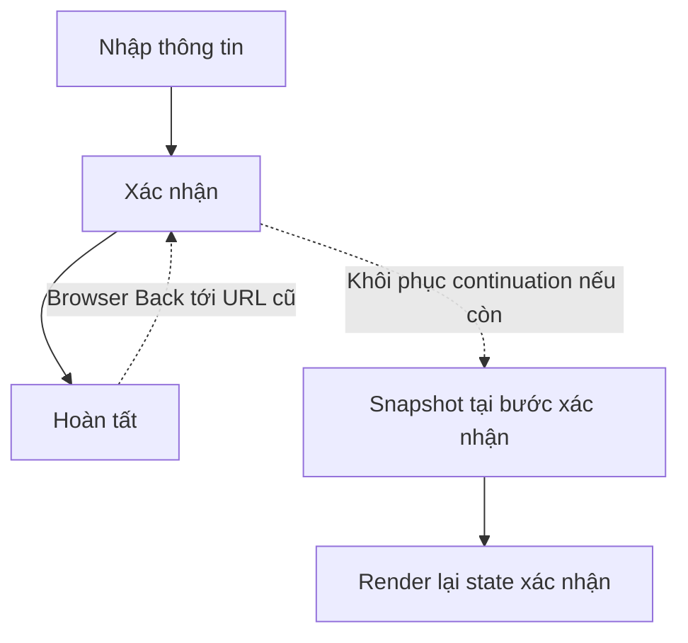

# Quay lại state cũ và dữ liệu đã thay đổi bên ngoài flow

## Bối cảnh và mục tiêu

Bài học thuộc chương **Lịch sử trình duyệt** của module `SPRING_WEB_FLOW`. Spring Web Flow mô hình hóa hành trình web nhiều bước bằng state, event, transition và subflow. Trong một wizard như đặt lịch, đăng ký hoặc thanh toán, người dùng có thể bấm Back của trình duyệt để quay lại màn hình trước, mở lại một trang đã xem hoặc gửi lại một request. Hành vi này liên quan đến lịch sử điều hướng của trình duyệt và khả năng khôi phục flow execution.

Một điểm dễ hiểu sai là cho rằng khi trình duyệt quay lại state cũ thì toàn bộ hệ thống cũng quay lại trạng thái trước đó. Thực tế, Spring Web Flow có thể khôi phục một snapshot của flow execution, nhưng snapshot đó không hoàn tác giao dịch cơ sở dữ liệu, không đảo ngược lời gọi dịch vụ bên ngoài và không bảo đảm dữ liệu nghiệp vụ vẫn còn đúng như lúc snapshot được tạo. Trong lúc người dùng rời màn hình, giá, tồn kho, quyền truy cập hoặc trạng thái đặt chỗ có thể đã thay đổi.

Sau bài học, bạn có thể:

- Phân biệt nút Back của trình duyệt với transition quay lại do flow định nghĩa.
- Giải thích continuation và snapshot hỗ trợ khôi phục flow execution như thế nào.
- Nhận diện dữ liệu trong flow snapshot và dữ liệu sống bên ngoài flow.
- Xử lý dữ liệu đã thay đổi khi người dùng quay lại màn hình cũ.
- Ngăn submit lặp và tác dụng phụ bị thực hiện nhiều lần.
- Thiết kế kiểm thử cho Back, Forward, refresh, nhiều tab và xung đột dữ liệu.

## 1. Hai loại “quay lại” có ý nghĩa khác nhau

Trong một flow nhiều bước, người dùng có thể quay lại bằng hai cách:

**Nút Back của trình duyệt** di chuyển tới một entry trước đó trong browser history. Trình duyệt có thể tải lại URL cũ, dùng nội dung cache hoặc gửi lại request tùy cách trang được tạo và hành vi của trình duyệt. Nếu URL chứa thông tin nhận diện một continuation cũ và snapshot tương ứng vẫn còn trong flow execution repository, Spring Web Flow có thể khôi phục trạng thái flow tại thời điểm đó.

**Transition quay lại do flow định nghĩa** là một event nghiệp vụ hoặc điều hướng được ứng dụng xử lý, ví dụ event `back` từ state xác nhận về state chỉnh sửa. Flow có thể thực hiện action trước khi chuyển state: tải lại giá, xóa lựa chọn không còn hợp lệ, tính lại phí hoặc hiển thị thông báo rằng dữ liệu đã thay đổi.

| Tiêu chí | Browser Back | Transition quay lại của flow |
| --- | --- | --- |
| Ai điều khiển | Trình duyệt | Định nghĩa flow và ứng dụng |
| Cách hoạt động | Đi tới entry trước trong lịch sử trình duyệt | Gửi event và thực hiện transition đã khai báo |
| Có thể khôi phục state cũ | Có, nếu URL/continuation và snapshot còn hợp lệ | Flow chuyển tới state đích theo logic hiện tại |
| Có thể chạy logic nghiệp vụ | Không nên giả định sẽ chạy một transition cụ thể | Có thể khai báo action và kiểm tra dữ liệu rõ ràng |
| Có hoàn tác database hoặc dịch vụ ngoài | Không | Không tự động; cần logic nghiệp vụ riêng |
| Kiểm soát thông báo và nhánh lỗi | Hạn chế, phụ thuộc request được khôi phục | Chủ động khai báo trong flow |

Nút Back là một hành động điều hướng của trình duyệt, không phải lệnh rollback. Nếu nghiệp vụ yêu cầu người dùng quay lại để sửa thông tin, nên cung cấp nút “Quay lại” của ứng dụng gắn với event và transition cụ thể. Trình duyệt Back vẫn có thể được sử dụng, vì vậy ứng dụng cần xử lý an toàn cả hai đường đi.

## 2. Flow execution snapshot và continuation

Spring Web Flow quản lý tiến trình của một flow thông qua flow execution. Khi flow đi qua các state và tạm dừng để render view, framework có thể lưu snapshot của execution. Một continuation đại diện cho một điểm có thể khôi phục trong lịch sử thực thi. URL của flow thường mang thông tin nhận diện execution và continuation để request tiếp theo có thể tiếp tục đúng tiến trình.

Mô hình khái quát:

1. Người dùng khởi chạy flow; framework tạo flow execution.
2. Flow xử lý state và event, sau đó tạm dừng ở một điểm render view.
3. Execution repository lưu trạng thái có thể khôi phục và tạo continuation key tương ứng.
4. Trình duyệt nhận URL của flow execution tại điểm đó.
5. Người dùng tiếp tục hành trình; flow tiến tới state mới và có thể tạo snapshot tiếp theo.
6. Nếu người dùng quay lại URL chứa continuation cũ, repository có thể khôi phục snapshot tương ứng nếu snapshot vẫn còn và execution còn hợp lệ.

Ví dụ hành trình:



Sơ đồ mô tả việc quay lại một điểm thực thi trước đó. Việc khôi phục snapshot chỉ khôi phục trạng thái thuộc flow execution được lưu tại thời điểm đó. Nó không đưa hệ thống bên ngoài về trạng thái cũ.

### Snapshot lưu những gì?

Snapshot phục vụ việc khôi phục trạng thái runtime của flow, có thể bao gồm state hiện tại, flow session, các scope và dữ liệu flow cần thiết để tiếp tục. Phạm vi chính xác phụ thuộc phiên bản, execution repository, snapshot factory và cấu hình ứng dụng.

Không nên coi snapshot là bản sao của toàn bộ hệ thống. Ví dụ, nếu flowScope giữ một mã đặt chỗ và một giá đã đọc trước đó, snapshot có thể khôi phục các giá trị đó. Nhưng snapshot không tự khôi phục:

- Số lượng tồn kho trong database.
- Trạng thái thanh toán ở cổng thanh toán.
- Quyền của người dùng vừa bị thu hồi.
- Giá sản phẩm vừa được cập nhật.
- Một chỗ hẹn đã được người khác đặt.
- Email hoặc thông báo đã gửi.
- Một giao dịch đã commit.

Đây là ranh giới quan trọng giữa trạng thái điều khiển của flow và trạng thái nghiệp vụ bên ngoài.

### Giới hạn số snapshot

Execution repository thường có chính sách giới hạn số snapshot/continuation được giữ lại để kiểm soát bộ nhớ và chi phí lưu trữ. Nếu một continuation cũ đã bị loại bỏ, URL cũ có thể không còn khôi phục được. Execution cũng có thể không còn hợp lệ do timeout, session hết hạn hoặc flow đã kết thúc.

Không nên phụ thuộc vào một số lượng snapshot mặc định mà không kiểm tra cấu hình và phiên bản đang dùng. Khi thiết kế ứng dụng, hãy xác định người dùng cần quay lại bao xa, lưu lượng request dự kiến, dung lượng snapshot và thời gian tồn tại của execution. Nếu người dùng quay lại một continuation không còn tồn tại, ứng dụng cần hiển thị thông báo có thể hiểu và hướng dẫn bắt đầu lại hoặc tiếp tục từ một điểm hợp lệ.

## 3. Vì sao dữ liệu ở state cũ có thể đã lỗi thời?

Giả sử người dùng đang đặt một phòng khách sạn:

1. Người dùng chọn phòng và thấy giá 2.000.000 đồng.
2. Flow chuyển sang màn hình xác nhận; giá và thông tin phòng được giữ trong flowScope.
3. Người dùng mở tab khác hoặc rời trang một lúc.
4. Một người khác đặt phòng cuối cùng, hoặc giá được cập nhật.
5. Người dùng bấm Back và nhìn thấy snapshot cũ.

Nếu ứng dụng dùng ngay giá trong snapshot để xác nhận đơn, có thể tạo ra đơn với giá không còn được chấp nhận hoặc xác nhận một phòng đã hết chỗ. Snapshot chỉ chứng minh flow từng có dữ liệu đó; nó không chứng minh dữ liệu còn đúng tại thời điểm hiện tại.

Các loại dữ liệu thường thay đổi bên ngoài flow:

| Dữ liệu | Điều có thể thay đổi | Rủi ro khi dùng snapshot cũ |
| --- | --- | --- |
| Giá và khuyến mãi | Giá hết hiệu lực, mã giảm giá bị thu hồi | Xác nhận sai giá hoặc áp dụng ưu đãi không còn hợp lệ |
| Tồn kho và lịch đặt | Sản phẩm hết hàng, khung giờ bị người khác giữ | Tạo giao dịch vượt số lượng hoặc trùng lịch |
| Quyền truy cập | Vai trò hoặc quyền của người dùng thay đổi | Cho phép tiếp tục thao tác không còn được cấp quyền |
| Trạng thái hồ sơ | Hồ sơ bị khóa, xác minh hoặc cập nhật ở nơi khác | Hiển thị dữ liệu cũ hoặc cho phép hành động sai |
| Thanh toán | Giao dịch đã được xử lý ở cổng thanh toán | Gửi yêu cầu thanh toán lần nữa |
| Hạn mức và hạn chót | Hạn mức bị dùng hết, thời gian đăng ký kết thúc | Chấp nhận thao tác đã hết điều kiện |
| Dữ liệu tham chiếu | Danh mục, tỷ giá hoặc chính sách thay đổi | Tính toán kết quả theo quy tắc cũ |

Không phải mọi dữ liệu đều cần tải lại mỗi lần render. Hãy phân loại dữ liệu theo mức độ biến động và hậu quả nếu dùng dữ liệu cũ. Dữ liệu hiển thị ít rủi ro có thể được giữ để người dùng tham khảo; dữ liệu quyết định quyền, giá, tồn kho hoặc giao dịch phải được kiểm tra lại tại điểm thực hiện nghiệp vụ.

## 4. Phân biệt dữ liệu của flow và dữ liệu sống bên ngoài

Một cách thiết kế hữu ích là lưu ID và lựa chọn của người dùng trong flow, còn dữ liệu có thể thay đổi được tải lại từ service khi cần.

Ví dụ, flowScope giữ:

- `bookingId` hoặc `productId`.
- Các lựa chọn người dùng đã nhập.
- Phiên bản dữ liệu mà người dùng đã xác nhận.
- Mã tương quan hoặc idempotency key cho thao tác nghiệp vụ.
- Kết quả tạm thời cần thiết để hiển thị lại form.

Khi cần xác nhận, service tải dữ liệu hiện tại từ nguồn có thẩm quyền:

- Giá hiện tại và điều kiện khuyến mãi.
- Tồn kho hoặc khả năng đặt chỗ.
- Quyền hiện tại của người dùng.
- Trạng thái giao dịch và trạng thái hồ sơ.
- Version hiện tại của bản ghi.

Ví dụ, thay vì giữ toàn bộ entity trong flowScope rồi tin rằng entity đó luôn mới, flow chỉ giữ ID và version:

```java
public class BookingSelection {
    private Long bookingId;
    private Long expectedVersion;
    private String idempotencyKey;

    // getters và setters
}
```

Khi người dùng xác nhận, service tải bản ghi mới nhất và kiểm tra các điều kiện trước khi ghi:

```java
@Transactional
public ConfirmationResult confirm(
        Long bookingId,
        Long expectedVersion,
        String idempotencyKey) {

    ConfirmationResult previous =
            confirmationRepository.findByIdempotencyKey(idempotencyKey);

    if (previous != null) {
        return previous;
    }

    Booking booking = bookingRepository.findByIdForUpdate(bookingId)
            .orElseThrow(BookingNotFoundException::new);

    if (!booking.isOpen()) {
        throw new BookingNoLongerAvailableException();
    }

    if (!booking.getVersion().equals(expectedVersion)) {
        throw new BookingChangedException();
    }

    // Kiểm tra giá, quyền, tồn kho và điều kiện hiện tại.
    // Ghi nhận xác nhận trong cùng ranh giới giao dịch phù hợp.
    return confirmationService.confirm(booking, idempotencyKey);
}
```

Đây là ví dụ minh họa. Tên repository và cách khóa bản ghi tùy kiến trúc ứng dụng. Điểm quan trọng là kiểm tra dữ liệu hiện tại và ghi kết quả theo một giao dịch nhất quán; không chỉ kiểm tra ở lúc render màn hình xác nhận.

## 5. Thiết kế transition khi người dùng quay lại

Nếu người dùng dùng nút quay lại của ứng dụng, flow có thể định nghĩa một transition rõ ràng và chạy action cần thiết trước khi render state trước.

Ví dụ:

```xml
<view-state id="confirmBooking" view="booking/confirm">
    <transition on="back" to="editBooking" validate="false">
        <evaluate expression="bookingService.refreshSelection(flowScope.bookingId)"
                  result="flowScope.currentBooking"/>
    </transition>

    <transition on="confirm" to="completed">
        <evaluate expression="bookingService.confirm(flowScope.bookingId,
                         flowScope.expectedVersion,
                         flowScope.idempotencyKey)"
                  result="flowScope.confirmationResult"/>
    </transition>
</view-state>
```

Trong ví dụ, event `back` là event của ứng dụng. Action tải lại dữ liệu trước khi chuyển về state chỉnh sửa. Event `confirm` gọi service để kiểm tra và xác nhận theo dữ liệu hiện tại.

Có thể dùng cách khác tùy nghiệp vụ:

- Tải lại dữ liệu hiện tại và điền lại form.
- Giữ các giá trị người dùng đã nhập nhưng hiển thị cảnh báo rằng giá hoặc trạng thái đã thay đổi.
- Đưa người dùng tới một state giải quyết xung đột.
- Yêu cầu người dùng xác nhận lại sau khi xem dữ liệu mới.
- Hủy lựa chọn đã hết hiệu lực và yêu cầu chọn lại.

Điều quan trọng là phân biệt dữ liệu do người dùng nhập với dữ liệu do hệ thống quyết định. Ví dụ, khi quay lại màn hình đặt phòng, có thể giữ ghi chú người dùng đã nhập nhưng phải tải lại giá và khả năng còn phòng. Không nên ghi đè toàn bộ form một cách máy móc nếu điều đó làm mất nội dung người dùng đang soạn.

### Xử lý xung đột bằng version

Nếu dữ liệu được người khác cập nhật trong lúc flow đang mở, version hoặc timestamp có thể giúp phát hiện xung đột. Khi xác nhận, service so sánh version người dùng đã thấy với version hiện tại:

- Nếu trùng nhau, tiếp tục theo quy tắc nghiệp vụ.
- Nếu khác nhau, không ghi đè âm thầm; trả kết quả xung đột.
- Flow chuyển tới state thông báo thay đổi, hiển thị dữ liệu mới và yêu cầu người dùng quyết định lại.

Đây là cách dùng optimistic locking hoặc kiểm tra version ở tầng nghiệp vụ. Không nên chỉ so sánh ở giao diện vì dữ liệu có thể thay đổi ngay sau khi trang được render.

## 6. Browser Back không hoàn tác tác dụng phụ

Một hành trình nhiều bước có thể thực hiện tác dụng phụ trước khi flow kết thúc: giữ chỗ, tạo hồ sơ, gửi email, gọi cổng thanh toán hoặc cập nhật một bản ghi. Nếu người dùng quay lại một snapshot cũ, những tác dụng phụ đó vẫn có thể đã xảy ra.

Ví dụ:

1. Người dùng bấm “Thanh toán”.
2. Ứng dụng gửi yêu cầu tới cổng thanh toán.
3. Cổng thanh toán chấp thuận và giao dịch đã được ghi nhận.
4. Flow chuyển tới màn hình hoàn tất.
5. Người dùng bấm Back về màn hình xác nhận.
6. Người dùng bấm “Thanh toán” lần nữa.

Nếu action thanh toán được gọi lại mà không có bảo vệ, ứng dụng có thể tạo giao dịch trùng. Browser Back không thể hoàn tác giao dịch đầu tiên.

### Dùng idempotency cho thao tác có tác dụng phụ

Một thao tác quan trọng nên có khóa idempotency hoặc mã nghiệp vụ duy nhất. Server lưu kết quả xử lý theo khóa đó. Nếu request lặp lại cùng khóa, service trả kết quả đã có hoặc xử lý theo quy tắc an toàn thay vì thực hiện tác dụng phụ lần nữa.

Khóa nên gắn với một thao tác logic, không chỉ với một HTTP request. Nếu người dùng tạo một giao dịch mới sau khi giao dịch trước bị hủy, thao tác mới cần khóa khác. Không tạo khóa mới mỗi lần browser Back/refresh nếu đó vẫn là cùng một thao tác xác nhận.

Các thao tác thường cần idempotency:

- Thu tiền hoặc yêu cầu hoàn tiền.
- Tạo đơn hàng hoặc đặt lịch.
- Giữ hoặc trừ tồn kho.
- Gửi thông báo có tính nghiệp vụ.
- Gửi lệnh tới hệ thống bên ngoài.

Với email hoặc thông báo, có thể lưu trạng thái gửi và mã sự kiện nghiệp vụ để tránh gửi trùng khi action bị chạy lại.

### Khi cần hoàn tác nghiệp vụ

Nếu người dùng có thể hủy sau khi đã thực hiện một tác dụng phụ, hãy thiết kế một hành động nghiệp vụ riêng: hủy đơn, giải phóng chỗ giữ, void hoặc refund giao dịch theo chính sách. Không dùng browser Back như cơ chế hủy. Các thao tác bù trừ có thể thất bại hoặc cần xử lý bất đồng bộ, vì vậy cần trạng thái rõ ràng như `cancellationPending`, `cancelled` hoặc `refundPending`.

## 7. Refresh, Forward và gửi lại request

Browser Back không phải tình huống duy nhất có thể đưa người dùng về một URL cũ.

| Hành vi | Điều có thể xảy ra | Cách thiết kế |
| --- | --- | --- |
| Back | Trình duyệt mở URL/entry trước; flow có thể khôi phục continuation cũ | Kiểm tra dữ liệu sống trước hành động quan trọng; cung cấp transition quay lại rõ ràng |
| Forward | Trình duyệt quay lại entry ở phía trước | Xác minh execution/continuation còn hợp lệ và không lặp tác dụng phụ |
| Refresh | Tải lại URL hiện tại; tùy request có thể chỉ render lại hoặc gửi lại POST | Dùng cơ chế redirect sau xử lý phù hợp và idempotency cho thao tác ghi |
| Mở link trong tab mới | Có thể tiếp tục cùng execution hoặc tạo một luồng khác tùy URL | Xác định rõ chính sách nhiều tab và execution key |
| Double click | Hai request có thể đến gần như đồng thời | Chặn submit trùng ở UI và bảo vệ ở server bằng idempotency/transaction |
| Khôi phục tab sau khi đóng trình duyệt | Trình duyệt có thể khôi phục URL cũ nhưng session hoặc snapshot đã hết hạn | Hiển thị trạng thái hết hạn và hướng dẫn bắt đầu lại |

Post/Redirect/Get (PRG) là một mẫu hữu ích để giảm việc trình duyệt gửi lại POST khi người dùng refresh sau khi xử lý form. Trong một flow, cần hiểu cách Spring Web Flow tạo flow execution URL và redirect khi pause theo cấu hình cụ thể; không áp dụng PRG một cách máy móc nếu làm mất continuation hoặc event cần thiết. Dù dùng redirect, thao tác ghi vẫn cần idempotency vì request có thể bị gửi lại từ nhiều nguồn khác nhau.

## 8. Nhiều tab và nhiều continuation

Một người dùng có thể mở cùng flow ở nhiều tab. Mỗi tab có thể giữ một URL chứa execution key/continuation riêng. Tuy nhiên, các tab thường chia sẻ HttpSession. Nếu ứng dụng lưu dữ liệu nghiệp vụ của wizard vào một session attribute cố định, hai tab có thể ghi đè dữ liệu của nhau.

Nên:

- Giữ dữ liệu riêng của mỗi hành trình trong flowScope của execution tương ứng.
- Không dùng một session key như `currentOrder` cho tất cả wizard.
- Nếu dữ liệu cần dùng chung giữa các flow session trong cùng một execution, cân nhắc conversationScope và xác định rõ quyền sở hữu.
- Không dùng conversationScope để chia sẻ giữa hai execution độc lập.
- Kiểm tra dữ liệu nghiệp vụ bằng version và idempotency ở service.
- Kiểm thử hai tab gửi request đồng thời, kể cả trường hợp cùng xác nhận một tài nguyên.

Nếu một tab quay lại continuation cũ trong khi tab khác đã cập nhật dữ liệu hoặc hoàn tất nghiệp vụ, flow cần phát hiện trạng thái hiện tại và hiển thị kết quả phù hợp. Snapshot của tab thứ nhất không có quyền ghi đè trạng thái mới của hệ thống.

## 9. Snapshot, serialization và dữ liệu trong flowScope

Dữ liệu trong flowScope hoặc viewScope có thể được giữ trong snapshot để khôi phục execution. Vì vậy, cần xem xét kích thước, khả năng serialize và tính ổn định của object được lưu.

Không nên giữ lâu trong flow scope:

- `HttpServletRequest`, `HttpServletResponse` hoặc stream.
- JDBC connection, Hibernate Session hoặc đối tượng gắn với request.
- Entity đang được quản lý bởi persistence context.
- Object rất lớn hoặc chứa tham chiếu vòng phức tạp.
- Cache dữ liệu bên ngoài mà không có cơ chế kiểm tra freshness.

Ưu tiên lưu ID, version, DTO nhỏ và lựa chọn người dùng. Khi cần dữ liệu mới, gọi service để tải lại. Nếu phải lưu một object có thể thay đổi, xác định cách serialize, version hóa và kiểm tra tính hợp lệ khi restore.

Khi snapshot được khôi phục, không nên giả định mọi dependency ngoài flow cũng được khôi phục. Spring bean, service và database vẫn là tài nguyên hiện tại của ứng dụng. Flow nên gọi service ở thời điểm cần để lấy trạng thái mới nhất, thay vì lưu tham chiếu tới tài nguyên runtime.

## 10. Kiểm thử browser history và dữ liệu thay đổi bên ngoài

Kiểm thử cần bao phủ cả khôi phục snapshot và tính đúng đắn của dữ liệu nghiệp vụ. Một số tình huống quan trọng:

| Ca kiểm thử | Cách thực hiện | Điều cần xác minh |
| --- | --- | --- |
| Back về state trước | Đi từ nhập liệu tới xác nhận, sau đó dùng Back | Continuation cũ được khôi phục nếu snapshot còn; state hiển thị đúng |
| Back sau khi dữ liệu ngoài thay đổi | Cập nhật giá hoặc trạng thái bản ghi ở service rồi quay lại | Ứng dụng không coi snapshot là dữ liệu nghiệp vụ mới nhất |
| Transition back của ứng dụng | Phát event `back` | Action refresh chạy theo thiết kế và flow đi tới state đích |
| Continuation hết hạn | Dùng URL cũ sau khi snapshot bị loại bỏ hoặc execution hết hạn | Ứng dụng hiển thị hướng xử lý thay vì lỗi kỹ thuật khó hiểu |
| Forward | Đi Back rồi Forward | Flow không thực hiện lại tác dụng phụ ngoài ý muốn |
| Refresh sau submit | Refresh trang kết quả của thao tác ghi | Không tạo đơn/giao dịch trùng |
| Double submit | Gửi hai request xác nhận gần như đồng thời | Chỉ có một thao tác logic được ghi nhận |
| Version conflict | Cập nhật bản ghi từ execution khác trước khi xác nhận | Service phát hiện xung đột và flow yêu cầu người dùng xử lý |
| Hai tab | Mở hai execution trong cùng HttpSession | Dữ liệu flow không bị trộn; xung đột nghiệp vụ được phát hiện |
| Quyền bị thu hồi | Thu hồi quyền sau khi flow đã vào màn hình xác nhận | Service kiểm tra quyền hiện tại trước thao tác nhạy cảm |
| Hủy sau tác dụng phụ | Thực hiện giữ chỗ rồi yêu cầu hủy | Có hành động bù trừ nghiệp vụ riêng, không dựa vào Back |

Khi kiểm thử continuation, cần dùng URL/flow execution key do ứng dụng thực sự sinh ra trong test hoặc môi trường kiểm thử. Không tự tạo key giả định. Cũng cần kiểm thử cấu hình giới hạn snapshot và timeout để hiểu người dùng có thể quay lại trong khoảng thời gian nào.

## 11. Quy trình xử lý khi người dùng báo Back hiển thị dữ liệu cũ

Khi nhận báo cáo rằng người dùng quay lại một bước và thấy dữ liệu cũ, hãy điều tra theo thứ tự:

1. Ghi lại flow ID, execution key/continuation, state và request URL liên quan; không ghi dữ liệu cá nhân nhạy cảm.
2. Xác định người dùng dùng browser Back/Forward, refresh hay event quay lại trong giao diện.
3. Kiểm tra continuation có khôi phục snapshot cũ hay request chỉ render lại nội dung cache của trình duyệt.
4. Xác định dữ liệu nào đến từ flow scope và dữ liệu nào được tải từ database/service.
5. Kiểm tra thời điểm dữ liệu bên ngoài thay đổi so với thời điểm snapshot được tạo.
6. Kiểm tra action xác nhận có tải lại dữ liệu và kiểm tra version/quyền/tồn kho hiện tại không.
7. Kiểm tra thao tác có tác dụng phụ có idempotency key hoặc cơ chế chống lặp không.
8. Kiểm tra execution repository còn snapshot cần thiết và timeout/giới hạn snapshot có phù hợp không.
9. Bổ sung test tái hiện đúng chuỗi Back/Forward/refresh và thay đổi dữ liệu bên ngoài.

Cách điều tra này giúp phân biệt lỗi restore snapshot với lỗi stale data, lỗi cache của trình duyệt hoặc lỗi service không kiểm tra lại trạng thái hiện tại.

## 12. Checklist thiết kế

- [ ] Phân biệt rõ browser Back với transition quay lại của flow.
- [ ] Hiểu execution repository và chính sách lưu snapshot/continuation của phiên bản đang dùng.
- [ ] Xác định dữ liệu nào thuộc flow snapshot và dữ liệu nào phải tải lại từ service.
- [ ] Không xem việc restore snapshot là rollback database hoặc dịch vụ ngoài.
- [ ] Tải lại và xác thực giá, tồn kho, quyền và trạng thái tại thời điểm xác nhận.
- [ ] Dùng version/optimistic locking để phát hiện dữ liệu đã thay đổi.
- [ ] Dùng idempotency cho thanh toán, tạo đơn, đặt chỗ và tác dụng phụ có thể bị gửi lặp.
- [ ] Thiết kế hành động hủy/compensation riêng nếu nghiệp vụ cần hoàn tác.
- [ ] Có nhánh xử lý continuation hết hạn hoặc không còn snapshot.
- [ ] Không lưu request, response, connection hoặc entity runtime không phù hợp trong flow scope.
- [ ] Kiểm thử Back, Forward, refresh, double submit và nhiều tab.
- [ ] Thông báo rõ cho người dùng khi dữ liệu đã thay đổi và cần xác nhận lại.

## 13. Bài tập thực hành

Xây dựng flow đặt lịch gồm ba state: chọn khung giờ, xác nhận và hoàn tất. Khi người dùng chọn giờ, flow lưu `slotId` và `expectedVersion` trong flowScope. Trước khi xác nhận, một người dùng khác có thể đặt cùng khung giờ.

1. Mô phỏng việc người dùng đi từ state chọn giờ tới state xác nhận, sau đó bấm browser Back.
2. Giải thích dữ liệu nào được khôi phục từ flow snapshot và dữ liệu nào phải tải lại từ service.
3. Cập nhật trạng thái khung giờ từ một execution khác rồi quay lại màn hình xác nhận.
4. Thiết kế service xác nhận có kiểm tra khả dụng và version hiện tại.
5. Nếu version thay đổi, đưa flow tới state thông báo xung đột và yêu cầu người dùng chọn giờ khác.
6. Thêm idempotency key để double click hoặc refresh không tạo hai lượt đặt.
7. Tạo transition `back` của ứng dụng và so sánh với browser Back.
8. Kiểm thử continuation hết hạn, Forward, hai tab và thao tác hủy sau khi đã giữ chỗ.

**Tiêu chí hoàn thành:** người học giải thích được continuation snapshot khôi phục điều gì và không khôi phục điều gì; phân biệt browser Back với flow transition; phát hiện được dữ liệu bên ngoài đã thay đổi; và thiết kế được xác nhận an toàn trước dữ liệu stale cùng request lặp.

## Kết luận

Spring Web Flow có thể dùng snapshot và continuation để hỗ trợ khôi phục một điểm thực thi trước đó khi người dùng điều hướng bằng lịch sử trình duyệt. Việc này chỉ khôi phục trạng thái của flow theo repository; nó không hoàn tác database, giao dịch thanh toán hay thay đổi ở hệ thống bên ngoài. Ứng dụng cần kiểm tra lại dữ liệu sống ở thời điểm xác nhận, phát hiện xung đột bằng version, bảo vệ tác dụng phụ bằng idempotency và cung cấp transition quay lại có kiểm soát. Khi đó, người dùng có thể quay lại hoặc tiếp tục hành trình mà không làm dữ liệu nghiệp vụ bị sai lệch hay thao tác bị thực hiện lặp.

