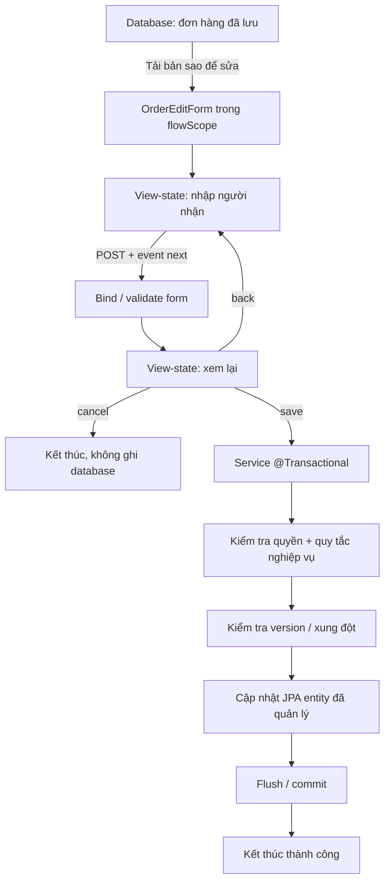
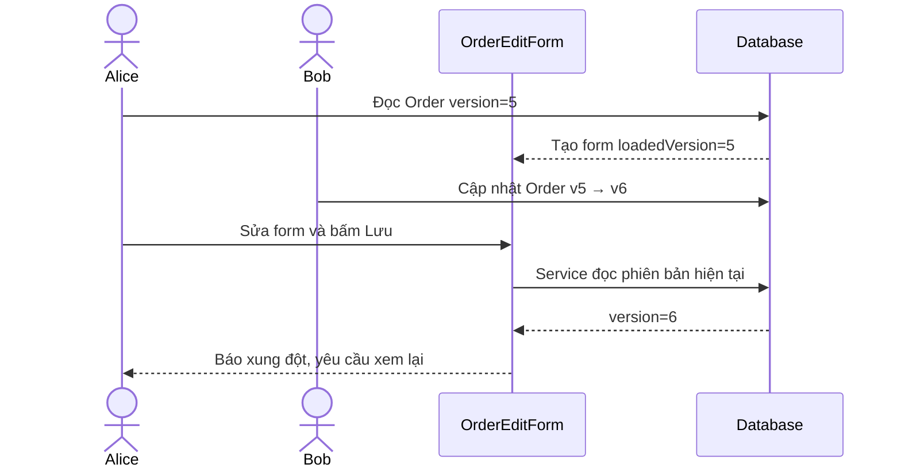

# Tách trạng thái biểu mẫu khỏi dữ liệu đã lưu trong Spring Web Flow

Trong ứng dụng có nhiều màn hình nhập liệu, người dùng thường sửa dữ liệu qua một vài bước, quay lại điều chỉnh, kiểm tra bản xem trước rồi mới bấm **Lưu** hoặc **Xác nhận**. Các thao tác trước bước cuối là **trạng thái đang chỉnh sửa**, chưa nhất thiết là dữ liệu nghiệp vụ đã được chấp nhận và lưu trong cơ sở dữ liệu.

Với **Spring Web Flow** (`SPRING_WEB_FLOW`), một `flow execution` có thể giữ trạng thái biểu mẫu qua nhiều `view-state`, nhận `event`, thực hiện `transition` và gọi `subflow` khi cần. Tuy nhiên, việc Web Flow giữ được dữ liệu giữa các request không đồng nghĩa với việc dữ liệu đã được commit trong database. Đây là điểm cốt lõi của chương **Dữ liệu và giao dịch**: cần **tách form model của hành trình khỏi thực thể dữ liệu đã lưu**, đồng thời đặt việc cập nhật thật sự vào ranh giới giao dịch rõ ràng.

Sau bài học, bạn có thể:

- Phân biệt dữ liệu từ trình duyệt, form model của flow, đối tượng nghiệp vụ và bản ghi đã commit.
- Thiết kế `view-state` bind vào DTO/form model thay vì bind trực tiếp vào JPA entity đang quản lý.
- Tải dữ liệu ban đầu khi launch, giữ thay đổi tạm trong `flowScope`, và chỉ ghi database ở hành động lưu được xác nhận.
- Đặt `@Transactional` ở service, kiểm tra quyền, validation, phiên bản dữ liệu và xử lý rollback.
- Phân biệt dữ liệu flow được lưu/khôi phục với transaction database, nhất là khi người dùng quay lại, mở nhiều tab hoặc gặp xung đột cập nhật.

## 1. Ba dạng trạng thái cần tách biệt

Hãy xét luồng chỉnh sửa một đơn hàng gồm ba màn hình: sửa người nhận, xem lại thông tin, xác nhận lưu. Tại thời điểm người dùng đổi tên người nhận từ “An” thành “Bình”, hệ thống có thể đang tồn tại ba trạng thái khác nhau:

| Loại trạng thái | Nơi tồn tại chủ yếu | Ví dụ | Có phải dữ liệu đã commit? |
| --- | --- | --- | --- |
| Dữ liệu request | Tham số HTTP hoặc nội dung POST từ trình duyệt | `recipient=Bình` | **Chưa**; đầu vào vẫn phải bind và kiểm tra |
| Dữ liệu biểu mẫu của flow | `OrderEditForm` trong `flowScope` hoặc scope phù hợp | `form.recipient = "Bình"` | **Chưa**; đây là bản người dùng đang sửa |
| Dữ liệu nghiệp vụ đã lưu | Database thông qua repository/service | `orders.recipient = "An"` | **Có**; đây là trạng thái đã ghi nhận trước đó |

Nếu người dùng bấm **Hủy**, dữ liệu trong form có thể bị bỏ mà database vẫn giữ “An”. Nếu bấm **Lưu**, service nhận dữ liệu đã được kiểm tra, cập nhật bản ghi trong một transaction và commit. Chỉ sau khi commit thành công, giá trị đã lưu mới trở thành “Bình”.



**Nguyên tắc:** `flowScope` là nơi giữ **trạng thái hội thoại của người dùng**; database là nơi giữ **sự thật nghiệp vụ đã commit**. Hai nguồn này có thể khác nhau trong suốt hành trình chỉnh sửa, và đó là hành vi mong muốn.

## 2. Vì sao không bind form trực tiếp vào JPA entity?

Một cách viết có vẻ nhanh là tải `Order` từ repository, đặt nguyên entity vào flow scope rồi dùng `model="order"` để Spring Web Flow bind các field từ request. Cách này gây nhiều rủi ro:

1. **Ghi nhầm dữ liệu quá sớm:** nếu entity còn được quản lý trong persistence context, chỉnh thuộc tính có thể được cơ chế dirty checking ghi xuống database tại một lần flush/commit không như người dùng mong đợi.
2. **Mass assignment:** nếu binding không giới hạn thuộc tính, request có thể cố gắng gán trường nhạy cảm như `status`, `totalPrice`, `ownerId` hoặc `approved`, dù giao diện không hiển thị các trường đó.
3. **Entity bị detached:** transaction đọc dữ liệu thường kết thúc trước request kế tiếp; entity giữ trong flow có thể không còn được quản lý, các lazy association có thể không truy cập được.
4. **Khó khôi phục execution:** tùy repository, Web Flow phải lưu/snapshot/serialize trạng thái. Proxy ORM, object graph lớn và quan hệ vòng có thể làm tăng chi phí hoặc gây lỗi.
5. **Dữ liệu cũ và ghi đè:** người khác có thể sửa bản ghi trong lúc người dùng đang đứng ở form. Nếu lưu toàn bộ entity cũ, nguy cơ ghi đè các thay đổi mới là rất lớn.
6. **Hủy không còn ý nghĩa rõ ràng:** nếu mọi chỉnh sửa đã ảnh hưởng entity được quản lý, thao tác “Hủy” trên giao diện có thể không thực sự hủy cập nhật.

Giải pháp cơ bản là tạo **form object/DTO độc lập** chứa đúng những trường người dùng được chỉnh sửa. Khi bắt đầu flow, service chuyển dữ liệu đã lưu thành form model. Khi xác nhận, service tải lại entity mới nhất trong một transaction, kiểm tra điều kiện rồi **chỉ chép những field cho phép** từ form sang entity.

`OrderEditForm` và `Order` có thể có một số thuộc tính trùng tên, nhưng đảm nhiệm hai trách nhiệm khác nhau:

- `OrderEditForm`: lưu giá trị nhập tạm, hiển thị lỗi validation, cho phép quay lại và sửa.
- `Order` (JPA entity): mô tả bản ghi có quan hệ, ràng buộc và vòng đời persistence do tầng dữ liệu quản lý.

Tách biệt này cũng áp dụng khi không dùng JPA: form model không nên kiêm luôn DTO cập nhật trực tiếp của một API hoặc bản ghi domain nếu chưa được kiểm tra ở ranh giới nghiệp vụ.

## 3. Thiết kế một flow chỉnh sửa đơn hàng

Giả sử màn hình `/orders/edit?orderId=42` cho phép sửa **người nhận** và **ghi chú** của đơn hàng. Người dùng có thể chuyển từ màn `edit` sang `review`, quay lại hoặc hủy. Chỉ event `save` mới gọi service ghi database.

### 3.1. Form model dành riêng cho quá trình chỉnh sửa

```java
package com.example.orders;

import java.io.Serializable;

public class OrderEditForm implements Serializable {
    private static final long serialVersionUID = 1L;

    private String recipient;
    private String note;

    // Phiên bản đã đọc khi mở form; không bind từ request.
    private Long loadedVersion;

    public String getRecipient() { return recipient; }
    public void setRecipient(String recipient) { this.recipient = recipient; }

    public String getNote() { return note; }
    public void setNote(String note) { this.note = note; }

    public Long getLoadedVersion() { return loadedVersion; }
    public void setLoadedVersion(Long loadedVersion) {
        this.loadedVersion = loadedVersion;
    }
}
```

`loadedVersion` là thông tin nội bộ dùng phát hiện xung đột dữ liệu. Đây không phải field người dùng được sửa. Có thể thay bằng một object snapshot bất biến do server giữ, nhưng dù dùng thiết kế nào cũng phải hạn chế binding từ request và xác thực đầu vào ở service.

### 3.2. Flow definition

```xml
<?xml version="1.0" encoding="UTF-8"?>
<flow xmlns="http://www.springframework.org/schema/webflow"
      xmlns:xsi="http://www.w3.org/2001/XMLSchema-instance"
      xsi:schemaLocation="http://www.springframework.org/schema/webflow
                          http://www.springframework.org/schema/webflow/spring-webflow-2.0.xsd">

    <input name="orderId" type="java.lang.Long" required="true" />

    <on-start>
        <evaluate expression="orderService.loadEditForm(orderId)"
                  result="flowScope.orderForm" />
    </on-start>

    <view-state id="edit" view="orders/edit" model="orderForm">
        <binder>
            <binding property="recipient" />
            <binding property="note" />
        </binder>

        <transition on="next" to="review" />
        <transition on="cancel" to="cancelled" bind="false" />
    </view-state>

    <view-state id="review" view="orders/review">
        <transition on="back" to="edit" />
        <transition on="save" to="persistEdit" />
        <transition on="cancel" to="cancelled" />
    </view-state>

    <action-state id="persistEdit">
        <evaluate expression="orderService.saveChanges(orderId, orderForm)" />
        <transition on="success" to="saved" />
    </action-state>

    <end-state id="saved" view="orders/saved" />
    <end-state id="cancelled" view="orders/cancelled" />
</flow>
```

Đây là ví dụ cấu trúc dành cho một ứng dụng có bean `orderService`. Nó cần được tích hợp với cấu hình Web Flow/Spring MVC, view và cơ chế validation/exception handling thực tế. Các phương thức `loadEditForm` và `saveChanges` là phương thức **do ứng dụng triển khai**, không phải API của Spring Web Flow.

Trong ví dụ:

| Thành phần | Chức năng |
| --- | --- |
| `<input name="orderId" ... />` | Xác định bản ghi cần sửa khi bắt đầu flow |
| `<on-start>` | Tạo bản sao dữ liệu thành `OrderEditForm` và giữ trong `flowScope` |
| `model="orderForm"` | Sử dụng form object để bind dữ liệu tại view-state `edit` |
| `<binder>` | Giới hạn các thuộc tính được phép nhận từ request |
| Event `next` | Chuyển sang bước xem lại, chưa commit thay đổi |
| Event `back` | Quay lại sửa dữ liệu trong cùng flow execution |
| Event `cancel` | Kết thúc mà không gọi service cập nhật đơn |
| `action-state persistEdit` | Gọi service lưu dữ liệu rồi chuyển tới trạng thái hoàn tất nếu thành công |

Với `<transition on="cancel" bind="false" />`, người dùng có thể hủy mà không cần bind/validate dữ liệu form vừa nhập. Các event thông thường ở `view-state` có thể kích hoạt binding và validation theo cấu hình. Nếu validation không đạt, flow có thể giữ người dùng ở màn hình để sửa lỗi; không được coi dữ liệu đó là đã lưu.

### 3.3. Form gửi event về đúng execution

Ví dụ JSP với Spring form tags:

```jsp
<form:form modelAttribute="orderForm"
           method="post" action="${flowExecutionUrl}">
    <label for="recipient">Người nhận</label>
    <form:input path="recipient" id="recipient" />
    <form:errors path="recipient" />

    <label for="note">Ghi chú</label>
    <form:textarea path="note" id="note" />
    <form:errors path="note" />

    <button type="submit" name="_eventId_next" value="1">
        Xem lại
    </button>
    <button type="submit" name="_eventId_cancel" value="1">
        Hủy
    </button>
</form:form>
```

Ví dụ giả định trang đã khai báo tag library `form` của Spring và cấu hình hiển thị lỗi. `${flowExecutionUrl}` là URL tiếp tục lượt Web Flow hiện tại; các nút `_eventId_next`, `_eventId_cancel` cung cấp event cho state machine. Nếu ứng dụng dùng Spring Security, form POST phải kèm CSRF token theo cơ chế đang bật. **Không** đưa `loadedVersion`, `ownerId` hoặc trạng thái phê duyệt vào các input có thể bind chỉ vì các thuộc tính đó tồn tại trong form/entity.

Trong thực tế, màn `review` cần hiển thị các giá trị một cách an toàn, có escaping phù hợp, và event `save` cũng phải được gửi qua URL tiếp tục đúng execution.

## 4. Service quyết định lúc nào dữ liệu thực sự được lưu

Ranh giới transaction nên nằm ở service nghiệp vụ thay vì kéo dài qua nhiều request của wizard. Phía Web Flow điều phối các state/event; phía service quyết định được phép cập nhật cái gì và cập nhật như thế nào.

```java
@Service
public class OrderService {
    private final OrderRepository orders;

    public OrderService(OrderRepository orders) {
        this.orders = orders;
    }

    @Transactional(readOnly = true)
    public OrderEditForm loadEditForm(Long orderId) {
        Order order = findEditableOrderForCurrentUser(orderId);

        OrderEditForm form = new OrderEditForm();
        form.setRecipient(order.getRecipient());
        form.setNote(order.getNote());
        form.setLoadedVersion(order.getVersion());
        return form;
    }

    @Transactional
    public void saveChanges(Long orderId, OrderEditForm form) {
        Order order = findEditableOrderForCurrentUser(orderId);
        validateEditedFields(form);

        if (!java.util.Objects.equals(
                order.getVersion(), form.getLoadedVersion())) {
            throw new StaleOrderEditException(orderId);
        }

        // Chỉ chép các thuộc tính mà nghiệp vụ cho phép sửa.
        order.setRecipient(form.getRecipient().trim());
        order.setNote(form.getNote());

        // Với JPA entity đang được quản lý, dirty checking theo
        // transaction sẽ đồng bộ thay đổi lúc flush/commit.
    }

    private Order findEditableOrderForCurrentUser(Long id) {
        // Ví dụ: truy vấn bản ghi và kiểm tra chủ sở hữu/quyền sửa.
        // Ném ngoại lệ khi không có quyền hoặc bản ghi không tồn tại.
        throw new UnsupportedOperationException("Triển khai trong ứng dụng");
    }

    private void validateEditedFields(OrderEditForm form) {
        // Ví dụ: bắt buộc người nhận, giới hạn độ dài ghi chú,
        // kiểm tra trạng thái đơn còn cho phép chỉnh sửa.
        throw new UnsupportedOperationException("Triển khai trong ứng dụng");
    }
}
```

Đây là **phác thảo service** để minh họa ranh giới và các kiểm tra. Hai phương thức private có thân placeholder bắt buộc được triển khai trước khi chạy; `OrderRepository`, `Order`, `StaleOrderEditException` cũng là các kiểu của ứng dụng. Một thực thể có thể dùng JPA `@Version` để kiểm soát optimistic locking:

```java
@Entity
public class Order {
    @Id
    private Long id;

    @Version
    private Long version;

    private String recipient;
    private String note;

    // Getter, setter và các quy tắc miền liên quan.
}
```

Ý nghĩa của hai thao tác service:

**`loadEditForm`:** mở transaction chỉ đọc, lấy thông tin được phép xem, chuyển nó thành DTO rồi kết thúc transaction. Sau đó form thuộc Web Flow, độc lập với `EntityManager` vừa dùng để đọc.

**`saveChanges`:** bắt đầu transaction ghi, tải lại entity từ database trong ngữ cảnh hiện tại, kiểm tra quyền, trạng thái nghiệp vụ và phiên bản, sau đó cập nhật các field được phép sửa. Khi transaction commit thành công, dữ liệu mới được ghi nhận. Trong JPA, transaction commit thường kéo theo flush; lỗi do constraint hay optimistic lock cũng có thể bộc lộ ở thời điểm flush/commit.

Với ứng dụng cần bắt lỗi ghi dữ liệu **trước khi phương thức trả về**, có thể chủ động `flush` trong transaction khi phù hợp. Không nên suy ra rằng một lời gọi setter hoặc `save(...)` đồng nghĩa database đã commit thành công. Ở Spring, `@Transactional` có hiệu lực khi lời gọi đi qua proxy/transaction interceptor đúng cách; gọi nội bộ một method `@Transactional` bằng `this.method()` có thể không kích hoạt advice như mong muốn.

## 5. Không mở một database transaction cho toàn bộ wizard

Một hành trình web có thể kéo dài vài phút, thậm chí lâu hơn vì người dùng dừng lại để nhập dữ liệu. Giữ transaction hoặc database connection mở xuyên suốt các thời điểm chờ người dùng thường gây vấn đề:

- Khóa và tài nguyên database bị giữ quá lâu.
- Transaction có thể timeout.
- Persistence context tích lũy dữ liệu cũ.
- Khi một request thất bại hoặc người dùng đóng tab, việc quản lý rollback trở nên phức tạp.

Hãy phân biệt các vòng đời:

| Vòng đời | Đơn vị | Thời lượng điển hình |
| --- | --- | --- |
| HTTP request | Một lần GET/POST | Ngắn, kết thúc khi phản hồi |
| Flow execution | Một lượt chạy state machine | Nhiều request, có thể qua nhiều bước |
| Flow scope | Dữ liệu thuộc một phiên flow | Tồn tại trong quá trình flow session hoạt động |
| Persistence context của JPA | Các entity được quản lý tại một thời điểm | Phụ thuộc cấu hình ORM/transaction |
| Database transaction | Đơn vị đọc/ghi có commit/rollback | Thường ngắn, bao quanh một thao tác service |

Các tính năng lưu/khôi phục `flow execution` của Spring Web Flow không biến toàn bộ wizard thành **một database transaction duy nhất**. Nếu ứng dụng sử dụng một cơ chế flow-managed persistence context, vẫn cần hiểu chính xác cách context được mở/đóng và khi nào transaction ghi được commit. Đừng đồng nhất “entity còn có trong flow” với “entity luôn ở trong transaction” hoặc “đã ghi dữ liệu”.

## 6. Validation có hai tầng khác nhau

Validation trên biểu mẫu giúp người dùng sửa lỗi ngay tại view-state, nhưng chỉ vậy chưa đủ để bảo vệ database.

### 6.1. Binding và validation tại view-state

Ở view-state `edit`, `model="orderForm"` cùng `<binder>` xác định đối tượng nhận dữ liệu và danh sách thuộc tính được phép bind. Có thể kết hợp Bean Validation hoặc validation theo cơ chế Web Flow của dự án để hiển thị lỗi như:

- Người nhận không được để trống.
- Ghi chú không vượt quá số ký tự.
- Chuỗi không hợp lệ về định dạng.

Ví dụ các constraint trên form:

```java
public class OrderEditForm implements java.io.Serializable {
    @jakarta.validation.constraints.NotBlank
    @jakarta.validation.constraints.Size(max = 100)
    private String recipient;

    @jakarta.validation.constraints.Size(max = 500)
    private String note;

    private Long loadedVersion;

    // Getter và setter tương ứng.
}
```

Đây là **biến thể minh họa** của `OrderEditForm` (không đặt trùng một class trong cùng dự án). Annotation ở ví dụ dùng namespace Jakarta Validation; với phiên bản Spring/Bean Validation cũ hơn, dự án có thể sử dụng `javax.validation`. Cần cấu hình validator tương thích để validation thực sự chạy theo lifecycle của `view-state`; chỉ thêm annotation chưa đủ bảo đảm mọi đường cập nhật đều được kiểm tra.

### 6.2. Kiểm tra lại tại service khi lưu

Service phải xác minh các điều kiện mà người dùng không thể tự quyết định:

- Người dùng hiện tại có quyền chỉnh sửa **đúng** đơn hàng này hay không.
- Đơn hàng còn ở trạng thái cho phép sửa không.
- Dữ liệu được gửi có thỏa quy tắc nghiệp vụ ở thời điểm ghi không.
- Phiên bản bản ghi có còn khớp với lúc tải form không.
- Các trường không được phép cập nhật (giá, chủ sở hữu, trạng thái thanh toán...) có được giữ nguyên không.

**Lý do:** người dùng có thể chỉnh sửa request, gọi service bằng một đường khác hoặc dữ liệu đã thay đổi trong lúc form còn mở. Kiểm tra ở giao diện không thay thế kiểm tra tại ranh giới transaction. Hơn nữa, các bản ghi liên quan có thể thay đổi giữa lúc tải form và lúc bấm Lưu.

## 7. Phát hiện xung đột với optimistic locking

Giả sử Alice và Bob đều mở đơn hàng phiên bản `v5`:

1. Alice mở form: `loadedVersion = 5`.
2. Bob sửa đơn rồi lưu: database chuyển thành `v6`.
3. Alice bấm Lưu với dữ liệu lấy từ `v5`.

Nếu cập nhật không kiểm tra xung đột, thay đổi mới của Bob có thể bị ghi đè. Có hai lớp bảo vệ bổ trợ:

**Kiểm tra phiên bản đã đọc:** khi lưu, service so `form.loadedVersion` với `order.version` mới tải từ database. Nếu khác, dừng và báo có thay đổi đồng thời.

**JPA `@Version`:** nếu một transaction khác sửa entity sau khi service đã tải nó, cơ chế optimistic locking của JPA vẫn phát hiện xung đột trong quá trình cập nhật/flush/commit. Vì vậy, kiểm tra thủ công tại thời điểm đầu transaction **không thay thế** `@Version`.



Khi có xung đột, **không** âm thầm chép toàn bộ form cũ lên bản ghi mới. Có thể hiển thị dữ liệu mới nhất, các thay đổi người dùng đang giữ và lựa chọn tải lại/áp dụng lại có kiểm soát. Đặc biệt với giá, tồn kho, thanh toán hay quyền truy cập, hệ thống phải dùng thông tin hiện tại và thực hiện lại kiểm tra nghiệp vụ.

Ngoại lệ optimistic locking hoặc lỗi commit thường không tự biến thành event `on="conflict"` trong Web Flow. Ứng dụng cần quy ước rõ nơi bắt/ánh xạ ngoại lệ, tạo outcome điều hướng hoặc dùng cơ chế exception handling phù hợp. Tránh bắt tất cả lỗi kỹ thuật rồi trả về “Lưu thành công” để người dùng thoát flow.

## 8. Hủy, quay lại và nhiều tab: các ca buộc phải tách trạng thái

### 8.1. Người dùng bấm Hủy

Nếu mọi chỉnh sửa chỉ nằm trong `OrderEditForm`, event `cancel` chỉ cần kết thúc flow hoặc đưa người dùng về danh sách. Transaction ghi chưa xảy ra, vì vậy không cần cố “rollback” một chuỗi thao tác nhập form đã tồn tại qua nhiều request.

Trường hợp nghiệp vụ chủ động lưu **draft xuống database** ở mỗi bước là một thiết kế khác: draft cũng là dữ liệu đã lưu, nhưng phải có trạng thái nghiệp vụ rõ ràng, cơ chế version, TTL/dọn dẹp, phân quyền và hành vi khi hủy. Không được gọi draft đã commit là dữ liệu “chưa lưu” chỉ vì chưa bấm nút cuối cùng.

### 8.2. Người dùng bấm Quay lại

Event `back` chuyển về `edit`; `flowScope.orderForm` vẫn giữ các giá trị vừa nhập. Nếu vào lại view-state làm chạy `<on-entry>`, tránh đặt action **tải form từ database rồi ghi đè tất cả thuộc tính** ở đây, vì nó sẽ xóa lựa chọn vừa chỉnh sửa. Dữ liệu gốc thường nên tải một lần trong `<on-start>`, còn danh mục hỗ trợ hiển thị có thể tải lại theo nhu cầu.

### 8.3. Người dùng mở hai tab

Hai lần launch cùng flow có thể tạo hai execution độc lập, mỗi execution có form và bản version của riêng mình. Khi cả hai cùng sửa một đơn, optimistic locking giúp phát hiện cập nhật đồng thời. Nếu sao chép URL có **cùng execution key** sang hai tab, hai tab có thể thao tác trên **cùng một execution** với lịch sử/snapshot khác nhau; điều này đòi hỏi kiểm tra cơ chế repository, browser history và khả năng resume phù hợp.

Không lưu một form chung dưới khóa `session.setAttribute("orderForm", ...)` cho mọi tab chỉ vì cùng một người dùng: dữ liệu giữa hai lượt chỉnh sửa có thể ghi đè nhau. `flowScope` gắn với từng flow session phù hợp hơn với trường hợp một wizard riêng biệt.

### 8.4. Session hoặc execution hết hạn

Form trong flow scope có thể không còn khôi phục được nếu execution đã hết hạn hoặc khóa không hợp lệ. Ứng dụng cần cung cấp đường bắt đầu lại hoặc khôi phục draft **nếu đã có cơ chế lưu draft riêng**. Không giả định browser còn hiển thị dữ liệu nghĩa là server vẫn giữ form, và không tự động chốt đơn bằng một execution key không còn hợp lệ.

## 9. Đặt trách nhiệm ở đúng tầng

Sự phân chia sau giúp ứng dụng dễ kiểm thử và giảm coupling:

| Tầng | Trách nhiệm chính | Không nên làm |
| --- | --- | --- |
| View (JSP/Thymeleaf...) | Hiển thị model và lỗi, phát event qua execution URL | Quyết định quyền cập nhật, tự xây SQL, lộ dữ liệu nhạy cảm |
| Flow definition | Quản lý state, transition, scope và thời điểm gọi action | Giữ logic nghiệp vụ phức tạp trong expression dài |
| Form/DTO | Giữ các trường có thể chỉnh sửa, constraint trình bày | Đại diện trực tiếp cho entity được JPA quản lý lâu dài |
| Application/domain service | Kiểm tra quyền, validation nghiệp vụ, xử lý transaction, optimistic locking | Tin rằng request luôn hợp lệ vì đã qua view-state |
| Repository/ORM | Tải, cập nhật và quản lý entity/database trong transaction | Dựa vào flow scope để giữ persistence context sống qua nhiều request |

Một lưu đồ đơn giản cho hành động `save`:

```text
Event save
  → action-state persistEdit
    → service @Transactional
      → tải entity hiện tại
      → xác thực quyền/trạng thái/version
      → áp dụng field cho phép
      → flush/commit
        → thành công: đi đến saved
        → thất bại: xử lý lỗi, bảo toàn dữ liệu form nếu có thể
```

Đối với nghiệp vụ có tác dụng phụ không thể đảo ngược như thu tiền hoặc gửi email, giao dịch database và lời gọi bên ngoài có thể không cùng ranh giới commit. Cần thiết kế idempotency, outbox hoặc cơ chế bảo đảm phù hợp ở tầng nghiệp vụ. Đây là lý do event `save` nên gọi một service có hợp đồng rõ ràng thay vì phân tán nhiều side effect vào `<on-entry>`, `<on-render>` hay các trang.

## 10. Kiểm thử sự tách biệt giữa form và database

Kiểm thử tốt cần quan sát cả **state của flow** lẫn **trạng thái database**, thay vì chỉ kiểm tra thông báo hiển thị.

| Ca kiểm thử | Thao tác | Kỳ vọng |
| --- | --- | --- |
| Khởi chạy | Mở `edit` với `orderId=42` hợp lệ | Form nhận dữ liệu ban đầu; chưa có transaction ghi thay đổi |
| Sửa rồi xem lại | Sửa `recipient`, phát event `next` | `review` hiển thị dữ liệu đã sửa; database giữ giá trị cũ |
| Quay lại | Từ `review` phát `back` | `edit` vẫn có giá trị đang sửa, không bị nạp đè |
| Hủy | Phát event `cancel` | Execution kết thúc theo thiết kế; database không đổi |
| Lưu hợp lệ | Phát event `save` | Service cập nhật đúng các field cho phép, commit; trạng thái sau lưu hiển thị chính xác |
| Input không hợp lệ | Gửi `recipient` rỗng/quá dài | Binding/validation/service từ chối, không ghi database |
| Thử mass assignment | Chèn `ownerId` hoặc `status` vào POST | Binder/service không cập nhật trường ngoài danh sách cho phép |
| Không đủ quyền | Đổi `orderId` sang đơn của người khác | Service từ chối, không tiết lộ và không sửa dữ liệu |
| Xung đột phiên bản | Người khác lưu sau khi form mở | Có báo xung đột; dữ liệu mới không bị ghi đè |
| Lỗi khi commit | Vi phạm constraint hoặc lỗi database | Không báo thành công; transaction rollback theo cấu hình |
| Hai execution song song | Mở hai tab riêng sửa hai đơn | Form độc lập, không bị trộn dữ liệu |
| Execution cũ | Submit bằng key đã hết hạn | Xử lý lỗi resume, không thực hiện cập nhật trái ngữ cảnh |

Để kiểm thử:

1. **Unit test service:** mock repository hoặc dùng entity/test fixture để xác nhận chỉ các field cho phép thay đổi; kiểm tra version và quyền.
2. **Integration test với database:** kiểm tra transaction commit/rollback và cơ chế `@Version` bằng những transaction cạnh tranh có kiểm soát.
3. **Flow test:** launch, phát `next`, `back`, `cancel`, `save`; xác nhận state hiện tại và nội dung `flowScope.orderForm`.
4. **Spring MVC/Web Flow integration test:** xác nhận execution URL, CSRF, binding, validation và thông điệp lỗi theo cấu hình thật.

Lưu ý: nếu test method tự được bọc trong một transaction và tự rollback, cần chú ý thời điểm flush/commit để không vô tình bỏ sót các lỗi chỉ xuất hiện khi commit thực tế.

## 11. Những sai lầm thường gặp và cách sửa

| Sai lầm | Hậu quả | Cách sửa |
| --- | --- | --- |
| Đặt JPA entity trong `flowScope` rồi bind mọi thuộc tính | Mass assignment, detached entity, trạng thái khó đoán | Sử dụng DTO/form model riêng và binder giới hạn field |
| Gọi `repository.save` mỗi khi sang màn hình mới | Chưa xác nhận đã ghi database | Đặt ghi dữ liệu ở action `save` hoặc định nghĩa rõ draft |
| Nạp lại form trong `<on-entry>` mỗi lần quay lại | Mất dữ liệu người dùng vừa sửa | Chỉ load gốc khi launch, giữ form xuyên bước |
| Chỉ kiểm tra `@NotBlank` trong view | Bỏ qua kiểm tra quyền và trạng thái nghiệp vụ | Service kiểm tra lại toàn bộ điều kiện trước commit |
| Không kiểm tra version | Có thể ghi đè thay đổi đồng thời | Dùng `loadedVersion` và `@Version` phù hợp |
| Giữ transaction mở khi chờ người dùng | Khóa dài, timeout, khó rollback | Transaction ngắn theo thao tác service |
| Coi lưu execution là lưu dữ liệu nghiệp vụ | Người dùng hiểu nhầm đã commit | Phân biệt flow repository và database |
| Coi việc mở tab mới là tiếp tục execution cũ | Dễ mất hoặc trộn dữ liệu | Mỗi flow có execution key riêng, kiểm tra concurrency |

## 12. Bài tập thực hành

Xây dựng flow `profileUpdate` gồm ba state `editContact`, `review`, `saved`. Người dùng có thể sửa tên hiển thị và số điện thoại, quay lại, hủy hoặc lưu:

1. Tạo `ProfileEditForm` chứa `displayName`, `phone`, `loadedVersion`; không dùng `UserEntity` làm model của `view-state`.
2. Trong `<on-start>`, nhận `userId`, xác thực người dùng hiện tại có quyền và tạo form model trong `flowScope`.
3. Giới hạn binder chỉ nhận `displayName`, `phone`; cấu hình validation hiển thị lỗi trên view.
4. Dùng event `next` và `back` để đi giữa hai màn hình mà không ghi database.
5. Dùng event `cancel` kết thúc flow; xác nhận database giữ dữ liệu cũ.
6. Khi `save`, gọi service `@Transactional`, nạp lại entity, kiểm tra quyền/version, cập nhật field được phép và commit.
7. Mô phỏng hai tab cùng sửa một hồ sơ: một tab lưu trước, tab còn lại phải nhận thông báo xung đột.
8. Viết test chứng minh một POST cố thêm thuộc tính `role=ADMIN` không thể thay đổi quyền của tài khoản.

**Câu hỏi tự đánh giá:**

- Vì sao `flowScope.orderForm.recipient = "Bình"` chưa đồng nghĩa database đã lưu “Bình”?
- Nếu người dùng bấm Hủy, khi nào cần rollback transaction và khi nào chỉ cần bỏ form?
- `@Version` có tác dụng gì nếu một người khác lưu trong thời gian form đang mở?
- Vì sao validator của form không thay thế kiểm tra quyền trong service?
- Nếu form có `loadedVersion`, vì sao vẫn cần hạn chế binder và kiểm tra version tại transaction ghi?
- Một Web Flow execution tồn tại qua nhiều request có đồng nghĩa một database transaction cũng tồn tại lâu như vậy không?

## Ghi nhớ

Trong Spring Web Flow, **trạng thái biểu mẫu là bản nháp của một hành trình**, còn **dữ liệu đã lưu là kết quả của một thao tác nghiệp vụ được commit**. Hãy để form model/DTO tồn tại trong scope phù hợp qua các state, bind các field có chủ đích, và chỉ gọi service ghi dữ liệu tại event xác nhận. Service phải tải lại entity hiện tại, kiểm tra quyền, validation nghiệp vụ và xung đột phiên bản trong transaction ngắn. Thiết kế này giúp nút Hủy thực sự có ý nghĩa, việc quay lại không làm mất dữ liệu, nhiều tab ít gây ghi đè hơn và các lỗi transaction được xử lý tại đúng ranh giới.
