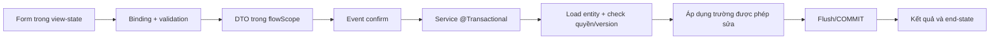
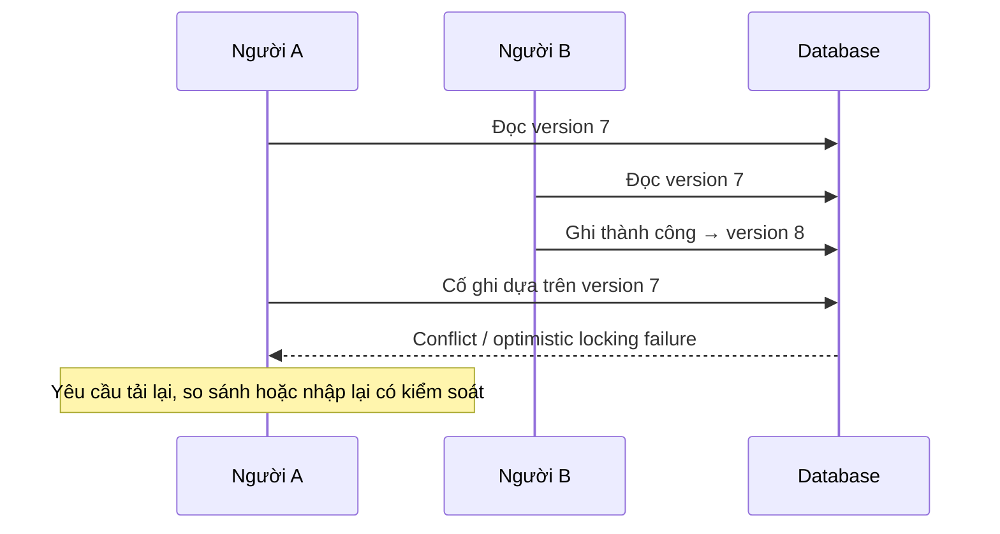

# Lưu qua tầng service và làm việc với đối tượng tách rời trong Spring Web Flow

## Mục tiêu bài học

Spring Web Flow mô hình hóa một hành trình web nhiều bước bằng **state**, **event**, **transition** và **subflow**. Người dùng có thể nhập dữ liệu, xem lại rồi mới xác nhận lưu. Giữa những bước đó, mỗi lần trình duyệt gửi yêu cầu thường là **một HTTP request khác nhau**. Vì vậy, một câu hỏi quan trọng khi làm việc với dữ liệu và giao dịch là:

> Khi flow giữ dữ liệu qua nhiều màn hình, liệu entity JPA còn được quản lý bởi `EntityManager` ở request tiếp theo? Khi nào nên ghi dữ liệu vào database, và ghi bằng cách nào cho an toàn?

Bài này tập trung vào **lưu dữ liệu qua tầng service** và **xử lý entity đã tách khỏi persistence context** (*detached entity*). Sau bài học, bạn sẽ:

- Phân biệt vòng đời **flow execution** với vòng đời **JPA persistence context** và **database transaction**.
- Hiểu vì sao một entity được giữ trong `flowScope` có thể trở thành **detached** sau khi service kết thúc.
- Thiết kế giải pháp ưu tiên **form/command DTO → service giao dịch → nạp lại entity → cập nhật và commit**.
- Biết cách dùng `EntityManager.merge(...)` khi thật sự cần xử lý detached entity, cũng như giới hạn và rủi ro của nó.
- Phòng tránh các vấn đề **lazy loading**, **lost update**, **mass assignment**, **double submit**, **session/snapshot serialization** và **giao dịch kéo dài qua nhiều màn hình**.
- Kiểm thử ranh giới giữa binding/validation của flow và transaction tại tầng service.

## 1. Flow sống qua nhiều request; transaction nên ngắn

Giả sử người dùng sửa thông tin hồ sơ theo ba bước:

1. **Nhập thông tin**: sửa tên hiển thị, email.
2. **Xem lại**: kiểm tra dữ liệu trước khi xác nhận.
3. **Lưu**: ghi thay đổi vào database rồi hiển thị kết quả.

Ở bước 1 và 2, Web Flow hiển thị `view-state` rồi **chờ người dùng**. Request trả trang đã kết thúc, nhưng flow execution vẫn có thể được repository lưu lại để tiếp tục bằng event ở request sau.

```mermaid
sequenceDiagram
    participant U as Người dùng
    participant W as Spring Web Flow
    participant S as ProfileService
    participant DB as Database
    U->>W: Mở màn hình chỉnh sửa
    W->>S: loadDraft(profileId)
    activate S
    S->>DB: SELECT hồ sơ trong transaction đọc
    DB-->>S: Entity đang managed
    S-->>W: ProfileDraft (DTO)
    deactivate S
    W-->>U: Render form rồi kết thúc HTTP request
    Note over U,W: Người dùng nhập dữ liệu; không giữ transaction mở
    U->>W: Event next + form hợp lệ
    W-->>U: Render màn hình xem lại
    Note over U,W: Flow chờ event confirm; vẫn không giữ transaction mở
    U->>W: Event confirm
    W->>S: saveDraft(ProfileDraft)
    activate S
    S->>DB: SELECT entity + kiểm tra version/quyền
    S->>DB: UPDATE và COMMIT transaction
    S-->>W: ID hồ sơ đã lưu
    deactivate S
    W-->>U: Hoàn thành flow
```

Ba vòng đời cần phân biệt:

| Đối tượng/vòng đời | Được quản lý bởi | Kéo dài đến khi nào? |
| --- | --- | --- |
| **Flow execution** | Spring Web Flow và `FlowExecutionRepository` | Qua các request khi flow còn hoạt động, cho tới khi kết thúc/hết hạn/bị loại bỏ |
| **`flowScope`/`conversationScope`** | Các scope của Web Flow | Theo vòng đời flow hoặc conversation tương ứng |
| **Transaction và transaction-scoped `EntityManager`** | Spring transaction manager và JPA | Thường chỉ trong một lời gọi service giao dịch |

**Điểm mấu chốt:** việc Web Flow lưu đối tượng trong `flowScope` **không** kéo dài transaction JPA hay giữ nguyên đối tượng ở trạng thái managed giữa các HTTP request. Repository lưu trạng thái điều hướng của flow; nó không thay thế repository dữ liệu nghiệp vụ.

## 2. Vòng đời JPA entity: managed khác detached ở đâu?

Trong JPA, một entity thường đi qua các trạng thái:

| Trạng thái | Diễn giải | Hành vi ghi điển hình |
| --- | --- | --- |
| **New/transient** | Object mới tạo, chưa gắn với persistence context | Dùng `persist` để bắt đầu quản lý và đưa vào database |
| **Managed** | Entity thuộc persistence context hiện hành, thay đổi được JPA theo dõi (*dirty checking*) | Sửa thuộc tính trong transaction; JPA đồng bộ khi flush/commit |
| **Detached** | Entity từng được quản lý nhưng không còn thuộc persistence context đang hoạt động | Sửa thuộc tính Java không tự làm database được cập nhật |
| **Removed** | Entity được đánh dấu xóa trong persistence context | JPA thực hiện DELETE theo quy trình flush/commit |

Ví dụ:

```java
@Transactional(readOnly = true)
public CustomerProfile loadProfile(Long id) {
    return entityManager.find(CustomerProfile.class, id);
}
```

Trong method giao dịch, object trả về từ `find` thường là **managed**. Sau khi method hoàn tất và transaction-scoped persistence context kết thúc, cùng object Java đó thường **không còn managed**. Nếu code giữ nó trong `flowScope` và gửi sang request sau, nó là một **detached entity** trong ngữ cảnh điển hình.

```text
Request A                              Request B
────────────────────────────         ────────────────────────────
Service @Transactional                Service @Transactional
   │                                     │
   ├─ JPA load entity: managed           ├─ Nhận object từ flowScope
   │                                     │    (có thể đã detached)
   └─ Hết transaction                    ├─ Nạp/reconcile trong
         ↓                               │    persistence context mới
     Entity không còn managed            └─ Commit
```

Có thể có cấu hình persistence context đặc biệt hoặc cơ chế *Open EntityManager in View* làm thay đổi một phần chi tiết này. Nhưng **không nên thiết kế flow dựa trên giả định entity được quản lý liên tục trong lúc người dùng suy nghĩ, nhập form hoặc chuyển qua nhiều màn hình**.

### Vì sao không giữ transaction mở suốt flow?

Một flow có thể kéo dài hàng phút hoặc lâu hơn. Nếu giữ database transaction mở qua thời gian chờ tương tác, ứng dụng dễ:

- Giữ connection và lock lâu, gây cạn connection pool hoặc chặn request khác.
- Tăng nguy cơ timeout, deadlock và tranh chấp dữ liệu.
- Gặp vấn đề khi người dùng đóng tab hoặc session hết hạn mà không hoàn tất flow.
- Khó bảo đảm dữ liệu đang xem không bị người khác sửa trong thời gian chờ.

Thiết kế phù hợp hơn là **một hoặc vài transaction ngắn tại các lời gọi service cần đọc/ghi**, kết thúc trước khi trả view chờ người dùng.

## 3. Nguyên tắc ưu tiên: lưu qua tầng service

Đường đi dữ liệu nên rõ ràng:



**Tầng Web Flow** chịu trách nhiệm hiển thị, nhận event, chuyển state, quản lý bản nháp tạm và hiển thị lỗi. **Tầng service** chịu trách nhiệm điều kiện nghiệp vụ, phân quyền, quản lý transaction và ghi dữ liệu. **Tầng repository/JPA** chịu trách nhiệm truy xuất và đồng bộ entity với database.

Tránh đặt logic `entityManager.persist(...)`, `entityManager.merge(...)`, lệnh SQL hoặc cập nhật trực tiếp nhiều bảng vào từng `view-state`/controller. Nếu logic lưu nằm trong service, bạn có thể dùng lại và kiểm thử nó độc lập với Web Flow.

### Hai cách làm phổ biến

| Cách làm | Lưu trong flow | Cách ghi cuối cùng | Đánh giá |
| --- | --- | --- | --- |
| **Form/command DTO** | Object đơn giản chứa ID, version, các trường nhập | Service nạp lại managed entity, kiểm tra và áp dụng thay đổi | **Ưu tiên** cho flow nhiều request |
| **Detached JPA entity** | Entity JPA được tải từ request trước | Service dùng `merge` hoặc nạp lại rồi sao chép trường được phép | Có thể dùng, nhưng cần quản lý chặt chẽ dữ liệu, lazy loading và update đồng thời |

DTO tách rõ dữ liệu giao diện với entity persistence. Nó cũng giúp tránh việc binder vô tình sửa các trường nội bộ như `ownerId`, `approved`, `price` hoặc `role`.

## 4. Ví dụ thực tế: sửa hồ sơ bằng DTO trong `flowScope`

Giả sử ứng dụng có `CustomerProfile` lưu trong database. Người dùng được phép sửa **tên hiển thị** và **email** qua form, nhưng không được sửa ID, chủ sở hữu hoặc quyền.

### 4.1. Entity dùng JPA và khóa phiên bản

```java
import jakarta.persistence.Column;
import jakarta.persistence.Entity;
import jakarta.persistence.GeneratedValue;
import jakarta.persistence.GenerationType;
import jakarta.persistence.Id;
import jakarta.persistence.Version;

@Entity
public class CustomerProfile {
    @Id
    @GeneratedValue(strategy = GenerationType.IDENTITY)
    private Long id;

    @Version
    private Long version;

    @Column(nullable = false, length = 120)
    private String displayName;

    @Column(nullable = false, length = 254)
    private String email;

    private Long ownerId;

    public Long getId() { return id; }
    public Long getVersion() { return version; }
    public String getDisplayName() { return displayName; }
    public String getEmail() { return email; }
    public Long getOwnerId() { return ownerId; }
    public void setDisplayName(String value) { this.displayName = value; }
    public void setEmail(String value) { this.email = value; }
}
```

`@Version` là cơ chế **optimistic locking** của JPA: khi cập nhật entity, provider dùng giá trị version để phát hiện một số trường hợp dữ liệu đã bị transaction khác sửa. Giá trị version cần được đưa vào bản nháp để biết người dùng đang sửa dựa trên phiên bản nào.

### 4.2. DTO chỉ chứa dữ liệu phục vụ form

```java
import java.io.Serializable;
import jakarta.validation.constraints.Email;
import jakarta.validation.constraints.NotBlank;
import jakarta.validation.constraints.Size;

public class ProfileDraft implements Serializable {
    private static final long serialVersionUID = 1L;

    // Metadata do service tạo; tuyệt đối không cho form tự sửa.
    private Long profileId;
    private Long expectedVersion;

    @NotBlank
    @Size(max = 120)
    private String displayName;

    @NotBlank
    @Email
    @Size(max = 254)
    private String email;

    public ProfileDraft() {}

    public ProfileDraft(Long id, Long version,
                        String displayName, String email) {
        this.profileId = id;
        this.expectedVersion = version;
        this.displayName = displayName;
        this.email = email;
    }

    public Long getProfileId() { return profileId; }
    public Long getExpectedVersion() { return expectedVersion; }
    public String getDisplayName() { return displayName; }
    public String getEmail() { return email; }
    public void setDisplayName(String value) { this.displayName = value; }
    public void setEmail(String value) { this.email = value; }
}
```

Ở đây, `profileId` và `expectedVersion` được gán khi service tạo DTO; form **chỉ được bind** hai trường `displayName` và `email`. Trong ứng dụng thật, hãy xác thực người dùng và kiểm tra quyền với ID ở server, vì mọi giá trị từ URL hoặc client đều có thể bị giả mạo.

DTO `Serializable` là lựa chọn thực tế khi flow execution có snapshot dựa trên Java serialization hoặc được lưu/replicate qua session. Nó không chứa `EntityManager`, Hibernate proxy, connection hay stream đang mở. Những đối tượng tài nguyên sống như vậy không thích hợp để giữ trong flow scope.

### 4.3. Repository dữ liệu

Ví dụ dùng Spring Data JPA:

```java
import org.springframework.data.jpa.repository.JpaRepository;

public interface CustomerProfileRepository
        extends JpaRepository<CustomerProfile, Long> {
}
```

Đây là repository **dữ liệu nghiệp vụ**. Nó hoàn toàn khác `FlowExecutionRepository`, vốn chỉ lưu trạng thái thực thi flow giữa các request.

### 4.4. Service mở transaction cho từng thao tác

```java
import java.util.Objects;
import org.springframework.stereotype.Service;
import org.springframework.transaction.annotation.Transactional;

@Service
public class ProfileFlowService {
    private final CustomerProfileRepository repository;
    private final ProfileAccessPolicy accessPolicy;

    public ProfileFlowService(CustomerProfileRepository repository,
                              ProfileAccessPolicy accessPolicy) {
        this.repository = repository;
        this.accessPolicy = accessPolicy;
    }

    @Transactional(readOnly = true)
    public ProfileDraft loadDraft(String rawProfileId) {
        Long id = parseProfileId(rawProfileId);
        CustomerProfile profile = repository.findById(id)
                .orElseThrow(ProfileNotFoundException::new);

        accessPolicy.requireEditPermission(profile);

        return new ProfileDraft(
                profile.getId(),
                profile.getVersion(),
                profile.getDisplayName(),
                profile.getEmail()
        );
    }

    @Transactional
    public Long saveDraft(ProfileDraft draft) {
        CustomerProfile managed = repository
                .findById(draft.getProfileId())
                .orElseThrow(ProfileNotFoundException::new);

        // Kiểm tra lại quyền ngay tại thời điểm ghi.
        accessPolicy.requireEditPermission(managed);

        // Phát hiện dữ liệu đã thay đổi trong lúc người dùng nhập form.
        if (!Objects.equals(managed.getVersion(),
                            draft.getExpectedVersion())) {
            throw new StaleProfileException();
        }

        validateBusinessRules(draft);

        // Chỉ áp dụng các trường được phép chỉnh sửa.
        managed.setDisplayName(draft.getDisplayName());
        managed.setEmail(draft.getEmail());

        // Entity đang managed: JPA dirty checking đồng bộ khi flush/commit.
        // Không cần merge một detached entity từ flowScope.
        return managed.getId();
    }

    private Long parseProfileId(String raw) {
        try {
            long id = Long.parseLong(raw);
            if (id <= 0) throw new IllegalArgumentException();
            return id;
        } catch (RuntimeException ex) {
            throw new IllegalArgumentException("Invalid profile ID", ex);
        }
    }

    private void validateBusinessRules(ProfileDraft draft) {
        // Quy tắc nghiệp vụ phía server, ví dụ email có được phép dùng hay không.
        // Dùng Bean Validation bổ sung nếu ứng dụng cần.
    }
}
```

`ProfileAccessPolicy`, `ProfileNotFoundException` và `StaleProfileException` là **thành phần minh họa do ứng dụng định nghĩa**. Trong hệ thống thật, access policy phải gắn với người dùng đã xác thực; đừng coi ID trong URL là bằng chứng quyền sở hữu.

Những điểm cần đọc kỹ:

1. `loadDraft` tạo DTO trong một **transaction chỉ đọc** và trả về các giá trị đơn giản; không để entity managed thoát ra rồi trông chờ dùng nó ở request sau.
2. `saveDraft` mở **transaction ghi mới**, lấy entity managed từ repository, rồi kiểm tra quyền và version.
3. Service áp dụng **danh sách trường được phép cập nhật**. `ownerId` không có setter ở luồng này, không bị bind từ form.
4. Sau khi setter thay đổi entity managed, JPA theo dõi thay đổi và flush/commit theo transaction. Không cần gọi `repository.save(managed)` chỉ để kích hoạt dirty checking trong ví dụ này.
5. Nếu transaction thất bại ở flush/commit do optimistic lock, constraint hoặc lỗi database, hãy xử lý ở lớp điều phối lỗi của flow theo chính sách ứng dụng; **không báo lưu thành công trước khi transaction commit thành công**.

Ví dụ tách các đoạn code để tập trung vào trách nhiệm service. Nó giả định đã cấu hình Spring Data JPA, transaction manager, Bean Validation (nếu cần), security và các exception/app collaborator tương ứng.

### 4.5. Flow XML chỉ điều phối các bước

```xml
<?xml version="1.0" encoding="UTF-8"?>
<flow xmlns="http://www.springframework.org/schema/webflow"
      xmlns:xsi="http://www.w3.org/2001/XMLSchema-instance"
      xsi:schemaLocation="http://www.springframework.org/schema/webflow
                          https://www.springframework.org/schema/webflow/spring-webflow.xsd">

    <on-start>
        <evaluate expression="profileFlowService.loadDraft(requestParameters.profileId)"
                  result="flowScope.profileDraft" />
    </on-start>

    <view-state id="editProfile"
                view="profile/edit"
                model="profileDraft">
        <binder>
            <binding property="displayName" required="true" />
            <binding property="email" required="true" />
        </binder>
        <transition on="next" to="reviewProfile" />
        <transition on="cancel" to="cancelled" bind="false" />
    </view-state>

    <view-state id="reviewProfile" view="profile/review">
        <transition on="back" to="editProfile" />
        <transition on="confirm" to="saveProfile" />
    </view-state>

    <action-state id="saveProfile">
        <evaluate expression="profileFlowService.saveDraft(profileDraft)"
                  result="flowScope.savedProfileId" />
        <transition on="success" to="completed" />
    </action-state>

    <end-state id="completed" />
    <end-state id="cancelled" />
</flow>
```

Để chạy ví dụ, ứng dụng phải có `profileFlowService`, cấu hình view resolution cho `profile/edit` và `profile/review`, đồng thời khai báo/khởi tạo flow. `requestParameters.profileId` là input từ request nên được service kiểm tra. `on-start` chỉ chạy khi khởi động flow và lấy bản nháp ban đầu; các transition điều khiển hành trình sau đó.

Khi người dùng nhấn **Next**, Web Flow bind các trường được phép và thực hiện validation theo cơ chế đã cấu hình. Nếu hợp lệ, flow đi tới `reviewProfile`; nếu không, form được render lại cùng lỗi. `back` quay lại form với DTO vẫn trong `flowScope`. `confirm` gọi service ghi trong transaction ngắn.

`@NotBlank`, `@Email` trong DTO có hiệu lực ở bước validation khi Bean Validation/validator tương ứng đã được tích hợp; các annotation này **không thay thế** kiểm tra nghiệp vụ trong service.

**Xử lý lỗi lưu:** XML trên minh họa đường thành công. Nếu `saveDraft` ném `StaleProfileException`, lỗi phân quyền, database constraint hoặc optimistic-lock exception, phải có chính sách xử lý exception của flow/MVC để đưa người dùng tới màn hình giải quyết xung đột hoặc lỗi. Không ngầm coi những ngoại lệ này là transition `success`.

## 5. Đối tượng tách rời (detached entity) là gì và xử lý ra sao?

Không phải dự án nào cũng dùng DTO ngay từ đầu. Một ứng dụng có thể tải entity rồi giữ trong `flowScope`:

```xml
<on-start>
    <evaluate expression="profileService.findProfile(requestParameters.profileId)"
              result="flowScope.profile" />
</on-start>

<view-state id="editProfile" model="profile">
    <transition on="confirm" to="persist" />
</view-state>
```

Giả sử `findProfile(...)` chạy trong transaction đọc rồi trả entity ra khỏi service. Khi request tiếp theo xử lý `confirm`, object `flowScope.profile` thường là **detached** đối với persistence context hiện tại.

Các thao tác sau **không đủ** để bảo đảm database được cập nhật:

```java
CustomerProfile detached = ...;  // lấy từ một flow request trước
detached.setDisplayName("Tên mới");
// Không có managed persistence context theo dõi thay đổi này.
```

### Cách A: nạp lại entity rồi áp dụng những trường được phép

Trong transaction service mới:

```java
@Transactional
public void updateFromDetached(CustomerProfile detached) {
    CustomerProfile managed = repository.findById(detached.getId())
            .orElseThrow(ProfileNotFoundException::new);

    accessPolicy.requireEditPermission(managed);
    requireSameVersion(managed.getVersion(), detached.getVersion());

    managed.setDisplayName(detached.getDisplayName());
    managed.setEmail(detached.getEmail());
}
```

`requireSameVersion(...)` là hàm minh họa để từ chối bản chỉnh sửa dựa trên phiên bản cũ. Cách này tương tự chiến lược DTO: ta **không đưa nguyên trạng thái entity từ client/flow vào persistence context**, mà chọn rõ những trường cập nhật. Cần kết hợp với kiểm tra hợp lệ của dữ liệu trước khi gán.

### Cách B: dùng `EntityManager.merge(...)`

JPA cung cấp thao tác `merge` để **sao chép trạng thái** của entity detached vào một managed instance:

```java
@Transactional
public Long mergeProfile(CustomerProfile detached) {
    CustomerProfile managed = entityManager.merge(detached);
    return managed.getId();
}
```

Điểm quan trọng:

- `merge(detached)` **trả về đối tượng managed** trong persistence context hiện tại.
- **Đối tượng `detached` được truyền vào vẫn detached**; đừng sửa object cũ rồi kỳ vọng JPA theo dõi thay đổi.
- `merge` có thể sao chép nhiều thuộc tính hơn dự định, tùy mapping và trạng thái object. Nếu một form không cung cấp đủ trường, các giá trị cũ/null có thể gây ghi đè ngoài ý muốn.
- JPA sẽ kiểm tra cơ chế `@Version` trong quá trình merge/flush/commit theo quy tắc optimistic locking, nhưng chỉ khi mapping và chiến lược version được thiết kế đúng.
- Không dùng `persist` như một cách thay thế cho `merge` trên entity vốn đã tồn tại; `persist` dành cho entity mới và có thể gây lỗi nếu đối tượng detached.

Vì các nguy cơ trên, **DTO + nạp lại entity managed rồi gán trường cho phép** là cách mặc định dễ kiểm soát hơn trong hành trình Web Flow nhiều bước.

### Bảng quyết định

| Tình huống | Cách xử lý nên ưu tiên | Vì sao? |
| --- | --- | --- |
| Chỉnh sửa vài field từ form | DTO → service nạp lại entity → cập nhật whitelist | Tránh mass assignment và ghi đè field không liên quan |
| Form qua nhiều `view-state` | DTO `Serializable` trong `flowScope` | Tránh giữ entity/proxy lớn qua snapshot |
| Có detached entity được tạo từ service cũ | Reload + copy field rõ ràng | Dễ kiểm soát quyền và version |
| Cần `merge` vì lý do kỹ thuật rõ ràng | `entityManager.merge(detached)` trong transaction, dùng instance trả về | Tuân theo vòng đời JPA và quản lý version |
| Dùng đối tượng mới chưa từng được persist | `persist` hoặc `save` theo nghiệp vụ | Không nhầm entity mới với entity detached |
| Ghi đơn hàng hoặc thanh toán | Service giao dịch + ràng buộc/idempotency | Bảo vệ side effect trước retry và double submit |

## 6. `@Transactional` đặt ở đâu, và rollback hoạt động thế nào?

Trong mô hình Spring, `@Transactional` nên bao quanh **một thao tác nghiệp vụ hoàn chỉnh**, ví dụ `saveDraft`, `confirmOrder`, `reserveInventory`, thay vì bao quanh toàn bộ flow gồm nhiều màn hình.

```java
@Service
public class OrderService {
    @Transactional
    public Long confirmOrder(CheckoutDraft draft) {
        // Kiểm tra quyền/giá/tồn kho từ dữ liệu hiện tại.
        // Tạo đơn, cập nhật các bảng cần thiết trong một transaction.
        // Trả ID đơn sau khi lời gọi được transaction interceptor xử lý.
        return orderId;
    }
}
```

Trong ví dụ này, `CheckoutDraft` là command DTO do ứng dụng định nghĩa; `orderId` được tạo từ logic nghiệp vụ đã triển khai. Transaction kết thúc khi lời gọi service qua Spring proxy hoàn tất và transaction manager commit hoặc rollback.

Các quy tắc quan trọng:

1. **Bean do Spring quản lý:** lời gọi phải đi qua cơ chế transaction của Spring. Với Spring AOP proxy thông thường, một method tự gọi method `@Transactional` khác trên chính object đó (*self-invocation*) có thể không kích hoạt interception như mong muốn.
2. **Rollback mặc định:** với declarative transaction, Spring thường rollback trên `RuntimeException` và `Error`; checked exception không tự động buộc rollback trừ khi được cấu hình (chẳng hạn `rollbackFor`).
3. **Thất bại tại commit:** optimistic lock, unique constraint hoặc lỗi database có thể xuất hiện tại flush/commit; đường giao diện “thành công” chỉ hợp lệ khi thao tác lưu đã commit thành công.
4. **Không giữ transaction qua view:** nếu user bỏ dở, transaction đọc/ghi trước đó đã đóng; khi user nhấn Confirm, service có transaction mới.
5. **Không nuốt ngoại lệ rồi tiếp tục commit:** nếu business logic tự catch một exception cần rollback, phải quyết định rõ có ném lại, đánh dấu rollback-only hay xử lý bằng cơ chế transaction thích hợp.

### Vì sao `repository.save(entity)` không luôn là bước bắt buộc?

Khi entity đã **managed** trong transaction, JPA dirty checking theo dõi thay đổi:

```java
@Transactional
public void changeEmail(Long id, String newEmail) {
    CustomerProfile managed = repository.findById(id)
            .orElseThrow(ProfileNotFoundException::new);
    managed.setEmail(newEmail);
    // JPA đồng bộ thay đổi khi flush/commit.
}
```

Với Spring Data JPA, `save` vẫn là API hữu ích cho tạo mới hoặc xử lý entity theo contract của repository, nhưng nó **không phải lệnh bắt buộc để flush mọi thay đổi của một managed entity**. Ngược lại, `save` cũng không làm transaction nghiệp vụ tự tồn tại xuyên nhiều request hoặc bảo đảm chống ghi trùng.

## 7. Chống ghi đè khi người khác sửa trong lúc flow đang mở

Giả sử:

```text
T0: Người A mở form, draft.expectedVersion = 7.
T1: Người B cập nhật hồ sơ, version trong database thành 8.
T2: Người A nhấn Confirm với dữ liệu từ version 7.
```

Nếu application ghi đè vô điều kiện, dữ liệu mới của B có thể bị mất (*lost update*). Đây là tình huống tự nhiên của flow nhiều bước vì có khoảng thời gian chờ người dùng.

Với DTO chứa `expectedVersion`, service có thể kiểm tra:

```java
if (!Objects.equals(managed.getVersion(),
                    draft.getExpectedVersion())) {
    throw new StaleProfileException();
}
```

Và `@Version` trên entity giúp JPA phát hiện thay đổi đồng thời ngay cả khi hai transaction bắt đầu gần như cùng lúc.



Khi có xung đột, không tự động “thử lại” bằng cách ghi đè phiên bản mới nhất nếu thao tác có thể làm mất thay đổi của người khác. Những lựa chọn phù hợp gồm:

- Hiển thị thông báo rằng dữ liệu đã được cập nhật bởi một phiên khác.
- Nạp phiên bản mới, cho người dùng so sánh và áp dụng lại phần thay đổi được phép.
- Với nghiệp vụ có hỗ trợ gộp thay đổi, triển khai merge **ở mức business field**, có audit và test cụ thể.

**Lưu ý:** `@Version` bảo vệ theo cơ chế cập nhật JPA có dùng version. Nó không thay thế ràng buộc database, phân quyền, và có thể bị bỏ qua bởi thao tác ghi trực tiếp ngoài JPA nếu không được thiết kế nhất quán.

## 8. Lazy loading và object graph trong flow scope

Một entity JPA có thể tham chiếu quan hệ `LAZY`, ví dụ:

```java
@Entity
class Order {
    @OneToMany(mappedBy = "order", fetch = FetchType.LAZY)
    private List<OrderLine> lines;
}
```

Nếu service trả entity rồi transaction/persistence context đã đóng, một view ở request khác cố truy cập `order.getLines()` có thể gặp lỗi lazy initialization. Một đối tượng detached không có đủ ngữ cảnh để tự tải quan hệ còn chưa được khởi tạo.

Không nên xử lý bằng cách **mở transaction từ lúc hiển thị form đến lúc user nhấn Confirm**, hoặc giữ `EntityManager` trong session/flow scope.

Cách phù hợp hơn:

```java
@Transactional(readOnly = true)
public OrderReviewDto loadReview(Long orderId) {
    Order order = repository.findById(orderId)
            .orElseThrow(OrderNotFoundException::new);

    // Lấy đúng dữ liệu màn hình cần trong transaction:
    return reviewMapper.toDto(order);
}
```

Khi cần collection, service có thể dùng projection, fetch join hoặc `@EntityGraph` phù hợp để lấy dữ liệu cần hiển thị. Tránh tải cả object graph chỉ vì muốn “đề phòng” lazy loading; vừa tốn bộ nhớ snapshot vừa làm chậm request.

Một flow có `subflow-state` cũng không làm entity tự duy trì managed state. Flow con có thể nhận **DTO hoặc ID** từ flow cha, nhưng các lời gọi service trong flow con vẫn nên tự quản lý ranh giới transaction tương ứng.

## 9. Lưu bản nháp tạm và lưu nghiệp vụ bền vững là hai việc khác nhau

`flowScope` phù hợp với **trạng thái thao tác đang diễn ra**. Nhưng nó không phải kho lưu trữ lâu dài:

| Nhu cầu | Nơi lưu phù hợp | Ghi chú |
| --- | --- | --- |
| Chuyển dữ liệu form từ nhập sang xem lại | DTO trong `flowScope` | Tồn tại khi flow còn sống |
| Chia sẻ dữ liệu giữa flow cha và subflow | DTO/ID qua input-output, scope thích hợp | Tránh entity/proxy lớn |
| Khôi phục bản nháp sau khi HTTP session hết hạn | Database/cache nghiệp vụ với draft ID | Có chính sách hết hạn và phân quyền riêng |
| Ghi hồ sơ chính thức sau Confirm | Service `@Transactional` + database | Validation, phân quyền, concurrency |
| Ghi trạng thái flow để resume request | `FlowExecutionRepository` | Không đồng nghĩa lưu bản nháp bền vững |
| Lưu file upload dung lượng lớn | Kho file/object storage ngoài flow | Giữ metadata/file ID trong flow |

Với checkout dài, đôi khi cần ghi **bản nháp bền vững** ở từng bước. Khi đó hãy thiết kế rõ bản ghi trạng thái `DRAFT` ở database và gọi service để cập nhật bản nháp bằng transaction ngắn. Đến bước Confirm, service chuyển bản ghi sang `CONFIRMED` theo quy tắc nghiệp vụ. Mỗi bước vẫn có transaction riêng; nếu một bước lỗi, hãy thiết kế retry/compensation hoặc quy trình phục hồi phù hợp.

Không thể dùng rollback của một transaction đã commit ở bước trước để “hủy” những thay đổi sau hàng phút. Nếu quy trình liên quan nhiều hệ thống, cần tư duy **workflow nghiệp vụ có các bước bù trừ**, thay vì giả định một database transaction trải dài qua toàn bộ màn hình.

## 10. Binding, validation và bảo mật khi lưu

Vì form gửi dữ liệu từ client, không nên bind trực tiếp mọi field của JPA entity rồi `merge` nguyên object.

Ví dụ một HTTP request giả mạo có thể thêm:

```text
displayName=Lan
email=lan@example.com
ownerId=123
approved=true
```

Nếu binder cho phép chỉnh mọi field và service merge entity không kiểm tra, dữ liệu server sở hữu có thể bị thay đổi trái phép.

Giải pháp trong ví dụ:

```xml
<binder>
    <binding property="displayName" required="true" />
    <binding property="email" required="true" />
</binder>
```

Kết hợp với:

- DTO chỉ cung cấp những setter phục vụ màn hình.
- Bean Validation cho cú pháp và những ràng buộc đơn giản.
- Kiểm tra nghiệp vụ phía server trong transaction `saveDraft`.
- Kiểm tra quyền trên entity **được load lại từ database** khi lưu.
- Quy tắc chống CSRF, xác thực phiên và phân quyền do ứng dụng cấu hình.

Đừng chỉ kiểm tra quyền ở `loadDraft`: trong lúc người dùng mở form, tài khoản hoặc quyền sở hữu bản ghi có thể thay đổi. Service cần kiểm tra lại trước khi commit.

## 11. Gửi trùng event Confirm và tính idempotent

Một người dùng có thể nhấn nút hai lần, trình duyệt retry request hoặc mạng khiến client không biết lần lưu trước đã thành công. Mặc dù Spring Web Flow có cơ chế khóa và quản lý flow execution, **không nên dùng flow execution key làm bảo đảm exactly-once** cho nghiệp vụ như tạo đơn hoặc thu tiền.

Ví dụ với tạo đơn hàng:

```text
Request confirm #1 → tạo Order 847 → commit
Response bị mất
Request confirm #2 → người dùng retry
```

Nếu service tạo một Order mới mỗi lần mà không có điều kiện chống trùng, hệ thống có thể phát sinh Order 848.

Giải pháp nên nằm ở tầng nghiệp vụ:

1. Dùng một **business operation key** hoặc `draftId` ổn định cho thao tác xác nhận.
2. Đặt unique constraint thích hợp trên database.
3. Trong transaction service, kiểm tra trạng thái xác nhận và chỉ tạo side effect một lần theo key nghiệp vụ.
4. Nếu nhận lại cùng key đã hoàn tất, trả về kết quả đã có thay vì tạo thêm.

Khi tích hợp thanh toán hoặc hệ thống bên ngoài, cần áp dụng cơ chế idempotency/compensation phù hợp với nhà cung cấp và thiết kế nghiệp vụ. Transaction JPA cục bộ không bao trùm một dịch vụ ngoài database theo cách tự động.

## 12. Xử lý lỗi và phục hồi flow sau khi service thất bại

Một số lỗi thường gặp ở bước lưu:

| Lỗi | Nguyên nhân thường gặp | Hướng xử lý |
| --- | --- | --- |
| **Validation failed** | Email sai định dạng hoặc thiếu trường bắt buộc | Render lại form; giữ DTO và thông báo field |
| **Business rule rejected** | Email không được phép dùng, trạng thái hồ sơ không còn hợp lệ | Giải thích lỗi, cho chỉnh hoặc hủy |
| **Access denied** | User không có quyền ghi bản ghi | Từ chối; không lấy input từ form làm căn cứ quyền |
| **Optimistic lock conflict** | Bản ghi thay đổi kể từ khi form được mở | Nạp bản mới, so sánh và xử lý xung đột |
| **Unique constraint** | Email trùng hoặc vi phạm ràng buộc | Báo lỗi nghiệp vụ sau khi transaction rollback |
| **Database unavailable** | Mất kết nối/timeout | Rollback, cho retry có kiểm soát và tránh trùng side effect |
| **Flow/session expired** | Execution không còn trong repository | Bắt đầu flow mới hoặc phục hồi draft bền vững |
| **Lazy initialization** | View truy cập quan hệ chưa load của detached entity | Chuyển sang DTO/projection do service chuẩn bị |

Đặc biệt, **lỗi khi commit transaction không đồng nghĩa flow nên đi thẳng tới `end-state` thành công**. Đường phục hồi có thể là một error view-state cho phép tải lại hoặc một exception handler ở tầng tích hợp. Không nên retry vô hạn một transaction bị optimistic-lock conflict mà không có quyết định của người dùng.

Khi lỗi xảy ra sau khi một side effect ngoài database đã thành công (ví dụ gọi API gửi hàng), hãy lưu trạng thái nghiệp vụ và áp dụng retry idempotent hoặc compensation; rollback JPA không tự đảo ngược side effect ngoài hệ thống.

## 13. Kiểm thử đúng ranh giới dữ liệu và transaction

Chỉ kiểm thử state chuyển từ `editProfile` sang `reviewProfile` chưa đủ để chứng minh ghi dữ liệu đúng. Nên có các nhóm kiểm thử sau:

| Tầng kiểm thử | Tình huống | Kỳ vọng |
| --- | --- | --- |
| **Flow-state** | `next` với form hợp lệ | Đi tới `reviewProfile`; `ProfileDraft` còn trong `flowScope` |
| **Binding** | Client gửi thêm `ownerId`/`profileId` | Các field ngoài danh sách binder không được cập nhật |
| **Validation** | Email trống hoặc sai định dạng | Không lưu; form hiển thị lỗi |
| **Service + JPA** | `saveDraft` với version hiện hành | Chỉ hai trường được phép thay đổi; version được tăng khi cập nhật |
| **Service + JPA** | `saveDraft` với version cũ | Từ chối; dữ liệu mới hơn không bị ghi đè |
| **Security** | User đổi ID hoặc mất quyền giữa hai bước | Service từ chối tại lúc save |
| **Transaction** | Ràng buộc database hoặc exception khi ghi | Transaction rollback theo contract; không trả thành công |
| **Detached entity** | Tải entity ở transaction A, sửa sau khi tách rời | Không tự lưu được nếu chưa merge/reload trong transaction B |
| **Session/snapshot** | Flow resume sau nhiều request | DTO còn dữ liệu, không phụ thuộc EntityManager cũ |
| **Idempotency** | Gửi Confirm trùng | Không tạo hai bản ghi/thanh toán cho một operation key |

Ví dụ phác thảo kiểm thử service với Spring Boot/Spring Data JPA:

```java
@Test
void staleDraftMustNotOverwriteNewerProfile() {
    ProfileDraft oldDraft = service.loadDraft("42");

    // Giả lập một transaction khác thay đổi cùng entity.
    anotherService.changeDisplayName(42L, "Tên được cập nhật");

    oldDraft.setDisplayName("Tên từ form cũ");

    assertThrows(StaleProfileException.class,
            () -> service.saveDraft(oldDraft));
}
```

Đây là **pseudocode kiểm thử**: `anotherService`, fixture ID `42` và bộ exception do dự án cung cấp. Khi triển khai test thật, phải bảo đảm thay đổi ở `anotherService` **đã commit trong transaction riêng** trước khi chạy `saveDraft`, nếu không test có thể không mô phỏng được xung đột. Không đánh dấu toàn bộ test bằng một transaction bao trùm cả hai nhánh rồi mặc định đó là hai phiên độc lập.

Ngoài ra, kiểm thử tại flush/commit giúp quan sát xung đột `@Version` do JPA phát hiện trong hai transaction đồng thời, bởi một phép so sánh version thủ công chỉ bao phủ trường hợp version đã thay đổi **trước khi** service nạp entity.

## 14. Những nhầm lẫn cần tránh

**“Đặt entity trong `flowScope` thì entity vẫn managed.”** Sai trong cách dùng transaction-scoped persistence context thông thường: flow scope giữ object qua request, còn persistence context đã đóng khi transaction kết thúc.

**“Để JPA transaction mở suốt flow sẽ bảo đảm không mất dữ liệu.”** Điều này thường gây giữ connection/lock quá lâu và giảm khả năng mở rộng; kiểm soát xung đột bằng version/transaction ngắn phù hợp hơn.

**“Chỉ cần gọi `merge` là mọi form đều an toàn.”** `merge` sao chép state của detached entity; nó không tự thay thế whitelist field, authorization, validation hoặc quy tắc nghiệp vụ.

**“Đã `merge` thì object đầu vào lập tức managed.”** Sai: JPA trả về **instance managed**; object được truyền vào vẫn detached.

**“Đã có `@Version` thì không cần kiểm tra quyền hay xử lý submit trùng.”** `@Version` hỗ trợ optimistic locking; phân quyền và idempotency là các vấn đề riêng.

**“Transaction đã rollback thì mọi side effect bên ngoài cũng rollback.”** Transaction JPA chỉ kiểm soát những tài nguyên tham gia transaction; gọi API ngoài cần chính sách nhất quán riêng.

**“FlowExecutionRepository chính là Spring Data repository.”** Hai loại repository có vai trò khác nhau: một bên giữ flow execution, bên kia truy xuất dữ liệu nghiệp vụ.

## 15. Bài tập thực hành

Bạn đang triển khai flow đổi địa chỉ giao hàng:

```text
editAddress → reviewAddress → confirmChange → completed
```

Trong database, entity `ShippingAddress` có `id`, `version`, `recipient`, `phone`, `street`, `customerId`, `verified`. Người dùng được sửa `recipient`, `phone`, `street`, nhưng không được sửa `customerId` hoặc `verified`.

Hãy thiết kế:

1. Một `AddressDraft` chứa ID, version và ba field người dùng được sửa; bảo đảm phù hợp để lưu trong flow scope.
2. Một service `loadDraft(id)` đọc entity trong transaction chỉ đọc, kiểm tra quyền và trả DTO.
3. Một service `confirmChange(draft)` chạy trong transaction ghi, nạp lại entity managed, kiểm tra quyền/version và chỉ gán ba field hợp lệ.
4. Một `view-state` bind đúng ba field; `reviewAddress` chỉ hiển thị; `action-state` gọi service khi nhận event `confirm`.
5. Cách trả lỗi khi người khác sửa địa chỉ giữa `editAddress` và `confirmChange`.
6. Kiểm thử xác nhận trường `verified` không thể bị sửa bởi request giả mạo và một draft version cũ không ghi đè bản mới.

**Hướng dẫn tự đối chiếu:** DTO được tạo ở service, `customerId` và `verified` chỉ có trên entity do server kiểm soát, `@Version` nằm ở entity, quyền được kiểm tra lại trong transaction ghi, và không có transaction nào mở trong lúc người dùng đang xem form.

## 16. Tổng kết

Trong Spring Web Flow, **flow execution có thể tồn tại qua nhiều request**, còn **transaction JPA nên gói gọn trong từng thao tác service**. Vì vậy, entity lấy ở bước đầu có thể đã detached khi đến bước cuối; chỉnh sửa trực tiếp nó sẽ không tự cập nhật database. Thiết kế dễ kiểm soát nhất cho phần lớn form nhiều bước là:

```text
view-state nhập form
    → DTO trong flowScope
    → view-state xem lại
    → event confirm
    → service @Transactional
    → nạp entity managed + kiểm tra quyền/version
    → chỉ cập nhật field được phép
    → commit
    → end-state
```

Khi buộc phải làm việc với detached entity, hãy nắm rõ `merge` trả về một instance managed mới, kiểm soát field được phép sao chép và bảo vệ dữ liệu đồng thời bằng optimistic locking. Dữ liệu cần tồn tại qua session hoặc tồn tại lâu dài phải được lưu riêng trong tầng nghiệp vụ; `flowScope` và `FlowExecutionRepository` chỉ phục vụ quản lý hành trình web.

### Tài liệu tham khảo

- [Spring Web Flow Reference Guide](https://docs.spring.io/spring-webflow/docs/3.0.2/reference/) — flow execution, state, scope, data binding và tích hợp tầng ứng dụng.
- [Spring Framework Reference — Declarative Annotation-based Transaction Management](https://docs.spring.io/spring-framework/reference/data-access/transaction/declarative/annotations.html) — `@Transactional`, transaction proxy và rollback.
- [Spring Data JPA Reference — Persisting Entities](https://docs.spring.io/spring-data/jpa/reference/jpa/entity-persistence.html) — phân biệt `persist` và `merge` trong cơ chế lưu entity.
- [Jakarta Persistence Specification](https://jakarta.ee/specifications/persistence/) — persistence context, entity lifecycle, `merge` và optimistic locking.
