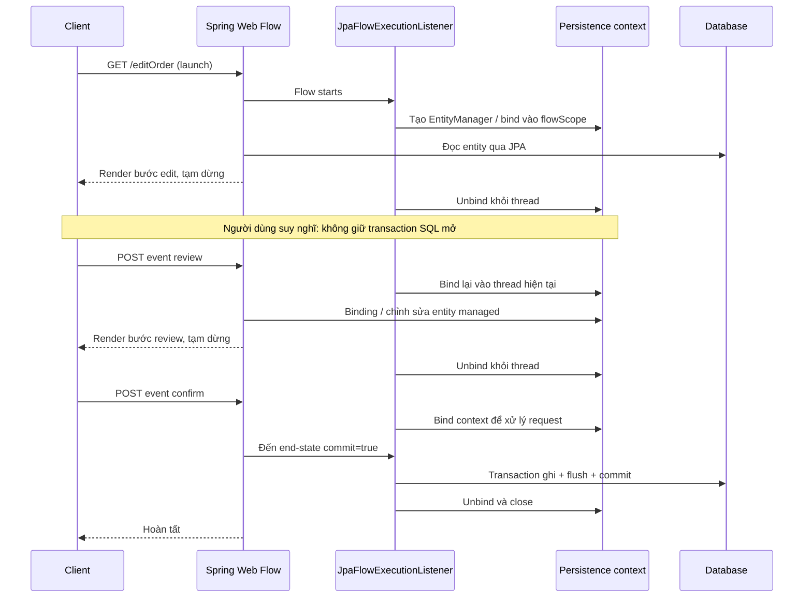

# Flow-managed persistence và thời gian sống của persistence context

## 1. Vì sao một flow nhiều bước cần chiến lược persistence riêng?

Trong **Spring Web Flow**, người dùng có thể sửa thông tin đơn hàng theo một hành trình gồm nhiều `view-state`: nhập địa chỉ, xem lại, xác nhận hoặc hủy. Mỗi lần bấm nút gửi một HTTP request riêng; giữa hai request, flow tạm dừng để chờ người dùng. State, event và transition của Web Flow giữ tiến trình điều hướng, nhưng ứng dụng cũng phải quyết định **dữ liệu JPA được quản lý và ghi xuống database ở thời điểm nào**.

Giả sử người dùng sửa địa chỉ giao hàng ở bước 1 rồi bấm **Hủy** ở bước 3. Nếu tầng service đã ghi cập nhật ở bước 1, nút Hủy không thể tự đảo ngược việc ghi đó. Với quy trình yêu cầu **chỉ lưu thay đổi khi người dùng xác nhận bước cuối**, Spring Web Flow cung cấp mẫu **flow-managed persistence** (FMPC, *Flow Managed Persistence Context*).

Mẫu này mở một JPA `EntityManager`/persistence context khi flow bắt đầu, giữ context cho các request tiếp theo trong cùng execution, rồi **commit và đóng ở cuối flow** theo kết quả. Nó phù hợp với một số hành trình chỉnh sửa dài nhiều bước; không phải mọi ứng dụng đều cần sử dụng. Cách khác là để service quản lý transaction và trao đổi dữ liệu trung gian bằng DTO tách khỏi entity.

Bài học thuộc chương **Dữ liệu và giao dịch** tập trung vào thời gian sống thực tế của persistence context, cách cấu hình listener, ranh giới transaction, xử lý cancel/subflow và các rủi ro phiên, cạnh tranh dữ liệu, kiểm thử. Những nguyên tắc này cần được áp dụng cùng form binding, validation, Spring MVC và xử lý lỗi của Spring Web Flow.

## 2. Phân biệt persistence context, transaction, flow execution và HTTP session

**Persistence context** trong JPA là tập các entity đang được một `EntityManager` quản lý. Nó duy trì danh tính entity (identity map), theo dõi thay đổi và có thể đồng bộ thay đổi xuống database khi flush. Persistence context không đồng nghĩa một transaction SQL.

| Khái niệm | Chức năng | Thời gian sống trong flow-managed persistence |
| --- | --- | --- |
| **Flow definition** | Bản thiết kế state, event, transition, subflow | Được registry dùng lại cho nhiều người |
| **Flow execution** | Một lần người dùng đi qua flow | Từ khi launch đến khi end-state hoặc execution bị mất/hủy |
| **JPA persistence context** | Tập entity được quản lý, theo dõi thay đổi qua `EntityManager` | Từ lúc flow khởi tạo context đến khi kết thúc/đóng; được gắn vào thread từng request |
| **Database transaction** | Ranh giới commit/rollback nguyên tử ở database | Thường chỉ diễn ra trong các lời gọi cần transaction; transaction ghi cuối cùng diễn ra tại commit end-state |
| **HTTP request/thread** | Một lượt xử lý MVC/Web Flow | Vài mili giây/giây, kết thúc trước khi người dùng sang bước sau |
| **HTTP session** | Nơi Web Flow có thể lưu conversation/execution giữa request | Có thể tồn tại lâu hơn một request, nhưng có timeout và chính sách lưu riêng |
| **EntityManagerFactory** | Factory tạo `EntityManager`; có thể là bean dùng chung | Thường sống theo Spring application context |

Một ngộ nhận nguy hiểm là cho rằng “persistence context sống qua ba trang nên database transaction cũng mở xuyên ba trang”. **Không đúng.** Flow-managed persistence giữ *context theo conversation*, còn transaction và kết nối database cần kết thúc đúng ranh giới thực thi; không mở một transaction SQL để chờ người dùng hàng phút.



Sơ đồ thể hiện **ý định và vòng đời điển hình**; chi tiết đọc dữ liệu, thời điểm flush và transaction cụ thể còn phụ thuộc provider, transaction manager, repository và service của ứng dụng. Nếu code tự mở read-write transaction hoặc gọi `flush()` sớm, thay đổi **có thể bị ghi trước bước cuối**.

## 3. Ba thành phần bắt buộc của flow-managed persistence

Để Web Flow thực sự quản lý context theo flow, cần kết nối cả ba:

1. Đánh dấu định nghĩa flow bằng phần tử `<persistence-context/>`.
2. Đăng ký `JpaFlowExecutionListener` (nếu dùng JPA) vào `FlowExecutor` cùng `EntityManagerFactory` và `PlatformTransactionManager` tương ứng.
3. Đặt `commit="true"` tại **end-state xác nhận thành công**. Những end-state hủy/quay lại không có cờ commit.

Nếu thiếu một mắt xích, hành vi không còn đúng như kỳ vọng:

| Thiếu hoặc cấu hình sai | Hệ quả |
| --- | --- |
| Không có `<persistence-context/>` | Flow không khai báo nhu cầu context do flow quản lý |
| Không gắn `JpaFlowExecutionListener` với executor | Không có listener thực hiện vòng đời tạo/bind/commit/close |
| Listener dùng sai `EntityManagerFactory` hoặc transaction manager | DAO có thể truy cập context khác, commit lỗi hoặc không ghi như mong muốn |
| End-state thành công thiếu `commit="true"` | Không kích hoạt nhánh commit theo hợp đồng FMPC |
| Service ghi/flush trong read-write transaction ở bước giữa | Thay đổi có thể ra database trước lúc người dùng xác nhận |
| Flow kết thúc bằng cancel nhưng service khác đã ghi trước đó | Cancel không khôi phục được các giao dịch đã commit |

### 3.1. Cấu hình XML tối thiểu trong flow

**`/WEB-INF/flows/orders/edit-order-flow.xml`**:

```xml
<?xml version="1.0" encoding="UTF-8"?>
<flow xmlns="http://www.springframework.org/schema/webflow"
      xmlns:xsi="http://www.w3.org/2001/XMLSchema-instance"
      xsi:schemaLocation="
        http://www.springframework.org/schema/webflow
        http://www.springframework.org/schema/webflow/spring-webflow-2.0.xsd">

    <!-- Kích hoạt flow-managed persistence cho flow này. -->
    <persistence-context/>

    <!-- orderId được truyền khi launch flow. -->
    <input name="orderId" required="true"/>

    <on-start>
        <evaluate expression="draftOrderService.findForEdit(orderId)"
                  result="flowScope.order"/>
    </on-start>

    <view-state id="edit" view="orders/edit" model="order">
        <transition on="review" to="review"/>
        <transition on="cancel" to="cancelled" bind="false"/>
    </view-state>

    <view-state id="review" view="orders/review" model="order">
        <transition on="back" to="edit" validate="false"/>
        <transition on="confirm" to="confirmed"/>
    </view-state>

    <!-- Chỉ nhánh xác nhận mới yêu cầu commit. -->
    <end-state id="confirmed" commit="true"/>
    <end-state id="cancelled"/>
</flow>
```

`model="order"` chỉ ra đối tượng được binding qua các view-state. Ví dụ giả định entity có các field tương ứng trong form và validator đã được cấu hình nếu cần; ở ứng dụng thực tế nên dùng whitelist field binding, validation và kiểm tra quyền sửa đơn hàng. `orderId` là input của flow, không phải bằng chứng người dùng có quyền sửa đơn hàng đó.

**Ý nghĩa của hai nhánh:**

- `confirm → confirmed`: listener có thể flush các entity đang managed trong một transaction, commit và đóng context khi flow kết thúc thành công.
- `cancel → cancelled`: listener đóng context khi kết thúc mà không thực hiện final commit. Các sửa đổi chưa được ghi bởi transaction khác sẽ bị bỏ đi cùng context.

Nếu không định nghĩa view của end-state, việc hiển thị trang hoàn tất hoặc redirect cần được cấu hình thêm theo hợp đồng `FlowHandler`/MVC của ứng dụng. Chương này tập trung vào transaction và vòng đời persistence context.

### 3.2. Cấu hình listener bằng Java

Ví dụ dùng Spring Web Flow 3.x / Jakarta Persistence, giả định ứng dụng **đã có** các bean JPA `EntityManagerFactory` và `PlatformTransactionManager` quản lý cùng một persistence unit. Registry và mapping/adapter cần được nạp vào Spring MVC application context:

```java
package com.example.config;

import jakarta.persistence.EntityManagerFactory;
import org.springframework.context.annotation.Bean;
import org.springframework.context.annotation.Configuration;
import org.springframework.transaction.PlatformTransactionManager;
import org.springframework.webflow.config.AbstractFlowConfiguration;
import org.springframework.webflow.definition.registry.FlowDefinitionRegistry;
import org.springframework.webflow.executor.FlowExecutor;
import org.springframework.webflow.mvc.servlet.FlowHandlerAdapter;
import org.springframework.webflow.mvc.servlet.FlowHandlerMapping;
import org.springframework.webflow.persistence.JpaFlowExecutionListener;

@Configuration
public class PersistenceWebFlowConfig extends AbstractFlowConfiguration {

    @Bean
    public FlowDefinitionRegistry flowRegistry() {
        return getFlowDefinitionRegistryBuilder()
                .addFlowLocation(
                    "/WEB-INF/flows/orders/edit-order-flow.xml",
                    "editOrder")
                .build();
    }

    // Hai tham số phải thuộc cùng cấu hình JPA của ứng dụng.
    @Bean
    public JpaFlowExecutionListener jpaFlowExecutionListener(
            EntityManagerFactory entityManagerFactory,
            PlatformTransactionManager transactionManager) {
        return new JpaFlowExecutionListener(
                entityManagerFactory, transactionManager);
    }

    @Bean
    public FlowExecutor flowExecutor(
            FlowDefinitionRegistry flowRegistry,
            JpaFlowExecutionListener jpaFlowExecutionListener) {
        return getFlowExecutorBuilder(flowRegistry)
                .addFlowExecutionListener(jpaFlowExecutionListener)
                .build();
    }

    @Bean
    public FlowHandlerMapping flowHandlerMapping(
            FlowDefinitionRegistry flowRegistry) {
        FlowHandlerMapping mapping = new FlowHandlerMapping();
        mapping.setFlowRegistry(flowRegistry);
        return mapping;
    }

    @Bean
    public FlowHandlerAdapter flowHandlerAdapter(
            FlowExecutor flowExecutor) {
        FlowHandlerAdapter adapter = new FlowHandlerAdapter();
        adapter.setFlowExecutor(flowExecutor);
        return adapter;
    }
}
```

Phương thức `addFlowExecutionListener(...)` thuộc `FlowExecutorBuilder`. Nó nối listener vào lifecycle **của các execution được executor tạo ra**, còn phần tử `<persistence-context/>` nói rõ **flow cụ thể** nào cần dùng pattern. Đừng chỉ khai báo listener như một bean đứng riêng rồi kỳ vọng executor tự nhận ra.

Ví dụ trên chưa khai báo `MvcViewFactoryCreator` và `FlowBuilderServices` dành cho JSP; khi tích hợp giao diện thật, thêm các bean view phù hợp hoặc sử dụng hạ tầng view đã có. Cũng cần bảo đảm `@EnableTransactionManagement`/cơ chế transaction của Spring JPA được cấu hình đúng nếu service dùng `@Transactional`. Trong ứng dụng Spring Web Flow 2.x, kiểu `EntityManagerFactory` thường thuộc `javax.persistence`; đối chiếu chữ ký constructor với version trước khi dùng.

### 3.3. Cấu hình XML tương đương

Với dự án dùng Spring XML:

```xml
<bean id="jpaFlowExecutionListener"
      class="org.springframework.webflow.persistence.JpaFlowExecutionListener">
    <constructor-arg ref="entityManagerFactory"/>
    <constructor-arg ref="transactionManager"/>
</bean>

<webflow:flow-executor id="flowExecutor"
                       flow-registry="flowRegistry">
    <webflow:flow-execution-listeners>
        <webflow:listener ref="jpaFlowExecutionListener"/>
    </webflow:flow-execution-listeners>
</webflow:flow-executor>
```

Đây là **trích đoạn** của Spring beans XML có khai báo namespace `webflow` và `flowRegistry` phù hợp. Listener JPA sử dụng hai bean do hạ tầng persistence/transaction của ứng dụng cung cấp.

## 4. Chính xác persistence context sống qua những giai đoạn nào?

Hãy theo dõi lần chạy flow `editOrder`:

| Mốc | Trạng thái persistence context | Trạng thái transaction |
| --- | --- | --- |
| **Launch** flow có `<persistence-context/>` | Listener tạo `EntityManager` và gắn vào flow scope | Không cần mở transaction ghi dài hạn |
| **Truy cập DB ở bước edit** | Dùng context hiện tại để nạp entity managed | Có thể đọc ngoài transaction hoặc trong transaction read-only phù hợp provider |
| **View-state tạm dừng** | Context còn gắn với execution/conversation | Listener unbind khỏi thread; không chờ với một transaction SQL mở |
| **Postback bước review** | Listener bind context vào thread xử lý request mới | Service có thể dùng context đó; tránh transaction ghi trước lúc xác nhận |
| **Bấm Back/đổi form** | Entity vẫn thuộc context của execution | Có thể thay đổi giá trị managed trong bộ nhớ |
| **End-state `confirmed`** | Context còn hoạt động để flush | Listener thực hiện transaction ghi, kiểm tra version và commit; sau đó đóng context |
| **End-state `cancelled`** | Context được đóng, các thay đổi chưa commit bị bỏ | Không thực hiện final commit theo `commit="true"` |
| **Session/execution mất trước khi confirm** | Dữ liệu chưa lưu có thể mất; thời điểm cleanup phụ thuộc hạ tầng | Không thể giả định còn transaction/context để tiếp tục |

Điều quan trọng nhất là **context được tái gắn theo từng request, không bị gắn vĩnh viễn vào một thread**. Một request có thể do thread A xử lý, request tiếp theo do thread B xử lý; listener chịu trách nhiệm bind/unbind đúng bối cảnh của Web Flow. Không nên giữ tham chiếu `EntityManager` trong biến `static` hoặc singleton tùy chỉnh.

Một persistence context dài qua nhiều request cũng có thể giữ nhiều entity managed và dữ liệu cũ trong first-level cache. Flow càng lâu hoặc tải càng nhiều entity, chi phí bộ nhớ và nguy cơ dữ liệu không còn mới so với database càng tăng. Với flow có thể kéo dài hàng giờ/ngày, cần đánh giá mô hình lưu trữ bền vững thay vì dựa vào session thông thường.

## 5. Service và DAO truy cập entity như thế nào?

Trong cấu hình JPA thông thường, Spring quản lý `EntityManager` thông qua `EntityManagerFactory` và `JpaTransactionManager`. Khi flow-managed listener đã bind context vào thread hiện tại, các Spring-managed DAO dùng cùng persistence unit có thể làm việc với context này. Tương thích chính xác với `@Transactional(readOnly = true)` và flush mode phụ thuộc provider và transaction manager.

Ví dụ service chỉ **nạp entity cần sửa**, không ghi thay đổi ở giữa flow:

```java
package com.example.orders;

import jakarta.persistence.EntityManager;
import jakarta.persistence.PersistenceContext;
import org.springframework.stereotype.Service;
import org.springframework.transaction.annotation.Transactional;

@Service("draftOrderService")
public class DraftOrderService {

    @PersistenceContext
    private EntityManager entityManager;

    @Transactional(readOnly = true)
    public DraftOrder findForEdit(Long orderId) {
        DraftOrder order = entityManager.find(DraftOrder.class, orderId);
        if (order == null) {
            throw new IllegalArgumentException("Không tìm thấy đơn hàng");
        }
        // Ứng dụng phải kiểm tra quyền chỉnh sửa của người hiện tại.
        return order;
    }
}
```

Entity có thể dùng `@Version` để phát hiện cập nhật đồng thời:

```java
package com.example.orders;

import jakarta.persistence.Entity;
import jakarta.persistence.Id;
import jakarta.persistence.Table;
import jakarta.persistence.Version;
import jakarta.validation.constraints.NotBlank;

@Entity
@Table(name = "orders")
public class DraftOrder {
    @Id
    private Long id;

    @Version
    private long version;

    @NotBlank
    private String shippingAddress;

    protected DraftOrder() {}

    public Long getId() { return id; }
    public long getVersion() { return version; }
    public String getShippingAddress() { return shippingAddress; }
    public void setShippingAddress(String value) {
        shippingAddress = value;
    }
}
```

Sau khi `DraftOrder` được nạp vào cùng persistence context của flow, binding từ view-state hoặc các action có thể chỉnh `shippingAddress` trên entity managed. Nếu giữ context đến end-state xác nhận và không có flush/commit sớm, JPA sẽ phát hiện thay đổi để đồng bộ trong transaction cuối.

**Không coi đây là lời khuyên binding mọi field trực tiếp lên entity.** Với ứng dụng có dữ liệu nhạy cảm, nên giới hạn field được phép binding, không cho client sửa `id`, `version` hoặc thuộc tính phân quyền, đồng thời kiểm tra authorization ở service. DTO + mapping có kiểm soát thường dễ bảo vệ hơn đối với form lớn.

### Điều gì xảy ra khi một service có @Transactional ghi ở bước giữa?

`JpaFlowExecutionListener` không tự ngăn cản mọi lời gọi service mở read-write transaction. Nếu flow gọi:

```java
@Transactional
public void saveImmediately(DraftOrder order) {
    entityManager.merge(order);
    // Có thể flush/commit trước khi người dùng tới end-state.
}
```

thì chiến lược “chỉ ghi khi Confirm” có thể bị phá vỡ. Bất kể người dùng sau đó có bấm Cancel, một transaction đã commit trước đó **không được Web Flow hoàn tác tự động**. Vì vậy hãy:

- Chỉ dùng các operation đọc hoặc read-only transaction thích hợp trong giai đoạn đi qua từng view-state.
- Dành read-write transaction để listener thực hiện final commit hoặc để service-layer chịu trách nhiệm nếu đã chọn thiết kế khác.
- Tránh gọi `flush()`, `saveAndFlush()` hoặc trigger những update độc lập khi chưa kết thúc flow, trừ khi nghiệp vụ thực sự muốn ghi ở bước giữa.
- Kiểm thử SQL/transaction thực tế; “không gọi `save()`” chưa đủ chứng minh DB chưa bị ghi, vì entity managed có thể bị flush bởi JPA.

### Nạp mới hay dùng lại entity managed?

Nếu một bước lặp lại gọi `find()` trên cùng entity ID và context còn quản lý entity đó, JPA có thể trả lại đối tượng từ first-level cache. Điều này giúp giữ các sửa đổi chưa commit qua các state, nhưng cũng có nghĩa dữ liệu DB do người khác thay đổi **có thể chưa được phản ánh** trong context hiện tại. Khi cần dữ liệu mới, phải xác định rõ chiến lược `refresh`, lock và xử lý xung đột; không refresh mù vì có thể mất chỉnh sửa đang dở.

## 6. Chỉ commit ở end-state được phép

Mốc xác nhận thành công trong XML:

```xml
<end-state id="confirmed" commit="true"/>
```

Listener nhận sự kiện kết thúc của flow và, khi end-state có cờ commit, thực hiện flush/commit trong transaction thích hợp rồi đóng persistence context. Khi flow kết thúc ở `cancelled`, không có lệnh final commit và context được đóng. **Điều này chỉ đảm bảo hủy các thay đổi chưa được transaction khác lưu**; không thể thu hồi email đã gửi, API bên ngoài đã gọi hoặc một payment đã được xử lý.

Một nguyên tắc thiết kế hữu ích là đặt các hành động **không thể đảo ngược** sau điểm xác nhận và thiết kế idempotency cho chúng. Khi cần ghi database đồng thời phát sự kiện ra hệ thống khác, cân nhắc outbox/event sau commit để tránh tình trạng DB rollback nhưng thông báo đã phát đi.

### Commit lỗi thì sao?

Khi flush cuối, JPA có thể ném `OptimisticLockException`, `ConstraintViolationException`, lỗi kết nối hoặc exception về transaction. Ví dụ:

- Người A mở màn hình sửa đơn hàng với `version = 5`.
- Người B cập nhật đơn hàng và commit, làm version trong DB tăng thành 6.
- Người A vẫn thấy entity managed với version 5 và bấm Confirm.
- Khi commit, kiểm tra version có thể phát hiện xung đột; việc lưu của A không được coi là thành công.

`@Version` là cơ chế **optimistic locking** phổ biến để phát hiện cập nhật đồng thời. Ứng dụng cần bắt/định tuyến lỗi ở tầng phù hợp, hiển thị thông tin dễ hiểu, cho phép tải lại dữ liệu hoặc khởi động lại flow an toàn. Không nên tự retry một transaction quan trọng mà không xét lại input, quyền và trạng thái dữ liệu mới nhất.

Lưu ý rằng exception có thể phát sinh sau khi transition đi vào end-state khi listener thực hiện final commit. Cơ chế phục hồi lúc này cần được thiết kế và kiểm thử với đúng callback của Web Flow/JPA; chỉ bắt lỗi trong action `confirm` chưa chắc bao phủ lỗi phát sinh lúc đóng flow.

## 7. Subflow dùng chung persistence context với flow cha

Một flow chỉnh sửa đơn hàng có thể gọi subflow `verifyAddress`. Theo cơ chế FMPC của Web Flow, persistence context của flow cha **được truyền cho subflow** khi subflow cũng khai báo `<persistence-context/>`.

```xml
<!-- Bên trong edit-order-flow.xml -->
<subflow-state id="verifyAddress" subflow="verifyAddress">
    <transition on="verified" to="review"/>
    <transition on="cancelled" to="edit"/>
</subflow-state>
```

Trong `verify-address-flow.xml`:

```xml
<flow xmlns="http://www.springframework.org/schema/webflow">
    <persistence-context/>
    <view-state id="check" view="orders/check-address">
        <transition on="finish" to="verified"/>
        <transition on="cancel" to="cancelled"/>
    </view-state>
    <end-state id="verified" commit="true"/>
    <end-state id="cancelled"/>
</flow>
```

Khi subflow **tái sử dụng context do cha tạo**, cờ `commit="true"` của end-state trong subflow **không làm commit context của cha**. Quyết định commit cuối cùng thuộc flow cha khi nó kết thúc. Điều này tránh việc bước xác minh địa chỉ ghi sớm trước khi người dùng xác nhận toàn bộ đơn hàng.

Flow con chạy độc lập, không có flow cha giữ persistence context, có thể có vòng đời/commit riêng theo cấu hình listener. Vì vậy khi kiểm thử subflow cần xét cả hai tình huống: được gọi từ cha và được chạy độc lập nếu ứng dụng cho phép.

## 8. Khi nào nên chọn flow-managed persistence?

| Tiêu chí | Flow-managed persistence | Service-managed transactions với DTO |
| --- | --- | --- |
| Model trong flow | Entity managed theo persistence context của execution | DTO/command hoặc dữ liệu tách khỏi JPA context |
| Thời gian sống JPA context | Qua nhiều HTTP request trong một flow | Thường chỉ trong từng lần gọi service/transaction |
| Lưu DB | Có thể trì hoãn tới commit end-state | Service quyết định lúc nào validate và persist |
| Cancel | Bỏ thay đổi chưa flush/commit và đóng context | Bỏ DTO hoặc dữ liệu tạm; service không được gọi save |
| Tải dữ liệu mới | Chú ý first-level cache và entity stale | Mỗi transaction có thể nạp trạng thái mới theo nhu cầu |
| Session, cluster và tài nguyên | Cần quản lý context dài hạn, memory và khả năng lưu execution | DTO thường dễ serialize/replicate và scale hơn |
| Form nhiều bước trên entity phức tạp | Có thể thuận tiện khi cần dirty checking | Cần mapping DTO → entity tại bước xác nhận |
| Tính rõ ràng transaction | Phải hiểu listener và end-state commit | Thường đặt transaction tại phương thức service rõ ràng |

**Nên cân nhắc FMPC khi** hành trình không quá dài, các thay đổi thuộc một đơn vị công việc, muốn giữ entity managed xuyên suốt và đã kiểm soát được provider/transaction manager/snapshot policy.

**Nên cân nhắc DTO/service transaction khi** flow lâu hoặc có yêu cầu lưu nháp qua nhiều ngày, hoạt động trên cluster/replicated session, tích hợp nhiều hệ thống hoặc cần ranh giới transaction đơn giản, có thể kiểm tra độc lập ở service. Một số hệ thống dùng cả hai theo từng flow khác nhau; không cần bật FMPC cho mọi hành trình.

## 9. HTTP session, snapshot và vấn đề lưu trạng thái dài hạn

Web Flow có thể lưu flow execution bằng cơ chế conversation/repository theo HTTP session. Với FMPC, context được giữ qua các lần dừng flow; điều này đặt ra một số vấn đề vận hành:

1. **Session timeout:** người dùng chưa xác nhận mà phiên hết hạn thì dữ liệu đang chỉnh có thể mất. Một lần đăng nhập mới không tự hồi sinh context cũ.
2. **Giới hạn executions và snapshots:** chính sách lưu của Web Flow có thể loại snapshot cũ; URL đã lưu từ một bước trước không chắc còn khôi phục được.
3. **Bộ nhớ:** persistence context giữ các entity managed và quan hệ của chúng. Không nạp cả graph lớn nếu chỉ chỉnh một vài field.
4. **Serialization/cluster:** `EntityManager` và provider-managed session không mặc định an toàn khi serialize/replicate giữa các node. Không giả định mọi HTTP session store có thể tự lưu FMPC.
5. **Nhiều tab:** hai execution có thể chỉnh cùng entity trên hai context khác nhau, tạo dữ liệu cũ và xung đột version khi commit.
6. **Điểm lỗi:** nếu container bị restart, session bị dọn hoặc flow execution bị hủy, cần chiến lược tạo lại hành trình/draft thay vì trông chờ context trong bộ nhớ.

Reference Guide mô tả việc lưu và tiếp tục flow trong thời gian dài cần cơ chế lưu trạng thái bền vững. **Việc chuyển một flow có `EntityManager` vào một store bền vững không tự động giải quyết vấn đề serialize.** Ứng dụng phải kiểm chứng repository/persistence provider và thiết kế durable draft phù hợp.

Với dữ liệu quan trọng, giải pháp rõ ràng thường là **lưu bản nháp như một entity riêng qua service transaction**, sau đó load lại vào flow mới khi người dùng tiếp tục; không giữ một transaction SQL mở để chờ người dùng.

## 10. Kịch bản kiểm thử nên có

Một flow test chỉ dùng mock event/state không đủ chứng minh JPA context đã được bind/unbind và commit. Cần phối hợp kiểm thử flow với kiểm thử tích hợp thật có `EntityManagerFactory`, `JpaTransactionManager` và database thử nghiệm.

| Kịch bản | Hành động | Điều cần xác minh |
| --- | --- | --- |
| Khởi tạo context | Launch `editOrder` có `<persistence-context/>` | Listener tạo và gắn context; service đọc được entity |
| Đi qua nhiều state | Sửa địa chỉ, sang review, quay lại edit | Cùng execution giữ giá trị đang sửa trong context |
| Cancel | Thay đổi entity rồi đi tới `cancelled` | DB không đổi nếu không có transaction ghi sớm |
| Confirm | Thay đổi entity rồi tới `confirmed` | DB chỉ cập nhật sau final commit; context được đóng |
| Hai request khác thread | Launch và resume trên các thread xử lý khác nhau | Context bind/unbind chính xác, không rò rỉ thread-local |
| Read-only service | Gọi `findForEdit()` ở bước giữa | Không commit các thay đổi đang chờ một cách bất ngờ |
| Premature write | Service gọi một phương thức `@Transactional` ghi giữa flow | Test phát hiện DB đã thay đổi trước confirm |
| Subflow | Cha gọi `verifyAddress`, subflow đạt end-state commit=true | DB không commit trước end-state xác nhận của cha |
| Cạnh tranh dữ liệu | Hai execution nạp cùng `@Version` và cùng chỉnh | Commit sau của một bên báo conflict theo optimistic locking |
| Session timeout | Đợi execution hết hạn trước confirm | Hành vi phục hồi an toàn, không báo đã lưu thành công |
| Mất DB/commit lỗi | Đóng kết nối hoặc mô phỏng lỗi transaction | Có thông báo lỗi và không đánh dấu thành công sai |

**Gợi ý test tích hợp:**

```java
// Pseudocode: thiết lập flow execution và JPA test infrastructure thật.
long orderId = createCommittedOrder("Địa chỉ cũ");

FlowTestSession flow = launchFlow("editOrder", orderId);
flow.update("shippingAddress", "Địa chỉ mới");
flow.signal("review");

assertDatabaseAddress(orderId, "Địa chỉ cũ"); // Chưa commit

flow.signal("cancel"); // Kết thúc qua end-state không commit
assertDatabaseAddress(orderId, "Địa chỉ cũ");

FlowTestSession second = launchFlow("editOrder", orderId);
second.update("shippingAddress", "Địa chỉ mới");
second.signal("review");
second.signal("confirm");
assertDatabaseAddress(orderId, "Địa chỉ mới");
```

`FlowTestSession` và các helper ở ví dụ này là **pseudocode**, không phải class có sẵn của Spring Web Flow. Khi triển khai, dùng test support thực tế hoặc điều khiển flow qua MVC/HTTP với session giữ nguyên, kết hợp truy vấn DB trong transaction độc lập sau mỗi mốc. Tránh dùng cùng `EntityManager` để kiểm tra kết quả DB vì first-level cache có thể khiến test đọc lại giá trị trong bộ nhớ thay vì dữ liệu đã commit.

## 11. Những lỗi thường gặp và cách truy nguyên

| Triệu chứng | Nguyên nhân thường gặp | Kiểm tra |
| --- | --- | --- |
| Không tìm thấy `persistenceContext` | Thiếu `<persistence-context/>` hoặc listener chưa gắn executor | Kiểm tra XML và `addFlowExecutionListener(...)` |
| `NoSuchBeanDefinitionException` cho transaction manager | Chưa có hoặc có nhiều bean `PlatformTransactionManager` | Kiểm tra cấu hình JPA, qualifier và cùng persistence unit |
| `EntityManager` bị closed trước khi sang bước tiếp theo | Đang sử dụng entity manager do service tự đóng, không phải context của flow | Kiểm tra DAO và listener bind/unbind |
| Đã sửa form nhưng Cancel vẫn ghi DB | Service transaction ghi/flush sớm | Audit `@Transactional`, flush, SQL logs và update ngoài flow |
| Confirm không lưu DB | End-state thiếu `commit="true"` hoặc entity đã detached | Kiểm tra transition đích, listener, managed state |
| Lỗi optimistic lock tại Confirm | Dữ liệu đổi ở execution khác trong lúc chờ | Kiểm tra `@Version` và thiết kế xử lý conflict |
| Không thể resume flow cũ | Session timeout, snapshot bị loại hoặc execution key không còn | Kiểm tra lifecycle/repository và client URL |
| JPA bị chậm/tăng memory theo thời gian | Context giữ nhiều entity managed hoặc flow bị bỏ dở | Đo context size, giới hạn thời gian/đối tượng |
| Failover/replication thất bại | EntityManager/session không an toàn khi serialize | Kiểm tra thiết kế cluster và lưu draft bền vững |
| Service không thấy entity mới cập nhật | Context đã cache entity cũ hoặc transaction khác cập nhật DB | Kiểm tra first-level cache và optimistic locking |
| Subflow commit quá sớm | Subflow dùng context riêng hoặc service ghi ngoài FMPC | Xác nhận `<persistence-context/>` ở cả cha và con, listener và transaction |

Khi có lỗi, đi theo chuỗi **flow XML → listener/executor → EntityManagerFactory/transaction manager → DAO/transaction annotation → persistence context → end-state → database**. Điều này giúp phân biệt cấu hình FMPC sai với entity detached, transaction mở sớm hoặc lỗi khôi phục execution.

## 12. Bài tập vận dụng

Hãy xây dựng flow `editProfile` gồm `contact → address → review`, có nhánh `cancelled` và `saved`:

1. Tạo JPA entity `CustomerProfile` có `@Id`, `@Version`, email và địa chỉ.
2. Đánh dấu flow bằng `<persistence-context/>` và đăng ký `JpaFlowExecutionListener` trên executor tương ứng.
3. Khi launch, nạp profile bằng service read-only và lưu đối tượng được quản lý vào `flowScope.profile`.
4. Cho phép sửa form ở hai view-state, binding/validation đúng những field được cho phép.
5. Khai báo `<end-state id="saved" commit="true"/>` và `<end-state id="cancelled"/>`.
6. Viết test xác nhận DB không thay đổi giữa các bước và sau Cancel, nhưng thay đổi sau Save.
7. Tạo hai execution cùng sửa một profile để quan sát `@Version` phát hiện xung đột; bổ sung thông báo cho người dùng và đường tải lại dữ liệu.

**Tiêu chí đạt:** persistence context sống đúng theo **flow execution**, bind/unbind theo từng HTTP request, không có transaction ghi kéo dài nhiều bước; chỉ end-state thành công thực hiện final commit; subflow không thể tự quyết định commit context của cha và các lỗi phiên/optimistic locking được xử lý an toàn.

## 13. Ghi nhớ

- **Flow-managed persistence** là một lựa chọn của Spring Web Flow cho hành trình có entity managed qua nhiều bước.
- `<persistence-context/>` đánh dấu flow; `JpaFlowExecutionListener` tạo, bind, unbind và đóng `EntityManager`; `commit="true"` trên end-state cho phép final commit.
- **Persistence context sống lâu không có nghĩa transaction database mở lâu.** Khi flow tạm dừng, context được unbind khỏi request thread.
- Với các bước trung gian, tránh read-write transaction và flush sớm nếu nghiệp vụ cần Cancel thực sự không ghi DB.
- Subflow có `<persistence-context/>` chia sẻ context với cha; khi dùng chung, **cha quyết định commit cuối cùng**.
- `@Version` giúp phát hiện xung đột giữa các execution; session timeout, stale data, snapshot và lưu trạng thái dài hạn vẫn cần thiết kế riêng.
- Khi flow phức tạp hoặc kéo dài, **DTO + service-layer transaction** thường là một lựa chọn dễ kiểm soát hơn.

### Tài liệu tham khảo chính thức

- [Spring Web Flow 3.0.2 – Flow Managed Persistence](https://docs.spring.io/spring-webflow/docs/3.0.2/reference/#flow-managed-persistence): lifecycle, `<persistence-context/>`, commit end-state và subflow.
- [Spring Web Flow 3.0.1 – JpaFlowExecutionListener API](https://docs.spring.io/spring-webflow/docs/3.0.1/api/org/springframework/webflow/persistence/JpaFlowExecutionListener.html): tạo context, bind/unbind theo request, flush/commit và close.
- [Spring Web Flow 3.0.1 – FlowExecutorBuilder API](https://docs.spring.io/spring-webflow/docs/3.0.1/api/org/springframework/webflow/config/FlowExecutorBuilder.html): `addFlowExecutionListener(...)` và `build()`.
- [Spring Web Flow 3.0.1 – PersistenceContextModel API](https://docs.spring.io/spring-webflow/docs/3.0.1/api/org/springframework/webflow/engine/model/PersistenceContextModel.html): quan hệ giữa context, flow và commit end-state.
- [Spring Framework – Transaction Management](https://docs.spring.io/spring-framework/reference/data-access/transaction.html): `@Transactional`, transaction manager và các ranh giới giao dịch.
