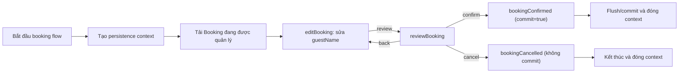
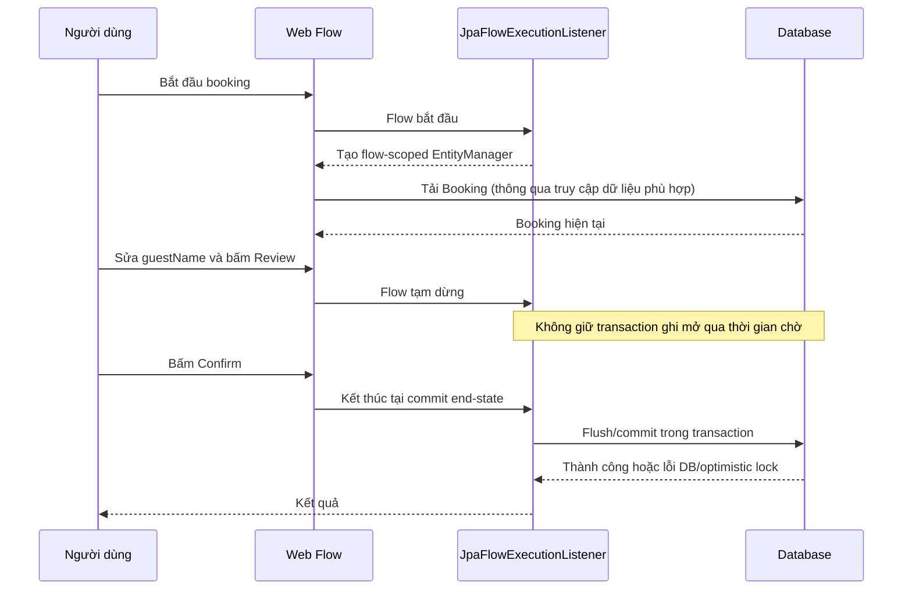

# Khai báo persistence-context cho một flow trong Spring Web Flow

Trong **Spring Web Flow** (`SPRING_WEB_FLOW`), người dùng thường đi qua nhiều màn hình trước khi xác nhận thay đổi dữ liệu: chọn đặt phòng, nhập thông tin khách, xem lại rồi bấm **Xác nhận**. Mỗi màn hình có thể thuộc một HTTP request khác nhau. Nếu ứng dụng dùng JPA/Hibernate, cần quyết định lúc nào đối tượng được tải từ cơ sở dữ liệu, các sửa đổi tạm thời được giữ ở đâu, và khi nào dữ liệu được ghi chính thức.

Chương **Dữ liệu và giao dịch** giới thiệu cơ chế *flow-managed persistence*: khai báo **`<persistence-context/>`** trong định nghĩa flow để Spring Web Flow quản lý một persistence context theo vòng đời của lần chạy flow. Khi kết hợp listener JPA/Hibernate và một `end-state` đánh dấu commit, mô hình này cho phép chỉnh sửa entity qua nhiều bước rồi chỉ ghi kết quả ở bước kết thúc được chấp nhận.

Bài học tập trung vào cách khai báo và vận hành cơ chế đó, cách tránh ghi database quá sớm, giới hạn khi session hết hạn, và cách kiểm thử hoạt động của một quy trình nhiều bước. Ví dụ dùng cú pháp XML của Spring Web Flow; tên artifact và phiên bản JPA phải được chọn theo dòng Spring Web Flow/Spring Framework thực tế của ứng dụng.

## 1. Persistence context là gì và khác transaction thế nào?

Trong JPA, **persistence context** là tập hợp các entity đang được một `EntityManager` quản lý. Nó theo dõi danh tính và trạng thái các entity đã tải. Một entity đang được quản lý (*managed entity*) có thể bị thay đổi thuộc tính; khi persistence context được flush trong một transaction thích hợp, thay đổi đó có thể được đồng bộ vào database.

**Transaction** là phạm vi commit/rollback của các thao tác dữ liệu. Một persistence context có thể tồn tại lâu hơn một transaction, nhưng điều đó không có nghĩa database transaction được giữ mở suốt thời gian người dùng đọc và điền form.

| Khái niệm | Phạm vi | Trong hành trình đặt phòng |
| --- | --- | --- |
| `Flow execution` | Một lần chạy flow, gồm state, event và scope | Người dùng đang sửa một đặt phòng |
| `flowScope` | Dữ liệu tồn tại qua các state trong execution | Entity đặt phòng đang được tham chiếu |
| `PersistenceContext` / `EntityManager` | Theo dõi entity và thay đổi trong một unit-of-work | Entity `Booking` đã tải và được cập nhật tạm |
| `Database transaction` | Ranh giới commit/rollback ở tầng database | Ghi những sửa đổi được xác nhận |
| `FlowExecutionRepository` | Cơ chế lưu/khôi phục flow execution giữa các request | Cho phép tiếp tục flow theo execution key |

Trong **flow-managed persistence**, persistence context được gắn với flow; khi người dùng tạm dừng ở một `view-state`, listener xử lý việc gỡ context khỏi thread hiện tại và gắn lại khi execution được tiếp tục. Mô hình này không mở một database transaction kéo dài xuyên nhiều HTTP request.

## 2. Khi nào nên dùng persistence context theo flow?

Mẫu này phù hợp khi có những điều kiện sau:

- Người dùng cần **xem và chỉnh sửa cùng một entity** trong nhiều state.
- Ứng dụng muốn giữ các thay đổi trung gian trước khi xác nhận cuối cùng.
- Entity và các quan hệ của nó cần được thao tác trong một persistence context nhất quán.
- Quy trình có đích **Xác nhận** và **Hủy** rõ ràng.
- Tầng truy cập dữ liệu và hạ tầng session/repository tương thích với cơ chế listener của Web Flow.

Ví dụ: flow `booking` có các state `editBooking → reviewBooking → bookingConfirmed`, cùng nhánh `bookingCancelled`. Người dùng chỉnh `guestName` ở màn hình đầu, kiểm tra lại, rồi quyết định xác nhận hoặc hủy.



Đây là mô hình **flow-managed persistence context** (*FMPC*). Nếu ứng dụng chỉ nhận DTO từ form rồi gọi một service `@Transactional` duy nhất khi xác nhận, mô hình **service-layer transaction** có thể đơn giản hơn. Không cần khai báo persistence context theo flow cho mọi CRUD nhỏ hoặc mọi flow chỉ đọc.

## 3. Cấu hình tối thiểu: ba mảnh phải đi cùng nhau

Để flow dùng JPA theo mô hình này, cần phân biệt rõ **định nghĩa flow**, **cấu hình executor/listener** và **đích commit**.

| Mảnh cấu hình | Nơi khai báo | Nhiệm vụ |
| --- | --- | --- |
| `<persistence-context/>` | Bên trong XML của flow | Đánh dấu flow cần context theo vòng đời flow |
| `JpaFlowExecutionListener` | Cấu hình Spring của `FlowExecutor` | Tạo, gắn/gỡ, commit và đóng `EntityManager` theo các sự kiện execution |
| `<end-state ... commit="true"/>` | Một end-state trong flow | Chỉ ra đích kết thúc muốn ghi thay đổi |

**Chỉ đặt `<persistence-context/>` trong flow chưa phải toàn bộ cấu hình.** Nếu thiếu listener phù hợp, bạn không thể mặc định EntityManager sẽ được cấp phát và commit đúng ý định. Tương tự, listener đã được đăng ký nhưng flow không đánh dấu persistence context thì không nên giả định listener quản lý mọi flow.

### 3.1. Đánh dấu flow bằng persistence-context

Ví dụ đoạn đầu của `booking-flow.xml`:

```xml
<?xml version="1.0" encoding="UTF-8"?>
<flow xmlns="http://www.springframework.org/schema/webflow"
      xmlns:xsi="http://www.w3.org/2001/XMLSchema-instance"
      xsi:schemaLocation="
          http://www.springframework.org/schema/webflow
          http://www.springframework.org/schema/webflow/spring-webflow.xsd"
      start-state="editBooking">

    <persistence-context />

    <!-- input, on-start, các state và end-state ở bên dưới -->
</flow>
```

Phần tử `<persistence-context/>` là một phần tử trong **namespace của Spring Web Flow** (`http://www.springframework.org/schema/webflow`). Nó không phải Java annotation `@PersistenceContext`, cũng không phải một bean tên `persistenceContext` phải tự tạo.

Tùy phiên bản thư viện, đường dẫn XSD chuẩn có thể khác. Nên dùng schema được reference documentation của bản đang triển khai khuyến nghị và để Spring xử lý schema theo cơ chế của nó.

### 3.2. Đăng ký JpaFlowExecutionListener với FlowExecutor

Một cấu hình Spring XML thông dụng cho JPA:

```xml
<!-- Đặt trong file Spring XML đã khai báo namespace webflow. -->
<webflow:flow-registry id="flowRegistry">
    <webflow:flow-location
        path="/WEB-INF/flows/booking/booking-flow.xml"
        id="booking" />
</webflow:flow-registry>

<webflow:flow-executor id="flowExecutor"
                       flow-registry="flowRegistry">
    <webflow:flow-execution-listeners>
        <webflow:listener ref="jpaFlowExecutionListener" />
    </webflow:flow-execution-listeners>
</webflow:flow-executor>

<bean id="jpaFlowExecutionListener"
      class="org.springframework.webflow.persistence.JpaFlowExecutionListener">
    <constructor-arg ref="entityManagerFactory" />
    <constructor-arg ref="transactionManager" />
</bean>
```

Ví dụ giả định ứng dụng đã có hai bean:

- `entityManagerFactory`: một JPA `EntityManagerFactory` được Spring cấu hình, biết persistence unit và entity mapping.
- `transactionManager`: transaction manager **tương thích với factory đó**, thông thường là `JpaTransactionManager` đối với cấu hình JPA chuẩn.

Bản thân đoạn XML trên **không tạo database, không cấu hình datasource, không đăng ký toàn bộ JPA**, và cũng chưa cấu hình đầy đủ Spring MVC/`FlowHandlerAdapter`. Đây là phần cần bổ sung vào ứng dụng Web Flow đã được cấu hình những nền tảng đó.

Nếu dự án dùng cấu hình Java/Boot thay vì XML, vẫn cần đăng ký đúng listener vào executor qua API cấu hình Web Flow phù hợp phiên bản. Không chuyển nguyên cú pháp XML trên thành Java tùy đoán.

### 3.3. Chọn end-state thực sự được commit

Trong flow:

```xml
<end-state id="bookingConfirmed" commit="true" />
<end-state id="bookingCancelled" />
```

`commit="true"` là dấu hiệu để listener thực hiện commit khi flow kết thúc ở `bookingConfirmed`. Nhánh `bookingCancelled` không được đánh dấu commit, nên với mô hình FMPC chuẩn các thay đổi tạm trong context sẽ không được commit bởi listener ở nhánh đó.

**Điều kiện quan trọng:** không có đoạn xử lý trung gian nào đã chủ động flush/commit thay đổi vào database ngoài cơ chế dự kiến. Nếu một service thực hiện transaction ghi sớm, việc hủy flow về sau **không thể tự đảo ngược** những dữ liệu đã được commit trước đó.

## 4. Flow XML minh họa: sửa đặt phòng qua hai màn hình

Ví dụ dưới đây kết hợp khai báo persistence context, đầu vào khi mở flow, load entity và nhánh commit/hủy:

```xml
<?xml version="1.0" encoding="UTF-8"?>
<flow xmlns="http://www.springframework.org/schema/webflow"
      xmlns:xsi="http://www.w3.org/2001/XMLSchema-instance"
      xsi:schemaLocation="
          http://www.springframework.org/schema/webflow
          http://www.springframework.org/schema/webflow/spring-webflow.xsd"
      start-state="editBooking">

    <persistence-context />

    <input name="bookingId" type="long" required="true" />

    <on-start>
        <evaluate expression="bookingService.findEditableBooking(bookingId)"
                  result="flowScope.booking" />
    </on-start>

    <view-state id="editBooking"
                view="booking/edit"
                model="booking">
        <binder>
            <binding property="guestName" required="true" />
        </binder>
        <transition on="review" to="reviewBooking" />
        <transition on="cancel"
                    to="bookingCancelled"
                    bind="false" />
    </view-state>

    <view-state id="reviewBooking" view="booking/review">
        <transition on="back" to="editBooking" />
        <transition on="confirm" to="bookingConfirmed" />
        <transition on="cancel" to="bookingCancelled" />
    </view-state>

    <end-state id="bookingConfirmed" commit="true" />
    <end-state id="bookingCancelled" />
</flow>
```

Cách hiểu từng phần:

1. Khi flow bắt đầu, `<persistence-context/>` cho listener biết cần quản lý persistence context cho flow này.
2. `bookingId` là đầu vào được khai báo; ứng dụng phải chuyển nó vào flow input map phù hợp khi bắt đầu execution.
3. `bookingService.findEditableBooking(bookingId)` phải tìm đúng entity **trong context mà listener quản lý** và kiểm tra quyền sửa của người dùng hiện tại.
4. Kết quả được đặt ở `flowScope.booking`, là model của `editBooking`.
5. `<binder>` chỉ cho phép form sửa `guestName`. Những field nhạy cảm như `price`, `ownerId`, `paid` không được bind từ client.
6. Khi người dùng bấm `review`, dữ liệu được kiểm tra và màn hình `reviewBooking` hiển thị kết quả đang được giữ trong execution.
7. Bấm `confirm` kết thúc ở end-state có `commit="true"`. Bấm `cancel` đi tới đích không commit.

Ở bước `editBooking`, việc gán `guestName` vào entity thay đổi trạng thái **trong bộ nhớ của persistence context**. Nó không tự xác nhận giao dịch. Hành vi ghi vào database phụ thuộc flush/transaction và listener; cần kiểm thử để bảo đảm không có flush sớm.

Đây là ví dụ về *cách dựng flow*, chưa phải một ứng dụng có thể chạy riêng. Cần có entity `Booking`, bean `bookingService`, persistence provider, validation, JSP/Thymeleaf/JSF view tương ứng và security phù hợp.

## 5. Khi nào entity là managed và vì sao quan trọng?

Trong JPA, object có thể ở các trạng thái thường gặp:

| Trạng thái | Ý nghĩa | Tác động trong flow |
| --- | --- | --- |
| **New/transient** | Chưa được gắn vào context | Chưa tự động được insert vào DB |
| **Managed** | `EntityManager` đang theo dõi entity | Thay đổi property có thể được flush vào DB khi transaction commit |
| **Detached** | Entity không còn thuộc context đang dùng | Chỉnh thuộc tính chưa chắc được đồng bộ nếu không merge/load lại |
| **Removed** | Entity được đánh dấu xóa trong context | Có thể được xóa khi flush/commit theo transaction |

Nếu `bookingService.findEditableBooking` dùng một `EntityManager` khác, trả DTO hoặc chủ động detach entity, thì `flowScope.booking` không mặc nhiên là một entity managed bởi flow context. Đoạn `<persistence-context/>` chỉ cung cấp hạ tầng; cách service lấy đối tượng quyết định các thay đổi được theo dõi hay không.

Tài liệu Spring Web Flow mô tả rằng các data access object được Spring quản lý có thể dùng context đang được listener gắn với thread hiện tại. Vì vậy, phải cấu hình chúng cùng `EntityManagerFactory` và cơ chế transaction tương thích, đồng thời **xác minh bằng test đọc và ghi**, không dựa vào tên bean.

Có thể kiểm tra trong một đoạn service thích hợp bằng `EntityManager.contains(entity)` (khi đang ở đúng request và context được gắn). Kết quả `true` giúp xác nhận entity đang được quản lý; `false` cảnh báo cần kiểm tra cách tải, detach hoặc merge.

## 6. Tại sao không nên mở transaction ghi ở mỗi bước?

FMPC nhằm giữ **những thay đổi chưa xác nhận** xuyên các màn hình mà không bắt database giữ lock hoặc transaction lâu giữa các request.



Nếu service có `@Transactional` dạng **read-write** và thực hiện flush khi flow vẫn ở bước `reviewBooking`, database có thể nhận thay đổi quá sớm. Lúc người dùng chọn Hủy, nhánh không commit của Web Flow không thể hoàn tác transaction đã commit ngoài flow.

Thực hành an toàn cho mô hình này:

- Các thao tác lấy dữ liệu trung gian nên được thực hiện không có transaction ghi hoặc trong transaction **read-only** phù hợp cơ chế FMPC.
- Chỉ ghi dữ liệu đã xác nhận ở end-state commit, hoặc theo một hợp đồng nghiệp vụ riêng được thiết kế rõ.
- Tránh gọi `saveAndFlush()`, `flush()` hay service ghi riêng khi đang đi qua các bước nhập/xem lại, trừ khi dữ liệu đó được thiết kế để tồn tại độc lập với việc hoàn tất flow.
- Nếu có side effect không thuộc JPA như gửi email, gọi thanh toán hoặc xuất message queue, `commit="true"` **không tự bảo đảm rollback** cho những tác động đó.

Nếu một nghiệp vụ cần nhiều lần commit độc lập hoặc có tác dụng bên ngoài phức tạp, cân nhắc cách triển khai qua service-layer transaction, outbox hoặc quy trình bù trừ (compensation), thay vì xem persistence context theo flow như một transaction toàn cục.

## 7. Sử dụng biến persistenceContext đúng phạm vi

Khi FMPC hoạt động, Web Flow cung cấp một persistence context trong phạm vi execution. Tài liệu Spring Web Flow dùng tên đặc biệt `persistenceContext` để truy cập context trong flow expression. Ở một số API description còn nhắc đến biến `entityManager`; tên truy cập khả dụng cần được xác minh với dòng Web Flow và cách listener triển khai đang dùng.

Ví dụ mô tả ý tưởng truy cập context trong expression (chỉ dùng sau khi xác nhận API phiên bản):

```xml
<evaluate expression="persistenceContext.contains(flowScope.booking)"
          result="flowScope.bookingIsManaged" />
```

Với JPA, `contains(...)` trả `boolean` cho biết entity có nằm trong persistence context hiện tại hay không. Tuy nhiên, để giữ flow dễ kiểm thử và giảm phụ thuộc vào chi tiết hạ tầng, phần lớn logic nghiệp vụ nên đi qua **Spring-managed service/DAO** có hợp đồng rõ ràng.

Không đưa `EntityManager` trực tiếp lên UI hoặc serialize nó thủ công để truyền về trình duyệt. Cũng không cho client chọn hay sửa persistence context qua một request parameter.

### So sánh @PersistenceContext và <persistence-context/>

Hai ký hiệu giống tên nhưng thuộc hai lớp hệ thống:

| Ký hiệu | Nơi dùng | Mục đích |
| --- | --- | --- |
| `@PersistenceContext` | Trên field hoặc method injection của bean JPA | Yêu cầu inject EntityManager/proxy theo cơ chế JPA/Spring |
| `<persistence-context/>` | Trong flow definition XML | Đánh dấu flow được listener cấp và quản lý context theo vòng đời execution |
| `commit="true"` | End-state của Web Flow | Chỉ ra kết thúc flow có ý định commit context |

Ở ứng dụng thuộc dòng JPA cũ, annotation thường là `javax.persistence.PersistenceContext`; với hệ Jakarta Persistence, annotation tương ứng là `jakarta.persistence.PersistenceContext`. Hãy sử dụng đúng package theo phiên bản Spring/JPA thực tế. Tên phần tử XML `<persistence-context/>` không bị thay thành `<jakarta-persistence-context/>`.

## 8. Subflow có được chia sẻ persistence context không?

Giả sử flow đặt phòng gọi subflow `addGuest` để thêm khách cùng đặt phòng. Nếu flow cha quản lý persistence context, Web Flow hỗ trợ việc **truyền context đang dùng sang subflow** với điều kiện subflow cũng khai báo `<persistence-context/>`.

```xml
<!-- Trong flow con addGuest-flow.xml -->
<flow xmlns="http://www.springframework.org/schema/webflow"
      xmlns:xsi="http://www.w3.org/2001/XMLSchema-instance"
      xsi:schemaLocation="
          http://www.springframework.org/schema/webflow
          http://www.springframework.org/schema/webflow/spring-webflow.xsd">

    <persistence-context />

    <!-- Các input và state của addGuest đặt tại đây. -->
</flow>
```

Đoạn trên chỉ minh họa phần đầu flow con. Khi context của cha được chia sẻ, **quyết định commit cuối cùng thuộc flow cha**; cờ commit của một end-state trong subflow không được dùng để buộc ghi sớm các sửa đổi của flow cha. Điều này cho phép người dùng thêm khách ở subflow rồi quay lại xác nhận toàn bộ đặt phòng trong flow gốc.

Cần kiểm tra rõ input/output của subflow, entity nào được quản lý, và liệu có service nào đã chạy transaction ghi riêng không. Không nên tạo một EntityManager mới cho subflow và giả định nó có cùng các managed entity với cha.

## 9. Session, repository và rủi ro khi người dùng bỏ dở

Persistence context theo flow được duy trì trong vòng đời flow execution. Nếu ứng dụng lưu execution trong HTTP session, người dùng tắt trình duyệt hoặc session hết hạn trước khi commit có thể khiến các thay đổi trong memory không còn được phục hồi.

| Tình huống | Điều cần dự kiến |
| --- | --- |
| Bấm Hủy đúng flow | Kết thúc không commit; thay đổi trung gian không được listener ghi |
| Session timeout | Execution/context có thể bị mất; cần UX bắt đầu lại hoặc khôi phục draft |
| Refresh hay Back | Có thể resume snapshot/URL cũ tùy repository và cấu hình history |
| Hai tab độc lập | Cần xác minh mỗi execution có trạng thái riêng và tránh cập nhật chồng chéo |
| Chạy nhiều node | Cần chiến lược session affinity/replication tương thích với cơ chế lưu execution và persistence context |
| Restart/deploy phiên bản mới | Dữ liệu execution đang sống hoặc serialized session có thể không tương thích; không hứa khôi phục tự động |

**FMPC không thay thế chức năng lưu bản nháp lâu dài.** Muốn người dùng lưu rồi trở lại sau nhiều ngày, thiết kế bảng draft hoặc cơ chế lưu bền vững riêng với transaction, quyền truy cập và version rõ ràng.

Chỉ nên dựa vào việc lưu state/session của Web Flow khi đã kiểm tra khả năng lưu, khôi phục và serialization của những object thực tế với provider JPA, repository và môi trường triển khai đang sử dụng.

## 10. Xung đột cập nhật và optimistic locking

Một persistence context sống qua nhiều bước có thể giữ entity trong khi người dùng khác cập nhật cùng bản ghi. Khi flow kết thúc, phiên bản trong database có thể đã khác phiên bản mà người dùng ban đầu tải.

Với JPA, một cách phổ biến để phát hiện xung đột là **optimistic locking** bằng trường `@Version`:

```java
// Import @Version từ javax.persistence hoặc jakarta.persistence
// theo dòng JPA của ứng dụng.
@Version
private Long version;
```

Đoạn này là phần trích trong một JPA entity, không phải class độc lập. Cần mapping thật sự và test theo provider đang dùng.

Tình huống:

1. Người dùng A tải Booking phiên bản `5`, bắt đầu chỉnh sửa trong flow.
2. Người dùng B cập nhật cùng Booking và commit thành phiên bản `6`.
3. A bấm Xác nhận. Khi flush/commit, provider có thể phát hiện phiên bản không còn khớp và báo optimistic locking failure.
4. Ứng dụng phải thông báo xung đột, đưa ra cách tải lại hoặc so sánh thay đổi; không tự ghi đè dữ liệu mới mà không có quyết định rõ.

Không mặc định một exception từ commit sẽ tạo outcome `error` để tự chuyển sang một state trong flow. Cần xác định cách listener/exception handler phản hồi và thiết kế UX an toàn khi lỗi xuất hiện **ở thời điểm kết thúc**.

## 11. Bảo mật và kiểm tra dữ liệu trước commit

Dùng persistence context lâu hơn một request không giảm yêu cầu xác thực và phân quyền. Một request có thể tự sửa `bookingId`, gửi thêm field hoặc cố dùng execution key thuộc người khác.

Trong ví dụ đặt phòng, ứng dụng cần:

1. Xác thực người dùng và **kiểm tra quyền sửa Booking** khi bắt đầu flow; kiểm tra lại những quyền quan trọng khi xác nhận, vì quyền có thể thay đổi trong lúc người dùng điền form.
2. Khai báo `<binder>` chỉ cho phép các property được sửa; không tự bind `ownerId`, `paid`, `totalPrice` hoặc `version` từ client.
3. Validate dữ liệu ở state nhập và **kiểm tra bất biến nghiệp vụ** trước final commit, như năng lực phục vụ, trạng thái đặt phòng, giá và quyền truy cập.
4. Bảo vệ request thay đổi trạng thái bằng CSRF token/cơ chế Spring Security tương ứng. Execution key chỉ định flow execution, không phải token chứng minh quyền.
5. Đảm bảo công việc nghiệp vụ có tính idempotent hoặc chống lặp ở backend, nhất là nếu flow kết thúc bằng tạo đơn, gọi thanh toán hay gửi email.

Đặc biệt, nếu flow đặt entity managed trực tiếp làm model của form, việc khai báo whitelist cho binder rất quan trọng. Trong dự án lớn, dùng **form DTO riêng** rồi áp dụng các trường được phép vào entity trong service còn giúp giảm nguy cơ mass assignment và làm rõ ranh giới nghiệp vụ.

## 12. Những lỗi cấu hình thường gặp

| Triệu chứng | Nơi nên kiểm tra | Hướng xử lý |
| --- | --- | --- |
| `<persistence-context/>` không được XML chấp nhận | Namespace/XSD/phiên bản Web Flow | Kiểm tra flow schema của đúng release |
| Không thấy dữ liệu được commit sau Confirm | End-state chưa có `commit="true"` hoặc entity không managed | Kiểm tra đường transition, listener, transaction manager và context thực tế |
| Hủy flow vẫn thấy dữ liệu bị đổi trong DB | Transaction ghi/flush được thực hiện trước khi tới end-state | Rà lại service `@Transactional`, `flush()`, `saveAndFlush()` hoặc side effect khác |
| `BeanCreationException` khi khởi động executor | Thiếu listener, factory hoặc transaction manager | Lần theo `Caused by`, tên bean và dependency cần thiết |
| `LazyInitializationException` | Entity/context không còn gắn hoặc thao tác xảy ra ngoài flow request | Kiểm tra nơi load, thread-bound context, scope và view rendering |
| `OptimisticLockException` khi confirm | Dữ liệu cùng bản ghi đã bị thay đổi | Thiết kế xử lý xung đột và kiểm tra version |
| Resume flow lỗi sau timeout | Session hoặc execution repository không còn context | Cung cấp UX khởi động lại, khôi phục từ draft đã lưu |
| Bấm Back/Refresh gây lặp ghi | Hành động ghi được gọi trước commit end-state | Đưa commit về bước xác nhận và thêm bảo vệ idempotency |
| Flow con có context khác cha | Thiếu `<persistence-context/>` ở subflow hoặc cấu hình không tương thích | Xác nhận cách truyền context và lifecycle subflow |

Để chẩn đoán, bật logger phù hợp với môi trường khi cần, ví dụ trong ứng dụng Spring Boot:

```properties
logging.level.org.springframework.webflow=DEBUG
logging.level.org.springframework.webflow.persistence=DEBUG
logging.level.org.springframework.orm.jpa=DEBUG
```

Tên logger và thông điệp thực tế thay đổi theo version. Nên đọc chuỗi `Caused by` và theo dõi flow ID/state/event, thời điểm commit, exception từ JPA/transaction manager và SQL trace cần thiết. Tránh ghi URL chứa execution key, PII hoặc toàn bộ entity vào log chia sẻ.

## 13. Kiểm thử hành trình để xác nhận cấu hình đúng

Chỉ thấy bean `JpaFlowExecutionListener` được tạo chưa chứng minh cơ chế hoạt động đúng. Tối thiểu cần các kịch bản sau:

| Kịch bản | Các bước | Kết quả cần chứng minh |
| --- | --- | --- |
| Confirm hợp lệ | Mở booking → sửa guestName → Review → Confirm | DB chỉ phản ánh thay đổi sau kết thúc ở commit end-state |
| Hủy | Mở booking → sửa → Cancel | DB giữ giá trị trước flow nếu không có transaction ghi trung gian |
| Quay lại | Sửa → Review → Back → sửa lại → Confirm | Dữ liệu cuối cùng chính xác, không bị commit tạm |
| Binding sai | Gửi input thiếu/sai hoặc trường ngoài whitelist | Không cập nhật entity nhạy cảm; validation chặn đường xác nhận |
| Lỗi transaction | Cố tình mô phỏng lỗi DB/transaction ở bước commit | Không thông báo thành công giả; xử lý lỗi và log đầy đủ |
| Concurrent update | Hai execution cùng sửa Booking có `@Version` | Một xung đột được phát hiện và xử lý theo chính sách |
| Session timeout | Bắt đầu flow rồi chờ session hết hạn | Không âm thầm ghi dữ liệu; có đường bắt đầu lại |
| Subflow | Từ flow cha sang addGuest rồi quay lại | Context được chia sẻ đúng; commit cuối do flow cha quyết định |
| Multi-node | Mở/sửa/confirm khi request đi qua các node khác nhau | Hành vi khôi phục execution/context đúng thiết kế hoặc fallback hợp lệ |

Một integration test hữu ích kiểm tra giá trị database **trước** khi bấm Confirm, rồi kiểm tra **sau** khi kết thúc. Với Cancel, nên đọc lại bằng một EntityManager/transaction mới để tránh nhầm giá trị còn nằm trong cache của context đang được kiểm thử.

Cũng cần xác minh transition tới đúng `end-state`: `commit="true"` không có tác dụng nếu người dùng thực tế đi vào nhánh kết thúc khác.

## 14. Khi nào chọn service-layer persistence thay vì flow-managed persistence?

Hai phương án đều hợp lệ khi thiết kế đúng:

| Tiêu chí | Flow-managed persistence | Persistence trong service |
| --- | --- | --- |
| Vòng đời entity | Context có thể theo suốt flow execution | Entity thường được load/detach hoặc chuyển DTO theo transaction |
| Thời điểm ghi | Listener commit khi flow tới commit end-state | Service `@Transactional` ghi ở bước nghiệp vụ đã chọn |
| Độ phụ thuộc vào Web Flow | Cao hơn, cần listener và repository phù hợp | Thấp hơn; dễ dùng cùng REST/API/batch |
| Form nhiều bước | Thuận tiện khi cập nhật entity managed qua state | Thu thập DTO rồi áp dụng thay đổi tại cuối |
| Session dài/đa node | Cần kiểm thử vòng đời context, khôi phục và serialization | Có thể lưu draft và load lại entity trong transaction ngắn |
| Điểm cần tránh | Flush trung gian, entity nặng, giữ context quá lâu | Detached entity/merge sai, dữ liệu cũ và kiểm soát version |

Nên chọn theo nhu cầu nghiệp vụ và kiến trúc đang dùng. Một ứng dụng thanh toán hoặc đặt hàng có workflow kéo dài nhiều giờ có thể phù hợp hơn với **draft được lưu bền vững** và một transaction service ngắn tại Confirm. Một ứng dụng chỉnh sửa entity qua vài bước trong session ngắn có thể tận dụng FMPC nếu provider/repository được kiểm chứng.

Không nên kết hợp hai mô hình một cách tùy tiện, ví dụ giữ entity managed trong flow nhưng lại gọi transaction ghi riêng ở mỗi màn hình, vì ranh giới commit lúc đó không còn nhất quán.

## 15. Bài thực hành: xác định vì sao Cancel vẫn cập nhật DB

Một flow có cấu hình:

```xml
<persistence-context />

<view-state id="editBooking" model="booking">
    <transition on="next" to="reviewBooking">
        <evaluate expression="bookingService.saveAndFlush(booking)" />
    </transition>
    <transition on="cancel" to="bookingCancelled"
                bind="false" />
</view-state>

<view-state id="reviewBooking">
    <transition on="confirm" to="bookingConfirmed" />
    <transition on="cancel" to="bookingCancelled" />
</view-state>

<end-state id="bookingConfirmed" commit="true" />
<end-state id="bookingCancelled" />
```

Giả sử `bookingService.saveAndFlush(booking)` chạy trong một transaction ghi độc lập. Người dùng sửa tên khách, bấm Next, rồi bấm Cancel. Khi kiểm tra lại database, tên khách đã thay đổi.

**Câu hỏi:**

1. `<persistence-context/>` đã đảm bảo không có transaction trung gian hay chưa?
2. Tại sao `bookingCancelled` không thể hoàn tác thay đổi đã ghi?
3. Cần sửa thiết kế để dữ liệu chỉ được commit khi đến `bookingConfirmed` thế nào?
4. Cách kiểm thử nào chứng minh việc sửa đã giải quyết đúng nguyên nhân?
5. Khi hai người cùng sửa Booking, cần thêm cơ chế gì?

**Gợi ý lời giải:**

- `<persistence-context/>` tạo cơ sở để listener quản lý context theo flow, nhưng **không tự ngăn** service khác mở transaction ghi.
- `saveAndFlush` đã có thể đồng bộ và commit thay đổi trong transaction độc lập. Việc hủy flow sau đó không phải lệnh rollback cho transaction đã hoàn tất.
- Nếu chọn mô hình FMPC, bỏ hành động ghi trung gian, chỉ thay đổi entity managed trong context, kiểm tra validation/quyền đầy đủ, và để end-state `bookingConfirmed` với `commit="true"` quyết định ghi cuối. Đồng thời bảo đảm service/DAO dùng đúng context và không flush sớm.
- Kiểm tra database từ transaction mới ở cả ba thời điểm: trước flow, sau Next nhưng trước Confirm, và sau Confirm/Cancel. Cancel phải giữ nguyên dữ liệu, Confirm mới ghi giá trị mong đợi.
- Dùng optimistic locking (`@Version`) và thiết kế phản hồi khi xung đột.

**Ghi nhớ:** Đối với Spring Web Flow, để khai báo persistence context cho một flow cần kết hợp **`<persistence-context/>` trong flow definition**, **listener JPA/Hibernate của FlowExecutor** và **end-state có `commit="true"`**. Persistence context theo flow giúp theo dõi entity qua nhiều bước; ranh giới transaction, quyền truy cập, validation, session và lỗi đồng thời vẫn phải được thiết kế và kiểm thử riêng.

## Tài liệu tham khảo chính thức

- [Spring Web Flow 2.5.x — Flow Managed Persistence](https://docs.spring.io/spring-webflow/docs/2.5.x/reference/html/flow-managed-persistence.html)
- [Spring Web Flow 3.0.0 — Flow Managed Persistence](https://docs.spring.io/spring-webflow/docs/3.0.0/reference/index.html)
- [JpaFlowExecutionListener API](https://docs.spring.io/spring-webflow/docs/3.0.1/api/org/springframework/webflow/persistence/JpaFlowExecutionListener.html)

Khi áp dụng vào dự án, đọc tài liệu tương ứng **đúng dòng phiên bản**. Đặc biệt, Spring Web Flow 2.x và 3.x có thể đi với các thế hệ Spring/JPA khác nhau; cách cấu hình provider, package `javax.persistence` hoặc `jakarta.persistence` và khả năng phục hồi session phải được xác minh theo dependency đã chọn.
