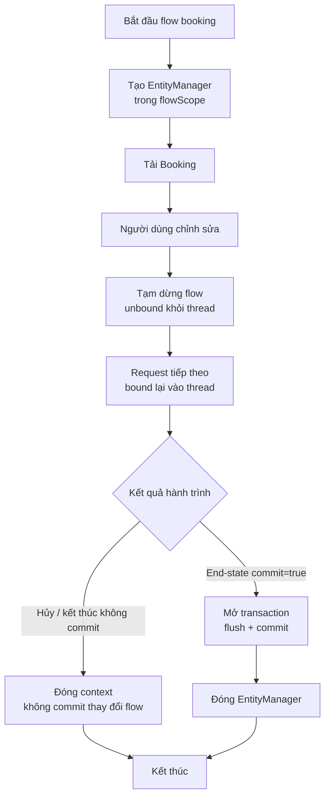
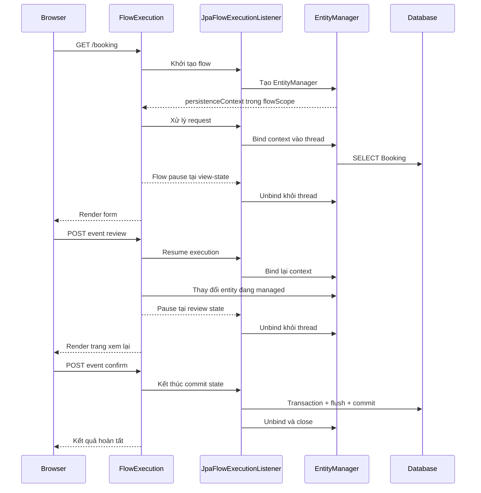

# JpaFlowExecutionListener và EntityManager theo flow

Trong **Spring Web Flow**, một quy trình như đặt phòng, đăng ký dịch vụ hoặc xử lý đơn hàng có thể kéo dài qua nhiều màn hình và nhiều HTTP request. Người dùng tải dữ liệu, sửa một vài trường, xem lại, quay lại chỉnh tiếp rồi mới xác nhận. Nếu mỗi request mở một `EntityManager` độc lập và trả các entity đã tách khỏi persistence context, ứng dụng phải tự quản lý việc nạp lại, đồng bộ thay đổi và xử lý xung đột giữa các bước.

Spring Web Flow cung cấp mô hình **Flow-Managed Persistence Context (FMPC)** cho tình huống này. Với JPA, `JpaFlowExecutionListener` tạo và quản lý một `EntityManager` gắn với vòng đời flow; persistence context được giữ trong `flowScope`, được đưa vào thread khi engine xử lý request và được gỡ khỏi thread khi flow tạm dừng. Khi flow kết thúc ở một end-state được đánh dấu commit, listener thực hiện commit trong transaction rồi đóng context.

Bài học thuộc chương **Dữ liệu và giao dịch**, tập trung vào cách cấu hình `JpaFlowExecutionListener`, sử dụng `EntityManager` theo flow, xác định điểm commit, phối hợp subflow, giữ tính nhất quán khi người dùng quay lại và kiểm thử cả trường hợp thành công lẫn hủy hoặc xung đột dữ liệu.

## 1. Bài toán persistence qua nhiều bước

Giả sử người dùng sửa một đặt phòng:

1. Mở flow và tải entity `Booking` từ cơ sở dữ liệu.
2. Sửa ngày nhận phòng và số khách.
3. Chuyển sang màn hình xem lại.
4. Quay lại chỉnh ngày hoặc thêm ghi chú.
5. Xác nhận để lưu thay đổi.

Nếu hệ thống ghi từng thay đổi vào database ngay sau mỗi request, thao tác **Hủy** không thể đơn giản loại bỏ những chỉnh sửa đã commit trước đó. Nếu mỗi bước chỉ giữ một DTO detached, ứng dụng lại phải tải entity, kiểm tra version và áp dụng thay đổi nhiều lần.

FMPC giải quyết bài toán bằng cách giữ một persistence context trong phạm vi **một flow execution**. Các entity được quản lý trong cùng context qua nhiều bước; thay đổi có thể được tích lũy trong khi người dùng đang làm việc và chỉ được commit khi hành trình đi đến điểm kết thúc có chủ đích.



**Persistence context và transaction là hai khái niệm khác nhau.** Persistence context có thể sống qua nhiều request của flow; transaction ghi dữ liệu nên ngắn và được điều khiển theo ranh giới nghiệp vụ. FMPC không có nghĩa giữ một transaction hoặc một kết nối database mở trong suốt thời gian người dùng đọc và sửa form.

## 2. JpaFlowExecutionListener làm những việc gì?

`JpaFlowExecutionListener` là một implementation của `FlowExecutionListener`, triển khai mẫu **Flow-Managed Persistence Context** bằng API JPA chuẩn.

Vòng đời khái quát:

| Thời điểm | Việc listener thực hiện |
| --- | --- |
| Flow bắt đầu | Tạo `EntityManager` mới và đặt persistence context vào `flowScope` |
| Trước khi xử lý request của execution | Đưa persistence context của flow thành persistence context hiện hành trên thread |
| Flow tạm dừng chờ người dùng | Gỡ persistence context khỏi thread; context vẫn thuộc flow |
| Flow tiếp tục ở request sau | Đưa lại persistence context của flow vào thread trước khi xử lý |
| Flow kết thúc tại commit state | Commit thay đổi trong transaction, sau đó unbind và đóng context |
| Flow kết thúc không có commit | Dọn dẹp context mà không thực hiện commit của FMPC |

Tên biến đặc biệt để truy cập context trong flow là **`persistenceContext`**. Listener cũng lưu context dưới thuộc tính nội bộ có tên `PERSISTENCE_CONTEXT_ATTRIBUTE`; ứng dụng thông thường nên dùng biến đặc biệt mà Web Flow cung cấp thay vì tự quản lý thuộc tính nội bộ này.

### Persistence context theo flow, không phải theo thread

Một flow có thể được tiếp tục bởi các request khác nhau, thậm chí được xử lý trên những thread servlet khác nhau. Listener bind cùng context vào thread đang xử lý request rồi unbind khi flow pause. Vì thế:

- Không được giữ `EntityManager` trong một biến `static` hoặc field mutable của singleton bean.
- Không chuyển `EntityManager` của flow sang background thread hay tác vụ chạy song song.
- Không giả định một thread servlet cụ thể sẽ phục vụ mọi request của flow.
- Không tự đóng context trong action hoặc DAO khi listener còn chịu trách nhiệm vòng đời.

`EntityManagerFactory` được thiết kế để dùng chung; một `EntityManager` là đối tượng quản lý persistence context và không an toàn khi nhiều thread cùng thao tác. Cơ chế bind/unbind của listener cho phép Spring-managed data access sử dụng đúng context trong request đang chạy.

## 3. Bật flow-managed persistence trong định nghĩa flow

Để một flow dùng FMPC, khai báo phần tử `persistence-context` ở **cấp flow**:

```xml
<?xml version="1.0" encoding="UTF-8"?>
<flow xmlns="http://www.springframework.org/schema/webflow"
      xmlns:xsi="http://www.w3.org/2001/XMLSchema-instance"
      xsi:schemaLocation="
          http://www.springframework.org/schema/webflow
          http://www.springframework.org/schema/webflow/spring-webflow.xsd">

    <persistence-context />

    <!-- input, variable, state và transition của flow -->
</flow>
```

Khai báo này cho biết flow cần persistence context do cơ chế flow-managed cung cấp. **Chỉ thêm `<persistence-context />` chưa đủ**: `FlowExecutor` cũng phải được đăng ký `JpaFlowExecutionListener`, và listener phải nhận đúng `EntityManagerFactory` cùng `PlatformTransactionManager`.

Khi flow bắt đầu, listener tạo một `EntityManager` mới và lưu nó trong `flowScope`. Bên trong flow, có thể dùng biến đặc biệt `persistenceContext` để gọi API JPA trực tiếp hoặc gọi service/DAO Spring-managed dùng chung persistence context hiện hành.

## 4. Đăng ký listener với FlowExecutor

Trong cấu hình XML Spring Web Flow 2.x, cấu hình điển hình:

```xml
<webflow:flow-executor id="flowExecutor"
                       flow-registry="flowRegistry">
    <webflow:flow-execution-listeners>
        <webflow:listener ref="jpaFlowExecutionListener" />
    </webflow:flow-execution-listeners>
</webflow:flow-executor>

<bean id="jpaFlowExecutionListener"
      class="org.springframework.webflow.persistence.JpaFlowExecutionListener">
    <constructor-arg ref="entityManagerFactory" />
    <constructor-arg ref="transactionManager" />
</bean>
```

Hai constructor argument có ý nghĩa:

| Phụ thuộc | Vai trò |
| --- | --- |
| `entityManagerFactory` | Tạo persistence context/`EntityManager` cho flow |
| `transactionManager` | Điều khiển transaction dùng để commit khi flow kết thúc ở commit state |

`transactionManager` cần quản lý đúng persistence unit mà `entityManagerFactory` cung cấp. Nếu ứng dụng có nhiều database hoặc nhiều `EntityManagerFactory`, phải nối listener với đúng cặp factory/transaction manager; nếu không, thao tác đọc và commit có thể đi qua hai persistence unit khác nhau.

Ví dụ trên giả định dự án đã khai báo `flowRegistry`, `entityManagerFactory` và một JPA transaction manager tương thích. Cần bảo đảm `FlowExecutor` mà `FlowHandlerAdapter` thực sự sử dụng là executor có listener này; cấu hình một listener ở một executor khác không làm thay đổi flow đang chạy qua executor hiện tại.

### Chọn đúng namespace JPA theo phiên bản

Spring Web Flow 2.x và 3.x thuộc hai thế hệ API persistence khác nhau:

| Dòng phiên bản tham chiếu | Kiểu JPA |
| --- | --- |
| Spring Web Flow 2.4/2.5 | `javax.persistence.EntityManagerFactory` |
| Spring Web Flow 3.0.x | `jakarta.persistence.EntityManagerFactory` |

Không trộn `javax.persistence.*` và `jakarta.persistence.*` trong cùng một cấu hình chỉ vì tên class giống nhau. Chọn phiên bản Spring Web Flow, Spring Framework, JPA provider và transaction manager tương thích; constructor của listener phải nhận đúng loại `EntityManagerFactory` mà bộ dependency đó sử dụng.

## 5. Dùng EntityManager trong flow

Khi FMPC đã được cấu hình, flow có thể truy cập biến đặc biệt `persistenceContext`. Ví dụ tải entity theo ID đầu vào:

```xml
<input name="bookingId"
       type="java.lang.Long"
       required="true" />

<on-start>
    <evaluate
        expression="persistenceContext.find(T(com.example.booking.Booking), flowScope.bookingId)"
        result="flowScope.booking" />
</on-start>
```

`persistenceContext.find(...)` trả về entity được quản lý bởi context của flow. Nếu entity được thay đổi trong các bước sau, JPA theo dõi thay đổi đó trong persistence context; không cần gọi `merge()` sau mỗi lần chuyển màn hình chỉ để giữ trạng thái của một entity đã được quản lý.

Có thể dùng service/DAO Spring-managed thay vì gọi trực tiếp `EntityManager` từ biểu thức flow. Cách này thường giữ ranh giới nghiệp vụ và truy cập dữ liệu rõ hơn:

```java
package com.example.booking;

import jakarta.persistence.EntityManager;
import jakarta.persistence.PersistenceContext;
import org.springframework.stereotype.Repository;

@Repository
public class BookingRepository {

    @PersistenceContext
    private EntityManager entityManager;

    public Booking findForEditing(Long id) {
        return entityManager.find(Booking.class, id);
    }
}
```

Đoạn Java dùng namespace `jakarta.persistence` theo Spring Web Flow 3/Jakarta. Với dòng Web Flow 2.x dùng `javax.persistence`, thay import cho đồng bộ với dependency dự án.

Spring-managed `@PersistenceContext`/DAO có thể lấy `EntityManager` đang được listener bind vào thread, miễn là dùng cùng `EntityManagerFactory` và cơ chế Spring JPA phù hợp. Vì vậy DAO singleton giữ một shared proxy được inject bởi Spring; DAO không tự tạo một `EntityManager` mới cho mỗi method nếu mục tiêu là dùng FMPC.

## 6. Ví dụ flow chỉnh sửa booking và chỉ commit khi xác nhận

Giả sử ứng dụng cho phép sửa ngày đến và số khách. Flow giữ entity `Booking` được quản lý, còn giao diện dùng một form DTO chỉ chứa những field người dùng được phép thay đổi.

```xml
<?xml version="1.0" encoding="UTF-8"?>
<flow xmlns="http://www.springframework.org/schema/webflow"
      xmlns:xsi="http://www.w3.org/2001/XMLSchema-instance"
      xsi:schemaLocation="
          http://www.springframework.org/schema/webflow
          http://www.springframework.org/schema/webflow/spring-webflow.xsd">

    <persistence-context />

    <input name="bookingId"
           type="java.lang.Long"
           required="true" />

    <on-start>
        <evaluate
            expression="bookingService.loadManaged(flowScope.bookingId)"
            result="flowScope.booking" />
        <evaluate
            expression="bookingMapper.toForm(flowScope.booking)"
            result="flowScope.bookingForm" />
    </on-start>

    <view-state id="editBooking"
                view="booking/edit"
                model="bookingForm">
        <binder>
            <binding property="arrivalDate" required="true" />
            <binding property="guestCount" required="true" />
        </binder>
        <transition on="review" to="applyChanges" />
        <transition on="cancel" to="cancelled"
                    bind="false" validate="false" />
    </view-state>

    <action-state id="applyChanges">
        <evaluate
            expression="bookingService.applyAllowedChanges(flowScope.booking, flowScope.bookingForm)" />
        <transition on="updated" to="reviewBooking" />
    </action-state>

    <view-state id="reviewBooking" view="booking/review">
        <transition on="back" to="editBooking" />
        <transition on="confirm" to="bookingConfirmed" />
        <transition on="cancel" to="cancelled" />
    </view-state>

    <end-state id="bookingConfirmed" commit="true" />
    <end-state id="cancelled" />
</flow>
```

Ở đây:

1. `<persistence-context />` yêu cầu flow có FMPC.
2. Khi flow bắt đầu, `bookingService.loadManaged(...)` tải entity trong persistence context hiện hành.
3. Form dùng DTO `bookingForm`, tránh bind trực tiếp các thuộc tính nội bộ của entity.
4. Action `applyAllowedChanges(...)` chép những field được phép vào entity đang được quản lý.
5. Người dùng có thể quay lại sửa form trước khi xác nhận.
6. Chỉ end-state `bookingConfirmed` có `commit="true"` mới kích hoạt quyết định commit của FMPC.
7. End-state `cancelled` không đánh dấu commit; các thay đổi chưa được commit trong context của flow sẽ không được lưu bởi điểm kết thúc này.

Các bean `bookingService`, `bookingMapper`, DTO, validator và view là thành phần ứng dụng cần triển khai. Flow XML thể hiện điều hướng và thời điểm kết thúc; quy tắc quyền sửa booking và bất biến nghiệp vụ vẫn thuộc service.

## 7. Commit ở end-state có ý nghĩa gì?

Trong FMPC, **điểm commit là một phần của mô hình điều hướng**. Đánh dấu end-state bằng `commit="true"`:

```xml
<end-state id="bookingConfirmed" commit="true" />
```

Khi execution kết thúc tại state này, `JpaFlowExecutionListener` thực hiện commit thay đổi trong một transaction bằng transaction manager đã cấu hình, sau đó unbind và đóng persistence context.

Một end-state không có `commit="true"`:

```xml
<end-state id="cancelled" />
```

sẽ kết thúc flow mà không yêu cầu listener commit các chỉnh sửa đang giữ trong FMPC. Listener dọn dẹp context; những thay đổi chưa được flush/commit trong context đó không trở thành dữ liệu đã lưu của flow.

| End-state | `commit` | Ý nghĩa |
| --- | --- | --- |
| `bookingConfirmed` | `true` | Chấp nhận thay đổi và commit khi flow kết thúc |
| `cancelled` | Mặc định/không khai báo | Kết thúc mà không commit thay đổi FMPC |
| `expired` | Mặc định/không khai báo | Không commit nếu chính sách flow coi đây là kết thúc không xác nhận |

**Không đánh dấu mọi end-state là commit.** Nếu cả nhánh Hủy và nhánh Hoàn tất đều commit, người dùng có thể lưu thay đổi ngoài ý định. Đặt tên outcome rõ ràng và review từng end-state như một quyết định giao dịch.

### Commit không phải là một event

Event như `confirm` có thể đưa flow đến end-state `bookingConfirmed`; thuộc tính `commit="true"` trên end-state mới là cấu hình quyết định FMPC commit khi kết thúc. Chỉ đặt tên event là `commit` hoặc `save` không tự làm transaction được commit.

## 8. Persistence context sống qua nhiều request, transaction thì không

Một flow có thể tạm dừng tại view để chờ người dùng trong vài phút. Trong thời gian đó, persistence context vẫn thuộc flow execution, nhưng không nên giữ transaction cơ sở dữ liệu mở.



Mô hình này cho phép giữ các entity đang được quản lý giữa những request, nhưng không giữ một transaction mở xuyên suốt thời gian người dùng suy nghĩ. Transaction chỉ xuất hiện ở ranh giới cần thiết, đặc biệt là lần commit cuối.

## 9. Quy tắc transaction trong thời gian flow còn hoạt động

Theo mô hình FMPC, các thao tác truy cập dữ liệu trong quá trình flow đang chạy mặc định **không dùng read-write transaction dài hạn**. Nếu cần gọi service có transaction để đọc thêm dữ liệu, nên dùng transaction read-only khi transaction manager và JPA provider hỗ trợ cách phối hợp này.

Tài liệu Spring Web Flow lưu ý rằng với Spring JPA transaction manager và một số provider như Hibernate, Spring có thể đặt flush mode phù hợp (ví dụ `MANUAL`) trong read-only transaction để các thay đổi đang giữ trong persistence context không bị flush sớm khi chỉ đọc dữ liệu mới.

| Giai đoạn | Cách truy cập nên dùng | Lý do |
| --- | --- | --- |
| Tải entity khi bắt đầu | Non-transactional theo FMPC hoặc read-only transaction được hỗ trợ | Không commit chỉnh sửa trung gian |
| Người dùng xem dữ liệu ở các bước | Đọc qua persistence context hiện hành | Giữ entity nhất quán trong flow |
| Người dùng chỉnh sửa entity | Thay đổi entity đang managed, chưa commit | Cho phép quay lại hoặc hủy |
| Tải thêm dữ liệu tham chiếu | Read-only transaction nếu cấu hình/provider hỗ trợ | Tránh flush thay đổi đang chờ |
| Xác nhận cuối flow | Transaction read-write do listener điều khiển | Flush và commit thay đổi được chấp nhận |

### Cẩn thận với `@Transactional` mặc định

Một service có `@Transactional` mặc định thường tạo transaction read-write. Nếu flow gọi service đó ở giữa hành trình và service commit thay đổi của entity, FMPC không còn giữ được ý nghĩa “chỉ lưu khi hoàn tất”.

Ví dụ không nên dùng cho bước chỉnh sửa trung gian:

```java
@Transactional
public void updateAndSave(Booking booking, BookingForm form) {
    booking.setArrivalDate(form.getArrivalDate());
    booking.setGuestCount(form.getGuestCount());
}
```

Nếu method này chạy trong transaction read-write riêng và commit, việc người dùng hủy ở state sau không thể tự hoàn tác lần commit đó.

Một cách phù hợp hơn cho bước đọc:

```java
@Transactional(readOnly = true)
public List<RoomOption> findAvailableOptions(Long hotelId) {
    return roomRepository.findOptions(hotelId);
}
```

Đối với thay đổi entity đã được FMPC quản lý, service có thể áp dụng các field cho phép mà không tự mở một transaction read-write trung gian; việc commit cuối do listener thực hiện. Cách phối hợp cụ thể cần được kiểm thử với transaction manager và JPA provider của ứng dụng.

**Không dựa vào `readOnly=true` như một cơ chế bảo mật hay đảm bảo phổ quát.** Hiệu quả flush mode phụ thuộc transaction manager/provider. Hãy xác nhận bằng integration test rằng các chỉnh sửa đang chờ không bị ghi xuống database trước end-state commit.

## 10. EntityManager theo flow và DAO Spring-managed

FMPC hoạt động thuận tiện khi DAO sử dụng shared `EntityManager` do Spring quản lý. Ví dụ:

```java
@Repository
public class BookingRepository {

    @PersistenceContext
    private EntityManager entityManager;

    public Booking findById(Long id) {
        return entityManager.find(Booking.class, id);
    }

    public void applyChanges(Booking booking,
                             BookingForm form) {
        booking.setArrivalDate(form.getArrivalDate());
        booking.setGuestCount(form.getGuestCount());
    }
}
```

Trong cấu hình Spring JPA phù hợp, proxy được inject qua `@PersistenceContext` sẽ tìm `EntityManager` gắn với thread hiện tại. Khi `JpaFlowExecutionListener` bind persistence context của flow, các DAO dùng cùng factory có thể làm việc với context đó.

Một số nguyên tắc:

- `EntityManagerFactory` dùng chung ở cấp ứng dụng; không tạo factory mới cho mỗi flow.
- DAO singleton không giữ một `EntityManager` thật được tạo thủ công trong field.
- DAO không tự `close()` shared `EntityManager` mà Spring cung cấp qua `@PersistenceContext`.
- Không gọi `merge()` vô điều kiện cho entity đã được quản lý; trước tiên xác định entity đang managed hay detached.
- Không dùng một repository kết nối sang `EntityManagerFactory` khác rồi kỳ vọng nó tham gia cùng FMPC.

Nếu dự án chủ động dùng `EntityManagerFactory.createEntityManager()` trong DAO, DAO phải tự chịu trách nhiệm vòng đời context riêng và sẽ không tự động dùng FMPC của flow. Chỉ làm vậy khi thực sự cần một persistence context độc lập và đã thiết kế transaction/lifecycle tương ứng.

## 11. Dùng DTO cho form, giữ entity managed trong flow

FMPC không đồng nghĩa nên bind trực tiếp toàn bộ entity JPA vào form. Một entity có thể có:

- Field quản trị như `status`, `approvedBy`, `createdAt`.
- Quan hệ lazy như `customer`, `payments`, `items`.
- Thuộc tính version dùng optimistic locking.
- Những field chỉ service được phép cập nhật.

Nếu request bind thẳng vào entity, người dùng có thể thử gửi thêm tham số ngoài dự kiến. Nên dùng DTO/form model với whitelist field, sau đó action/service áp dụng những thay đổi được phép lên entity managed.

```java
public class BookingForm {
    private LocalDate arrivalDate;
    private Integer guestCount;

    // getters/setters
}
```

```java
public void applyAllowedChanges(Booking booking,
                                BookingForm form) {
    booking.setArrivalDate(form.getArrivalDate());
    booking.setGuestCount(form.getGuestCount());
}
```

Đoạn service chỉ cập nhật hai thuộc tính mà form được phép thay đổi. Không nhận `status`, `version`, `ownerId` hoặc quyền phê duyệt từ request chỉ vì các field đó tồn tại trong entity.

**Entity managed được giữ trong persistence context; DTO được bind từ HTTP.** Hai object có mục đích khác nhau. Khi người dùng quay lại form, flow có thể tạo lại DTO từ entity hoặc giữ DTO trong `flowScope`, nhưng cần đồng bộ các thay đổi theo quy tắc rõ ràng.

## 12. Subflow có thể dùng chung persistence context của flow cha

Nếu một quy trình lớn gọi subflow để xử lý một phần công việc, FMPC có thể được truyền xuống subflow. Flow cha và flow con đều cần khai báo:

```xml
<!-- Flow cha -->
<flow xmlns="http://www.springframework.org/schema/webflow">
    <persistence-context />

    <subflow-state id="editGuestDetails"
                   subflow="guestDetails">
        <input name="bookingId"
               value="flowScope.booking.id" />
        <transition on="updated" to="reviewBooking" />
        <transition on="cancelled" to="reviewBooking" />
    </subflow-state>

    <end-state id="confirmed" commit="true" />
    <end-state id="cancelled" />
</flow>
```

```xml
<!-- Flow con guestDetails -->
<flow xmlns="http://www.springframework.org/schema/webflow">
    <persistence-context />

    <input name="bookingId"
           type="java.lang.Long"
           required="true" />

    <!-- Các state dùng persistenceContext của flow-managed context -->
    <end-state id="updated" />
    <end-state id="cancelled" />
</flow>
```

Khi subflow khai báo `<persistence-context />` và tái sử dụng context do flow cha tạo, persistence context được **propagate** xuống subflow. Trong trường hợp này, commit flag ở end-state của subflow được bỏ qua để flow cha giữ quyền quyết định commit cuối cùng.

Điều này có nghĩa:

1. Flow cha khởi tạo persistence context.
2. Flow con sử dụng cùng context để tải hoặc sửa các entity liên quan.
3. Flow con kết thúc và trả outcome cho flow cha; chưa commit chỉ vì flow con đã kết thúc.
4. Flow cha tiếp tục hoặc hủy; quyết định commit cuối thuộc end-state của flow cha.

Nếu subflow cũng có thể được khởi chạy độc lập, hãy kiểm thử riêng trường hợp đó: khi nó là flow root, nó có thể tạo persistence context riêng và commit theo end-state của chính nó.

## 13. Optimistic locking và xung đột khi commit cuối

FMPC có thể giữ một entity qua thời gian người dùng suy nghĩ. Trong khoảng thời gian đó, người khác có thể cập nhật cùng bản ghi. Để tránh ghi đè âm thầm, thường kết hợp FMPC với **optimistic locking** bằng `@Version`.

```java
import jakarta.persistence.Entity;
import jakarta.persistence.Id;
import jakarta.persistence.Version;

@Entity
public class Booking {
    @Id
    private Long id;

    @Version
    private Long version;

    private Integer guestCount;
    // getters/setters
}
```

Kịch bản:

1. Flow A và flow B cùng tải booking có version 4.
2. Flow A sửa số khách và commit thành công; version tăng lên 5.
3. Flow B vẫn giữ bản entity với version 4.
4. Khi flow B đi đến end-state `commit="true"`, JPA phát hiện version trong database không còn khớp và commit thất bại.

Đây là hành vi bảo vệ dữ liệu, không phải lỗi cần bỏ qua. Ứng dụng nên đưa người dùng đến một đường xử lý phù hợp: thông báo dữ liệu đã được người khác cập nhật, tải lại phiên bản mới và yêu cầu xác nhận lại. Không tự động retry commit với entity cũ vì có thể ghi đè thay đổi của người khác.

## 14. Hủy flow và các side effect ngoài JPA

Khi người dùng chọn Hủy và flow kết thúc tại end-state không commit, listener không commit các thay đổi đang giữ trong FMPC. Điều đó hữu ích cho chỉnh sửa entity chưa được lưu.

Tuy nhiên, **FMPC không tự hoàn tác những side effect đã được commit ở nơi khác**:

| Tác vụ trong quá trình flow | Khi flow bị hủy |
| --- | --- |
| Sửa field trên entity managed, chưa commit | Không được lưu bởi FMPC khi kết thúc không commit |
| Gọi service mở transaction read-write riêng và commit | Thay đổi đã commit vẫn tồn tại |
| Gửi email hoặc gọi API bên ngoài | Không thể tự thu hồi bằng cách đóng EntityManager |
| Ghi file hoặc phát message ra hệ thống khác | Cần cơ chế bù trừ hoặc xử lý riêng |
| Tạo một transaction độc lập cho thao tác trung gian | Transaction đó có vòng đời riêng, không phụ thuộc end-state FMPC |

Vì vậy, tránh thực hiện các hành động không thể đảo ngược trong những bước mà người dùng vẫn có thể hủy. Nếu cần side effect trước commit cuối, thiết kế trạng thái nghiệp vụ tạm, outbox, saga/compensation hoặc một cơ chế giao dịch phù hợp.

## 15. Session, lưu flow execution và thời gian sống của context

FMPC tồn tại cùng flow execution. Nếu ứng dụng lưu flow state trong HTTP session và session hết hạn trước khi người dùng xác nhận, tiến trình chưa commit có thể bị mất. Tài liệu Spring Web Flow khuyến nghị dùng **durable store cho flow state** khi cần lưu và khởi động lại tiến trình sau một khoảng thời gian dài.

Trước khi dùng FMPC cho quy trình kéo dài, cần trả lời:

- Flow execution được lưu trong session hay repository bền vững?
- Người dùng có thể tiếp tục sau khi đăng xuất hoặc sau khi server restart không?
- Cơ chế lưu/khôi phục có hỗ trợ các đối tượng trong flow scope và persistence context theo cách ứng dụng cần không?
- Khi execution bị timeout hoặc bị xóa, ai chịu trách nhiệm dọn dẹp và xử lý dữ liệu chưa commit?
- Có giới hạn số flow đang mở trên mỗi người dùng để tránh giữ quá nhiều entity và tài nguyên không?

Không mặc định một `EntityManager` có thể được serialize an toàn bởi mọi durable flow repository. Cần xác minh khả năng tương thích của repository, provider và cách triển khai; nếu không thể lưu FMPC bền vững, cân nhắc lưu draft bằng DTO/ID ở tầng service và mở persistence context mới khi người dùng tiếp tục.

## 16. Khi nào nên dùng FMPC và khi nào nên để service layer quản lý?

Spring Web Flow cũng hỗ trợ một cách tiếp cận khác: **service layer tự quản lý persistence context và transaction**, còn flow chỉ giữ DTO hoặc ID qua các bước. Hai mô hình giải quyết các nhu cầu khác nhau.

| Tiêu chí | Flow-managed persistence | Service-layer-managed persistence |
| --- | --- | --- |
| Nơi giữ persistence context | Gắn với flow execution | Mỗi thao tác/service transaction tự quản lý |
| Entity qua nhiều bước | Có thể giữ entity managed xuyên request | Thường truyền DTO/ID và tải lại khi cần |
| Điểm commit | End-state có `commit="true"` | Service transaction theo từng use case |
| Hủy chỉnh sửa trung gian | Có thể bỏ thay đổi chưa commit của FMPC | Cần draft, command hoặc cơ chế bù trừ |
| Độ phức tạp vòng đời | Listener, flow scope, repository và transaction manager phải phối hợp | Transaction tập trung ở service layer |
| Phù hợp | Quy trình nhiều bước cần cô lập thay đổi đến cuối | Ứng dụng muốn web layer không phụ thuộc persistence context |

Không cần bật FMPC cho mọi flow có truy cập database. Nếu mỗi request có thể hoàn thành một use case độc lập và service trả DTO, để service layer quản lý transaction thường đơn giản hơn. Chọn FMPC khi lợi ích giữ entity và trì hoãn commit thực sự phù hợp với nghiệp vụ.

## 17. Kiểm thử JpaFlowExecutionListener và commit lifecycle

Kiểm thử cần chạy qua flow executor đã đăng ký listener, dùng JPA provider và database test phù hợp. Chỉ unit test một method repository không chứng minh FMPC được khởi tạo, bind/unbind hoặc commit đúng lúc.

### Ma trận kiểm thử chính

| Kịch bản | Điều cần xác nhận |
| --- | --- |
| Bắt đầu flow có `<persistence-context />` | Có persistence context trong `flowScope` |
| Flow pause ở view-state | Context được gỡ khỏi thread, không giữ transaction mở để chờ người dùng |
| Request tiếp tục cùng execution | Context của flow được bind lại trước khi xử lý |
| Sửa entity rồi pause ở màn hình review | Thay đổi vẫn nằm trong context; database chưa nhận commit cuối |
| Đi tới end-state `commit="true"` | Listener commit trong transaction và đóng context |
| Đi tới end-state không commit | Thay đổi chưa commit của FMPC không được lưu |
| Hai flow cùng sửa entity có `@Version` | Flow commit sau phát hiện optimistic locking conflict |
| Subflow khai báo persistence-context | Dùng context của flow cha khi được propagate |
| Subflow kết thúc | Không tự commit context dùng chung trước khi flow cha quyết định |
| Service đọc trong read-only transaction | Không flush sớm thay đổi đang chờ nếu provider/configuration hỗ trợ |
| Session/execution bị hết hạn | Dữ liệu chưa commit và cleanup được xử lý theo chính sách |
| Exception trong lúc commit | Transaction rollback/failure được quan sát và có đường xử lý phù hợp |

### Kiểm tra database bằng persistence context mới

Sau khi flow kết thúc, không nên đọc lại entity bằng chính `EntityManager` vừa giữ entity đã sửa rồi kết luận database đã lưu. First-level cache có thể trả object đang có trong memory. Hãy kiểm tra bằng transaction/`EntityManager` mới hoặc clear context phù hợp:

1. Tạo booking ban đầu với `guestCount = 2`.
2. Khởi động flow, sửa thành `guestCount = 4` rồi dừng ở màn hình review.
3. Đọc bằng context độc lập và xác nhận database vẫn là 2 trước commit.
4. Gửi event xác nhận để đi tới end-state `commit="true"`.
5. Đọc lại bằng context mới và xác nhận database là 4.

Một test riêng nên sửa thành 5 rồi đi tới end-state Hủy; sau khi flow kết thúc, context độc lập vẫn phải đọc giá trị 4. Test này chứng minh thay đổi chưa commit được loại bỏ khi hủy.

### Kiểm tra subflow và optimistic lock

- Flow cha tải entity; subflow sửa entity; subflow kết thúc; flow cha vẫn có thể đọc thay đổi trong cùng persistence context.
- Khi subflow kết thúc, database chưa commit nếu parent chưa đi tới commit state.
- Tạo hai execution cùng tải một entity có `@Version`; commit execution thứ nhất rồi thử commit execution thứ hai và xác nhận xung đột được phát hiện.

## 18. Những lỗi cấu hình và thiết kế thường gặp

| Triệu chứng | Nguyên nhân có thể | Hướng kiểm tra |
| --- | --- | --- |
| `persistenceContext` không có trong flow | Flow thiếu `<persistence-context />` hoặc listener không được đăng ký | Kiểm tra XML flow và listener trong executor |
| Flow có khai báo nhưng không tạo được context | Listener dùng sai `EntityManagerFactory` hoặc bean không khởi tạo | Kiểm tra constructor args và dependency JPA |
| DAO dùng context khác | DAO dùng factory khác hoặc tự `createEntityManager()` | Đối chiếu factory và `@PersistenceContext` |
| Thay đổi được lưu trước khi người dùng xác nhận | Service trung gian commit transaction read-write | Kiểm tra `@Transactional`, flush và transaction boundary |
| Hủy flow nhưng dữ liệu vẫn đổi | Đã có transaction/side effect độc lập commit trước đó | Tách thay đổi tạm khỏi thao tác ghi không thể đảo ngược |
| Commit cuối thất bại | Constraint, optimistic lock, transaction manager hoặc provider | Kiểm tra nguyên nhân commit và đường xử lý lỗi |
| Subflow commit sớm | Subflow không tái sử dụng FMPC như dự kiến hoặc tự dùng transaction khác | Khai báo persistence-context phù hợp ở parent/child và test |
| Entity lazy loading lỗi khi render | Truy cập association ngoài lúc context được bind hoặc sau khi flow kết thúc | Tải dữ liệu cần thiết trong request phù hợp hoặc chuyển DTO |
| Lỗi khi server restart | Repository không hỗ trợ lưu/khôi phục trạng thái FMPC như giả định | Kiểm tra durable store và khả năng phục hồi context |
| Lỗi class `javax`/`jakarta` | Trộn thế hệ JPA với phiên bản Web Flow | Đồng bộ dependency và import |

### Checklist review

```text
□ Flow khai báo <persistence-context /> ở cấp flow.
□ FlowExecutor đăng ký JpaFlowExecutionListener.
□ Listener nhận đúng EntityManagerFactory và PlatformTransactionManager.
□ DAO dùng cùng EntityManagerFactory và Spring-managed EntityManager.
□ Các bước trung gian không commit read-write ngoài ý muốn.
□ End-state xác nhận có commit="true".
□ End-state hủy không có commit="true".
□ Subflow khai báo persistence-context nếu cần dùng chung context.
□ Entity có @Version nếu cần phát hiện cập nhật đồng thời.
□ Session/repository có chính sách cho flow kéo dài và timeout.
□ Integration test kiểm tra database bằng persistence context mới.
```

## 19. Bài thực hành: sửa booking qua nhiều request và commit một lần

Hãy xây dựng flow `bookingEdit` với các bước:

1. Nhận `bookingId` và tải entity `Booking` bằng DAO Spring-managed.
2. Khai báo `<persistence-context />` và đăng ký `JpaFlowExecutionListener` vào `FlowExecutor`.
3. Hiển thị DTO gồm ngày đến và số khách; chỉ cho phép binding hai field này.
4. Khi người dùng nhấn **Xem lại**, áp dụng field hợp lệ lên entity đang managed rồi chuyển tới màn hình review.
5. Cho phép quay lại sửa nhiều lần; xác nhận mỗi request tiếp tục dùng context của cùng flow execution.
6. Khi người dùng nhấn **Xác nhận**, kết thúc tại `<end-state id="confirmed" commit="true" />`.
7. Khi người dùng nhấn **Hủy**, kết thúc tại end-state không commit.
8. Tạo một subflow `guestDetails` cũng khai báo `<persistence-context />`, sửa một thuộc tính của booking và kiểm tra parent vẫn quyết định commit cuối.
9. Thêm `@Version` vào entity và mô phỏng hai người dùng sửa cùng booking.
10. Viết integration test chứng minh thay đổi chưa có trong database trước commit, được lưu sau commit và bị bỏ khi hủy.

Hoàn thành khi flow giữ được entity managed qua nhiều bước, transaction chỉ được mở ở ranh giới cần thiết, nhánh xác nhận commit đúng một lần và nhánh hủy không lưu thay đổi FMPC. Nếu ứng dụng cần tiếp tục quy trình sau session timeout hoặc server restart, bổ sung kiểm thử cho cơ chế lưu/khôi phục execution trước khi chọn FMPC làm mô hình persistence chính.

## 20. Tài liệu tham khảo

- [Spring Web Flow Reference Guide 2.5.x — Flow Managed Persistence](https://docs.spring.io/spring-webflow/docs/2.5.x/reference/html/flow-managed-persistence.html): khai báo `<persistence-context />`, cấu hình `JpaFlowExecutionListener`, commit end-state và dùng chung persistence context trong subflow.
- [JpaFlowExecutionListener API — Spring Web Flow 3.0.1](https://docs.spring.io/spring-webflow/docs/3.0.1/api/org/springframework/webflow/persistence/JpaFlowExecutionListener.html): vòng đời context, bind/unbind theo request và commit khi flow kết thúc ở commit state.
- [JpaFlowExecutionListener API — Spring Web Flow 2.4.5](https://docs.spring.io/spring-webflow/docs/2.4.5.RELEASE/api/org/springframework/webflow/persistence/JpaFlowExecutionListener.html): constructor sử dụng `javax.persistence.EntityManagerFactory` trong thế hệ Web Flow 2.x.

`JpaFlowExecutionListener` phù hợp khi một flow cần giữ persistence context để người dùng chỉnh sửa entity qua nhiều bước rồi quyết định commit ở cuối. Khai báo `<persistence-context />`, đăng ký listener với đúng factory và transaction manager, đồng thời đánh dấu rõ end-state commit là ba phần không thể tách rời của cấu hình. Khi giữ transaction ngắn, dùng optimistic locking, chia sẻ context với subflow có chủ đích và kiểm thử bằng persistence context độc lập, ứng dụng có thể bảo toàn thay đổi trung gian mà vẫn kiểm soát được thời điểm ghi dữ liệu.
