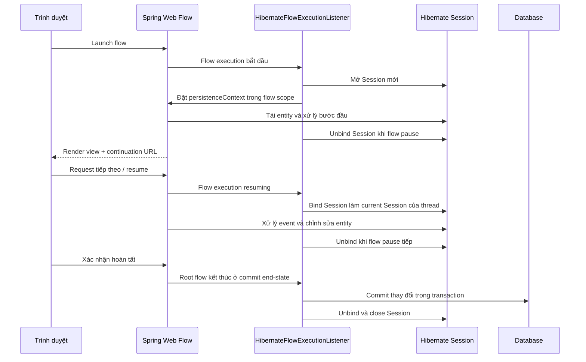

# Tích hợp Hibernate theo khả năng của phiên bản sử dụng

## 1. Vai trò của Hibernate trong một flow nhiều bước

Spring Web Flow (SWF) điều phối một hành trình qua nhiều HTTP request. Ví dụ, người dùng sửa thông tin đặt phòng theo các bước:

1. Mở hồ sơ đặt phòng.
2. Chỉnh ngày nhận/trả phòng và số khách.
3. Xem lại thay đổi.
4. Xác nhận để lưu, hoặc hủy để bỏ thay đổi.

Hibernate ánh xạ đối tượng Java với dữ liệu quan hệ và cung cấp **persistence context** để theo dõi entity. Spring quản lý việc tạo `SessionFactory`, tích hợp Session với transaction và cung cấp transaction manager. Spring Web Flow có thể phối hợp với những thành phần đó theo hai cách:

- **Flow-managed persistence context (FMPC):** một persistence context được gắn với vòng đời flow; người dùng có thể chỉnh sửa entity qua nhiều request rồi commit khi flow kết thúc ở end-state được đánh dấu.
- **Service-layer persistence:** flow chỉ giữ DTO và ID; service mở transaction, đọc/ghi dữ liệu ở từng thao tác. Đây thường là lựa chọn dễ kiểm soát hơn với flow dài, session timeout và hệ thống nhiều node.

SWF có listener chuyên dụng cho cả Hibernate native API và JPA: `HibernateFlowExecutionListener` và `JpaFlowExecutionListener`. Lựa chọn nào phù hợp phụ thuộc **phiên bản SWF, Spring Framework, Hibernate ORM và kiểu API mà ứng dụng sử dụng**.

## 2. Kiểm tra tương thích trước khi cấu hình

Không nên lấy một đoạn XML cũ rồi chỉ đổi số phiên bản dependency. Các thế hệ Spring/Hibernate có thay đổi ở namespace, API và cách Spring hỗ trợ Hibernate native.

| Nền tảng | Khả năng tích hợp cần lưu ý |
| --- | --- |
| Spring Web Flow 2.5.x | Dòng legacy đi cùng Spring Framework 5 và Java 8+; tài liệu 2.5 mô tả Hibernate 5. |
| Spring Web Flow 3.0.x | Yêu cầu Java 17+ và Spring Framework 6.0+; có `HibernateFlowExecutionListener` và `JpaFlowExecutionListener`. |
| Spring Framework 6 + Hibernate ORM 5.5/5.6 | Spring hỗ trợ native `LocalSessionFactoryBean` trong package `org.springframework.orm.hibernate5`, thường kết hợp `HibernateTransactionManager`. |
| Spring Framework 6 + Hibernate ORM 6 | Spring hỗ trợ Hibernate 6 chủ yếu với vai trò JPA provider; với ứng dụng mới nên dùng `LocalContainerEntityManagerFactoryBean`, `JpaTransactionManager` và listener JPA của Web Flow. |

Tài liệu Spring Framework 6 ghi rõ `LocalSessionFactoryBean` native tương thích Hibernate ORM 5.5/5.6; Hibernate ORM 6 được hỗ trợ chính thức như JPA provider. Vì vậy, việc SWF có class `HibernateFlowExecutionListener` **không có nghĩa mọi tổ hợp Spring/Hibernate đều dùng được listener native**. Hãy kiểm tra dependency tree và tài liệu đúng phiên bản trước khi chọn cấu hình.

Với dòng SWF 3.0, yêu cầu nền tảng là Java 17 trở lên và Spring Framework 6.0 trở lên. Dòng SWF 2.5 là lựa chọn legacy cho ứng dụng còn chạy Spring 5. Khi nâng cấp, hãy nâng cấp cả stack theo một tổ hợp đã được kiểm chứng, không chỉ thay riêng `spring-webflow`.

## 3. Hai mô hình tích hợp và cách chọn

| Tiêu chí | Flow-managed persistence | Service-layer persistence |
| --- | --- | --- |
| Nơi giữ persistence context | Gắn với flow scope và vòng đời flow | Nằm trong transaction của service |
| Thời gian sống | Có thể kéo dài qua nhiều request | Thường chỉ trong một lần gọi service |
| Nơi commit | End-state có `commit="true"` | Service command kết thúc transaction |
| Dữ liệu flow giữ | Có thể giữ entity đang được quản lý | Nên giữ DTO, form data và ID |
| Phù hợp | Quy trình chỉnh sửa có chủ đích commit một lần cuối | Flow dài, nhiều người dùng, timeout, retry và nhiều node |
| Rủi ro chính | Session lâu sống, dữ liệu cũ, flush sớm, session hết hạn | Cần tải lại entity và xử lý cập nhật giữa các bước |

**Khuyến nghị thực tế:** bắt đầu với service-layer persistence nếu không có yêu cầu cụ thể cần giữ một persistence context xuyên suốt flow. Chỉ chọn FMPC khi quy trình cần cô lập các chỉnh sửa trung gian và có một điểm commit rõ ràng ở cuối.

### 3.1. Service-layer persistence

Trong mô hình này, flow không cần khai báo `<persistence-context />` và không cần listener Hibernate của Web Flow. Service dùng transaction riêng:

```java
@Service
public class BookingService {

    private final BookingRepository bookingRepository;

    public BookingService(BookingRepository bookingRepository) {
        this.bookingRepository = bookingRepository;
    }

    @Transactional(readOnly = true)
    public BookingForm loadForm(long bookingId, long currentUserId) {
        Booking booking = bookingRepository
            .findOwnedBooking(bookingId, currentUserId)
            .orElseThrow(BookingNotFoundException::new);

        return BookingForm.from(booking);
    }

    @Transactional
    public void update(long bookingId, long currentUserId,
                       BookingForm form) {
        Booking booking = bookingRepository
            .findOwnedBooking(bookingId, currentUserId)
            .orElseThrow(BookingNotFoundException::new);

        booking.changeDates(form.getCheckIn(), form.getCheckOut());
        booking.changeGuestCount(form.getGuestCount());
    }
}
```

Đây là ví dụ Spring Data/JPA style; repository có thể dùng Hibernate native API bên dưới. Điểm quan trọng là transaction đọc và ghi được đóng trong service. Flow lưu `bookingId` và `BookingForm` qua các view-state; khi người dùng xác nhận, service tải lại entity, kiểm tra quyền và cập nhật.

Lợi ích là flow có thể tạm dừng lâu mà không giữ một Hibernate Session đang quản lý entity. Nếu dữ liệu thay đổi giữa các bước, service có thể kiểm tra version/trạng thái mới nhất trước khi ghi.

### 3.2. Flow-managed persistence context

FMPC phù hợp khi ứng dụng muốn:

- Tạo persistence context lúc flow bắt đầu.
- Tải entity vào context đó.
- Thực hiện chỉnh sửa qua một số view-state.
- Chỉ ghi thay đổi khi flow kết thúc thành công ở end-state có `commit="true"`.
- Bỏ các chỉnh sửa trung gian nếu flow kết thúc ở nhánh hủy không commit.

SWF quản lý việc bind/unbind persistence context quanh các lần xử lý request. Điều này **không có nghĩa giữ một database transaction mở trong lúc người dùng đọc trang và suy nghĩ**.

## 4. Flow-managed persistence hoạt động như thế nào?

Với Hibernate listener, vòng đời tổng quát:



Listener `HibernateFlowExecutionListener` thực hiện các việc chính:

1. Khi flow execution bắt đầu, tạo Hibernate `Session` và gắn nó vào flow scope dưới thuộc tính persistence context.
2. Trước khi xử lý request của flow đã pause, đưa Session tương ứng thành current Session cho thread đang xử lý.
3. Khi flow pause để chờ người dùng, unbind Session khỏi thread.
4. Khi flow kết thúc, commit nếu end-state là commit state; sau đó unbind context và đóng Session.

Session có thể được giữ theo conversation của flow, nhưng nó **không chiếm một thread hoặc giữ một transaction/connection mở trong suốt thời gian người dùng chờ**. Listener chỉ bind Session vào thread khi xử lý request.

## 5. Cấu hình Hibernate native với Spring Framework 6 và Hibernate 5.5/5.6

Phần này minh họa tổ hợp native Hibernate mà Spring Framework 6 hỗ trợ: `LocalSessionFactoryBean` và `HibernateTransactionManager` trong package `org.springframework.orm.hibernate5`.

### 5.1. Khai báo SessionFactory và transaction manager

Ví dụ XML Spring:

```xml
<bean id="sessionFactory"
      class="org.springframework.orm.hibernate5.LocalSessionFactoryBean">
    <property name="dataSource" ref="dataSource" />
    <property name="packagesToScan"
              value="com.example.booking.domain" />
    <property name="hibernateProperties">
        <props>
            <prop key="hibernate.hbm2ddl.auto">validate</prop>
            <prop key="hibernate.show_sql">false</prop>
        </props>
    </property>
</bean>

<bean id="transactionManager"
      class="org.springframework.orm.hibernate5.HibernateTransactionManager">
    <property name="sessionFactory" ref="sessionFactory" />
</bean>
```

`dataSource` phải là bean kết nối database đã được cấu hình. `packagesToScan` trỏ tới package entity. `hibernate.hbm2ddl.auto=validate` là lựa chọn thường dùng ở môi trường cần schema được quản lý riêng; không dùng `create`/`create-drop` trên dữ liệu thật.

`HibernateTransactionManager` quản lý transaction cho một `SessionFactory`. Nếu ứng dụng dùng transaction JTA do container quản lý hoặc nhiều resource cần một transaction phân tán, phải chọn `JtaTransactionManager` và cấu hình Hibernate/JTA tương ứng thay vì sao chép nguyên cấu hình local này.

### 5.2. Đăng ký HibernateFlowExecutionListener

Listener nhận đúng hai dependency: `SessionFactory` và `PlatformTransactionManager`.

```xml
<bean id="hibernateFlowExecutionListener"
      class="org.springframework.webflow.persistence.HibernateFlowExecutionListener">
    <constructor-arg ref="sessionFactory" />
    <constructor-arg ref="transactionManager" />
</bean>

<webflow:flow-executor id="flowExecutor"
                       flow-registry="flowRegistry">
    <webflow:flow-execution-listeners>
        <webflow:listener ref="hibernateFlowExecutionListener" />
    </webflow:flow-execution-listeners>
</webflow:flow-executor>
```

Đảm bảo listener được gắn vào **flow executor thực sự xử lý các flow**. Khai báo bean listener mà không thêm nó vào danh sách `flow-execution-listeners` sẽ không kích hoạt FMPC.

Nếu có nhiều executor/registry, mỗi executor có thể có danh sách listener riêng. Kiểm tra đúng executor được Spring MVC FlowHandlerAdapter sử dụng.

### 5.3. Flow definition bật persistence context

Trong flow XML, thêm `<persistence-context />` ở cấp flow:

```xml
<flow xmlns="http://www.springframework.org/schema/webflow"
      xmlns:xsi="http://www.w3.org/2001/XMLSchema-instance"
      xsi:schemaLocation="
          http://www.springframework.org/schema/webflow
          https://www.springframework.org/schema/webflow/spring-webflow.xsd">

    <persistence-context />

    <view-state id="editBooking" view="booking/edit">
        <transition on="confirm" to="confirmed" />
        <transition on="cancel" to="cancelled"
                    bind="false" validate="false" />
    </view-state>

    <end-state id="confirmed" commit="true" />
    <end-state id="cancelled" />
</flow>
```

Thẻ `<persistence-context />` yêu cầu Web Flow áp dụng persistence context cho flow. Listener Hibernate đảm nhiệm việc tạo và quản lý Session. `commit="true"` đánh dấu end-state mà tại đó thay đổi được commit. End-state `cancelled` không có cờ commit nên không yêu cầu listener commit các chỉnh sửa FMPC.

## 6. Ví dụ nghiệp vụ: chỉnh sửa đặt phòng rồi commit ở cuối

Giả sử người dùng sửa ngày đặt phòng và số khách. Flow cần tải entity, hiển thị một form DTO chỉ chứa các trường cho phép sửa, rồi áp dụng các giá trị hợp lệ vào entity đang được Hibernate quản lý.

### 6.1. DAO dùng current Session

Với `LocalSessionFactoryBean` native Hibernate, DAO có thể gọi `SessionFactory.getCurrentSession()`:

```java
public class BookingDao {

    private final SessionFactory sessionFactory;

    public BookingDao(SessionFactory sessionFactory) {
        this.sessionFactory = sessionFactory;
    }

    public Booking findForEdit(long bookingId) {
        return sessionFactory.getCurrentSession()
            .get(Booking.class, bookingId);
    }
}
```

`HibernateFlowExecutionListener` bind Session của flow làm current Session trong thời gian xử lý request. Vì vậy DAO có thể lấy Session đó qua `getCurrentSession()` theo cấu hình native Hibernate của Spring.

Phải gọi DAO trong lúc flow request đang được listener quản lý. Không lấy current Session từ một thread nền hoặc sau khi flow đã pause.

### 6.2. Form DTO và thao tác cập nhật được cho phép

Không nên bind toàn bộ entity Hibernate trực tiếp vào form. Entity có thể chứa `id`, `ownerId`, `status`, `price`, quyền quản trị hoặc các quan hệ mà người dùng không được thay đổi.

Dùng form DTO:

```java
public class BookingEditForm {
    private LocalDate checkIn;
    private LocalDate checkOut;
    private int guestCount;

    // getters/setters
}
```

Một component cập nhật chỉ những trường được phép:

```java
public class BookingFlowUpdater {

    public void apply(Booking booking, BookingEditForm form) {
        if (form.getCheckOut().isBefore(form.getCheckIn())) {
            throw new IllegalArgumentException("Invalid date range");
        }
        if (form.getGuestCount() < 1 || form.getGuestCount() > 8) {
            throw new IllegalArgumentException("Invalid guest count");
        }

        booking.changeDates(form.getCheckIn(), form.getCheckOut());
        booking.changeGuestCount(form.getGuestCount());
    }
}
```

Trong mô hình FMPC, `booking` là entity đang được Session quản lý. `apply` thay đổi trạng thái trong persistence context; commit database sẽ do listener thực hiện tại end-state commit. Component này không nên tự mở một read-write transaction rồi commit sớm.

### 6.3. Flow XML đầy đủ hơn

```xml
<flow xmlns="http://www.springframework.org/schema/webflow"
      xmlns:xsi="http://www.w3.org/2001/XMLSchema-instance"
      xsi:schemaLocation="
          http://www.springframework.org/schema/webflow
          https://www.springframework.org/schema/webflow/spring-webflow.xsd">

    <persistence-context />

    <var name="bookingForm"
         class="com.example.booking.BookingEditForm" />

    <on-start>
        <evaluate
            expression="bookingDao.findForEdit(requestParameters.bookingId)"
            result="flowScope.booking" />
        <evaluate
            expression="bookingFormFactory.from(flowScope.booking)"
            result="flowScope.bookingForm" />
    </on-start>

    <view-state id="editBooking"
                view="booking/edit"
                model="bookingForm">
        <binder>
            <binding property="checkIn" required="true" />
            <binding property="checkOut" required="true" />
            <binding property="guestCount" required="true" />
        </binder>

        <transition on="confirm" to="confirmed">
            <evaluate
                expression="bookingFlowUpdater.apply(flowScope.booking, flowScope.bookingForm)" />
        </transition>

        <transition on="cancel" to="cancelled"
                    bind="false" validate="false" />
    </view-state>

    <end-state id="confirmed" commit="true" />
    <end-state id="cancelled" />
</flow>
```

Đây là skeleton minh họa; ứng dụng thật cần thêm flow input có kiểu, kiểm tra quyền sở hữu booking trước khi tải, validator cho ngày/số khách, view JSP/Thymeleaf, exception handling và route kết quả. `bookingFormFactory` chỉ sao chép những giá trị được phép từ entity. Không lấy `bookingId` từ request rồi tin rằng người dùng có quyền sửa bản ghi đó.

**Lưu ý về biến:** ví dụ khai báo `bookingForm` bằng `<var>` rồi khởi tạo lại ở `<on-start>` để nhấn mạnh form được tạo cho flow. Trong ứng dụng thật, có thể bỏ `<var>` nếu factory là nơi duy nhất tạo và gán form vào `flowScope`.

## 7. Transaction boundary: không giữ transaction trong lúc người dùng chờ

FMPC giữ Hibernate Session theo flow, nhưng không nên mở transaction database rồi giữ nó qua nhiều request. Một transaction dài theo thời gian người dùng có thể gây:

- Giữ connection hoặc lock quá lâu.
- Tăng nguy cơ deadlock và làm giảm throughput.
- Làm dữ liệu trong transaction cũ không phản ánh thay đổi mới từ người dùng khác.
- Tăng chi phí rollback và phục hồi khi session timeout.

Theo mô hình FMPC của SWF, thao tác dữ liệu trong flow mặc định không nằm trong read-write transaction cho tới lần commit cuối. Flow có thể gọi service đọc dữ liệu trong read-only transaction; trong trường hợp đó Session dùng flush mode thủ công để tránh flush các chỉnh sửa trung gian.

### 7.1. Tránh commit sớm từ service

Không đặt `@Transactional` read-write lên một phương thức được gọi giữa flow nếu phương thức đó commit các chỉnh sửa đang nằm trong FMPC. Nếu service mở transaction và commit trước khi người dùng xác nhận cuối cùng, nhánh Cancel không còn khả năng bỏ thay đổi đã ghi.

Hãy phân biệt:

| Hoạt động | Cách xử lý trong FMPC |
| --- | --- |
| Tải entity để chỉnh sửa | Dùng Session của flow, hoặc service đọc trong read-only transaction theo cấu hình |
| Cập nhật thuộc tính entity được quản lý | Thay đổi trong persistence context, chưa commit |
| Người dùng chuyển qua view-state khác | Session được unbind khi flow pause; không giữ transaction qua thời gian chờ |
| Người dùng hủy | Kết thúc ở end-state không commit |
| Người dùng xác nhận thành công | Kết thúc ở end-state `commit="true"` |

### 7.2. Commit có thể thất bại

`commit="true"` không có nghĩa dữ liệu chắc chắn đã được lưu nếu có lỗi database. Commit có thể thất bại do:

- Optimistic locking conflict.
- Constraint violation.
- Kết nối database hoặc transaction manager lỗi.
- Dữ liệu không còn thỏa điều kiện nghiệp vụ.

Flow phải có chính sách xử lý exception và không thông báo thành công trước khi commit hoàn tất. Khi cần retry, hãy tải lại trạng thái mới và yêu cầu người dùng xác nhận lại dữ liệu bị xung đột.

## 8. Optimistic locking khi flow kéo dài qua nhiều request

Trong lúc người dùng sửa booking ở flow A, một người dùng khác có thể sửa cùng bản ghi ở flow B. Nếu không có kiểm soát đồng thời, commit cuối có thể ghi đè dữ liệu mới hơn.

Hibernate hỗ trợ optimistic locking qua trường version:

```java
@Entity
public class Booking {

    @Id
    private Long id;

    @Version
    private long version;

    private LocalDate checkIn;
    private LocalDate checkOut;
    private int guestCount;

    // domain methods
}
```

Khi Hibernate commit entity đã được chỉnh sửa, version được dùng để phát hiện bản ghi đã thay đổi từ lúc flow tải nó. Nếu version không còn khớp, commit có thể ném optimistic locking exception thay vì âm thầm ghi đè.

Flow cần bắt lỗi này và đưa người dùng về màn hình phù hợp: tải lại dữ liệu mới, so sánh thay đổi hoặc yêu cầu chỉnh sửa lại. Không nên tự động retry cùng một entity cũ vì nó vẫn chứa dữ liệu dựa trên phiên bản trước.

## 9. Subflow và persistence context dùng chung

Flow có thể gọi subflow để chọn khách, nhập địa chỉ hoặc xác nhận. FMPC có thể được truyền sang subflow nếu subflow cũng khai báo `<persistence-context />`.

```xml
<flow xmlns="http://www.springframework.org/schema/webflow">
    <persistence-context />

    <subflow-state id="editGuest" subflow="guestDetails">
        <input name="bookingId" value="flowScope.booking.id" />
        <transition on="updated" to="review" />
        <transition on="cancelled" to="review" />
    </subflow-state>

    <end-state id="confirmed" commit="true" />
</flow>
```

Subflow:

```xml
<flow xmlns="http://www.springframework.org/schema/webflow">
    <persistence-context />

    <input name="bookingId" required="true" />

    <view-state id="guestDetails" view="booking/guest-details">
        <transition on="save" to="updated" />
        <transition on="cancel" to="cancelled" />
    </view-state>

    <end-state id="updated" />
    <end-state id="cancelled" />
</flow>
```

Khi subflow sử dụng lại persistence context do parent tạo, commit flag ở end-state của subflow được bỏ qua; parent flow giữ quyền quyết định commit cuối cùng. Điều này tránh trường hợp subflow commit sớm khi quy trình cha còn có thể bị hủy.

Đừng tạo một persistence context độc lập trong subflow nếu mục tiêu là cùng một đơn vị chỉnh sửa với parent. Hãy kiểm tra cả parent và subflow có khai báo persistence context theo yêu cầu của cơ chế FMPC.

## 10. Hibernate 6: tích hợp qua JPA listener

Với Spring Framework 6 và Hibernate ORM 6, Spring khuyến nghị dùng Hibernate như JPA provider cho ứng dụng mới. Khi đó, dùng `JpaFlowExecutionListener` thay cho native `HibernateFlowExecutionListener`.

### 10.1. Cấu hình EntityManagerFactory và JpaTransactionManager

Ví dụ cấu hình XML:

```xml
<bean id="entityManagerFactory"
      class="org.springframework.orm.jpa.LocalContainerEntityManagerFactoryBean">
    <property name="dataSource" ref="dataSource" />
    <property name="packagesToScan"
              value="com.example.booking.domain" />
    <property name="jpaVendorAdapter">
        <bean class="org.springframework.orm.jpa.vendor.HibernateJpaVendorAdapter" />
    </property>
</bean>

<bean id="transactionManager"
      class="org.springframework.orm.jpa.JpaTransactionManager">
    <property name="entityManagerFactory" ref="entityManagerFactory" />
</bean>

<bean id="jpaFlowExecutionListener"
      class="org.springframework.webflow.persistence.JpaFlowExecutionListener">
    <constructor-arg ref="entityManagerFactory" />
    <constructor-arg ref="transactionManager" />
</bean>

<webflow:flow-executor id="flowExecutor"
                       flow-registry="flowRegistry">
    <webflow:flow-execution-listeners>
        <webflow:listener ref="jpaFlowExecutionListener" />
    </webflow:flow-execution-listeners>
</webflow:flow-executor>
```

Flow XML vẫn có thể dùng:

```xml
<flow xmlns="http://www.springframework.org/schema/webflow">
    <persistence-context />

    <view-state id="editBooking" view="booking/edit">
        <transition on="confirm" to="confirmed" />
        <transition on="cancel" to="cancelled" />
    </view-state>

    <end-state id="confirmed" commit="true" />
    <end-state id="cancelled" />
</flow>
```

Trong trường hợp JPA, listener quản lý `EntityManager` trong flow scope và cung cấp biến đặc biệt `persistenceContext`. Service/DAO dùng JPA thông qua Spring-managed data access có thể tham gia persistence context đó theo cơ chế tích hợp.

**Không trộn listener Hibernate và listener JPA trên cùng một flow chỉ để “phòng lỗi”.** Chọn một persistence API và một listener phù hợp với factory/transaction manager mà ứng dụng đang dùng.

### 10.2. Bảng chọn nhanh

| Stack ứng dụng | Persistence factory | Transaction manager | Listener của Web Flow |
| --- | --- | --- | --- |
| Spring 6 + Hibernate 5.5/5.6 native | `LocalSessionFactoryBean` | `HibernateTransactionManager` | `HibernateFlowExecutionListener` |
| Spring 6 + Hibernate 6 qua JPA | `LocalContainerEntityManagerFactoryBean` | `JpaTransactionManager` | `JpaFlowExecutionListener` |
| JPA provider khác | `EntityManagerFactory` | `JpaTransactionManager` hoặc manager phù hợp | `JpaFlowExecutionListener` |
| JTA/container-managed transaction | Factory được cấu hình cho JTA | `JtaTransactionManager` | Chọn listener theo Hibernate native hoặc JPA API thực tế |

Nếu ứng dụng dùng Spring Framework 7 hoặc một bản Hibernate mới hơn, hãy kiểm tra hướng dẫn Spring ORM của đúng nhánh. Package và baseline Hibernate native có thể thay đổi giữa các major version; không lấy class name của Spring 6 áp dụng máy móc.

## 11. Khi nào nên tránh FMPC?

FMPC hữu ích nhưng không phải cách mặc định cho mọi flow.

Tránh hoặc cân nhắc kỹ khi:

- Flow có thể kéo dài hàng giờ/ngày.
- Người dùng thường bỏ dở, đóng trình duyệt hoặc đổi thiết bị.
- Ứng dụng cần lưu execution state vào kho ngoài hoặc replicate giữa nhiều node.
- Session chứa nhiều entity/collection lớn.
- Nhiều flow cùng sửa một entity và có tần suất xung đột cao.
- Nghiệp vụ cần lưu từng bước như bản nháp bền vững.

Hibernate Session không nên bị coi là một DTO có thể serialize tùy ý để lưu trữ dài hạn. Nếu cần khôi phục quy trình sau session timeout hoặc deployment, hãy lưu **draft data** vào database, giữ draft ID trong flow và khởi tạo execution mới khi người dùng quay lại. Kiểm tra khả năng serialization của repository nếu ứng dụng dự định lưu flow state chứa persistence context.

Với flow dài, service-layer persistence thường an toàn hơn: mỗi request đọc/ghi bằng transaction ngắn, flow giữ DTO và business ID.

## 12. Các lỗi thường gặp khi tích hợp

| Triệu chứng | Nguyên nhân có thể | Cách kiểm tra |
| --- | --- | --- |
| `getCurrentSession()` báo không có Session | Listener không được đăng ký hoặc flow thiếu `<persistence-context />` | Kiểm tra flow executor, listener và flow definition |
| Session đã được bind vào thread | Kết hợp FMPC với Open Session in View hoặc một listener/filter khác cùng bind Session | Kiểm tra OSIV, filter và danh sách listener; tránh bind trùng |
| Hủy flow nhưng dữ liệu vẫn được lưu | Service đã commit trong transaction riêng trước khi flow kết thúc | Tìm `@Transactional` read-write hoặc DAO commit sớm |
| Xác nhận nhưng dữ liệu không được commit | End-state thiếu `commit="true"` hoặc listener không chạy | Kiểm tra end-state và executor listener |
| LazyInitializationException | Truy cập lazy association ngoài phạm vi Session đang được bind | Tải dữ liệu trong service/DAO đúng thời điểm hoặc chuyển DTO |
| Optimistic locking exception | Entity đã bị người khác cập nhật trong khi flow đang mở | Dùng `@Version`, xử lý xung đột và tải lại dữ liệu |
| Không tương thích method/class Hibernate | Spring ORM và Hibernate ORM không cùng baseline hỗ trợ | Đối chiếu phiên bản và chọn native Hibernate hoặc JPA |
| Lỗi khi lưu flow state ra kho ngoài | Persistence context/session không serialize được theo repository | Không lưu Session tùy tiện; dùng service-layer persistence/draft |
| Subflow commit quá sớm | Child không dùng lại FMPC của parent hoặc cấu hình thiếu persistence context | Kiểm tra khai báo persistence context ở parent và child |
| Connection/transaction kéo dài | Ứng dụng giữ transaction mở qua thời gian người dùng chờ | Xác nhận transaction boundary; không giữ transaction qua HTTP request |

### 12.1. Kiểm tra thứ tự debug

1. Xác định chính xác Spring Web Flow, Spring Framework và Hibernate ORM đang chạy.
2. Xác định ứng dụng dùng native `SessionFactory` hay JPA `EntityManagerFactory`.
3. Kiểm tra đúng listener được gắn vào đúng `flowExecutor`.
4. Kiểm tra flow có `<persistence-context />` hay không.
5. Kiểm tra request được resume qua cùng flow execution và listener có bind Session.
6. Kiểm tra end-state có `commit="true"` nếu mong muốn commit.
7. Tìm transaction read-write có thể commit trước end-state.
8. Kiểm tra optimistic locking, constraint và lỗi database ở thời điểm commit.

## 13. Kiểm thử tích hợp Hibernate với flow

Không chỉ kiểm tra trang cuối trả HTTP 200. Cần xác nhận dữ liệu trong database đúng theo outcome của flow.

| Ca kiểm thử | Thao tác | Kết quả mong đợi |
| --- | --- | --- |
| Flow khởi chạy | Launch flow có persistence context | Listener tạo Session/EntityManager cho flow |
| Flow pause | Dừng ở view-state và chờ người dùng | Persistence context được unbind khỏi thread |
| Flow resume | Gửi event tiếp theo bằng execution hiện hành | Listener bind lại context cho request |
| Commit | Đi tới end-state `commit="true"` | Thay đổi được ghi trong transaction |
| Cancel | Đi tới end-state không commit | Chỉnh sửa FMPC chưa commit không được ghi |
| Validation lỗi | Gửi form không hợp lệ | Không đi tới commit state |
| Optimistic conflict | Cập nhật entity từ transaction khác trước khi flow commit | Xung đột được phát hiện, không ghi đè im lặng |
| Subflow | Parent gọi child có persistence context | Child dùng context của parent; parent quyết định commit |
| Session timeout | Hết HTTP session trước khi commit | Không giả định dữ liệu trung gian đã được lưu |
| Hibernate 6/JPA | Chạy với `JpaFlowExecutionListener` | EntityManager và JpaTransactionManager phối hợp đúng |
| Hibernate native | Chạy với stack 5.5/5.6 tương thích | Hibernate listener và HibernateTransactionManager dùng cùng SessionFactory |

### 13.1. Test commit và cancel bằng database thật

Một kịch bản integration test:

1. Tạo booking có `guestCount = 2`.
2. Launch flow, sửa form thành `guestCount = 3`.
3. Gửi event Confirm; sau khi flow kết thúc, mở transaction mới và đọc lại booking.
4. Xác nhận `guestCount = 3`.
5. Tạo booking thứ hai, mở flow và sửa thành `guestCount = 4`.
6. Gửi event Cancel; mở transaction mới và đọc lại.
7. Xác nhận giá trị vẫn là `2`.

Test phải dùng database/test transaction phù hợp và đọc lại từ persistence context mới. Nếu đọc ngay trong cùng Session đang quản lý entity, test có thể thấy giá trị trong bộ nhớ mà chưa chứng minh database đã commit.

### 13.2. Test concurrency

Mở flow A và tải booking version 1. Dùng transaction độc lập cập nhật booking thành version 2. Sau đó xác nhận flow A. Kỳ vọng commit phát hiện optimistic locking conflict.

Test này chứng minh hệ thống có kiểm soát xung đột khi flow kéo dài qua nhiều request. Nếu nghiệp vụ cho phép ghi đè, hãy định nghĩa quy tắc merge cụ thể thay vì bỏ kiểm tra version.

## 14. Bài tập thực hành

### Bài 1 — Chọn listener

Ứng dụng dùng Spring Framework 6 và Hibernate ORM 5.6 qua native `SessionFactory`. Nên chọn listener nào?

**Gợi ý:** dùng `HibernateFlowExecutionListener`, cùng `LocalSessionFactoryBean` và `HibernateTransactionManager` tương thích.

### Bài 2 — Nâng cấp Hibernate

Ứng dụng nâng từ Hibernate 5.6 lên Hibernate 6 nhưng vẫn dùng native `LocalSessionFactoryBean` của Spring Framework 6.

**Câu hỏi:** có nên giữ nguyên cấu hình mà không kiểm tra?

**Đáp án:** không. Spring Framework 6 hỗ trợ native `LocalSessionFactoryBean` với Hibernate 5.5/5.6; Hibernate 6 được hỗ trợ chính thức theo hướng JPA. Hãy chuyển sang `LocalContainerEntityManagerFactoryBean`, `JpaTransactionManager` và `JpaFlowExecutionListener` nếu chọn JPA integration.

### Bài 3 — Hủy mà vẫn ghi dữ liệu

Người dùng sửa entity, bấm Cancel nhưng dữ liệu vẫn xuất hiện trong database.

**Gợi ý:** kiểm tra service được gọi giữa flow có `@Transactional` read-write và commit riêng không. FMPC chỉ kiểm soát commit của persistence context do listener quản lý; nó không hoàn tác một transaction độc lập đã commit.

### Bài 4 — Subflow commit

Parent flow gọi subflow để nhập địa chỉ. Subflow có end-state `commit="true"`; parent sau đó còn có bước xem lại và có thể hủy.

**Đáp án:** khi child tái sử dụng persistence context của parent và cũng khai báo `<persistence-context />`, quyết định commit cuối được defer cho parent. Cần xác minh đúng cấu hình chia sẻ context và chỉ commit ở end-state cuối của root flow.

### Bài 5 — Chọn mô hình cho quy trình dài

Một hồ sơ phê duyệt có thể mở lại sau nhiều ngày, cần lưu bản nháp và cho phép chuyển thiết bị.

**Gợi ý:** ưu tiên service-layer persistence và draft record trong database. Flow chỉ giữ draft ID/DTO; mỗi thao tác gọi service với transaction ngắn. Không phụ thuộc vào Hibernate Session được giữ trong flow scope qua nhiều ngày.

## 15. Ghi nhớ

- Spring Web Flow tích hợp Hibernate qua **Flow Managed Persistence Context** hoặc thông qua service layer quản lý persistence.
- Với FMPC, thêm `<persistence-context />`, đăng ký đúng listener vào `flowExecutor` và đánh dấu end-state cần commit bằng `commit="true"`.
- `HibernateFlowExecutionListener` tạo Session khi flow bắt đầu, bind khi xử lý request, unbind khi pause và commit/close khi flow kết thúc theo outcome.
- Không giữ database transaction mở trong lúc người dùng chờ; tránh service read-write commit sớm làm mất ý nghĩa của nhánh Cancel.
- Với Spring Framework 6, native `LocalSessionFactoryBean` hỗ trợ Hibernate ORM 5.5/5.6; Hibernate ORM 6 nên tích hợp qua JPA với `JpaFlowExecutionListener`.
- FMPC có thể được chia sẻ qua subflow khi parent và child khai báo persistence context; parent giữ quyền quyết định commit cuối.
- Dùng optimistic locking để phát hiện xung đột khi nhiều người sửa cùng entity.
- Với flow dài, session timeout, nhiều node hoặc cần lưu nháp bền vững, **service-layer persistence và DTO/ID** thường dễ vận hành hơn.

## Tài liệu tham khảo

- [Spring Web Flow 3.0 Reference Guide — Flow Managed Persistence](https://docs.spring.io/spring-webflow/docs/3.0.0/reference/index.html#flow-managed-persistence)
- [Spring Web Flow 3.0.1 API — HibernateFlowExecutionListener](https://docs.spring.io/spring-webflow/docs/3.0.1/api/org/springframework/webflow/persistence/HibernateFlowExecutionListener.html)
- [Spring Web Flow 3.0.1 API — JpaFlowExecutionListener](https://docs.spring.io/spring-webflow/docs/3.0.1/api/org/springframework/webflow/persistence/JpaFlowExecutionListener.html)
- [Spring Framework 6.2 API — LocalSessionFactoryBean](https://docs.spring.io/spring-framework/docs/6.2.x/javadoc-api/org/springframework/orm/hibernate5/LocalSessionFactoryBean.html)
- [Spring Framework Reference — Hibernate Integration](https://docs.spring.io/spring-framework/reference/data-access/orm/hibernate.html)
- [Spring Web Flow 2.5 Reference Guide — Flow Managed Persistence](https://docs.spring.io/spring-webflow/docs/2.5.x/reference/html/flow-managed-persistence.html)
