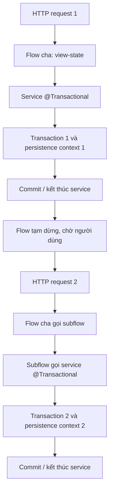

# Lan truyền persistence context sang subflow

Một flow nhiều bước thường chia hành trình thành flow cha và một hoặc nhiều subflow. Chẳng hạn flow đặt hàng gọi subflow chỉnh sửa địa chỉ, chọn phương thức giao hàng hoặc xác nhận thanh toán. Khi các flow cùng thao tác trên một entity JPA, câu hỏi thường gặp là: persistence context của flow cha có tự động được truyền sang flow con hay không, và làm thế nào để entity vẫn được quản lý khi đi qua ranh giới đó?

Cần phân biệt ba vòng đời: vòng đời của flow execution, vòng đời của transaction và vòng đời của JPA persistence context. Spring Web Flow có thể giữ dữ liệu điều hướng qua nhiều HTTP request; Spring transaction quản lý transaction theo ranh giới được cấu hình; JPA persistence context quản lý các entity đang được theo dõi trong một đơn vị làm việc. Ba vòng đời này không tự động trùng nhau. Một subflow không phải là một transaction mới, cũng không phải là cơ chế tự động chuyển `EntityManager` từ flow cha sang flow con.

Trong ứng dụng Spring Web Flow tích hợp Spring và JPA, cách thiết kế thông thường là truyền ID hoặc command/DTO qua ranh giới subflow, rồi để service mở transaction phù hợp, tải entity trong persistence context của transaction đó và thực hiện thay đổi. Chỉ khi subflow chạy đồng bộ trong cùng một thread và thực sự nằm bên trong một transaction đang hoạt động thì service dùng propagation `REQUIRED` mới có thể tham gia cùng transaction và persistence context hiện hành.

## 1. Persistence context là gì?

JPA persistence context là vùng quản lý các entity instance đang ở trạng thái managed. Trong một persistence context, mỗi entity được định danh bởi loại entity và khóa chính; khi một entity đã được nạp, các lần truy cập tương ứng trong cùng context thường dùng cùng một managed instance. Persistence context theo dõi thay đổi để đồng bộ xuống database khi flush hoặc commit.

Các trạng thái entity cơ bản:

| Trạng thái | Ý nghĩa | Ví dụ |
|---|---|---|
| New / transient | Entity mới được tạo, chưa được persistence context quản lý | `new Order()` chưa persist |
| Managed | Entity đang được một persistence context quản lý | Entity được tải qua repository trong transaction hiện tại |
| Detached | Entity từng được quản lý nhưng hiện không còn gắn với persistence context đó | Entity được giữ lại sau khi transaction-scoped context kết thúc |
| Removed | Entity được đánh dấu xóa trong persistence context | Gọi `EntityManager.remove(order)` |

Một persistence context có thể được tạo khi transaction bắt đầu và kết thúc khi transaction hoàn tất. Đây là mô hình transaction-scoped phổ biến trong ứng dụng Spring sử dụng JPA. Khi context kết thúc, các entity trước đó do context quản lý trở thành detached. Việc một object Java vẫn còn trong bộ nhớ không có nghĩa nó vẫn managed.

`EntityManager` là API để làm việc với persistence context. Trong Spring, bean được inject bằng `@PersistenceContext` thường là shared proxy; khi gọi trong một transaction đang hoạt động, proxy sẽ truy cập `EntityManager` gắn với transaction hiện tại. Không nên nhầm proxy này với một đối tượng `EntityManager` thực tế có thể lưu trong flow scope hoặc chuyển cho trình duyệt.

## 2. Flow execution, transaction và persistence context có vòng đời khác nhau

Flow execution có thể tồn tại qua nhiều request. Người dùng có thể dừng ở màn hình nhập địa chỉ trong vài phút rồi mới nhấn tiếp tục. Mỗi request được xử lý trên một thread của server; transaction do Spring quản lý thường được mở và kết thúc bên trong một lần gọi service.



Trong sơ đồ, flow cha và subflow có thể thuộc cùng một flow execution, nhưng hai lần gọi service vẫn có thể chạy trong hai transaction khác nhau. Flow engine giữ state và dữ liệu scope giữa các request; transaction không được giữ mở trong suốt thời gian người dùng đọc và nhập form.

Vì vậy, không thể suy luận rằng entity được tải ở request đầu sẽ tiếp tục managed trong request sau. Nếu entity được giữ trong `flowScope` hoặc `conversationScope`, nó có thể chỉ là object detached. Khi subflow gọi service với transaction mới, persistence context mới không tự động nhận object đó làm managed.

## 3. Subflow không tự truyền EntityManager

`subflow-state` chuyển dữ liệu qua các phần tử `input` và có thể nhận dữ liệu trả về từ flow con qua output. Cơ chế này truyền giá trị theo hợp đồng giữa hai flow; nó không chuyển transaction hoặc persistence context.

Ví dụ flow cha truyền ID đơn hàng:

```xml
<subflow-state id="editOrder" subflow="order-edit">
    <input name="orderId" value="flowScope.orderId" />
    <transition on="updated" to="reviewOrder" />
    <transition on="cancelled" to="reviewOrder" />
</subflow-state>
```

Flow con khai báo input tương ứng và tải entity khi cần:

```xml
<flow xmlns="http://www.springframework.org/schema/webflow"
      start-state="editOrderDetails">
    <input name="orderId" type="long" />
    <!-- Các state của flow con -->
</flow>
```

Trong subflow, service tìm đơn hàng bằng `orderId` trong transaction của chính thao tác cần thực hiện. Cách này làm rõ ranh giới dữ liệu và tránh phụ thuộc vào việc entity được tải từ request trước có còn managed hay không.

Không truyền `EntityManager`, Hibernate `Session`, connection hoặc transaction object vào `input`. Không lưu các đối tượng đó trong `flowScope` hay `conversationScope`. Chúng có vòng đời và ràng buộc thread riêng, không phù hợp với trạng thái flow có thể được lưu hoặc khôi phục qua request.

## 4. Khi nào persistence context thực sự được dùng chung?

Spring quản lý transaction theo thread thông qua transaction manager. Với `JpaTransactionManager`, một `EntityManager` gắn với transaction hiện hành được bind vào thread. Shared `EntityManager` proxy được inject vào repository hoặc service sẽ tìm context đó khi phương thức được gọi.

Nếu một phương thức service đang chạy trong transaction và gọi một service khác trên cùng thread, propagation `REQUIRED` của service được gọi sẽ tham gia transaction hiện tại. Hai thao tác có thể dùng chung persistence context do transaction manager quản lý.

Ví dụ:

```java
@Service
public class OrderApplicationService {
    private final OrderRepository orderRepository;
    private final AddressApplicationService addressService;

    public OrderApplicationService(
            OrderRepository orderRepository,
            AddressApplicationService addressService) {
        this.orderRepository = orderRepository;
        this.addressService = addressService;
    }

    @Transactional
    public void updateShippingAddress(Long orderId, AddressCommand command) {
        Order order = orderRepository.findById(orderId)
                .orElseThrow(() -> new IllegalArgumentException("Order not found"));

        addressService.applyTo(order, command);
        order.recalculateShipping();
    }
}

@Service
public class AddressApplicationService {

    @Transactional(propagation = Propagation.REQUIRED)
    public void applyTo(Order order, AddressCommand command) {
        order.changeShippingAddress(command.toValue());
    }
}
```

Trong trường hợp này, `applyTo` tham gia transaction đang mở của `updateShippingAddress`; entity `order` vẫn managed trong persistence context đó. Đây là lời gọi service đồng bộ bên trong cùng luồng xử lý, không phải việc Spring Web Flow tự truyền persistence context qua một subflow-state.

Nếu flow cha gọi `orderApplicationService.updateShippingAddress(...)`, phương thức hoàn tất và transaction commit trước khi flow chuyển sang state kế tiếp. Một subflow được gọi sau đó không tự tham gia transaction đã kết thúc. Khi subflow gọi một service `REQUIRED` mà không có transaction đang hoạt động, service đó sẽ mở transaction mới.

Để propagation hoạt động như mong đợi, lời gọi phải đi qua Spring transaction proxy. Gọi một phương thức `@Transactional` khác bằng self-invocation trong cùng object thường không đi qua proxy và không kích hoạt interceptor transaction mới. Nên đặt ranh giới transaction ở service bean có thể được gọi qua proxy.

## 5. Ý nghĩa của các propagation thường gặp

Transaction propagation quyết định một service method xử lý thế nào khi đã có transaction hiện hành. Nó không phải tùy chọn của `subflow-state` và không tự kéo dài transaction qua nhiều HTTP request.

| Propagation | Hành vi | Ứng dụng trong flow/subflow |
|---|---|---|
| `REQUIRED` | Tham gia transaction hiện có; nếu chưa có thì tạo transaction mới | Lựa chọn mặc định phù hợp cho phần lớn service nghiệp vụ |
| `REQUIRES_NEW` | Tạm treo transaction hiện tại và tạo transaction độc lập | Chỉ dùng khi cần commit/rollback độc lập có chủ đích |
| `SUPPORTS` | Tham gia transaction nếu có; nếu không thì chạy không có transaction | Phù hợp với một số thao tác đọc không yêu cầu transaction riêng |
| `MANDATORY` | Yêu cầu phải có transaction hiện tại, nếu không sẽ lỗi | Dùng để buộc caller thiết lập ranh giới transaction |
| `NOT_SUPPORTED` | Tạm treo transaction hiện tại và chạy ngoài transaction | Dùng cho công việc không nên nằm trong transaction |
| `NEVER` | Không cho phép chạy khi đã có transaction | Dùng cho thao tác yêu cầu không có transaction |

`NESTED` phụ thuộc transaction manager và khả năng savepoint của tài nguyên; không nên hiểu nó là một persistence context JPA độc lập lồng bên trong. Với JPA, hãy xác minh hỗ trợ cụ thể của transaction manager và database trước khi dựa vào nested transaction.

Ví dụ, nếu một subflow gọi service có `REQUIRES_NEW`, transaction đang có sẽ bị tạm treo và service chạy trong transaction riêng. Thao tác đó có thể commit ngay cả khi transaction bên ngoài rollback. Đây là hành vi có ảnh hưởng nghiệp vụ và cần được chọn có chủ đích, không dùng chỉ để “truyền” persistence context.

## 6. Entity được truyền sang subflow có trạng thái gì?

Giả sử flow cha tải `Order` trong transaction A, sau đó đưa entity vào `flowScope.order` rồi chuyển sang subflow ở một request khác. Khi transaction A kết thúc, `Order` thường đã detached. Subflow nhận lại tham chiếu object nhưng nó không tự trở thành managed trong transaction B.

Các hệ quả thường gặp:

- Thay đổi field trên detached entity không tự được ghi xuống database.
- Truy cập quan hệ lazy sau khi persistence context đã đóng có thể gây `LazyInitializationException`.
- Một entity detached có thể chứa dữ liệu cũ so với database tại thời điểm subflow tiếp tục.
- Gọi `merge` có thể sao chép trạng thái detached vào một managed instance, nhưng object được truyền vào không nhất thiết trở thành managed; phải dùng instance mà `merge` trả về.
- Gửi toàn bộ entity qua nhiều state làm tăng nguy cơ ghi đè dữ liệu mới bằng bản sao cũ.

Với flow nhiều request, ưu tiên truyền ID và command/DTO. Subflow gọi service để tải entity hiện hành, kiểm tra quyền và trạng thái, sau đó áp dụng thay đổi trong transaction ngắn.

## 7. Thiết kế input/output giữa flow cha và subflow

Hợp đồng subflow nên thể hiện dữ liệu mà quy trình con cần, không bộc lộ hạ tầng persistence. Ví dụ flow cha truyền `orderId`; flow con trả về một kết quả gọn như `OrderSummary` hoặc chỉ event `updated` nếu cha không cần thêm dữ liệu.

```xml
<subflow-state id="editShipping" subflow="shipping-edit">
    <input name="orderId" value="flowScope.orderId" />
    <transition on="updated" to="reviewOrder" />
    <transition on="cancelled" to="reviewOrder" />
</subflow-state>
```

Trong flow con, khai báo input và dùng service để tải dữ liệu:

```xml
<flow xmlns="http://www.springframework.org/schema/webflow"
      start-state="loadShipping">
    <input name="orderId" type="long" />

    <action-state id="loadShipping">
        <evaluate expression="shippingService.loadForm(orderId)"
                  result="flowScope.shippingForm" />
        <transition to="editShippingDetails" />
    </action-state>

    <!-- view-state và action lưu được khai báo ở đây -->
</flow>
```

`loadForm` nên trả về DTO dành cho form, không trả một entity với lazy associations chưa được tải. Khi người dùng submit, flow con gọi service cập nhật theo `orderId` và các giá trị trong command. Service tải lại entity trong transaction và áp dụng thay đổi.

Nếu flow cha cần dữ liệu sau khi subflow hoàn tất, có thể khai báo output ở end state của flow con và ánh xạ output theo hợp đồng của Spring Web Flow. Chỉ trả ID, mã trạng thái hoặc DTO nhỏ cần thiết. Không trả `EntityManager`, transaction hay một graph entity đang được quản lý để mong rằng persistence context sẽ tiếp tục tồn tại ở flow cha.

## 8. Ví dụ service tải và cập nhật dữ liệu an toàn

Một service có thể cung cấp hai phương thức riêng: một phương thức đọc tạo DTO cho form, và một phương thức cập nhật chạy trong transaction:

```java
@Service
public class ShippingService {
    private final OrderRepository orderRepository;

    public ShippingService(OrderRepository orderRepository) {
        this.orderRepository = orderRepository;
    }

    @Transactional(readOnly = true)
    public ShippingForm loadForm(Long orderId) {
        Order order = orderRepository.findById(orderId)
                .orElseThrow(() -> new IllegalArgumentException("Order not found"));
        return ShippingForm.from(order);
    }

    @Transactional
    public OrderSummary update(Long orderId, ShippingCommand command) {
        Order order = orderRepository.findById(orderId)
                .orElseThrow(() -> new IllegalArgumentException("Order not found"));

        order.changeShippingAddress(command.address());
        order.changeDeliveryMethod(command.deliveryMethod());

        return OrderSummary.from(order);
    }
}
```

Trong `loadForm`, entity chỉ cần được đọc để dựng DTO. Transaction kết thúc sau khi method trả về; DTO có thể được giữ trong scope của flow để hiển thị mà không phụ thuộc lazy loading. Trong `update`, service tải entity mới trong transaction ghi, thực hiện thay đổi trên managed entity và trả DTO kết quả.

Ở ví dụ dùng record cho command, cần Java version hỗ trợ record; với phiên bản cũ hơn có thể dùng class bất biến thông thường. Các kiểu `ShippingForm`, `ShippingCommand`, `OrderSummary` và repository là thành phần minh họa cần được định nghĩa theo domain của ứng dụng.

Không tin các giá trị như `customerId`, `orderStatus`, `price` hoặc `ownerId` do form gửi lên chỉ vì chúng nằm trong flow scope. Service cần xác minh người dùng hiện tại có quyền thao tác trên order đó và đọc lại các giá trị nhạy cảm từ nguồn dữ liệu chuẩn.

## 9. Persistence context và conversationScope

Spring Web Flow có các scope với vòng đời khác nhau. `flowScope` gắn với flow session; `conversationScope` có thể chia sẻ dữ liệu giữa flow cha và subflow trong cùng conversation. Các scope này hữu ích để giữ dữ liệu điều phối, nhưng chúng không phải JPA persistence context.

Ví dụ có thể đặt `orderId` hoặc một `ShippingForm` nhỏ trong scope để subflow sử dụng. Tuy nhiên, việc object nằm trong `conversationScope` không làm nó trở thành managed entity. Khi transaction kết thúc, entity vẫn detached dù tham chiếu còn tồn tại trong scope.

Không dùng conversation scope để giữ `EntityManager`, Hibernate `Session`, JDBC connection hoặc transaction. Những đối tượng này không phù hợp với việc lưu trạng thái qua nhiều request, không bảo đảm thread safety và có thể gây rò rỉ tài nguyên nếu flow bị bỏ dở hoặc session hết hạn.

Nếu cần giữ một bản nháp nghiệp vụ qua nhiều bước, hãy lưu DTO/command có thể được quản lý như dữ liệu ứng dụng. Trước khi ghi, service tải lại entity và kiểm tra các bất biến. Nếu cần phát hiện dữ liệu đã bị người khác cập nhật, dùng optimistic locking với `@Version` và xử lý `OptimisticLockException` hoặc lỗi tương ứng bằng thông báo phù hợp.

## 10. Extended persistence context và giới hạn sử dụng

JPA có khái niệm extended persistence context, thường gắn với vòng đời dài hơn một transaction, chẳng hạn một stateful component được quản lý theo cơ chế phù hợp. Đây là lựa chọn chuyên biệt, không tự động được Spring Web Flow bật lên khi một flow có subflow hoặc conversation scope.

Một extended persistence context có thể giữ entity managed qua nhiều transaction, nhưng cần quản lý vòng đời và đồng bộ rõ ràng. Trong web application, việc dùng chung context dài hạn qua các request có thể gây:

- Dữ liệu trong bộ nhớ trở nên cũ so với database.
- Entity graph tăng theo thời gian và chiếm nhiều bộ nhớ.
- Xung đột khi cùng conversation bị truy cập đồng thời từ nhiều tab hoặc request.
- Khó xử lý rollback, retry và các thay đổi đã commit một phần.
- Khó passivate/replicate session nếu đối tượng liên quan không tương thích serialization.

Vì vậy, không nên cố kéo dài một transaction hoặc lưu một `EntityManager` vào flow scope để giữ entity managed qua toàn bộ hành trình. Với phần lớn quy trình nhiều bước, mô hình request/transaction ngắn, DTO trong flow scope và tải lại entity ở mỗi thao tác là dễ vận hành hơn.

`OpenEntityManagerInViewFilter` cũng không giải quyết việc giữ persistence context qua toàn bộ flow. Filter này thường bind một `EntityManager` cho một HTTP request để view có thể truy cập lazy association trong thời gian render. Nó không kéo dài context qua request tiếp theo và không đồng nghĩa với một transaction bao trùm nhiều màn hình. Không nên dựa vào nó để thực hiện cập nhật nghiệp vụ hoặc che giấu việc tải dữ liệu chưa được thiết kế rõ ràng.

## 11. Transaction ngắn và side effect qua nhiều subflow

Không nên giữ transaction mở trong lúc người dùng đi qua nhiều màn hình. Một flow có thể chờ vài phút hoặc lâu hơn; transaction dài sẽ giữ lock, chiếm connection và làm tăng nguy cơ deadlock hoặc timeout. Mỗi service method nên tạo một đơn vị công việc ngắn với transaction riêng hoặc tham gia transaction hiện có trong cùng lời gọi đồng bộ.

Nếu một hành trình gồm nhiều bước có side effect đã commit, ví dụ giữ chỗ, tạo vận đơn rồi thanh toán, không thể dùng một persistence context để biến toàn bộ hành trình thành một transaction ACID xuyên suốt nhiều request. Hãy thiết kế quy trình nghiệp vụ theo trạng thái, có khả năng retry, bù trừ hoặc idempotency khi cần. Flow điều phối các bước và lưu trạng thái tương tác; service/domain xử lý từng giao dịch nghiệp vụ.

Ví dụ:

| Bước flow | Service operation | Ranh giới transaction |
|---|---|---|
| Chọn phương thức giao hàng | Đọc lựa chọn khả dụng | Transaction đọc ngắn |
| Xác nhận địa chỉ | Lưu địa chỉ giao hàng | Transaction ghi ngắn |
| Tạo yêu cầu vận chuyển | Ghi yêu cầu hoặc outbox event | Transaction ghi ngắn |
| Thanh toán | Gọi quy trình thanh toán chuyên biệt | Giao dịch riêng, có idempotency và xử lý kết quả |

Nếu cần bảo đảm cập nhật database và phát sự kiện nhất quán, có thể cân nhắc transactional outbox. Flow không nên giữ một transaction mở để chờ hệ thống ngoài phản hồi.

## 12. Đồng thời, stale data và optimistic locking

Khi người dùng mở form rồi quay lại sau một khoảng thời gian, entity trong database có thể đã được cập nhật bởi người khác. Một DTO trong flow scope là snapshot dữ liệu tại lúc tải; nó không phải nguồn chân lý ở thời điểm submit.

Với entity có thể được cập nhật đồng thời, dùng trường version:

```java
@Entity
public class Order {
    @Id
    private Long id;

    @Version
    private long version;

    // Các thuộc tính nghiệp vụ khác
}
```

Khi service tải entity trong transaction cập nhật, JPA dùng version để phát hiện một transaction khác đã ghi trước đó. Nếu version không còn khớp, thao tác có thể thất bại do optimistic locking. Flow có thể nhận một kết quả xung đột có ý nghĩa, yêu cầu tải lại dữ liệu và cho người dùng xác nhận lại thay đổi.

Không nên ghi đè entity mới bằng cách merge toàn bộ object form đã giữ từ request trước. Hãy dùng command chỉ chứa các trường được phép chỉnh sửa, tải entity hiện hành rồi áp dụng từng thay đổi được phép. Điều này hạn chế mass assignment và giảm nguy cơ ghi đè thuộc tính mà người dùng không được quyền sửa.

## 13. Kiểm thử persistence context qua subflow

Kiểm thử cần xác minh transaction và trạng thái entity ở từng ranh giới, thay vì chỉ kiểm tra flow chuyển state thành công.

1. **Parent tải dữ liệu:** service đọc entity trong transaction và trả DTO cho flow cha; xác minh DTO có dữ liệu cần hiển thị.
2. **Subflow nhận input:** truyền ID qua `subflow-state`; xác minh flow con nhận đúng ID và tải dữ liệu bằng service của nó.
3. **Transaction mới:** sau khi transaction của service cha kết thúc, subflow gọi service ghi; xác minh entity được tải lại và managed trong transaction mới.
4. **REQUIRED cùng transaction:** trong một lời gọi service đồng bộ có transaction ngoài, service được gọi với `REQUIRED` tham gia transaction hiện tại.
5. **REQUIRES_NEW:** xác minh transaction độc lập có thể commit dù transaction ngoài rollback, nếu đây là hành vi được thiết kế.
6. **Detached entity:** nếu thử giữ entity trong scope, xác minh code không giả định nó vẫn managed sau khi transaction cũ kết thúc.
7. **Lazy loading:** xác minh DTO được dựng đầy đủ trong transaction cần thiết và view không phụ thuộc một lazy association ngoài context.
8. **Optimistic locking:** cập nhật cùng entity từ hai transaction và xác minh flow xử lý xung đột có kiểm soát.
9. **Nhiều request/tab:** xác minh hai execution không chia sẻ một mutable entity hoặc `EntityManager`.
10. **Session timeout:** xác minh việc flow bị bỏ dở không để lại transaction hoặc tài nguyên persistence mở.

Có thể kiểm tra trạng thái managed bằng `EntityManager.contains(entity)` trong transaction thích hợp. Chỉ dùng kiểm tra này trong test hoặc chẩn đoán; không thiết kế flow dựa trên việc giữ một entity managed qua request.

## 14. Lỗi thiết kế thường gặp

- **Cho rằng subflow tự kế thừa persistence context:** subflow là ranh giới điều phối flow. Chỉ transaction manager mới quyết định transaction và persistence context nào đang hoạt động.
- **Truyền entity thay vì ID/DTO:** entity có thể detached hoặc chứa dữ liệu cũ. Tải lại entity trong service của subflow.
- **Đưa EntityManager vào flow scope:** đối tượng gắn với thread và tài nguyên persistence, không phù hợp với trạng thái flow kéo dài.
- **Giữ transaction qua nhiều view-state:** transaction dài giữ lock và connection trong lúc chờ người dùng. Dùng transaction ngắn cho từng thao tác nghiệp vụ.
- **Dùng `REQUIRES_NEW` để sửa lỗi detached entity:** propagation này tạo transaction độc lập, không tự gắn entity cũ vào persistence context mới. Tải entity lại hoặc merge có kiểm soát.
- **Cho rằng `merge` làm object đầu vào managed:** `merge` trả về managed instance; hãy tiếp tục dùng instance trả về.
- **Dựa vào OpenEntityManagerInView để giữ context cả flow:** cơ chế này gắn với request, không kéo dài qua các request của flow.
- **Không xử lý dữ liệu cũ:** dùng optimistic locking, kiểm tra trạng thái và yêu cầu người dùng xác nhận lại khi có xung đột.
- **Để flow quyết định quy tắc persistence:** transaction, quyền cập nhật và bất biến dữ liệu phải nằm ở service/domain.

## 15. Nguyên tắc áp dụng

1. Phân biệt vòng đời flow execution, transaction và persistence context.
2. Xem `subflow-state` input/output là hợp đồng dữ liệu; không dùng nó để chuyển `EntityManager` hoặc transaction.
3. Truyền ID, command hoặc DTO gọn qua flow cha và subflow.
4. Đặt `@Transactional` tại service method thực hiện đơn vị công việc nghiệp vụ.
5. Dùng `REQUIRED` khi muốn tham gia transaction đang hoạt động trong cùng thread; chỉ dùng propagation khác khi có yêu cầu rõ ràng.
6. Tải entity trong transaction nơi cần đọc/ghi; không giả định entity giữ trong flow scope còn managed.
7. Dùng DTO để tránh lazy loading ngoài transaction và dùng optimistic locking để xử lý cập nhật đồng thời.
8. Không giữ transaction hoặc `EntityManager` trong scope của flow qua nhiều HTTP request.
9. Kiểm thử ranh giới transaction, detached entity, subflow input/output, retry và xung đột dữ liệu.

Spring Web Flow có thể giữ dữ liệu điều phối để flow cha và subflow tiếp tục hành trình, còn Spring transaction manager và JPA quyết định persistence context nào đang quản lý entity tại một thời điểm. Khi truyền dữ liệu gọn qua subflow và để service tải entity trong transaction ngắn, ứng dụng tránh được giả định sai về entity managed, đồng thời giữ được tính nhất quán khi người dùng quay lại hoặc nhiều request cập nhật cùng dữ liệu.
