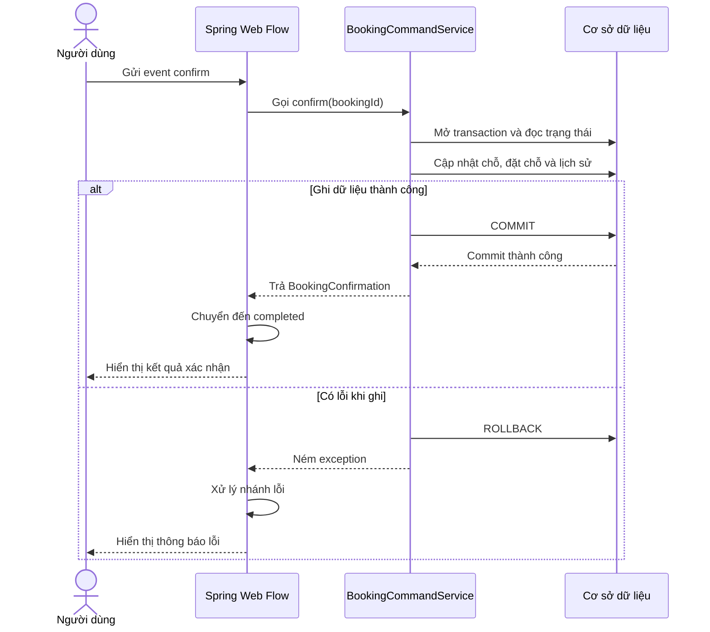

# Vai trò của transaction ở thời điểm ghi nhận thay đổi

Trong chương **Dữ liệu và giao dịch**, transaction xác định một nhóm thay đổi dữ liệu được ghi nhận như một đơn vị nhất quán. Với **SPRING_WEB_FLOW**, flow điều phối các state, event và transition của hành trình web; Spring quản lý transaction ở tầng service khi nghiệp vụ cần đọc hoặc ghi dữ liệu bền vững. Chọn đúng thời điểm mở và kết thúc transaction giúp dữ liệu không rơi vào trạng thái dở dang khi người dùng chuyển bước, hủy hoặc gửi lại request.

Bài học dùng quy trình đặt chỗ làm ví dụ. Người dùng có thể đi qua nhiều màn hình để chọn phòng, nhập thông tin và xem lại. Transaction nên bao quanh thao tác xác nhận ghi nhận đặt chỗ vào cơ sở dữ liệu, tại thời điểm nghiệp vụ đã đủ dữ liệu để commit.

## 1. Transaction bảo vệ điều gì?

Transaction là ranh giới mà hệ quản trị cơ sở dữ liệu dùng để bảo đảm một nhóm thao tác được xử lý nhất quán. Các thuộc tính ACID thường được nhắc đến gồm:

- **Atomicity:** các thay đổi trong transaction cùng được commit hoặc cùng bị rollback.
- **Consistency:** transaction đưa dữ liệu từ một trạng thái hợp lệ sang trạng thái hợp lệ theo các ràng buộc của hệ thống.
- **Isolation:** các transaction đồng thời không nhìn thấy những trạng thái trung gian theo cách vi phạm mức cô lập đã cấu hình.
- **Durability:** sau khi commit thành công, thay đổi đã được ghi nhận bền vững theo cam kết của hệ quản trị dữ liệu.

Ví dụ, khi xác nhận một đặt chỗ, ứng dụng có thể cần cập nhật trạng thái đặt chỗ, giảm số chỗ còn trống và ghi một bản ghi lịch sử. Nếu chỉ một trong các thao tác đó thành công, dữ liệu có thể không còn nhất quán. Đưa các thao tác cùng thuộc một nghiệp vụ vào một transaction giúp chúng được commit hoặc rollback cùng nhau.

Transaction không thay thế validation hoặc kiểm tra quyền. Trước khi ghi dữ liệu, ứng dụng vẫn phải xác nhận người dùng được phép thao tác, dữ liệu hợp lệ và điều kiện nghiệp vụ còn đúng tại thời điểm ghi.

## 2. Đặt transaction ở ranh giới nghiệp vụ

Spring Web Flow có thể mất nhiều request mới hoàn tất một hành trình. Người dùng có thể dừng lại đọc thông tin, chuyển tab, đóng trình duyệt hoặc quay lại vào ngày hôm sau. Không nên mở một transaction cơ sở dữ liệu ở đầu flow rồi giữ nó qua nhiều màn hình.

Một transaction kéo dài qua thời gian người dùng suy nghĩ có thể giữ connection, lock và tài nguyên cơ sở dữ liệu quá lâu. Nó cũng không phù hợp với vòng đời HTTP: mỗi request được xử lý độc lập và có thể đến máy chủ khác trong môi trường nhiều instance.

Hãy phân chia như sau:

| Giai đoạn của flow | Công việc | Cách quản lý dữ liệu |
|---|---|---|
| Mở form, tra cứu lựa chọn | Đọc dữ liệu để hiển thị. | Dùng service đọc, thường với transaction chỉ đọc ngắn nếu cần. |
| Người dùng nhập và xem lại | Giữ dữ liệu tạm trong flow model hoặc bản nháp đã lưu. | Không giữ transaction mở trong lúc chờ người dùng. |
| Xác nhận | Kiểm tra điều kiện hiện tại và ghi nhận thay đổi nghiệp vụ. | Mở transaction ngắn ở service command và commit/rollback trước khi flow đi tiếp. |
| Hiển thị kết quả | Đọc mã tham chiếu và trạng thái đã ghi nhận. | Dùng dữ liệu kết quả đã commit hoặc truy vấn lại qua service. |

Transaction nên bao trọn một đơn vị nghiệp vụ có ý nghĩa, chẳng hạn `confirmBooking`, thay vì bám theo toàn bộ flow hoặc từng câu lệnh SQL rời rạc. Service command là nơi thích hợp để gom các thao tác ghi cần thành công cùng nhau.

## 3. Gọi service có `@Transactional` từ action-state

Flow definition điều phối event `confirm` đến một `action-state`. Action gọi Spring-managed service; transaction interceptor của Spring mở transaction trước khi chạy phương thức và commit khi phương thức trả về bình thường. Nếu phương thức ném exception thuộc quy tắc rollback, transaction được rollback.

Flow có thể được viết như sau:

```xml
<view-state id="reviewBooking">
    <transition on="confirm" to="confirmBooking" />
    <transition on="cancel" to="cancelled" />
</view-state>

<action-state id="confirmBooking">
    <evaluate expression="bookingCommandService.confirm(flowScope.bookingId)"
              result="flowScope.confirmation" />
    <transition to="completed" />
</action-state>

<end-state id="completed" view="booking/confirmation" />
<end-state id="cancelled" view="booking/cancelled" />
```

Service thực hiện toàn bộ thay đổi liên quan trong một transaction:

```java
@Service
public class BookingCommandService {

    private final BookingRepository bookingRepository;
    private final AvailabilityRepository availabilityRepository;
    private final BookingHistoryRepository historyRepository;

    public BookingCommandService(
            BookingRepository bookingRepository,
            AvailabilityRepository availabilityRepository,
            BookingHistoryRepository historyRepository) {
        this.bookingRepository = bookingRepository;
        this.availabilityRepository = availabilityRepository;
        this.historyRepository = historyRepository;
    }

    @Transactional
    public BookingConfirmation confirm(String bookingId) {
        Booking booking = bookingRepository.findById(bookingId)
                .orElseThrow(() -> new BookingNotFoundException(bookingId));

        if (!booking.isPending()) {
            throw new BookingStateException("Đặt chỗ không còn ở trạng thái chờ.");
        }

        Availability availability = availabilityRepository
                .findForUpdate(booking.getRoomId(), booking.getDate())
                .orElseThrow(AvailabilityException::new);

        availability.reserveOne();
        booking.confirm();
        historyRepository.save(BookingHistory.confirmed(booking));

        return new BookingConfirmation(booking.getReference(), booking.getStatus());
    }
}
```

`findForUpdate` đại diện cho truy vấn khóa bản ghi phù hợp với cơ chế của repository và hệ quản trị cơ sở dữ liệu. Một lựa chọn khác là optimistic locking với cột version. Điều quan trọng là kiểm tra tình trạng và cập nhật số chỗ phải được bảo vệ trước các request xác nhận đồng thời.

Khi `confirm` trả về bình thường, transaction được commit trước khi lời gọi service hoàn tất ở phía caller. Sau đó action-state mới tiếp tục transition đến `completed`. Nếu service ném exception, flow không nên đi đến state thành công; ứng dụng cần ánh xạ lỗi nghiệp vụ sang nhánh lỗi hoặc view phù hợp.

## 4. Vì sao commit phải xảy ra trước khi báo thành công?

Flow chỉ nên hiển thị kết quả thành công sau khi transaction đã commit. Nếu thông báo thành công được tạo trước commit, người dùng có thể thấy xác nhận dù database rollback do constraint, lỗi connection hoặc lỗi khi ghi bản ghi cuối cùng.

Trình tự nên là:



Mã xác nhận, success message hoặc redirect đến trang hoàn tất chỉ nên được tạo sau khi service xác nhận thành công. Nếu transaction commit thành công nhưng response bị mất trên đường về trình duyệt, người dùng có thể gửi lại request. Vì vậy, thao tác xác nhận vẫn cần cơ chế idempotency hoặc kiểm tra trạng thái để lần gửi lại không tạo thêm đặt chỗ.

## 5. Rollback và cách Spring quyết định rollback

Với transaction quản lý bằng `@Transactional`, mặc định Spring rollback khi phương thức ném `RuntimeException` hoặc `Error`. Checked exception thường không kích hoạt rollback theo mặc định. Nếu nghiệp vụ dùng checked exception và muốn rollback, khai báo rõ:

```java
@Transactional(rollbackFor = BookingRejectedException.class)
public BookingConfirmation confirm(String bookingId)
        throws BookingRejectedException {
    // Đọc, kiểm tra và cập nhật dữ liệu đặt chỗ.
}
```

Một số điểm cần lưu ý:

- Nếu bắt exception rồi chỉ ghi log và trả về bình thường, transaction có thể commit. Chỉ bắt lỗi khi có thể xử lý đầy đủ; nếu cần rollback, hãy ném lại exception phù hợp hoặc đánh dấu transaction rollback-only theo API quản lý transaction.
- Nếu một phương thức transactional gọi phương thức khác trong cùng object bằng `this.someMethod()`, lời gọi nội bộ thường không đi qua proxy nên annotation trên phương thức được gọi có thể không được áp dụng như mong đợi.
- Phương thức cần được gọi qua Spring bean/proxy được quản lý đúng cách. Không tự tạo service bằng `new` rồi kỳ vọng `@Transactional` hoạt động.
- Không nên chuyển exception kỹ thuật thành kết quả thành công giả. Hãy phân biệt lỗi nghiệp vụ có thể hiển thị với lỗi hạ tầng cần log, retry hoặc xử lý ở tầng cao hơn.

Flow có thể xử lý lỗi từ action/service để hiển thị thông báo thân thiện, nhưng việc hiển thị thông báo không làm transaction đã rollback trở thành commit. Hãy giữ hai trách nhiệm tách biệt: service bảo vệ dữ liệu, flow quyết định state và trải nghiệm tiếp theo.

## 6. Propagation và transaction lồng nhau

Spring cung cấp propagation để xác định cách một phương thức tham gia transaction hiện có. Với nghiệp vụ xác nhận đặt chỗ, `REQUIRED` là lựa chọn mặc định phổ biến: nếu đã có transaction thì tham gia transaction đó; nếu chưa có thì tạo transaction mới.

```java
@Transactional(propagation = Propagation.REQUIRED)
public BookingConfirmation confirm(String bookingId) {
    // Một đơn vị nghiệp vụ cần commit/rollback cùng nhau.
}
```

Một số propagation thường gặp:

| Propagation | Hành vi | Tình huống sử dụng |
|---|---|---|
| `REQUIRED` | Tham gia transaction hiện tại hoặc tạo mới nếu chưa có. | Mặc định phù hợp với phần lớn service nghiệp vụ. |
| `REQUIRES_NEW` | Tạm treo transaction hiện tại và tạo transaction độc lập. | Ghi nhận dữ liệu phụ cần commit độc lập, sau khi đã cân nhắc rõ hậu quả nhất quán. |
| `SUPPORTS` | Tham gia transaction nếu có; nếu không thì chạy không có transaction. | Một số thao tác đọc có thể hoạt động trong cả hai bối cảnh. |
| `MANDATORY` | Yêu cầu caller đã có transaction; nếu không sẽ báo lỗi. | Phương thức nội bộ chỉ được gọi trong một đơn vị nghiệp vụ đã mở transaction. |

Không dùng `REQUIRES_NEW` chỉ để “chắc chắn có transaction”. Ví dụ, nếu ghi lịch sử xác nhận bằng transaction độc lập nhưng transaction đặt chỗ sau đó rollback, lịch sử có thể nói rằng đặt chỗ đã xác nhận dù trạng thái chính chưa được commit. Chỉ tách transaction khi dữ liệu độc lập thực sự có ý nghĩa nghiệp vụ riêng.

Nếu nhiều service cùng tham gia một transaction `REQUIRED`, exception đánh dấu transaction rollback-only có thể khiến transaction ngoài cùng rollback khi kết thúc, kể cả khi một lớp phía trên đã bắt exception. Cần thiết kế ranh giới bắt lỗi và quyết định tiếp tục thật rõ ràng.

## 7. Transaction chỉ đọc và dữ liệu hiển thị

Các bước tra cứu để hiển thị lựa chọn hoặc trang xem lại thường không cần ghi dữ liệu. Có thể đánh dấu service query là read-only:

```java
@Service
public class BookingQueryService {

    @Transactional(readOnly = true)
    public BookingSummary findSummary(String bookingId) {
        return bookingRepository.findSummaryById(bookingId)
                .orElseThrow(() -> new BookingNotFoundException(bookingId));
    }
}
```

`readOnly = true` là gợi ý cho transaction manager hoặc persistence provider và có thể giúp tối ưu một số thao tác. Không nên coi nó là hàng rào bảo mật bảo đảm tuyệt đối rằng không thể ghi dữ liệu. Query service vẫn cần tránh sửa entity và cần trả dữ liệu phù hợp với view.

Một transaction đọc ngắn có thể kết thúc trước khi flow hiển thị màn hình. Không giữ entity đang được quản lý bởi persistence context qua nhiều request; nên đưa dữ liệu cần thiết vào DTO hoặc lưu ID trong flow scope rồi truy vấn lại khi cần.

## 8. Cạnh tranh cập nhật và gửi lặp event

Hai người dùng có thể cùng xem một phòng còn một chỗ trống. Cả hai đều thấy trạng thái ban đầu còn chỗ, nhưng chỉ một người được phép xác nhận. Transaction giúp nhóm kiểm tra và cập nhật dữ liệu nhất quán, tuy nhiên ứng dụng vẫn phải chọn chiến lược xử lý cạnh tranh:

- **Pessimistic locking:** khóa bản ghi cần cập nhật trong transaction, ví dụ truy vấn `SELECT ... FOR UPDATE` thông qua repository phù hợp. Khóa được giữ đến khi commit/rollback.
- **Optimistic locking:** thêm trường version (ví dụ `@Version` với JPA); khi hai transaction cập nhật cùng một phiên bản, một transaction sẽ thất bại do version đã thay đổi.
- **Ràng buộc cơ sở dữ liệu:** dùng unique constraint, check constraint hoặc cập nhật có điều kiện để bảo vệ bất biến ngay tại nơi lưu dữ liệu.

Nếu dùng optimistic locking, hãy xử lý `OptimisticLockingFailureException` hoặc exception tương ứng thành thông báo “Dữ liệu vừa được cập nhật bởi thao tác khác; hãy tải lại và thử lại”. Không tự động lặp lại một thao tác ghi nếu chưa xác định nó có an toàn để retry hay không.

Transaction cũng không tự chống việc cùng một event `confirm` bị gửi hai lần. Hãy dùng idempotency key hoặc mã yêu cầu duy nhất được lưu cùng kết quả, kết hợp unique constraint hoặc kiểm tra trạng thái trong transaction. Khi request được gửi lại, service trả về kết quả đã có thay vì tạo thêm giao dịch mới.

## 9. Gọi dịch vụ bên ngoài trong quy trình transaction

Transaction cơ sở dữ liệu thông thường chỉ quản lý các tài nguyên được enlist trong transaction manager tương ứng. Gọi cổng thanh toán, gửi email hoặc gọi HTTP API không tự động trở thành một phần nguyên tử của transaction cơ sở dữ liệu.

Ví dụ, nếu service mở transaction DB, gọi cổng thanh toán, rồi cập nhật đặt chỗ, có thể xảy ra tình huống cổng thanh toán đã thu tiền nhưng database rollback. Hoặc database đã commit nhưng email thông báo không gửi được. Hai hệ thống không tự rollback lẫn nhau.

Một số cách tổ chức phù hợp:

1. Ghi trạng thái nghiệp vụ và một outbox event trong cùng transaction DB.
2. Sau khi commit, worker đọc outbox và gửi thông điệp đến hệ thống bên ngoài.
3. Dùng idempotency key ở consumer hoặc API đích để xử lý thông điệp gửi lại an toàn.
4. Nếu quy trình cần nhiều bước bù trừ, mô hình hóa thành saga: mỗi bước có hành động bù tương ứng, ví dụ giải phóng chỗ nếu thanh toán thất bại.

Spring Web Flow có thể điều phối các state của saga ở mức hành trình người dùng, nhưng mỗi lần ghi dữ liệu vẫn nên dùng transaction cục bộ ngắn tại service. Không giữ transaction DB trong khi đợi người dùng nhập OTP hoặc đợi một dịch vụ bên ngoài phản hồi lâu.

## 10. Kiểm thử ranh giới transaction

Test cần chứng minh cả kết quả thành công và trạng thái dữ liệu sau lỗi:

| Kịch bản | Điều cần xác nhận |
|---|---|
| Xác nhận thành công | Trạng thái đặt chỗ, số chỗ và lịch sử cùng được commit. |
| Lỗi giữa các thao tác ghi | Tất cả thay đổi trong transaction bị rollback. |
| Checked exception được cấu hình rollback | Transaction rollback theo `rollbackFor` đã khai báo. |
| Lỗi cạnh tranh cập nhật | Chỉ một yêu cầu thành công; yêu cầu còn lại nhận lỗi có thể xử lý. |
| Gửi event xác nhận lặp | Idempotency hoặc constraint ngăn tạo giao dịch trùng. |
| Gửi thông điệp outbox thất bại | Bản ghi outbox còn để worker retry; trạng thái DB không bị đảo ngược tùy tiện. |

Khi dùng test có `@Transactional`, framework test thường rollback transaction của test sau khi hoàn tất. Điều này tiện cho việc cô lập dữ liệu, nhưng có thể che khuất thời điểm commit của service. Nếu cần xác nhận commit thật, hãy kiểm tra dữ liệu từ một transaction độc lập sau khi service kết thúc, hoặc cấu hình test rõ ràng để commit trong trường hợp cần thiết.

Flow integration test nên xác nhận thêm rằng state thành công chỉ được vào sau khi service trả kết quả commit thành công; khi service ném exception, flow không phát success outcome. Test service và test flow có thể tách riêng: service test kiểm tra ACID/rollback, flow test kiểm tra event và state.

## 11. Những lỗi thường gặp

| Hiện tượng | Nguyên nhân cần kiểm tra |
|---|---|
| Dữ liệu chỉ được ghi một phần | Các thao tác ghi nằm ở nhiều transaction độc lập hoặc exception bị bắt khiến transaction commit. |
| Transaction giữ lock quá lâu | Ranh giới transaction bao trùm nhiều request hoặc thời gian chờ người dùng; chuyển transaction vào service command ngắn. |
| `@Transactional` không có hiệu lực | Bean không do Spring quản lý, gọi nội bộ qua `this`, hoặc cấu hình proxy/transaction manager không đúng. |
| Checked exception không rollback | Chưa khai báo `rollbackFor` hoặc chưa chủ động đánh dấu rollback-only. |
| Flow báo thành công dù DB rollback | Message hoặc state thành công được thiết lập trước khi service commit hoặc exception bị xử lý sai. |
| Hai người dùng cùng chiếm một chỗ | Thiếu khóa, optimistic version, constraint hoặc cập nhật có điều kiện trong transaction. |
| Gọi lại event tạo hai giao dịch | Thiếu idempotency key và kiểm soát trạng thái/unique constraint. |
| Email hoặc thanh toán không đồng bộ với DB | Hiểu nhầm transaction DB bao gồm dịch vụ HTTP bên ngoài; cân nhắc outbox và saga. |

Khi điều tra, hãy xác định transaction bắt đầu ở đâu, kết thúc ở đâu, exception nào xảy ra và resource nào thực sự được transaction manager quản lý. Sau đó mới kiểm tra state của flow để biết vì sao người dùng nhìn thấy kết quả tương ứng.

## 12. Thực hành

Hoàn thiện flow đặt chỗ có bước xem lại và xác nhận.

1. Tạo `BookingCommandService.confirm` với `@Transactional` để cập nhật đặt chỗ, số chỗ còn lại và lịch sử trong cùng transaction.
2. Gọi service từ `action-state` sau event `confirm`; chỉ chuyển đến `completed` khi phương thức trả kết quả thành công.
3. Tạo một lỗi có chủ đích sau lần ghi đầu tiên và xác nhận mọi thay đổi đều rollback.
4. Thử checked exception và cấu hình `rollbackFor` để quan sát khác biệt.
5. Mô phỏng hai request xác nhận cùng một chỗ; dùng lock hoặc optimistic version để ngăn vượt số chỗ.
6. Gửi lại cùng event xác nhận và bảo đảm idempotency không tạo bản ghi trùng.
7. Nếu cần gửi email hoặc thông báo thanh toán, ghi outbox trong transaction rồi xử lý bên ngoài sau commit.

Bạn hoàn thành bài khi giải thích được vì sao transaction nên nằm ở service nghiệp vụ tại thời điểm ghi nhận thay đổi, chứng minh được rollback khi có lỗi, và bảo đảm flow chỉ báo thành công sau khi dữ liệu đã commit.
