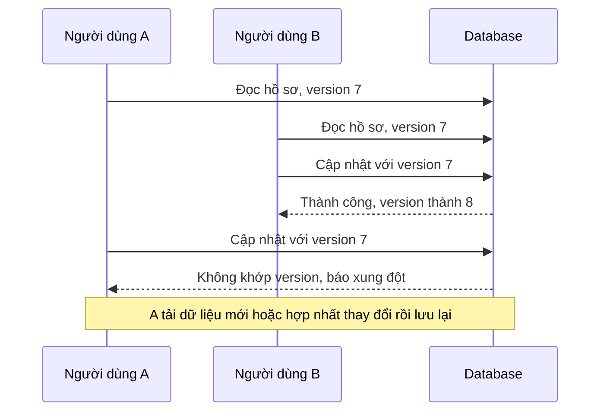

# Khóa lạc quan và xung đột chỉnh sửa giữa nhiều người dùng

Trong chương **Dữ liệu và giao dịch**, khóa lạc quan (optimistic locking) giúp phát hiện trường hợp nhiều người cùng chỉnh sửa một bản ghi trong khoảng thời gian chồng lấn. Thay vì giữ khóa cơ sở dữ liệu trong suốt lúc người dùng mở form và suy nghĩ, ứng dụng ghi nhận phiên bản dữ liệu khi bắt đầu chỉnh sửa rồi kiểm tra lại phiên bản đó khi lưu. Nếu một người khác đã cập nhật bản ghi trước, thao tác lưu dựa trên phiên bản cũ bị từ chối và ứng dụng có thể yêu cầu người dùng tải lại hoặc hợp nhất thay đổi.

Module `SPRING_WEB_FLOW` dùng state, event, transition và subflow để mô hình hóa hành trình web nhiều bước; đồng thời thực hành form binding, validation, quản lý scope và phiên, tích hợp Spring MVC, kiểm thử và phục hồi luồng khi có lỗi. Với hành trình có thể kéo dài qua nhiều request, khóa lạc quan đặc biệt hữu ích: flow giữ bản nháp và phiên bản đã đọc, còn service kiểm tra xung đột trong transaction khi ghi dữ liệu.

## 1. Vì sao cần phát hiện chỉnh sửa đồng thời?

Giả sử hai nhân viên cùng mở hồ sơ khách hàng có địa chỉ `12 Nguyễn Huệ`.

1. Nhân viên A mở hồ sơ và nhận dữ liệu hiện tại.
2. Nhân viên B cũng mở hồ sơ đó trước khi A lưu.
3. B sửa địa chỉ thành `15 Nguyễn Huệ` và lưu thành công.
4. A vẫn đang nhìn dữ liệu cũ, sửa số điện thoại rồi gửi toàn bộ form.

Nếu ứng dụng chỉ cập nhật theo ID mà không kiểm tra phiên bản, thao tác của A có thể ghi đè địa chỉ mới của B bằng địa chỉ cũ. Đây là lost update: một cập nhật hợp lệ đã bị mất do một người dùng lưu dữ liệu được đọc từ trước.

Khóa lạc quan phát hiện tình huống này tại thời điểm ghi. Ứng dụng có thể từ chối cập nhật của A, giữ lại nội dung A vừa nhập và cho A xem dữ liệu mới nhất trước khi quyết định hợp nhất. Cơ chế này không ngăn người dùng cùng mở một bản ghi; nó bảo vệ tính nhất quán khi họ lưu.

## 2. Cơ chế hoạt động của khóa lạc quan

Mỗi bản ghi có một trường phiên bản. Khi đọc dữ liệu, ứng dụng nhận cả nội dung và phiên bản hiện tại. Khi cập nhật, câu lệnh ghi chỉ thành công nếu phiên bản trong cơ sở dữ liệu vẫn bằng phiên bản mà thao tác đã đọc. Nếu một transaction khác đã cập nhật bản ghi, phiên bản không còn khớp và thao tác hiện tại bị phát hiện là xung đột.

Ví dụ theo trình tự:



Về khái niệm, câu lệnh cập nhật tương đương:

```sql
UPDATE customer
   SET address = ?, version = version + 1
 WHERE id = ?
   AND version = ?;
```

Đây là SQL minh họa, không phải cam kết về câu lệnh chính xác mà mọi JPA provider sinh ra. Nếu số dòng được cập nhật bằng 0, bản ghi có thể đã bị xóa hoặc phiên bản đã thay đổi; provider nhận diện điều kiện optimistic lock không còn thỏa mãn và báo lỗi. Câu lệnh thực tế có thể có thêm cột, tham số hoặc cách tăng phiên bản khác.

Khóa được kiểm tra trong transaction cập nhật, không giữ một khóa cơ sở dữ liệu suốt thời gian người dùng đi qua nhiều màn hình. Vì vậy, hai người có thể cùng đọc dữ liệu; chỉ một cập nhật dựa trên cùng phiên bản có thể thắng.

## 3. Dùng `@Version` với JPA

JPA hỗ trợ optimistic locking qua thuộc tính được đánh dấu `@Version`. Provider quản lý giá trị phiên bản và dùng nó để phát hiện cập nhật đồng thời.

```java
import jakarta.persistence.Entity;
import jakarta.persistence.Id;
import jakarta.persistence.Version;

@Entity
public class Customer {

    @Id
    private Long id;

    private String name;
    private String address;
    private String phone;

    @Version
    private Long version;

    // getters and setters
}
```

Một số điểm cần nhớ:

- Mỗi entity cần một thuộc tính phiên bản được provider quản lý.
- Với ứng dụng thông thường, `Long` hoặc `Integer` là kiểu phiên bản dễ theo dõi.
- Không tự tăng hoặc ghi đè trường `version` trong logic form hay service; provider chịu trách nhiệm cập nhật nó.
- Không bind trường phiên bản từ form như một thuộc tính người dùng được quyền chỉnh sửa.
- Giá trị version là dấu mốc đồng bộ dữ liệu, không phải cơ chế xác thực hoặc phân quyền.

Khi transaction cập nhật entity, JPA provider kiểm tra phiên bản đọc được. Nếu phiên bản hiện tại ở database không còn khớp, provider ném `OptimisticLockException` hoặc một ngoại lệ liên quan theo provider và thời điểm phát hiện. Khi dùng Spring ORM/Spring Data, lỗi có thể được chuyển thành `ObjectOptimisticLockingFailureException` hoặc một kiểu `OptimisticLockingFailureException` phù hợp.

`@Version` bảo vệ các thao tác cập nhật entity được thực hiện qua cơ chế persistence có tham gia optimistic locking. Các câu lệnh bulk JPQL, native SQL hoặc cập nhật trực tiếp ngoài JPA có thể bỏ qua cơ chế này nếu không tự kiểm tra và cập nhật version. Hãy rà soát mọi đường ghi vào cùng bảng để không tạo ra một lối cập nhật không có kiểm soát phiên bản.

## 4. Đặt transaction tại service layer

Một lần lưu nên được thực hiện trong transaction ngắn, bao gồm tải entity hiện tại, kiểm tra quyền, kiểm tra phiên bản, áp dụng thay đổi và flush/commit. Không mở transaction rồi giữ nó trong suốt thời gian người dùng nhập form; thời gian chờ của con người có thể kéo dài và sẽ giữ tài nguyên database không cần thiết.

Ví dụ service:

```java
@Service
public class CustomerService {

    private final CustomerRepository repository;

    public CustomerService(CustomerRepository repository) {
        this.repository = repository;
    }

    @Transactional
    public void updateCustomer(Long customerId,
                               Long expectedVersion,
                               CustomerEditDraft draft) {
        Customer customer = repository.findById(customerId)
                .orElseThrow(() -> new CustomerNotFoundException(customerId));

        // Authorization phải được kiểm tra bằng người dùng hiện tại.
        authorizeEdit(customer);

        if (!Objects.equals(expectedVersion, customer.getVersion())) {
            throw new ConcurrentEditException(customerId);
        }

        customer.setAddress(draft.getAddress());
        customer.setPhone(draft.getPhone());

        // Flush sớm để phát hiện optimistic-lock conflict trong lời gọi này.
        repository.flush();
    }
}
```

Đoạn mã giả định repository hỗ trợ `flush()` như Spring Data JPA `JpaRepository`. Nếu dùng JPA thuần, có thể gọi `EntityManager.flush()`. Việc so sánh `expectedVersion` phát hiện bản ghi đã thay đổi trước khi service tải entity hiện tại. `@Version` vẫn cần thiết vì một transaction khác có thể cập nhật sau lần đọc và trước lần flush của transaction này.

`flush()` đồng bộ thay đổi đang chờ xuống database trong transaction; nó không thay thế commit. Transaction interceptor có thể phát hiện thêm lỗi khi commit. Vì vậy, nơi gọi service qua Spring proxy cần xử lý ngoại lệ phát sinh từ toàn bộ lời gọi transactional, bao gồm cả lỗi xảy ra khi transaction hoàn tất.

Không nhận `customerId`, version hoặc dữ liệu form rồi cập nhật thẳng mà bỏ qua kiểm tra quyền. Người dùng có thể sửa ID trong request; service phải tải tài nguyên đáng tin cậy và xác minh người dùng hiện tại có quyền thay đổi tài nguyên đó.

## 5. Không giữ JPA entity được quản lý qua nhiều bước flow

Spring Web Flow có thể giữ dữ liệu trong `flowScope` qua nhiều request. Tuy nhiên, một JPA entity được quản lý bởi persistence context có vòng đời gắn với transaction/session của ORM. Giữ entity đó trong flow scope qua nhiều request có thể tạo ra đối tượng detached, dữ liệu cũ, lazy-loading lỗi hoặc hành vi khó dự đoán khi merge.

Một thiết kế phù hợp hơn:

1. Khi bắt đầu chỉnh sửa, service đọc entity trong transaction và chuyển thành DTO/bản nháp.
2. Flow giữ bản nháp cùng `expectedVersion` trong `flowScope`.
3. Người dùng sửa dữ liệu qua một hoặc nhiều view state.
4. Khi người dùng lưu, flow gửi ID, version đã đọc và bản nháp tới service.
5. Service tải lại entity trong transaction mới, kiểm tra quyền và version, áp dụng các trường được phép rồi lưu.

Ví dụ form object:

```java
public class CustomerEditDraft {
    private Long customerId;
    private String address;
    private String phone;

    // getters and setters
}
```

Flow có thể giữ:

```text
flowScope.editDraft       -> CustomerEditDraft
flowScope.expectedVersion -> version đọc khi bắt đầu chỉnh sửa
flowScope.originalSnapshot -> dữ liệu gốc dùng để so sánh khi hợp nhất
```

Không đưa `expectedVersion` vào danh sách property được bind từ trình duyệt. Giữ nó ở flow scope do máy chủ quản lý hoặc trong một token có tính toàn vẹn được xác minh. Nếu version được gửi từ client, nó chỉ là dữ liệu đầu vào cần kiểm tra; không được coi là bằng chứng người dùng có quyền sửa bản ghi.

## 6. Xử lý optimistic-lock conflict trong Spring Web Flow

Khi lưu, service có thể phát hiện version đã thay đổi và báo một kết quả xung đột. Flow nên chuyển tới state giải thích tình huống, giữ lại bản nháp người dùng vừa nhập và cho phép họ quyết định cách tiếp tục.

Ví dụ flow:

```xml
<flow xmlns="http://www.springframework.org/schema/webflow">
    <view-state id="editCustomer"
                view="customer/edit"
                model="editDraft">
        <transition on="save" to="saveCustomer"
                    bind="true" validate="true" />
    </view-state>

    <action-state id="saveCustomer">
        <evaluate expression="customerActions.save(flowRequestContext)" />
        <transition on="success" to="saved" />
        <transition on="conflict" to="resolveConflict" />
    </action-state>

    <view-state id="resolveConflict" view="customer/conflict">
        <transition on="reload" to="reloadLatest" />
        <transition on="merge" to="prepareMerge" />
        <transition on="cancel" to="cancelled" />
    </view-state>

    <end-state id="saved" view="customer/saved" />
    <end-state id="cancelled" view="customer/cancelled" />
</flow>
```

Các state `reloadLatest` và `prepareMerge` đại diện cho các bước xử lý tiếp theo cần được định nghĩa trong flow thực tế. Điều quan trọng ở đây là event `conflict` có một nhánh riêng; flow không báo thành công khi service từ chối cập nhật do version cũ.

Action có thể bắt lỗi từ lời gọi service transactional và chuyển nó thành event:

```java
public Event save(RequestContext context) {
    CustomerEditDraft draft =
            (CustomerEditDraft) context.getFlowScope().get("editDraft");
    Long expectedVersion =
            (Long) context.getFlowScope().get("expectedVersion");

    try {
        customerService.updateCustomer(
                draft.getCustomerId(), expectedVersion, draft);
        return new Event(this, "success");
    } catch (ConcurrentEditException
             | ObjectOptimisticLockingFailureException ex) {
        context.getFlowScope().put("conflictDraft", draft);
        context.getFlowScope().put("conflictDetected", Boolean.TRUE);
        return new Event(this, "conflict");
    }
}
```

Đây là ví dụ về adapter action; import, cách tạo `Event` và API `RequestContext` phải khớp phiên bản Spring Web Flow. Điểm quan trọng về transaction là action gọi service qua Spring proxy. Lỗi khi transaction kết thúc có thể được ném ra ở ranh giới lời gọi đó, vì vậy bắt exception bên ngoài lời gọi service giúp flow nhận được cả lỗi flush/commit. Không bắt rồi nuốt lỗi bên trong một method transactional trước khi transaction interceptor hoàn tất.

Trong ứng dụng thực tế, nên chuẩn hóa ngoại lệ persistence thành một kết quả xung đột có ý nghĩa ở application boundary. Chỉ chuyển những lỗi optimistic lock đã nhận diện được sang event `conflict`; các lỗi database không liên quan hoặc lỗi lập trình cần đi theo cơ chế exception handling phù hợp.

## 7. Chọn cách giải quyết xung đột

Khi flow phát hiện xung đột, không nên tự động ghi lại toàn bộ bản nháp cũ lên dữ liệu mới nhất. Cần cho người dùng biết dữ liệu đã thay đổi và đưa ra lựa chọn phù hợp với mức độ quan trọng của nghiệp vụ.

| Cách xử lý | Hành vi | Phù hợp khi |
|---|---|---|
| Tải lại dữ liệu mới nhất | Bỏ bản nháp cũ sau khi thông báo và tải phiên bản hiện tại | Người dùng có thể nhập lại hoặc thay đổi cũ không quan trọng |
| Xem khác biệt | Hiển thị giá trị lúc mở, giá trị người dùng vừa nhập và giá trị mới nhất | Cần hiểu thay đổi nào đã xảy ra trước khi quyết định |
| Hợp nhất có chọn lọc | Áp dụng các trường người dùng thay đổi lên bản ghi mới nhất sau khi kiểm tra xung đột từng trường | Các thay đổi độc lập có thể kết hợp an toàn |
| Hủy thao tác | Giữ dữ liệu hiện tại trong hệ thống và kết thúc flow chỉnh sửa | Không thể hợp nhất an toàn hoặc người dùng không muốn tiếp tục |
| Yêu cầu hỗ trợ/phê duyệt | Chuyển tới quy trình xử lý thủ công | Dữ liệu có rủi ro cao hoặc cần quyết định nghiệp vụ |

Một cách hợp nhất thường dùng là so sánh ba phiên bản:

- **Bản gốc:** dữ liệu người dùng đã đọc khi bắt đầu chỉnh sửa.
- **Bản người dùng:** các giá trị họ vừa nhập.
- **Bản mới nhất:** dữ liệu hiện tại trong database.

Nếu A đổi số điện thoại còn B đổi địa chỉ, ứng dụng có thể áp dụng cả hai thay đổi lên bản mới nhất. Nếu A và B cùng đổi địa chỉ, cần cho người dùng chọn giá trị hoặc áp dụng quy tắc nghiệp vụ đã định nghĩa. Không nên tự động chọn bản người dùng cuối cùng mà không thông báo.

Sau khi hợp nhất, service vẫn phải tải entity mới nhất, xác minh quyền, áp dụng các trường được phép, kiểm tra invariant và ghi trong transaction với `@Version`. Một cập nhật khác có thể xảy ra trong lúc người dùng xem màn hình xung đột, nên lần lưu sau vẫn có thể phát sinh conflict mới.

## 8. Không retry mù quáng

Retry tự động chỉ phù hợp nếu thao tác có thể chạy lại an toàn và dữ liệu có thể được tính lại mà không ghi đè thay đổi của người khác. Với form chỉnh sửa, việc tự động tải lại entity rồi áp toàn bộ bản nháp cũ lên có thể tái tạo lost update mà khóa lạc quan vừa ngăn chặn.

Nếu ứng dụng muốn retry sau khi conflict:

1. Tải lại dữ liệu mới nhất trong transaction mới.
2. So sánh bản gốc, bản người dùng và bản mới nhất.
3. Xác định trường nào chỉ một bên thay đổi và trường nào xung đột.
4. Áp dụng quy tắc hợp nhất hoặc yêu cầu người dùng quyết định.
5. Chạy lại validation và kiểm tra nghiệp vụ.
6. Ghi với version mới; nếu có cập nhật đồng thời khác, xử lý conflict lần nữa.

Với thao tác có side effect như gửi thanh toán, tạo đơn hoặc phát thông báo, cần idempotency key và ranh giới transaction phù hợp. Chỉ phát sự kiện sau khi cập nhật dữ liệu đã commit; transactional outbox là một lựa chọn khi cần bảo đảm sự kiện được phát nhất quán với thay đổi database.

## 9. Khóa lạc quan và khóa bi quan

Khóa lạc quan phù hợp khi xung đột không thường xuyên và nhiều người chủ yếu đọc dữ liệu. Nó cho phép các request cùng làm việc, chỉ phát hiện xung đột khi ghi. Khóa bi quan (pessimistic locking) yêu cầu database khóa bản ghi trong transaction để hạn chế transaction khác cập nhật đồng thời.

| Tiêu chí | Khóa lạc quan | Khóa bi quan |
|---|---|---|
| Thời điểm phát hiện/chặn | Phát hiện khi cập nhật hoặc flush/commit | Khóa trong transaction khi đọc/ghi theo chế độ lock |
| Giữ khóa trong lúc người dùng nhập form | Không | Không nên giữ transaction/lock qua thời gian người dùng suy nghĩ |
| Hành vi khi xung đột | Một cập nhật thất bại, cần tải lại hoặc hợp nhất | Transaction khác có thể phải chờ hoặc bị timeout/deadlock tùy DB và cấu hình |
| Phù hợp | Đọc nhiều, xung đột ít, có thể xử lý conflict | Xung đột thường xuyên hoặc cần tuần tự hóa thao tác ngắn trong transaction |
| Chi phí | Cần thiết kế đường xử lý conflict | Tăng cạnh tranh khóa và nguy cơ chờ/deadlock |

Không dùng pessimistic lock để giữ hồ sơ trong suốt một flow nhiều bước. Nếu cần khóa bi quan, hãy giới hạn trong một transaction ngắn quanh thao tác nghiệp vụ cần bảo vệ. Với phần lớn form web, optimistic locking thường phù hợp hơn vì không giữ khóa trong lúc người dùng đi qua nhiều màn hình.

## 10. Kiểm thử xung đột giữa nhiều flow execution

Kiểm thử cần mô phỏng hai execution độc lập cùng đọc một phiên bản rồi lần lượt lưu. Một test đơn lẻ chỉ gọi service hai lần tuần tự với dữ liệu mới có thể không tái hiện tình huống stale version.

| Kịch bản | Điều cần xác minh |
|---|---|
| Tạo entity mới | Version được khởi tạo theo provider; ứng dụng không tự gán version |
| Một người cập nhật | Dữ liệu lưu thành công và version được tăng tự động |
| Hai người cùng đọc version N | Cả hai nhận cùng version ban đầu |
| Người A lưu trước | A thành công; database chuyển sang version N+1 |
| Người B lưu bằng version N | B nhận conflict; dữ liệu của A không bị ghi đè |
| Flow B chuyển tới conflict state | Bản nháp B vẫn được giữ để người dùng xem xét |
| Người dùng chọn reload | Flow tải dữ liệu mới nhất và bỏ/đặt lại bản nháp theo xác nhận |
| Người dùng hợp nhất | Chỉ trường được chọn được áp dụng; invariant được kiểm tra lại |
| Xung đột xảy ra tại flush/commit | Exception được chuyển thành event conflict, không báo success |
| Có side effect sau lưu | Không phát side effect khi transaction cập nhật thất bại; retry không tạo bản ghi trùng |

Có thể dùng hai transaction/persistence context độc lập trong integration test: cả hai đọc cùng version, transaction thứ nhất commit, transaction thứ hai cố cập nhật entity cũ rồi xác minh optimistic-lock exception. Không dùng chung một persistence context cho cả hai nhánh vì cache cấp một có thể che khuất hành vi đọc đồng thời.

Với Spring Web Flow, kiểm thử hai flow execution riêng biệt trong cùng hoặc khác HTTP session tùy kịch bản. Xác minh mỗi execution giữ `expectedVersion` và bản nháp riêng; sau khi một execution lưu thành công, execution còn lại chuyển tới state xung đột khi gửi event lưu.

## 11. Những lỗi thiết kế thường gặp

### Bỏ quên `@Version`

Entity không có thuộc tính version thì JPA không thể dùng cơ chế optimistic locking chuẩn cho entity đó. Thêm `@Version` và kiểm thử câu chuyện hai transaction cùng cập nhật.

### Tự sửa giá trị version

Form hoặc service tự tăng version có thể làm sai cơ chế của provider. Để JPA quản lý trường này và không đưa nó vào whitelist binding.

### Giữ entity detached trong flow scope

Entity được giữ qua nhiều request có thể cũ và không còn gắn với persistence context. Giữ DTO/bản nháp cùng version, tải entity mới trong transaction khi lưu.

### Chỉ so sánh version ở giao diện

Client có thể gửi request cũ hoặc bỏ qua giao diện. Kiểm tra version phải diễn ra trong service transaction ngay trước khi cập nhật; `@Version` vẫn cần bảo vệ race condition sau lần đọc.

### Ghi đè toàn bộ bản ghi sau khi conflict

Tải bản mới nhất rồi chép toàn bộ bản nháp cũ lên có thể xóa thay đổi của người khác. Dùng so sánh ba chiều và hợp nhất có chọn lọc.

### Bắt exception quá sớm hoặc quá muộn

Nếu chỉ bắt trong method transactional, lỗi có thể phát sinh khi proxy commit sau khi method đã trả về. Nếu bắt quá cao và không giữ context, flow có thể mất bản nháp. Bắt tại action boundary quanh lời gọi service transactional, chuẩn hóa loại lỗi và giữ bản nháp an toàn.

### Coi mọi lỗi lưu là optimistic conflict

Lỗi kết nối, constraint violation, authorization hoặc bug không phải đều là stale version. Chỉ chuyển lỗi optimistic lock đã nhận diện sang nhánh conflict; lỗi khác phải theo chính sách riêng.

## 12. Checklist trước khi triển khai

Trước khi đưa optimistic locking vào flow chỉnh sửa, hãy xác nhận:

1. Entity có trường `@Version` do JPA provider quản lý.
2. Mọi đường cập nhật dữ liệu đều tuân thủ version; bulk/native update được xử lý riêng.
3. Khi bắt đầu flow, service trả DTO/bản nháp và version cùng một snapshot nhất quán.
4. Flow giữ bản nháp và expected version trong scope riêng của execution.
5. Form không được phép bind trực tiếp trường version hoặc trường do máy chủ quản lý.
6. Service tải entity mới trong transaction, kiểm tra quyền và expected version trước khi áp dụng thay đổi.
7. Lần flush/commit được bảo vệ bởi `@Version` để bắt race condition còn lại.
8. Action chuyển lỗi optimistic lock thành event conflict và giữ lại dữ liệu người dùng.
9. Màn hình conflict hỗ trợ reload, xem khác biệt, merge hoặc hủy theo quy tắc nghiệp vụ.
10. Retry có giới hạn, có idempotency khi cần và không ghi đè mù dữ liệu mới nhất.
11. Integration test mô phỏng hai transaction hoặc hai flow execution cùng sửa một bản ghi.

## Kết luận

Khóa lạc quan phát hiện cập nhật đồng thời bằng cách so sánh version tại thời điểm ghi. Với JPA, `@Version` cho phép provider quản lý dấu mốc này và báo lỗi khi một transaction cố ghi trên dữ liệu đã bị thay đổi. Cách làm phù hợp với form web nhiều bước vì không cần giữ khóa database trong lúc người dùng suy nghĩ.

Trong Spring Web Flow, hãy giữ DTO/bản nháp và expected version trong flow scope, tải entity mới trong transaction ngắn khi lưu, rồi chuyển optimistic-lock failure thành nhánh xử lý conflict. Cho người dùng tải lại hoặc hợp nhất thay đổi có kiểm soát; không retry mù quáng hay ghi đè toàn bộ dữ liệu cũ. Kiểm thử hai execution cùng cập nhật sẽ xác nhận hệ thống phát hiện xung đột và bảo toàn thay đổi đã lưu.
