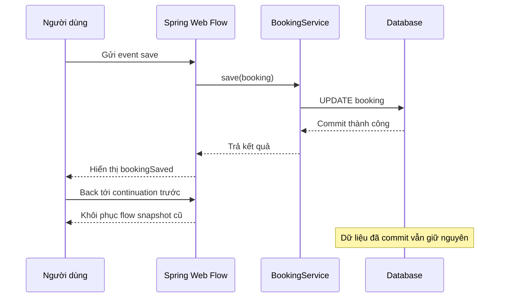

# Phân biệt khôi phục snapshot với hoàn tác thay đổi trong cơ sở dữ liệu

Trong module **SPRING_WEB_FLOW**, một hành trình nhiều bước có thể được lưu lại để người dùng quay về state trước, tải lại trang hoặc tiếp tục execution. Spring Web Flow có cơ chế snapshot/continuation để khôi phục trạng thái của flow execution. Cơ chế này thường bị nhầm với rollback của transaction cơ sở dữ liệu, nhưng hai việc giải quyết hai loại trạng thái khác nhau.

Khôi phục snapshot đưa flow execution về một trạng thái điều phối đã được lưu: state hiện tại, dữ liệu trong các scope và những thông tin execution mà repository quản lý. Rollback transaction hoàn tác các thao tác database chưa commit trong một transaction đang hoạt động. Khi transaction đã commit, khôi phục snapshot của flow không thể tự đảo ngược dữ liệu đã ghi. Muốn sửa một thay đổi đã commit, ứng dụng phải thực hiện một nghiệp vụ bù trừ hoặc một thao tác cập nhật mới theo quy tắc nghiệp vụ.

## 1. Hai loại trạng thái cần phân biệt

Một flow chỉnh sửa booking có thể giữ dữ liệu người dùng nhập trong `flowScope`, đi qua các view-state và gọi service để lưu dữ liệu. Trong quá trình đó tồn tại ít nhất hai loại trạng thái:

| Loại trạng thái | Ví dụ | Cơ chế quản lý |
|---|---|---|
| Trạng thái điều phối của flow | State `editBooking`, event đã xử lý, `flowScope.bookingForm`, dữ liệu phục vụ view | Spring Web Flow execution và repository/snapshot |
| Trạng thái nghiệp vụ đã lưu | Booking trong database, số lượng tồn kho, khoản thanh toán, trạng thái phê duyệt | Database, transaction manager và service nghiệp vụ |

Flow snapshot ghi nhận trạng thái execution tại một điểm phù hợp với cơ chế lưu continuation của Web Flow. Khi một request quay lại continuation đó và repository còn giữ snapshot tương ứng, framework có thể khôi phục flow về trạng thái đã lưu.

Database transaction quản lý một đơn vị công việc trên database. Nếu transaction bị rollback trước khi commit, các thay đổi thuộc transaction đó không được giữ lại. Sau khi commit thành công, transaction đã kết thúc; một snapshot cũ của flow không thể yêu cầu database tự quay ngược về trước commit.

Không nên gọi cả hai cơ chế là “rollback” mà không nói rõ đối tượng được hoàn tác. Hãy dùng các thuật ngữ riêng:

- **Restore flow snapshot:** khôi phục trạng thái điều phối của một flow execution.
- **Database rollback:** hủy các thay đổi chưa commit trong transaction hiện tại.
- **Compensation/undo nghiệp vụ:** thực hiện một thao tác nghiệp vụ mới để bù trừ một thay đổi đã commit, nếu quy tắc nghiệp vụ cho phép.

Ngoài ra, một số hệ quản trị database dùng thuật ngữ **database snapshot** cho bản chụp dữ liệu tại một thời điểm hoặc ảnh chụp ở tầng lưu trữ. Khôi phục loại snapshot này là thao tác vận hành database, có thể ảnh hưởng tới phạm vi dữ liệu rộng và cần quy trình backup/restore riêng. Nó cũng khác với rollback của một transaction đang mở và khác với snapshot của Spring Web Flow.

## 2. Snapshot của Spring Web Flow lưu và khôi phục điều gì?

Spring Web Flow quản lý một `FlowExecution` qua nhiều request. Repository lưu trạng thái execution để request tiếp theo có thể tiếp tục. Tùy repository, cấu hình và phiên bản, framework có thể giữ các snapshot/continuation của execution để hỗ trợ quay lại một điểm trước đó hoặc xử lý request tiếp tục.

Một snapshot có thể đại diện cho trạng thái điều phối như:

- State hiện tại và vị trí tiếp tục của flow.
- Các biến trong scope của flow, view hoặc conversation theo vòng đời của chúng.
- Dữ liệu model đang được flow giữ để hiển thị hoặc dùng ở bước tiếp theo.
- Thông tin execution cần thiết để tiếp tục các transition.

Phạm vi dữ liệu thực tế phụ thuộc cách repository và snapshot được triển khai. Không nên giả định mọi object Java đang được tham chiếu trong JVM đều được sao chép sâu hoặc mọi tài nguyên bên ngoài đều được snapshot. Connection database, transaction đang mở, file handle, HTTP client hoặc trạng thái của hệ thống bên ngoài không trở thành một phần có thể phục hồi chỉ vì chúng được tham chiếu từ flow scope.

Ví dụ, người dùng nhập ghi chú vào `flowScope.bookingForm`, chuyển sang màn hình xem lại và sau đó dùng Back để quay về continuation trước. Flow có thể khôi phục nội dung form đã lưu trong snapshot. Điều đó chỉ khôi phục dữ liệu form mà execution giữ; nếu một service đã ghi booking xuống database trước đó, database vẫn giữ thay đổi đã commit.

## 3. Database rollback chỉ có tác dụng trong transaction chưa commit

Spring quản lý transaction thường thông qua `PlatformTransactionManager` và `@Transactional`. Một service method được gọi trong transaction có thể đọc và ghi dữ liệu. Nếu thao tác thất bại và transaction được đánh dấu rollback theo cấu hình, các thay đổi thuộc transaction đó sẽ bị hủy khi transaction kết thúc.

Ví dụ service lưu booking và các dòng hàng trong cùng một transaction:

```java
import org.springframework.stereotype.Service;
import org.springframework.transaction.annotation.Transactional;

@Service
public class BookingService {

    private final BookingRepository bookingRepository;
    private final BookingItemRepository itemRepository;

    public BookingService(BookingRepository bookingRepository,
                          BookingItemRepository itemRepository) {
        this.bookingRepository = bookingRepository;
        this.itemRepository = itemRepository;
    }

    @Transactional
    public Booking save(Booking booking) {
        Booking saved = bookingRepository.save(booking);
        itemRepository.replaceItems(saved.getId(), booking.getItems());
        return saved;
    }
}
```

Nếu `replaceItems` phát sinh lỗi khiến transaction rollback, thao tác lưu booking và thay thế các dòng hàng trong cùng transaction sẽ được hoàn tác theo khả năng transaction của database. Khi method kết thúc bình thường và transaction commit, các thay đổi được lưu bền vững.

Với cấu hình Spring mặc định, unchecked exception (`RuntimeException`) và `Error` thường kích hoạt rollback; checked exception không tự động rollback trong mọi cấu hình. Nếu nghiệp vụ cần rollback khi một checked exception được ném ra, hãy khai báo rõ, ví dụ `@Transactional(rollbackFor = BookingWriteException.class)`. Quy tắc rollback có thể được tùy chỉnh bằng annotation hoặc transaction configuration.

`@Transactional` cần được áp dụng qua Spring proxy. Nếu một method trong cùng bean tự gọi một method khác có `@Transactional`, self-invocation có thể không đi qua proxy và không tạo ranh giới transaction như mong muốn. Giữ transaction ở service được Spring quản lý và kiểm tra cấu hình thực tế.

## 4. Ví dụ: khôi phục snapshot không hủy lần lưu đã commit

Xét hành trình sau:

1. Flow hiển thị `editBooking`; người dùng sửa ghi chú.
2. Người dùng gửi `save`; action gọi `bookingService.save`.
3. Service commit thay đổi booking vào database.
4. Flow chuyển sang `bookingSaved` và render màn hình kết quả.
5. Người dùng bấm Back để quay lại continuation trước đó.

Ở bước 5, Web Flow có thể khôi phục snapshot của state trước. Form trong flow có thể hiển thị ghi chú cũ hoặc dữ liệu cũ tùy snapshot được khôi phục. Database vẫn chứa ghi chú mới đã commit ở bước 3. Hai trạng thái có thể khác nhau:



Vì vậy, không được dựa vào thao tác Back hoặc restore snapshot để hủy cập nhật database. Nếu người dùng cần sửa lại, flow phải tải dữ liệu mới nhất từ service hoặc hiển thị rõ dữ liệu nào đang là bản nháp và dữ liệu nào đã được lưu.

## 5. Giữ transaction ngắn, không kéo dài qua thời gian người dùng nhập form

Một flow có thể kéo dài vài phút hoặc vài giờ vì người dùng đọc, nhập, chuyển màn hình hoặc tạm rời ứng dụng. Không nên mở transaction database khi flow bắt đầu rồi giữ transaction trong toàn bộ thời gian người dùng tương tác.

Transaction dài có thể:

- Giữ connection và lock lâu, làm giảm khả năng phục vụ request khác.
- Tăng nguy cơ deadlock hoặc xung đột khi nhiều người cùng sửa dữ liệu.
- Bị timeout hoặc mất kết nối trong lúc người dùng chưa gửi form.
- Không thể phục hồi đáng tin cậy chỉ bằng flow snapshot khi session hoặc process bị mất.

Thay vào đó, hãy để form giữ dữ liệu nháp trong flow scope, rồi gọi một service method có transaction ngắn khi người dùng xác nhận lưu:

```xml
<view-state id="editBooking" view="booking/edit" model="bookingForm">
    <transition on="continue" to="reviewBooking" bind="true" validate="true" />
</view-state>

<view-state id="reviewBooking" view="booking/review" model="bookingForm">
    <transition on="confirm" to="saveBooking" />
    <transition on="back" to="editBooking" />
</view-state>

<action-state id="saveBooking">
    <evaluate expression="bookingAction.confirmAndSave(flowScope.bookingForm)"
              result="flowScope.savedBooking" />
    <transition on="success" to="bookingSaved" />
    <transition on="conflict" to="bookingConflict" />
</action-state>
```

Service `confirmAndSave` thực hiện kiểm tra trạng thái, cập nhật dữ liệu và commit trong một transaction ngắn. Flow snapshot chỉ quản lý bản nháp và vị trí điều phối giữa các màn hình; transaction của service quản lý tính nguyên tử của lần ghi.

## 6. Thiết kế Back và Cancel theo trạng thái nghiệp vụ

Nút Back và Cancel có thể mang ý nghĩa khác nhau:

| Hành động | Khi nào dùng | Tác động mong đợi |
|---|---|---|
| Back trong form chưa lưu | Người dùng muốn quay lại bước nhập trước | Khôi phục hoặc hiển thị dữ liệu form theo flow execution; không cần database rollback |
| Cancel trước khi lưu | Người dùng bỏ bản nháp | Kết thúc hoặc rời flow; dọn dữ liệu tạm và giải phóng tài nguyên nếu có |
| Back sau khi đã commit | Người dùng muốn xem lại bước trước | Có thể khôi phục UI snapshot; dữ liệu đã lưu vẫn còn trong database |
| Hủy một nghiệp vụ đã commit | Người dùng muốn đảo ngược kết quả đã lưu | Gọi service nghiệp vụ bù trừ, nếu trạng thái và chính sách cho phép |

Không đặt tên event `cancel` rồi giả định nó tự rollback database. Event chỉ là tín hiệu điều phối. Nếu cancel xảy ra trước commit, flow có thể bỏ dữ liệu nháp và không gọi service lưu. Nếu cancel xảy ra sau commit, cần một thao tác nghiệp vụ riêng, ví dụ `cancelBooking`, với kiểm tra quyền, trạng thái, phí hủy và khả năng hoàn tiền.

Ví dụ flow xử lý hủy booking đã lưu:

```xml
<view-state id="bookingSaved" view="booking/saved">
    <transition on="requestCancellation" to="cancelSavedBooking" />
</view-state>

<action-state id="cancelSavedBooking">
    <evaluate expression="bookingAction.cancelCommittedBooking(flowScope.savedBooking.id)" />
    <transition on="success" to="bookingCancelled" />
    <transition on="notAllowed" to="cancellationNotAllowed" />
    <transition on="conflict" to="bookingConflict" />
</action-state>
```

`cancelCommittedBooking` là thao tác mới trên database, không phải phục hồi snapshot. Service cần quyết định có thể hủy hay không và ghi nhận lịch sử thay đổi.

## 7. Bù trừ nghiệp vụ sau commit

Khi một thao tác đã commit, không thể dùng rollback của transaction cũ để đảo ngược nó. Với nghiệp vụ cho phép hoàn tác, hãy tạo một thao tác bù trừ rõ ràng. Đây thường là một transaction mới và có thể tạo ra bản ghi lịch sử riêng.

Ví dụ:

- Booking đã xác nhận: tạo yêu cầu hủy booking, kiểm tra thời hạn và chính sách phí.
- Đã trừ tồn kho: thực hiện nghiệp vụ trả tồn kho nếu việc hủy được chấp nhận.
- Đã thu tiền: gọi quy trình hoàn tiền thông qua payment provider, sau đó ghi nhận kết quả hoàn tiền.
- Đã gửi thông báo: không thể thu hồi email đã gửi; có thể gửi thông báo đính chính hoặc hủy.

Một thao tác bù trừ không phải lúc nào cũng là phép đảo ngược toán học chính xác. Ví dụ, hoàn tiền có thể phát sinh phí, thời gian xử lý hoặc trạng thái chờ từ nhà cung cấp. Hãy mô hình hóa các bước và kết quả này như một quy trình nghiệp vụ riêng.

Với quy trình nhiều hệ thống, có thể cần mô hình saga/process manager: mỗi bước đã commit có một hành động bù trừ tương ứng nếu bước sau thất bại. Lưu trạng thái từng bước và bảo đảm các hành động bù trừ có thể retry an toàn. Flow điều phối giao diện có thể hiển thị tiến độ, nhưng tính nhất quán giữa các hệ thống cần được quản lý bởi tầng nghiệp vụ.

## 8. Tránh lưu object không phù hợp trong flow scope

Flow snapshot không nên được xem là bản sao lưu của toàn bộ trạng thái ứng dụng. Chỉ giữ dữ liệu mà flow cần để tiếp tục. Đối tượng ORM đang được quản lý, lazy proxy, connection, stream hoặc object chứa tài nguyên không thể serialize có thể gây vấn đề khi execution được lưu, passivate, replicate hoặc khôi phục tùy repository.

Các nguyên tắc thực tế:

1. Giữ DTO hoặc dữ liệu form cần cho màn hình trong `flowScope`.
2. Với dữ liệu nghiệp vụ cần tải lại, ưu tiên giữ ID và gọi service để lấy bản mới nhất.
3. Không giữ `EntityManager`, JDBC connection, transaction status hoặc tài nguyên hạ tầng trong scope.
4. Không coi một entity đã nạp trong snapshot là dữ liệu mới nhất; database có thể đã được cập nhật bởi request khác.
5. Nếu repository yêu cầu serialize execution hoặc hỗ trợ replication, kiểm tra các object trong scope có đáp ứng yêu cầu serialization của cấu hình đó không.

Ví dụ, thay vì giữ một entity `Booking` lớn trong flow scope qua nhiều bước, có thể giữ `bookingId` và một `BookingForm` gọn. Khi người dùng xác nhận, service tải lại booking trong transaction, kiểm tra version và áp dụng các trường được phép thay đổi.

## 9. Xử lý xung đột khi snapshot cũ hơn database

Một snapshot có thể chứa dữ liệu được đọc trước khi một người dùng khác cập nhật cùng bản ghi. Khi flow được khôi phục, dữ liệu trong scope có thể cũ. Nếu ghi thẳng snapshot đó xuống database, thay đổi mới hơn có thể bị ghi đè.

Dùng optimistic locking để phát hiện xung đột. Ví dụ entity có trường `version` được quản lý bởi JPA:

```java
@Entity
public class Booking {
    @Id
    private Long id;

    @Version
    private long version;

    private String note;
}
```

Form có thể mang version lúc được tải. Khi lưu, service tải entity hiện tại, so sánh version và áp dụng thay đổi có kiểm soát. Nếu version đã đổi, persistence provider có thể ném optimistic locking exception; service ánh xạ lỗi đó thành kết quả `conflict` để flow yêu cầu người dùng tải lại hoặc so sánh thay đổi.

```java
@Transactional
public Booking updateNote(Long bookingId, long expectedVersion, String note) {
    Booking current = bookingRepository.findById(bookingId)
            .orElseThrow(() -> new BookingNotFoundException(bookingId));

    if (current.getVersion() != expectedVersion) {
        throw new BookingConflictException(bookingId);
    }

    current.setNote(note);
    return bookingRepository.save(current);
}
```

Việc so sánh version ở service làm rõ ý định và giúp đưa xung đột thành một nhánh nghiệp vụ. Cần vẫn xử lý optimistic locking exception ở thời điểm flush/commit vì dữ liệu có thể thay đổi sau lần so sánh. Snapshot restore không thay thế kiểm soát đồng thời.

## 10. Idempotency khi người dùng gửi lại event

Back, refresh, retry mạng hoặc mở nhiều tab có thể khiến một event được gửi lại. Nếu action tạo booking, thu tiền hoặc giữ chỗ, gửi lặp có thể tạo side effect trùng. Không nên dựa vào snapshot để bảo đảm thao tác chỉ chạy một lần.

Hãy dùng một hoặc nhiều biện pháp ở tầng nghiệp vụ:

- Idempotency key duy nhất cho một ý định submit, được lưu cùng kết quả xử lý.
- Unique constraint hoặc khóa nghiệp vụ để ngăn tạo bản ghi trùng.
- Kiểm tra trạng thái trước khi thực hiện chuyển đổi, ví dụ chỉ cho phép `PENDING` chuyển sang `CONFIRMED`.
- Transaction để ghi kết quả nghiệp vụ và idempotency record một cách nhất quán.
- Outbox hoặc cơ chế phát sự kiện bền vững nếu cần đồng bộ thông báo/hệ thống ngoài sau commit.

Ví dụ service có thể nhận `submissionKey` từ flow và bảo đảm cùng một key không tạo hai booking. Key phải được tạo và quản lý an toàn; không dùng execution key của Web Flow làm idempotency key nghiệp vụ nếu vòng đời và phạm vi duy nhất của nó không đáp ứng yêu cầu.

## 11. Kiểm thử snapshot, rollback và compensation riêng biệt

Một bộ test tốt phải chứng minh từng cơ chế hoạt động đúng phạm vi. Không dùng một test Back để kết luận database đã rollback.

| Tình huống kiểm thử | Assertion cần có |
|---|---|
| Quay lại snapshot trước khi lưu | State và dữ liệu form trong flow được khôi phục theo continuation; database không thay đổi |
| Service thất bại trước commit | Transaction rollback; dữ liệu database không có thay đổi một phần |
| Service commit thành công rồi flow quay lại snapshot cũ | Database vẫn chứa dữ liệu đã commit; flow có thể đang hiển thị dữ liệu cũ |
| Người dùng hủy trước commit | Không có thay đổi database; dữ liệu nháp được bỏ theo thiết kế |
| Hủy nghiệp vụ sau commit | Một transaction mới ghi nhận thao tác bù trừ và kiểm tra đúng điều kiện |
| Snapshot cũ và database có version mới | Service phát hiện xung đột; không ghi đè dữ liệu mới hơn |
| Gửi event lặp | Idempotency hoặc constraint ngăn side effect trùng |
| Execution không thể phục hồi | Ứng dụng xử lý lỗi continuation/session và hướng người dùng bắt đầu lại an toàn |

Ở cấp service, kiểm thử rollback bằng transaction test và xác nhận dữ liệu sau khi transaction kết thúc. Ở cấp flow, dùng test support của Spring Web Flow để khởi chạy execution, gửi event, lưu URL/continuation phù hợp với test harness và kiểm tra state cùng scope. Ở cấp tích hợp, kiểm thử HTTP session, repository và database để xác nhận hành vi thật khi refresh, Back hoặc session hết hạn.

Một kịch bản quan trọng là: lưu thành công, xác nhận database đã commit, sau đó khôi phục snapshot trước. Assertion phải chứng minh database vẫn giữ thay đổi. Kịch bản này trực tiếp ngăn việc hiểu nhầm restore snapshot là rollback database.

## 12. Những lỗi thiết kế thường gặp

| Cách làm sai | Hệ quả | Cách sửa |
|---|---|---|
| Cho rằng Back tự hoàn tác lần lưu trước | Người dùng thấy form cũ nhưng database vẫn chứa dữ liệu mới | Hiển thị trạng thái đã lưu và cung cấp thao tác sửa/hủy nghiệp vụ riêng |
| Giữ transaction trong suốt thời gian người dùng nhập form | Lock, connection và transaction timeout kéo dài | Chỉ mở transaction ngắn quanh service method ghi dữ liệu |
| Giữ entity/connection trong flow scope | Snapshot hoặc passivation có thể lỗi, dữ liệu dễ cũ | Giữ DTO/ID và tải lại qua service |
| Dùng Cancel để xóa bản ghi đã commit mà không có quy tắc | Mất lịch sử hoặc vi phạm chính sách nghiệp vụ | Tạo quy trình cancel/compensation có kiểm tra trạng thái |
| Không kiểm tra version khi khôi phục snapshot cũ | Ghi đè cập nhật của người dùng khác | Dùng optimistic locking và nhánh xử lý conflict |
| Giả định action chỉ chạy một lần vì flow đã chuyển state | Refresh hoặc retry có thể lặp side effect | Thiết kế service idempotent và kiểm tra trạng thái |
| Chỉ kiểm thử flow state, không kiểm tra database | Bỏ sót thay đổi đã commit hoặc transaction không rollback | Kiểm thử flow và persistence ở hai cấp |

## 13. Quy trình quyết định cơ chế phù hợp

Khi người dùng muốn “quay lại”, “hủy” hoặc “khôi phục”, hãy xác định trước trạng thái nào cần thay đổi:

1. **Chỉ muốn quay về màn hình hoặc dữ liệu nháp trước:** dùng navigation/continuation và snapshot của flow nếu execution còn hợp lệ.
2. **Muốn bỏ dữ liệu chưa lưu:** kết thúc hoặc rời flow, dọn dữ liệu tạm; không cần database rollback nếu chưa có transaction ghi dữ liệu.
3. **Một lần ghi đang chạy bị lỗi trước commit:** để transaction manager rollback đơn vị công việc đó.
4. **Dữ liệu đã commit và cần thay đổi lại:** gọi service nghiệp vụ mới để sửa hoặc bù trừ theo chính sách.
5. **Snapshot chứa dữ liệu cũ:** tải lại dữ liệu từ service và kiểm tra version trước khi cập nhật.
6. **Có thể gửi event nhiều lần:** bảo vệ thao tác bằng idempotency và constraint ở tầng nghiệp vụ.

Spring Web Flow quản lý trạng thái của hành trình; transaction manager quản lý tính nguyên tử của lần truy cập database; service nghiệp vụ quyết định cách sửa hoặc bù trừ một thay đổi đã commit. Giữ ranh giới này rõ ràng giúp Back và refresh không tạo cảm giác sai rằng dữ liệu đã lưu được hoàn tác, đồng thời giúp ứng dụng phục hồi an toàn khi flow snapshot cũ hơn trạng thái thật trong database.
