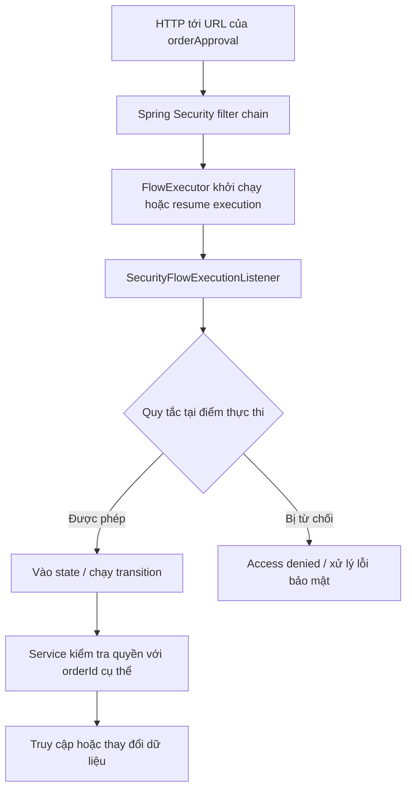

# Phần tử `secured` ở flow, state và transition trong Spring Web Flow

Một quy trình web nhiều bước thường có nhiều mức quyền. Người dùng đã đăng nhập có thể mở hồ sơ, nhân viên được phép xem thông tin xử lý, còn người phê duyệt mới có quyền bấm **Duyệt**. Nếu chỉ ẩn nút Duyệt trong giao diện, một client vẫn có thể tự gửi HTTP request chứa event `approve`. Nếu chỉ bảo vệ URL của flow, cùng một URL thường phục vụ nhiều state và transition, khiến việc phân quyền chi tiết trở nên khó rõ ràng.

Spring Web Flow hỗ trợ khai báo **`<secured>`** ngay trong flow definition để diễn tả yêu cầu truy cập tại ba cấp: **toàn flow**, **một state** và **một transition**. Khi tích hợp Spring Security đúng cách, các quy tắc này được kiểm tra trong vòng đời thực thi flow. Bài học thuộc chương **Bảo vệ flow** của module `SPRING_WEB_FLOW`, với mục tiêu áp dụng cơ chế phân quyền cho hành trình dùng state, event, transition và subflow, đồng thời bảo vệ thao tác nghiệp vụ ở tầng service.

Sau bài học, bạn có thể:

- Giải thích ý nghĩa `attributes` và `match="all"/"any"` của `<secured>`.
- Đặt quy tắc bảo vệ ở cấp flow, state và transition, biết khi nào mỗi cấp phát huy tác dụng.
- Hiểu vai trò của `SecurityFlowExecutionListener` và mối liên hệ với Spring Security.
- Phân tích quyền hiệu lực khi có nhiều lớp `<secured>` và khi người dùng đổi vai trò giữa execution.
- Phân biệt kiểm tra vai trò trong flow với quyền truy cập **đối tượng cụ thể**, CSRF và giới hạn form binding.
- Thiết kế đường xử lý từ chối truy cập, kiểm thử request giả mạo event và bảo vệ subflow.

## 1. Vì sao một URL được bảo vệ vẫn chưa đủ?

Giả sử ứng dụng có flow `orderApproval` với các state:

- `review`: xem bản tóm tắt đơn.
- `editNote`: thêm ghi chú xử lý.
- `approve`: thực hiện quyết định phê duyệt.
- `done`: kết thúc luồng.

Đường dẫn `/orderApproval?orderId=42` dùng để bắt đầu flow; những request tiếp theo thường tiếp tục cùng execution qua URL chứa execution key. Cả thao tác **Xem**, **Sửa ghi chú** và **Duyệt** có thể đi qua cùng entrypoint HTTP. Vì vậy, một quy tắc chỉ xét URL ở lớp security filter chưa chắc diễn đạt chính xác quyền của **state hoặc transition hiện tại**.



Sơ đồ mô tả trách nhiệm các lớp. Spring Security quản lý xác thực và security context; Web Flow xác định **đang vào flow/state nào hoặc thực hiện transition nào**; service kiểm tra quyền đối với **đơn hàng thực tế**, trạng thái nghiệp vụ và dữ liệu tại thời điểm thao tác.

**Phần tử `<secured>` không tự kích hoạt chỉ vì được viết trong XML.** Cần cấu hình listener bảo mật phù hợp và bảo đảm request đi qua các thành phần xác thực của Spring Security.

## 2. Cú pháp cơ bản của `<secured>`

Một quy tắc bảo vệ đơn giản:

```xml
<secured attributes="ROLE_USER" />
```

Để chấp nhận một trong hai vai trò:

```xml
<secured attributes="ROLE_EDITOR,ROLE_ADMIN" match="any" />
```

Để yêu cầu đồng thời hai thuộc tính:

```xml
<secured attributes="ROLE_STAFF,ROLE_APPROVER" match="all" />
```

| Thuộc tính | Ý nghĩa | Ví dụ |
| --- | --- | --- |
| `attributes` | Danh sách các security attribute được dùng làm yêu cầu truy cập; trong cấu hình mặc định thường là tên role, phân cách bằng dấu phẩy | `ROLE_STAFF,ROLE_ADMIN` |
| `match="all"` | Phải đáp ứng **tất cả** attribute trong danh sách | Có cả `ROLE_STAFF` và `ROLE_APPROVER` |
| `match="any"` | Chỉ cần đáp ứng **ít nhất một** attribute trong danh sách | Có `ROLE_EDITOR` hoặc `ROLE_ADMIN` |

Trong cách dùng thông thường của Spring Web Flow 2.x, **`match` mặc định là `all`**. Hãy khai báo `match="any"` khi ý định là quan hệ OR; với nhiều role, quên thuộc tính này có thể khiến người có một role hợp lệ vẫn bị từ chối.

`ROLE_USER` hoặc `ROLE_ADMIN` chỉ là các authority minh họa. Việc xác định authority thực tế, quy ước tiền tố role và cách xác thực tùy cấu hình Spring Security của ứng dụng. Không coi `attributes` là một biểu thức SpEL tùy ý nếu chưa thiết lập cơ chế đánh giá tương ứng trong phiên bản framework đang dùng.

### Phân biệt `match` với nhiều cấp bảo vệ

`match="any"` chỉ ảnh hưởng đến **các attribute của chính phần tử `<secured>` đó**. Nó không có nghĩa quy tắc ở state/transition sẽ bỏ qua quy tắc ở cấp flow.

Ví dụ flow yêu cầu `ROLE_USER`, state yêu cầu `ROLE_EDITOR`, transition yêu cầu `ROLE_APPROVER`. Để thực hiện transition đi qua những điểm đó, người dùng phải thỏa các yêu cầu được kiểm tra ở **từng cấp tương ứng**. Một phần tử `match="any"` ở transition không vô hiệu hóa yêu cầu flow-level.

## 3. Bảo vệ toàn bộ flow

Đặt `<secured>` trực tiếp trong định nghĩa flow khi mọi lượt truy cập vào hành trình đều phải đáp ứng một yêu cầu chung:

```xml
<?xml version="1.0" encoding="UTF-8"?>
<flow xmlns="http://www.springframework.org/schema/webflow"
      xmlns:xsi="http://www.w3.org/2001/XMLSchema-instance"
      xsi:schemaLocation="http://www.springframework.org/schema/webflow
                          http://www.springframework.org/schema/webflow/spring-webflow-2.0.xsd">

    <secured attributes="ROLE_EMPLOYEE" />

    <input name="orderId" type="java.lang.Long" required="true" />

    <on-start>
        <evaluate expression="orderService.requireReadableOrder(orderId)"
                  result="flowScope.order" />
    </on-start>

    <view-state id="review" view="orders/review">
        <transition on="cancel" to="cancelled" />
    </view-state>

    <end-state id="cancelled" view="orders/cancelled" />
</flow>
```

Ở ví dụ này, một người **không thỏa `ROLE_EMPLOYEE`** không được phép bắt đầu flow theo quy tắc đã khai báo và được listener hỗ trợ. Dữ liệu `orderId` vẫn phải được kiểm tra ở service: hai nhân viên cùng có `ROLE_EMPLOYEE` không mặc nhiên có quyền xem mọi đơn.

**Trường hợp phù hợp:** toàn bộ hành trình chỉ dành cho người đã được cấp vai trò nhất định: công cụ nội bộ, quy trình xử lý hồ sơ, trang tác nghiệp nhân viên hoặc wizard quản trị.

**Giới hạn:** quy tắc cấp flow không biểu đạt được quyền riêng của từng bước nếu có state chỉ dành cho người phê duyệt; cần thêm `<secured>` ở cấp state/transition. Việc một flow đã được mở cũng không đảm bảo người dùng giữ nguyên quyền mãi mãi hoặc dữ liệu vẫn thuộc phạm vi được phép.

## 4. Bảo vệ một state

Một state nhạy cảm có thể yêu cầu vai trò riêng. Ví dụ, nhân viên được xem đơn nhưng chỉ giám sát viên được mở màn `auditDetails`:

```xml
<view-state id="auditDetails" view="orders/audit">
    <secured attributes="ROLE_SUPERVISOR,ROLE_ADMIN" match="any" />

    <on-entry>
        <evaluate expression="auditService.loadVisibleHistory(orderId)"
                  result="viewScope.history" />
    </on-entry>

    <transition on="back" to="review" />
</view-state>
```

Khi Web Flow chuẩn bị **đi vào** `auditDetails`, listener bảo mật có thể đánh giá quy tắc của state. Người không đủ quyền không nên được vào state để xem dữ liệu nhạy cảm. Service `loadVisibleHistory` vẫn phải kiểm tra hồ sơ và từng mục lịch sử phù hợp quyền người gọi.

Phân biệt:

- **Kiểm tra state:** bảo vệ việc đi vào một bước nhất định.
- **Kiểm tra ở view:** các nút/đoạn HTML được ẩn hoặc hiện theo quyền chỉ cải thiện trải nghiệm; client có thể tự tạo request.
- **Kiểm tra service:** bảo vệ dữ liệu và thao tác bất kể request đến từ flow nào.

Nếu một state có nhiều đường đến (từ `review`, `search` hoặc subflow), quy tắc đặt **ngay trên state** giúp biểu đạt yêu cầu truy cập chung cho mọi đường vào state đó.

### Có thể dùng `<secured>` trên state không phải view-state?

Mục tiêu của bảo vệ state là kiểm soát việc flow đi vào bước tương ứng. Tùy loại state và schema/version Web Flow, hãy kiểm tra nơi `<secured>` được cho phép trong định nghĩa đang dùng. Cách thể hiện điển hình là bảo vệ `view-state` cho màn hình nhạy cảm và bảo vệ `transition` đưa tới thao tác có tác dụng nghiệp vụ. Với action-state tự động thực thi, đặc biệt phải kiểm tra thêm quyền tại service để tránh phụ thuộc vào cách một hook trạng thái được triển khai.

## 5. Bảo vệ transition: ngăn event nhạy cảm

Đây là cấp rất quan trọng khi cùng một màn hình có nhiều thao tác. Người dùng có thể **xem** đơn nhưng chưa chắc được **duyệt** đơn.

```xml
<view-state id="review" view="orders/review">
    <transition on="back" to="search" />

    <transition on="approve" to="performApproval">
        <secured attributes="ROLE_APPROVER,ROLE_ADMIN" match="any" />
    </transition>

    <transition on="reject" to="performRejection">
        <secured attributes="ROLE_APPROVER,ROLE_ADMIN" match="any" />
    </transition>
</view-state>
```

Nếu client gửi `_eventId=approve`, Web Flow chỉ được thực hiện transition nhạy cảm khi các điều kiện bảo mật tương ứng được đáp ứng. Việc ẩn nút Approve ở UI không thay thế quy tắc này.

### Phân quyền transition khác phân quyền state như thế nào?

| Cấp | Kiểm soát | Ví dụ |
| --- | --- | --- |
| Flow | Ai được bắt đầu/tham gia hành trình | Chỉ nhân viên được mở flow duyệt đơn |
| State | Ai được vào màn hình/bước cụ thể | Chỉ supervisor được xem lịch sử kiểm toán |
| Transition | Ai được kích hoạt một đường chuyển hoặc hành động | Chỉ approver được phát event `approve` |

Transition có thể chứa action, hoặc đi tới `action-state` để chạy service. Kiểm tra ở transition giúp chặn hành động bị cấm trên đường đi của state machine, nhưng vẫn cần kiểm tra tại **đích thực thi nghiệp vụ**.

Ví dụ service phê duyệt:

```java
@Service
public class ApprovalService {

    // Phụ thuộc vào cấu hình Spring Security method security của dự án.
    @PreAuthorize("hasAnyAuthority('ROLE_APPROVER', 'ROLE_ADMIN')")
    @Transactional
    public String approve(Long orderId) {
        Order order = requireOrderApproverAccess(orderId);
        requireStillAwaitingApproval(order);
        order.approve();
        return "success";
    }

    private Order requireOrderApproverAccess(Long orderId) {
        // Triển khai: nạp đơn và kiểm tra quyền với chính orderId.
        throw new UnsupportedOperationException("Application-specific");
    }

    private void requireStillAwaitingApproval(Order order) {
        // Triển khai: kiểm tra trạng thái hiện tại, version và quy tắc nghiệp vụ.
        throw new UnsupportedOperationException("Application-specific");
    }
}
```

Đây là ví dụ **phác thảo**, không phải class chạy ngay: `Order` và các phương thức private phải được ứng dụng triển khai. Với các thế hệ Spring Security dùng annotation `@PreAuthorize`, cần bật **method security** tương ứng (`@EnableMethodSecurity` ở thế hệ mới hoặc cấu hình tương thích ở thế hệ cũ). `@Transactional` phải có transaction manager thích hợp và đi qua cơ chế proxy/interceptor thực tế.

Đặc biệt, role là kiểm tra coarse-grained; service phải kiểm tra thêm **đúng đơn hàng**, quyền phân công, trạng thái chờ duyệt, version dữ liệu và giới hạn nghiệp vụ. Một `ROLE_APPROVER` không nên tự động duyệt mọi đơn chỉ vì tên role phù hợp.

## 6. Phối hợp bảo vệ ở cả ba cấp trong một flow

Ví dụ sau kết hợp quy tắc chung và quy tắc theo thao tác:

```xml
<?xml version="1.0" encoding="UTF-8"?>
<flow xmlns="http://www.springframework.org/schema/webflow"
      xmlns:xsi="http://www.w3.org/2001/XMLSchema-instance"
      xsi:schemaLocation="http://www.springframework.org/schema/webflow
                          http://www.springframework.org/schema/webflow/spring-webflow-2.0.xsd">

    <!-- Ai được bắt đầu hành trình -->
    <secured attributes="ROLE_EMPLOYEE" />
    <input name="orderId" type="java.lang.Long" required="true" />

    <on-start>
        <evaluate expression="orderService.loadAccessibleOrder(orderId)"
                  result="flowScope.order" />
    </on-start>

    <view-state id="review" view="orders/review">
        <transition on="showAudit" to="auditDetails" />

        <transition on="approve" to="approveAction">
            <secured attributes="ROLE_APPROVER,ROLE_ADMIN" match="any" />
        </transition>

        <transition on="cancel" to="cancelled" />
    </view-state>

    <view-state id="auditDetails" view="orders/audit">
        <secured attributes="ROLE_SUPERVISOR,ROLE_ADMIN" match="any" />
        <transition on="back" to="review" />
    </view-state>

    <action-state id="approveAction">
        <evaluate expression="approvalService.approve(orderId)" />
        <transition on="success" to="approved" />
    </action-state>

    <end-state id="approved" view="orders/approved" />
    <end-state id="cancelled" view="orders/cancelled" />
</flow>
```

Trong ví dụ, `orderService` và `approvalService` là bean do ứng dụng tự triển khai. Phương thức `approve` được viết ở dạng **minh họa outcome**: service/action thực tế cần trả giá trị thích hợp để tạo event `success` và có chiến lược xử lý exception/transaction đúng. Các trang, authentication và bảo vệ POST/CSRF phải được cấu hình trong ứng dụng.

### Ma trận quyền minh họa

Giả sử flow yêu cầu `ROLE_EMPLOYEE` và user có các authority như sau:

| Authority của user | Mở flow `orderApproval` | Vào `auditDetails` | Kích hoạt `approve` |
| --- | --- | --- | --- |
| Chưa đăng nhập | Không | Không | Không |
| `ROLE_EMPLOYEE` | Có | Không | Không |
| `ROLE_EMPLOYEE, ROLE_APPROVER` | Có | Không | Có, nếu service cũng cho phép |
| `ROLE_EMPLOYEE, ROLE_SUPERVISOR` | Có | Có | Không |
| `ROLE_EMPLOYEE, ROLE_ADMIN` | Có | Có | Có, nếu service cũng cho phép |
| Chỉ `ROLE_ADMIN` | Không theo quy tắc flow hiện tại | Không thể tới state từ flow này | Không thể thực hiện transition trong flow này |

Dòng cuối cho thấy một điểm thường bị bỏ qua: **`ROLE_ADMIN` không tự động vượt qua mọi `<secured attributes="ROLE_EMPLOYEE">`**. Nếu hệ thống muốn admin được vào flow, hãy thể hiện rõ:

```xml
<secured attributes="ROLE_EMPLOYEE,ROLE_ADMIN" match="any" />
```

Chính sách vai trò không nên phụ thuộc vào việc người đọc “ngầm hiểu admin có tất cả quyền”; điều đó chỉ đúng nếu cấu hình authority hierarchy/mapping của ứng dụng thật sự cung cấp quyền tương ứng.

## 7. Cấu hình `SecurityFlowExecutionListener` để thực thi bảo vệ

Khai báo `<secured>` trong XML là **chính sách**. Thành phần thực thi kiểm tra chính sách trong Web Flow là `SecurityFlowExecutionListener`, tích hợp với ngữ cảnh xác thực của Spring Security. Với cấu hình XML của Spring Web Flow 2.x, một cách đăng ký thường gặp là:

```xml
<!-- Namespace webflow được khai báo trong file cấu hình Spring tương ứng -->
<webflow:flow-executor id="flowExecutor">
    <webflow:flow-execution-listeners>
        <webflow:listener ref="securityFlowExecutionListener" />
    </webflow:flow-execution-listeners>
</webflow:flow-executor>

<bean id="securityFlowExecutionListener"
      class="org.springframework.webflow.security.SecurityFlowExecutionListener" />
```

Đoạn trên là **trích cấu hình minh họa**. Một cấu hình hoàn chỉnh còn cần namespace/schema của `webflow`, flow registry, Spring MVC handler mapping/adapter và các thành phần Spring Security tương thích. Tên class, XML namespace, phiên bản dependency và cách đăng ký listener cần được kiểm tra với đúng phiên bản Spring Web Flow mà ứng dụng sử dụng.

Luồng xử lý khái niệm:

1. Spring Security filter chain xử lý request, xác thực người dùng khi có đủ thông tin và thiết lập `SecurityContext` cho luồng gọi hiện tại.
2. Spring MVC chuyển request tới Web Flow theo URL/handler mapping.
3. Web Flow khởi chạy hoặc resume execution; listener nhận các lifecycle callback liên quan đến flow, state và transition.
4. Listener đối chiếu security attributes đã khai báo với quyền đang có của principal.
5. Nếu không đạt, việc truy cập bị từ chối; ứng dụng/Spring Security xử lý exception theo cấu hình bảo mật thực tế.

**Nếu chưa đăng ký listener hoặc security context chưa được thiết lập đúng, đừng giả định `<secured>` đang bảo vệ flow.** Phải có test xác nhận người thiếu role thực sự bị chặn ở cả ba cấp.

### Chỗ nào nên đặt thêm bảo vệ ngoài `<secured>`?

| Lớp | Mục đích |
| --- | --- |
| HTTP security filter | Bảo vệ request đầu vào, authentication, CSRF, session policy |
| `<secured>` của Web Flow | Thể hiện quy tắc theo flow/state/transition |
| Method security của Spring Security | Chặn lời gọi service không được phép, kể cả ngoài Web Flow |
| Kiểm tra tài nguyên ở service | Quyền trên đúng `orderId`, tenant, trạng thái và version |
| Binder/validation | Giới hạn field nhận từ client và kiểm tra dữ liệu biểu mẫu |

Các lớp này phối hợp với nhau; kiểm tra role chỉ là một phần của an toàn nghiệp vụ.

## 8. Trường hợp từ chối quyền và phục hồi luồng

Khi một người dùng không thỏa quy tắc `<secured>`, Web Flow có thể phát sinh lỗi bảo mật/denied trong quá trình lifecycle. Kết quả HTTP cuối cùng phụ thuộc Spring Security, thứ tự filter và cấu hình exception handling; **không khẳng định mặc định mọi lỗi đều tự động thành HTTP 403 hoặc trang login** trong tất cả các cách tích hợp.

Các hành vi thường mong muốn:

| Tình huống | Hướng xử lý |
| --- | --- |
| Chưa xác thực mở flow dành cho nhân viên | Điều hướng login theo chính sách authentication của ứng dụng hoặc trả lỗi phù hợp |
| Đã xác thực nhưng thiếu role cấp flow | Từ chối khởi chạy; không tạo dữ liệu nghiệp vụ |
| Thiếu role khi vào state nhạy cảm | Không hiển thị nội dung nhạy cảm; thông báo không đủ quyền |
| Thiếu role với event `approve` | Không gọi service phê duyệt; giữ hoặc kết thúc execution tùy chính sách an toàn |
| Role bị thu hồi khi execution đang mở | Kiểm tra lại quyền tại thao tác tiếp theo và trong service; không dựa vào quyền cũ trên giao diện |
| Execution key cũ hoặc session hết hạn | Xử lý lỗi khôi phục execution; cung cấp đường bắt đầu lại |

Không mặc nhiên đặt một `<transition on="error" ...>` rồi cho rằng exception `AccessDeniedException` sẽ được chuyển thành event `error`. Error handling phải được thiết kế theo cơ chế của Web Flow/Spring MVC/Spring Security đang sử dụng.

**Bảo toàn dữ liệu và bảo mật khi denied:** tránh hiển thị stack trace, thông tin của đơn không được phép xem hay dữ liệu nhạy cảm trong thông điệp lỗi. Một request thất bại khi authorization không được phép thực hiện thao tác ghi. Nếu đang dùng transaction, service phải tuân thủ rollback/exception strategy cho các lỗi nghiệp vụ và quyền.

### Nếu user có quyền tại lúc launch nhưng bị thu hồi quyền giữa chừng?

Flow execution có thể tồn tại qua nhiều HTTP request. Người dùng có thể mở trang `review`, rồi quản trị viên thu hồi `ROLE_APPROVER` trước khi họ bấm nút `approve`. Client vẫn hiển thị nút cũ, nhưng lần request tiếp theo phải được kiểm tra theo authority được ứng dụng cung cấp tại thời điểm xử lý. Cấu hình session/security context có thể ảnh hưởng độ mới của quyền; service không nên dựa vào giao diện đã render trước đó để quyết định.

Với yêu cầu bảo mật nghiêm ngặt, cần chiến lược làm mới quyền, kiểm tra lại assignment/quy tắc từ nguồn dữ liệu và quyền ở bước commit, nhất là hành động phê duyệt, hủy đơn hoặc thay đổi tiền.

## 9. Subflow, input và dữ liệu form có liên quan gì?

Một flow lớn có thể gọi subflow dành cho xác minh, chọn phương thức hoặc phê duyệt. Khi flow cha gọi flow con, flow con có định nghĩa và các state riêng:

```xml
<!-- Đặt trong flow cha -->
<subflow-state id="extraCheck" subflow="additionalReview">
    <input name="orderId" value="flowScope.orderId" />
    <transition on="checked" to="review" />
</subflow-state>
```

```xml
<!-- Đặt trong flow additionalReview -->
<secured attributes="ROLE_REVIEWER" />
<input name="orderId" type="java.lang.Long" required="true" />
```

Đây là **các trích đoạn ở hai flow khác nhau**, không ghép chúng thành một file XML hoàn chỉnh. Khi flow con bắt đầu, các quy tắc bảo vệ của flow con phải được xem xét trong lifecycle của nó; flow cha có được mở trước đó không mặc nhiên cấp quyền vào tất cả flow con. Tương tự, việc nhận `orderId` chỉ xác định ngữ cảnh đối tượng, **không chứng minh** người dùng được phép xem/chỉnh đối tượng đó.

Trong một form nhiều bước, `<secured>` bảo vệ **đường truy cập**, còn `<binder>` trong `view-state` quyết định field nào được bind. Một user có `ROLE_EDITOR` không vì thế được phép tự gửi `approved=true`, `ownerId=... ` hoặc `totalPrice=...` nếu các field đó nằm ngoài quyền sửa. Cần dùng form DTO, binder allowlist, validation và service kiểm tra quyền.

## 10. Những sai lầm thường gặp

| Sai lầm | Vì sao nguy hiểm | Hướng sửa |
| --- | --- | --- |
| Chỉ ẩn nút **Approve** trong HTML | Client tự phát `_eventId=approve` | Bảo vệ transition và service |
| Chỉ viết `<secured>` nhưng quên listener | Quy tắc có thể không được thực thi | Đăng ký `SecurityFlowExecutionListener`, test denied |
| Dùng `attributes="ROLE_A,ROLE_B"` và tưởng là OR | `match` mặc định `all` | Dùng `match="any"` nếu chỉ cần một trong hai |
| Cho rằng admin luôn vượt qua rule mọi cấp | Quy tắc role không tự suy luận hierarchy | Thể hiện rõ các role/hierarchy mong muốn |
| Cho rằng flow-level cho phép mọi action | State và transition có thể có quyền khác | Bổ sung rule đúng cấp và service check |
| Chỉ dựa vào role khi cập nhật tài nguyên | Người cùng role vẫn có thể không sở hữu đơn | Kiểm tra object-level authorization tại service |
| Dùng `orderId` từ request mà không xác thực | IDOR: truy cập đối tượng không thuộc quyền | Nạp object theo quyền và dùng ngữ cảnh tin cậy |
| Không chống CSRF cho POST | Request có thể bị phát từ nguồn ngoài | Bật CSRF theo Spring Security/config |
| Lưu entity có nhiều field trực tiếp từ form | Over-posting/mass assignment | DTO + `<binder>` allowlist + service cập nhật field cho phép |
| Tin execution key là bằng chứng quyền | Key có thể cũ, bị chia sẻ hoặc không còn hợp lệ | Kiểm tra authentication/authorization trên server |
| Không kiểm tra lại quyền sau thời gian chờ | Vai trò hoặc phân công có thể thay đổi | Kiểm tra tại request tiếp theo và trước commit |

## 11. Kiểm thử bảo vệ flow, state và transition

Kiểm thử phải chứng minh việc **từ chối thực sự xảy ra** ở server. Kiểm tra nút bị ẩn trên giao diện là chưa đủ.

| Ca kiểm thử | Input/quyền | Kỳ vọng |
| --- | --- | --- |
| Không có authentication | Mở flow `orderApproval` | Bị chặn theo chính sách login/denied; không đọc đơn |
| Thiếu role cấp flow | User không có `ROLE_EMPLOYEE` | Không vào flow hợp lệ |
| Đúng role cấp flow | Có `ROLE_EMPLOYEE` | Có thể vào `review` nếu `orderId` được phép |
| Role state không đủ | Chỉ có `ROLE_EMPLOYEE`, phát `showAudit` | Không hiển thị `auditDetails` |
| Role state với `any` | Có `ROLE_EMPLOYEE,ROLE_ADMIN` | Được xem audit nếu service xác thực order |
| Thiếu role transition | User chỉ `ROLE_EMPLOYEE` tự gửi `_eventId=approve` | Không thực hiện action phê duyệt; database không đổi |
| Role transition với `any` | Có `ROLE_EMPLOYEE,ROLE_APPROVER` | Qua kiểm tra transition, service quyết định quyền trên order |
| Thiếu role chung dù có role thao tác | Chỉ `ROLE_APPROVER`, không có `ROLE_EMPLOYEE` | Không vượt được rule cấp flow |
| Có role nhưng không sở hữu đơn | User hợp role, `orderId` thuộc phạm vi khác | Service từ chối truy cập/cập nhật |
| Role bị thu hồi giữa flow | Launch có quyền, sau đó quyền bị thu hồi | Request nhạy cảm tiếp theo không được thực hiện trái phép |
| Thêm field trái phép | POST `approved=true` hoặc `role=ADMIN` | Binder/service không thay đổi thuộc tính không được phép |
| Gửi CSRF token không hợp lệ | POST từ client giả mạo | Bị từ chối theo Spring Security |
| Cùng execution ở hai tab | Submit event từ tab có state/role cũ | Kiểm tra lại quyền, xử lý snapshot hợp lệ |
| Subflow được bảo vệ | Flow cha gọi `additionalReview` | Rule cấp flow con cũng được áp dụng |

### Cách kiểm thử ở các tầng

1. **Flow test:** khởi chạy flow, phát event, xác nhận state và đường transition được thiết kế đúng.
2. **Integration test Spring Security + Web Flow:** chạy với principal có/không có authority; chứng minh listener thực thi rule trên flow/state/transition và trả lỗi bảo mật theo cấu hình thật.
3. **Service test:** gọi thẳng method với người không được phép, kể cả không đi qua Web Flow; bảo đảm dữ liệu không bị sửa.
4. **HTTP test:** gửi thủ công `_eventId=approve`, thay `orderId`, thử key cũ và CSRF sai; kiểm tra status/redirect, response không lộ dữ liệu.
5. **Database verification:** kiểm tra một event denied không tạo transaction ghi thành công và không thay đổi trạng thái đơn.

Nếu test chỉ mock listener hoặc chỉ xác nhận thuộc tính `<secured>` có mặt trong XML, đó **chưa chứng minh** chính sách được tích hợp vào runtime. Đặc biệt, việc mock toàn bộ service không đủ để kiểm tra object-level authorization.

## 12. Bài tập thực hành: quy trình duyệt yêu cầu nghỉ phép

Hãy xây dựng flow `leaveApproval` có các state `requestSummary`, `managerNotes`, `auditHistory`, `approveAction`, `rejected` và `approved`:

1. Đặt `<secured>` cấp flow để chỉ nhân viên đã xác thực thuộc role được cho phép mở hành trình.
2. Cho `requestSummary` hiển thị với `ROLE_EMPLOYEE`, nhưng `auditHistory` yêu cầu `ROLE_HR` hoặc `ROLE_ADMIN` bằng `match="any"`.
3. Chỉ `ROLE_MANAGER` hoặc `ROLE_ADMIN` có thể kích hoạt transition `approve`/`reject`.
4. Cấu hình `SecurityFlowExecutionListener` trong flow executor và xác minh security filter chain được kích hoạt.
5. Form ghi chú chỉ bind các field `comment` và `reason`, không nhận `ownerId`, `approved` hoặc `status` từ client.
6. Trong service, kiểm tra người duyệt có quyền trên đúng đơn nghỉ phép, trạng thái vẫn đang chờ và không tự duyệt yêu cầu của chính mình nếu nghiệp vụ cấm.
7. Gửi HTTP request thủ công với `_eventId=approve` khi thiếu role; chứng minh không có bản ghi được duyệt.
8. Thử thu hồi role sau khi user đã mở form, dùng hai tab cùng execution và kiểm tra subflow có role riêng.

**Câu hỏi tự đánh giá:**

- `<secured attributes="ROLE_MANAGER,ROLE_ADMIN" />` có nghĩa là OR hay AND theo giá trị `match` mặc định?
- Vì sao `match="any"` ở transition không tự bỏ qua một `<secured>` ở cấp flow?
- Nếu không đăng ký `SecurityFlowExecutionListener`, việc XML có `<secured>` đã đủ đảm bảo chặn truy cập chưa?
- Điều gì khác nhau giữa bảo vệ state `auditHistory` và bảo vệ transition `approve`?
- Một người có `ROLE_APPROVER` có được duyệt **mọi** đơn nếu service không kiểm tra `orderId` không?
- Tại sao việc ẩn nút Approve, dùng execution key và bật CSRF vẫn chưa thay thế được kiểm tra nghiệp vụ ở service?

## Ghi nhớ

`<secured>` diễn tả các yêu cầu truy cập **tại cấp flow, state và transition** trong Spring Web Flow. Thuộc tính `attributes` khai báo security attributes; `match="all"` yêu cầu tất cả và `match="any"` yêu cầu ít nhất một. Để quy tắc được thực thi, ứng dụng phải tích hợp `SecurityFlowExecutionListener` với Spring Security và kiểm thử thực tế. Quy tắc ở nhiều cấp cùng góp phần bảo vệ hành trình; không được coi việc có role hoặc một execution key là đủ quyền trên dữ liệu cụ thể. Tầng service vẫn phải kiểm tra đối tượng, quyền truy cập, trạng thái, transaction, còn form cần binder/validation và request POST cần bảo vệ CSRF.
