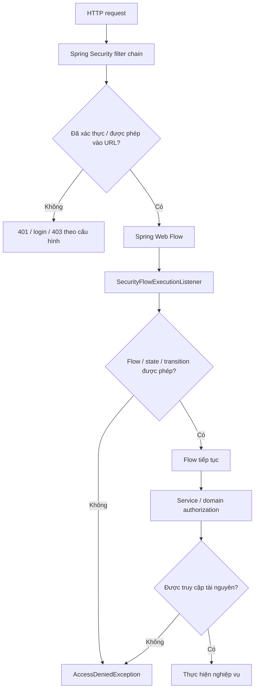

# Quyết định phân quyền theo cơ chế của phiên bản Spring Security

Một flow Spring Web Flow có thể có màn hình xem hồ sơ, bước xác nhận đơn hàng và bước phê duyệt dành riêng cho quản lý. Việc người dùng đăng nhập thành công chỉ xác nhận **họ là ai**; ứng dụng vẫn phải quyết định **họ được phép đi tới flow, state hoặc transition nào**. Nếu chỉ ẩn nút Phê duyệt trên giao diện, người dùng vẫn có thể thử gửi event trực tiếp hoặc truy cập URL của flow.

Spring Web Flow tích hợp với Spring Security qua phần tử **`<secured>`** trong định nghĩa flow và **`SecurityFlowExecutionListener`** gắn vào `FlowExecutor`. Cách ra quyết định đã thay đổi theo các thế hệ Spring Security: ví dụ cũ thường dùng `AccessDecisionManager`, trong khi Spring Web Flow 3.0.1 trở lên hỗ trợ `AuthorizationManager` và đánh dấu các API cũ để loại bỏ. Vì vậy, khi cấu hình phân quyền, cần xác định đúng phiên bản của cả hai framework.

## 1. Mục tiêu học tập

Sau bài này, bạn có thể:

1. Phân biệt xác thực (authentication) và phân quyền (authorization).
2. Bảo vệ toàn bộ flow, một state hoặc một transition bằng `<secured>`.
3. Đăng ký `SecurityFlowExecutionListener` vào đúng flow executor để các quy tắc thực sự được thực thi.
4. Hiểu ý nghĩa danh sách `attributes` và chế độ so khớp `any`/`all`.
5. Chọn `AuthorizationManager` hay cơ chế `AccessDecisionManager` cũ theo phiên bản Spring Web Flow/Spring Security.
6. Dùng Spring Security filter chain cho request HTTP và kiểm tra quyền tại service cho dữ liệu nghiệp vụ.
7. Kiểm thử quyền truy cập, từ chối truy cập, subflow và việc truyền `AccessDeniedException`.

## 2. Authentication và authorization giải quyết hai câu hỏi khác nhau

| Khái niệm | Câu hỏi | Kết quả thường dùng |
| --- | --- | --- |
| Authentication — xác thực | Người gửi request là ai? | Principal, Authentication và SecurityContext |
| Authorization — phân quyền | Người đó được phép thực hiện thao tác nào? | Quyết định cho phép hoặc từ chối |

Ví dụ, một nhân viên đã đăng nhập với authority `ROLE_USER` có thể xem đơn hàng của mình. Tuy nhiên, chỉ người có `ROLE_MANAGER` mới được phê duyệt đơn hàng. Ngoài role, service còn phải kiểm tra đơn hàng có thuộc phạm vi quản lý của người đó hay không.

Spring Security cung cấp nền tảng xác thực, lưu thông tin người dùng hiện tại và áp dụng chính sách truy cập ở nhiều tầng. Spring Web Flow bổ sung điểm kiểm tra phù hợp với mô hình điều hướng nhiều bước:



Các tầng này bổ sung cho nhau. URL được bảo vệ không thay thế kiểm tra state; kiểm tra state không thay thế kiểm tra quyền sở hữu đơn hàng trong service.

## 3. Ba bước để bảo vệ flow

Theo Spring Web Flow Reference Guide, cần hoàn thành đủ ba việc:

1. **Cấu hình Spring Security** để xác thực và cung cấp authority/quyền cho người dùng.
2. **Khai báo quy tắc trong flow** bằng phần tử `<secured>` ở flow, state hoặc transition.
3. **Đăng ký `SecurityFlowExecutionListener`** để xử lý các quy tắc đó trong quá trình thực thi flow.

Thiếu bất kỳ bước nào cũng có thể khiến chính sách bảo vệ không hoạt động như mong muốn. Đặc biệt, chỉ thêm `<secured>` vào XML flow **chưa đủ** để bảo vệ flow.

## 4. Khai báo quyền ở ba cấp

`<secured>` có thể đặt tại ba vị trí: trực tiếp trong `<flow>`, bên trong một state, hoặc bên trong một transition.

### 4.1. Bảo vệ toàn bộ flow

Nếu mọi người bắt đầu hành trình quản lý đơn hàng đều phải đăng nhập với quyền quản lý, đặt quy tắc ở cấp flow:

```xml
<flow xmlns="http://www.springframework.org/schema/webflow"
      xmlns:xsi="http://www.w3.org/2001/XMLSchema-instance"
      xsi:schemaLocation="http://www.springframework.org/schema/webflow
                          https://www.springframework.org/schema/webflow/spring-webflow.xsd">

    <secured attributes="ROLE_MANAGER" />

    <view-state id="reviewOrders" />
    <end-state id="completed" />
</flow>
```

Quy tắc được kiểm tra khi flow session được khởi tạo. Người dùng thiếu `ROLE_MANAGER` không được bắt đầu flow này qua executor đã gắn security listener.

### 4.2. Bảo vệ một state

Có những flow cho phép người dùng thông thường xem thông tin, nhưng chỉ quản lý mới được vào bước phê duyệt:

```xml
<flow xmlns="http://www.springframework.org/schema/webflow">

    <view-state id="viewOrder" />

    <view-state id="approveOrder">
        <secured attributes="ROLE_MANAGER" />
        <transition on="approve" to="approved" />
    </view-state>

    <end-state id="approved" />
</flow>
```

Quyền được kiểm tra trước khi vào `approveOrder`. Người dùng không có authority cần thiết không thể chỉ gửi event hoặc sửa URL để bỏ qua bước này.

### 4.3. Bảo vệ một transition

Một state có thể được nhiều nhóm người dùng truy cập, nhưng chỉ một nhóm được phép thực hiện hành động nhạy cảm:

```xml
<view-state id="reviewOrder">
    <transition on="back" to="editOrder" />

    <transition on="approve" to="approved">
        <secured attributes="ROLE_MANAGER" />
    </transition>
</view-state>

<end-state id="approved" />
```

Ở ví dụ này, người dùng có thể vào `reviewOrder` và quay lại chỉnh sửa. Chỉ người có `ROLE_MANAGER` mới được thực hiện transition `approve`.

### 4.4. So sánh vị trí khai báo

| Vị trí `<secured>` | Phạm vi bảo vệ | Ví dụ |
| --- | --- | --- |
| Cấp `<flow>` | Khởi tạo flow session | Chỉ quản lý được bắt đầu flow phê duyệt |
| Bên trong state | Trước khi vào state | Chỉ quản lý được vào `approveOrder` |
| Bên trong transition | Trước khi thực hiện transition | Chỉ quản lý được gửi event `approve` |

Quy tắc nên đặt gần hành vi cần bảo vệ để người đọc flow dễ nhận ra. Nếu cả flow vốn chỉ dành cho quản lý, bảo vệ ở cấp flow giúp thể hiện ý định rõ hơn; nếu chỉ một bước nhạy cảm, state/transition-level phù hợp hơn.

## 5. Attributes, ROLE và matching type

Thuộc tính `attributes` là danh sách các authority mà người dùng cần có:

```xml
<secured attributes="ROLE_USER" />
```

Một danh sách có nhiều giá trị có thể được dùng:

```xml
<secured attributes="ROLE_USER, ROLE_SUPPORT"
         match="any" />
```

Hai kiểu so khớp được mô tả:

| `match` | Ý nghĩa | Điều kiện |
| --- | --- | --- |
| `any` | Người dùng có ít nhất một authority trong danh sách | `ROLE_USER` **hoặc** `ROLE_SUPPORT` |
| `all` | Người dùng phải có tất cả authority trong danh sách | `ROLE_USER` **và** `ROLE_SUPPORT` |

Nếu bỏ `match`, giá trị mặc định được tài liệu Web Flow nêu là `any`. Ví dụ yêu cầu đồng thời hai quyền:

```xml
<secured attributes="ROLE_USER, ROLE_APPROVER"
         match="all" />
```

Tên authority phải khớp với dữ liệu được cấp cho `Authentication`. Ví dụ `ROLE_MANAGER` khác `MANAGER`; đừng tự giả định Web Flow thêm tiền tố `ROLE_` cho chuỗi trong `attributes`.

### 5.1. Lưu ý khi dùng custom AuthorizationManager

Tài liệu Web Flow 3.0.x nêu `match` là `any` hoặc `all`, nhưng cũng ghi chú thuộc tính này chỉ được tôn trọng khi dùng access decision manager mặc định. Trong khi đó, từ Web Flow 3.0.1, cơ chế mặc định đã chuyển sang `AuthorizationManager`. Vì vậy, nếu ứng dụng cung cấp `AuthorizationManager` tùy biến, **không nên giả định nó tự áp dụng ngữ nghĩa `match` trong XML**. Hãy đọc `SecurityRule.getComparisonType()` nếu cần, đưa quy tắc `any/all` vào manager và viết test cho từng trường hợp.

Khi dùng manager mặc định theo phiên bản hiện tại, kiểm tra lại hành vi của dependency đang chạy bằng integration test thay vì chỉ dựa trên một ví dụ XML từ tài liệu phiên bản cũ.

## 6. Đăng ký SecurityFlowExecutionListener

Đây là bước bắt buộc để `<secured>` có hiệu lực. Ví dụ Spring XML:

```xml
<webflow:flow-executor id="flowExecutor"
                       flow-registry="flowRegistry">
    <webflow:flow-execution-listeners>
        <webflow:listener ref="securityFlowExecutionListener" />
    </webflow:flow-execution-listeners>
</webflow:flow-executor>

<bean id="securityFlowExecutionListener"
      class="org.springframework.webflow.security.SecurityFlowExecutionListener" />
```

Listener được gắn với executor quản lý flow. Nếu ứng dụng có nhiều executor, cần bảo đảm executor thực sự được `FlowHandlerAdapter` sử dụng cũng được gắn listener.

Trong Java configuration, bean mặc định có thể được khai báo:

```java
import org.springframework.context.annotation.Bean;
import org.springframework.context.annotation.Configuration;
import org.springframework.webflow.security.SecurityFlowExecutionListener;

@Configuration
public class FlowSecurityConfiguration {

    @Bean
    public SecurityFlowExecutionListener securityFlowExecutionListener() {
        return new SecurityFlowExecutionListener();
    }
}
```

Sau đó cấu hình flow executor để thêm bean listener đó vào danh sách listener. Chỉ tạo bean mà không gắn vào executor thì chưa đủ.

## 7. Chọn cơ chế phân quyền theo phiên bản Spring Security

Đây là điểm cần đặc biệt chú ý khi đọc ví dụ cũ trên Internet. Spring Security đã hiện đại hóa API authorization; Spring Web Flow cũng cập nhật listener để theo kịp thay đổi đó.

### 7.1. Bức tranh tương thích

| Dòng phiên bản | Cơ chế thường gặp trong ví dụ | Cách tiếp cận |
| --- | --- | --- |
| Spring Web Flow 2.x và tài liệu cũ | `AccessDecisionManager`, `AccessDecisionVoter` | Phù hợp hệ thống legacy đang khóa phiên bản; không nên lấy làm mẫu cho ứng dụng mới |
| Spring Web Flow 3.0.0 | Tích hợp với Spring Framework 6; tài liệu ban đầu vẫn có ví dụ access decision manager | Kiểm tra đúng API của artifact đang dùng |
| Spring Web Flow 3.0.1 trở lên | Hỗ trợ `AuthorizationManager`; API `AccessDecisionManager` trong security listener bị deprecated for removal | Ưu tiên `AuthorizationManager` |
| Spring Security 6.x | `AccessDecisionManager` đã deprecated trong Spring Security | Dùng `AuthorizationManager` cho thiết kế mới |
| Spring Security 7.x | Access API cũ được tách sang module tương thích tùy chọn `spring-security-access` | Dùng API mới; chỉ thêm module cũ khi thực sự duy trì legacy code và có tương thích tương ứng |

Spring Web Flow 3.0.1 bổ sung hỗ trợ AuthorizationManager; release notes của dự án cũng ghi nhận nâng cấp tương thích Spring Framework 6.x và Spring Security 6.x. Dòng Spring Web Flow 4.0.0 được phát hành cùng nền tảng Spring Framework 7 và Spring Security 7. Khi chọn phiên bản, hãy đồng bộ bộ dependency thay vì chỉ nâng riêng một JAR.

### 7.2. Vì sao nên ưu tiên AuthorizationManager?

`AccessDecisionManager` thuộc nhóm API authorization cũ của Spring Security. Các API này đã bị deprecated để chuyển sang mô hình `AuthorizationManager`, trong đó quyết định cho phép/từ chối được biểu diễn trực tiếp qua một manager cho đối tượng cần bảo vệ.

Trong Spring Web Flow 3.0.1, các phương thức sau trên `SecurityFlowExecutionListener` được đánh dấu deprecated for removal:

- `setAccessDecisionManager(...)`
- `getAccessDecisionManager()`
- `createAccessDecisionManager(...)`
- `getConfigAttributes(...)`

API thay thế là `setAuthorizationManagerInitializer(...)`. Không nên sao chép đoạn cấu hình `AffirmativeBased` hoặc voter cũ từ một bài viết Spring Web Flow 2.x vào ứng dụng 3.x/4.x mà không kiểm tra dependency và cảnh báo deprecated.

### 7.3. Giữ legacy code khi chưa thể nâng cấp

Một ứng dụng đang chạy Web Flow 2.x và Spring Security cũ có thể vẫn dùng `AccessDecisionManager`. Trong trường hợp đó:

1. Giữ phiên bản dependency đã được kiểm thử.
2. Dùng đúng tài liệu/Javadoc của dòng Web Flow đang chạy.
3. Không nâng riêng Spring Security lên major version mới rồi kỳ vọng các class cũ vẫn còn trong cùng artifact.
4. Lập kế hoạch chuyển quy tắc sang `AuthorizationManager` và kiểm thử tương đương trước khi nâng cấp.

Từ Spring Security 7, một số API Access cũ được chuyển sang module `spring-security-access` tùy chọn. Việc thêm module này chỉ phục vụ tương thích legacy; nó không phải hướng triển khai mới được khuyến nghị.

## 8. Tùy chỉnh AuthorizationManager trong Spring Web Flow 3.0.1+

Theo Javadoc, `SecurityFlowExecutionListener.setAuthorizationManagerInitializer` nhận một hàm:

```java
Function<SecurityRule, AuthorizationManager<Object>>
```

Hàm nhận `SecurityRule` của phần tử `<secured>` và trả về manager quyết định quyền cho rule đó. Mặc định, `SecurityRule.getAuthorizationManager()` tạo manager dựa trên authority.

Ví dụ cấu hình một factory tùy biến:

```java
import org.springframework.context.annotation.Bean;
import org.springframework.context.annotation.Configuration;
import org.springframework.security.authorization.AuthorizationManager;
import org.springframework.webflow.security.SecurityFlowExecutionListener;
import org.springframework.webflow.security.SecurityRule;

@Configuration
public class FlowAuthorizationConfiguration {

    @Bean
    public SecurityFlowExecutionListener securityFlowExecutionListener(
            FlowAuthorizationManagerFactory managerFactory) {

        SecurityFlowExecutionListener listener =
                new SecurityFlowExecutionListener();

        listener.setAuthorizationManagerInitializer(
                (SecurityRule rule) -> managerFactory.forRule(rule));

        return listener;
    }
}

public interface FlowAuthorizationManagerFactory {
    AuthorizationManager<Object> forRule(SecurityRule rule);
}
```

`FlowAuthorizationManagerFactory` là thành phần do ứng dụng triển khai. Nó có thể đọc `rule.getAttributes()` và `rule.getComparisonType()` để xây dựng manager theo quyền hoặc permission model của hệ thống. Ví dụ trên chỉ thay điểm khởi tạo manager; nó chưa phải một chính sách phân quyền hoàn chỉnh.

### 8.1. Khi authority không chỉ là role

Một hệ thống có thể sử dụng quyền như:

- `ORDER_READ` — xem đơn hàng.
- `ORDER_APPROVE` — phê duyệt đơn hàng.
- `CUSTOMER_EXPORT` — xuất dữ liệu khách hàng.

Nếu authority không theo quy ước role mặc định, có thể cấu hình `AuthorizationManager` tùy biến qua initializer. Ví dụ XML:

```xml
<view-state id="exportCustomers">
    <secured attributes="CUSTOMER_EXPORT" />
</view-state>
```

Manager do ứng dụng cung cấp sẽ quyết định `CUSTOMER_EXPORT` được ánh xạ tới quyền nào trong hệ thống. Không nên chỉ đổi tên chuỗi authority rồi giả định Spring Security tự hiểu permission nghiệp vụ.

## 9. Cấu hình Spring Security ở tầng HTTP

Flow security bảo vệ các giai đoạn bên trong flow. Ứng dụng vẫn cần cấu hình Spring Security filter chain để kiểm soát request đi vào endpoint.

Ví dụ Java configuration theo Spring Security 6:

```java
import org.springframework.context.annotation.Bean;
import org.springframework.context.annotation.Configuration;
import org.springframework.security.config.annotation.web.builders.HttpSecurity;
import org.springframework.security.web.SecurityFilterChain;

@Configuration
public class HttpSecurityConfiguration {

    @Bean
    SecurityFilterChain applicationSecurity(HttpSecurity http)
            throws Exception {

        return http
            .authorizeHttpRequests(authorize -> authorize
                .requestMatchers("/flows/admin/**").hasRole("ADMIN")
                .requestMatchers("/flows/**").authenticated()
                .anyRequest().permitAll()
            )
            .build();
    }
}
```

Các URL trong ví dụ chỉ là mapping minh họa; hãy thay bằng đường dẫn thực tế do `FlowHandlerMapping` và ứng dụng MVC sử dụng. Cấu hình trên yêu cầu đăng nhập với mọi URL dưới `/flows/**` và quyền ADMIN cho nhóm URL quản trị.

Không tắt CSRF một cách tùy tiện chỉ để form Web Flow submit được. Với request thay đổi dữ liệu qua POST, giữ cơ chế CSRF của Spring Security và cấu hình view/form token phù hợp với cách tích hợp đang dùng.

### 9.1. Tầng HTTP không thay thế kiểm tra state

Nếu `/flows/**` chỉ yêu cầu authenticated, mọi người dùng đã đăng nhập đều có thể vào endpoint. Một flow vẫn cần `<secured>` để giới hạn state phê duyệt hoặc transition quản trị. Ngược lại, bảo vệ state mà để endpoint khởi chạy flow hoàn toàn công khai có thể tạo ra bề mặt truy cập không mong muốn.

## 10. Kiểm tra quyền nghiệp vụ ở service

Role trả lời câu hỏi “người dùng thuộc nhóm nào?”. Nhiều nghiệp vụ cần trả lời thêm “người dùng có quyền trên **tài nguyên cụ thể** này không?”.

Ví dụ, hai người đều có `ROLE_USER` nhưng chỉ chủ sở hữu mới được xem đơn hàng có ID 42. Không thể diễn đạt đầy đủ điều đó bằng:

```xml
<secured attributes="ROLE_USER" />
```

Hãy kiểm tra ownership tại service. Với Spring Security method security:

```java
import org.springframework.security.access.prepost.PreAuthorize;
import org.springframework.stereotype.Service;

@Service
public class OrderService {

    @PreAuthorize("@orderAuthorization.canRead(authentication, #orderId)")
    public Order findForCurrentUser(Long orderId) {
        // Truy vấn đơn hàng và trả dữ liệu theo quyền đã kiểm tra.
        return loadOrder(orderId);
    }
}
```

Bật method security trong cấu hình:

```java
import org.springframework.context.annotation.Configuration;
import org.springframework.security.config.annotation.method.configuration.EnableMethodSecurity;

@Configuration
@EnableMethodSecurity
public class MethodSecurityConfiguration {
}
```

`orderAuthorization.canRead(...)` là bean do ứng dụng triển khai, kiểm tra principal hiện tại có quyền đọc đúng đơn hàng đó hay không. Nếu không được phép, service từ chối thao tác ngay cả khi người gọi đã vượt qua flow-level security.

### 10.1. Vì sao cần kiểm tra lại khi lưu?

Flow có thể kéo dài nhiều phút hoặc lâu hơn. Trong lúc người dùng giữ flow:

- Đơn hàng có thể được chuyển sang chủ sở hữu khác.
- Vai trò người dùng có thể bị thu hồi.
- Trạng thái đơn hàng có thể chuyển từ `PENDING` sang `CANCELLED`.
- Một người quản lý có thể không còn thuộc nhóm phụ trách khu vực đó.

Do đó, service cần xác minh lại quyền và trạng thái tại thời điểm thực hiện thao tác nhạy cảm. Không xem việc đã vào state `approveOrder` là giấy phép vĩnh viễn cho mọi lần lưu tiếp theo.

## 11. Bảo vệ subflow và flow có thể được gọi độc lập

Một flow cha có thể gọi subflow:

```xml
<subflow-state id="reviewPayment" subflow="payment-review">
    <input name="orderId" value="flowScope.orderId" />
    <transition on="approved" to="complete" />
    <transition on="cancelled" to="reviewOrder" />
</subflow-state>
```

Nếu `payment-review` cũng có thể được khởi chạy độc lập qua URL/flow mapping, nên khai báo quyền ở chính flow con:

```xml
<flow xmlns="http://www.springframework.org/schema/webflow">
    <secured attributes="ROLE_PAYMENT_REVIEWER" />
    <!-- Các state và transition của bước rà soát thanh toán. -->
</flow>
```

Không nên giả định quyền của flow cha tự động thay thế mọi kiểm tra cần có ở flow con. Mỗi flow definition cần có chính sách phù hợp với các đường khởi chạy được hỗ trợ. Service xử lý thanh toán vẫn phải kiểm tra quyền trên đúng đơn hàng.

## 12. Từ chối truy cập và AccessDeniedException

Khi người dùng không đạt yêu cầu của một `<secured>`, `SecurityFlowExecutionListener` ném `AccessDeniedException`. Theo tài liệu Web Flow, exception này cần được để truyền lên execution stack để Spring Security có thể xử lý, chẳng hạn yêu cầu xác thực hoặc trả về trang từ chối truy cập.

**Không bắt rồi nuốt AccessDeniedException trong exception handler chung.** Nếu handler chuyển nó thành một event bình thường hoặc render một view thành công, Spring Security có thể không nhận được tín hiệu để xử lý đúng.

Một quy trình phù hợp:

1. Listener đánh giá rule của flow/state/transition.
2. Nếu không đủ quyền, phát sinh `AccessDeniedException`.
3. Exception truyền lên tầng tích hợp Spring Security.
4. Filter chain áp dụng cơ chế đã cấu hình: login challenge, access denied response hoặc trang lỗi.

Không nên hiển thị stack trace hoặc chi tiết quyền nội bộ cho người dùng cuối. Ghi log có kiểm soát, kèm correlation ID và thông tin flow/state không nhạy cảm để phục vụ điều tra.

## 13. Kiểm thử quyết định phân quyền

Phân quyền cần được kiểm thử như một phần của hành vi flow, không chỉ kiểm tra rằng XML có thẻ `<secured>`.

### 13.1. Ma trận quyền cho flow quản lý đơn hàng

Giả sử flow có:

- `ROLE_USER` được xem đơn hàng.
- `ROLE_MANAGER` được vào state phê duyệt.
- `ROLE_APPROVER` được thực hiện transition `approve`.

| Người dùng | Vào flow | Vào `approveOrder` | Transition `approve` |
| --- | --- | --- | --- |
| Chưa đăng nhập | Bị chặn bởi HTTP security nếu endpoint yêu cầu authenticated | Không tới được | Không tới được |
| `ROLE_USER` | Được nếu flow cho phép | Bị từ chối | Bị từ chối |
| `ROLE_MANAGER` | Được | Được | Chưa chắc được; cần `ROLE_APPROVER` |
| `ROLE_MANAGER` + `ROLE_APPROVER` | Được | Được | Được |
| Người có role nhưng không sở hữu đơn hàng | Có thể vào bước chung | Có thể qua role check | Service phải từ chối thao tác trên đơn hàng không thuộc quyền |

### 13.2. Những test cần có

1. Người chưa đăng nhập truy cập URL flow bị filter chain xử lý.
2. Người dùng thường không thể bắt đầu flow cấp quản lý nếu flow có rule đó.
3. Người dùng không có quyền không thể vào state được bảo vệ dù tự gửi URL/event.
4. Người có quyền vào state nhưng không có quyền transition không thể thực hiện hành động.
5. Quyền `match="any"` và `match="all"` được kiểm tra với đủ trường hợp có một, đủ hoặc không có authority.
6. Custom `AuthorizationManager` áp dụng đúng quy tắc và không bỏ qua security attribute.
7. Subflow được khởi chạy độc lập cũng có chính sách phù hợp.
8. `AccessDeniedException` được truyền lên tầng Spring Security, không bị exception handler chung nuốt.
9. Service từ chối truy cập đơn hàng không thuộc người dùng dù role hợp lệ.
10. Quyền bị thu hồi trong khi flow đang chạy được kiểm tra lại ở thao tác lưu nhạy cảm.

### 13.3. Test với người dùng giả lập

Với Spring Security Test, có thể dùng `@WithMockUser` trong test MVC/service:

```java
@Test
@WithMockUser(authorities = "ROLE_USER")
void ordinaryUserCannotApproveOrder() throws Exception {
    // Gửi request/event tới bước phê duyệt và xác minh bị từ chối.
}

@Test
@WithMockUser(authorities = {
        "ROLE_USER", "ROLE_MANAGER", "ROLE_APPROVER"
})
void approverCanReachApprovalAction() throws Exception {
    // Khởi chạy flow và xác minh transition được phép.
}
```

Đây là khung minh họa; test hoàn chỉnh cần dựng flow registry/executor, cấu hình security filter chain và fixture đơn hàng. Với flow execution test trực tiếp, bảo đảm `SecurityContext` được thiết lập trong cùng luồng thực thi test.

## 14. Những lỗi cấu hình thường gặp

| Triệu chứng | Nguyên nhân | Cách kiểm tra |
| --- | --- | --- |
| Người dùng không có quyền vẫn vào flow | Chỉ khai báo `<secured>` nhưng không đăng ký listener | Kiểm tra `flow-execution-listeners` của đúng executor |
| Listener không được gọi | `FlowHandlerAdapter` đang dùng executor khác | Kiểm tra wiring Spring MVC |
| Tất cả người dùng bị từ chối | Authority thực tế không khớp `attributes` | Kiểm tra `Authentication.getAuthorities()` |
| Có `ROLE_USER` nhưng không qua `ROLE_ADMIN` | Quy tắc yêu cầu quyền khác hoặc `match="all"` | Đọc chính xác rule và matching type |
| XML `match="all"` nhưng kết quả khác mong đợi | Custom manager không áp dụng comparison type hoặc hành vi phụ thuộc version | Kiểm tra `SecurityRule.getComparisonType()` và test manager |
| `AccessDeniedException` biến thành trang thành công | Exception handler bắt và chuyển đổi exception | Để exception truyền lên Spring Security |
| Người dùng có role nhưng đọc được đơn hàng của người khác | Chỉ kiểm tra role, thiếu ownership check | Bổ sung method/domain authorization ở service |
| Subflow bị bảo vệ khi gọi từ cha nhưng mở trực tiếp lại được | Chỉ bảo vệ state cha | Bảo vệ flow con và service |
| Code cũ không biên dịch sau nâng cấp Spring Security | Dùng API `AccessDecisionManager` đã deprecated/tách module | Kiểm tra dependency tree và version matrix |
| Nút bị ẩn nhưng request vẫn thực hiện được | Chỉ bảo vệ UI | Đặt kiểm tra tại flow và service |

## 15. Bài tập thực hành

Thiết kế flow `refund-request` cho hệ thống bán hàng:

1. Người dùng `ROLE_USER` có thể bắt đầu yêu cầu hoàn tiền và xem trạng thái của mình.
2. Chỉ `ROLE_SUPPORT` được vào state `reviewRefund`.
3. Chỉ `ROLE_FINANCE` được thực hiện transition `issueRefund`.
4. Service phải xác minh đơn hàng thuộc khách hàng hiện tại và đang ở trạng thái được hoàn tiền.
5. Flow executor phải gắn `SecurityFlowExecutionListener`.
6. Cấu hình HTTP security để endpoint `/flows/refund/**` yêu cầu xác thực.
7. Dùng `AuthorizationManager` nếu đang ở Spring Web Flow 3.0.1+; ghi rõ cách xử lý nếu hệ thống cũ vẫn dùng `AccessDecisionManager`.
8. Viết test cho người dùng thường, support, finance và người có role finance nhưng không có quyền trên đơn hàng.

**Câu hỏi tự kiểm tra:**

- Nếu chỉ thêm `<secured attributes="ROLE_FINANCE"/>` vào transition mà không gắn listener, điều gì xảy ra?
- Vì sao `ROLE_FINANCE` không chứng minh người dùng được hoàn tiền cho mọi đơn hàng?
- Nếu custom `AuthorizationManager` được cấu hình, ai chịu trách nhiệm diễn giải `match="all"`?
- Vì sao không nên bắt `AccessDeniedException` trong handler lỗi chung rồi chuyển tới state thành công?
- Khi nâng Spring Security 6 lên 7, vì sao cần kiểm tra lại dependency và API Access cũ?

## 16. Checklist trước khi đưa flow lên môi trường thật

- [ ] Spring Web Flow và Spring Security đang ở các phiên bản tương thích.
- [ ] Authentication được cấu hình; principal và authorities được cấp đúng.
- [ ] URL flow được bảo vệ bằng filter chain theo chính sách HTTP.
- [ ] Flow/state/transition nhạy cảm có `<secured>` đúng vị trí.
- [ ] `SecurityFlowExecutionListener` được gắn vào executor mà MVC thực sự sử dụng.
- [ ] `attributes` khớp chính xác authority; `any/all` đã được kiểm thử.
- [ ] Nếu dùng custom `AuthorizationManager`, logic đọc rule và matching được triển khai rõ ràng.
- [ ] Không dùng API `AccessDecisionManager` deprecated trong code mới.
- [ ] Service kiểm tra quyền trên tài nguyên cụ thể tại thời điểm thao tác.
- [ ] Subflow có thể khởi chạy độc lập đã được bảo vệ tương ứng.
- [ ] `AccessDeniedException` được để truyền tới Spring Security.
- [ ] Có test cho cả trường hợp được phép và bị từ chối, bao gồm truy cập trực tiếp.

## 17. Ghi nhớ

- Authentication xác định người dùng; authorization quyết định người đó được làm gì.
- `<secured>` bảo vệ flow, state hoặc transition; nó cần `SecurityFlowExecutionListener` gắn vào đúng `FlowExecutor` mới được thực thi.
- `attributes` là danh sách authority; `match="any"` yêu cầu ít nhất một quyền, `match="all"` yêu cầu tất cả quyền.
- Spring Web Flow 3.0.1+ hỗ trợ `AuthorizationManager` qua `setAuthorizationManagerInitializer`; API `AccessDecisionManager` trên listener đã deprecated for removal.
- Spring Security 6 đã đánh dấu nhiều Access API cũ deprecated; Spring Security 7 tách một số phần legacy sang module tùy chọn. Chọn dependency đồng bộ với phiên bản Web Flow.
- Filter chain bảo vệ request HTTP; flow listener bảo vệ điều hướng; service kiểm tra quyền trên dữ liệu nghiệp vụ. Cả ba tầng đều có vai trò riêng.
- Đừng bắt và nuốt `AccessDeniedException`; hãy để Spring Security xử lý theo cấu hình.
- Test quyền với cả role hợp lệ, role thiếu, tài nguyên không thuộc người dùng và trường hợp quyền thay đổi khi flow đang chạy.

### Tài liệu tham khảo

- [Spring Web Flow 3.0.x Reference Guide — Securing Flows](https://docs.spring.io/spring-webflow/docs/3.0.x/reference/#_securing_flows)
- [Spring Web Flow 3.0.1 Javadoc — SecurityFlowExecutionListener](https://docs.spring.io/spring-webflow/docs/3.0.1/api/org/springframework/webflow/security/SecurityFlowExecutionListener.html)
- [Spring Web Flow 3.0.1 Javadoc — SecurityRule](https://docs.spring.io/spring-webflow/docs/3.0.1/api/org/springframework/webflow/security/SecurityRule.html)
- [Spring Security Reference — Authorization](https://docs.spring.io/spring-security/reference/servlet/authorization/index.html)
- [Spring Security 6.5 API — AccessDecisionManager (deprecated)](https://docs.spring.io/spring-security/site/docs/6.5.x/api/org/springframework/security/access/AccessDecisionManager.html)
- [Spring Security 7 — Access API moves to spring-security-access](https://spring.io/blog/2025/09/09/access-api-moves-to-spring-security-access/)
- [Spring Web Flow Releases — dependency upgrades and AuthorizationManager support](https://github.com/spring-projects/spring-webflow/releases)
