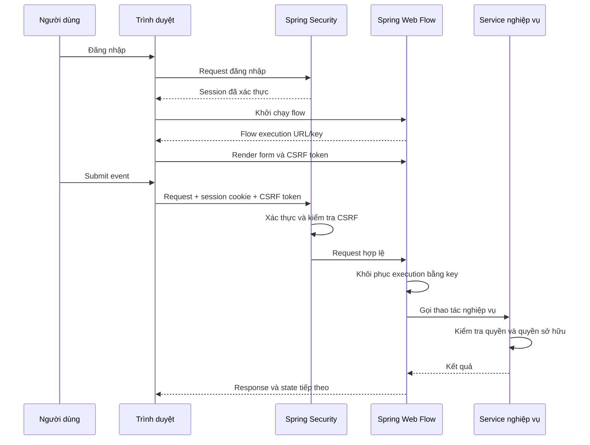

# Vai trò riêng của execution key, phiên đăng nhập và CSRF token

## Bối cảnh và mục tiêu

Bài học thuộc chương **Bảo vệ flow** của module `SPRING_WEB_FLOW`. Spring Web Flow mô hình hóa hành trình web nhiều bước bằng state, event, transition và subflow. Mỗi lần chạy flow có một flow execution, được tiếp tục qua nhiều HTTP request. Ứng dụng đồng thời phải xác định người dùng đã đăng nhập là ai, người đó được phép làm gì và request hiện tại có được gửi từ một tương tác hợp lệ của ứng dụng hay không.

Ba khái niệm thường xuất hiện cùng một request nhưng giải quyết ba vấn đề khác nhau:

- **Flow execution key** giúp xác định execution hoặc continuation cần tiếp tục.
- **Phiên đăng nhập** gắn request với ngữ cảnh xác thực của người dùng, thường được duy trì bằng HttpSession và SecurityContext.
- **CSRF token** giúp bảo vệ request thay đổi trạng thái trước kiểu tấn công giả mạo request từ một website khác.

Nếu xem execution key như mật khẩu, coi session còn tồn tại là đủ để cấp quyền hoặc bỏ CSRF vì URL flow đã có key, ứng dụng có thể mở ra lỗ hổng nghiêm trọng. Bài học này làm rõ vai trò và ranh giới của từng thành phần, sau đó ghép chúng vào quy trình xử lý flow an toàn.

Sau bài học, bạn có thể:

- Giải thích flow execution key dùng để định tuyến và tiếp tục flow như thế nào.
- Phân biệt session web với trạng thái đăng nhập và quyền của người dùng.
- Mô tả CSRF token bảo vệ request thay đổi trạng thái ra sao.
- Tích hợp Spring Web Flow với Spring Security mà không nhầm lẫn ba cơ chế.
- Bảo vệ dữ liệu theo người dùng/tenant và kiểm tra quyền ở mỗi thao tác nhạy cảm.
- Kiểm thử request hợp lệ, thiếu token, sai phiên, hết phiên và truy cập execution không thuộc người dùng.

## 1. Ba câu hỏi bảo mật khác nhau

Khi một request tiếp tục flow, máy chủ cần trả lời ba câu hỏi:

1. **Request muốn tiếp tục tiến trình nào?** Flow execution key và thông tin flow execution giúp tìm đúng tiến trình và continuation.
2. **Ai đang gửi request và họ được phép làm gì?** Session đăng nhập cùng SecurityContext cung cấp principal và authorities; ứng dụng vẫn phải kiểm tra quyền đối với tài nguyên cụ thể.
3. **Request thay đổi trạng thái có được gửi từ một tương tác hợp lệ trong ứng dụng không?** CSRF protection kiểm tra token gắn với ngữ cảnh người dùng để giảm nguy cơ website bên ngoài lợi dụng cookie tự động được trình duyệt gửi.

| Thành phần | Vai trò chính | Không thay thế được |
| --- | --- | --- |
| Flow execution key | Chọn flow execution/continuation cần khôi phục | Đăng nhập, phân quyền, CSRF token |
| HttpSession và SecurityContext | Duy trì ngữ cảnh phiên và thông tin xác thực | Quyền truy cập từng bản ghi, CSRF token, tính hợp lệ của flow |
| CSRF token | Chứng minh request có token hợp lệ gắn với ngữ cảnh ứng dụng | Xác thực danh tính, phân quyền, execution key |

Một request chỉ an toàn khi các kiểm tra cần thiết đều đạt. Có execution key đúng không chứng minh người dùng được phép xem đơn hàng. Có session đăng nhập không chứng minh request POST không bị website khác kích hoạt. Có CSRF token không chứng minh người dùng có quyền hủy đơn hàng của người khác.

## 2. Flow execution key dùng để làm gì?

Spring Web Flow tạo và quản lý flow execution để giữ tiến trình của một hành trình nhiều bước. Khi flow tạm dừng để render view, framework có thể lưu trạng thái thực thi và tạo continuation. Request tiếp theo mang thông tin nhận diện execution/continuation để framework khôi phục đúng tiến trình, xử lý event và tiếp tục state machine.

Trong URL hoặc form của flow, bạn có thể gặp các tham số như `execution`, `_flowExecutionKey` hoặc dữ liệu URL được tạo bởi flow handler tùy cấu hình và phiên bản. Tên và cách biểu diễn cụ thể cần được kiểm tra trong ứng dụng đang dùng.

Execution key có các đặc điểm:

- Gắn request với một flow execution hoặc một continuation cụ thể.
- Cho phép framework tìm trạng thái flow tương ứng trong execution repository.
- Giúp phân biệt nhiều flow execution, kể cả khi cùng người dùng mở nhiều wizard.
- Có thể xuất hiện trong URL hoặc dữ liệu form để request tiếp theo tiếp tục đúng flow.
- Có thể hết hiệu lực khi execution kết thúc, bị loại khỏi repository hoặc phiên lưu trữ không còn hợp lệ.

**Execution key không phải thông tin đăng nhập.** Không dùng nó làm mật khẩu, bearer token hoặc bằng chứng người dùng sở hữu tài nguyên. Không cấp quyền chỉ vì request có một key hợp lệ. Một key chỉ có ý nghĩa trong cơ chế tra cứu flow execution; ứng dụng vẫn cần kiểm tra session, principal, quyền và quyền sở hữu dữ liệu.

Không nên dựa vào việc key khó đoán. Cách tạo key và lưu execution phụ thuộc repository, phiên bản và cấu hình. Ngay cả khi key có tính khó đoán, nó vẫn không thay thế authentication, authorization hay CSRF protection.

### Luồng request ở mức khái quát

1. Người dùng đăng nhập; ứng dụng tạo hoặc khôi phục phiên đã xác thực.
2. Người dùng khởi chạy flow; Spring Web Flow tạo execution.
3. Flow render view và cung cấp URL/continuation cần thiết cho request tiếp theo.
4. Người dùng gửi form với flow execution key và CSRF token nếu request thuộc loại cần bảo vệ.
5. Security filter chain xử lý request, xác thực session và kiểm tra CSRF theo cấu hình.
6. Spring Web Flow sử dụng execution key để tìm execution, xử lý event và chuyển state.
7. Service nghiệp vụ kiểm tra quyền trên tài nguyên cụ thể trước khi đọc hoặc thay đổi dữ liệu.



Sơ đồ cho thấy các bước kiểm tra có vai trò độc lập. Tùy kiến trúc, một số filter hoặc handler có thể chạy theo thứ tự khác, nhưng không được bỏ các kiểm tra cần thiết chỉ vì flow đã có execution key.

## 3. Phiên đăng nhập và HttpSession

HttpSession là phiên do Servlet container quản lý. Trình duyệt thường gửi session cookie trong các request thuộc cùng phiên. Ứng dụng có thể lưu thông tin phiên trong đó, còn Spring Security thường duy trì SecurityContext chứa Authentication để biết principal và authorities của request đã được xác thực.

Cần phân biệt:

- **Session tồn tại:** trình duyệt gửi một session identifier mà máy chủ nhận diện được.
- **Đã xác thực:** SecurityContext có Authentication hợp lệ theo cơ chế xác thực của ứng dụng.
- **Được cấp quyền:** principal có authority cần thiết và được phép thao tác trên tài nguyên cụ thể.

Một session có thể tồn tại nhưng chưa đăng nhập. Một người dùng đã đăng nhập có thể không có quyền truy cập một đơn hàng thuộc người dùng khác. Quyền cũng có thể thay đổi trong khi flow đang mở; không nên chỉ kiểm tra ở lúc khởi chạy flow rồi tin rằng quyền đó luôn còn hiệu lực.

### Session fixation và logout

Khi đăng nhập, Spring Security có cơ chế bảo vệ session fixation theo cấu hình mặc định/chiến lược session của phiên bản. Ứng dụng cần giữ cấu hình an toàn và kiểm tra hành vi khi nâng cấp hoặc tùy chỉnh session management.

Khi logout, cần xóa hoặc vô hiệu hóa ngữ cảnh xác thực theo cấu hình, làm mất hiệu lực session phù hợp và xử lý các flow execution phụ thuộc vào session đó. Một URL cũ chứa execution key không được trở thành cách tiếp tục thao tác đã xác thực sau khi người dùng logout.

Khi session hết hạn:

- Request tiếp theo có thể không còn Authentication.
- Execution repository lưu trong session có thể không còn tìm thấy execution.
- CSRF token được lưu theo session có thể không còn hợp lệ.
- Người dùng cần được chuyển tới luồng đăng nhập hoặc thông báo phiên hết hạn phù hợp.
- Sau đăng nhập lại, cần áp dụng chính sách khôi phục flow rõ ràng; không tự động cho phép tiếp tục thao tác nhạy cảm dựa trên dữ liệu cũ.

### Không đặt quyền sở hữu tài nguyên trong session để tin tưởng tuyệt đối

Không nên chỉ lưu `currentUserId` trong flowScope hoặc session rồi tin rằng mọi thao tác sau đó đều thuộc người dùng đó. Service nên lấy principal hiện tại từ ngữ cảnh bảo mật và kiểm tra quyền truy cập vào tài nguyên ở phía server.

Ví dụ, một service hủy đơn hàng có thể nhận order ID từ flow, nhưng phải xác minh đơn đó thuộc người dùng hiện tại hoặc principal có quyền quản trị phù hợp:

```java
@Transactional
public void cancelOrder(Long orderId, Authentication authentication) {
    Order order = orderRepository.findById(orderId)
            .orElseThrow(OrderNotFoundException::new);

    String username = authentication.getName();

    if (!order.isOwnedBy(username)
            && !hasOrderAdminAuthority(authentication)) {
        throw new AccessDeniedException("Không có quyền hủy đơn hàng này");
    }

    order.cancel();
}
```

Đây là ví dụ minh họa. Cách biểu diễn chủ sở hữu, authority và truy cập Authentication tùy ứng dụng. Kiểm tra quyền nên nằm ở tầng service hoặc policy dùng chung để mọi đường gọi đều được bảo vệ, kể cả khi flow được tiếp tục từ một URL cũ.

## 4. CSRF token bảo vệ điều gì?

CSRF (Cross-Site Request Forgery) là kiểu tấn công trong đó một website bên ngoài khiến trình duyệt của người dùng gửi request tới ứng dụng mà người dùng đang đăng nhập. Trình duyệt có thể tự động đính kèm cookie phiên vào request. Nếu ứng dụng chỉ dựa vào cookie để tin request, một website độc hại có thể lợi dụng phiên đang đăng nhập để kích hoạt hành động ngoài ý muốn.

CSRF token là giá trị bí mật, khó đoán, gắn với ngữ cảnh người dùng/phiên theo cơ chế repository. Ứng dụng yêu cầu token hợp lệ trong request cần bảo vệ. Website bên ngoài thường không đọc được token được cấp trong trang của ứng dụng do same-origin policy, nên không dễ tạo request hợp lệ chỉ bằng cách khiến trình duyệt gửi cookie.

CSRF token:

- Được phát cho trang/form hoặc được cung cấp qua cơ chế request phù hợp.
- Được gửi lại cùng request thay đổi trạng thái.
- Được Spring Security kiểm tra trước khi request tới controller/flow handler theo filter chain.
- Có thể được lưu theo session hoặc dùng cơ chế repository khác.
- Có thể thay đổi theo chính sách token của phiên bản và request handler.

CSRF token **không xác thực người dùng**. Một người dùng không có quyền vẫn có thể sở hữu token hợp lệ của chính phiên họ. Vì vậy, ứng dụng phải kiểm tra authorization độc lập sau khi CSRF pass.

### Vì sao execution key không thay CSRF token?

Execution key thường được đưa vào URL hoặc form để framework biết cần tiếp tục execution nào. Một website bên ngoài có thể không cần biết execution key để thử gửi request tới một endpoint mà trình duyệt tự động đính kèm session cookie; tùy cách ứng dụng thiết kế, key có thể bị lộ trong URL, lịch sử trình duyệt, log hoặc referrer. Ngay cả khi key không thể đoán, nó không được thiết kế để chứng minh request đến từ form hợp lệ trong ứng dụng.

CSRF token giải quyết đúng câu hỏi về tính hợp lệ của request thay đổi trạng thái. Vì vậy:

- Giữ CSRF protection của Spring Security cho các request thay đổi trạng thái.
- Đưa CSRF token vào form của flow và request AJAX nếu endpoint yêu cầu.
- Không tắt CSRF chỉ vì request có `_flowExecutionKey` hoặc execution URL.
- Không dùng CSRF token làm flow ID hoặc dữ liệu nghiệp vụ.
- Không ghi token vào log hoặc gửi nó qua URL nếu có thể tránh.

## 5. Đưa CSRF token vào form của Spring Web Flow

Khi Spring Security bảo vệ ứng dụng, form submit của flow cần gửi CSRF token theo cơ chế được cấu hình. Với form HTML thông thường, token thường được biểu diễn bằng hidden input có tên `_csrf`; Spring Security cũng cung cấp các tích hợp theo view technology.

Ví dụ JSP với Spring Security tag library:

```jsp
<%@ taglib prefix="sec" uri="http://www.springframework.org/security/tags" %>

<form method="post" action="${flowExecutionUrl}">
    <sec:csrfInput/>

    <input type="text" name="email"/>
    <button type="submit" name="_eventId" value="continue">
        Tiếp tục
    </button>
</form>
```

`flowExecutionUrl` đại diện URL do Spring Web Flow cung cấp cho view hiện tại. Cú pháp cụ thể để lấy URL và tích hợp tag phụ thuộc công nghệ view. Không tự ghép execution key bằng chuỗi nếu framework đã cung cấp URL phù hợp.

Với Thymeleaf và tích hợp Spring Security, form POST có thể tự được thêm CSRF hidden field khi cấu hình dialect/integration tương ứng. Cần xác minh HTML render thực tế có chứa token và request gửi lại token đúng tên mà filter mong đợi.

Nếu tự render form hoặc dùng template engine không tích hợp, cần lấy CSRF token từ request attribute theo cơ chế Spring Security của phiên bản đang dùng và thêm vào form. Không hard-code token, không lưu token cố định trong template và không dùng một token mẫu cho mọi người dùng.

### Request AJAX

Nếu flow gửi event bằng fetch/XHR, client cần gửi CSRF token theo header mà ứng dụng cấu hình. Spring Security thường cung cấp tên header như `X-CSRF-TOKEN` hoặc một biến thể theo repository/request handler. Hãy đọc tên header từ cấu hình thực tế thay vì giả định mọi dự án dùng giống nhau.

Ví dụ khái niệm:

```javascript
fetch(flowExecutionUrl, {
    method: "POST",
    headers: {
        "Content-Type": "application/x-www-form-urlencoded",
        "X-CSRF-TOKEN": csrfToken
    },
    body: new URLSearchParams({
        "_eventId": "continue",
        "_flowExecutionKey": flowExecutionKey
    })
});
```

Đây là ví dụ minh họa; tên header, tham số event và cách mã hóa body cần khớp cấu hình thực tế. Token phải được lấy từ trang/request hiện tại và giữ an toàn trong client. Không đưa token vào URL query string vì URL có thể xuất hiện trong lịch sử, log và referrer.

## 6. Cấu hình Spring Security cho ứng dụng có flow

Spring Security bảo vệ request ở filter chain trước khi request được xử lý bởi Spring MVC và Spring Web Flow. Cần cấu hình quyền truy cập endpoint flow và giữ CSRF protection cho request thay đổi trạng thái.

Ví dụ cấu hình Java ở mức khái quát:

```java
@Bean
SecurityFilterChain securityFilterChain(HttpSecurity http) throws Exception {
    http
        .authorizeHttpRequests(authorize -> authorize
            .requestMatchers("/login", "/assets/**").permitAll()
            .requestMatchers("/flows/admin/**").hasRole("ADMIN")
            .requestMatchers("/flows/**").authenticated()
            .anyRequest().permitAll()
        )
        .csrf(Customizer.withDefaults());

    return http.build();
}
```

Ví dụ trên minh họa hai điểm: endpoint flow cần đăng nhập và CSRF vẫn được bật. Quy tắc URL thực tế phải khớp cách Spring Web Flow được ánh xạ trong ứng dụng. Không nên mở toàn bộ endpoint chỉ để flow dễ chạy; cũng không nên chỉ dựa vào URL authorization để thay thế kiểm tra quyền trên từng bản ghi.

Nếu ứng dụng dùng nhiều SecurityFilterChain, cần chắc chắn request flow đi qua chain có cấu hình authentication và CSRF phù hợp. Thứ tự matcher và filter chain có thể khiến endpoint vô tình rơi vào chain khác. Hãy kiểm tra cấu hình thực tế và test request tới đúng flow handler.

### Không vô hiệu hóa CSRF cho toàn bộ flow một cách tùy tiện

Một số ứng dụng cũ có thể thêm matcher để bỏ qua CSRF cho endpoint flow vì form hoặc event không hoạt động sau khi bật Spring Security. Đây thường là dấu hiệu form chưa gửi token, filter chain chưa được tích hợp đúng hoặc request dùng phương thức/đường dẫn chưa được hiểu rõ.

Trước khi thay đổi chính sách CSRF:

1. Xác định request nào bị từ chối và vì sao.
2. Kiểm tra form render có hidden token không.
3. Kiểm tra AJAX có gửi header token không.
4. Kiểm tra request method và matcher của CSRF filter.
5. Kiểm tra filter chain áp dụng cho flow endpoint.
6. Bổ sung token và test lại.

Chỉ cấu hình bỏ qua CSRF cho một endpoint thật sự không thể bị lợi dụng để thay đổi trạng thái, với lý do rõ ràng và review bảo mật. Không loại trừ tất cả request của Spring Web Flow chỉ để khắc phục lỗi form.

## 7. Authorization ở từng state và service

Authentication trả lời “ai đang đăng nhập”; authorization trả lời “người đó được làm gì”. Một flow có thể yêu cầu đăng nhập để khởi chạy, nhưng vẫn cần kiểm tra quyền ở các điểm quan trọng.

Ví dụ hành trình quản lý hồ sơ:

- Người dùng mở flow sửa hồ sơ.
- Flow nhận `profileId` qua URL hoặc input.
- Service tải hồ sơ và kiểm tra người dùng hiện tại có quyền xem.
- Khi submit thay đổi, service kiểm tra lại quyền sửa và trạng thái hồ sơ.
- Khi xác nhận, service thực hiện cập nhật trong transaction phù hợp.

Không nên chỉ kiểm tra quyền ở bước đầu. Trong lúc flow đang mở, quản trị viên có thể thu hồi quyền, tài khoản có thể bị khóa hoặc hồ sơ có thể được chuyển sang trạng thái không cho sửa. Thao tác nhạy cảm cần kiểm tra lại quyền và trạng thái tại thời điểm thực hiện.

Với subflow, không cho rằng quyền đã được flow cha kiểm tra là đủ cho mọi hành động của flow con. Subflow có thể được gọi từ nhiều caller; service nghiệp vụ cần tự bảo vệ thao tác của nó. Nếu subflow có các state quản trị và người dùng thường, cần kiểm soát quyền tương ứng tại cả route và service.

## 8. Execution key, session và CSRF trong các tình huống thường gặp

| Tình huống | Vai trò của execution key | Vai trò của session | Vai trò của CSRF |
| --- | --- | --- | --- |
| Tiếp tục flow hợp lệ | Chọn execution/continuation | Khôi phục principal và ngữ cảnh phiên | Kiểm tra request thay đổi trạng thái |
| Người dùng logout rồi mở URL cũ | Key có thể còn trong URL nhưng execution có thể không còn khả dụng | Không còn Authentication hợp lệ | Token gắn với phiên cũ có thể không còn hợp lệ |
| Người dùng đã đăng nhập nhưng không có quyền | Key vẫn có thể trỏ tới execution | Nhận diện principal hiện tại | Token hợp lệ vẫn không cấp quyền |
| Request POST từ website khác | Key không chứng minh nguồn request | Cookie có thể tự được gửi theo chính sách trình duyệt | Token hợp lệ giúp chặn request giả mạo |
| Hai tab mở hai flow | Key giúp phân biệt execution/continuation | Cả hai tab có thể dùng cùng HttpSession | Mỗi form cần token hợp lệ theo cơ chế ứng dụng |
| Continuation hết hạn | Không tìm thấy snapshot/continuation hợp lệ | Session có thể vẫn đăng nhập | Token có thể vẫn hợp lệ nhưng không làm execution sống lại |
| Session hết hạn | Key không khôi phục được ngữ cảnh xác thực đã mất | Principal không còn được xác thực | Token lưu trong session có thể không còn hợp lệ |

Bảng này nhấn mạnh rằng một cơ chế có thể còn hiệu lực trong khi cơ chế khác đã hết hạn. Ứng dụng phải xử lý từng lỗi đúng tầng, ví dụ thông báo continuation hết hạn, chuyển tới đăng nhập khi session hết hạn hoặc trả 403 khi người dùng không có quyền.

## 9. Xử lý lỗi và hết hạn an toàn

Một flow có thể gặp nhiều loại lỗi liên quan bảo mật:

- **Execution key không hợp lệ:** execution không tồn tại, continuation đã bị loại bỏ hoặc URL bị sửa.
- **Session hết hạn:** người dùng không còn Authentication hoặc repository không còn execution.
- **CSRF token thiếu/sai:** request bị từ chối trước khi flow xử lý event.
- **Không đủ quyền:** người dùng đã xác thực nhưng không được thao tác trên tài nguyên.
- **Tài khoản bị khóa hoặc quyền bị thu hồi:** trạng thái xác thực/quyền đã thay đổi trong lúc flow đang chạy.

Không nên xử lý tất cả bằng một trang “Flow error” chung mà không ghi nhận loại lỗi nội bộ. Có thể cung cấp thông báo thân thiện theo tình huống:

| Lỗi | Phản hồi phù hợp |
| --- | --- |
| Continuation hết hạn | “Phiên thao tác đã hết hạn. Vui lòng bắt đầu lại.” |
| Session đăng nhập hết hạn | Chuyển tới đăng nhập, sau đó áp dụng chính sách tiếp tục an toàn |
| CSRF token không hợp lệ | Từ chối request; hướng dẫn tải lại biểu mẫu nếu phù hợp |
| Không đủ quyền | Trả 403 hoặc trang từ chối truy cập |
| Tài nguyên đã thay đổi | Hiển thị dữ liệu mới và yêu cầu người dùng xác nhận lại |

Không tiết lộ trong thông báo cho người dùng các chi tiết như session ID, token, execution repository key nội bộ, stack trace hoặc dữ liệu của người dùng khác. Log nội bộ nên ghi correlation ID, loại lỗi, flow ID và thông tin chẩn đoán đã được lọc; không ghi CSRF token, session cookie hoặc dữ liệu xác thực.

## 10. Các lỗi cấu hình thường gặp

| Lỗi | Hậu quả | Cách khắc phục |
| --- | --- | --- |
| Coi execution key là mật khẩu | Ai có key có thể bị xem nhầm là đã được xác thực | Kiểm tra Authentication và quyền độc lập |
| Tắt CSRF cho toàn bộ flow | Request giả mạo có thể kích hoạt event thay đổi trạng thái | Tích hợp token vào form/AJAX và giữ CSRF protection |
| Form thiếu hidden CSRF field | POST bị Spring Security từ chối | Kiểm tra HTML render và thêm token đúng cơ chế |
| Chỉ kiểm tra quyền lúc khởi chạy flow | Quyền có thể bị thu hồi trong khi flow đang mở | Kiểm tra lại ở service tại thao tác nhạy cảm |
| Dùng session key cố định để chọn tài nguyên | Nhiều tab hoặc execution có thể dùng nhầm dữ liệu | Gắn dữ liệu với execution và kiểm tra quyền sở hữu |
| Cho phép mọi endpoint flow không cần đăng nhập | Người chưa xác thực có thể khởi chạy flow nhạy cảm | Cấu hình authorization matcher phù hợp |
| Bỏ qua CSRF vì request có execution key | Nhầm định danh flow với tính hợp lệ của request | Yêu cầu cả execution key và CSRF token khi cần |
| Không xử lý logout/session timeout | URL cũ hoặc form cũ gây lỗi khó hiểu | Xử lý hết phiên và execution không còn khả dụng |
| Ghi token vào log hoặc URL | Token có thể bị lộ qua log/history/referrer | Chỉ gửi token trong form body hoặc header phù hợp |

## 11. Kiểm thử bảo mật cho flow

Kiểm thử cần xác minh cả ba lớp: định tuyến execution, xác thực/phân quyền và CSRF. Không chỉ kiểm thử đường đi thành công.

| Ca kiểm thử | Cách thực hiện | Kết quả mong đợi |
| --- | --- | --- |
| Khởi chạy chưa đăng nhập | Gửi request tới flow yêu cầu xác thực | Chuyển tới đăng nhập hoặc bị từ chối theo policy |
| Tiếp tục flow đã đăng nhập | Dùng session hợp lệ và execution key hợp lệ | Khôi phục đúng execution |
| Key không hợp lệ | Sửa hoặc dùng key không tồn tại | Không truy cập được execution khác; xử lý lỗi phù hợp |
| Thiếu CSRF token | POST event mà không có token | Spring Security từ chối trước khi flow thực hiện transition |
| CSRF token sai | Gửi token không khớp phiên | Request bị từ chối |
| CSRF token hợp lệ | Gửi token hợp lệ cùng session | Request qua CSRF filter; vẫn cần kiểm tra quyền |
| Người dùng khác tài nguyên | Đăng nhập user B rồi gửi order ID của user A | Service từ chối truy cập |
| Quyền bị thu hồi | Thu hồi authority sau khi flow khởi chạy rồi xác nhận | Thao tác nhạy cảm bị từ chối |
| Logout rồi dùng URL cũ | Logout và gửi lại URL có execution key | Không tiếp tục như người dùng đã xác thực |
| Session hết hạn | Hết session rồi submit form cũ | Chuyển tới xử lý hết phiên; không thực hiện nghiệp vụ |
| Hai tab | Mở hai execution trong cùng session | Mỗi key trỏ đúng execution; dữ liệu không bị trộn |
| Subflow nhạy cảm | Gọi subflow từ nhiều flow cha với principal khác nhau | Service kiểm tra quyền độc lập với caller |

Khi dùng MockMvc hoặc công cụ kiểm thử Spring Security, có thể kiểm tra request POST có/không có CSRF token theo hỗ trợ của phiên bản. Cần thêm kiểm thử tích hợp với flow handler để xác minh form thực tế render token, URL chứa execution key và event được gửi đúng.

Một test chỉ gọi service trực tiếp có thể chứng minh authorization nhưng không chứng minh CSRF filter được cấu hình đúng. Ngược lại, một test chỉ xác minh CSRF token không chứng minh service kiểm tra quyền sở hữu tài nguyên.

## 12. Checklist triển khai

- [ ] Execution key chỉ được dùng để định danh execution/continuation.
- [ ] Không dùng execution key làm bằng chứng đăng nhập hoặc quyền sở hữu tài nguyên.
- [ ] Flow endpoint được bảo vệ bởi SecurityFilterChain phù hợp.
- [ ] Session và SecurityContext được quản lý theo chính sách xác thực của ứng dụng.
- [ ] Quyền truy cập tài nguyên được kiểm tra ở tầng service tại thời điểm thao tác.
- [ ] CSRF protection được bật cho request thay đổi trạng thái.
- [ ] Mọi form POST của flow có token hợp lệ.
- [ ] Request AJAX gửi token qua header phù hợp.
- [ ] Token không bị đưa vào URL hoặc log.
- [ ] Logout và session timeout làm mất hiệu lực ngữ cảnh xác thực theo thiết kế.
- [ ] Continuation hết hạn và execution key không hợp lệ có phản hồi phù hợp.
- [ ] Có kiểm thử riêng cho authentication, authorization, CSRF và flow execution.
- [ ] Có kiểm thử nhiều tab và truy cập tài nguyên của người dùng khác.

## 13. Bài tập thực hành

Xây dựng flow quản lý đơn hàng gồm các bước xem đơn, xác nhận và hủy đơn. Flow được bảo vệ bằng Spring Security và có form POST cho event `confirm` và `cancel`.

1. Cấu hình SecurityFilterChain yêu cầu đăng nhập cho endpoint flow và giữ CSRF protection.
2. Khởi chạy flow rồi ghi nhận execution URL/key do framework tạo ra. Giải thích key giúp tiếp tục execution nhưng không chứng minh danh tính.
3. Render form có CSRF token; kiểm tra HTML và request gửi token.
4. Thử POST event không có token và token sai; xác minh request bị từ chối trước khi flow chuyển state.
5. Đăng nhập user B và thử dùng order ID thuộc user A; xác minh service từ chối dù session và CSRF token đều hợp lệ.
6. Thu hồi quyền của user sau khi flow đã vào màn hình xác nhận; kiểm tra service từ chối thao tác ở thời điểm xác nhận.
7. Logout rồi gửi lại URL cũ có execution key; xác minh người dùng phải xác thực lại và chính sách continuation được áp dụng an toàn.
8. Mở hai tab với hai flow execution, thử Back/refresh và xác minh dữ liệu không bị trộn.
9. Viết test riêng cho execution key sai, session hết hạn, CSRF thiếu/sai và authorization thất bại.

**Tiêu chí hoàn thành:** người học giải thích đúng ba vai trò; chứng minh được execution key không thay authentication hay CSRF; tích hợp được token vào form flow; và có test cho người dùng khác tài nguyên, request giả mạo, logout và session hết hạn.

## Kết luận

Flow execution key định vị tiến trình cần tiếp tục; session và SecurityContext cung cấp ngữ cảnh người dùng đã xác thực; CSRF token bảo vệ request thay đổi trạng thái khỏi các request giả mạo từ bên ngoài. Không cơ chế nào thay thế hai cơ chế còn lại. Một flow an toàn cần bảo vệ endpoint bằng Spring Security, kiểm tra quyền trên tài nguyên ở tầng nghiệp vụ, gửi CSRF token trong form/AJAX và xử lý đúng execution hoặc session hết hạn. Khi giữ rõ các ranh giới này, Spring Web Flow có thể tiếp tục hành trình nhiều bước mà không biến continuation URL thành thông tin xác thực hoặc bỏ qua bảo vệ request.

