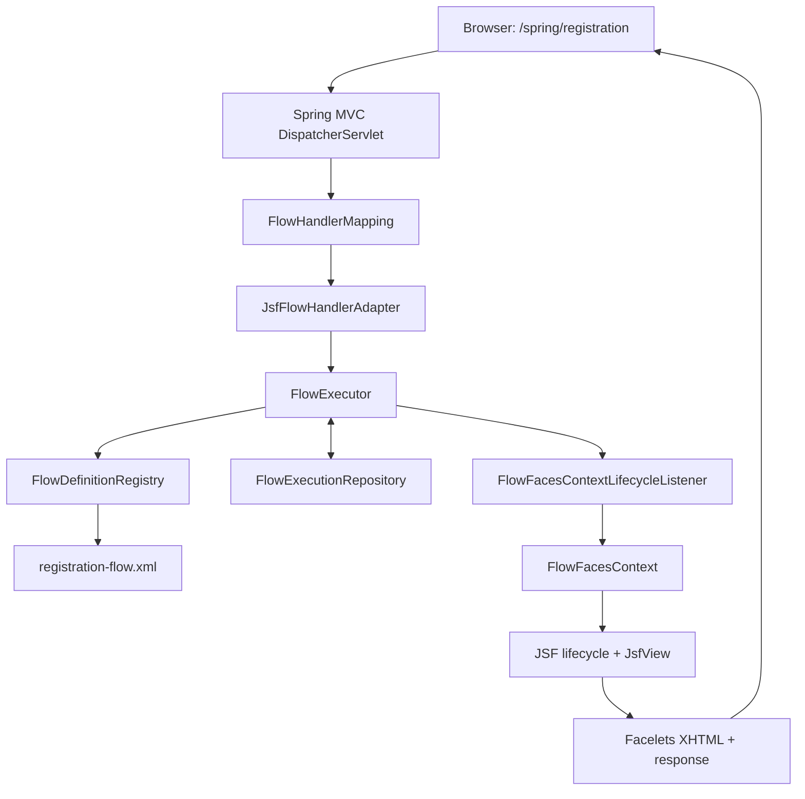
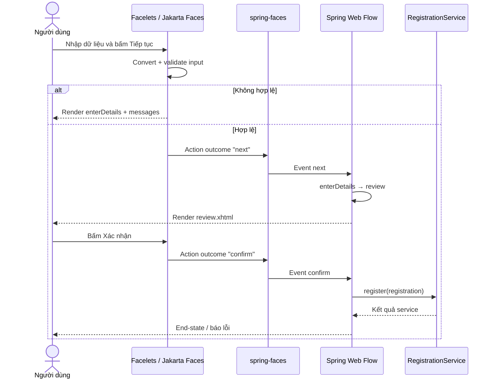

# Vai trò của spring-faces và Jakarta Faces trong ứng dụng Web Flow

## 1. Vì sao cần Spring Faces khi đã có Spring Web Flow?

**Spring Web Flow** dùng *state*, *event*, *transition* và *subflow* để mô hình hóa các hành trình web nhiều bước. Ví dụ, quy trình đăng ký dịch vụ có các bước nhập thông tin, kiểm tra dữ liệu, xem lại và xác nhận. Thay vì viết điều kiện điều hướng rải rác trong nhiều controller, ta mô tả các bước bằng một flow definition.

**Jakarta Faces** (tên cũ: JavaServer Faces/JSF) là framework UI phía máy chủ dựa trên **cây component**. Nó cung cấp Facelets (file `.xhtml`), các tag `h:form`, `h:inputText`, `h:commandButton`, conversion, validation, xử lý action event và Ajax/partial rendering.

**`spring-faces`** là module cầu nối giữa Jakarta Faces với Spring Web Flow và Spring MVC. Nó cho phép một `view-state` trong flow dùng các component Jakarta Faces, trong khi hành trình và transition vẫn do Web Flow điều phối.

> **Phân chia trách nhiệm:** Jakarta Faces xử lý component, biểu mẫu, validation và render. Spring Web Flow quản lý flow state, event, chuyển bước và scope của execution. Spring Faces phối hợp vòng đời của hai framework. Spring service vẫn thực hiện nghiệp vụ, transaction và truy cập dữ liệu.

Bài thuộc chương **Tích hợp JSF** của module `SPRING_WEB_FLOW`, liên hệ các chủ đề form binding, validation, quản lý scope/phiên, tích hợp Spring MVC, kiểm thử và phục hồi flow khi gặp lỗi.

Sau bài này, bạn có thể:

1. Phân biệt vai trò của `spring-webflow`, `spring-faces`, Spring MVC và Jakarta Faces runtime.
2. Giải thích tại sao cần `FlowFacesContextLifecycleListener`, `JsfViewFactoryCreator` và `JsfFlowHandlerAdapter`.
3. Cấu hình một flow sử dụng Facelets với XML hoặc Java configuration.
4. Liên hệ JSF component action với event/transition trong Web Flow.
5. Xử lý model, validation, scope, Ajax resources và các tình huống session/flow execution hết hạn.

## 2. Các thành phần phối hợp như thế nào?

| Thành phần | Trách nhiệm | Ví dụ |
| --- | --- | --- |
| **Spring MVC / DispatcherServlet** | Nhận URL và phân phối request đến handler | `/spring/registration` |
| **Spring Web Flow** | Dựng, đăng ký và thực thi flow definition; quản lý execution | `enterDetails → review → finished` |
| **spring-faces** | Ghép vòng đời JSF với Web Flow, hỗ trợ view factory, EL, Ajax, resources | Render `enterDetails.xhtml` và xử lý event `next` |
| **Jakarta Faces runtime** | Xử lý cây component, conversion, validation và postback | `h:inputText`, `h:messages` |
| **Spring service** | Xử lý nghiệp vụ và lưu trữ dữ liệu lâu dài | `registrationService.register(...)` |
| **FlowExecutionRepository** | Lưu/khôi phục một execution và cấp execution key | Tiếp tục wizard giữa các HTTP request |

Sơ đồ request:



Đây là bản đồ trách nhiệm, không mô tả thứ tự tất cả phương thức nội bộ. Một request đến flow thường được `DispatcherServlet` tiếp nhận, `FlowHandlerMapping` xác định flow ID, `JsfFlowHandlerAdapter` chuyển thành thao tác trên `FlowExecutor`. Listener thiết lập ngữ cảnh JSF và view-state dùng JSF view factory để khôi phục/render cây component.

**Flow ID và execution key không giống nhau.** `registration` là ID định nghĩa flow dùng lại cho nhiều người. Execution key xác định một lần chạy đang tạm dừng; nó có thể thay đổi theo chính sách repository và snapshot. Không tự tạo execution key từ user ID hoặc URL.

## 3. Tương thích phiên bản và dependency

Tài liệu chính thức Spring Web Flow **3.0.x** yêu cầu **JSF/Jakarta Faces 4.0 trở lên**. Dòng 3.0.x được xây dựng cho Java 17+ và Spring Framework 6+. Các ví dụ sau dùng API `jakarta.faces.*`.

Các bài hướng dẫn JSF 2.x thường dùng `javax.faces.*`. Sao chép nguyên văn class `javax.faces.webapp.FacesServlet` hoặc thư viện hỗ trợ Javax sang stack Jakarta có thể gây `ClassNotFoundException`, lỗi method signature hoặc xung đột phiên bản.

Maven dependency tích hợp:

```xml
<dependency>
    <groupId>org.springframework.webflow</groupId>
    <artifactId>spring-faces</artifactId>
    <version>3.0.2</version>
</dependency>
```

Ứng dụng còn cần một **Jakarta Faces implementation** phù hợp, ví dụ Mojarra hoặc Apache MyFaces, và Servlet container/spring dependencies đáp ứng phiên bản đã chọn. Một số server Jakarta EE đã cung cấp runtime; nếu đóng gói WAR, kiểm tra deployment model để không tải hai implementation cùng lúc.

Cần giữ `spring-faces` và `spring-webflow` tương thích về release. `spring-faces` phục vụ tích hợp, còn API và implementation Jakarta Faces cung cấp component lifecycle thực tế. Chỉ thêm `spring-webflow` cùng Jakarta Faces runtime mà thiếu `spring-faces` chưa đủ cho các view-state sử dụng JSF.

## 4. Những lớp tích hợp quan trọng

| Lớp | Vai trò |
| --- | --- |
| `AbstractFacesFlowConfiguration` | Cung cấp Java builder/configuration dành riêng cho JSF; hỗ trợ JSF resource handler |
| `FlowFacesContextLifecycleListener` | Tạo và giải phóng `FlowFacesContext` quanh request xử lý flow |
| `FlowFacesContext` | Wrapper cho `FacesContext`, tích hợp message và xử lý render/redirect |
| `JsfViewFactoryCreator` | Tạo view factory tương thích với JSF |
| `JsfViewFactory` | Khôi phục hoặc tạo JSF view root khi vào view-state |
| `JsfView` | Render response của một view-state theo cơ chế Jakarta Faces |
| `JsfFlowHandlerAdapter` | Spring MVC adapter chuyên dụng thay `FlowHandlerAdapter` khi dùng JSF |
| `JsfAjaxHandler` | Nhận diện Ajax request/partial response theo JSF |
| `FlowViewHandler` | Đưa FlowExecutionKey vào action URL của JSF form |
| `FlowELResolver` | Cho JSF expression truy cập flow variables và các scope |
| `JsfResourceRequestHandler` | Phân phối script/style/resource qua JSF ResourceHandler |
| `FlowLifecycle` | Điều phối phần xử lý event/validation của JSF lifecycle trong Web Flow |

### Vì sao phải tự tạo FacesContext trong request Web Flow?

JSF thuần để `FacesServlet` trực tiếp điều khiển request. Trong tích hợp Spring Faces, URL flow thông thường đi qua **`DispatcherServlet`**. Vì vậy, `FlowFacesContextLifecycleListener` phải cung cấp `FacesContext` cho thành phần JSF và dọn nó khi request kết thúc.

`FlowFacesContext` kết nối message của Web Flow với `FacesMessage`/hiển thị trong `h:messages`; nó còn hỗ trợ hành vi POST → REDIRECT → GET khi JSF render xảy ra qua nhiều request.

### JSF lifecycle có bị thay thế không?

JSF thường có sáu pha: **Restore View**, **Apply Request Values**, **Process Validations**, **Update Model Values**, **Invoke Application** và **Render Response**. Khi tích hợp, `JsfViewFactory` đảm nhiệm restore view, `FlowLifecycle` phối hợp các pha xử lý ở giữa, còn `JsfView` render response. Web Flow vẫn quyết định **state nào đang hoạt động** và **transition nào được thực hiện**.

Nếu conversion hoặc validation thất bại ở JSF component, action chuyển state có thể không được phát. Vì thế nhấn nút `next` không bảo đảm flow sang bước tiếp theo.

## 5. web.xml: DispatcherServlet xử lý flow, FacesServlet bootstrap

Với ứng dụng WAR, có thể dùng mapping `/spring/*` cho flow và một mapping riêng cho bootstrap Jakarta Faces:

```xml
<web-app xmlns="https://jakarta.ee/xml/ns/jakartaee"
         xmlns:xsi="http://www.w3.org/2001/XMLSchema-instance"
         xsi:schemaLocation="
           https://jakarta.ee/xml/ns/jakartaee
           https://jakarta.ee/xml/ns/jakartaee/web-app_6_0.xsd"
         version="6.0">

    <servlet>
        <servlet-name>spring</servlet-name>
        <servlet-class>
            org.springframework.web.servlet.DispatcherServlet
        </servlet-class>
        <init-param>
            <param-name>contextConfigLocation</param-name>
            <param-value>/WEB-INF/web-application-config.xml</param-value>
        </init-param>
        <load-on-startup>1</load-on-startup>
    </servlet>

    <servlet-mapping>
        <servlet-name>spring</servlet-name>
        <url-pattern>/spring/*</url-pattern>
    </servlet-mapping>

    <!-- Khởi tạo Jakarta Faces; thông thường flow không qua mapping này. -->
    <servlet>
        <servlet-name>Faces Servlet</servlet-name>
        <servlet-class>jakarta.faces.webapp.FacesServlet</servlet-class>
        <load-on-startup>1</load-on-startup>
    </servlet>
    <servlet-mapping>
        <servlet-name>Faces Servlet</servlet-name>
        <url-pattern>*.faces</url-pattern>
    </servlet-mapping>

    <context-param>
        <param-name>jakarta.faces.DEFAULT_SUFFIX</param-name>
        <param-value>.xhtml</param-value>
    </context-param>
</web-app>
```

Đây là ví dụ cho Servlet/Jakarta web.xml phiên bản tương ứng với server hỗ trợ; schema/version có thể khác theo hệ thống. Hai ý chính:

- `/spring/registration` thuộc **`DispatcherServlet` + Web Flow**, không tự động chạy qua `FacesServlet`.
- `FacesServlet` vẫn được khai báo để JSF implementation khởi tạo, dù flow request thông thường do Spring MVC điều phối.

Ứng dụng có thể phục vụ cả JSF pages truyền thống và Web Flow trong giai đoạn migration, nhưng phải thiết kế URL mapping rõ ràng để không dispatch nhầm servlet.

## 6. Cấu hình Spring XML cho Spring Faces

Ví dụ XML dùng namespace `webflow` và `faces`, cùng registry, executor, listener, adapter và resources:

```xml
<?xml version="1.0" encoding="UTF-8"?>
<beans xmlns="http://www.springframework.org/schema/beans"
       xmlns:xsi="http://www.w3.org/2001/XMLSchema-instance"
       xmlns:webflow="http://www.springframework.org/schema/webflow-config"
       xmlns:faces="http://www.springframework.org/schema/faces"
       xsi:schemaLocation="
         http://www.springframework.org/schema/beans
         https://www.springframework.org/schema/beans/spring-beans.xsd
         http://www.springframework.org/schema/webflow-config
         https://www.springframework.org/schema/webflow-config/spring-webflow-config.xsd
         http://www.springframework.org/schema/faces
         https://www.springframework.org/schema/faces/spring-faces.xsd">

    <webflow:flow-registry id="flowRegistry"
                           flow-builder-services="flowBuilderServices">
        <webflow:flow-location
            path="/WEB-INF/flows/registration/registration-flow.xml"
            id="registration" />
    </webflow:flow-registry>

    <faces:flow-builder-services id="flowBuilderServices" />

    <webflow:flow-executor id="flowExecutor"
                           flow-registry="flowRegistry">
        <webflow:flow-execution-listeners>
            <webflow:listener ref="facesContextListener" />
        </webflow:flow-execution-listeners>
    </webflow:flow-executor>

    <bean id="facesContextListener"
          class="org.springframework.faces.webflow.FlowFacesContextLifecycleListener" />

    <bean class="org.springframework.webflow.mvc.servlet.FlowHandlerMapping">
        <property name="flowRegistry" ref="flowRegistry" />
        <property name="order" value="0" />
    </bean>

    <bean class="org.springframework.faces.webflow.JsfFlowHandlerAdapter">
        <property name="flowExecutor" ref="flowExecutor" />
    </bean>

    <faces:resources />
</beans>
```

**Bốn quyết định có ý nghĩa đặc biệt:**

1. `<faces:flow-builder-services>` cung cấp JSF view factory và các chính sách tích hợp; đây không phải cấu hình builder MVC mặc định cho JSP/Thymeleaf.
2. `FlowFacesContextLifecycleListener` quản lý `FacesContext` cho request flow.
3. `JsfFlowHandlerAdapter` thay adapter MVC Web Flow thông dụng và dùng `JsfAjaxHandler` để xử lý Jakarta Faces Ajax đúng cách.
4. `<faces:resources />` ủy quyền request resource tới JSF resource API để component tải được script/style.

Nếu chỉ thấy HTML render nhưng Ajax không trả partial response hoặc JS/CSS thất bại, cần kiểm tra adapter và resource mapping trước khi sửa business flow.

## 7. Java configuration với AbstractFacesFlowConfiguration

`AbstractFacesFlowConfiguration` là lớp nền chuyên biệt cho JSF, tương tự `AbstractFlowConfiguration` của Web Flow thông thường. Mẫu Java:

```java
import org.springframework.context.annotation.Bean;
import org.springframework.context.annotation.Configuration;
import org.springframework.faces.config.AbstractFacesFlowConfiguration;
import org.springframework.faces.webflow.FlowFacesContextLifecycleListener;
import org.springframework.webflow.definition.registry.FlowDefinitionRegistry;
import org.springframework.webflow.executor.FlowExecutor;

@Configuration
public class RegistrationFacesFlowConfig
        extends AbstractFacesFlowConfiguration {

    @Bean
    public FlowDefinitionRegistry flowRegistry() {
        return getFlowDefinitionRegistryBuilder()
                .addFlowLocation(
                    "/WEB-INF/flows/registration/registration-flow.xml",
                    "registration")
                .build();
    }

    @Bean
    public FlowExecutor flowExecutor() {
        return getFlowExecutorBuilder(flowRegistry())
                .addFlowExecutionListener(
                    new FlowFacesContextLifecycleListener())
                .build();
    }
}
```

Theo hướng dẫn Spring Web Flow, lớp nền `AbstractFacesFlowConfiguration` cung cấp builder thích hợp và đăng ký `JsfResourceRequestHandler`. Khi tự chỉnh Spring MVC infrastructure, hãy bảo đảm còn `FlowHandlerMapping` và **`JsfFlowHandlerAdapter`** cho flow request; không tạo hai adapter cạnh tranh nếu lớp nền/cấu hình khác đã cung cấp chúng.

XML và Java configuration là hai cách biểu đạt cùng thiết kế. Chọn một cách nhất quán trong ứng dụng và kiểm tra bean name tránh trùng registry, executor hay listener.

## 8. Flow definition: đăng ký dịch vụ qua hai view-state

Giả sử `/spring/registration` mở flow `registration` với hai bước nhập và xem lại. Các resource:

```text
WEB-INF/flows/registration/
├── registration-flow.xml
├── enterDetails.xhtml
└── review.xhtml
```

`registration-flow.xml`:

```xml
<?xml version="1.0" encoding="UTF-8"?>
<flow xmlns="http://www.springframework.org/schema/webflow"
      xmlns:xsi="http://www.w3.org/2001/XMLSchema-instance"
      xsi:schemaLocation="
        http://www.springframework.org/schema/webflow
        https://www.springframework.org/schema/webflow/spring-webflow.xsd">

    <var name="registration"
         class="com.example.registration.RegistrationDraft" />

    <view-state id="enterDetails" view="enterDetails.xhtml">
        <transition on="next" to="review" />
        <transition on="cancel" to="cancelled" bind="false" />
    </view-state>

    <view-state id="review" view="review.xhtml">
        <transition on="back" to="enterDetails" />
        <transition on="confirm" to="saveRegistration" />
    </view-state>

    <action-state id="saveRegistration">
        <evaluate expression="registrationService.register(registration)" />
        <transition on="success" to="finished" />
        <transition on="error" to="review" />
    </action-state>

    <end-state id="finished" />
    <end-state id="cancelled" />
</flow>
```

`RegistrationDraft` là JavaBean có thuộc tính `fullName`, `email` và getter/setter. `registrationService` là Spring bean xử lý lưu đăng ký. Outcome `success`/`error` cần đúng với kết quả action và chính sách xử lý exception của ứng dụng; ví dụ này tập trung vào hành trình, không mô tả giao dịch thật.

### Facelets enterDetails.xhtml

```xml
<!DOCTYPE html>
<html xmlns="http://www.w3.org/1999/xhtml"
      xmlns:h="jakarta.faces.html"
      xmlns:f="jakarta.faces.core">
<h:head>
    <title>Đăng ký dịch vụ</title>
</h:head>
<h:body>
    <h:form id="registrationForm">
        <h:messages id="messages" globalOnly="false" />

        <h:outputLabel for="fullName" value="Họ tên" />
        <h:inputText id="fullName"
                     value="#{registration.fullName}"
                     required="true"
                     requiredMessage="Vui lòng nhập họ tên" />
        <h:message for="fullName" />

        <h:outputLabel for="email" value="Email" />
        <h:inputText id="email"
                     value="#{registration.email}"
                     required="true" />
        <h:message for="email" />

        <h:commandButton value="Tiếp tục" action="next" />
        <h:commandButton value="Hủy"
                         action="cancel" immediate="true" />
    </h:form>
</h:body>
</html>
```

Giá trị `#{registration.fullName}` được giải quyết qua tích hợp EL của Spring Faces. `h:commandButton action="next"` phát action outcome `next`; Web Flow khớp với `<transition on="next" to="review"/>`. Thuộc tính `immediate="true"` cho nút hủy minh họa cách tránh để validation dữ liệu nhập ngăn một action hủy; hành vi với component thật phải được kiểm thử.

### Facelets review.xhtml

```xml
<!DOCTYPE html>
<html xmlns="http://www.w3.org/1999/xhtml"
      xmlns:h="jakarta.faces.html">
<h:head>
    <title>Xác nhận thông tin</title>
</h:head>
<h:body>
    <h:form id="reviewForm">
        <h:messages />
        <h:outputText value="#{registration.fullName}" />
        <h:outputText value=" - " />
        <h:outputText value="#{registration.email}" />

        <h:commandButton value="Quay lại" action="back" />
        <h:commandButton value="Xác nhận" action="confirm" />
    </h:form>
</h:body>
</html>
```

Ở đây JSF cung cấp component, Web Flow giữ logic điều hướng. Nút `back` trở về `enterDetails`, còn `confirm` thực hiện action-state trước khi kết thúc. Không cần tạo một JSF navigation rule riêng cho mỗi transition của wizard.


## 9. Một action của JSF trở thành Web Flow event như thế nào?

Trong Jakarta Faces, component nhận request, convert và validate dữ liệu, cập nhật model khi hợp lệ, sau đó phát `ActionEvent` và xử lý giá trị `action`. Spring Faces kết nối kết quả action đó với event mà view-state Web Flow đang chờ. Flow definition chọn transition tương ứng theo `on`.



**Không phải một nút submit luôn phát event chuyển state.** Nếu người dùng nhập dữ liệu không hợp lệ, Jakarta Faces có thể dừng ở pha validation và render thông báo ngay trên view hiện tại. Khi đó không thể kết luận transition `on="next"` đã được thực thi.

Một số hành động chỉ cập nhật dữ liệu trong cùng trang. Web Flow cho phép transition **không có thuộc tính `to`**:

```xml
<view-state id="review" view="review.xhtml">
    <transition on="reloadSummary">
        <evaluate expression="registrationService.refreshSummary(registration)" />
    </transition>
    <transition on="confirm" to="saveRegistration" />
</view-state>
```

Action `reloadSummary` cập nhật model rồi ở lại `review`. Đây là cách đưa hành vi UI nhiều tương tác vào cùng mô hình event/transition mà không cần tạo thêm state giả.

## 10. Binding, conversion và validation với Jakarta Faces

### 10.1. Khác biệt với form binding thuần Spring MVC

Ở một flow dùng view MVC như JSP/Thymeleaf, Web Flow có thể trực tiếp sử dụng cơ chế binding của Spring Binding cho request parameter. Khi view là Jakarta Faces, các **JSF UI components** mới là nơi chủ yếu xử lý conversion, validation và model update theo lifecycle của Faces.

Ví dụ, `h:inputText value="#{registration.email}"` thực hiện binding dựa trên component/EL. Jakarta Faces cung cấp:

- `required="true"`, `requiredMessage`, `h:message` và `h:messages`.
- Converter và validator của Jakarta Faces, kể cả converter tùy chỉnh.
- `f:validateLength`, `f:validateRegex` và `f:validateBean` khi runtime có Bean Validation provider.
- Ajax event và partial processing/rendering bằng `f:ajax`.

Nếu biểu mẫu bị chặn ở `Process Validations`, action `next` có thể chưa chạy. Đừng tự động đổ lỗi cho Web Flow transition hoặc registry.

### 10.2. Validation ở cấp model và nghiệp vụ

Validation từng input không đủ cho quy tắc liên trường như ngày bắt đầu phải trước ngày kết thúc hoặc gói dịch vụ còn chỗ. Web Flow có `MessageContext` để domain/validation logic đưa lỗi vào hệ thống message, sau đó Spring Faces có thể trình bày qua `h:messages`.

Ví dụ kiến trúc:

```xml
<view-state id="enterDetails" view="enterDetails.xhtml">
    <transition on="next" to="review">
        <evaluate expression="registrationValidator.validateDraft(registration, messageContext)" />
    </transition>
</view-state>
```

Đây là ví dụ **extension point**, trong đó `registrationValidator` là bean do ứng dụng cung cấp. Quy tắc validator phải được thiết kế để báo lỗi qua `messageContext` đúng API, và cần kiểm thử liệu lỗi có ngăn transition. Khi chỉ cần constraint đơn giản, dùng Bean Validation với JSF component có thể dễ hiểu hơn.

Trong mọi trường hợp, một service ghi dữ liệu thật **vẫn** phải kiểm tra phân quyền, dữ liệu và trạng thái nghiệp vụ. UI validation không phải ranh giới bảo mật.

### 10.3. Không nhầm JSF form model với session

JSF component tree/view state, Web Flow `FlowExecution` và HTTP session có vòng đời khác nhau:

| Khái niệm | Lưu gì? | Ai quản lý? |
| --- | --- | --- |
| JSF view/component state | Tình trạng cây component, một phần thông tin render/postback | Jakarta Faces |
| Web Flow execution | State đang hoạt động, scope và transition context | Spring Web Flow/Repository |
| HTTP session | Thông tin phiên phía server theo môi trường servlet | Servlet container / ứng dụng |

Một lỗi về restore JSF view không nhất thiết là lỗi mất flow definition; ngược lại, execution key hết hạn không thể sửa bằng cách tạo lại một JSF component.

## 11. Model và các scope dành cho hành trình nhiều bước

Một lý do thường dùng Web Flow với Jakarta Faces là cần scope ở giữa request và session. `spring-faces` tích hợp EL để `#{registration.fullName}` có thể truy cập flow variable `registration`.

### 11.1. Flow variables

```xml
<var name="registration"
     class="com.example.registration.RegistrationDraft" />
```

Với form:

```xml
<h:inputText value="#{registration.fullName}" />
```

Biến `registration` tồn tại trong flow execution, phục vụ cả `enterDetails` và `review`. Khi execution kết thúc, nó không còn là nơi lưu bản nháp nghiệp vụ lâu dài.

### 11.2. Spring beans dùng scope flow

Ngoài `<var>`, có thể khai báo một Spring bean được quản lý theo scope flow:

```xml
<bean id="registration"
      class="com.example.registration.RegistrationDraft"
      scope="flow" />
```

Đây là **phương án thay thế** nếu cần khả năng tiêm dependency hay hỗ trợ container của Spring. Không tùy tiện đặt đồng thời `<var name="registration">` và bean `registration` nếu không xác định rõ ưu tiên phân giải EL. Service dùng chung của Spring thường nên stateless; dữ liệu riêng người dùng thuộc flow/view/conversation scope hoặc kho nghiệp vụ.

| Scope của Web Flow | Vòng đời điển hình | Dữ liệu ví dụ |
| --- | --- | --- |
| `requestScope` | Một request | Thông tin tính toán tạm |
| `flashScope` | Dữ liệu ngắn hạn cho render/transition theo cơ chế Web Flow | Thông báo thao tác |
| `viewScope` | View-state hiện tại | Kết quả lọc hoặc phân trang của một màn hình |
| `flowScope` | Một flow | Bản nháp đăng ký qua nhiều bước |
| `conversationScope` | Flow và các subflow thuộc conversation | Dữ liệu phối hợp giữa nhiều flow |

### 11.3. DataModel cho JSF DataTable

spring-faces hỗ trợ conversion sang `DataModel` phục vụ `h:dataTable`:

```xml
<on-render>
    <evaluate expression="registrationService.findPlans()"
              result="viewScope.plans"
              result-type="dataModel" />
</on-render>
```

```xml
<h:dataTable value="#{plans}" var="plan">
    <h:column>
        <h:outputText value="#{plan.name}" />
    </h:column>
</h:dataTable>
```

Hạ tầng `FacesConversionService` có converter cho alias `dataModel` và các implementation tracking selection. Khi dữ liệu quá lớn, phân trang ở service thay vì giữ toàn bộ tập kết quả trong execution snapshot.

## 12. Ajax, partial rendering và tài nguyên JSF

Jakarta Faces hỗ trợ Ajax qua `f:ajax`. spring-faces cần adapter phù hợp để request Ajax được nhận diện và trả partial response theo đúng protocol của Jakarta Faces:

```xml
<h:form xmlns:h="jakarta.faces.html"
        xmlns:f="jakarta.faces.core"
        id="reviewForm">
    <h:panelGroup id="summary">
        <h:outputText value="#{registration.fullName}" />
    </h:panelGroup>

    <h:commandButton value="Làm mới" action="reloadSummary">
        <f:ajax execute="@form" render="summary" />
    </h:commandButton>
</h:form>
```

Trong flow cũng có thể yêu cầu render fragment ở phía server:

```xml
<transition on="reloadSummary">
    <evaluate expression="registrationService.refreshSummary(registration)" />
    <render fragments="reviewForm:summary" />
</transition>
```

ID fragment cần khớp **client ID** thực sự trong JSF naming container. `reviewForm:summary` chỉ là một ví dụ theo cây component đã định nghĩa. Nếu Ajax response không cập nhật đúng vùng, hãy quan sát request, response và client ID đã render.

### Resources có gì đặc biệt?

JSF UI component libraries thường tải JavaScript, CSS và hình ảnh bằng `ResourceHandler` của Jakarta Faces. Vì flow request đi qua Spring MVC, cần một cầu nối xử lý các URL resource đó. Trong XML:

```xml
<faces:resources />
```

Trong Java configuration với `AbstractFacesFlowConfiguration`, hỗ trợ `JsfResourceRequestHandler` được đăng ký theo cấu hình nền. Nếu thiếu mapping này, trang HTML có thể xuất hiện nhưng style/script hoặc hành vi Ajax của thư viện component bị hỏng.

## 13. Redirect, flow execution key và phục hồi phiên

### 13.1. POST–Redirect–GET

Web Flow thường dùng **POST–Redirect–GET** giữa các bước để ngăn việc refresh/back vô tình lặp lại POST. `FlowFacesContext` được thiết kế để duy trì ngữ nghĩa rendering JSF dù luồng xử lý tạm dừng và đi qua redirect.

Với Ajax/flow nhúng trong trang, redirect thường không được mong muốn; Web Flow có chế độ embedded và hỗ trợ partial render. Hành vi cần được kiểm tra thực tế với thư viện component đang sử dụng.

Một số JSF implementation có thể gặp vấn đề khi `FacesContext` bị giữ/cached trong tình huống redirect trong cùng view-state. Web Flow có tùy chọn:

```xml
<webflow:flow-executor id="flowExecutor">
    <webflow:flow-execution-attributes>
        <webflow:redirect-in-same-state value="false" />
    </webflow:flow-execution-attributes>
</webflow:flow-executor>
```

Đây là cách xử lý **trường hợp đặc thù**, không phải thiết lập bắt buộc cho mọi dự án. Tránh vô hiệu hóa PRG khi chưa hiểu hệ quả với refresh/back và double submit.

### 13.2. Form postback trở về đúng execution

`FlowViewHandler` hỗ trợ tạo form action URL kèm execution key hiện hành để postback đi về đúng Web Flow execution. Nếu key cũ, session hết hạn hoặc repository không còn snapshot, request có thể không resume được.

Chiến lược phục hồi:

1. Thông báo phiên đã hết hạn và cho người dùng bắt đầu một execution mới.
2. Nếu cần giữ bản nháp lâu dài, lưu qua database/service ở bước thích hợp, không dựa hoàn toàn vào `flowScope`.
3. Xác thực quyền truy cập vào tài nguyên theo danh tính thực, không xem execution key là bằng chứng authorization.
4. Thiết kế chống retry cho action cuối cùng (transaction, idempotency key, unique constraint).
5. Kiểm thử submit từ nhiều tab, reload, session timeout và back về snapshot cũ.

### 13.3. Multipart file upload

Với component upload của một số JSF library, JSF cần kiểm soát việc parse multipart request. Spring MVC `MultipartResolver` có thể xung đột với cách parser của component hoạt động. Khi triển khai upload, xem kỹ tài liệu của JSF implementation/component library và test đường request thực tế.

Không giữ stream/file lớn trong flow execution snapshot; lưu tệp vào storage và đưa token/ID tạm phù hợp vào model, có thời gian sống và quyền truy cập rõ ràng.

## 14. Kiểm thử tích hợp và chẩn đoán lỗi

Cần ba nhóm kiểm thử:

**Kiểm tra cấu hình:** Spring context có registry nhận ID `registration`, executor được nối listener, adapter/resources đúng loại và dependency runtime không xung đột.

**Kiểm tra state machine:** launch vào `enterDetails`, gửi `next`/`back`/`confirm`, xác nhận transition và cách gọi service. Test flow riêng không chứng minh rằng JSF converter/validator/render đã chạy.

**Kiểm tra HTTP + Jakarta Faces:** mở URL thật, submit form, kiểm tra `h:messages`, partial Ajax, JSF resource URL, JSF view state, execution key, session timeout và hai tab.

Bảng chẩn đoán:

| Triệu chứng | Nguyên nhân thường gặp | Nơi kiểm tra |
| --- | --- | --- |
| `/spring/registration` trả 404 | Servlet mapping hoặc flow ID/handler mapping sai | `web.xml`, `FlowHandlerMapping`, registry |
| Không tìm được `FacesContext` | Thiếu lifecycle listener hoặc sai đường xử lý request | `FlowFacesContextLifecycleListener`, adapter |
| Facelets không render | Dùng builder MVC, sai file/view ID hoặc Faces runtime | `faces:flow-builder-services`, view factory, resource |
| Nhấn `next` nhưng ở lại form | JSF conversion/validation lỗi, action không phát | `h:messages`, JSF lifecycle, action/transition |
| AJAX không cập nhật | Adapter sai hoặc client ID không khớp | `JsfFlowHandlerAdapter`, `JsfAjaxHandler`, partial response |
| CSS/JS JSF trả 404 | Thiếu resource handler | `faces:resources`, `JsfResourceRequestHandler` |
| Dữ liệu model mất khi sang view mới | Scope hoặc execution key/session sai | `flowScope`, repository, postback URL |
| `ClassNotFoundException: javax.faces...` | Trộn thư viện JSF 2.x với Jakarta Faces 4 | Maven dependency tree |
| Một thao tác xác nhận chạy hai lần | Retry/back/multiple tabs và service thiếu idempotency | Service, transaction, database |
| Upload không nhận được file | Hai cơ chế xử lý multipart đụng nhau | JSF upload component, MultipartResolver |

## 15. Hướng dẫn triển khai và câu hỏi tự luyện

Quy trình đề xuất:

1. Chọn phiên bản tương thích Spring Web Flow, `spring-faces`, Jakarta Faces và Servlet container.
2. Đưa flow URL qua `DispatcherServlet`; cấu hình `FacesServlet` để bootstrap runtime.
3. Đăng ký flow registry, builder services chuyên cho JSF, context listener, handler adapter và resource handler.
4. Viết flow definition với view-state/event/transition; xây dựng Facelets dùng `h:form` và action outcome tương ứng.
5. Kiểm thử conversion, validation và thông báo ở từng view, sau đó kiểm tra model-level validation.
6. Chọn scope đúng, giới hạn dữ liệu trong snapshot và đưa bản nháp cần tồn tại lâu vào persistence.
7. Test Ajax/resources, redirect, timeout, browser back, hai tab và retry hành động nghiệp vụ.

Câu hỏi tự luyện:

1. Spring Web Flow, spring-faces và Jakarta Faces quản lý ba phần nào khác nhau?
2. Tại sao vẫn cần `FacesServlet` dù flow request đi qua `DispatcherServlet`?
3. `FlowFacesContextLifecycleListener` có tác dụng gì trong từng request?
4. Nếu action của `h:commandButton` là `next`, XML nào quyết định đi đến `review`?
5. Một form sai dữ liệu có nhất thiết phát Web Flow event `next` không?
6. Vì sao nên dùng `JsfFlowHandlerAdapter` khi Web Flow kết hợp Ajax của JSF?
7. Ba khái niệm JSF view state, FlowExecutionKey và HTTP session khác nhau ra sao?
8. Lỗi CSS/JavaScript component 404 thường cần kiểm tra thành phần tích hợp nào?
9. Vì sao `flowScope` không thể thay thế kho lưu bản nháp nghiệp vụ dài hạn?
10. Tại sao chống double submit phải xử lý thêm ở service/database?

## Tài liệu tham khảo

- [Spring Web Flow 3.0.2 Reference Guide — JSF Integration](https://docs.spring.io/spring-webflow/docs/3.0.2/reference/#_jsf_integration)
- [Spring Web Flow 3.0.2 Reference Guide — Configuring Web Flow for Use with JSF](https://docs.spring.io/spring-webflow/docs/3.0.2/reference/#_configuring_web_flow_for_use_with_jsf)
- [Javadoc — spring-faces package org.springframework.faces.webflow](https://docs.spring.io/spring-webflow/docs/3.0.2/api/org/springframework/faces/webflow/package-summary.html)
- [Javadoc — JsfFlowHandlerAdapter](https://docs.spring.io/spring-webflow/docs/3.0.2/api/org/springframework/faces/webflow/JsfFlowHandlerAdapter.html)
- [Javadoc — FlowFacesContextLifecycleListener](https://docs.spring.io/spring-webflow/docs/3.0.2/api/org/springframework/faces/webflow/FlowFacesContextLifecycleListener.html)
- [Jakarta Faces Specification](https://jakarta.ee/specifications/faces/)

Những đoạn code trên tập trung vào kiến trúc và một cấu hình đại diện. Khi áp dụng, cần bổ sung model/service, security, transaction và các file runtime thực tế, đồng thời dùng API tương ứng với phiên bản Spring Web Flow và Jakarta Faces của dự án.
