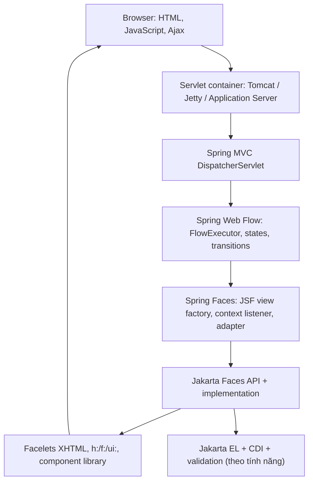
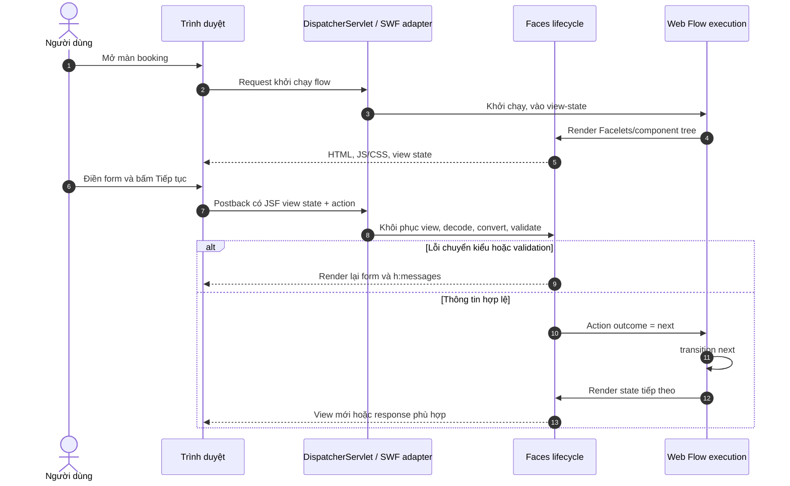

# Kiểm tra phiên bản Faces, Servlet và thư viện thành phần khi tích hợp Spring Web Flow

## 1. Mục tiêu và phạm vi

Một ứng dụng sử dụng **Spring Web Flow (SWF)** cùng **Jakarta Faces / JavaServer Faces (JSF)** cần các thành phần ở nhiều tầng hoạt động tương thích: Spring Framework, `spring-webflow`, `spring-faces`, Faces API, Faces implementation, Servlet container và thư viện UI như PrimeFaces hoặc OmniFaces. Các tầng này cùng tham gia xử lý biểu mẫu nhiều bước, từ lúc render `view-state` cho đến khi người dùng phát sinh event, JSF chuyển đổi và xác thực giá trị, Web Flow chọn `transition`, rồi quay lại một view hoặc kết thúc flow.

Ví dụ, màn chọn lịch hẹn dùng `<h:form>`, `<h:inputText>`, `<h:commandButton>` và thành phần lịch của một UI library. Ứng dụng có thể **biên dịch thành công** nhưng thất bại lúc khởi động nếu các API `javax.faces.*` và `jakarta.faces.*` lẫn nhau; cũng có thể khởi động được nhưng lỗi khi Ajax render hoặc khôi phục JSF view state do component library không tương thích.

Bài thuộc chương **Tích hợp JSF**, tập trung vào việc **kiểm tra phiên bản Faces, Servlet và thư viện thành phần** trước khi cấu hình hoặc nâng cấp một ứng dụng Spring Web Flow. Nội dung hướng dẫn xác định stack hiện tại, đối chiếu yêu cầu phiên bản, phân tích dependency và xác minh hoạt động của một flow có giao diện JSF.

Sau bài này, bạn sẽ có thể:

1. Phân biệt **Faces specification/API**, **Faces implementation**, **Spring Faces integration**, **Servlet API/container** và **component library**.
2. Đọc ma trận tương thích cơ bản của Spring Web Flow 2.5, 3.0, 4.0 với JSF/Jakarta Faces và môi trường Java/Servlet.
3. Xác minh phiên bản được khai báo, phiên bản dependency được giải quyết, các JAR được đóng gói và thành phần thực sự chạy.
4. Phát hiện lỗi `javax.*`/`jakarta.*`, trùng implementation, thiếu CDI/EL và lệch phiên bản thư viện UI.
5. Thiết kế bài smoke test cho render Facelets, chuyển đổi dữ liệu, JSF validation, điều hướng SWF, Ajax và session/view-state recovery.

## 2. Phân rã stack: cùng gọi là “JSF” nhưng không phải một thư viện



| Thành phần | Chức năng | Ví dụ cần kiểm kê |
|---|---|---|
| **Spring Web Flow** | Quản lý flow execution, state, event, transition, subflow và scope. | `org.springframework.webflow:spring-webflow`, version 3.x/4.x. |
| **Spring Faces integration** | Kết nối JSF lifecycle/view với Web Flow và Spring MVC. | `org.springframework.webflow:spring-faces`, cùng dòng version với Web Flow. |
| **Faces API** | Tập interface, annotations, lifecycle và component contract theo specification. | `jakarta.faces-api` hoặc API do server cung cấp. |
| **Faces implementation** | Mã runtime thực thi spec và render các thành phần. | Mojarra hoặc Apache MyFaces (tùy môi trường). |
| **Servlet API/container** | HTTP request/session, servlet/filter, classloader và tài nguyên web. | Servlet 6.0 với Tomcat 10.1; Servlet 6.1 với Tomcat 11. |
| **EL/CDI/Validation** | Phân giải `#{...}`, quản lý bean/context và validation. | Jakarta EL, CDI, Bean Validation provider khi cần. |
| **UI component library** | Cung cấp component mở rộng, theme, resource bundle và Ajax client. | PrimeFaces, OmniFaces, BootsFaces hoặc thư viện nội bộ. |
| **Facelets/view resources** | Định nghĩa template và cách compose component tree. | `*.xhtml`, `ui:composition`, `faces-config.xml`, JavaScript/CSS. |

**Không đồng nhất Faces API với Faces implementation.** Ứng dụng có thể compile vì có `jakarta.faces-api` nhưng khi deploy lên Tomcat vẫn thiếu bộ triển khai Faces để xây component tree và xử lý lifecycle. Ngược lại, một application server có sẵn Faces implementation; đóng gói thêm implementation khác trong WAR có thể sinh xung đột classloader hoặc khởi tạo hai bộ factory.

Spring Faces là cầu nối dành riêng cho tích hợp SWF/JSF; sự hiện diện của `spring-webflow` **không tự chứng minh** project đã cài đặt đầy đủ `spring-faces` hoặc đang sử dụng đúng JSF adapter.

## 3. Baseline được công bố cho các thế hệ Spring Web Flow

Bảng sau chỉ nêu **yêu cầu nền tảng chính thức đáng chú ý** và sự liên hệ với các công nghệ liên quan. Nó **không** xác nhận mọi bản vá của các sản phẩm bên thứ ba đều tương thích với nhau.

| Dòng SWF | Java và Spring | Yêu cầu Faces khi dùng JSF | Servlet/container cần xét |
|---|---|---|---|
| **SWF 2.5.x** | Mốc nâng cấp lên Spring Framework 5, Java 8 trở lên. | **JSF 2.2 trở lên** theo tài liệu SWF 2.5. | Dòng Spring 5 có baseline Servlet 3.1; các ứng dụng thế hệ này thường dùng API `javax.servlet.*`. |
| **SWF 3.0.x** | **Java 17+**, **Spring Framework 6.0+** theo reference 3.0. | **Jakarta Faces (JSF) 4.0+**. | Cần stack Servlet/Jakarta tương thích với Spring 6 và Faces 4; ví dụ một ứng viên là Tomcat 10.1 với Servlet 6.0. |
| **SWF 4.0.x** | **Java 17+**, **Spring Framework 7.0 baseline**. | **Jakarta Faces (JSF) 4.1+**. | Reference 4.0 yêu cầu **Servlet 6.1**; ví dụ container phù hợp baseline là Tomcat 11. |

Nguồn đối chiếu: [SWF 2.5 Reference](https://docs.spring.io/spring-webflow/docs/2.5.x/reference/html/whatsnew.html), [SWF 3.0 Reference](https://docs.spring.io/spring-webflow/docs/3.0.x/reference/), [SWF 4.0 Reference](https://docs.spring.io/spring-webflow/docs/4.0.x/reference/).

Hai lưu ý quan trọng:

- “JSF 2.2 trở lên” trong tài liệu **SWF 2.5** được viết ở thế hệ thư viện cũ; không thể suy luận rằng bản SWF 2.5 tự động chạy được với Faces 4 chỉ từ phép so sánh số version. Sự chuyển namespace `javax.*` sang `jakarta.*` làm thay đổi API và binary compatibility.
- “SWF 3.0 yêu cầu Spring 6.0 hoặc cao hơn” là phát biểu baseline của tài liệu 3.0. Khi nhắm Spring Framework 7, cần kiểm tra **dòng SWF được hỗ trợ** và bản vá thực tế; SWF 4.0 là dòng có baseline Spring 7 được công bố.

### 3.1. Servlet container không cung cấp mọi thứ của Jakarta EE

Theo bảng phiên bản của Apache Tomcat:

| Tomcat | Servlet | Jakarta Pages/JSP | EL | Java tối thiểu của container | Điều cần nhớ |
|---|---|---|---|---|---|
| **Tomcat 9.0.x** | Servlet 4.0 | JSP 2.3 | EL 3.0 | Java 8 | Nền Java EE/`javax.servlet.*`. |
| **Tomcat 10.1.x** | Servlet 6.0 | Jakarta Pages 3.1 | EL 5.0 | Java 11 | Dòng Jakarta EE 10 web stack; khi dùng SWF 3/Jakarta Faces 4, Java của app phải đạt baseline **Java 17+**. |
| **Tomcat 11.0.x** | Servlet 6.1 | Jakarta Pages 4.0 | EL 6.0 | Java 17 | Dòng web stack Jakarta EE 11, phù hợp điều kiện Servlet 6.1 của SWF 4. |

Tomcat là **Servlet container**, không phải một Jakarta EE application server đầy đủ. Do đó Tomcat có Servlet/JSP/EL nhưng không thể giả định đã tích hợp sẵn JSF implementation, CDI container và tất cả tính năng Bean Validation. Với Mojarra hoặc MyFaces, kiểm tra riêng những runtime khác còn thiếu và cách đóng gói chúng.

Trên WildFly, Open Liberty, Payara hoặc application server tương tự, một số API/implementation có thể đã được server cung cấp. Khi đó phải đối chiếu tính năng server đang bật, classloader policy và phiên bản thực tế; không copy toàn bộ dependency từ ví dụ dùng Tomcat vào WAR một cách máy móc.

Nguồn: [Apache Tomcat — Which Version](https://tomcat.apache.org/whichversion).

### 3.2. Yêu cầu Faces implementation cũng phải được kiểm tra

Ví dụ **Eclipse Mojarra 4.0** công bố các yêu cầu runtime như Jakarta Servlet 6.0, EL 5.0 và CDI 4.0; **Mojarra 4.1** yêu cầu Java 17, Jakarta Servlet 6.1, EL 6.0 và CDI 4.1. Một số thư viện hỗ trợ, như WebSocket/JSON Processing/Bean Validation, chỉ cần khi các tính năng tương ứng được sử dụng; không nên coi tất cả đều là bắt buộc trong mọi ứng dụng.

**Mojarra không phải tên thay thế cho spec.** Faces 4.1 là mức specification; Mojarra 4.1 là một bộ triển khai. Nếu dùng Apache MyFaces, phải kiểm tra **release notes và support matrix của MyFaces**, không áp dụng nguyên xi bảng dependency riêng của Mojarra.

Nguồn: [Mojarra runtime requirements](https://eclipse-ee4j.github.io/mojarra/), [Mojarra 4.1](https://github.com/eclipse-ee4j/mojarra), [Jakarta Faces 4.1](https://jakarta.ee/specifications/faces/4.1/).

## 4. Nắm rõ bước chuyển `javax.faces` sang `jakarta.faces`

Thay đổi lớn nhất giữa JSF thế hệ Java EE và Jakarta EE hiện đại là **namespace**. Ví dụ:

```java
// Ứng dụng cũ dùng JSF 2.x:
import javax.faces.context.FacesContext;
import javax.faces.component.UIComponent;
import javax.servlet.http.HttpServletRequest;

// Stack Jakarta Faces 4.x + Servlet hiện đại:
import jakarta.faces.context.FacesContext;
import jakarta.faces.component.UIComponent;
import jakarta.servlet.http.HttpServletRequest;
```

Cả hai nhóm có thể có tên class giống nhau nhưng **khác binary type**. Một custom converter được compile để implement interface `javax.faces.convert.Converter` không tự trở thành converter hợp lệ cho `jakarta.faces.convert.Converter`.

Khi kiểm kê, phân loại ít nhất:

1. **Java imports**: `javax.faces.*`/`jakarta.faces.*`, `javax.servlet.*`/`jakarta.servlet.*`, `javax.validation.*`/`jakarta.validation.*`.
2. **Dependency**: API/implementation thuộc thời Java EE hay Jakarta EE, gồm các dependency kéo gián tiếp bởi component library.
3. **View config**: `web.xml`, `faces-config.xml`, context-param, taglib URI và EL namespace trong Facelets.
4. **Runtime**: server cung cấp API nào; WAR chứa API/implementation nào; có classloader override không.
5. **Custom extension**: `Converter`, `Validator`, `PhaseListener`, `ExceptionHandler`, `ResourceHandler`, custom JSF component/renderer và JavaScript assets.

Với Facelets hiện đại, namespace có thể khai báo như sau:

```xhtml
<html xmlns="http://www.w3.org/1999/xhtml"
      xmlns:h="jakarta.faces.html"
      xmlns:f="jakarta.faces.core"
      xmlns:ui="jakarta.faces.facelets">
    <h:head />
    <h:body>
        <h:outputText value="Kiểm tra Faces đang hoạt động" />
    </h:body>
</html>
```

Đây là ví dụ cho stack Jakarta Faces 4.x. Những dự án JSF 2.x thường dùng URI có dạng `http://xmlns.jcp.org/jsf/html` hoặc URI cũ hơn; việc URI cũ còn được thư viện hỗ trợ ra sao phụ thuộc phiên bản. Khi chuyển đổi, cần theo tài liệu của Faces implementation, không đơn thuần tìm và thay thế mọi đoạn văn bản trùng chữ `javax`.

### Dấu hiệu xung đột phổ biến

| Hiện tượng | Nguyên nhân nghi vấn | Cách xác minh |
|---|---|---|
| `NoClassDefFoundError: javax/faces/...` trên Jakarta Faces 4 | Một library/custom class vẫn tham chiếu JSF đời cũ. | Đọc dependency tree và bytecode/stack trace của class lỗi. |
| `ClassNotFoundException: jakarta/faces/...` | Không có API/implementation Jakarta Faces phù hợp hoặc classpath của server sai. | Kiểm tra WAR, server modules, log khởi tạo. |
| `NoSuchMethodError` hoặc `ClassCastException` khi render component | API và implementation hoặc component library khác thế hệ. | Đối chiếu JAR nguồn, version thực load và compatibility matrix. |
| Server chạy được nhưng trang lỗi `TagException`/taglib | Taglib URI hoặc thư viện view không khớp phiên bản. | Kiểm tra XHTML, thư viện Facelets và migration guide. |
| Nhiều `FactoryFinder`/factory registration hoặc khởi động JSF thất bại | Có thể nạp hai implementation hoặc thiếu CDI/EL. | Kiểm tra classloader, WAR và log boot. |

**Không phải mọi lỗi ở trên đều chỉ có một nguyên nhân.** Bảng giúp khoanh vùng giả thuyết có thể kiểm chứng, tránh xử lý bằng cách ngẫu nhiên thay JAR.

## 5. Mẫu inventory theo bốn cấp chứng cứ

Một báo cáo “ứng dụng đang dùng JSF 4” là quá chung. Hãy tách:

| Cấp | Câu hỏi | Bằng chứng |
|---|---|---|
| **Declared** | File build/BOM khai báo phiên bản nào? | `pom.xml`, version catalog, `build.gradle`, BOM. |
| **Resolved** | Tool quản lý dependency chọn phiên bản nào sau transitive resolution? | Maven dependency tree, Gradle dependencies/dependencyInsight. |
| **Packaged** | WAR/JAR thực sự chứa JAR nào? | `WEB-INF/lib`, `BOOT-INF/lib`, artifact được deploy. |
| **Running** | Process/server đang nạp implementation nào? | Startup logs, server features/modules, classloader evidence, image digest. |

Không được suy ra **running = declared**. Ví dụ: POM khai báo Mojarra, nhưng WAR loại implementation theo scope `provided` và application server tải MyFaces do server cung cấp. Khi đó hành vi thực tế do runtime classpath quyết định.

### 5.1. Bảng kiểm kê tối thiểu

| Trường cần ghi | Ví dụ minh họa | Tại sao cần |
|---|---|---|
| Application, môi trường, thời điểm | `portal-booking / staging / 2026-11-25` | Không nhầm test với production. |
| JDK thực chạy | `Temurin 17.x` | Xác định baseline Java, khác JDK build thì phải ghi cả hai. |
| Spring Framework + SWF | `spring-webmvc 6.x / spring-webflow 3.x` | Xác định dòng Spring và Web Flow. |
| Spring Faces | `spring-faces 3.x` | Kiểm tra module tích hợp có cùng dòng SWF không. |
| Faces API | `Jakarta Faces 4.0 API` | Xác định specification. |
| Faces implementation | `Mojarra 4.0.x` hoặc `MyFaces 4.0.x` | Xác định engine thực chạy. |
| Servlet + container | `Tomcat 10.1.x / Servlet 6.0` | Đối chiếu yêu cầu runtime. |
| EL/CDI/Validation | Version và nhà cung cấp | Phát hiện thiếu integration trong servlet-only container. |
| Component library | Tên, artifact, version, classifier | Xác định compatibility với Faces API. |
| UI templates và resources | Facelets `*.xhtml`, Ajax resources | Đánh giá độ phủ màn hình cần test. |
| Nguồn chứng cứ | Dependency tree, WAR, startup log | Có thể kiểm tra và tái lập. |
| Owner, trạng thái xác minh | `Verified / Resolved / Unknown` | Chỉ rõ việc còn thiếu. |

*Mọi giá trị ở cột ví dụ đều là dữ liệu giả định, không phải khảo sát một dự án đã có.*

Dòng version hiển thị trong `pom.xml` chỉ được đánh giá **Declared**. Nếu thấy module API và implementation khác version family, đặt trạng thái **Needs investigation** thay vì kết luận ngay nguyên nhân.

## 6. Kiểm tra phụ thuộc bằng Maven

Với dự án dùng Maven, người học có thể thực hiện ở **repository của ứng dụng cần kiểm kê**:

```bash
# Kiểm tra Java và Maven phục vụ build
java -version
mvn -version

# Tập hợp parent, BOM, profile đã áp dụng
mvn help:effective-pom -Doutput=effective-pom.xml

# Liệt kê graph dependency đã giải quyết
mvn dependency:tree -Dverbose -DoutputFile=dependency-tree.txt

# Truy các module Spring Web Flow / Spring Faces
mvn dependency:tree -Dincludes=org.springframework.webflow:*

# Truy JSF implementation và library; groupId thực tế tùy sản phẩm
mvn dependency:tree -Dincludes=jakarta.platform:*,org.glassfish:*,org.apache.myfaces.core:*,org.primefaces:*
```

Lệnh chỉ là **hướng dẫn kiểm kê**, không phải test đã được chạy trong bài học. Với nhiều module Maven, hãy chạy tại module tạo WAR và xét reactor/profile thực tế. Một số phiên bản plugin có tùy chọn `-Dverbose` khác nhau; cần đối chiếu output và sửa filter theo dependency thực tế.

Cần tìm ít nhất các dấu hiệu sau trong tree:

```text
org.springframework.webflow:spring-webflow
org.springframework.webflow:spring-faces
org.springframework:spring-webmvc
jakarta.faces:jakarta.faces-api
org.glassfish:jakarta.faces
org.apache.myfaces.core:myfaces-impl
org.apache.myfaces.core:myfaces-api
org.primefaces:primefaces
org.omnifaces:omnifaces
jakarta.servlet:jakarta.servlet-api
jakarta.enterprise:jakarta.enterprise.cdi-api
jakarta.el:jakarta.el-api
jakarta.validation:jakarta.validation-api
```

Đây là **các artifact ID thường gặp để tìm kiếm**, không phải danh sách dependency bắt buộc và không bảo đảm một runtime sẽ có đúng mọi tên kể trên. Faces implementation, CDI và EL có thể do server cung cấp dưới tên module khác. Tương tự, UI library có thể được phát hành với artifact/classifier riêng cho Jakarta.

Nếu Maven cho thấy Faces implementation được khai báo ở scope `provided`, hãy kiểm tra server có cung cấp phiên bản tương thích hay không. Với Tomcat, không tự động coi `provided` là hợp lý chỉ vì Tomcat đã có Servlet/EL.

### 6.1. Cách tìm dependency transitive gây xung đột

Giả sử `primefaces` phiên bản A kéo thêm thư viện liên quan JSF đời cũ, trong khi application đã chọn Faces 4.1. Cần xác định:

1. Dependency cha nào kéo thư viện đó.
2. Nó nằm trong `compile`, `runtime`, `test` hay `provided`.
3. Phiên bản thực sự được resolver chọn khi có nhiều ràng buộc.
4. JAR nào được đóng gói và Java package mà nó sử dụng.
5. Có bản thư viện UI phù hợp hơn hoặc hướng loại bỏ dependency xung đột không.

**Không xử lý bằng cách thêm càng nhiều phiên bản API vào classpath.** Hai thế hệ `javax.faces.*` và `jakarta.faces.*` tồn tại song song thường là dấu hiệu migration chưa hoàn chỉnh; thêm JAR có thể che lỗi lúc compile nhưng tạo lỗi tại runtime.

## 7. Kiểm tra phụ thuộc bằng Gradle và artifact thực tế

Với Gradle:

```bash
# Linux/macOS - dùng wrapper của dự án
./gradlew --version

# Thống kê dependency của runtime
./gradlew dependencies --configuration runtimeClasspath

# Ai đưa spring-faces vào classpath?
./gradlew dependencyInsight --dependency spring-faces --configuration runtimeClasspath

# Ai giải quyết PrimeFaces và Jakarta Faces API?
./gradlew dependencyInsight --dependency primefaces --configuration runtimeClasspath
./gradlew dependencyInsight --dependency jakarta.faces --configuration runtimeClasspath
```

Trên Windows, dùng `.\gradlew.bat`. Với WAR/enterprise app, cần bổ sung cấu hình `providedCompile`, `providedRuntime` hoặc dependency configuration tương ứng plugin; một graph `runtimeClasspath` đơn lẻ chưa chứng minh toàn bộ classpath production.

Đọc WAR đã tạo:

```bash
# Kiểm tra danh mục thư viện và cấu hình bên trong WAR
jar tf booking.war

# Quan sát MANIFEST nếu muốn nhận diện build
unzip -p booking.war META-INF/MANIFEST.MF
```

Trong `WEB-INF/lib`, tập trung vào:

- Có bao nhiêu bộ triển khai Faces (Mojarra/MyFaces), hoặc hoàn toàn không có?
- API Faces và implementation có tương thích và có bị server cung cấp lại không?
- Có JAR `spring-faces` tương ứng với dòng `spring-webflow` không?
- Có thư viện JSF cũ mang bytecode tham chiếu `javax.faces.*` không?
- Có nhiều bản PrimeFaces/OmniFaces hoặc trùng phiên bản của chính một module không?
- Có EL/CDI/Bean Validation implementation khi runtime cần chúng không?

Với executable JAR, xem `BOOT-INF/lib`; với application server, khảo sát server modules và classloader. Kết quả kiểm tra JAR trên máy build phải được đối chiếu với **artifact được triển khai thật**, tránh nhầm phiên bản từ một bản build chưa phát hành.

## 8. Kiểm tra runtime: container, API và implementation

### 8.1. Thu thập thông tin từ quá trình khởi động

Với một ứng dụng đang chạy, ghi rõ:

1. JVM của process application (vendor, major version, build).
2. Container/server version và Servlet API thực tế.
3. Faces implementation/version được bootstrap, cùng cảnh báo liên quan CDI/EL.
4. Spring Web Flow, Spring Faces và component library được nạp.
5. Danh sách server-provided libraries và chính sách classloader.
6. Image/tag/digest nếu deploy bằng container; application artifact SHA/commit.
7. Môi trường: development, CI, staging hay production, thời điểm lấy log.

Những cách thu thập thường thấy:

```bash
# Java của terminal, chỉ là một manh mối; cần đối chiếu Java của process thật.
java -version

# Tomcat được cài độc lập (chạy ở thư mục bin của installation)
./version.sh
# Windows: version.bat hoặc catalina.bat version
```

Không coi `java -version` trên laptop là Java mà Tomcat đang sử dụng. Với container image, ưu tiên image digest, startup banner và process information. Với server enterprise, dùng CLI hoặc console quản trị để đọc **feature Faces/Servlet/EL/CDI đã kích hoạt**, rồi đối chiếu WAR.

### 8.2. Xác minh implementation một cách có chứng cứ

Nếu log khởi động ghi Mojarra/MyFaces và version, ghi nguyên văn thông tin tương ứng vào inventory. Khi cần kiểm tra sâu hơn, có thể quan sát từ vị trí nạp class/nguồn JAR trên môi trường test; phải tách **JSF API class** và **class của implementation** vì chúng có thể đến từ hai artifact khác nhau.

Đừng chỉ dựa vào `faces-config.xml version="4.0"` hay version của dependency API: các thông số đó không chứng minh bản runtime implementation. Tương tự, `Package.getImplementationVersion()` có thể trả `null` nếu manifest thiếu metadata; kết quả đó là *không có bằng chứng*, không phải một version cụ thể.

## 9. Kiểm tra điểm nối Spring Web Flow – JSF

Một stack dù có các phiên bản trông hợp lệ vẫn có thể tích hợp sai ở tầng request handling.

### 9.1. Những thành phần phải xuất hiện đúng chỗ

Trong cấu hình kiểu XML của SWF/JSF, các thành phần chính gồm:

- `FlowExecutor` quản lý execution của hành trình web.
- `FlowDefinitionRegistry` và `flow-builder-services` dành cho môi trường Faces.
- `FlowFacesContextLifecycleListener` giữ `FacesContext` phù hợp trong Web Flow request.
- `JsfFlowHandlerAdapter` thay cho adapter thông thường dùng trong môi trường Web Flow MVC thuần.
- Handler cho JSF resources để phục vụ JavaScript/CSS/image mà Faces/component library tạo ra.
- `DispatcherServlet` nhận request flow; `FacesServlet` được khai báo để bootstrap JSF theo hướng dẫn SWF.

Ví dụ cấu hình **rút gọn**, giả định namespace Spring XML đã được khai báo ở file beans:

```xml
<webflow:flow-executor id="flowExecutor">
    <webflow:flow-execution-listeners>
        <webflow:listener ref="facesContextListener" />
    </webflow:flow-execution-listeners>
</webflow:flow-executor>

<webflow:flow-registry id="flowRegistry"
                       flow-builder-services="facesFlowBuilderServices">
    <webflow:flow-location-pattern value="/WEB-INF/flows/**/*-flow.xml" />
</webflow:flow-registry>

<faces:flow-builder-services id="facesFlowBuilderServices" />

<bean id="facesContextListener"
      class="org.springframework.faces.webflow.FlowFacesContextLifecycleListener" />

<faces:resources />

<bean class="org.springframework.faces.webflow.JsfFlowHandlerAdapter">
    <property name="flowExecutor" ref="flowExecutor" />
</bean>
```

Đây là **đoạn cấu hình học tập**, chưa gồm toàn bộ `beans`/`xsi:schemaLocation`, Spring MVC handler mapping, security và các file flow. Trong cấu hình Java, SWF có `AbstractFacesFlowConfiguration` hỗ trợ các bean và resource handler tương ứng; cần dùng đúng kiểu cấu hình của phiên bản đã chọn.

Cấu hình servlet cho thế hệ Jakarta có thể chứa:

```xml
<servlet>
    <servlet-name>Faces Servlet</servlet-name>
    <servlet-class>jakarta.faces.webapp.FacesServlet</servlet-class>
    <load-on-startup>1</load-on-startup>
</servlet>
<servlet-mapping>
    <servlet-name>Faces Servlet</servlet-name>
    <url-pattern>*.faces</url-pattern>
</servlet-mapping>
<context-param>
    <param-name>jakarta.faces.DEFAULT_SUFFIX</param-name>
    <param-value>.xhtml</param-value>
</context-param>
```

Theo reference SWF 3/4, khi flow được phục vụ qua `DispatcherServlet`, `FacesServlet` thường được khai báo để khởi tạo JSF và **không phải endpoint chính cho request flow**. Đường dẫn `/spring/*` hoặc mapping cụ thể của `DispatcherServlet` phải được kiểm tra riêng trong project.

**Trường hợp nguy hiểm:** người quản trị thấy FacesServlet không trực tiếp nhận request flow rồi xóa nó. Việc bootstrap JSF có thể bị ảnh hưởng, làm lỗi rendering hoặc resource registration. Không xóa servlet/config chỉ dựa trên việc thấy URL flow đang chạy qua MVC.

### 9.2. So sánh lifecycle trước khi chọn test

Với Spring MVC form thông thường, dữ liệu postback được Web Flow bind vào model ở `view-state`. Trong tích hợp JSF, **Faces lifecycle** còn quản lý component tree, conversion, validation, update model values và JSF action events. SWF tiếp nhận các event đó để quyết định transition.



Sơ đồ mô tả các bước chính, lược bớt những giai đoạn chi tiết của JSF lifecycle. Quy tắc điều hướng SWF có thể chứa thêm validation/action ở cấp model và kiểm tra quyền trước khi chuyển state; nếu cần xử lý nghiệp vụ nhạy cảm, không chỉ dựa vào JSF field validation.

## 10. Kiểm tra thư viện thành phần: PrimeFaces, OmniFaces và extension khác

### 10.1. “Thư viện thành phần hỗ trợ Faces 4” có nhiều nghĩa

Một phiên bản component library có thể:

- Được biên dịch với đúng API `jakarta.faces.*`.
- Hỗ trợ mức Faces specification cần thiết.
- Chạy cùng **Mojarra** nhưng chưa được nhà phát triển xác nhận với **MyFaces**, hoặc ngược lại.
- Có phụ thuộc runtime vào EL/CDI/Bean Validation hoặc một Jakarta specification khác.
- Cần resource/JavaScript/stylesheet hoạt động với chính build component library.
- Có classifier/artifact riêng dành cho Jakarta, tùy sản phẩm và dòng phát hành.

Vì vậy, mỗi dòng inventory phải bao gồm **groupId:artifactId:version[:classifier]**, nguồn version, release notes/support matrix và điểm đã test. Chỉ đọc trang marketing nói “Jakarta supported” chưa đủ để chốt với một phiên bản Faces/Servlet cụ thể.

### 10.2. Câu hỏi cần trả lời cho từng thư viện

| Câu hỏi | Bằng chứng cần có | Hành động nếu chưa rõ |
|---|---|---|
| Artifact có dùng đúng namespace JSF mục tiêu? | Release notes, JAR bytecode, dependency tree. | Chọn artifact/classifier tương thích hoặc đánh dấu blocker. |
| Hỗ trợ Faces 4.0 hay 4.1? | Compatibility matrix của nhà phát hành. | Kiểm tra version cụ thể, không tự suy từ số version. |
| Có khác biệt giữa Mojarra và MyFaces? | Tài liệu/hồ sơ lỗi/đường test được hỗ trợ. | Chạy smoke test trên implementation đang dùng. |
| Phụ thuộc vào CDI/EL/Validation nào? | Dependency metadata và documentation. | Bổ sung runtime đúng hoặc cấu hình server feature. |
| Resource Ajax được phục vụ qua SWF? | Network browser, `JsfResourceRequestHandler` hoặc `faces:resources`. | Kiểm tra handler, đường dẫn và security filter. |
| Theme và file tĩnh có khớp version? | Browser network, console JS, resource names. | Nâng bundle đồng bộ, xóa cache khi test. |
| Custom component/renderer có API cũ? | Source, bytecode, stack trace. | Migrate source và build lại theo Jakarta. |

### 10.3. Không chỉ kiểm tra Maven version của PrimeFaces

Đối với UI library có JavaScript và CSS, một lỗi có thể chỉ xuất hiện trên trình duyệt:

- Trang render được nhưng widget lịch không khởi tạo.
- Click nút tạo Ajax request nhưng server trả HTML đầy đủ thay vì JSF partial-response.
- Resource JS hoặc CSS trả `404` hoặc bị Spring Security filter chặn.
- Ajax update sai client ID do JSF naming container.
- Validation hiển thị lỗi nhưng fragment không cập nhật.
- Session timeout làm view-state token không còn hợp lệ.

Để chẩn đoán, dùng **network tab**, response content type, request parameters, console errors và server logs. Lưu ý `Faces/JSF view state` và `Web Flow execution state` là **hai lớp khác nhau**: Faces quản lý component tree và state của view, còn Web Flow quản lý state của hành trình nhiều bước. Kiểm tra cả hai khi phát sinh lỗi ở request lặp lại.

## 11. Ví dụ mini để kiểm tra event và view

Flow minh họa màn nhập email rồi đến trang review:

```xml
<?xml version="1.0" encoding="UTF-8"?>
<flow xmlns="http://www.springframework.org/schema/webflow"
      start-state="enterEmail">

    <var name="registration"
         class="com.example.registration.RegistrationForm" />

    <view-state id="enterEmail" view="enterEmail.xhtml">
        <transition on="next" to="review" />
        <transition on="cancel" to="cancelled" />
    </view-state>

    <view-state id="review" view="review.xhtml">
        <transition on="back" to="enterEmail" />
        <transition on="confirm" to="completed" />
    </view-state>

    <end-state id="completed" />
    <end-state id="cancelled" />
</flow>
```

`RegistrationForm` là một Java bean mẫu có property `email` dạng `String` và getter/setter, được lưu trong `flowScope` theo vòng đời `<var>`. View Facelets dùng EL để truy cập model:

```xhtml
<html xmlns="http://www.w3.org/1999/xhtml"
      xmlns:h="jakarta.faces.html"
      xmlns:f="jakarta.faces.core">
    <h:head />
    <h:body>
        <h:form id="registerForm">
            <h:outputLabel for="email" value="Email" />
            <h:inputText id="email"
                         value="#{registration.email}"
                         required="true"
                         requiredMessage="Vui lòng nhập email">
                <f:validateRegex pattern=".+@.+\..+" />
            </h:inputText>

            <h:message for="email" />
            <h:commandButton value="Tiếp tục" action="next" />
            <h:commandButton value="Hủy" action="cancel" immediate="true" />
        </h:form>
    </h:body>
</html>
```

Điểm cần quan sát:

- `value="#{registration.email}"` là EL của JSF tham chiếu model do Web Flow quản lý.
- `action="next"` phát event `next` để chuyển sang `review` theo định nghĩa flow.
- `required="true"` và `<f:validateRegex>` chạy ở **Faces component lifecycle**; khi lỗi, `h:message` trình bày lỗi và người dùng thường ở lại view.
- `immediate="true"` của nút Hủy là cơ chế JSF cho action sớm, phù hợp tình huống cần bỏ qua lỗi input để hủy. Cần kiểm thử end-to-end: SWF transition và các business action vẫn phải đáp ứng yêu cầu của hệ thống.
- Ví dụ cố ý không khai báo `model` trên `view-state`: trong tích hợp JSF, JSF EL và component lifecycle xử lý giá trị form; cần hiểu điểm khác với cơ chế Spring MVC data binder.
- Chức năng `review.xhtml`, cấu hình security, JSF resources, CDI/EL và Servlet mapping phải được cung cấp bởi ứng dụng thật; snippet trên là ví dụ tập trung vào **khả năng tương thích runtime và JSF event**.

Nhiều ứng dụng thật sẽ có component library thay `h:inputText` bằng widget riêng. Hãy chạy smoke test trước với JSF core components rồi thử lại với widget của thư viện. Nếu core components chạy mà widget hỏng, vùng cần điều tra chuyển từ Web Flow/Faces cơ bản sang **component library, theme và Ajax resource**.

## 12. Ma trận kiểm tra trước khi chọn một tổ hợp version

### 12.1. Mẫu ma trận

Đặt mỗi dòng tương ứng một stack mục tiêu. Ví dụ:

| Hạng mục | Stack A: SWF 3.x | Stack B: SWF 4.x |
|---|---|---|
| JDK | 17+ | 17+ |
| Spring Framework | 6.x theo baseline SWF 3 | 7.x theo baseline SWF 4 |
| Spring Web Flow / Faces | `spring-webflow 3.x` + `spring-faces 3.x` | `spring-webflow 4.x` + `spring-faces 4.x` |
| Faces API | Jakarta Faces 4.0+ theo SWF 3 | Jakarta Faces 4.1+ theo SWF 4 |
| Ví dụ Faces implementation | Mojarra 4.0.x / MyFaces tương ứng | Mojarra 4.1.x / MyFaces tương ứng |
| Servlet container ứng viên | Servlet 6.0 (ví dụ Tomcat 10.1) | Servlet 6.1 (ví dụ Tomcat 11) |
| EL / CDI / Validator | Xác nhận theo implementation + server | Xác nhận theo implementation + server |
| PrimeFaces/OmniFaces | Phiên bản có bằng chứng hỗ trợ Faces 4.0 và stack đã chọn | Phiên bản có bằng chứng hỗ trợ Faces 4.1 và stack đã chọn |
| Smoke test bắt buộc | Facelets, JSF validation, event, Ajax, session | Tất cả các mục trước, cộng tác động thay đổi ở Faces 4.1/Servlet 6.1 |

Ma trận là **khung lựa chọn**, không phải bảng xác nhận tương thích cho mọi phiên bản PrimeFaces/OmniFaces. Không đưa một phiên bản UI library vào ô “PASS” nếu chưa đối chiếu release notes của đúng artifact và chưa chạy thử.

### 12.2. Phân loại kết quả từng ô

Dùng một trong bốn trạng thái:

- **PASS:** có tài liệu tương thích và test tương ứng trên stack đã chọn.
- **VERIFY:** có chứng cứ sơ bộ nhưng chưa kiểm tra runtime hoặc chưa biết cách đóng gói.
- **BLOCKED:** không đạt một baseline bắt buộc hoặc lỗi tương thích đã tái hiện.
- **NOT USED:** ứng dụng không dùng thành phần/tính năng đó, có bằng chứng xác nhận.

Ví dụ Tomcat 10.1 + SWF 4.0 là **BLOCKED ở Servlet baseline** vì Tomcat 10.1 cung cấp Servlet 6.0 trong khi SWF 4.0 yêu cầu Servlet 6.1. Nếu một ứng dụng không dùng JSF, không cần kéo Faces implementation vào chỉ để cho ma trận trông đầy đủ; nhưng bài này áp dụng cho các ứng dụng **có JSF integration**.

## 13. Quy trình thực hành kiểm tra trên ứng dụng thật

### Bước 1 — Đóng băng điểm xuất phát

Ghi **commit SHA**, build tool/version, profile, BOM, loại artifact, environment, container image digest và thời điểm thu thập. Mục đích là có thể tái lập chính kết quả đang đánh giá.

### Bước 2 — Lập inventory dependency

Lấy effective POM/dependency graph hoặc Gradle runtime graph. Đối chiếu `spring-webflow`, `spring-faces`, `spring-webmvc`, Faces API, implementation, EL, CDI, Bean Validation, PrimeFaces/OmniFaces và các JSF custom extension.

### Bước 3 — Xác minh artifact và server

Mở WAR/JAR, xem JAR packaged. Thu phiên bản server/Servlet, JVM của process, các Faces/CDI features server cung cấp, startup log và source library bị nạp. Đánh dấu rõ thông tin nào mới chỉ ở mức khai báo.

### Bước 4 — Phân loại namespace và classloader

Tìm `javax.faces.*`/`jakarta.faces.*`, `javax.servlet.*`/`jakarta.servlet.*`, taglib cũ và bytecode của thư viện riêng. Xử lý tình trạng API/implementation trùng hoặc thiếu.

### Bước 5 — Xác minh cấu hình tích hợp Web Flow

Kiểm tra `FlowFacesContextLifecycleListener`, `faces:flow-builder-services`, `JsfFlowHandlerAdapter`, mapping `DispatcherServlet`, bootstrap `FacesServlet` và handler resources. Nhận diện bộ test đang chạy qua endpoint nào.

### Bước 6 — Smoke test theo từng tầng

1. **Bootstrap:** ứng dụng khởi động, Faces implementation được nạp, không có `BeanCreationException` hoặc lỗi `FactoryFinder`.
2. **Static Facelets:** mở một trang có `h:outputText`, `h:form`; kiểm tra response không bị thiếu EL/CDI.
3. **Model binding và field validation:** điền email hợp lệ/sai; kiểm tra converter/validator, `h:message`, model và state.
4. **Web Flow navigation:** gửi `next`, `back`, `cancel`; kiểm tra transition, scope và trang đích.
5. **JSF component library:** thay bằng một widget PrimeFaces/OmniFaces đang dùng; kiểm tra CSS/JS resources và browser console.
6. **Ajax:** chạy `f:ajax` hoặc widget Ajax; kiểm tra partial response, update target, lỗi validation và flow event.
7. **View state/session:** refresh, back, nhiều tab, session timeout, deploy lại ứng dụng; xác nhận cách báo lỗi/khôi phục an toàn.
8. **Bảo mật:** kiểm tra CSRF, quyền truy cập flow, POST trực tiếp và resource URLs theo cấu hình thật.

### Bước 7 — Chốt ma trận

Đánh dấu từng tổ hợp `PASS`/`VERIFY`/`BLOCKED`/`NOT USED`, ghi evidence và owner cho các khoảng trống. Chỉ sau đó mới quyết định target version và phạm vi nâng cấp.

## 14. Bảng lỗi thường gặp và cách lần theo nguyên nhân

| Hiện tượng | Lớp ưu tiên kiểm tra | Đường điều tra |
|---|---|---|
| Không khởi động: thiếu `jakarta.faces.context.FacesContext` | Faces API/implementation, runtime classpath | Kiểm tra version và cách đóng gói/server module. |
| Lỗi khởi tạo Faces factory | Faces implementation, CDI/EL, duplicate JAR | Kiểm tra startup log, provider, server classloader. |
| SWF không render Facelets | Spring Faces, view factory, servlet mapping | Xem listener, flow builder services, adapter và view ID. |
| JSF page render nhưng form không chuyển state | JSF action event, flow execution URL, transition | Xem postback, action outcome, flow log. |
| Trang báo lỗi JSF tag hoặc EL | Namespace XHTML, EL, JSF spec | Đối chiếu Facelets URI, converter và JSF implementation. |
| Component library lỗi `NoSuchMethodError` | API và UI library version | Xem release notes, JAR được nạp, artifact classifier. |
| Ajax request báo `404` cho resources | JSF resource handler, Spring MVC/security mapping | Xem URL của file JS/CSS và `faces:resources`. |
| Ajax không cập nhật fragment | Partial-response, naming container, client ID | Xem Network, request parameters, render target. |
| Sau session timeout báo lỗi khôi phục view | JSF view state + SWF flow execution | Kiểm tra session, flow repository, cơ chế hết hạn. |
| Test CI chạy, production lỗi | Runtime khác nhau hoặc server-provided libraries | So sánh JVM, server, image digest, WAR và modules. |

Không xử lý `NoSuchMethodError` bằng cách tùy tiện thêm bản Faces API mới vào WAR; cần xác định đúng lớp nào đã nạp method hoặc đang sử dụng API không tương thích.

## 15. Bài tập: phân tích ba cấu hình

### Trường hợp A — Tomcat 9 và thư viện JSF cũ

Ứng dụng đang có Spring Web Flow 2.5, Spring Framework 5, Tomcat 9, Mojarra 2.3 và một library tham chiếu `javax.faces.*`.

Hãy:

1. Lập inventory với các cột declared/resolved/packaged/running.
2. Chỉ ra các yếu tố nào thuộc thế hệ Java EE.
3. Nêu những thay đổi tối thiểu cần khảo sát nếu muốn chuyển sang SWF 3 và Jakarta Faces 4.
4. Giải thích vì sao đổi `spring-webflow` sang 3.x trong POM **không đủ**.

### Trường hợp B — SWF 4 trên Tomcat 10.1

Một nhóm đã lên Java 17, Spring Framework 7, SWF 4.0, Faces 4.1, nhưng giữ Tomcat 10.1.

Câu hỏi: lớp nào không đạt baseline? Hãy chỉ ra phiên bản Servlet của Tomcat 10.1, yêu cầu của SWF 4 và một container ứng viên đáp ứng Servlet 6.1. Sau đó mô tả các thành phần vẫn phải kiểm tra tiếp, kể cả Faces implementation, CDI/EL, component library và runtime packaging.

### Trường hợp C — UI library lỗi dù h:inputText hoạt động

Một flow có `h:form`, `h:inputText` và `h:commandButton action="next"` hoạt động trên staging. Nhưng khi thay bằng widget lịch của PrimeFaces, trang chỉ render nhãn, không xuất hiện lịch và browser console báo lỗi JavaScript.

Hãy chọn thứ tự điều tra: version/classifier của PrimeFaces, JSF resource URLs, Network 404/403, JavaScript/CSS conflicts, Facelets namespace, Ajax naming container và thông tin cụ thể của Faces implementation. Giải thích vì sao không nên thay đổi cấu hình `transition` của Web Flow khi event trong form cơ bản vẫn hoạt động.

### Tiêu chí đạt bài

Một bản kiểm kê đạt yêu cầu phải:

- Ghi **chính xác** Java, Spring, Web Flow, Spring Faces, Faces API, implementation, Servlet API và server/container.
- Nêu rõ component library, version, artifact/classifier và nguồn hỗ trợ Faces tương ứng.
- Phân biệt thông tin declared, resolved, packaged và running.
- Chỉ ra namespace `javax.*`/`jakarta.*` và library gây xung đột nếu có.
- Có ít nhất một bộ test cho **Facelets render, postback/validation, event transition, Ajax/resources và session/view-state**.
- Kèm bằng chứng hoặc trạng thái `Unknown/VERIFY` cho những thông tin chưa xác nhận.

## 16. Ghi nhớ

Để tích hợp JSF ổn định trong Spring Web Flow, phải kiểm tra **cả một chuỗi tương thích**: Java → Spring Framework → Spring Web Flow + Spring Faces → Servlet/container → Faces API + implementation → EL/CDI/validation → UI component library → Facelets/JSF resources. Một thành phần đạt yêu cầu riêng chưa đủ chứng minh toàn bộ tổ hợp vận hành đúng.

Những mốc đáng nhớ là **SWF 3.0 yêu cầu Faces 4.0+**, **SWF 4.0 yêu cầu Faces 4.1+ và Servlet 6.1**. Khi nâng cấp ứng dụng từ thế hệ `javax.*` lên `jakarta.*`, luôn lấy bằng chứng ở dependency tree, artifact thực tế và runtime, rồi smoke test các nhánh form, event, Ajax và session. Chỉ sau khi các tầng khớp nhau, nhóm mới có đủ cơ sở quyết định nâng cấp hoặc khắc phục lỗi tích hợp.

## 17. Tài liệu tham khảo

1. [Spring Web Flow 2.5.x Reference — JSF Integration](https://docs.spring.io/spring-webflow/docs/2.5.x/reference/html/spring-faces.html) — mốc JSF 2.2+ và cơ chế Spring Faces đời cũ.
2. [Spring Web Flow 3.0.x Reference — JSF Integration](https://docs.spring.io/spring-webflow/docs/3.0.x/reference/) — yêu cầu Faces 4.0+, `FlowFacesContextLifecycleListener`, `JsfFlowHandlerAdapter` và cách xử lý JSF events.
3. [Spring Web Flow 4.0.x Reference — Baseline and JSF Integration](https://docs.spring.io/spring-webflow/docs/4.0.x/reference/) — Spring 7, Servlet 6.1, Faces 4.1+ và JSF resources.
4. [Apache Tomcat — Which Version Do I Want?](https://tomcat.apache.org/whichversion) — Tomcat 9/10.1/11 và Servlet, Pages/JSP, EL, Java.
5. [Eclipse Mojarra — Runtime Requirements](https://eclipse-ee4j.github.io/mojarra/) — yêu cầu của bộ triển khai Faces 4.0 và các dòng cũ.
6. [Eclipse Mojarra 4.1](https://github.com/eclipse-ee4j/mojarra) — Java 17, Servlet 6.1, EL 6.0, CDI 4.1 và các API tùy tính năng.
7. [Jakarta Faces 4.1 Specification](https://jakarta.ee/specifications/faces/4.1/) — specification và các thay đổi của Faces 4.1.
