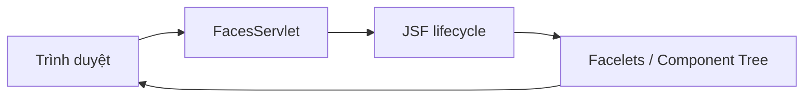
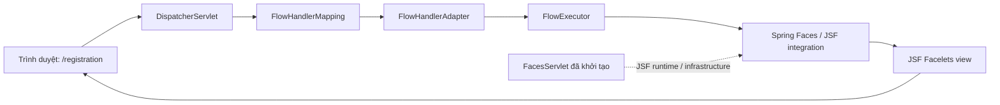
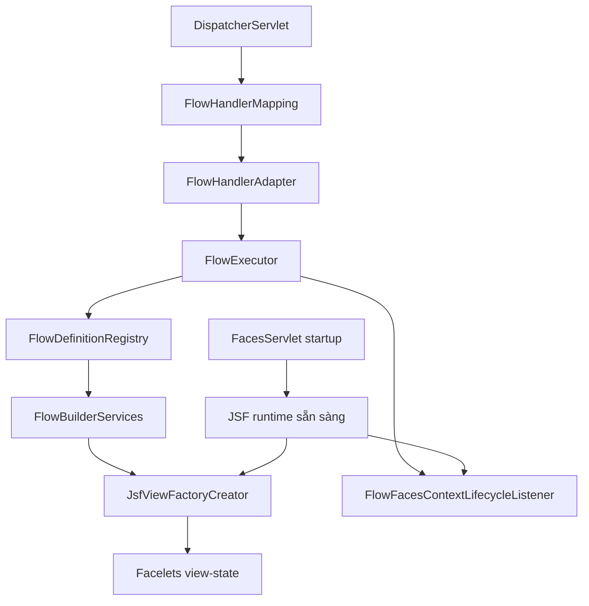
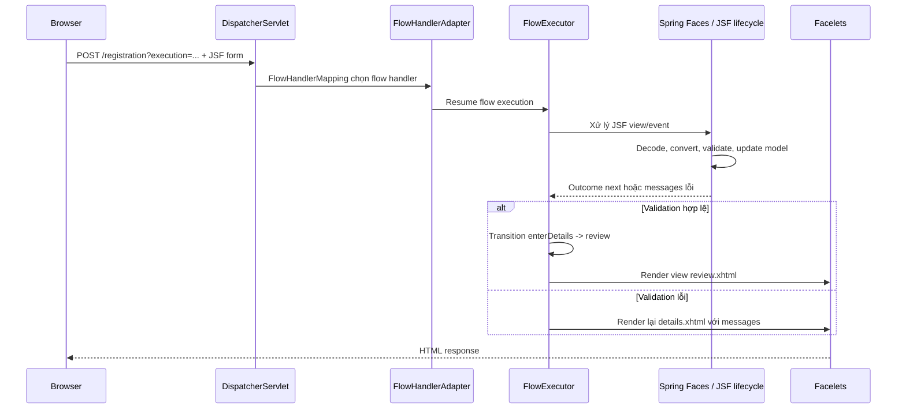

# Khởi tạo FacesServlet và định tuyến qua DispatcherServlet

Trong một ứng dụng **JavaServer Faces (JSF)** thông thường, trình duyệt gửi request tới `FacesServlet` để thực hiện vòng đời JSF: khôi phục cây component, áp dụng giá trị request, validation, cập nhật model, gọi action và render trang. Khi tích hợp JSF với **Spring Web Flow**, cách định tuyến có một điểm quan trọng: **các URL của flow có thể được xử lý bởi Spring MVC `DispatcherServlet`**, trong khi **`FacesServlet` vẫn cần được khởi tạo để cung cấp hạ tầng JSF**.

Đây là nội dung của bài **“Khởi tạo FacesServlet và định tuyến qua DispatcherServlet”** thuộc chương **Tích hợp JSF** trong module **SPRING_WEB_FLOW**. Mục tiêu là hiểu chính xác servlet nào nhận request, flow execution được bắt đầu/tiếp tục như thế nào, JSF tham gia render view ra sao, và vì sao việc cấu hình đồng thời hai servlet thiếu chủ đích dễ gây lỗi điều hướng, validation, state hoặc Ajax.

Sau bài học, bạn có thể:

1. Giải thích vai trò khác nhau của `FacesServlet`, `DispatcherServlet`, `FlowHandlerMapping`, `FlowHandlerAdapter` và `FlowExecutor`.
2. Khởi tạo JSF runtime mà không để `FacesServlet` chiếm các URL dành cho flow.
3. Đăng ký flow và cơ chế tích hợp Spring Faces/JSF tương thích với phiên bản đang dùng.
4. Tạo một flow dùng Facelets (`.xhtml`) và action outcome tương ứng với event Web Flow.
5. Đọc luồng HTTP/JSF/Ajax để xác định lỗi thuộc servlet mapping, lifecycle, flow execution hay view rendering.
6. Kiểm thử điều hướng, binding/validation, scope, quyền truy cập và phục hồi khi execution hết hạn.

> **Lưu ý phiên bản:** ví dụ phân biệt `javax.faces.*` / `javax.servlet.*` (Java EE/JSF cũ) với `jakarta.faces.*` / `jakarta.servlet.*` (Jakarta EE mới). Các artifact, lớp Spring Faces và cấu hình Web Flow thay đổi theo thế hệ; trước khi sử dụng, cần chọn một bộ phiên bản **Spring Framework – Spring Web Flow – Spring Faces – JSF implementation – Servlet container** tương thích. Các cấu hình dưới đây là mẫu học tập và điểm khởi đầu, không phải cam kết chạy trực tiếp trên mọi phiên bản Spring Boot.

## 1. Hai servlet nhưng không có nghĩa một request phải chạy qua cả hai

Một ứng dụng JSF thuần thường có đường đi:



Một ứng dụng Spring Web Flow dùng JSF view có thể có đường đi khác:



Điều cần phân biệt: sơ đồ thứ hai **không** có mũi tên HTTP bắt buộc từ `DispatcherServlet` sang `FacesServlet`. Hai servlet là **hai điểm vào độc lập** của servlet container; servlet mapping xác định servlet nào nhận một HTTP request. Khi flow được định tuyến vào DispatcherServlet, Spring Faces tích hợp với JSF để tạo `FacesContext`, xử lý component/view và render nội dung phù hợp, thay vì chuyển tiếp request qua `FacesServlet` như một controller trung gian.

| Thành phần | Trách nhiệm chính | Có trực tiếp nhận URL flow không? |
| --- | --- | --- |
| `FacesServlet` | Khởi tạo và cung cấp entry point truyền thống cho JSF runtime; trực tiếp xử lý những URL được mapping tới nó | Không nhất thiết; với flow-driven JSF, có thể chỉ dùng để khởi tạo JSF |
| `DispatcherServlet` | Front controller của Spring MVC | Có, nếu URL flow được servlet mapping và handler mapping xử lý |
| `FlowHandlerMapping` | Tìm flow definition ứng với request/flow ID | Có, ở tầng Spring MVC |
| `FlowHandlerAdapter` | Dùng `FlowExecutor` để khởi động/tiếp tục flow | Có, sau khi mapping chọn handler |
| `FlowExecutor` | Thực thi state, event, transition và quản lý execution | Không phải servlet HTTP |
| `JsfViewFactoryCreator` | Tạo view JSF tương thích với Web Flow | Không, nó thuộc tầng view |
| `FlowFacesContextLifecycleListener` | Hỗ trợ quản lý `FacesContext` khi thực thi flow | Không, nó là listener của Web Flow |

Tùy dự án, các lớp của Spring Faces có thể được cấu hình khác nhau hoặc không còn hiện diện ở một tổ hợp phiên bản mới. Nếu thiếu dependency/implementation phù hợp, việc khai báo servlet thôi chưa thể render Facelets qua Web Flow.

## 2. Hiểu servlet mapping trước khi viết web.xml

Servlet container quyết định handler HTTP từ các `url-pattern`. Chẳng hạn:

- `/` là default mapping, thường dành cho Spring MVC `DispatcherServlet`.
- `/faces/*` là path-prefix mapping, có thể dành cho JSF trực tiếp.
- `*.xhtml` là extension mapping, thường gặp trong JSF truyền thống.
- `/api/*` có thể dành cho một servlet khác nếu dự án dùng nhiều front controller.

Một điều cần chú ý trong cơ chế servlet mapping: **exact mapping**, **longest path-prefix mapping**, **extension mapping** và **default mapping** có thứ tự ưu tiên riêng. Không phải servlet khai báo trước trong `web.xml` sẽ luôn nhận request trước.

Ví dụ:

| Request | Mapping áp dụng trong cấu hình minh họa | Kết quả |
| --- | --- | --- |
| `GET /registration` | DispatcherServlet `/` | Spring MVC có thể tìm flow `registration` |
| `POST /registration?execution=...` | DispatcherServlet `/` | Tiếp tục flow execution |
| `GET /faces/help.xhtml` | FacesServlet `/faces/*` nếu được khai báo | Xử lý bởi JSF trực tiếp |
| `GET /assets/site.css` | Tùy cấu hình static resource handler | Không tự động là view-state của flow |
| `GET /registration.xhtml` | Có thể bị `*.xhtml` bắt nếu map FacesServlet theo extension | **Không đồng nghĩa** URL flow `/registration` |

Nếu map `FacesServlet` vào `*.xhtml` rồi dùng chính đường dẫn `/registration.xhtml` làm flow URL, request có thể đi thẳng qua FacesServlet, khiến `FlowHandlerMapping` của Spring MVC không được gọi. Vì vậy cần quy hoạch **không gian URL**: URL dùng để khởi động/tiếp tục flow không bị servlet JSF chặn.

## 3. Khởi tạo FacesServlet nhưng để DispatcherServlet xử lý flow

Một mẫu Java web application triển khai trên servlet container có thể dùng `web.xml` như sau (ví dụ **Jakarta Servlet 6 / Jakarta Faces**, cần dùng các artifact tương thích):

```xml
<?xml version="1.0" encoding="UTF-8"?>
<web-app xmlns="https://jakarta.ee/xml/ns/jakartaee"
         xmlns:xsi="http://www.w3.org/2001/XMLSchema-instance"
         xsi:schemaLocation="
           https://jakarta.ee/xml/ns/jakartaee
           https://jakarta.ee/xml/ns/jakartaee/web-app_6_0.xsd"
         version="6.0">

    <!-- Spring MVC là HTTP entry point cho URL của Web Flow. -->
    <servlet>
        <servlet-name>springDispatcher</servlet-name>
        <servlet-class>
            org.springframework.web.servlet.DispatcherServlet
        </servlet-class>
        <load-on-startup>2</load-on-startup>
    </servlet>

    <servlet-mapping>
        <servlet-name>springDispatcher</servlet-name>
        <url-pattern>/</url-pattern>
    </servlet-mapping>

    <!-- Khởi tạo JSF runtime; flow request không cần đi vào servlet này. -->
    <servlet>
        <servlet-name>Faces Servlet</servlet-name>
        <servlet-class>jakarta.faces.webapp.FacesServlet</servlet-class>
        <load-on-startup>1</load-on-startup>
    </servlet>

</web-app>
```

Ý nghĩa:

1. `springDispatcher` được map `/` để tiếp nhận các flow URL như `/registration`.
2. `FacesServlet` được khai báo với `load-on-startup` để JSF runtime sẵn sàng trước khi view JSF được dùng. Đây là cách cấu hình thường gặp trong tài liệu Spring Faces/Web Flow truyền thống.
3. Ví dụ cố ý **không** ánh xạ flow URL sang FacesServlet.
4. `load-on-startup` không làm một HTTP request tự đi qua cả hai servlet; nó chỉ tác động tới việc khởi tạo.

**Ghi chú triển khai:** với một số JSF implementation/container, tài nguyên `jakarta.faces.resource` hoặc trang JSF nằm ngoài flow có thể cần một mapping FacesServlet phù hợp, ví dụ `/faces/*`. Khi đó hãy thêm mapping tách biệt và kiểm thử URL tài nguyên thực tế. Một số triển khai JSF hiện đại có cơ chế auto-configuration/`ServletContainerInitializer` riêng; không nên vừa để auto-register vừa khai báo trùng servlet mà không biết servlet name và mapping nào đang có hiệu lực.

Nếu ứng dụng dùng công nghệ cũ, phần class trong `web.xml` là:

```xml
<servlet-class>javax.faces.webapp.FacesServlet</servlet-class>
```

Đó là **phương án thay thế cho stack `javax`**, không phải một servlet thứ hai cần đăng ký cùng lúc với `jakarta.faces.webapp.FacesServlet`.

### Khi nào cần mapping cho FacesServlet?

Có hai nhu cầu khác nhau:

- **Chỉ render JSF views bên trong flow:** cần JSF runtime và cơ chế Spring Faces tích hợp. Các request tiếp tục flow chạy qua DispatcherServlet. Không nên tạo mapping JSF chiếm flow URL.
- **Dùng thêm các trang JSF không thuộc flow:** có thể cần một vùng URL JSF riêng (ví dụ `/faces/*`) cho FacesServlet. JSF resource URLs cũng phải được kiểm tra trong Network để chắc mapping hoạt động.

Nếu thêm mapping:

```xml
<!-- Chỉ dùng khi dự án thật sự có đường JSF độc lập. -->
<servlet-mapping>
    <servlet-name>Faces Servlet</servlet-name>
    <url-pattern>/faces/*</url-pattern>
</servlet-mapping>
```

Đừng thêm mapping này rồi giả định mọi liên kết `/registration` sẽ tự chạy qua JSF. Flow URL vẫn thuộc DispatcherServlet; một trang độc lập dưới `/faces/*` sẽ có lifecycle và cơ chế điều hướng JSF trực tiếp, trừ khi bạn chủ động nối nó với Web Flow.

## 4. Cấu hình Spring MVC nhận flow URL

Servlet mapping `/` chỉ bảo đảm request vào `DispatcherServlet`. Spring MVC còn phải biết **handler nào** chịu trách nhiệm cho flow ID tương ứng. Hai bean quan trọng là `FlowHandlerMapping` và `FlowHandlerAdapter`.

Định tuyến minh họa:

```text
GET /registration
      |
      v
DispatcherServlet
      |
      v
FlowHandlerMapping -> tìm FlowDefinitionRegistry["registration"]
      |
      v
FlowHandlerAdapter -> FlowExecutor.launchExecution("registration")
      |
      v
view-state "enterDetails" -> render JSF Facelets view
```

Khi người dùng gửi event tiếp theo, đường đi tương tự, nhưng `FlowExecutor` **resume execution** đang có, thay vì tạo bản mới. Giá trị execution key/URL do Web Flow quản lý; không được tự tạo chuỗi key để gọi JSP.

Một cấu hình Bean kiểu XML cho tầng MVC:

```xml
<bean class="org.springframework.webflow.mvc.servlet.FlowHandlerMapping">
    <property name="flowRegistry" ref="flowRegistry"/>
    <property name="order" value="-1"/>
</bean>

<bean class="org.springframework.webflow.mvc.servlet.FlowHandlerAdapter">
    <property name="flowExecutor" ref="flowExecutor"/>
    <property name="ajaxHandler">
        <bean class="org.springframework.faces.webflow.JsfAjaxHandler"/>
    </property>
</bean>
```

Đoạn trên là **fragment cấu hình** được đặt trong Spring application context của DispatcherServlet. Nó giả định `flowRegistry` và `flowExecutor` đã được khai báo, đồng thời đã có dependency Spring Faces cung cấp `JsfAjaxHandler`. Không đặt fragment này trực tiếp ở top-level `web.xml` — `web.xml` cấu hình servlet; các `<bean>` này thuộc Spring context.

Ý nghĩa của `order="-1"`: ưu tiên kiểm tra handler mapping flow trước một số mapping mặc định. Trong ứng dụng nhiều controller, thứ tự mapping phải được chọn để không vô tình cướp những URL không thuộc flow.

### URL và view ID là hai đối tượng khác nhau

| Giá trị | Ví dụ | Ai sử dụng? |
| --- | --- | --- |
| Flow ID | `registration` | Registry và flow handler |
| Flow URL | `/registration` | Browser, DispatcherServlet |
| Execution URL | `/registration?execution=e1s1` (chỉ minh họa) | Browser gửi event tiếp tục |
| State ID | `enterDetails` | Flow engine |
| JSF view ID | `/WEB-INF/views/registration/details.xhtml` | JSF/Facelets renderer |

`/WEB-INF/views/registration/details.xhtml` là **view template**, không phải URL người dùng cần truy cập trực tiếp. Bấm nút “Tiếp tục” phải gửi event vào execution, chứ không phải POST thẳng tới file `details.xhtml`.

## 5. Nạp registry và cấu hình hỗ trợ Spring Faces

Để flow render được Facelets, cần một **view factory thích hợp cho JSF**, không chỉ đăng ký flow executor. Trong hệ sinh thái Spring Faces, các thành phần thường có:

- `JsfViewFactoryCreator`: giúp xây dựng view Web Flow dựa trên JSF.
- `FlowFacesContextLifecycleListener`: quản lý ngữ cảnh Faces khi flow được thực thi.
- `JsfAjaxHandler`: phối hợp chuyển hướng/partial response theo giao thức Ajax của JSF.
- `FlowDefinitionRegistry` và `FlowExecutor`: cấu trúc Web Flow độc lập với công nghệ view.

Một mẫu **Spring XML context** cho các phiên bản có namespace `webflow-config` và Spring Faces classes:

```xml
<?xml version="1.0" encoding="UTF-8"?>
<beans xmlns="http://www.springframework.org/schema/beans"
       xmlns:webflow="http://www.springframework.org/schema/webflow-config"
       xmlns:xsi="http://www.w3.org/2001/XMLSchema-instance"
       xsi:schemaLocation="
         http://www.springframework.org/schema/beans
         http://www.springframework.org/schema/beans/spring-beans.xsd
         http://www.springframework.org/schema/webflow-config
         http://www.springframework.org/schema/webflow-config/spring-webflow-config.xsd">

    <!-- JSF-specific view factory cho các view-state -->
    <bean id="facesViewFactoryCreator"
          class="org.springframework.faces.webflow.JsfViewFactoryCreator"/>

    <webflow:flow-builder-services
        id="facesFlowBuilderServices"
        view-factory-creator="facesViewFactoryCreator"/>

    <!-- "registration" là flow ID bên phía Spring MVC. -->
    <webflow:flow-registry id="flowRegistry"
                           flow-builder-services="facesFlowBuilderServices">
        <webflow:flow-location
            id="registration"
            path="/WEB-INF/flows/registration/registration-flow.xml"/>
    </webflow:flow-registry>

    <bean id="facesContextListener"
          class="org.springframework.faces.webflow.FlowFacesContextLifecycleListener"/>

    <webflow:flow-executor id="flowExecutor"
                           flow-registry="flowRegistry">
        <webflow:flow-execution-listeners>
            <webflow:listener ref="facesContextListener"/>
        </webflow:flow-execution-listeners>
    </webflow:flow-executor>
</beans>
```

Đoạn này có tính **minh họa theo API/configuration style của Spring Web Flow và Spring Faces truyền thống**; cần kiểm tra tên thuộc tính, schema XSD, package và cách đăng ký listener ở bộ phiên bản sử dụng. Nó cũng không bao gồm controller/security, dịch vụ nghiệp vụ hay cấu hình resources.

Nếu dự án dùng Java Config, ý tưởng tương tự: cung cấp `FlowBuilderServices` với `JsfViewFactoryCreator`, đăng ký flow definition, tạo `FlowExecutor` với listener JSF, và cấu hình Spring MVC mapping/adapter. **Không chỉ đăng ký `FacesServlet` rồi để Web Flow mặc định render Facelets**, vì view factory và lifecycle integration là phần việc riêng.

### Sơ đồ phụ thuộc



Một ứng dụng có thể có cách tạo context khác nhau, nhưng các **trách nhiệm** nói trên vẫn cần được đáp ứng: định tuyến flow, thực thi state và tích hợp vòng đời/render JSF.

## 6. Viết flow definition sử dụng Facelets view

Xét hành trình đăng ký workshop: nhập thông tin, xem lại, xác nhận. Ví dụ dưới dùng view ID `.xhtml` thay vì JSP.

```xml
<?xml version="1.0" encoding="UTF-8"?>
<flow xmlns="http://www.springframework.org/schema/webflow"
      xmlns:xsi="http://www.w3.org/2001/XMLSchema-instance"
      xsi:schemaLocation="
        http://www.springframework.org/schema/webflow
        http://www.springframework.org/schema/webflow/spring-webflow.xsd"
      start-state="enterDetails">

    <var name="registration"
         class="com.example.registration.RegistrationDraft"/>

    <view-state id="enterDetails"
                view="/WEB-INF/views/registration/details.xhtml"
                model="registration">
        <transition on="next" to="review"/>
        <transition on="cancel" to="cancelled"
                    bind="false" validate="false"/>
    </view-state>

    <view-state id="review"
                view="/WEB-INF/views/registration/review.xhtml">
        <transition on="edit" to="enterDetails"/>
        <transition on="confirm" to="submitRegistration"/>
        <transition on="cancel" to="cancelled"/>
    </view-state>

    <action-state id="submitRegistration">
        <evaluate expression="registrationAction.submit(registration)"/>
        <transition on="success" to="completed"/>
        <transition on="soldOut" to="soldOut"/>
    </action-state>

    <view-state id="soldOut"
                view="/WEB-INF/views/registration/sold-out.xhtml">
        <transition on="chooseAgain" to="enterDetails"/>
        <transition on="cancel" to="cancelled"/>
    </view-state>

    <end-state id="completed"
               view="/WEB-INF/views/registration/completed.xhtml"/>
    <end-state id="cancelled"
               view="/WEB-INF/views/registration/cancelled.xhtml"/>
</flow>
```

Một số điểm cần nắm:

- `id="enterDetails"` là **state ID** do Web Flow quản lý.
- `view="/WEB-INF/views/registration/details.xhtml"` là **JSF view ID** cần được Facelets/view factory giải quyết.
- `<var name="registration".../>` giữ bản nháp trong phạm vi flow execution, hỗ trợ quay lại mà không mất dữ liệu.
- `next`, `edit`, `confirm` là **event** lựa chọn transition; chúng không phải URL của từng file XHTML.
- `action-state` gọi service khi xác nhận. Quy tắc quyền, transaction và chống xử lý trùng được cài đặt ở service, không thể bảo đảm chỉ bằng JSF component.

### Đừng ghép JSP form binding với JSF component binding một cách máy móc

Trong JSP/Spring MVC, ta thường dùng `<form:form>` và `flowExecutionUrl`. Với JSF, `<h:form>`, component tree, action outcome và EL `#{...}` thuộc cơ chế JSF. Spring Faces tích hợp các outcome và model của JSF vào flow context. Hãy chọn **một cách binding/rendering có chủ đích**, tránh đặt Spring Form Tags vào Facelets rồi chờ mọi vòng đời chạy như JSP.

## 7. Tạo Facelets view và phát event Web Flow

Ví dụ `details.xhtml`:

```xml
<!DOCTYPE html>
<html xmlns="http://www.w3.org/1999/xhtml"
      xmlns:h="http://xmlns.jcp.org/jsf/html"
      xmlns:f="http://xmlns.jcp.org/jsf/core">
<h:head>
    <title>Đăng ký workshop</title>
</h:head>
<h:body>
    <h1>Thông tin đăng ký</h1>

    <h:form id="registrationForm">
        <h:panelGrid columns="2">

            <h:outputLabel for="fullName" value="Họ tên"/>
            <h:panelGroup>
                <h:inputText id="fullName"
                             value="#{registration.fullName}"
                             required="true"/>
                <h:message for="fullName"/>
            </h:panelGroup>

            <h:outputLabel for="email" value="Email"/>
            <h:panelGroup>
                <h:inputText id="email"
                             value="#{registration.email}"
                             required="true"/>
                <h:message for="email"/>
            </h:panelGroup>

        </h:panelGrid>

        <h:commandButton id="next"
                         value="Xem lại"
                         action="next"/>
        <h:commandButton id="cancel"
                         value="Hủy"
                         action="cancel"
                         immediate="true"/>
    </h:form>
</h:body>
</html>
```

Ở đây, JSF xử lý component tree, conversion, validation và cập nhật model theo lifecycle. Với Spring Faces integration được cấu hình đúng, action outcome như `next` được chuyển thành event Web Flow, rồi state hiện tại quyết định transition.

**Lưu ý namespace:** `http://xmlns.jcp.org/jsf/html` và `.../core` thường xuất hiện ở JSF 2.2/2.3 (Java EE). Với **Jakarta Faces 4**, namespace taglib được chuẩn hóa sang các URI `jakarta.faces.html` và `jakarta.faces.core`; dự án dùng Jakarta phải chỉnh namespace cho tương thích. Không chỉ thay import `javax` sang `jakarta` mà giữ mọi namespace cũ rồi giả định tất cả tag được resolve.

Một đoạn JSF Facelets theo Jakarta Faces 4 có thể bắt đầu:

```xml
<html xmlns="http://www.w3.org/1999/xhtml"
      xmlns:h="jakarta.faces.html"
      xmlns:f="jakarta.faces.core">
    <!-- Nội dung h:form, h:inputText, h:commandButton tương tự. -->
</html>
```

Các thành phần `<h:form>` sẽ tự quản lý dữ liệu cần cho JSF view state theo integration, không nên thay bằng `<form action="/WEB-INF/views/...">` vì như thế request có thể không quay lại đúng execution.

### Màn review dùng outcome thay cho URL đến state

```xml
<h:form xmlns:h="http://xmlns.jcp.org/jsf/html">
    <h:outputText value="#{registration.fullName}"/>
    <h:outputText value="#{registration.email}"/>

    <h:commandButton value="Quay lại sửa" action="edit"/>
    <h:commandButton value="Xác nhận" action="confirm"/>
    <h:commandButton value="Hủy" action="cancel"/>
</h:form>
```

Đây là **fragment Facelets**, không phải trang XHTML hoàn chỉnh. Trong một JSF flow đã được nối đúng, action outcome `confirm` đến Web Flow ở state `review`, rồi transition sang `submitRegistration`.

Với nút **Hủy**, thuộc tính `immediate="true"` có thể giúp bỏ qua một phần quy trình xử lý lỗi input thông thường của JSF để thực hiện action sớm. Tuy nhiên chính sách hủy cần được kiểm thử cùng Web Flow transition `bind="false" validate="false"` theo stack thực tế; đừng tự giả định mọi loại component/validator đều luôn bỏ qua chính xác giống nhau.

## 8. FacesServlet khởi tạo runtime, còn FacesContext phải hợp lệ trong request flow

Trong JSF truyền thống, `FacesServlet` thường đóng vai trò chuẩn bị và điều phối `FacesContext` cho request được map tới nó. Khi request đi vào `DispatcherServlet`, integration Spring Faces phải bảo đảm JSF có **FacesContext** phù hợp trong lúc render hoặc xử lý JSF component.

Nếu không cấu hình đúng vòng đời, lỗi có thể trông như:

- `FacesContext.getCurrentInstance()` trả `null` khi view cố dùng API JSF.
- Component/view không được restore đúng, gây lỗi view state hoặc xử lý action.
- Expression `#{registration.email}` không tìm thấy model thuộc flow.
- JSF messages không xuất hiện dù validation đã thất bại.
- View được render như file tĩnh hoặc sai resolver, thay vì chạy JSF Facelets.

`FlowFacesContextLifecycleListener` là một trong các thành phần tích hợp dùng để quản lý JSF context liên quan đến quá trình thực thi Web Flow. Khi debug, cần kiểm tra listener thực sự được đăng ký trong **FlowExecutor đang xử lý request**, không chỉ tồn tại như một bean chưa được dùng.

**Không nên viết mã tự tạo một FacesContext tối giản bằng tay** chỉ để tránh `null`. Làm vậy có thể khiến state saving, component tree, Ajax partial response và resource handling không nhất quán. Cách đúng là lắp integration giữa Spring Faces và Web Flow.

## 9. Những bước lifecycle nào do JSF xử lý?

Trong một JSF request thông thường, lifecycle có các giai đoạn:

1. Restore View.
2. Apply Request Values.
3. Process Validations.
4. Update Model Values.
5. Invoke Application.
6. Render Response.

Spring Web Flow có lifecycle riêng:

1. Xác định flow execution.
2. Xác định state hiện tại và event.
3. Thực hiện binding/validation hoặc JSF processing theo integration.
4. Thực hiện transition, gọi action, hoặc render view.
5. Ghi nhận execution/snapshot phù hợp.

Hai lifecycle **không phải hai chuỗi chạy độc lập rồi nối lại bằng HTTP**. Integration cần điều phối JSF lifecycle trong request flow để action outcome được chuyển thành event đúng lúc và view đang hiển thị có model/context chính xác.



Trong triển khai thật, chi tiết thứ tự callback và state saving phụ thuộc JSF implementation, Web Flow version và view adapter. Sơ đồ nhấn mạnh **trách nhiệm của từng thành phần**, không thay cho trace framework thực tế.

## 10. JSF Ajax đi qua DispatcherServlet thế nào?

JSF có giao thức Ajax riêng, ví dụ request mang header `Faces-Request: partial/ajax` và các trường nội bộ liên quan component. Một nút JSF có thể cập nhật một phần màn hình:

```xml
<h:form xmlns:h="http://xmlns.jcp.org/jsf/html"
        xmlns:f="http://xmlns.jcp.org/jsf/core"
        id="searchForm">

    <h:inputText id="keyword" value="#{searchCriteria.keyword}"/>

    <h:commandButton value="Lọc" action="filter">
        <f:ajax execute="@form" render="results messages"/>
    </h:commandButton>

    <h:messages id="messages"/>
    <h:panelGroup id="results">
        <!-- Các kết quả phù hợp được render ở đây. -->
    </h:panelGroup>
</h:form>
```

Với flow-driven JSF, request này vẫn phải gắn với **URL execution hợp lệ** và được định tuyến đến Web Flow nếu đó là một action của flow. `JsfAjaxHandler` hỗ trợ nhận diện request Ajax/redirect theo cách JSF hiểu. View adapter và JSF runtime xử lý **partial response**, không chỉ trả một HTML fragment bất kỳ.

Dạng response JSF Ajax mang tính minh họa:

```xml
<?xml version="1.0" encoding="UTF-8"?>
<partial-response>
    <changes>
        <update id="searchForm:results">
            <![CDATA[<span>Đã cập nhật kết quả</span>]]>
        </update>
    </changes>
</partial-response>
```

Nếu flow quyết định redirect trong Ajax request, giao thức JSF có thể biểu diễn redirect **trong response body** dưới dạng `<partial-response><redirect .../></partial-response>`. Đừng viết JavaScript chỉ kiểm tra HTTP 302 rồi kỳ vọng trang được điều hướng đúng; JSF Ajax runtime cần xử lý response theo contract của JSF.

**Các điểm dễ sai:**

- Browser gửi Ajax đến URL `/faces/...` thay vì URL flow `/registration?...`.
- Handler Ajax mặc định không nhận diện được giao thức JSF, khiến redirect xử lý sai.
- Mục tiêu `render` không khớp **client ID** do JSF naming container tạo.
- Form sau transition tiếp tục sử dụng execution key cũ.
- Browser nhận JSF `partial-response` nhưng code JavaScript tự xử lý nó như HTML fragment thường.

Cần kiểm thử cả HTTP request và nội dung partial response, không chỉ kiểm tra state cuối của Web Flow.

## 11. JSF resources và mapping có thể gây nhầm lẫn

JSF component libraries thường cần JavaScript, CSS và resource handler của JSF. Các URL tài nguyên có thể mang đường dẫn/định danh `javax.faces.resource` hoặc `jakarta.faces.resource` tùy phiên bản và kiểu servlet mapping.

Với DispatcherServlet `/` và FacesServlet có mapping riêng, cần kiểm tra:

1. Resource URL được JSF render ra là gì?
2. Request tới URL đó thực sự vào servlet/handler nào?
3. Resource có status 200, đúng MIME type và nội dung không?
4. Có bị Spring Security hoặc filter CSRF chặn nhầm không?
5. Có bị `FlowHandlerMapping` nhận nhầm thành flow ID không?

Không nên sửa tất cả link resource thành `/WEB-INF/views/...`. Tài nguyên JSF cần đi qua **cơ chế resource của JSF** hoặc một static resource handler được cấu hình phù hợp. Các XHTML view nằm trong `WEB-INF` thường không được phục vụ trực tiếp cho browser.

### Cấu hình hai nhóm URL rõ ràng

Một cách tổ chức dễ bảo trì:

| Nhóm URL | Bộ xử lý dự kiến | Ví dụ |
| --- | --- | --- |
| Flow URL | `DispatcherServlet` → Web Flow | `/registration` |
| Spring MVC API | `DispatcherServlet` → controller/API | `/api/workshops` |
| JSF page trực tiếp, nếu có | `FacesServlet` theo mapping riêng | `/faces/help.xhtml` |
| JSF resources | JSF resource handling theo mapping/config | `...faces.resource/...` |
| Static assets bình thường | Static resource handler/container | `/assets/app.css` |

Cần kiểm tra routing thực tế bằng Network và log thay vì chỉ nhìn tên đuôi `.xhtml`.

## 12. Quản lý dữ liệu: JSF view state không thay flow scope

Có ít nhất ba loại dữ liệu trong một flow JSF:

- **Flow state:** state ID hiện tại, event/transition, execution key, snapshots.
- **Model nghiệp vụ:** ví dụ bản nháp `registration` được Web Flow giữ trong `flowScope`.
- **JSF component/view state:** cây component, giá trị nhập, thông tin giao diện và cấu trúc cần JSF phục hồi qua request.

JSF view state và Web Flow execution key **không thay thế cho nhau**. `javax.faces.ViewState` / `jakarta.faces.ViewState` đại diện cho dữ liệu phục vụ JSF view processing; execution key xác định lần chạy flow bên phía Web Flow. Tùy integration, form JSF cần mang đúng các trường ngầm để cả hai cơ chế hoạt động.

| Dữ liệu | Nơi quản lý thích hợp | Lưu ý |
| --- | --- | --- |
| `registration` | `flowScope` | Giữ bản nháp qua các state |
| Giá trị component và JSF messages | JSF view/lifecycle | Phục vụ lỗi validation và render |
| Execution key | Web Flow execution repository | Có thể thay đổi theo snapshot/response |
| Đăng ký đã xác nhận | Service/database | Bền vững ngoài execution |
| Dữ liệu dùng giữa nhiều tab | Per-flow execution hoặc storage theo định danh | Tránh session key cố định dùng chung |

Nếu người dùng quay lại từ `review`, bản nháp trong `flowScope` vẫn nên còn. Nhưng nếu browser dùng một JSF ViewState token cũ, việc restore component tree có thể thất bại tùy chính sách lưu view state; đó là một loại lỗi khác với việc model bị xóa.

## 13. Bảo mật và transaction không được bỏ qua khi dùng JSF

Flow-driven JSF vẫn phải tuân thủ chính sách bảo mật của ứng dụng:

**Xác thực và phân quyền:** session đăng nhập và security context cần có ở request flow. Service ghi phải kiểm tra người dùng có quyền đăng ký/sửa tài nguyên đó. Không dựa vào một hidden field hoặc event action outcome để kết luận người dùng có quyền.

**CSRF:** POST chứa JSF form thường mang cơ chế state/token riêng của JSF; nhưng khi Spring Security bật CSRF protection, cần kiểm tra các bộ lọc, token repository và integration thực tế. Không giả định chỉ có `javax.faces.ViewState`/`jakarta.faces.ViewState` thì mặc nhiên thỏa mãn mọi cấu hình Spring Security CSRF.

**XSS:** JSF `h:outputText` thường escape dữ liệu theo cấu hình mặc định. Không tùy tiện dùng `escape="false"` với dữ liệu từ người dùng; khi cần HTML có kiểm soát, hãy sanitize và dùng component phù hợp.

**Idempotency:** event `confirm` có thể bị gửi lặp do double-click hoặc mất response. Service nên có khóa yêu cầu duy nhất và transaction để tránh ghi trùng. JSF disabled button hay Ajax loading indicator không thay thế cơ chế đó.

**Session và timeout:** khi flow execution đã hết hạn, không nên tự động khởi động flow mới rồi phát lại `confirm` với dữ liệu cũ. Cần thông báo rõ và cho người dùng bắt đầu lại hoặc khôi phục bản nháp bền vững nếu nghiệp vụ hỗ trợ.

## 14. Phân biệt các loại lỗi tích hợp

Khi một yêu cầu thất bại, hãy định vị tầng trước khi sửa cấu hình.

| Triệu chứng | Tầng có thể sai | Cách kiểm tra |
| --- | --- | --- |
| `GET /registration` trả 404 | Servlet/handler mapping | DispatcherServlet có nhận URL? Flow registry có ID `registration`? |
| Request trực tiếp tới FacesServlet thay vì Spring MVC | Servlet URL pattern | Có mapping `*.xhtml` hoặc `/faces/*` chiếm đường dẫn không? |
| `FacesContext` null khi render | Spring Faces lifecycle integration | Listener có gắn vào đúng FlowExecutor? |
| Không resolve được view `details.xhtml` | JSF view factory/resource path | View ID và vị trí Facelets đúng không? |
| `#{registration.email}` null | Model/EL integration | Biến `registration` có trong flow scope? |
| Nhấn Next nhưng flow không chuyển state | JSF outcome/Web Flow event | Outcome `next` có trùng transition `on="next"`? |
| Validation lỗi nhưng không thấy message | JSF lifecycle/render | `h:message`, `required` và FacesContext đúng không? |
| Ajax gửi thành full page request | JSF Ajax integration | Header `Faces-Request`, `JsfAjaxHandler`, `f:ajax` có hoạt động không? |
| Ajax redirect không thay URL | Partial-response protocol | JSF runtime có xử lý `<redirect>` không? |
| JSF CSS/JavaScript 404 | Resource routing | URL `faces.resource` được servlet nào phục vụ? |
| Refresh tạo giao dịch hai lần | Service/action design | Idempotency và transition confirm có được bảo vệ? |
| Hai tab làm mất bản nháp | Scope/session design | Có dùng session attribute chung không? |
| Back báo view expired | JSF/Web Flow history/snapshot | JSF view state và execution key có còn hợp lệ? |
| Bean/class không tìm thấy | Dependency/version | Có trộn `javax` và `jakarta` hoặc thiếu Spring Faces không? |

**Lỗi 404 ở `/registration` không nhất thiết do JSF**, vì request này có thể chưa hề đến tầng render JSF. Ngược lại, JSF resource 404 có thể xảy ra dù FlowHandlerMapping chạy hoàn toàn đúng.

### Phương pháp debug theo từng lớp

1. Bật Network, kiểm tra URL, method, status, redirect, cookies và request body.
2. Xác định servlet nào nhận request (DispatcherServlet hay FacesServlet).
3. Nếu là flow URL, kiểm tra handler mapping tìm được flow ID chưa.
4. Kiểm tra state hiện tại, event/outcome và execution key.
5. Xác minh view factory, FacesContext và Facelets view ID.
6. Nếu dùng Ajax, kiểm tra `Faces-Request` và `partial-response`.
7. Kiểm tra lỗi validation, scope hoặc transaction ở tầng service.
8. Xử lý riêng các vấn đề mất session, stale execution và browser Back.

Không log công khai toàn bộ JSF ViewState, flow execution token hoặc dữ liệu nhạy cảm của form.

## 15. Kịch bản kiểm thử trước khi đưa vào sử dụng

Một bộ kiểm thử đủ tốt cần bao phủ **routing**, **flow behavior**, **JSF lifecycle** và **nghiệp vụ**. Mock flow engine đơn thuần không chứng minh request thực tế vào đúng servlet.

| ID | Kịch bản | Kết quả mong đợi |
| --- | --- | --- |
| T1 | Khởi động container | FacesServlet và DispatcherServlet khởi tạo thành công |
| T2 | GET `/registration` | DispatcherServlet nhận, flow bắt đầu ở `enterDetails` |
| T3 | GET `/WEB-INF/views/registration/details.xhtml` trực tiếp | Không truy cập view nội bộ như public URL |
| T4 | Submit form hợp lệ, outcome `next` | Flow đến `review` |
| T5 | Thiếu email, click Next | JSF validation lỗi, giữ `enterDetails`, hiển thị message |
| T6 | Click Cancel khi form sai | Hủy theo thiết kế, không bị chặn bởi validation |
| T7 | Review → Edit | Về form, giữ bản nháp trong flow scope |
| T8 | Review → Confirm | Action/service được gọi khi có quyền và dữ liệu hợp lệ |
| T9 | Service trả `soldOut` | Flow đến view giải thích kết quả nghiệp vụ |
| T10 | Hai request confirm cùng yêu cầu | Service không tạo bản ghi trùng |
| T11 | `f:ajax` tìm kiếm/lọc | Request được nhận là JSF partial Ajax, DOM cập nhật đúng |
| T12 | Ajax cần redirect | JSF partial response có chỉ dẫn redirect mà client xử lý |
| T13 | JSF resource tải từ browser | Không 404, đúng content type và nội dung |
| T14 | Không được xác thực/phân quyền | Bị chặn ở tầng bảo mật/service |
| T15 | Flow execution đã hết hạn | Hướng dẫn bắt đầu lại, không tiếp tục xác nhận cũ |
| T16 | JSF ViewState cũ hoặc sai | Hệ thống xử lý lỗi view state rõ ràng và an toàn |
| T17 | Gửi event sai state | Không bỏ qua bước và không gọi service |
| T18 | Hai tab mở hai execution | Dữ liệu bản nháp không bị lẫn |

Ví dụ pseudocode kiểm thử hành trình (không phải API test thực của một thư viện):

```text
HTTP GET /registration
  -> handledBy == DispatcherServlet
  -> flowId == "registration"
  -> currentState == "enterDetails"
  -> response contains JSF form with correct flow execution context

HTTP POST /registration?execution=<current-execution-key>
     JSF action outcome: "next"
  -> JSF validation passes
  -> currentState == "review"
  -> persistedRegistrations == 0

HTTP POST flow execution URL
     JSF action outcome: "edit"
  -> currentState == "enterDetails"
  -> flowScope.registration.email remains unchanged

HTTP POST flow execution URL
     JSF action outcome: "confirm"
  -> registrationAction returns success
  -> currentState == "completed"
  -> persistedRegistrations == 1
```

Khi triển khai thực tế, có thể kết hợp test flow với Spring Web Flow test support, unit test validator/action, integration test HTTP servlet mapping và E2E test JSF/Ajax bằng trình duyệt. **MockMvc** có thể giúp kiểm tra một phần Spring MVC, nhưng không mặc nhiên mô phỏng đầy đủ JSF lifecycle và một servlet container thật; nên có ít nhất một bộ test chạy trong môi trường tích hợp tương đương production.

## 16. Bài thực hành: sửa cấu hình hai servlet bị xung đột

Giả sử dự án có hai cấu hình sau:

```xml
<servlet-mapping>
    <servlet-name>springDispatcher</servlet-name>
    <url-pattern>/</url-pattern>
</servlet-mapping>

<servlet-mapping>
    <servlet-name>Faces Servlet</servlet-name>
    <url-pattern>*.xhtml</url-pattern>
</servlet-mapping>
```

Và người phát triển quyết định dùng `/registration.xhtml` làm URL của Spring Web Flow.

**Vấn đề:** với servlet mapping theo extension, request `/registration.xhtml` có thể được chuyển thẳng tới FacesServlet, nên Spring MVC không thấy request để kích hoạt FlowHandlerMapping. Ngoài ra, đặt view file XHTML ở URL public có thể khiến người dùng bỏ qua ngữ cảnh flow.

Hãy thực hiện:

1. Đổi URL khởi động flow sang `/registration` và giữ `*.xhtml` chỉ cho những trang JSF trực tiếp nếu dự án thực sự cần.
2. Kiểm tra DispatcherServlet nhận `GET /registration` và mapping tìm được flow ID `registration`.
3. Đặt các Facelets view vào `/WEB-INF/views/registration/`, tham chiếu bằng view ID trong XML flow.
4. Đăng ký `JsfViewFactoryCreator` và listener JSF với đúng registry/executor.
5. Chuyển form Facelets sang dùng action outcome `next` / `edit` / `confirm`.
6. Thử gửi form hợp lệ, form lỗi và event không thuộc state hiện tại.
7. Bật JSF Ajax cho một thao tác lọc; xác minh resource URLs và partial response.
8. Kiểm tra trạng thái khi session/flow hết hạn và khi người dùng mở hai tab.
9. Viết kiểm thử tích hợp bảo đảm `/registration` không bị FacesServlet trực tiếp nhận.
10. Đối chiếu dependency để không trộn API `javax.faces` với `jakarta.faces`.

### Tiêu chí tự đánh giá

- [ ] Có sơ đồ cho thấy servlet nào nhận flow URL và servlet nào khởi tạo JSF.
- [ ] URL flow không trùng mapping của FacesServlet.
- [ ] FlowHandlerMapping và FlowHandlerAdapter được gắn vào đúng DispatcherServlet context.
- [ ] Registry chứa flow ID, view factory phù hợp với JSF và listener được gắn đúng executor.
- [ ] Các view `.xhtml` được render bởi JSF/Facelets, không bị gửi ra như static HTML.
- [ ] Form JSF phát outcome tương ứng với event Web Flow.
- [ ] Binding/validation và thông báo lỗi hoạt động theo JSF lifecycle.
- [ ] Model trong flow scope giữ dữ liệu khi quay lại và không trộn giữa hai execution.
- [ ] JSF Ajax và resource requests được route/parse đúng giao thức.
- [ ] Security, CSRF, transaction, retry và idempotency được bảo vệ ở đúng tầng.
- [ ] Có test HTTP mapping, flow navigation, JSF Ajax, stale execution và hết phiên.

**Kết luận:** khởi tạo `FacesServlet` và định tuyến qua `DispatcherServlet` là hai công việc bổ trợ nhưng không đồng nhất. `FacesServlet` giúp thiết lập khả năng chạy JSF; `DispatcherServlet` cùng `FlowHandlerMapping`, `FlowHandlerAdapter` và `FlowExecutor` chịu trách nhiệm xử lý các request flow; Spring Faces nối JSF lifecycle/view vào hành trình state/event/transition. Cấu hình tách bạch sẽ giúp ứng dụng có giao diện JSF phong phú mà vẫn tận dụng Spring Web Flow để quản lý bản nháp, điều hướng nhiều bước và phục hồi lỗi nhất quán.
