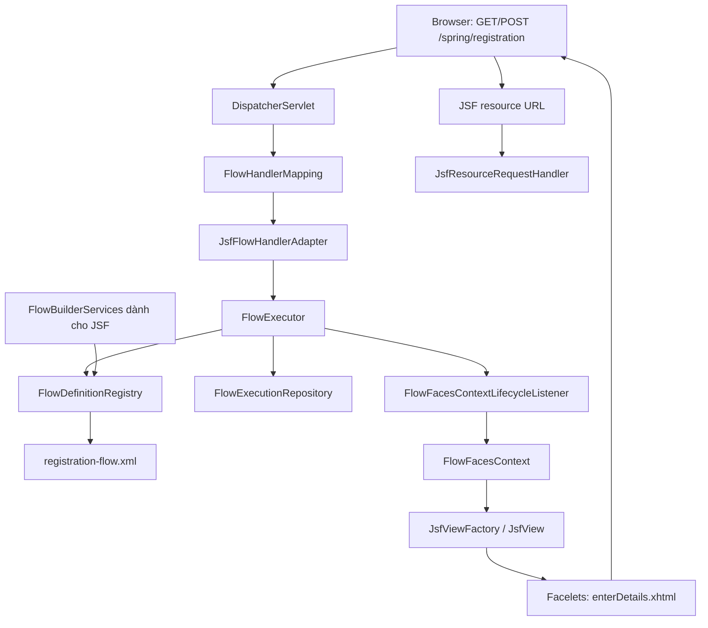
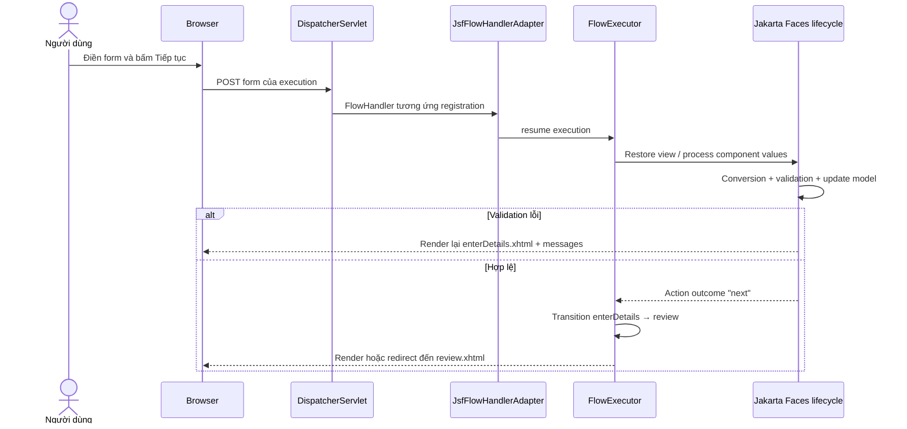

# AbstractFacesFlowConfiguration và cấu hình Java tương ứng

## 1. Vì sao cần cấu hình riêng cho Jakarta Faces?

**Spring Web Flow** mô hình hóa hành trình nhiều bước thông qua **state**, **event**, **transition** và **subflow**. Với một wizard đăng ký dịch vụ, Web Flow quyết định khi nào chuyển từ trang nhập thông tin sang trang xác nhận, khi nào quay lại và khi nào kết thúc. **Jakarta Faces** (trước đây gọi là JSF) đảm nhiệm cây component giao diện, Facelets (`.xhtml`), form conversion, validation, postback và Ajax.

Khi kết hợp hai công nghệ này với Spring MVC, một request tới flow thường đi qua `DispatcherServlet`, trong khi các component Faces vẫn cần một `FacesContext` và lifecycle của Jakarta Faces. Chỉ khai báo `FlowExecutor` hoặc chỉ thêm `FacesServlet` là chưa đủ: ứng dụng phải **kết nối các thành phần xây dựng flow, lifecycle và HTTP adapter dành cho Faces**.

`org.springframework.faces.config.AbstractFacesFlowConfiguration` là lớp nền để viết cấu hình Java kiểu `@Configuration` cho Web Flow trong môi trường JSF. Lớp này cung cấp builder chuyên biệt cho:

- `FlowDefinitionRegistry`: đăng ký các file định nghĩa flow và tra cứu theo ID.
- `FlowExecutor`: khởi chạy và tiếp tục những flow execution.
- `FlowBuilderServices`: lựa chọn các dịch vụ xây dựng flow, đặc biệt là **JSF view factory**.
- Cơ chế **phục vụ JSF resources** (CSS, JavaScript, hình ảnh của thư viện component) trong Spring MVC.

> **Mục tiêu cốt lõi:** Dùng `AbstractFacesFlowConfiguration` để lắp đúng hệ sinh thái Spring Faces thay vì sao chép nguyên cấu hình Spring MVC/JSP và kỳ vọng Facelets tự hoạt động.

Bài thuộc chương **Tích hợp JSF** của module `SPRING_WEB_FLOW`. Nội dung liên hệ cấu hình Spring MVC, form binding/validation, quản lý scope và phiên, Ajax, kiểm thử và phục hồi execution khi lỗi.

### Sau bài này, bạn sẽ làm được gì?

1. Phân biệt `AbstractFacesFlowConfiguration` với `AbstractFlowConfiguration` và các builder trùng tên.
2. Viết cấu hình Java đăng ký `FlowBuilderServices`, `FlowDefinitionRegistry`, `FlowExecutor` và `FlowFacesContextLifecycleListener`.
3. Kết nối `FlowHandlerMapping` với `JsfFlowHandlerAdapter` thay vì adapter MVC thông thường.
4. Hiểu các bean JSF resource handler được lớp nền tự đăng ký và khi nào cần cấu hình thêm.
5. Khởi tạo `DispatcherServlet` và `FacesServlet` bằng Java hoặc cấu hình Servlet tương đương.
6. Tạo một flow dùng Facelets, truyền action outcome thành event và kiểm thử những đường chạy chính.

## 2. Kiến trúc: Java configuration ghép những tầng nào?



Sơ đồ diễn tả **vai trò và sự phụ thuộc**, không nhất thiết thứ tự chính xác của mọi lời gọi nội bộ. Một flow có thể đi qua nhiều action/decision states trước khi render view. Việc load definition cũng có thể được hoãn cho tới lần tra cứu đầu tiên.

| Thành phần | Vai trò | Do ai cung cấp/cấu hình? |
| --- | --- | --- |
| `AbstractFacesFlowConfiguration` | Lớp nền Java config, cung cấp builder và JSF resource infrastructure | `spring-faces` |
| `FlowBuilderServices` | Định nghĩa cách parse expression, conversion, tạo JSF view và validation | Java `@Bean` / JSF builder |
| `FlowDefinitionRegistry` | Gắn flow ID với resource XML | Java `@Bean` |
| `FlowExecutor` | Launch/resume/refresh execution theo registry | Java `@Bean` |
| `FlowFacesContextLifecycleListener` | Quản lý `FacesContext` cho mỗi Web Flow request | Đăng ký với executor |
| `FlowHandlerMapping` | Nhận URL có ID khớp flow | Spring MVC Web Flow |
| `JsfFlowHandlerAdapter` | Điều phối request đến executor; xử lý JSF Ajax | Spring Faces |
| `JsfResourceRequestHandler` | Phục vụ resource qua JSF ResourceHandler | Được lớp nền tự đăng ký |
| `FacesServlet` | Bootstrap JSF runtime | Servlet container |
| `DispatcherServlet` | Điểm vào cho flow URL | Spring MVC / Servlet container |

**Phân biệt đặc biệt:** Lớp nền hỗ trợ **resource requests** không có nghĩa là mọi request tới flow tự động được nối vào `JsfFlowHandlerAdapter`. Hai tuyến HTTP này có chức năng khác nhau và đều phải được cấu hình đúng.

## 3. AbstractFacesFlowConfiguration khác AbstractFlowConfiguration thế nào?

| Khía cạnh | `AbstractFacesFlowConfiguration` | `AbstractFlowConfiguration` |
| --- | --- | --- |
| Package | `org.springframework.faces.config` | `org.springframework.webflow.config` |
| Ứng dụng chủ yếu | Web Flow có UI component Jakarta Faces | Web Flow dùng Spring MVC view thông thường |
| Builder services | `org.springframework.faces.config.FlowBuilderServicesBuilder` | `org.springframework.webflow.config.FlowBuilderServicesBuilder` |
| ViewFactoryCreator mặc định trong builder tương ứng | `JsfViewFactoryCreator` | MVC view factory |
| Infrastructure cho JSF resources | Có bean đăng ký sẵn | Không tự thêm JSF resources |
| Cần listener FacesContext? | **Có**, vẫn phải đăng ký với executor | Không dùng trong MVC thuần |
| Handler adapter khi dùng Faces | `JsfFlowHandlerAdapter` | `FlowHandlerAdapter` cho MVC thông thường |

Hai lớp nền là **hai class khác nhau**, không nên xem `AbstractFacesFlowConfiguration` đơn giản là một alias hoặc subclass của `AbstractFlowConfiguration`. Điều quan trọng là chọn **đúng package của builder**; hai builder `FlowBuilderServicesBuilder` có tên giống nhau nhưng mặc định khác nhau.

### 3.1. Các builder mà lớp nền cung cấp

Javadoc Spring Web Flow 3.0 mô tả những phương thức protected:

```java
// Phần chữ ký rút gọn để đọc kiến trúc:
getFlowExecutorBuilder(FlowDefinitionLocator flowRegistry)

getFlowDefinitionRegistryBuilder()

getFlowDefinitionRegistryBuilder(
    FlowBuilderServices flowBuilderServices)

getFlowBuilderServicesBuilder()
```

Builder trả về các đối tượng cấu hình sau khi gọi `build()`. Những phương thức này chỉ tạo **builder**, không tự quét mọi flow hay tự sinh flow definitions mới.

### 3.2. Các bean infrastructure được kế thừa

`AbstractFacesFlowConfiguration` có những `@Bean` factory methods như:

```text
jsrResourceHandlerMapping()
jsfResourceRequestHandler()
httpRequestHandlerAdapter()
```

Chúng phục vụ JSF resource URL thông qua Spring MVC, trong đó mapping có thể xử lý đường dẫn `/jakarta.faces.resource/**` trên stack Jakarta. Lớp nền không phải `FacesServlet` và không thay thế việc bootstrap JSF runtime.

**Không chủ động khai báo lại cùng các bean resource này** trừ khi đã hiểu cấu hình hiện tại và có nhu cầu thay đổi thực sự. Nếu thêm mapping thủ công mà trùng với mapping do lớp nền tạo, request resource có thể đi sai handler hoặc gây lỗi bean name.

## 4. Điều kiện trước khi dùng Java configuration

Cấu hình trong bài minh họa cho **Spring Web Flow 3.0.x**:

- Java 17 trở lên, Spring Framework 6 trở lên.
- Jakarta Faces/JSF **4.0 trở lên**.
- Servlet container tương thích với các thư viện Spring và Jakarta Faces đã chọn.
- Thư viện `spring-faces` đồng bộ release với `spring-webflow`; một Jakarta Faces implementation như Mojarra hoặc Apache MyFaces.
- Spring MVC hiện diện để đưa request qua `DispatcherServlet`.

Với Maven, ví dụ nhóm dependency tích hợp:

```xml
<!-- Chọn cùng version cho hai module Web Flow. -->
<dependency>
    <groupId>org.springframework.webflow</groupId>
    <artifactId>spring-webflow</artifactId>
    <version>3.0.2</version>
</dependency>
<dependency>
    <groupId>org.springframework.webflow</groupId>
    <artifactId>spring-faces</artifactId>
    <version>3.0.2</version>
</dependency>
```

Ví dụ version trên theo tài liệu 3.0.2, **không khẳng định đây là release mới nhất**. Trong ứng dụng có BOM/dependency management, giữ một nguồn khai báo version. JSF API/implementation, Servlet API và Bean Validation provider cần chọn theo môi trường triển khai; không nạp song song Mojarra và MyFaces.

**Dấu hiệu sai dependency:** `ClassNotFoundException`/`NoClassDefFoundError` liên quan `javax.faces` trong ứng dụng `jakarta.faces`; sử dụng code/config mẫu JSF 2.x mà không chuyển package; hoặc thêm `spring-faces` lệch version so với Web Flow.

## 5. Cấu hình Java hoàn chỉnh: registry, services, executor và MVC bridge

Ví dụ cấu hình một flow `registration` có file `/WEB-INF/flows/registration/registration-flow.xml`. Cấu hình dùng `@Bean` để minh họa rõ từng dependency.

```java
package com.example.config;

import org.springframework.context.annotation.Bean;
import org.springframework.context.annotation.Configuration;
import org.springframework.faces.config.AbstractFacesFlowConfiguration;
import org.springframework.faces.webflow.FlowFacesContextLifecycleListener;
import org.springframework.faces.webflow.JsfFlowHandlerAdapter;
import org.springframework.webflow.definition.registry.FlowDefinitionRegistry;
import org.springframework.webflow.engine.builder.support.FlowBuilderServices;
import org.springframework.webflow.executor.FlowExecutor;
import org.springframework.webflow.mvc.servlet.FlowHandlerMapping;

@Configuration
public class RegistrationFacesFlowConfig
        extends AbstractFacesFlowConfiguration {

    @Bean
    public FlowBuilderServices facesFlowBuilderServices() {
        // Builder dành cho JSF, mặc định dùng JsfViewFactoryCreator.
        return getFlowBuilderServicesBuilder()
                .setDevelopmentMode(false)
                .build();
    }

    @Bean
    public FlowDefinitionRegistry flowRegistry() {
        // ID explicit tránh phụ thuộc quy tắc suy ID từ tên tệp.
        return getFlowDefinitionRegistryBuilder(facesFlowBuilderServices())
                .addFlowLocation(
                    "/WEB-INF/flows/registration/registration-flow.xml",
                    "registration")
                .build();
    }

    @Bean
    public FlowExecutor flowExecutor() {
        // Listener giữ một FacesContext phù hợp cho mỗi flow request.
        return getFlowExecutorBuilder(flowRegistry())
                .addFlowExecutionListener(
                    new FlowFacesContextLifecycleListener())
                .build();
    }

    @Bean
    public FlowHandlerMapping flowHandlerMapping() {
        FlowHandlerMapping mapping = new FlowHandlerMapping();
        mapping.setFlowRegistry(flowRegistry());
        mapping.setOrder(0);
        return mapping;
    }

    @Bean
    public JsfFlowHandlerAdapter jsfFlowHandlerAdapter() {
        JsfFlowHandlerAdapter adapter = new JsfFlowHandlerAdapter();
        adapter.setFlowExecutor(flowExecutor());
        return adapter;
    }
}
```

### Vì sao mẫu này hoạt động?

1. `facesFlowBuilderServices()` dùng **builder JSF** từ `AbstractFacesFlowConfiguration`, do đó các view-state có `JsfViewFactoryCreator` phù hợp.
2. `flowRegistry()` nối đúng services với registry và gắn ID `registration` cho resource XML.
3. `flowExecutor()` gắn `FlowFacesContextLifecycleListener` để quản lý FacesContext qua request Web Flow.
4. `flowHandlerMapping()` ánh xạ path tương ứng flow ID tới flow handler.
5. `jsfFlowHandlerAdapter()` xử lý flow request, sử dụng cơ chế Ajax của JSF thay vì Ajax handler mặc định của Spring JavaScript.
6. Các bean JSF resource mapping/handler được **kế thừa từ lớp nền**, không cần tạo thêm ở đây.

**Giới hạn của ví dụ:** Spring application context còn phải được gắn với một `DispatcherServlet`, và server phải bootstrap `FacesServlet`. Cần cung cấp Facelets template, JSF runtime, service/model bean, dependency và cấu hình security thực tế. Việc cấu hình `@Bean` ở đây không tự cung cấp database, converter hoặc view contents.

### 5.1. Vị trí của @Configuration

`RegistrationFacesFlowConfig` cần được đăng ký vào **application context của Spring MVC DispatcherServlet**, hoặc một context cha mà DispatcherServlet có thể nhìn thấy các bean tương ứng. Nếu application có root context và nhiều child servlet contexts, tránh tình huống:

- Registry ở root context nhưng handler mapping ở một child context không nhìn thấy nó.
- `JsfFlowHandlerAdapter` được tạo ở một context khác, không được Spring MVC phát hiện.
- Có hai `FlowExecutor` với cùng hoặc tương tự bean name, và URL sử dụng nhầm executor.

Trong mô hình ví dụ, đặt các bean flow và MVC bridge ở cùng WebApplicationContext của DispatcherServlet là cách dễ hiểu nhất.

### 5.2. Tại sao không gọi thêm FlowHandlerAdapter thông thường?

`JsfFlowHandlerAdapter` **kế thừa** `FlowHandlerAdapter` nhưng thay Ajax handler mặc định bằng `JsfAjaxHandler`. Nếu tự đăng ký thêm một `FlowHandlerAdapter` cho cùng flow mà không hiểu thứ tự adapter, JSF partial response/redirect có thể sai. Hãy chọn một adapter chuyên dùng cho flow JSF và kiểm thử HTTP.

## 6. Đăng ký nhiều flow: ID tường minh hay location pattern?

Nếu có nhiều wizard, có thể thêm từng resource:

```java
@Bean
public FlowDefinitionRegistry flowRegistry() {
    return getFlowDefinitionRegistryBuilder(facesFlowBuilderServices())
            .addFlowLocation(
                "/WEB-INF/flows/registration/registration-flow.xml",
                "registration")
            .addFlowLocation(
                "/WEB-INF/flows/checkout/checkout-flow.xml",
                "checkout")
            .build();
}
```

Hoặc dùng pattern theo ví dụ hướng dẫn:

```java
@Bean
public FlowDefinitionRegistry flowRegistry() {
    return getFlowDefinitionRegistryBuilder(facesFlowBuilderServices())
            .setBasePath("/WEB-INF")
            .addFlowLocationPattern("**/*-flow.xml")
            .build();
}
```

**Khác biệt quan trọng:** Với `base-path`, ID có thể được suy từ **các đoạn đường dẫn tương đối** của resource, không phải luôn từ tên file. Một file `/WEB-INF/flows/registration/registration-flow.xml` trong mẫu pattern có thể nhận ID phản ánh đường dẫn dưới `/WEB-INF`. Đừng mặc nhiên cho rằng tên flow trong HTTP sẽ là `registration`.

Nếu HTTP URL phải ổn định như `/spring/registration`, thường nên **đăng ký ID tường minh** và viết test xác nhận `registry.containsFlowDefinition("registration")`.

## 7. Java Servlet bootstrap: không phải mọi thứ do @Configuration xử lý

Dù dùng `AbstractFacesFlowConfiguration`, ứng dụng vẫn cần hai servlet đảm nhiệm trách nhiệm khác nhau:

- **`DispatcherServlet`** nhận các flow URLs, ví dụ `/spring/registration`.
- **`FacesServlet`** được đăng ký để Jakarta Faces implementation khởi tạo. Trong tích hợp Spring Web Flow, flow requests thông thường **không đi trực tiếp qua FacesServlet**.

Một cách Java-only cho ứng dụng Servlet/WAR là dùng `WebApplicationInitializer`:

```java
package com.example.config;

import jakarta.faces.webapp.FacesServlet;
import jakarta.servlet.ServletContext;
import jakarta.servlet.ServletException;
import jakarta.servlet.ServletRegistration;

import org.springframework.web.WebApplicationInitializer;
import org.springframework.web.context.support.AnnotationConfigWebApplicationContext;
import org.springframework.web.servlet.DispatcherServlet;

public class RegistrationWebInitializer
        implements WebApplicationInitializer {

    @Override
    public void onStartup(ServletContext servletContext)
            throws ServletException {

        AnnotationConfigWebApplicationContext webContext =
                new AnnotationConfigWebApplicationContext();

        // WebMvcAppConfig là @Configuration riêng của ứng dụng,
        // chứa @EnableWebMvc và các bean MVC cần thiết.
        webContext.register(
                WebMvcAppConfig.class,
                RegistrationFacesFlowConfig.class);

        ServletRegistration.Dynamic dispatcher =
                servletContext.addServlet(
                        "spring", new DispatcherServlet(webContext));
        dispatcher.setLoadOnStartup(1);
        dispatcher.addMapping("/spring/*");

        ServletRegistration.Dynamic faces =
                servletContext.addServlet(
                        "Faces Servlet", new FacesServlet());
        faces.setLoadOnStartup(1);
        faces.addMapping("*.faces");

        servletContext.setInitParameter(
                "jakarta.faces.DEFAULT_SUFFIX", ".xhtml");
    }
}
```

Ở ví dụ này, `WebMvcAppConfig` là lớp `@Configuration` mà dự án phải định nghĩa. Nó cấu hình Spring MVC và các thành phần bổ sung cho ứng dụng; class này không phải API của Spring Web Flow.

Một bản tối thiểu có thể gồm:

```java
package com.example.config;

import org.springframework.context.annotation.Configuration;
import org.springframework.web.servlet.config.annotation.EnableWebMvc;

@Configuration
@EnableWebMvc
public class WebMvcAppConfig {
    // Đăng ký thêm những MVC beans cần thiết của ứng dụng.
}
```

**Lưu ý về bootstrap:** Java config này chỉ là một cách cài đặt thay cho `web.xml`. Trong Spring Boot hoặc ứng dụng đã có `DispatcherServlet` do framework quản lý, **không thêm servlet thứ hai** chỉ vì thấy ví dụ. Hãy kết hợp các bean Web Flow vào context/servlet setup đang có, đồng thời đảm bảo Jakarta Faces vẫn được khởi tạo đúng cách.

### 7.1. web.xml tương đương nếu không dùng WebApplicationInitializer

```xml
<!-- Các đoạn này phải đặt trong web-app hợp lệ của ứng dụng. -->
<servlet>
    <servlet-name>spring</servlet-name>
    <servlet-class>
        org.springframework.web.servlet.DispatcherServlet
    </servlet-class>
    <load-on-startup>1</load-on-startup>
</servlet>
<servlet-mapping>
    <servlet-name>spring</servlet-name>
    <url-pattern>/spring/*</url-pattern>
</servlet-mapping>

<!-- Bootstrap Faces implementation; không dùng làm flow endpoint. -->
<servlet>
    <servlet-name>Faces Servlet</servlet-name>
    <servlet-class>jakarta.faces.webapp.FacesServlet</servlet-class>
    <load-on-startup>1</load-on-startup>
</servlet>
<servlet-mapping>
    <servlet-name>Faces Servlet</servlet-name>
    <url-pattern>*.faces</url-pattern>
</servlet-mapping>
```

Nếu dùng `web.xml`, cần đảm bảo context configuration của `DispatcherServlet` thực sự import `RegistrationFacesFlowConfig`; `@Configuration` trong classpath mà không được scan/import thì **không tạo bean**.

## 8. Flow XML mà Java config sẽ dựng và thực thi

Cấu hình `flowRegistry()` ở trên đăng ký:

```text
WEB-INF/
└── flows/
    └── registration/
        ├── registration-flow.xml
        ├── enterDetails.xhtml
        └── review.xhtml
```

Tệp `registration-flow.xml`:

```xml
<?xml version="1.0" encoding="UTF-8"?>
<flow xmlns="http://www.springframework.org/schema/webflow"
      xmlns:xsi="http://www.w3.org/2001/XMLSchema-instance"
      xsi:schemaLocation="
        http://www.springframework.org/schema/webflow
        https://www.springframework.org/schema/webflow/spring-webflow.xsd">

    <var name="registration"
         class="com.example.registration.RegistrationDraft" />

    <view-state id="enterDetails" view="enterDetails.xhtml">
        <transition on="next" to="review" />
        <transition on="cancel" to="cancelled" />
    </view-state>

    <view-state id="review" view="review.xhtml">
        <transition on="back" to="enterDetails" />
        <transition on="confirm" to="submitted" />
    </view-state>

    <end-state id="submitted" />
    <end-state id="cancelled" />
</flow>
```

Ở đây `RegistrationDraft` là JavaBean có constructor không tham số, getter/setter phù hợp, các thuộc tính `fullName` và `email`. Cần chú ý:

- Không bắt buộc `model="registration"` trên `view-state` trong ví dụ sử dụng **JSF component binding** vì Faces tự bind thông qua EL.
- `<var name="registration">` tạo dữ liệu của từng flow execution; không dùng Spring singleton chứa thông tin mỗi người dùng.
- `action="next"` của JSF button sẽ tạo outcome/event để Web Flow khớp với `transition on="next"`.
- `submitted` và `cancelled` là `end-state`; nếu cần ghi dữ liệu, phải gọi service trong action/transition thích hợp **trước khi kết thúc**.

Bài tập mở rộng: thay `review` → `submitted` bằng `review` → `saveRegistration`, trong đó `action-state` gọi `registrationService.save(registration)` và xử lý outcome. Khi service có side effect, phải bổ sung transaction, authorization và idempotency.

## 9. Facelets postback và transition

`enterDetails.xhtml`:

```xml
<!DOCTYPE html>
<html xmlns="http://www.w3.org/1999/xhtml"
      xmlns:h="jakarta.faces.html">
<h:head>
    <title>Nhập thông tin đăng ký</title>
</h:head>
<h:body>
    <h:form id="registrationForm">
        <h:messages id="messages" globalOnly="false" />

        <h:outputLabel for="fullName" value="Họ tên" />
        <h:inputText id="fullName"
                     value="#{registration.fullName}"
                     required="true"
                     requiredMessage="Cần nhập họ tên" />
        <h:message for="fullName" />

        <h:outputLabel for="email" value="Email" />
        <h:inputText id="email"
                     value="#{registration.email}"
                     required="true" />
        <h:message for="email" />

        <h:commandButton value="Tiếp tục" action="next" />
        <h:commandButton value="Hủy"
                         action="cancel" immediate="true" />
    </h:form>
</h:body>
</html>
```

`review.xhtml`:

```xml
<!DOCTYPE html>
<html xmlns="http://www.w3.org/1999/xhtml"
      xmlns:h="jakarta.faces.html">
<h:head>
    <title>Xác nhận thông tin</title>
</h:head>
<h:body>
    <h:form id="reviewForm">
        <h:messages />

        <h:outputText value="#{registration.fullName}" />
        <h:outputText value=" – " />
        <h:outputText value="#{registration.email}" />

        <h:commandButton value="Quay lại" action="back" />
        <h:commandButton value="Gửi đăng ký" action="confirm" />
    </h:form>
</h:body>
</html>
```

### Điều gì xảy ra khi người dùng bấm Tiếp tục?



Nội bộ việc render có thể liên quan `JsfViewFactory`, `JsfView`, `FlowFacesContext` và POST–Redirect–GET. Sơ đồ biểu diễn logic chính, không thay thế việc kiểm tra trace request cụ thể.

### Điểm dễ nhầm về binding/validation

Trong view JSF, `h:inputText`/`h:commandButton` sử dụng **Jakarta Faces component lifecycle**. Khi giá trị không hợp lệ, action outcome có thể không được phát; Web Flow vẫn ở cùng view-state và thông báo lỗi hiện qua `h:message` hoặc `h:messages`.

Nếu muốn validation nghiệp vụ xuyên nhiều trường hoặc dùng Bean Validation, hãy cấu hình provider và cách báo lỗi phù hợp. Không cho rằng chỉ đặt `setValidator(...)` trên Web Flow builder là tự kích hoạt tất cả constraint trong mọi JSF component; cần test lifecycle thật.

## 10. XML namespace tương đương với Java config

Để hiểu rõ các bean Java ở mục 5, đối chiếu chúng với cấu hình XML Spring Faces:

```xml
<webflow:flow-registry
    id="flowRegistry"
    flow-builder-services="facesFlowBuilderServices">
    <webflow:flow-location
        id="registration"
        path="/WEB-INF/flows/registration/registration-flow.xml" />
</webflow:flow-registry>

<faces:flow-builder-services
    id="facesFlowBuilderServices" />

<webflow:flow-executor id="flowExecutor"
                       flow-registry="flowRegistry">
    <webflow:flow-execution-listeners>
        <webflow:listener ref="facesContextListener" />
    </webflow:flow-execution-listeners>
</webflow:flow-executor>

<bean id="facesContextListener"
      class="org.springframework.faces.webflow.FlowFacesContextLifecycleListener" />

<bean class="org.springframework.webflow.mvc.servlet.FlowHandlerMapping">
    <property name="flowRegistry" ref="flowRegistry" />
</bean>

<bean class="org.springframework.faces.webflow.JsfFlowHandlerAdapter">
    <property name="flowExecutor" ref="flowExecutor" />
</bean>

<faces:resources />
```

Đoạn XML trên là **nội dung đặt bên trong `<beans>`** đã khai báo namespace `beans`, `webflow`, `faces` và `xsi:schemaLocation`. Khi dùng Java config từ lớp nền, `faces:resources` tương ứng với **các resource handler beans đã đăng ký sẵn**, nên không cần cấu hình thêm XML chỉ để lặp lại phần đó.

| XML | Java |
| --- | --- |
| `<faces:flow-builder-services>` | `getFlowBuilderServicesBuilder().build()` |
| `<webflow:flow-registry>` | `getFlowDefinitionRegistryBuilder(...).build()` |
| `<webflow:flow-location>` | `addFlowLocation(path, id)` |
| `<webflow:flow-executor>` | `getFlowExecutorBuilder(flowRegistry()).build()` |
| `<webflow:listener ref="...">` | `addFlowExecutionListener(new FlowFacesContextLifecycleListener())` |
| Bean `FlowHandlerMapping` | `@Bean FlowHandlerMapping` |
| Bean `JsfFlowHandlerAdapter` | `@Bean JsfFlowHandlerAdapter` |
| `<faces:resources />` | Resource mapping/handler từ `AbstractFacesFlowConfiguration` |

**Đừng trộn cả hai kiểu chỉ vì “bổ sung chắc chắn hơn”.** Nếu khai báo XML và Java cùng một bean ID, có thể tạo bean trùng hoặc vô tình sử dụng hai registries/executors khác nhau.

## 11. Tùy chỉnh FlowBuilderServices cho JSF

Một nhu cầu thực tế là bật development mode, cấu hình validator, conversion service hoặc hỗ trợ legacy JSF managed beans.

Mẫu Java:

```java
import org.springframework.context.annotation.Bean;
import org.springframework.validation.beanvalidation.LocalValidatorFactoryBean;
import org.springframework.webflow.engine.builder.support.FlowBuilderServices;

@Bean
public LocalValidatorFactoryBean flowValidator() {
    return new LocalValidatorFactoryBean();
}

@Bean
public FlowBuilderServices facesFlowBuilderServices() {
    return getFlowBuilderServicesBuilder()
            .setValidator(flowValidator())
            .setDevelopmentMode(false)
            .build();
}
```

Đây là **mẫu thay thế** cho factory method cùng tên ở mục 5, không phải code bổ sung nguyên xi cùng một `@Bean` trùng ID. `LocalValidatorFactoryBean` cần Bean Validation provider thực sự phù hợp với Jakarta stack.

### 11.1. Phương thức cấu hình đáng chú ý

`org.springframework.faces.config.FlowBuilderServicesBuilder` cung cấp những lựa chọn như:

| Phương thức | Tác dụng |
| --- | --- |
| `setConversionService(...)` | Chọn conversion service của Web Flow/Spring Binding |
| `setExpressionParser(...)` | Chọn cách xử lý các biểu thức trong flow |
| `setViewFactoryCreator(...)` | Thay đổi cách tạo JSF view factory |
| `setValidator(...)` | Validator cho model ở view-state theo cơ chế Web Flow |
| `setValidationHintResolver(...)` | Diễn giải validation hints/groups |
| `setEnableManagedBeans(...)` | Bật cơ chế phân giải legacy JSF managed beans nếu cần |
| `setDevelopmentMode(...)` | Theo dõi thay đổi flow definitions trong môi trường phát triển |

Trong builder **JSF**, mặc định view factory creator là `JsfViewFactoryCreator`. Nếu bạn tự truyền một MVC view factory creator vào `setViewFactoryCreator(...)`, các `view-state` có thể không render đúng Facelets. Khi tùy chỉnh, luôn xác minh rằng những defaults có ý nghĩa đối với JSF vẫn được giữ.

### 11.2. Conversion và validation có hai tầng

JSF cung cấp conversion/validation tại cấp **UI component**. Web Flow còn có conversion/validation cho data binding, action và flow model. Hai tầng phối hợp nhưng không đồng nhất:

- `h:inputText` nhận chuỗi từ form, convert và validate theo Jakarta Faces.
- `f:validateBean` có thể kích hoạt Bean Validation theo runtime Faces/provider.
- Web Flow builder có `setValidator(...)` cho những nơi Web Flow yêu cầu model validator.
- Service nghiệp vụ luôn phải kiểm tra authorization, consistency và invariant trước khi ghi dữ liệu.

Nếu UI không validate, hãy xác định đang lỗi ở **component lifecycle** hay **flow model validation** trước khi sửa builder.

### 11.3. EnableManagedBeans không phải một cờ nên bật vô điều kiện

`setEnableManagedBeans(true)` giúp cấu hình parser hỗ trợ tìm JSF-managed beans cũ. Trên stack Jakarta Faces hiện đại, nên ưu tiên mô hình biến Web Flow, Spring-managed services và cơ chế dependency injection phù hợp; không bật tùy chọn chỉ vì thấy từ “managed bean”.

Cần phân biệt `@Named`/CDI beans với legacy JSF managed-bean facility và xem phiên bản Jakarta Faces thực tế hỗ trợ cơ chế nào.

### 11.4. Development mode

`setDevelopmentMode(true)` hỗ trợ việc kiểm tra thay đổi resource của flow trong lúc phát triển. Không nên mặc định dùng cho production; mode này không phải giải pháp giữ execution sau session timeout hoặc tự migrate snapshot cũ sang definition mới.

## 12. JSF resource mapping: tại sao tự động nhưng vẫn có thể lỗi?

Theo Javadoc `AbstractFacesFlowConfiguration`, lớp nền đăng ký:

- `JsfResourceRequestHandler`: chuyển yêu cầu resource tới Jakarta Faces `ResourceHandler`.
- `SimpleUrlHandlerMapping` cho các URL resource, ví dụ `/jakarta.faces.resource/**`.
- `HttpRequestHandlerAdapter` để Spring MVC thực thi những resource handler tương ứng.

Như vậy, trong ví dụ Java config **không cần** thêm bean `JsfResourceRequestHandler` lần nữa.

Nhưng resource vẫn có thể lỗi nếu:

1. `@Configuration` không được import/scan trong context của DispatcherServlet.
2. `DispatcherServlet` không nhận resource URL mà JSF sinh ra vì servlet mapping không phù hợp.
3. JSF implementation chưa bootstrap hoặc thư viện component thiếu artifact.
4. URL có context path, servlet path hoặc reverse proxy prefix không đúng.
5. Các handler mappings của ứng dụng có thứ tự xung đột với mapping resource.
6. Static resource bị Spring Security hoặc proxy chặn theo cấu hình.

Ví dụ một trang hiển thị HTML và các nút JSF nhưng mất CSS/JavaScript: nhìn tab **Network** để thấy resource URL được sinh và HTTP status; không vội sửa flow state machine khi thực chất là lỗi tuyến resource.

## 13. Vì sao JSF Ajax cần JsfFlowHandlerAdapter?

`JsfFlowHandlerAdapter` là biến thể của `FlowHandlerAdapter`, tự dùng `JsfAjaxHandler` thay cho Ajax handler mặc định của Spring JavaScript. Nó giúp nhận diện request Ajax của Faces và trả redirect/partial response theo giao thức phù hợp.

Ví dụ Facelets:

```xml
<h:form xmlns:h="jakarta.faces.html"
        xmlns:f="jakarta.faces.core"
        id="filterForm">

    <h:inputText id="keyword"
                 value="#{searchCriteria.keyword}" />

    <h:panelGroup id="results">
        <h:outputText value="#{searchCriteria.summary}" />
    </h:panelGroup>

    <h:commandButton value="Tìm kiếm" action="search">
        <f:ajax execute="@form" render="results" />
    </h:commandButton>
</h:form>
```

Flow có thể xử lý event `search` ngay trong `view-state` rồi render fragment:

```xml
<view-state id="searchProducts" view="searchProducts.xhtml">
    <transition on="search">
        <evaluate expression="searchService.update(searchCriteria)" />
        <render fragments="filterForm:results" />
    </transition>
</view-state>
```

Ví dụ giả định `searchCriteria` đã được khai báo và `searchService` là Spring bean. ID fragment thực tế phải khớp **JSF client ID** của component theo naming container. Một số thư viện UI có quy ước Ajax/component IDs riêng; cần kiểm tra HTML render và network response thật.

**Không gọi side-effect quan trọng trong `on-render`** chỉ vì Ajax muốn cập nhật view: render có thể lặp lại khi Refresh hoặc qua request khác. Với action có side-effect, dùng operation idempotency ở service.

## 14. Scope, model và session của flow Faces

`spring-faces` cho phép EL của Facelets tìm các flow variables:

```xml
<var name="registration"
     class="com.example.registration.RegistrationDraft" />
```

```xml
<h:inputText value="#{registration.fullName}" />
```

| Scope Web Flow | Vòng đời | Ví dụ |
| --- | --- | --- |
| `requestScope` | Trong request hiện tại | Tính toán tạm |
| `viewScope` | Khi đang ở một view-state | Trạng thái lựa chọn, dữ liệu hiển thị của view |
| `flashScope` | Dữ liệu ngắn hạn qua lần render/transition | Thông báo thao tác |
| `flowScope` | Trong flow hiện tại | Bản nháp đăng ký qua nhiều bước |
| `conversationScope` | Trong conversation gồm flow và subflow | Context dùng chung giữa quy trình con |

Các biến trong `flowScope`, `viewScope` hoặc `conversationScope` có thể tham gia serialization/snapshot của execution repository. Vì vậy, không giữ trực tiếp connection, stream, entity manager hay object graph quá lớn. Nếu người dùng cần lưu bản nháp sau khi session hết hạn, dùng persistence nghiệp vụ, không dựa vào scope của Web Flow.

### Spring-managed bean scope flow là một phương án khác

```xml
<bean id="registration"
      class="com.example.registration.RegistrationDraft"
      scope="flow" />
```

Đây là cách khai báo bean thuộc flow scope trong Spring XML, **thay thế** cho `<var>` trong tình huống cần Spring bean lifecycle/AOP. Khi dùng Java bean definitions, hãy chắc rằng scope `flow` được Web Flow đăng ký và bean không được inject trực tiếp vào singleton tại startup mà thiếu proxy/lookup thích hợp.

Không định nghĩa đồng thời hai biến cùng tên `registration` ở hai hệ quản lý mà không kiểm tra EL resolution; dễ tạo ra object form khác nhau khi người dùng chuyển state.

## 15. Redirect, execution key và lỗi cần xử lý

### 15.1. Execution key và JSF view state là hai khái niệm

- **FlowExecutionKey** định danh một lần chạy/snapshot mà `FlowExecutionRepository` lưu.
- **JSF view state** lưu thông tin liên quan cây component và lifecycle của Faces.
- **HTTP session** là container state có thời gian sống và security context riêng.

`FlowViewHandler` hỗ trợ đưa URL execution hiện hành vào `h:form` để postback được Spring Web Flow xử lý. Khi session hết hạn, key cũ có thể không resume được dù browser vẫn hiển thị HTML form.

### 15.2. POST–Redirect–GET và validation failure

Web Flow thường áp dụng POST–Redirect–GET giữa các view-state, và tùy cấu hình có thể redirect dù vẫn trong cùng view-state sau validation failure. Điều này làm cho JSF render/restore view qua redirect cần được phối hợp với `FlowFacesContext`.

Nếu một JSF implementation gặp vấn đề khi redirect trong cùng state, có thể cân nhắc cấu hình `redirect-in-same-state=false` ở executor. Nhưng đó là điều chỉnh **có mục tiêu**, không phải cài đặt mặc định cho mọi dự án: tắt PRG có thể làm Refresh phát lại POST.

### 15.3. Chiến lược phục hồi

Khi không tìm được execution key, có thể cần hiển thị thông báo phiên hết hạn và cung cấp cách bắt đầu lại. Nếu action nghiệp vụ đã thành công mà response bị mất, không nên tự động launch flow mới rồi gọi lại `confirm`; thay vào đó kiểm tra kết quả nghiệp vụ qua ID/operation key bền vững.

Với flow đặt hàng/thanh toán, cần idempotency và transaction ở service. `FlowExecutor`, `JsfFlowHandlerAdapter` và JSF component validation không thay thế những lớp bảo vệ này.

## 16. Kiểm thử cấu hình Java và hành vi JSF

### 16.1. Test bean wiring và registry

Ví dụ một test Spring context có web environment đã nạp `RegistrationFacesFlowConfig`:

```java
import static org.junit.jupiter.api.Assertions.*;

import org.junit.jupiter.api.Test;
import org.springframework.beans.factory.annotation.Autowired;
import org.springframework.test.context.junit.jupiter.web.SpringJUnitWebConfig;
import org.springframework.webflow.definition.registry.FlowDefinitionRegistry;
import org.springframework.webflow.executor.FlowExecutor;
import org.springframework.faces.webflow.JsfFlowHandlerAdapter;

@SpringJUnitWebConfig(classes = {
        WebMvcAppConfig.class,
        RegistrationFacesFlowConfig.class
})
class RegistrationFlowWiringTest {

    @Autowired FlowDefinitionRegistry registry;
    @Autowired FlowExecutor executor;
    @Autowired JsfFlowHandlerAdapter adapter;

    @Test
    void flowDefinitionAndAdapterExist() {
        assertNotNull(executor);
        assertNotNull(adapter);
        assertTrue(registry.containsFlowDefinition("registration"));
        assertEquals(
            "registration",
            registry.getFlowDefinition("registration").getId());
    }
}
```

Test này yêu cầu `/WEB-INF/flows/...` thật sự có thể được load trong test `WebApplicationContext` và JSF dependencies tương thích. Nó chỉ chứng minh bean/definition được nối đúng, **chưa** chứng minh FacesServlet bootstrap hoặc Facelets lifecycle render đúng trong một Servlet container thực tế.

### 16.2. Test resource beans

Nếu muốn kiểm tra resource infrastructure từ `AbstractFacesFlowConfiguration`, có thể assert rằng Spring context có bean kiểu `JsfResourceRequestHandler` và `HttpRequestHandlerAdapter`. Không được đánh đồng điều đó với việc một resource URL nhất định trả HTTP 200: vẫn phải test servlet mapping và JSF ResourceHandler thật.

### 16.3. Test flow behavior

Các ca tối thiểu:

1. `GET /spring/registration` khởi chạy flow và vào `enterDetails`.
2. Form render đúng `h:form`, component values và JSF view state.
3. Submit dữ liệu hợp lệ + action `next` đến `review`.
4. Submit thiếu `fullName` không chuyển state; `h:messages` hiển thị lỗi.
5. Event `back` quay lại `enterDetails` với dữ liệu model giữ trong execution.
6. Event `cancel` kết thúc flow, không bị validation cản trở.
7. Event `confirm` kết thúc flow hoặc gọi service nếu bài tập mở rộng đã triển khai.
8. JSF resource CSS/JS tải được; Ajax partial response có format/fragment đúng.
9. Browser Refresh, session timeout, tab song song và execution key hết hạn có hành vi dự kiến.

### 16.4. Test theo lớp

| Cấp kiểm thử | Mục tiêu | Giới hạn |
| --- | --- | --- |
| Bean/wiring | Registry, executor, listener/adapter/resource beans | Không kiểm JSF lifecycle thực |
| Flow execution test | Event và state transitions, scope | Không kiểm HTML/Ajax thực |
| MVC/Servlet integration | URL mapping, POST/redirect, session và resources | Cần cấu hình môi trường phù hợp |
| End-to-end browser | Facelets rendering, component lifecycle, Ajax, timeout | Chậm hơn, cần runtime JSF đầy đủ |

## 17. Các lỗi điển hình khi viết Java configuration

| Triệu chứng | Nguyên nhân có thể | Điều cần kiểm tra |
| --- | --- | --- |
| `/spring/registration` trả 404 | `DispatcherServlet` mapping sai hoặc registry ID không đúng | Servlet path, `FlowHandlerMapping`, `containsFlowDefinition` |
| Context khởi động nhưng Faces view không render | Registry dùng MVC builder/default sai | `getFlowBuilderServicesBuilder()` từ `AbstractFacesFlowConfiguration` |
| `FacesContext.getCurrentInstance()` không phù hợp lúc xử lý flow | Quên listener | `addFlowExecutionListener(new FlowFacesContextLifecycleListener())` |
| JSF Ajax response bị hỏng | Có `FlowHandlerAdapter` thường thay vì Faces adapter | `JsfFlowHandlerAdapter` |
| CSS/JavaScript của JSF trả 404 | Resource mapping/servlet path hoặc runtime thiếu | `jsrResourceHandlerMapping`, `JsfResourceRequestHandler`, network |
| Nút `next` không chuyển sang view sau | JSF conversion/validation lỗi hoặc action outcome sai | `h:messages`, `action` và `transition on` |
| Bean không tồn tại dù có `@Configuration` | Chưa import config vào WebApplicationContext | DispatcherServlet context registration |
| Bean trùng/đụng tên | Dùng cả XML lẫn Java cho cùng executor/registry | Bean definitions và component scanning |
| Lỗi `javax.faces` với stack Jakarta | Dependency/version lệch | `spring-faces`, Jakarta Faces implementation |
| Form model mất khi sang view | Scope hoặc execution bị thay đổi/hết hạn | `flowScope`, repository, session, execution key |
| Hai adapter xử lý cùng URL | Vô tình tạo hai flow adapters | HandlerAdapter beans và order |
| Phân trang/Ajax không cập nhật | Client ID fragment sai | JSF component tree, naming container |
| Reload gây submit lại action | Cấu hình PRG/redirect thay đổi | Redirect policy và idempotent service |

### Thứ tự debug có ích

1. Xác định **URL** có được DispatcherServlet nhận không.
2. Xác định **FlowHandlerMapping** có tìm thấy flow ID không.
3. Kiểm tra registry có xây dựng được **definition** không.
4. Kiểm tra executor đã đăng ký **FlowFacesContextLifecycleListener** chưa.
5. Kiểm tra **JsfFlowHandlerAdapter** có xử lý request/Ajax không.
6. Kiểm tra JSF runtime được bootstrap, resources load và Facelets render.
7. Kiểm tra component validation/action outcome, flow scope và repository.

Một lỗi ở bước 1–3 không nên sửa bằng cách thay JSF validator. Một lỗi resource 404 không nên sửa bằng cách thay transition XML.

## 18. Checklist cuối bài và câu hỏi tự luyện

**Checklist cấu hình Java:**

- [ ] Chọn đúng release Spring Web Flow, `spring-faces` và Jakarta Faces tương thích.
- [ ] Đăng ký `AbstractFacesFlowConfiguration` subclass trong đúng MVC context.
- [ ] Dùng JSF `getFlowBuilderServicesBuilder()`, nối vào flow registry.
- [ ] Registry có flow ID và XML resource đúng.
- [ ] `FlowExecutor` gắn `FlowFacesContextLifecycleListener`.
- [ ] Có `FlowHandlerMapping` và **`JsfFlowHandlerAdapter`** cho flow requests.
- [ ] Không khai báo trùng các JSF resource beans đã do lớp nền tạo.
- [ ] `DispatcherServlet` nhận flow URL; `FacesServlet` được bootstrap.
- [ ] Model/Facelets/EL/event IDs khớp với flow definition.
- [ ] Test form validation, Ajax, resource URLs, session timeout và side effects.

**Câu hỏi tự luyện:**

1. Tại sao `AbstractFacesFlowConfiguration` phù hợp hơn `AbstractFlowConfiguration` khi các view-state dùng Facelets?
2. Hai builder cùng tên `FlowBuilderServicesBuilder` khác nhau về package/mặc định quan trọng nào?
3. Tại sao phải gắn `FlowFacesContextLifecycleListener` dù đã dùng `AbstractFacesFlowConfiguration`?
4. `FlowHandlerMapping` và `JsfFlowHandlerAdapter` khác nhau thế nào?
5. Khi nào cần `JsfResourceRequestHandler`? Có cần tự tạo `@Bean` này khi đã kế thừa lớp nền không?
6. Vì sao vẫn bootstrap `FacesServlet` dù flow URL đi qua `DispatcherServlet`?
7. Nếu ứng dụng đã có DispatcherServlet của Spring Boot, có nên tạo thêm bằng WebApplicationInitializer không?
8. `action="next"` từ `h:commandButton` sẽ được khớp với phần tử nào trong flow XML?
9. Khi JSF validation lỗi, event `next` có nhất thiết được đưa vào state machine không?
10. Flow scope và JSF view state khác nhau về trách nhiệm và thời gian sống ra sao?
11. Khi nào nên dùng `setValidator(...)`, và tại sao nó không thay thế mọi JSF component validation?
12. Vì sao một POST xác nhận bị retry cần idempotency ở service, ngay cả khi đã có execution key?

## Tài liệu tham khảo

- [Spring Web Flow Reference Guide 3.0.2 — JSF Integration](https://docs.spring.io/spring-webflow/docs/3.0.2/reference/#_jsf_integration)
- [Spring Web Flow Reference Guide 3.0.2 — Configuring Web Flow for Use with JSF](https://docs.spring.io/spring-webflow/docs/3.0.2/reference/#_configuring_web_flow_for_use_with_jsf)
- [Javadoc 3.0.1 — AbstractFacesFlowConfiguration](https://docs.spring.io/spring-webflow/docs/3.0.1/api/org/springframework/faces/config/AbstractFacesFlowConfiguration.html)
- [Javadoc 3.0.1 — JSF FlowBuilderServicesBuilder](https://docs.spring.io/spring-webflow/docs/3.0.1/api/org/springframework/faces/config/FlowBuilderServicesBuilder.html)
- [Javadoc 3.0.1 — JsfFlowHandlerAdapter](https://docs.spring.io/spring-webflow/docs/3.0.1/api/org/springframework/faces/webflow/JsfFlowHandlerAdapter.html)
- [Javadoc 3.0.1 — JsfResourceRequestHandler](https://docs.spring.io/spring-webflow/docs/3.0.1/api/org/springframework/faces/webflow/JsfResourceRequestHandler.html)
- [Jakarta Faces Specification](https://jakarta.ee/specifications/faces/)

Các cấu hình và đoạn mã trong bài minh họa kiến trúc Java configuration cho Spring Web Flow 3.0.x. Trước khi đưa vào ứng dụng thật, cần đối chiếu API version, dependency và runtime Servlet/Jakarta Faces, bổ sung model/service/security/persistence và thực hiện kiểm thử tại môi trường triển khai.
