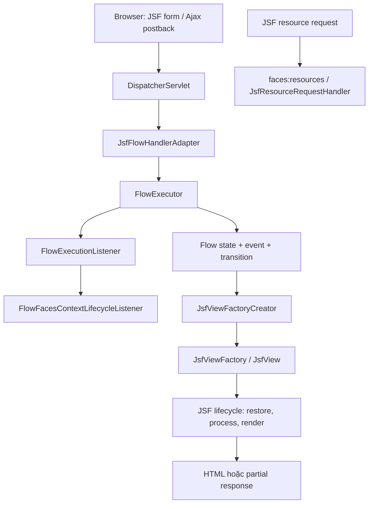

# JsfFlowHandlerAdapter và view factory cho Faces trong Spring Web Flow

Khi dùng **Spring Web Flow** (`SPRING_WEB_FLOW`) cùng **JavaServer Faces (JSF)** hoặc **Jakarta Faces**, ứng dụng cần phối hợp hai cơ chế điều khiển: Web Flow quản lý state, event, transition và vòng đời một flow execution; Faces quản lý cây component, xử lý postback, validation và render view. Hai cơ chế này phải gặp nhau ở đúng thời điểm của HTTP request.

Trong tích hợp đó, hai thành phần thường được nhắc cùng nhau là **`JsfFlowHandlerAdapter`** và **view factory dành cho Faces**. Chúng có liên quan nhưng không làm cùng một việc:

- `JsfFlowHandlerAdapter` là adapter của Spring MVC cho request đi vào Web Flow; nó thay Ajax handler mặc định bằng `JsfAjaxHandler` để xử lý phản hồi Ajax theo cách phù hợp với JSF.
- `JsfViewFactoryCreator` tạo `JsfViewFactory` cho các view-state. Factory này phối hợp với JSF lifecycle để khôi phục và tạo view.
- `FlowFacesContextLifecycleListener` quản lý một `FacesContext` cho mỗi request Web Flow.
- `faces:flow-builder-services` kết nối view factory dành cho JSF vào quá trình dựng flow; `faces:resources` chuyển yêu cầu tài nguyên JSF đến resource handler.

Bài thuộc chương **Tích hợp JSF** giải thích ranh giới trách nhiệm, cấu hình XML và Java, cách view-state phát event qua Facelets, xử lý Ajax và các bước kiểm thử. Nội dung phân biệt rõ dòng Spring Web Flow 2.5 dùng thế hệ JSF cũ với dòng 3.0 dùng Jakarta Faces; hãy chọn cấu hình theo phiên bản thực tế của ứng dụng.

## 1. Kiến trúc tích hợp: request đi qua những thành phần nào?

Giả sử ứng dụng có flow đặt phòng:

```text
enterBookingDetails -> reviewBooking -> bookingConfirmed
                     \-> bookingCancelled
```

Người dùng mở màn hình nhập tên khách, bấm **Tiếp tục**, xem lại thông tin và xác nhận. Với JSF, form được tạo từ các component như `h:inputText`, `h:commandButton`. Khi submit, JSF cần xử lý postback; Web Flow cần biết event nào đã xảy ra và state nào đang hoạt động.

Các thành phần tham gia:

| Thành phần | Trách nhiệm | Câu hỏi nó giải quyết |
| --- | --- | --- |
| `DispatcherServlet` | Tiếp nhận request được map tới Spring MVC | Request Web Flow đi vào Spring ở đâu? |
| `JsfFlowHandlerAdapter` | Adapter Spring MVC để xử lý flow request với JSF Ajax handler | Làm sao adapter Web Flow dùng đúng cơ chế Ajax của JSF? |
| `FlowExecutor` | Tiếp tục hoặc khởi tạo flow execution, xử lý event và transition | Người dùng đang ở state nào và event dẫn đến đâu? |
| `FlowFacesContextLifecycleListener` | Quản lý vòng đời `FacesContext` trong một request Web Flow | JSF context có sẵn xuyên suốt lần xử lý request không? |
| `JsfViewFactoryCreator` | Tạo view factory chuyên biệt cho JSF | Mỗi view-state sẽ tạo/khôi phục view bằng cách nào? |
| `JsfViewFactory` / `JsfView` | Phối hợp JSF lifecycle với view của Web Flow | Khôi phục component tree, xử lý postback và render view ra sao? |
| `faces:resources` / `JsfResourceRequestHandler` | Phục vụ tài nguyên do JSF quản lý | CSS, JavaScript, ảnh của component library được tải thế nào? |

`JsfFlowHandlerAdapter` không phải view renderer. `JsfViewFactoryCreator` cũng không thay thế flow executor. Một request hoạt động đúng khi **adapter, executor, listener và view factory** được cấu hình cùng hệ tích hợp.



Sơ đồ thể hiện trách nhiệm chính, không phải mọi lời gọi nội bộ theo từng phase. Điểm quan trọng là request của flow được Spring MVC tiếp nhận, còn phần view được xử lý bằng JSF lifecycle thông qua view factory phù hợp.

## 2. JsfFlowHandlerAdapter làm gì?

`JsfFlowHandlerAdapter` thuộc package:

```java
org.springframework.faces.webflow.JsfFlowHandlerAdapter
```

Lớp này **mở rộng `FlowHandlerAdapter`** của Spring Web Flow. Khác biệt được công bố của nó là thay `AjaxHandler` mặc định bằng `JsfAjaxHandler`. Nhờ đó, khi JSF component gửi Ajax request, adapter có thể xử lý request/response theo cơ chế Ajax của JSF.

Nó đảm nhiệm vai trò ở **lớp Spring MVC request handling**:

- Nhận request đã được Spring MVC định tuyến tới flow handler.
- Dùng `FlowExecutor` được cấu hình để khởi chạy hoặc tiếp tục flow.
- Dùng JSF-specific Ajax handler cho phản hồi Ajax.
- Phối hợp trả kết quả xử lý flow về client theo cách adapter hỗ trợ.

Adapter **không tự dựng cây component JSF** và không tự định nghĩa view template. Việc tạo và khôi phục view do `JsfViewFactory` và JSF lifecycle đảm nhiệm.

Cấu hình XML thông dụng:

```xml
<bean class="org.springframework.faces.webflow.JsfFlowHandlerAdapter">
    <property name="flowExecutor" ref="flowExecutor" />
</bean>
```

Đây là cấu hình Spring MVC-related của tích hợp JSF. Trong cùng application context, phải có bean `flowExecutor` được cấu hình với registry và các listener cần thiết.

Không đăng ký đồng thời hai adapter cạnh tranh cho cùng một mapping mà không có chủ đích. Nếu ứng dụng còn xử lý flow bằng `FlowHandlerAdapter` thông thường, hãy kiểm tra thứ tự và cách Spring MVC chọn handler adapter; trong môi trường JSF, adapter dành cho JSF cần được sử dụng cho request flow tương ứng.

## 3. JsfViewFactoryCreator và JsfViewFactory làm gì?

Spring Web Flow dùng một SPI có tên `ViewFactoryCreator` để tạo `ViewFactory` cho mỗi view-state. Trong môi trường JSF, tích hợp Faces cung cấp:

- `JsfViewFactoryCreator`: triển khai `ViewFactoryCreator` chuyên cho JSF.
- `JsfViewFactory`: triển khai `ViewFactory` để tạo/khôi phục view JSF.
- `JsfView`: đại diện cho view JSF đang tham gia vào một flow execution.

`JsfViewFactoryCreator` có nhiệm vụ tạo view factory dựa trên view ID expression, expression parser, conversion service, binder configuration và validator của flow builder services. Nó cũng cung cấp quy ước tạo view ID từ state ID khi flow không khai báo view ID tường minh.

`JsfViewFactory` chịu trách nhiệm thực hiện phần **RESTORE_VIEW** của JSF lifecycle ở đầu request và tạo view tiếp theo khi flow thực hiện transition. `JsfView` phối hợp các phần còn lại của lifecycle: xử lý postback/user event và render response.

Có thể hình dung ranh giới:

| Bước | Thành phần chính | Vai trò |
| --- | --- | --- |
| Xác định view-state cần hiển thị | Flow engine | Chọn state và view ID |
| Tạo/khôi phục cây view | `JsfViewFactory` | Thực hiện công việc RESTORE_VIEW |
| Xử lý postback | `JsfView` và JSF lifecycle | Áp dụng request values, conversion, validation, model update và action event |
| Chuyển flow | `FlowExecutor` | Nhận flow event và chạy transition |
| Render | `JsfView` / JSF lifecycle | Thực hiện RENDER_RESPONSE |

**View factory được chọn trong lúc dựng flow.** Vì vậy, cấu hình `flow-builder-services` phải gắn với `flow-registry` đang xây dựng các flow JSF. Chỉ tạo một bean `JsfViewFactoryCreator` mà không đưa nó vào builder services không bảo đảm các view-state sẽ dùng factory đó.

## 4. FlowFacesContextLifecycleListener giữ FacesContext theo request

`FacesContext` là đối tượng trung tâm trong JSF lifecycle, cung cấp thông tin request, view root, message, response và trạng thái xử lý component. Trong tích hợp Web Flow, `FlowFacesContextLifecycleListener` quản lý một `FacesContext` cho thời gian xử lý **một request Web Flow**.

Lớp nằm trong package:

```java
org.springframework.faces.webflow.FlowFacesContextLifecycleListener
```

Listener được gắn vào `FlowExecutor` qua `flow-execution-listeners`. Nó giúp các thành phần Web Flow và JSF truy cập context phù hợp trong request hiện tại.

Không hiểu điều này thành “giữ một FacesContext sống suốt toàn bộ flow nhiều ngày”. Mỗi lần trình duyệt gửi request tiếp tục flow, server xử lý một request mới; listener quản lý context tương ứng với request đó. Flow execution và dữ liệu trong scope có vòng đời riêng, không đồng nhất với FacesContext.

Cấu hình listener trong XML:

```xml
<webflow:flow-executor id="flowExecutor">
    <webflow:flow-execution-listeners>
        <webflow:listener ref="facesContextListener" />
    </webflow:flow-execution-listeners>
</webflow:flow-executor>

<bean id="facesContextListener"
      class="org.springframework.faces.webflow.FlowFacesContextLifecycleListener" />
```

Nếu thiếu listener hoặc đăng ký sai executor, lỗi có thể chỉ xuất hiện khi view JSF truy cập context, xử lý postback hoặc render. Vì vậy cần kiểm tra cả quá trình khởi động và request thực tế.

## 5. Cấu hình flow-builder-services cho Faces

`flow-builder-services` chứa các dịch vụ mà Web Flow dùng khi dựng flow, trong đó có **view factory creator**. Namespace tùy chỉnh `faces` cung cấp phần tử:

```xml
<faces:flow-builder-services id="flowBuilderServices" />
```

Trong cấu hình JSF, phần tử này dùng cấu hình phù hợp với Faces; `JsfViewFactoryCreator` được chọn mặc định trong builder services dành cho JSF. Sau đó registry phải tham chiếu đúng ID:

```xml
<webflow:flow-registry id="flowRegistry"
                       flow-builder-services="flowBuilderServices"
                       base-path="/WEB-INF">
    <webflow:flow-location-pattern value="**/*-flow.xml" />
</webflow:flow-registry>
```

Nếu flow registry dùng builder services mặc định dành cho Spring MVC, view-state có thể được tạo bằng MVC view factory thay vì JSF view factory. Triệu chứng có thể là Web Flow tìm JSP/view resolver trong khi flow cần JSF view, hoặc lifecycle không được gọi như dự kiến.

### Khi nào cần tùy chỉnh view factory creator?

Thông thường, chỉ cần `<faces:flow-builder-services/>`. Khi ứng dụng có yêu cầu render đặc biệt, có thể tùy chỉnh `ViewFactoryCreator` thông qua cấu hình flow builder services.

Trong Java API của Spring Web Flow 3.x, `org.springframework.faces.config.FlowBuilderServicesBuilder` cung cấp phương thức `setViewFactoryCreator(...)`. Builder này mặc định dùng `JsfViewFactoryCreator`; chỉ thay thế khi có implementation tùy chỉnh và đã kiểm thử đầy đủ.

Không nên tự tạo `JsfViewFactory` trong controller hoặc action rồi gán trực tiếp vào request. Web Flow cần view factory được tích hợp ở tầng flow builder để mỗi view-state được cấu hình nhất quán.

## 6. Cấu hình XML hoàn chỉnh cho Spring Web Flow và JSF

Ví dụ sau ghép flow executor, listener, registry và builder services trong application context. Đây là cấu trúc tham khảo cho dòng Spring Web Flow có hỗ trợ JSF tương ứng:

```xml
<?xml version="1.0" encoding="UTF-8"?>
<beans xmlns="http://www.springframework.org/schema/beans"
       xmlns:xsi="http://www.w3.org/2001/XMLSchema-instance"
       xmlns:webflow="http://www.springframework.org/schema/webflow-config"
       xmlns:faces="http://www.springframework.org/schema/faces"
       xsi:schemaLocation="
           http://www.springframework.org/schema/beans
           https://www.springframework.org/schema/beans/spring-beans.xsd
           http://www.springframework.org/schema/webflow-config
           https://www.springframework.org/schema/webflow-config/spring-webflow-config.xsd
           http://www.springframework.org/schema/faces
           https://www.springframework.org/schema/faces/spring-faces.xsd">

    <webflow:flow-executor id="flowExecutor">
        <webflow:flow-execution-listeners>
            <webflow:listener ref="facesContextListener" />
        </webflow:flow-execution-listeners>
    </webflow:flow-executor>

    <webflow:flow-registry id="flowRegistry"
                           flow-builder-services="flowBuilderServices"
                           base-path="/WEB-INF">
        <webflow:flow-location-pattern value="**/*-flow.xml" />
    </webflow:flow-registry>

    <faces:flow-builder-services id="flowBuilderServices" />

    <bean id="facesContextListener"
          class="org.springframework.faces.webflow.FlowFacesContextLifecycleListener" />

</beans>
```

Cấu hình này làm ba việc:

1. `flowExecutor` được gắn listener quản lý FacesContext.
2. `flowRegistry` dùng builder services dành cho JSF khi dựng flow.
3. `faces:flow-builder-services` cung cấp cấu hình render view phù hợp JSF.

Ứng dụng còn phải khai báo bean service, view templates, servlet mapping, JSF implementation và adapter Spring MVC. Ví dụ trên chưa thay thế toàn bộ cấu hình web application.

## 7. Đăng ký JsfFlowHandlerAdapter và JSF resource handler

Ở cấu hình Spring MVC, sử dụng `JsfFlowHandlerAdapter` và đăng ký resource handler:

```xml
<?xml version="1.0" encoding="UTF-8"?>
<beans xmlns="http://www.springframework.org/schema/beans"
       xmlns:xsi="http://www.w3.org/2001/XMLSchema-instance"
       xmlns:faces="http://www.springframework.org/schema/faces"
       xsi:schemaLocation="
           http://www.springframework.org/schema/beans
           https://www.springframework.org/schema/beans/spring-beans.xsd
           http://www.springframework.org/schema/faces
           https://www.springframework.org/schema/faces/spring-faces.xsd">

    <faces:resources />

    <bean class="org.springframework.faces.webflow.JsfFlowHandlerAdapter">
        <property name="flowExecutor" ref="flowExecutor" />
    </bean>

</beans>
```

`faces:resources` ủy quyền các request tài nguyên JSF cho JSF ResourceHandler, ví dụ resource của component library như CSS, JavaScript và hình ảnh. Trong Java configuration dựa trên `AbstractFacesFlowConfiguration`, `JsfResourceRequestHandler` được đăng ký tự động theo cấu hình được cung cấp bởi framework.

Hai điểm cần phân biệt:

- `JsfFlowHandlerAdapter` xử lý request đi vào flow và dùng `JsfAjaxHandler`.
- `faces:resources` xử lý resource request; nó không thay thế view factory và cũng không định nghĩa state/transition.

Nếu tài nguyên component không tải được, hãy kiểm tra resource mapping và response của resource handler, không chỉ kiểm tra flow XML.

## 8. DispatcherServlet và FacesServlet trong web.xml

Với tích hợp JSF của Spring Web Flow, request flow thường được định tuyến qua **Spring MVC DispatcherServlet**. Tài liệu Spring Web Flow hướng dẫn cấu hình `FacesServlet` để JSF implementation khởi tạo đúng, dù trong mô hình này request flow thường không cần đi qua FacesServlet.

Ví dụ cấu trúc mapping:

```xml
<servlet>
    <servlet-name>Spring MVC Dispatcher Servlet</servlet-name>
    <servlet-class>org.springframework.web.servlet.DispatcherServlet</servlet-class>
    <init-param>
        <param-name>contextConfigLocation</param-name>
        <param-value>/WEB-INF/web-application-config.xml</param-value>
    </init-param>
    <load-on-startup>1</load-on-startup>
</servlet>

<servlet-mapping>
    <servlet-name>Spring MVC Dispatcher Servlet</servlet-name>
    <url-pattern>/spring/*</url-pattern>
</servlet-mapping>

<!-- FacesServlet được khai báo để JSF implementation bootstrap. -->
<servlet>
    <servlet-name>Faces Servlet</servlet-name>
    <servlet-class>jakarta.faces.webapp.FacesServlet</servlet-class>
    <load-on-startup>1</load-on-startup>
</servlet>

<servlet-mapping>
    <servlet-name>Faces Servlet</servlet-name>
    <url-pattern>*.faces</url-pattern>
</servlet-mapping>
```

Ở đây, URL bắt đầu bằng `/spring/` được Spring MVC tiếp nhận. Mapping `*.faces` minh họa cấu hình FacesServlet để implementation khởi tạo; nó không có nghĩa mọi request Web Flow phải đi qua servlet này.

**Chọn đúng package theo phiên bản:**

| Dòng tích hợp | FacesServlet class | Yêu cầu tham chiếu |
| --- | --- | --- |
| Spring Web Flow 2.5.x với JSF 2.x | `javax.faces.webapp.FacesServlet` | API JSF thế hệ `javax` |
| Spring Web Flow 3.0.x với Jakarta Faces | `jakarta.faces.webapp.FacesServlet` | API Jakarta Faces |

Không trộn `javax.faces` và `jakarta.faces` trong cùng một integration stack. Servlet container, Spring Framework, Spring Web Flow, JSF implementation và component library phải thuộc tổ hợp tương thích.

## 9. Định nghĩa flow và view-state sử dụng Facelets

Một flow đặt phòng có thể khai báo model ở cấp flow để các view cùng tham chiếu:

```xml
<?xml version="1.0" encoding="UTF-8"?>
<flow xmlns="http://www.springframework.org/schema/webflow"
      xmlns:xsi="http://www.w3.org/2001/XMLSchema-instance"
      xsi:schemaLocation="
          http://www.springframework.org/schema/webflow
          https://www.springframework.org/schema/webflow/spring-webflow.xsd"
      start-state="enterBookingDetails">

    <var name="booking"
         class="com.example.booking.BookingForm" />

    <view-state id="enterBookingDetails"
                view="booking/enterBookingDetails.xhtml">
        <transition on="continue" to="reviewBooking" />
        <transition on="cancel" to="bookingCancelled" />
    </view-state>

    <view-state id="reviewBooking"
                view="booking/reviewBooking.xhtml">
        <transition on="revise" to="enterBookingDetails" />
        <transition on="confirm" to="bookingConfirmed" />
    </view-state>

    <end-state id="bookingConfirmed" />
    <end-state id="bookingCancelled" />
</flow>
```

Trong Facelets, biến flow có thể được tham chiếu qua EL. Ví dụ minh họa cho Jakarta Faces 4:

```xml
<!DOCTYPE html>
<html xmlns="http://www.w3.org/1999/xhtml"
      xmlns:h="jakarta.faces.html">
<h:head>
    <title>Thông tin đặt phòng</title>
</h:head>
<h:body>
    <h:form id="bookingForm">
        <h:outputLabel for="guestName" value="Tên khách" />
        <h:inputText id="guestName"
                     value="#{booking.guestName}"
                     required="true" />
        <h:message for="guestName" />

        <h:commandButton value="Tiếp tục"
                         action="continue" />
        <h:commandButton value="Hủy"
                         action="cancel"
                         immediate="true" />
    </h:form>
</h:body>
</html>
```

Ở đây:

- `#{booking.guestName}` truy cập biến `booking` do flow khai báo; không nhất thiết phải thêm tiền tố `flowScope` trong EL vì Web Flow cung cấp variable resolver cho các scope.
- `action="continue"` phát sinh JSF action outcome mà tích hợp Web Flow chuyển thành flow event `continue`.
- Transition `on="continue"` xử lý event đó và chuyển đến `reviewBooking`.
- `required="true"` là validation phía JSF cho component; có thể hiển thị qua `h:message`.

Ví dụ dùng namespace component của Jakarta Faces 4. Với JSF 2.x, namespace Facelets thường dùng URI thế hệ cũ theo tài liệu của bản JSF đó. Không copy namespace giữa hai thế hệ một cách máy móc.

## 10. View ID, quy ước tên và view factory

Thuộc tính `view` trong `view-state` là định danh view được view factory xử lý. Với JSF, view ID thường là đường dẫn Facelets, ví dụ `booking/enterBookingDetails.xhtml` hoặc đường dẫn tuyệt đối tùy cách bố trí template và flow.

`JsfViewFactoryCreator` có phương thức `getViewIdByConvention(viewStateId)` để xác định view ID theo quy ước khi flow không chỉ định view ID tường minh. Nếu dự án có quy ước thư mục hoặc suffix riêng, khai báo `view` rõ ràng giúp việc tra cứu dễ kiểm tra hơn.

Ví dụ:

```xml
<view-state id="enterBookingDetails"
            view="booking/enterBookingDetails.xhtml" />
```

Nếu view factory không tìm thấy view, hãy kiểm tra:

1. Flow definition được load từ resource nào.
2. View ID thực tế mà state cung cấp.
3. File Facelets có nằm ở vị trí được JSF ViewHandler tìm thấy không.
4. Context path và servlet mapping có làm thay đổi đường dẫn không.
5. View factory creator của flow registry có phải loại JSF không.

Không nên chỉ đổi tên file hoặc thêm suffix ngẫu nhiên. Hãy xác định view ID mà Web Flow đã chuyển tới và đối chiếu với cấu trúc template của JSF.

## 11. Xử lý JSF action event bằng transition

JSF component có thể gửi action event mà không cần viết một managed bean chỉ để chuyển trang:

```xml
<h:commandButton value="Tiếp tục" action="continue" />
```

Trong flow:

```xml
<view-state id="enterBookingDetails">
    <transition on="continue" to="reviewBooking" />
</view-state>
```

Web Flow nhận event `continue` và quyết định transition. Cách này giữ navigation rule ở flow definition thay vì chia nhỏ giữa `faces-config.xml` và các managed bean.

Có hai loại event hữu ích:

**Event trong cùng view:** transition không có thuộc tính `to` có thể thực hiện action rồi render lại cùng view-state.

```xml
<view-state id="reviewHotels">
    <on-render>
        <evaluate expression="bookingService.findHotels(searchCriteria)"
                  result="viewScope.hotels"
                  result-type="dataModel" />
    </on-render>

    <transition on="next">
        <evaluate expression="searchCriteria.nextPage()" />
    </transition>
</view-state>
```

**Event điều hướng sang view khác:** transition có `to` chuyển state và có thể gán dữ liệu trước khi rời view.

```xml
<view-state id="reviewHotels">
    <transition on="select" to="reviewHotel">
        <set name="flowScope.hotel" value="hotels.selectedRow" />
    </transition>
</view-state>
```

Trong ví dụ bảng JSF, `result-type="dataModel"` có thể dùng converter của Spring Faces để bọc danh sách thành DataModel hỗ trợ theo dõi row selection. Khi đó action event của command link có thể đọc dòng đã chọn qua `hotels.selectedRow`. Cần xác minh converter alias và loại DataModel trong version thực tế; không giả định mọi List tự động có thuộc tính `selectedRow`.

## 12. Ajax, partial rendering và redirect

JSF component library có thể gửi Ajax postback và render một phần trang. `JsfFlowHandlerAdapter` dùng `JsfAjaxHandler` để tích hợp cách xử lý Ajax với request flow.

Một Facelets component có thể dùng:

```xml
<h:commandButton value="Trang tiếp"
                 action="next">
    <f:ajax execute="@form" render="results" />
</h:commandButton>
```

Nếu flow cần chỉ định fragment render từ flow definition, có thể dùng phần tử `<render>` trong transition:

```xml
<view-state id="reviewHotels">
    <transition on="next">
        <evaluate expression="searchCriteria.nextPage()" />
        <render fragments="hotels:searchResultsFragment" />
    </transition>
</view-state>
```

Tên fragment phải khớp với quy ước/định danh component mà JSF view và tích hợp Web Flow sử dụng. Không nên tự đoán ID render; kiểm tra component tree và response thực tế.

### Redirect trong cùng một state

Web Flow thường dùng POST-REDIRECT-GET khi vào view-state để giúp Refresh/Back không gửi lại POST. Với Ajax request, flow thường không cần redirect theo cùng cách. Một số JSF implementation/listener cũ có thể giả định FacesContext được dùng xuyên lifecycle và gặp vấn đề khi redirect trong cùng view-state.

Nếu gặp lỗi cụ thể liên quan redirect trong cùng state, Web Flow cho phép cấu hình `redirect-in-same-state` trên flow executor:

```xml
<webflow:flow-executor id="flowExecutor">
    <webflow:flow-execution-attributes>
        <webflow:redirect-in-same-state value="false" />
    </webflow:flow-execution-attributes>
</webflow:flow-executor>
```

Chỉ thay đổi tùy chọn này khi đã tái hiện lỗi và kiểm tra tác động tới Back/Refresh. Tắt redirect có thể thay đổi trải nghiệm điều hướng và cảnh báo gửi lại form của trình duyệt.

## 13. Phân biệt JSF lifecycle với Web Flow lifecycle

Một lỗi tích hợp phổ biến là nghĩ rằng JSF và Web Flow có chung một lifecycle. Trên thực tế, mỗi framework quản lý một phần khác nhau:

| JSF lifecycle / component | Web Flow lifecycle |
| --- | --- |
| Khôi phục view/component tree | Khôi phục flow execution và state |
| Apply Request Values | Nhận dữ liệu postback vào component |
| Process Validations | Chạy converter/validator JSF |
| Update Model Values | Cập nhật model mà component tham chiếu |
| Invoke Application | Phát JSF action event |
| Render Response | Render view JSF |
| Không quyết định toàn bộ quy trình nghiệp vụ | Nhận event, chạy transition/action và chọn state tiếp theo |

`JsfViewFactory` và `JsfView` phối hợp các giai đoạn cần thiết để JSF view tham gia vào flow. Khi action event được phát, Web Flow xử lý event theo transition của state hiện tại.

Ví dụ, một trường bắt buộc của JSF có thể làm validation thất bại trước khi action event được gọi. Khi đó flow không nhận event `continue` như một lần submit hợp lệ. Nếu chỉ nhìn flow log mà không xem JSF messages, bạn có thể nhầm rằng transition bị thiếu.

Ngược lại, JSF component validation thành công không bảo đảm quy tắc nghiệp vụ của toàn bộ flow đã đạt. Service/validator của Web Flow vẫn phải kiểm tra dữ liệu theo yêu cầu nghiệp vụ.

## 14. Các lỗi thường gặp và cách điều tra

| Triệu chứng | Nơi cần kiểm tra | Hướng xử lý |
| --- | --- | --- |
| Flow mở được nhưng JSF view không render | `flow-builder-services` và `JsfViewFactoryCreator` | Xác nhận registry dùng builder services dành cho Faces và view ID đúng |
| `FacesContext.getCurrentInstance()` trả null trong action | `FlowFacesContextLifecycleListener` | Kiểm tra listener được gắn vào đúng `FlowExecutor` |
| JSF action không tạo transition | Component action outcome và event mapping | So `action="continue"` với `transition on="continue"` |
| Ajax postback trả response không đúng | `JsfFlowHandlerAdapter` / `JsfAjaxHandler` | Kiểm tra adapter đang được Spring MVC chọn và request có thực sự là JSF Ajax |
| CSS/JS/ảnh component không tải | `faces:resources` / resource handler | Kiểm tra URL resource, handler mapping và response status |
| Không tìm thấy Facelets template | View ID và vị trí file | Đối chiếu `view`, convention và cấu trúc template |
| Validation báo lỗi nhưng flow không chuyển | JSF lifecycle/messages | Xem conversion/validation trước Invoke Application |
| Back/Refresh gây submit lại | PRG, execution key và redirect | Kiểm tra response redirect, Ajax hay non-Ajax |
| Lỗi `ClassNotFoundException` với `javax.faces` hoặc `jakarta.faces` | Phiên bản JSF và Spring Faces | Đồng bộ namespace, API, implementation và container |
| Custom component không hoạt động | Component library và JSF version | Kiểm tra compatibility matrix và lifecycle extension |

Bật log có chọn lọc khi cần:

```properties
logging.level.org.springframework.webflow=DEBUG
logging.level.org.springframework.faces=DEBUG
logging.level.org.springframework.webflow.mvc.servlet=DEBUG
```

Tên logger cụ thể và lượng log có thể thay đổi theo phiên bản. Khi debug, thu thập flow ID, state ID, event, view ID, HTTP method, Ajax/non-Ajax và exception sâu nhất. Không ghi toàn bộ session hoặc dữ liệu người dùng vào log chia sẻ.

## 15. Chọn đúng dòng phiên bản JSF và Jakarta Faces

Tích hợp JSF phụ thuộc chặt vào thế hệ API mà Spring Web Flow hỗ trợ:

| Dòng Spring Web Flow | Yêu cầu được tài liệu nêu | Package Faces |
| --- | --- | --- |
| Spring Web Flow 2.5.x | JSF 2.2 trở lên | `javax.faces.*` |
| Spring Web Flow 3.0.x | JSF/Jakarta Faces 4.0 trở lên | `jakarta.faces.*` |

Tài liệu Spring Web Flow 3.0.x còn nêu baseline Java 17 và Spring Framework 6.0 trở lên. Vì vậy, khi nâng cấp, cần kiểm tra đồng bộ:

- Phiên bản `spring-webflow` và `spring-faces` từ cùng dòng phát hành.
- Spring Framework và JDK.
- JSF implementation, Servlet container và API Servlet.
- Component library như PrimeFaces hoặc thư viện bên thứ ba.
- Namespace trong `web.xml`, Facelets và các custom converter/validator.
- Các thư viện cũ có phụ thuộc `javax.faces` hoặc Servlet `javax`.

Không trộn `spring-faces` của dòng cũ với Jakarta Faces chỉ bằng cách thay import. Hai thế hệ API có kiểu Java khác nhau; class đã biên dịch cho `javax.faces.context.FacesContext` không trở thành tương thích với `jakarta.faces.context.FacesContext`.

Nếu ứng dụng còn dùng JSF 2.x, hãy khóa tổ hợp tương thích trước khi nâng. Nếu chuyển sang Web Flow 3.x, hãy kiểm tra đầy đủ yêu cầu Jakarta Faces 4.0+ và các thay đổi Servlet/Jakarta của runtime.

## 16. Kiểm thử tích hợp từ request đến view factory

Một cấu hình khởi động thành công chưa chứng minh JSF lifecycle và Web Flow transition phối hợp đúng. Nên kiểm thử tối thiểu:

| Kịch bản | Thao tác | Kết quả cần xác nhận |
| --- | --- | --- |
| Mở flow | GET URL bắt đầu flow | DispatcherServlet và JsfFlowHandlerAdapter chọn đúng flow |
| Render view | Mở state có view Facelets | JsfViewFactory khôi phục/tạo view và render được template |
| Postback | Submit một field hợp lệ | JSF xử lý model update, action phát event |
| Transition | Bấm Continue | Web Flow nhận event và chuyển đúng state |
| JSF validation | Bỏ trống trường required | JSF hiển thị message, action/transition không chạy như submit hợp lệ |
| Flow validation | JSF validation đạt nhưng quy tắc nghiệp vụ sai | Validator/service Web Flow chặn transition hoặc báo lỗi theo thiết kế |
| In-page event | Bấm phân trang | Transition không có `to` cập nhật model và render lại cùng view |
| Ajax | Gửi request qua `f:ajax` | Response partial đúng và fragment cần thiết được cập nhật |
| Resource | Tải CSS/JavaScript của component | Resource handler trả tài nguyên thành công |
| Back/Refresh | Quay lại hoặc refresh | Execution key, redirect và snapshot hoạt động theo chính sách |
| Session timeout | Tiếp tục URL cũ sau timeout | Có xử lý hết hạn an toàn |
| Version compatibility | Deploy đúng tổ hợp dependency | Không trộn class `javax.faces` và `jakarta.faces` |

Khi test flow ở tầng engine, có thể sử dụng công cụ test của Spring Web Flow để xác minh state/event. Nhưng cần thêm **web integration test** để xác nhận DispatcherServlet, adapter, JSF lifecycle, view factory và resource handler hoạt động cùng nhau. Unit test transition không thay thế kiểm thử postback của Faces.

## 17. Bài thực hành: tìm nguyên nhân view JSF không được tạo

Một ứng dụng có flow:

```xml
<flow xmlns="http://www.springframework.org/schema/webflow"
      xmlns:xsi="http://www.w3.org/2001/XMLSchema-instance"
      xsi:schemaLocation="
          http://www.springframework.org/schema/webflow
          https://www.springframework.org/schema/webflow/spring-webflow.xsd"
      start-state="enterProfile">

    <var name="profile" class="com.example.ProfileForm" />

    <view-state id="enterProfile" view="profile/edit.xhtml">
        <transition on="continue" to="reviewProfile" />
    </view-state>

    <view-state id="reviewProfile" view="profile/review.xhtml" />
</flow>
```

Spring MVC nhận được request và flow executor tìm thấy flow. Tuy nhiên khi vào `enterProfile`, ứng dụng cố resolve view bằng MVC view resolver, trong khi template là Facelets. Cấu hình hiện tại dùng builder services mặc định của Spring MVC.

**Câu hỏi:**

1. Vì sao `FlowExecutor` có thể tìm thấy flow nhưng view vẫn không render?
2. Thành phần nào cần được chọn trong `flow-builder-services`?
3. `JsfFlowHandlerAdapter` có thay thế `JsfViewFactoryCreator` không?
4. Listener nào cần được gắn vào `FlowExecutor` để quản lý FacesContext?
5. Cần kiểm tra thêm những gì ở Spring MVC và JSF resource mapping?

**Gợi ý lời giải:**

- Registry đã load được định nghĩa flow, nhưng view-state được dựng bằng view factory không phù hợp với JSF.
- Cấu hình `<faces:flow-builder-services id="flowBuilderServices"/>` và gắn `flow-builder-services="flowBuilderServices"` vào flow registry để sử dụng cấu hình Faces với `JsfViewFactoryCreator`.
- `JsfFlowHandlerAdapter` chỉ là adapter Spring MVC mở rộng `FlowHandlerAdapter` và dùng `JsfAjaxHandler`. Nó không thay thế view factory creator.
- Đăng ký `FlowFacesContextLifecycleListener` vào `flow-execution-listeners` của executor.
- Kiểm tra DispatcherServlet mapping, bean `JsfFlowHandlerAdapter` có đúng executor, `faces:resources`/`JsfResourceRequestHandler` và view ID có khớp Facelets template.

**Điểm cần nhớ:** `JsfFlowHandlerAdapter` kết nối request Spring MVC với Web Flow và xử lý Ajax theo JSF; `JsfViewFactoryCreator`/`JsfViewFactory` đảm nhiệm tạo và khôi phục view theo JSF lifecycle; `FlowFacesContextLifecycleListener` quản lý FacesContext cho request Web Flow. Cấu hình đúng cả ba ranh giới giúp flow state, JSF component, postback, validation và transition phối hợp ổn định.

## Tài liệu tham khảo chính thức

- [Spring Web Flow 3.0.x Reference Guide — JSF Integration](https://docs.spring.io/spring-webflow/docs/3.0.x/reference/)
- [Spring Web Flow 2.5.x Reference Guide — JSF Integration](https://docs.spring.io/spring-webflow/docs/2.5.x/reference/html/spring-faces.html)
- [JsfFlowHandlerAdapter API — Spring Web Flow 3.0.1](https://docs.spring.io/spring-webflow/docs/3.0.1/api/org/springframework/faces/webflow/JsfFlowHandlerAdapter.html)
- [JsfViewFactoryCreator API — Spring Web Flow 3.0.1](https://docs.spring.io/spring-webflow/docs/3.0.1/api/org/springframework/faces/webflow/JsfViewFactoryCreator.html)
- [JsfViewFactory API — Spring Web Flow 3.0.1](https://docs.spring.io/spring-webflow/docs/3.0.1/api/org/springframework/faces/webflow/JsfViewFactory.html)
- [FlowBuilderServicesBuilder API — Spring Web Flow 3.0.1](https://docs.spring.io/spring-webflow/docs/3.0.1/api/org/springframework/faces/config/FlowBuilderServicesBuilder.html)

Luôn đối chiếu tài liệu của đúng phiên bản đang dùng. Các chi tiết như package `javax.faces` hay `jakarta.faces`, schema XML, servlet mapping và component library phải thống nhất trong cùng một tổ hợp runtime.
