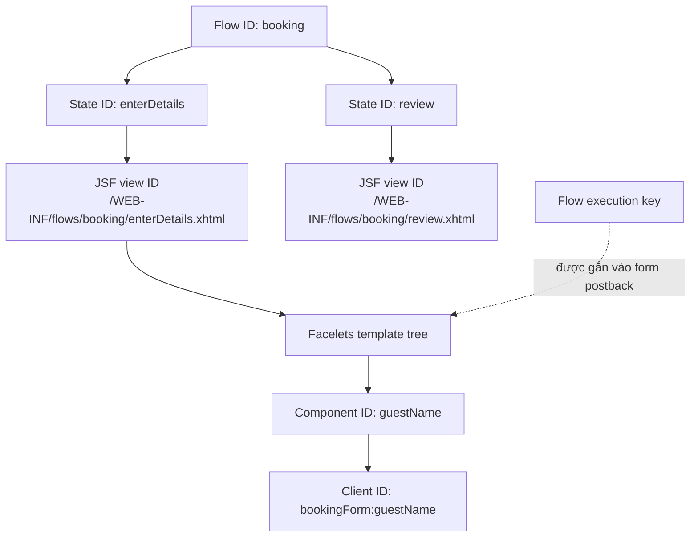

# Facelets, định danh view và tài nguyên giao diện trong Spring Web Flow

## 1. Vai trò của Facelets trong một flow nhiều bước

Spring Web Flow (SWF) mô hình hóa hành trình web bằng flow definition, state, event và transition. Mỗi `view-state` là một điểm dừng có thể hiển thị giao diện, nhận thao tác của người dùng rồi tiếp tục flow. Khi dùng JavaServer Faces (JSF), phần giao diện có thể được xây dựng bằng **Facelets**: định dạng template XHTML khai báo component như `h:form`, `h:inputText`, `h:commandButton`, `h:dataTable` và các thành phần của thư viện UI.

Hai framework đảm nhiệm hai phần việc phối hợp:

- **Spring Web Flow** quản lý flow execution, state hiện tại, event, scope, transition và thời điểm hiển thị view.
- **JSF/Facelets** xây component tree, chạy JSF lifecycle, bind giá trị component vào model, render HTML và quản lý resource như CSS, JavaScript, hình ảnh.

Ví dụ, flow đặt phòng có các bước `enterDetails`, `review` và `completed`. State `enterDetails` trỏ đến một trang Facelets để người dùng nhập tên khách và ngày nhận phòng. Khi họ bấm nút Tiếp tục, JSF xử lý component tree và phát action event; tích hợp Spring Faces chuyển action đó thành event của flow. Flow chọn transition phù hợp và có thể chuyển sang state `review`, state này lại render một Facelets view khác.

Điều cần làm rõ trong bài này là **định danh view**. Một trang XHTML có thể được nhắc đến bằng nhiều loại ID: ID của flow, ID của state, JSF view ID, ID của component, client ID được JSF sinh ra và flow execution key. Chúng có ý nghĩa khác nhau. Nếu trộn chúng, ứng dụng có thể build flow thành công nhưng không tìm thấy XHTML, form postback không quay về đúng execution hoặc Ajax không render đúng component.

Sau bài này, bạn có thể:

1. Phân biệt flow ID, state ID, JSF view ID, Facelets resource path, component ID, client ID và flow execution key.
2. Dùng `view-state` mặc định theo quy ước hoặc khai báo thuộc tính `view` bằng đường dẫn tương đối/tuyệt đối.
3. Tổ chức Facelets page, template, `ui:define`, `ui:insert` và `ui:include` theo cấu trúc dễ bảo trì.
4. Cấu hình Spring Web Flow JSF integration với `faces:flow-builder-services`, `FlowFacesContextLifecycleListener`, `JsfFlowHandlerAdapter` và `faces:resources`.
5. Hiểu vai trò của `FlowViewHandler`, JSF view state và execution URL trong postback.
6. Đưa CSS, JavaScript và hình ảnh qua JSF `ResourceHandler`, đồng thời phân biệt resource URL với URL của flow view.
7. Chẩn đoán lỗi view not found, sai suffix, lỗi form postback, resource 404, Ajax partial render và lệch namespace giữa `javax` với `jakarta`.

## 2. Bản đồ các loại định danh

Trước khi cấu hình, hãy phân biệt các định danh thường xuất hiện trong một ứng dụng.

| Định danh | Ví dụ | Ai quản lý? | Vai trò |
|---|---|---|---|
| Flow ID | `booking` | Flow registry | Chọn flow definition được khởi chạy. |
| State ID | `enterDetails` | Flow definition | Định danh một state duy nhất trong flow. |
| JSF view ID | `/WEB-INF/flows/booking/enterDetails.xhtml` | JSF `ViewHandler` | Đường dẫn context-relative xác định view được tạo/restored. |
| Facelets resource path | `resources/css/booking.css` hoặc `/WEB-INF/layout/main.xhtml` | JSF Facelets/ResourceHandler | Vị trí file XHTML, CSS, JavaScript hoặc ảnh. |
| Component ID | `guestName` | JSF component tree | ID cục bộ của một component trong view. |
| Client ID | `bookingForm:guestName` | JSF naming container | ID cuối cùng dùng trong HTML/JSF Ajax sau khi kết hợp các naming container. |
| Flow execution key | Key do SWF tạo | Flow execution repository | Xác định một execution hoặc snapshot để postback tiếp tục đúng hành trình. |

Ví dụ:

- `booking` không phải tên file XHTML.
- `enterDetails` là state ID, nhưng không nhất thiết phải là tên trang.
- `/WEB-INF/flows/booking/enterDetails.xhtml` là JSF view ID trỏ tới template.
- `guestName` là component ID bên trong XHTML, không phải state.
- `bookingForm:guestName` có thể là client ID khi form là naming container.
- Execution key được SWF quản lý; không tự đặt nó theo tên state hoặc component.



Sơ đồ thể hiện quan hệ khái niệm. JSF có thể sinh client ID khác tùy naming container, composite component hoặc thư viện UI. Execution key không phải thành phần của tên file view.

## 3. view-state và cách xác định JSF view ID

### 3.1. Quy ước mặc định: state ID ánh xạ tới view

Một `view-state` có thể bỏ thuộc tính `view`. Khi đó, SWF sử dụng ID của state theo quy ước để tìm template trong thư mục làm việc của flow.

Ví dụ flow definition:

```xml
<flow xmlns="http://www.springframework.org/schema/webflow"
      start-state="enterDetails">

    <var name="booking"
         class="com.example.booking.BookingForm" />

    <view-state id="enterDetails" model="booking">
        <transition on="next" to="review" />
    </view-state>

    <view-state id="review">
        <transition on="back" to="enterDetails" />
        <transition on="confirm" to="completed" />
    </view-state>

    <end-state id="completed" />
</flow>
```

Giả sử flow definition được đặt tại:

```text
/WEB-INF/flows/booking/booking-flow.xml
```

Theo quy ước, state `enterDetails` có thể ánh xạ tới template:

```text
/WEB-INF/flows/booking/enterDetails.xhtml
```

và state `review` có thể ánh xạ tới:

```text
/WEB-INF/flows/booking/review.xhtml
```

Quy ước này hữu ích khi mỗi state có một template cùng tên. Tuy nhiên, với ứng dụng có nhiều view, nhiều fragment hoặc tên file được tổ chức theo chức năng, khai báo rõ thuộc tính `view` thường dễ đọc hơn.

### 3.2. View ID tương đối với thư mục flow

Thuộc tính `view` có thể là đường dẫn tương đối từ thư mục làm việc của flow:

```xml
<view-state id="enterDetails"
            view="bookingDetails.xhtml"
            model="booking">
    <transition on="next" to="review" />
</view-state>
```

Nếu flow nằm trong `/WEB-INF/flows/booking/`, view tương ứng là:

```text
/WEB-INF/flows/booking/bookingDetails.xhtml
```

Có thể trỏ vào thư mục con:

```xml
<view-state id="review"
            view="pages/bookingReview.xhtml" />
```

Khi đó, đường dẫn được giải quyết tương đối với working directory của flow. Nếu di chuyển flow definition sang một thư mục khác, cần kiểm tra lại mọi view ID tương đối.

### 3.3. View ID tuyệt đối trong web application

Nếu muốn dùng đường dẫn đầy đủ tính từ web application root, bắt đầu bằng `/`:

```xml
<view-state id="enterDetails"
            view="/WEB-INF/views/booking/enterDetails.xhtml"
            model="booking">
    <transition on="next" to="review" />
</view-state>
```

Cách này tách vị trí flow XML khỏi vị trí Facelets page. Nó phù hợp khi nhiều flow dùng chung một thư mục view hoặc khi nhóm giao diện muốn quản lý template ở một cấu trúc độc lập.

Đổi lại, đường dẫn tuyệt đối có thể làm flow phụ thuộc chặt vào layout thư mục của web application. Khi đổi tên hoặc di chuyển file, phải cập nhật view ID tương ứng và chạy test render.

### 3.4. Logical view ID và đường dẫn tài nguyên JSF

SWF hỗ trợ nhiều loại view ID tùy view framework. Với Spring MVC view resolver, ID có thể là tên logic như `bookingDetails`. Với JSF/Facelets, cần hiểu view ID theo hợp đồng của JSF: một đường dẫn context-relative xác định tài nguyên tạo view, thường là file XHTML.

| Cấu hình | Ý nghĩa |
|---|---|
| `view="bookingDetails.xhtml"` | View tương đối với thư mục làm việc của flow. |
| `view="/WEB-INF/views/bookingDetails.xhtml"` | View tuyệt đối từ web application root. |
| `view="bookingDetails"` | Tên logic có thể dùng với một số MVC ViewResolver; không mặc nhiên là file Facelets. |
| `view="/WEB-INF/views/bookingDetails.xhtml"` trong JSF | Đường dẫn rõ ràng đến Facelets view. |

Đừng đưa một logical view name của Thymeleaf/JSP vào flow chạy JSF rồi mong JSF tự tìm file. Hãy xác định `ViewFactory`/view technology mà `flow-builder-services` đang sử dụng.

### 3.5. State ID không cần trùng tên file

Một flow có thể đặt tên state theo hành vi nghiệp vụ, còn file view theo cấu trúc UI:

```xml
<view-state id="collectGuestInformation"
            view="forms/guest-details.xhtml"
            model="booking">
    <transition on="continue" to="reviewBooking" />
</view-state>

<view-state id="reviewBooking"
            view="summary/booking-review.xhtml">
    <transition on="edit" to="collectGuestInformation" />
    <transition on="confirm" to="completed" />
</view-state>
```

Cách đặt tên này giúp state ID phản ánh **ý nghĩa điều hướng**, còn view ID phản ánh **tài nguyên giao diện**. Khi log flow, nhóm phát triển có thể thấy state `collectGuestInformation`; khi debug file system, họ tìm `forms/guest-details.xhtml`.

## 4. Tổ chức thư mục Facelets và tài nguyên

Một cấu trúc mẫu:

```text
src/main/webapp/
└── WEB-INF/
    ├── flows/
    │   └── booking/
    │       ├── booking-flow.xml
    │       ├── enterDetails.xhtml
    │       ├── review.xhtml
    │       └── messages.properties
    ├── views/
    │   └── shared/
    │       └── error.xhtml
    └── layout/
        ├── main.xhtml
        └── fragments/
            ├── header.xhtml
            └── footer.xhtml

src/main/webapp/resources/
├── css/
│   └── booking.css
├── js/
│   └── booking.js
└── images/
    └── hotel-placeholder.svg
```

Ý nghĩa:

- `WEB-INF/flows/booking/` chứa flow definition và các Facelets page gắn với flow.
- `WEB-INF/layout/` chứa template layout và fragment dùng chung.
- `WEB-INF/views/shared/` có thể chứa các view nội bộ không muốn truy cập trực tiếp bằng URL.
- `resources/` là vị trí phổ biến cho JSF web resources như CSS, JavaScript và ảnh.
- `messages.properties` có thể chứa message bundle gắn với flow nếu cấu hình resource/message source tương ứng.

Đặt XHTML trong `WEB-INF` giúp tránh truy cập trực tiếp qua URL thông thường; trang được render thông qua JSF/SWF. Các resource cần browser tải trực tiếp như CSS, JavaScript và ảnh phải được phục vụ qua JSF ResourceHandler hoặc một static resource handler phù hợp.

Không đặt file cấu hình, secret, dữ liệu người dùng hoặc file upload trong thư mục public resources.

## 5. Cấu hình nền tảng JSF và Spring Web Flow

Spring Web Flow 3.0 yêu cầu **Jakarta Faces 4.0 trở lên**. Vì vậy các ví dụ ở phần này dùng Jakarta namespace và package `jakarta.*`. Dự án SWF 2.x hoặc JSF thế hệ cũ dùng `javax.*` và có cấu hình tương ứng khác; không trộn dependency hoặc namespace của hai thế hệ.

### 5.1. Cấu hình DispatcherServlet và FacesServlet

Trong tích hợp JSF với SWF 3.0, request chạy flow thường được xử lý qua Spring MVC `DispatcherServlet` và `JsfFlowHandlerAdapter`. `FacesServlet` vẫn cần được khai báo để JSF implementation khởi tạo đúng, nhưng thông thường không trực tiếp nhận các request flow runtime.

Ví dụ rút gọn `web.xml`:

```xml
<web-app xmlns="https://jakarta.ee/xml/ns/jakartaee"
         xmlns:xsi="http://www.w3.org/2001/XMLSchema-instance"
         xsi:schemaLocation="https://jakarta.ee/xml/ns/jakartaee
                             https://jakarta.ee/xml/ns/jakartaee/web-app_6_0.xsd"
         version="6.0">

    <context-param>
        <param-name>jakarta.faces.DEFAULT_SUFFIX</param-name>
        <param-value>.xhtml</param-value>
    </context-param>

    <servlet>
        <servlet-name>spring</servlet-name>
        <servlet-class>org.springframework.web.servlet.DispatcherServlet</servlet-class>
        <init-param>
            <param-name>contextConfigLocation</param-name>
            <param-value>/WEB-INF/web-application-config.xml</param-value>
        </init-param>
        <load-on-startup>1</load-on-startup>
    </servlet>

    <servlet-mapping>
        <servlet-name>spring</servlet-name>
        <url-pattern>/spring/*</url-pattern>
    </servlet-mapping>

    <!-- Khai báo để JSF implementation bootstrap; flow runtime đi qua DispatcherServlet. -->
    <servlet>
        <servlet-name>Faces Servlet</servlet-name>
        <servlet-class>jakarta.faces.webapp.FacesServlet</servlet-class>
        <load-on-startup>1</load-on-startup>
    </servlet>

    <servlet-mapping>
        <servlet-name>Faces Servlet</servlet-name>
        <url-pattern>*.faces</url-pattern>
    </servlet-mapping>
</web-app>
```

`jakarta.faces.DEFAULT_SUFFIX=.xhtml` thông báo suffix mặc định của Facelets view template trong cấu hình minh họa. Tùy ứng dụng, có thể dùng thêm các tham số Facelets chuẩn khác để kiểm soát view mappings, refresh trong development hoặc library tag files. Chỉ khai báo các tham số cần thiết và đối chiếu đúng Jakarta Faces version.

Mapping `/spring/*` là ví dụ cho DispatcherServlet. Đường dẫn thực tế phụ thuộc URL strategy của ứng dụng và FlowUrlHandler. Tránh cấu hình mapping chồng lấn khiến một request flow bị FacesServlet hoặc một servlet khác bắt trước khi tới Spring MVC.

### 5.2. Cấu hình flow builder services cho JSF

Khi dùng JSF, `flow-builder-services` phải được cấu hình từ namespace `faces`, để flow registry sử dụng view factory phù hợp với JSF.

Ví dụ Spring XML:

```xml
<?xml version="1.0" encoding="UTF-8"?>
<beans xmlns="http://www.springframework.org/schema/beans"
       xmlns:xsi="http://www.w3.org/2001/XMLSchema-instance"
       xmlns:webflow="http://www.springframework.org/schema/webflow-config"
       xmlns:faces="http://www.springframework.org/schema/faces"
       xsi:schemaLocation="
           http://www.springframework.org/schema/beans
           https://www.springframework.org/schema/beans/spring-beans.xsd
           http://www.springframework.org/schema/webflow-config
           https://www.springframework.org/schema/webflow-config/spring-webflow-config.xsd
           http://www.springframework.org/schema/faces
           https://www.springframework.org/schema/faces/spring-faces.xsd">

    <webflow:flow-executor id="flowExecutor">
        <webflow:flow-execution-listeners>
            <webflow:listener ref="facesContextListener" />
        </webflow:flow-execution-listeners>
    </webflow:flow-executor>

    <webflow:flow-registry id="flowRegistry"
                           flow-builder-services="flowBuilderServices"
                           base-path="/WEB-INF">
        <webflow:flow-location-pattern value="**/*-flow.xml" />
    </webflow:flow-registry>

    <faces:flow-builder-services id="flowBuilderServices" />

    <bean id="facesContextListener"
          class="org.springframework.faces.webflow.FlowFacesContextLifecycleListener" />

</beans>
```

Các thành phần quan trọng:

- `faces:flow-builder-services` cấu hình các dịch vụ xây flow trong môi trường JSF, bao gồm view factory phù hợp.
- `FlowFacesContextLifecycleListener` quản lý một `FacesContext` cho thời gian xử lý một flow request và giải phóng nó sau khi request được xử lý.
- `flowRegistry` dùng builder services này để tạo các flow definition.
- `base-path="/WEB-INF"` và `flow-location-pattern` là ví dụ tổ chức flow XML bên dưới WEB-INF.

Nếu registry sử dụng builder services mặc định của Web Flow thay vì JSF-specific builder services, flow có thể được tạo theo view technology khác và không render Facelets như mong muốn.

### 5.3. Dùng JsfFlowHandlerAdapter và JSF resource handler

Trong Spring MVC context, JSF integration cần adapter riêng:

```xml
<beans xmlns="http://www.springframework.org/schema/beans"
       xmlns:xsi="http://www.w3.org/2001/XMLSchema-instance"
       xmlns:faces="http://www.springframework.org/schema/faces"
       xsi:schemaLocation="
           http://www.springframework.org/schema/beans
           https://www.springframework.org/schema/beans/spring-beans.xsd
           http://www.springframework.org/schema/faces
           https://www.springframework.org/schema/faces/spring-faces.xsd">

    <faces:resources />

    <bean class="org.springframework.faces.webflow.JsfFlowHandlerAdapter">
        <property name="flowExecutor" ref="flowExecutor" />
    </bean>

</beans>
```

`JsfFlowHandlerAdapter` mở rộng `FlowHandlerAdapter` và thay Ajax handler mặc định bằng `JsfAjaxHandler`, phù hợp với các request Ajax của JSF. `faces:resources` đăng ký cơ chế chuyển tiếp các request resource đến JSF `ResourceHandler`.

Khi dùng Java configuration với `AbstractFacesFlowConfiguration`, SWF tự đăng ký `JsfResourceRequestHandler`; vì vậy không cần cấu hình lặp lại cùng handler bằng XML nếu base configuration đã đảm nhiệm.

### 5.4. Java configuration

Một cấu hình Java điển hình kế thừa `AbstractFacesFlowConfiguration`:

```java
import org.springframework.context.annotation.Bean;
import org.springframework.context.annotation.Configuration;
import org.springframework.faces.config.AbstractFacesFlowConfiguration;
import org.springframework.webflow.definition.registry.FlowDefinitionRegistry;
import org.springframework.webflow.execution.FlowExecutor;
import org.springframework.faces.webflow.FlowFacesContextLifecycleListener;

@Configuration
public class WebFlowConfig extends AbstractFacesFlowConfiguration {

    @Bean
    public FlowExecutor flowExecutor() {
        return getFlowExecutorBuilder(flowRegistry())
                .addFlowExecutionListener(
                        new FlowFacesContextLifecycleListener())
                .build();
    }

    @Bean
    public FlowDefinitionRegistry flowRegistry() {
        return getFlowDefinitionRegistryBuilder()
                .setBasePath("/WEB-INF")
                .addFlowLocationPattern("**/*-flow.xml")
                .build();
    }
}
```

Đây là phần cấu hình flow/JSF theo API SWF 3.x; cần bổ sung cấu hình Spring MVC và đăng ký `JsfFlowHandlerAdapter` theo cách ứng dụng đang dùng. Các import và chữ ký builder phải khớp chính xác minor release trong dependency tree. Không dùng class `AbstractFacesFlowConfiguration` của một bản SWF khác với `spring-webflow` đang chạy.

## 6. Facelets XHTML: composition, template và component tree

### 6.1. Trang Facelets độc lập

Facelets dùng XHTML well-formed. Với Jakarta Faces 4, namespace có thể khai báo như sau:

```xml
<!DOCTYPE html>
<html xmlns="http://www.w3.org/1999/xhtml"
      xmlns:h="jakarta.faces.html"
      xmlns:f="jakarta.faces.core"
      xmlns:ui="jakarta.faces.facelets">

<h:head>
    <title>Nhập thông tin đặt phòng</title>
    <h:outputStylesheet library="css" name="booking.css" />
    <h:outputScript library="js" name="booking.js" target="body" />
</h:head>

<h:body>
    <h:form id="bookingForm">
        <h:messages id="messages" />

        <h:outputLabel for="guestName" value="Tên khách" />
        <h:inputText id="guestName"
                     value="#{booking.guestName}"
                     required="true" />
        <h:message for="guestName" />

        <h:commandButton id="next"
                         value="Tiếp tục"
                         action="next" />
    </h:form>
</h:body>
</html>
```

Trong ví dụ, `booking` là biến flow được JSF EL resolver của Spring Faces tích hợp cung cấp. Component `h:commandButton` phát action outcome `next`; Spring Web Flow nhận action event đó và tìm transition `on="next"` trong view-state.

Không viết `action="booking/review.xhtml"` ở command button để điều hướng trực tiếp như một ứng dụng JSF thuần. Khi dùng flow, việc chuyển state nên do transition trong flow definition quyết định.

### 6.2. Dùng template với ui:composition

Một ứng dụng có thể dùng layout chung cho header, navigation, footer và phần nội dung riêng của từng flow view.

File layout `/WEB-INF/layout/main.xhtml`:

```xml
<!DOCTYPE html>
<html xmlns="http://www.w3.org/1999/xhtml"
      xmlns:h="jakarta.faces.html"
      xmlns:ui="jakarta.faces.facelets">

<h:head>
    <title>
        <ui:insert name="title">Booking Portal</ui:insert>
    </title>
    <h:outputStylesheet library="css" name="site.css" />
</h:head>

<h:body>
    <header>
        <ui:include src="/WEB-INF/layout/fragments/header.xhtml" />
    </header>

    <main>
        <ui:insert name="content" />
    </main>

    <footer>
        <ui:include src="/WEB-INF/layout/fragments/footer.xhtml" />
    </footer>
</h:body>
</html>
```

Facelets page `/WEB-INF/flows/booking/enterDetails.xhtml`:

```xml
<ui:composition xmlns="http://www.w3.org/1999/xhtml"
                xmlns:h="jakarta.faces.html"
                xmlns:f="jakarta.faces.core"
                xmlns:ui="jakarta.faces.facelets"
                template="/WEB-INF/layout/main.xhtml">

    <ui:define name="title">Thông tin đặt phòng</ui:define>

    <ui:define name="content">
        <h:form id="bookingForm">
            <h:messages id="messages" />

            <h:outputLabel for="guestName" value="Tên khách" />
            <h:inputText id="guestName"
                         value="#{booking.guestName}"
                         required="true" />
            <h:message for="guestName" />

            <h:commandButton id="next"
                             value="Tiếp tục"
                             action="next" />
        </h:form>
    </ui:define>
</ui:composition>
```

`ui:composition` định nghĩa một composition dùng template; `ui:define` cung cấp các phần mà layout chèn qua `ui:insert`; `ui:include` tái sử dụng fragment XHTML. Các fragment là thành phần của cùng JSF view/component tree, không phải flow state độc lập.

### 6.3. Tổ chức fragment để hỗ trợ Ajax

Ví dụ một fragment kết quả tìm phòng:

```xml
<ui:composition xmlns="http://www.w3.org/1999/xhtml"
                xmlns:h="jakarta.faces.html"
                xmlns:ui="jakarta.faces.facelets">

    <h:panelGroup id="roomResults" layout="block">
        <h:dataTable value="#{rooms}" var="room">
            <h:column>
                <h:outputText value="#{room.name}" />
            </h:column>
            <h:column>
                <h:outputText value="#{room.price}" />
            </h:column>
        </h:dataTable>
    </h:panelGroup>
</ui:composition>
```

Nếu một transition của flow yêu cầu render fragment:

```xml
<view-state id="searchRooms" view="searchRooms.xhtml">
    <on-render>
        <evaluate expression="roomService.search(criteria)"
                  result="viewScope.rooms"
                  result-type="dataModel" />
    </on-render>

    <transition on="nextPage">
        <evaluate expression="criteria.nextPage()" />
        <render fragments="searchForm:roomResults" />
    </transition>
</view-state>
```

Tên fragment trong `render` phải khớp quy tắc component/client ID mà view framework tích hợp sử dụng. Trong JSF, component ID có thể được bao bởi naming container, chẳng hạn form `searchForm` chứa panel `roomResults`, nên target có thể là `searchForm:roomResults`. Hãy kiểm tra ID thực được render ra HTML và chạy thử Ajax; không đoán ID dựa trên tên file XHTML.

## 7. ViewHandler và postback của JSF trong flow

### 7.1. Vì sao form phải submit về đúng execution URL?

Trong một ứng dụng JSF thuần, `ViewHandler` xác định action URL và JSF state được gửi trong form. Khi dùng SWF, postback phải quay về đúng flow execution hiện tại, không chỉ quay về một đường dẫn XHTML chung.

Spring Faces cung cấp `FlowViewHandler`, một wrapper của JSF `ViewHandler`. Nó cung cấp action URL phù hợp cho JSF form, bao gồm flow execution URL và execution key hiện tại, để postback được SWF nhận diện và xử lý đúng execution.

Vì vậy, với cấu hình JSF/SWF chuẩn, dùng `h:form` bình thường:

```xml
<h:form id="bookingForm">
    <h:inputText id="guestName" value="#{booking.guestName}" />
    <h:commandButton id="next" value="Tiếp tục" action="next" />
</h:form>
```

Không tự ghi cứng `action="/spring/booking"` vào form, không tự nối execution key và không sửa hidden input `jakarta.faces.ViewState`. Các chi tiết đó thuộc `FlowViewHandler`, `FlowResponseStateManager` và cơ chế lưu JSF view state của Spring Faces.

### 7.2. JSF view state và Web Flow view scope

Spring Faces tích hợp state management của JSF với Web Flow. `FlowRenderKit` sử dụng response state manager của Web Flow để lưu JSF state vào view-scoped variable được Web Flow quản lý; flow execution key được dùng làm giá trị state token khi cần nhận diện postback.

Điều này giúp view state được gắn với flow execution và vòng đời view-state thay vì tạo một kho state JSF tách biệt không liên quan tới flow.

Hệ quả:

- Không copy hidden `jakarta.faces.ViewState` từ một trang khác sang form hiện tại.
- Không dùng cùng một form action URL cho nhiều flow execution bằng cách hard-code.
- Không giữ JSF component tree hoặc `FacesContext` trong Spring singleton.
- Nếu view-state bị rời đi hoặc execution key không còn hợp lệ, postback cũ có thể không được phục hồi; cần xử lý theo chính sách lỗi/expired execution của ứng dụng.

### 7.3. Action outcome là event của flow

Một command component có thể phát event bằng action string:

```xml
<h:commandButton id="continue"
                 value="Tiếp tục"
                 action="next" />
<h:commandButton id="cancel"
                 value="Hủy"
                 action="cancel" />
```

Flow definition nhận các event tương ứng:

```xml
<view-state id="enterDetails" view="enterDetails.xhtml" model="booking">
    <transition on="next" to="review" />
    <transition on="cancel" to="cancelled" bind="false" />
</view-state>

<view-state id="review" view="review.xhtml">
    <transition on="back" to="enterDetails" />
    <transition on="confirm" to="completed" />
</view-state>
```

`action="next"` là outcome/action event được Spring Faces tích hợp với flow. Nó không phải URL chuyển trang. Flow transition mới là nơi quyết định state đích.

### 7.4. Event trong cùng view và event chuyển sang view khác

Một transition không có `to` có thể xử lý event và render lại cùng view:

```xml
<view-state id="searchHotels" view="search.xhtml">
    <on-render>
        <evaluate expression="hotelService.findHotels(criteria)"
                  result="viewScope.hotels"
                  result-type="dataModel" />
    </on-render>

    <transition on="nextPage">
        <evaluate expression="criteria.nextPage()" />
    </transition>

    <transition on="select" to="reviewHotel">
        <set name="flowScope.hotel" value="hotels.selectedRow" />
    </transition>
</view-state>
```

Trong Facelets:

```xml
<h:commandLink id="nextPage" value="Trang sau" action="nextPage" />
<h:commandLink id="select" value="Xem khách sạn" action="select" />
```

`nextPage` thay đổi dữ liệu và giữ nguyên view-state; `select` chuyển sang state `reviewHotel`. Nhờ vậy, flow definition điều khiển điều hướng, còn Facelets chỉ phát các action outcome có ý nghĩa.

## 8. Tài nguyên CSS, JavaScript và hình ảnh

### 8.1. Dùng JSF ResourceHandler thay vì hard-code URL

JSF có ResourceHandler để resolve tài nguyên từ web application hoặc từ thư viện đóng gói trong classpath. Cách khai báo chuẩn trong Facelets:

```xml
<h:head>
    <h:outputStylesheet library="css" name="booking.css" />
    <h:outputScript library="js" name="booking.js" target="body" />
</h:head>

<h:body>
    <h:graphicImage library="images"
                    name="hotel-placeholder.svg"
                    alt="Ảnh minh họa khách sạn" />
</h:body>
```

Một cách tổ chức phổ biến trong web application:

```text
src/main/webapp/resources/
    css/booking.css
    js/booking.js
    images/hotel-placeholder.svg
```

Thuộc tính `library` chỉ định nhóm tài nguyên, còn `name` là tên file. JSF tạo resource URL phù hợp với context và ResourceHandler. Tránh tự viết `/resources/css/booking.css` ở mọi template vì có thể sai khi ứng dụng chạy dưới context path khác hoặc dùng resource library từ dependency JAR.

### 8.2. Resource trong JAR

Một thư viện UI hoặc module dùng chung có thể đóng gói resource trong:

```text
META-INF/resources/
    theme/
        theme.css
    images/
        logo.svg
```

JSF ResourceHandler có thể tìm tài nguyên web application và classpath theo quy tắc resource của JSF. Điều này giúp chia sẻ CSS, JavaScript, ảnh và component resources giữa nhiều ứng dụng.

Không nhầm resource library của JSF với thư mục chứa Facelets view. `h:outputStylesheet` dùng để phát resource URL; `view-state view="..."` chọn view template. Hai cơ chế giải quyết hai loại tài nguyên khác nhau.

### 8.3. faces:resources và JsfResourceRequestHandler

Trong Spring Web Flow JSF integration, phần cấu hình:

```xml
<faces:resources />
```

ủy quyền request resource tới JSF ResourceHandler. `JsfResourceRequestHandler` là thành phần xử lý request bằng cách gọi ResourceHandler, phục vụ resource web application và classpath như CSS, JavaScript và ảnh.

Nếu dùng Java config với `AbstractFacesFlowConfiguration`, SWF tự đăng ký `JsfResourceRequestHandler`. Nếu dùng XML, cần có `faces:resources` trong MVC application context theo cấu hình JSF integration.

Nếu CSS hoặc JavaScript trả 404, kiểm tra:

1. HTML được render có chứa URL resource do JSF tạo hay không.
2. Request URL có đi tới `JsfResourceRequestHandler` hay bị servlet/controller khác bắt.
3. Resource tồn tại đúng `library` và `name`.
4. File có nằm trong `resources/` hoặc `META-INF/resources/` phù hợp.
5. Context path, reverse proxy prefix và cache không làm sai URL.
6. Response có đúng status và content type; không trả HTML trang lỗi dưới URL `.js` hoặc `.css`.

### 8.4. Facelets resource path qua Spring Resource

Spring Faces có `FlowResourceHandler`, hỗ trợ resolve Facelets resource bằng Spring Resource path, ví dụ một resource theo dạng `classpath:foo.xhtml`. Đây là khả năng tích hợp nâng cao, hữu ích khi template được đóng gói cùng thư viện hoặc không nằm trực tiếp trong web root.

Không mặc định mọi đường dẫn `classpath:` đều hoạt động chỉ vì Spring có ResourceLoader. Cần xác minh view factory và resource handler của phiên bản đang dùng thực sự hỗ trợ đường dẫn đó. Với flow đơn giản, đặt Facelets page trong `WEB-INF` và dùng relative/absolute view ID là cách dễ kiểm tra hơn.

## 9. Tài nguyên giao diện và cấu trúc view có thể tái sử dụng

### 9.1. Một layout, nhiều flow view

Một layout Facelets có thể được dùng bởi nhiều flow:

```text
/WEB-INF/layout/main.xhtml
/WEB-INF/flows/booking/enterDetails.xhtml
/WEB-INF/flows/booking/review.xhtml
/WEB-INF/flows/refund/enterReason.xhtml
/WEB-INF/flows/refund/reviewRefund.xhtml
```

Mỗi view-state chỉ cần chỉ tới view tương ứng:

```xml
<view-state id="enterDetails"
            view="enterDetails.xhtml"
            model="booking" />

<view-state id="review"
            view="review.xhtml" />
```

Các Facelets page dùng `template="/WEB-INF/layout/main.xhtml"`. Layout chịu trách nhiệm CSS/JS chung và fragment navigation; flow state chỉ quan tâm view nào xuất hiện ở từng bước.

### 9.2. Đưa flow navigation vào layout một cách có chủ đích

Một layout có thể chứa thanh điều hướng, nhưng action của từng nút phải phù hợp với transition của flow đang hoạt động. Ví dụ:

```xml
<h:form id="globalActions">
    <h:commandLink id="home" value="Trang chủ" action="home" />
    <h:commandLink id="help" value="Trợ giúp" action="help" />
</h:form>
```

Nếu flow definition khai báo global transition:

```xml
<global-transitions>
    <transition on="help" to="help" />
</global-transitions>
```

thì action `help` có thể được xử lý từ nhiều view-state. Nếu không có transition phù hợp, command action có thể không tạo ra navigation như mong đợi.

Không đặt link tùy ý đến state nội bộ bằng URL file XHTML. Người dùng cần tiếp tục flow qua execution URL và event, không bỏ qua flow lifecycle bằng cách mở trực tiếp file view.

### 9.3. Tách fragment trình bày khỏi nghiệp vụ

Facelets fragment nên tập trung vào component và trình bày:

- Hiển thị form field, label và message.
- Hiển thị bảng dữ liệu.
- Hiển thị vùng kết quả hoặc thông báo.
- Tái sử dụng header/footer/layout.
- Khai báo resource stylesheet và script.

Flow definition quản lý state, transition, scope, event và action. Service layer thực hiện nghiệp vụ. Không đặt truy vấn DB, authorization hoặc giao dịch ghi dữ liệu trong EL của Facelets.

## 10. JSF lifecycle, validation và thông báo trong view

### 10.1. JSF xử lý component trước khi flow chuyển state

Khi form Facelets postback, JSF lifecycle thực hiện các pha như apply request values, process validations, update model values và invoke application. Spring Faces tích hợp lifecycle này với Web Flow để action event trở thành flow event.

Nếu field không hợp lệ, JSF có thể không cập nhật model và action event có thể không được xử lý như một transition bình thường. Khi đó trang hiện tại được render lại với thông báo validation.

Ví dụ:

```xml
<h:form id="bookingForm">
    <h:messages id="messages" />

    <h:outputLabel for="email" value="Email" />
    <h:inputText id="email"
                 value="#{booking.email}"
                 required="true">
        <f:validateLength minimum="5" />
    </h:inputText>
    <h:message for="email" />

    <h:commandButton id="next"
                     value="Tiếp tục"
                     action="next" />
</h:form>
```

Validation ở component phù hợp với kiểm tra tại field. Quy tắc nghiệp vụ nhiều field, ví dụ ngày trả phòng phải sau ngày nhận phòng, có thể được xử lý ở model validator/transition action trong flow.

### 10.2. MessageContext và h:messages

Spring Web Flow có `MessageContext` độc lập với JSF API. Khi service/action thêm lỗi vào `MessageContext`, Spring Faces có thể đưa message đó vào `FacesContext` để Facelets hiển thị qua `h:messages`.

Flow:

```xml
<view-state id="enterDetails" model="booking">
    <transition on="next" to="review">
        <evaluate expression="booking.validateDates(messageContext)" />
    </transition>
</view-state>
```

Facelets:

```xml
<h:messages id="messages" globalOnly="true" />
<h:message for="checkinDate" />
```

Trong model/action, thêm message có source tương ứng tên field để component message hiển thị đúng vị trí. Domain model không cần phụ thuộc `FacesMessage`; `MessageContext` giúp tách validation nghiệp vụ khỏi JSF UI.

### 10.3. Resource bundle theo flow

Có thể đặt `messages.properties` cùng thư mục flow để chứa thông báo gắn với flow. Trong Facelets, biến `resourceBundle` của Web Flow cho phép đọc message:

```xml
<h:outputText value="#{resourceBundle.bookingTitle}" />
```

Ví dụ file:

```properties
bookingTitle=Thông tin đặt phòng
checkinDate.invalid=Ngày nhận phòng không hợp lệ
checkoutDate.afterCheckin=Ngày trả phòng phải sau ngày nhận phòng
```

Cần bảo đảm message source của ứng dụng và flow được cấu hình đúng. Nếu Facelets không tìm thấy message, kiểm tra tên bundle, locale, vị trí file và key được dùng; không đổi view ID để chữa một lỗi message bundle.

## 11. Ajax và partial rendering trong Facelets

JSF có hỗ trợ Ajax thông qua `f:ajax`:

```xml
<h:form id="searchForm">
    <h:inputText id="keyword" value="#{searchCriteria.keyword}" />

    <h:commandButton id="search"
                     value="Tìm kiếm"
                     action="search">
        <f:ajax execute="@form"
                render="messages resultsPanel" />
    </h:commandButton>

    <h:messages id="messages" />

    <h:panelGroup id="resultsPanel" layout="block">
        <ui:include src="/WEB-INF/flows/catalog/results.xhtml" />
    </h:panelGroup>
</h:form>
```

Trong flow, có thể khai báo transition event xử lý trong cùng view-state và yêu cầu render fragment:

```xml
<view-state id="searchCatalog" view="search.xhtml">
    <on-render>
        <evaluate expression="catalogService.search(searchCriteria)"
                  result="viewScope.results"
                  result-type="dataModel" />
    </on-render>

    <transition on="search">
        <evaluate expression="searchCriteria.resetPage()" />
        <render fragments="searchForm:resultsPanel" />
    </transition>
</view-state>
```

`JsfFlowHandlerAdapter` sử dụng `JsfAjaxHandler` để nhận biết JSF Ajax request và trả chỉ dẫn redirect phù hợp khi flow cần redirect. Điều này giúp request Ajax của JSF không bị xử lý như một response HTML đầy đủ trong mọi trường hợp.

Khi partial rendering lỗi, kiểm tra ba tầng:

1. JSF component ID và client ID thật sau khi render.
2. `execute` và `render` của `f:ajax`.
3. Fragment ID mà flow transition yêu cầu qua `<render fragments="...">`.

Một lỗi phổ biến là `render="resultsPanel"` đúng trong phạm vi component, nhưng flow dùng fragment ID thiếu naming container hoặc khác cách view factory mong đợi. Hãy xem HTML và request payload thực tế để xác định ID.

## 12. Các lỗi thường gặp về view ID và resource

| Triệu chứng | Nguyên nhân thường gặp | Cách kiểm tra |
|---|---|---|
| Flow build được nhưng render báo view không tìm thấy | `view` tương đối sai thư mục hoặc file XHTML không tồn tại | Kiểm tra flow working directory, đường dẫn file và suffix. |
| `view-state id` đúng nhưng template vẫn sai | Nhầm state ID với view ID được override | Kiểm tra thuộc tính `view` và convention mapping. |
| Trang được tìm nhưng Facelets báo tag/namespace lỗi | Dùng namespace cũ hoặc thư viện JSF không tương thích | Xác minh Jakarta Faces 4 và namespace `jakarta.faces.*`. |
| File `.xhtml` bị xử lý như resource tĩnh | Request đi sai servlet hoặc view handler | Kiểm tra DispatcherServlet, FacesServlet và FlowHandlerAdapter. |
| Form postback tạo execution mới hoặc mất flow | Form action không mang execution URL đúng | Kiểm tra FlowViewHandler, `h:form`, state token và execution key. |
| `jakarta.faces.ViewState` bị invalid | JSF state không khớp flow execution/view scope | Kiểm tra FlowRenderKit, response state manager và session/execution lifecycle. |
| CSS/JS trả 404 | Resource library/name sai hoặc request không tới JSF ResourceHandler | Kiểm tra output component, `faces:resources` và URL thực. |
| Ảnh không hiện khi chạy dưới context path khác | Hard-code đường dẫn resource | Dùng `h:graphicImage` và JSF resource library. |
| Ajax trả về toàn trang hoặc redirect sai | Handler không dùng JsfFlowHandlerAdapter hoặc Ajax handler khác | Kiểm tra adapter được đăng ký và request có phải JSF Ajax. |
| `h:message` không hiển thị lỗi model-level | Message chưa được thêm vào MessageContext hoặc source không khớp | Kiểm tra validation action, message source và component ID. |
| Fragment không được cập nhật | Sai naming container/client ID | Kiểm tra HTML render và ID truyền vào `render`. |
| Trang chạy trên môi trường này nhưng lỗi trên môi trường khác | Trộn `javax.*` và `jakarta.*` hoặc phiên bản JSF/SWF không tương thích | Kiểm tra dependency tree, servlet API và JSF implementation. |
| View trong `WEB-INF` không mở trực tiếp | Đây là hành vi bảo vệ bình thường | Mở flow qua URL được SWF quản lý, không gọi trực tiếp file. |

### 12.1. Quy trình điều tra view not found

1. Xác định flow ID và state ID trong log.
2. Kiểm tra `view-state` có khai báo `view` hay dùng quy ước state ID.
3. Xác định working directory của flow definition.
4. Ghép đường dẫn tương đối với thư mục flow; hoặc xác nhận đường dẫn tuyệt đối từ web root.
5. Kiểm tra file XHTML được đóng gói trong WAR/artefact sau build.
6. Xác minh JSF view handler và JSF-specific flow builder services được sử dụng.
7. Mở flow trong test/integration container và kiểm tra `UIViewRoot.getViewId()`.

Không sửa state ID chỉ để trùng tên file nếu state ID đang mang ý nghĩa nghiệp vụ rõ. Hãy sửa đường dẫn `view` khi file resource nằm ở vị trí khác.

### 12.2. Quy trình điều tra resource 404

1. Xem source HTML và lấy đúng URL CSS/JS/ảnh mà JSF đã render.
2. Kiểm tra URL có context path, resource library và resource name phù hợp.
3. Kiểm tra file trong `src/main/webapp/resources` hoặc `META-INF/resources` của dependency.
4. Xác minh `faces:resources` hoặc `JsfResourceRequestHandler` đang được đăng ký.
5. Kiểm tra security filter có chặn resource request hay không.
6. Kiểm tra proxy/cache không viết lại path.
7. Xác minh response status, content type và nội dung response.

Nếu request CSS trả HTML trang đăng nhập hoặc trang lỗi, lỗi nằm ở routing/security/handler chứ không phải nội dung CSS.

## 13. Kiểm thử view ID, Facelets và resource

### 13.1. Kiểm thử flow definition

Flow test cần xác minh:

- Flow registry tìm được flow XML.
- State đầu tiên có đúng state ID.
- View-state chọn đúng view ID.
- Flow chuyển state theo event của JSF.
- `viewScope` và `flowScope` được dùng đúng vòng đời.
- Event không hợp lệ không điều hướng tới view không tồn tại.

Các test flow thuần có thể dùng `AbstractXmlFlowExecutionTests` hoặc test support phù hợp với phiên bản SWF. Chúng kiểm tra flow definition và transition, nhưng không thay thế kiểm thử JSF component tree.

### 13.2. Kiểm thử JSF integration

Một bài integration test qua servlet/container nên kiểm tra:

1. Khởi chạy flow qua DispatcherServlet.
2. Response render Facelets XHTML đúng view.
3. Form action chứa URL tiếp tục execution do FlowViewHandler tạo.
4. Hidden JSF view-state được phát theo cơ chế Spring Faces.
5. Postback của `h:commandButton action="next"` tạo event `next` và chuyển đúng transition.
6. Input validation lỗi làm view render lại với `h:messages`/`h:message`.
7. Chuyển sang state `review` render đúng Facelets view ID.
8. Bấm Back quay về view trước theo flow history.
9. Ajax event chỉ cập nhật fragment dự kiến.
10. Request CSS/JS/ảnh trả resource đúng với content type.

### 13.3. Ma trận test

| ID | Kịch bản | Kết quả cần chứng minh |
|---|---|---|
| F01 | State ID theo quy ước, file XHTML cùng thư mục flow | View được resolve đúng. |
| F02 | View ID tương đối tới thư mục con | Resource được tìm đúng theo flow working directory. |
| F03 | View ID tuyệt đối dưới `/WEB-INF` | JSF ViewHandler mở đúng view. |
| F04 | State ID khác tên file và có `view` rõ | Điều hướng dùng đúng state, render đúng file. |
| F05 | Template `ui:composition` và `ui:include` | Layout/fragment được dựng đúng component tree. |
| F06 | `h:commandButton action="next"` | Flow nhận event `next`. |
| F07 | JSF field validation lỗi | Model không chuyển state và message hiển thị. |
| F08 | Flow model validation thêm MessageContext | `h:messages` hiển thị message nghiệp vụ. |
| F09 | `h:outputStylesheet` và `h:outputScript` | URL resource trả 200 và đúng content type. |
| F10 | Resource trong `META-INF/resources` | JSF ResourceHandler tìm được resource từ JAR. |
| F11 | JSF Ajax render một fragment | Chỉ fragment yêu cầu được cập nhật. |
| F12 | Flow postback sau nhiều request | Execution key và JSF view state vẫn khớp. |
| F13 | Session/execution hết hạn | Postback cũ được xử lý theo chính sách expired execution. |
| F14 | Nâng từ `javax` sang `jakarta` | Dependency và namespace không bị trộn. |

Đây là ma trận đề xuất cho dự án, không phải kết quả test đã chạy trên một ứng dụng cụ thể.

## 14. Bài tập thực hành

### Bối cảnh

Ứng dụng `hotel-booking` có flow `booking` với các bước:

- `enterDetails`: nhập tên khách và ngày nhận phòng.
- `review`: xem lại thông tin.
- `completed`: kết thúc đặt phòng.

Giao diện dùng Facelets và layout chung. CSS/JavaScript được đặt trong JSF resource library. Ứng dụng dùng Spring Web Flow 3.0 và Jakarta Faces 4.

### Yêu cầu

1. Tạo flow XML trong `/WEB-INF/flows/booking/booking-flow.xml`.
2. Khai báo `view-state id="enterDetails"` và trỏ rõ tới `enterDetails.xhtml`.
3. Tạo `review.xhtml`, dùng template `/WEB-INF/layout/main.xhtml`.
4. Phân biệt state ID `review` với view ID `/WEB-INF/flows/booking/review.xhtml`.
5. Tạo form Facelets với `h:inputText`, `h:message`, `h:messages` và nút `h:commandButton action="next"`.
6. Cấu hình `faces:flow-builder-services`, `FlowFacesContextLifecycleListener`, `JsfFlowHandlerAdapter` và `faces:resources`.
7. Tạo CSS `resources/css/booking.css` và đăng ký bằng `h:outputStylesheet`.
8. Tạo một event `nextPage` giữ nguyên view-state và render một results fragment.
9. Viết test để chứng minh form postback giữ đúng flow execution và chuyển state.
10. Thử cố tình đổi đường dẫn view thành `wrong/review.xhtml`; ghi lại lỗi và xác định nguyên nhân.
11. Thử đổi `library="css"` thành `library="style"`; kiểm tra URL resource và response 404.
12. Đối chiếu namespace `jakarta.faces.*` với dự án JSF cũ dùng `javax.*`, rồi ghi rõ những dependency cần nâng cấp đồng bộ.

### Câu hỏi tự đánh giá

- `view-state id` có bắt buộc trùng tên file XHTML không?
- View ID tương đối được giải quyết từ thư mục nào?
- Vì sao JSF view ID không phải component client ID?
- `FlowViewHandler` có vai trò gì đối với action URL của `h:form`?
- Vì sao phải khai báo `FacesServlet` dù request flow thường đi qua `DispatcherServlet`?
- `JsfFlowHandlerAdapter` khác `FlowHandlerAdapter` ở điểm nào?
- `faces:resources` chuyển request resource tới thành phần nào?
- CSS/JavaScript trong `resources/` khác Facelets view trong `WEB-INF` ra sao?
- Khi nào dùng `ui:include`, khi nào dùng `ui:composition`?
- Vì sao không nên hard-code flow execution key trong form?
- Khi nào Ajax fragment cần naming container prefix?
- Tại sao `javax.faces.*` không tương thích trực tiếp với `jakarta.faces.*`?

Bài thực hành đạt yêu cầu khi có thể lần theo chuỗi **flow ID → state ID → JSF view ID → Facelets component tree → flow execution URL → postback event**, đồng thời xác định riêng đường đi của CSS/JavaScript qua JSF ResourceHandler.

## 15. Checklist triển khai

| Kiểm tra | Bằng chứng mong đợi |
|---|---|
| Phiên bản SWF và JSF tương thích | SWF 3.0 đi với Jakarta Faces 4.0+ |
| Namespace đúng thế hệ | Dùng `jakarta.faces.*`, không trộn `javax.*` |
| DispatcherServlet mapping đúng | Flow request đi qua Spring MVC |
| FacesServlet được bootstrap | JSF implementation khởi tạo bình thường |
| Facelets suffix đúng | `.xhtml` được JSF nhận diện |
| Flow registry dùng faces builder services | `faces:flow-builder-services` được gắn vào registry |
| FacesContext lifecycle được quản lý | Listener được gắn vào FlowExecutor |
| Adapter đúng | `JsfFlowHandlerAdapter` dùng đúng FlowExecutor |
| Resource handler đúng | `faces:resources` hoặc Java config đăng ký handler |
| View ID rõ ràng | Relative/absolute path trỏ tới file thực |
| Component tree hợp lệ | XHTML well-formed, namespace đúng |
| Form action không hard-code | FlowViewHandler tạo URL postback |
| JSF state thuộc flow | View state được quản lý qua Spring Faces |
| Resource URL được kiểm tra | CSS/JS/ảnh trả đúng status và content type |
| Ajax fragment ID đúng | Kiểm tra client ID/naming container |
| Test postback có execution thật | Event chuyển đúng transition và giữ model |

## 16. Ghi nhớ và tài liệu tham khảo

Facelets là lớp trình bày component của JSF; Spring Web Flow điều khiển hành trình và quyết định state nào cần hiển thị. Thuộc tính `view` của `view-state` xác định **JSF view ID**; nếu không khai báo, SWF có thể dùng state ID theo quy ước để tìm template trong thư mục flow. View ID tương đối được giải quyết theo working directory của flow; view ID tuyệt đối bắt đầu từ web application root.

Trong tích hợp SWF 3.0 với Jakarta Faces 4, cần cấu hình JSF-specific flow builder services, FacesContext lifecycle listener, `JsfFlowHandlerAdapter` và JSF resource handler. `FlowViewHandler` tạo action URL đúng cho JSF form để postback quay về execution hiện tại. `h:outputStylesheet`, `h:outputScript` và `h:graphicImage` sử dụng JSF ResourceHandler cho CSS, JavaScript và ảnh; chúng có đường xử lý khác với Facelets view được render bởi view-state.

Giữ rõ các loại ID, dùng template/fragment có cấu trúc, không hard-code execution key và kiểm thử cả postback lẫn resource request. Đây là nền tảng để giao diện Facelets hoạt động nhất quán trong một flow nhiều bước.

### Tài liệu chính thức

1. [Spring Web Flow 3.0.x Reference Guide — Rendering Views](https://docs.spring.io/spring-webflow/docs/3.0.x/reference/) — quy ước ánh xạ state ID sang view, relative/absolute/logical view IDs và view scope.
2. [Spring Web Flow 3.0.x Reference Guide — JSF Integration](https://docs.spring.io/spring-webflow/docs/3.0.x/reference/) — cấu hình web.xml, FacesServlet, Facelets, JSF-specific builder services, event và Ajax.
3. [Spring Web Flow 3.0.1 API — FlowViewHandler](https://docs.spring.io/spring-webflow/docs/3.0.1/api/org/springframework/faces/webflow/FlowViewHandler.html) — action URL của JSF form và flow execution key.
4. [Spring Web Flow 3.0.1 API — JsfFlowHandlerAdapter](https://docs.spring.io/spring-webflow/docs/3.0.1/api/org/springframework/faces/webflow/JsfFlowHandlerAdapter.html) — adapter tích hợp và JSF Ajax handler.
5. [Spring Web Flow 3.0.1 API — JsfResourceRequestHandler](https://docs.spring.io/spring-webflow/docs/3.0.1/api/org/springframework/faces/webflow/JsfResourceRequestHandler.html) — chuyển resource request tới JSF ResourceHandler.
6. [Spring Web Flow 3.0.0 API — org.springframework.faces.webflow](https://docs.spring.io/spring-webflow/docs/3.0.0/api/org/springframework/faces/webflow/package-summary.html) — các thành phần FlowViewHandler, FlowResourceHandler, FlowRenderKit, FlowResponseStateManager và JSF integration.
7. [Jakarta Faces 4.0 Specification](https://jakarta.ee/specifications/faces/4.0/) — view ID, ViewHandler, Facelets và resource handling trong Jakarta Faces.
