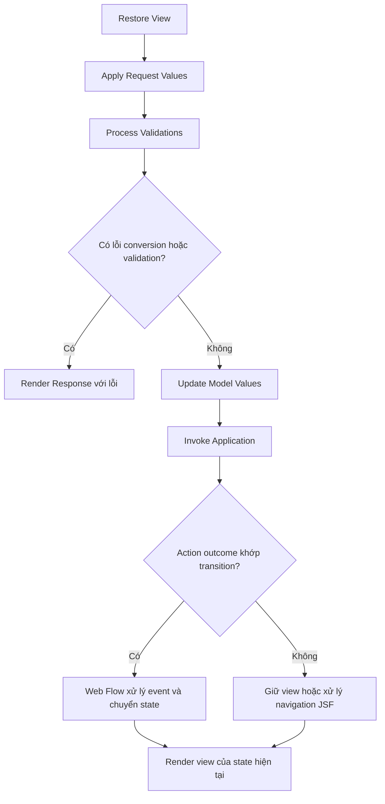

# Vòng đời JSF và ranh giới với vòng đời flow

Trong chương **Tích hợp JSF**, cần hiểu rằng một màn hình JSF và một flow Spring Web Flow có hai vòng đời liên quan nhưng không đồng nhất. JSF xử lý component tree, chuyển đổi dữ liệu, validation, cập nhật model và render giao diện trong từng HTTP request. Spring Web Flow quản lý hành trình nghiệp vụ qua state, event và transition; flow execution có thể tồn tại qua nhiều request cho đến khi đi đến end state.

Với **SPRING_WEB_FLOW**, việc phối hợp hai vòng đời giúp form nhiều bước hoạt động đúng: JSF chịu trách nhiệm xử lý form, còn Web Flow quyết định khi nào người dùng chuyển sang bước tiếp theo. Bài học dùng màn hình nhập thông tin đặt chỗ để theo dõi một lần render, một lần postback, lỗi validation và một transition thực sự.

## 1. Hai vòng đời phục vụ hai mục đích

JSF là framework giao diện component-based. Mỗi request JSF đi qua một số phase để khôi phục cây component, đọc tham số, chuyển đổi và kiểm tra dữ liệu, cập nhật model rồi gọi action. Sau đó JSF render toàn bộ hoặc một phần view.

Spring Web Flow là bộ điều phối quy trình. Flow definition mô tả các state; một `view-state` hiển thị màn hình, event từ người dùng có thể kích hoạt transition, và `end-state` kết thúc flow. Flow executor nhận request, resume flow execution và lưu trạng thái để lần request sau có thể tiếp tục.

| Nội dung | Vòng đời JSF | Vòng đời Spring Web Flow |
|---|---|---|
| Đơn vị quản lý | Một lần xử lý request/view JSF. | Một flow execution kéo dài qua nhiều request. |
| Trạng thái chính | `FacesContext`, `UIViewRoot`, component tree, view state và dữ liệu của backing bean. | Flow execution, current state, flow variables và scopes của flow. |
| Xử lý dữ liệu | Convert, validate, update model từ component input. | Binding model của view-state và điều phối action/transition theo event. |
| Điều hướng | JSF action outcome và navigation handler. | Event được so khớp với transition của state hiện tại. |
| Kết thúc | Request kết thúc sau khi render response. | Flow kết thúc khi đi đến end state hoặc bị kết thúc theo cơ chế quản lý execution. |

Một postback JSF không đồng nghĩa flow đã chuyển state. Nó chỉ là request gửi lại một view. Flow chỉ chuyển state khi một event được phát và transition tương ứng được chọn.

## 2. Các phase của JSF trong một request

Một request JSF đầy đủ thường đi qua sáu phase theo thứ tự:

1. **Restore View:** khôi phục cây component của view trước đó hoặc tạo view mới cho request đầu tiên.
2. **Apply Request Values:** đọc các giá trị gửi từ trình duyệt vào component và ghi nhận sự kiện component.
3. **Process Validations:** chuyển đổi kiểu dữ liệu và chạy validation của component.
4. **Update Model Values:** ghi các giá trị hợp lệ từ component vào model hoặc backing bean.
5. **Invoke Application:** gọi action method và xử lý các sự kiện ứng dụng.
6. **Render Response:** tạo response HTML hoặc response một phần cho AJAX.

Nếu conversion hoặc validation thất bại, JSF đánh dấu lỗi, bỏ qua các phase cập nhật model và gọi action thông thường, rồi chuyển đến Render Response để hiển thị lại view cùng thông báo lỗi. Vì action chưa được gọi nên event điều hướng của flow thường cũng chưa được phát. Đây là lý do một form sai dữ liệu vẫn ở màn hình hiện tại.



Sơ đồ mô tả đường đi thường gặp khi dùng JSF với Web Flow. Việc tích hợp cụ thể dùng navigation handler và view factory của Web Flow để đưa outcome của JSF về event của flow.

## 3. Vòng đời của flow execution

Flow có vòng đời riêng, không bị tạo lại chỉ vì JSF render lại view. Một hành trình đơn giản có thể diễn ra như sau:

1. Trình duyệt mở flow URL; flow executor tạo flow execution mới.
2. Flow đi đến state đầu tiên, thường là một `view-state`.
3. View factory tích hợp JSF render trang của state đó.
4. Người dùng gửi form; JSF khôi phục view và xử lý các phase của request.
5. Nếu form hợp lệ, action outcome được chuyển thành flow event. Web Flow tìm transition có `on` khớp event và chuyển sang state đích.
6. Flow executor lưu trạng thái execution để có thể resume ở request kế tiếp.
7. Khi flow đến `end-state`, execution kết thúc và không còn nhận event như một flow đang hoạt động.

Ví dụ flow đặt chỗ:

```xml
<flow xmlns="http://www.springframework.org/schema/webflow">
    <var name="booking" class="com.example.booking.BookingForm" />

    <view-state id="enterDetails" view="bookingDetails.xhtml" model="booking">
        <transition on="continue" to="reviewBooking" />
        <transition on="cancel" to="cancelled" />
    </view-state>

    <view-state id="reviewBooking" view="bookingReview.xhtml">
        <transition on="confirm" to="completed" />
        <transition on="back" to="enterDetails" />
    </view-state>

    <end-state id="completed" view="bookingConfirmation.xhtml" />
    <end-state id="cancelled" view="bookingCancelled.xhtml" />
</flow>
```

`enterDetails` và `reviewBooking` là state của flow. `bookingDetails.xhtml` và `bookingReview.xhtml` là các view JSF được render trong những state tương ứng. Transition `continue` chỉ được chọn khi JSF action phát outcome cùng tên và request vượt qua validation.

## 4. Từ JSF action outcome đến flow event

Trong tích hợp JSF của Spring Web Flow, action outcome của component có thể được dùng làm event ID. Ví dụ, action method trả về chuỗi `continue`; navigation handler của Web Flow nhận outcome đó và so khớp với transition `on="continue"` trong view state hiện tại.

```xhtml
<html xmlns="http://www.w3.org/1999/xhtml"
      xmlns:h="http://xmlns.jcp.org/jsf/html">
<h:head>
    <title>Thông tin đặt chỗ</title>
</h:head>
<h:body>
    <h:form id="bookingForm">
        <h:panelGrid columns="3">
            <h:outputLabel for="customerName" value="Họ và tên" />
            <h:inputText id="customerName"
                         value="#{flowScope.booking.customerName}"
                         required="true"
                         requiredMessage="Vui lòng nhập họ và tên." />
            <h:message for="customerName" />
        </h:panelGrid>

        <h:commandButton id="continue"
                         value="Tiếp tục"
                         action="continue" />
        <h:commandButton id="cancel"
                         value="Hủy"
                         action="cancel"
                         immediate="true" />

        <h:messages globalOnly="true" />
    </h:form>
</h:body>
</html>
```

Trong ví dụ, `flowScope.booking.customerName` là thuộc tính model được giữ trong flow scope. JSF đọc giá trị vào component, validate rồi cập nhật property khi request hợp lệ. Action outcome `continue` kích hoạt transition tương ứng. Cú pháp namespace JSF và cách khai báo view phụ thuộc phiên bản JSF đang dùng; cần đồng bộ namespace `javax.*` hoặc `jakarta.*` với phiên bản runtime và thư viện tích hợp.

Nếu ứng dụng dùng action method thay vì outcome tĩnh, phương thức có thể trả về chuỗi event:

```java
@Named
@RequestScoped
public class BookingActions {

    public String continueBooking() {
        return "continue";
    }

    public String cancelBooking() {
        return "cancel";
    }
}
```

```xhtml
<h:commandButton value="Tiếp tục"
                 action="#{bookingActions.continueBooking}" />
```

Action method chỉ nên quyết định outcome điều hướng hoặc gọi một thao tác phù hợp với vai trò của nó. Các thay đổi nghiệp vụ quan trọng nên nằm trong service được Spring quản lý, với transaction ở ranh giới nghiệp vụ. Flow vẫn chịu trách nhiệm chọn state tiếp theo.

## 5. Validation JSF và validation của flow

JSF có thể kiểm tra dữ liệu ngay trong component bằng `required`, converter và validator. Ví dụ `required="true"` chặn action nếu trường chưa được nhập. Lỗi được lưu trong context của request JSF và hiển thị bằng `<h:message>` hoặc `<h:messages>`.

Spring Web Flow cũng có thể bind model của `view-state` và chạy validation theo cấu hình của flow hoặc model. Hai lớp kiểm tra có thể cùng tồn tại, nhưng nên phân chia trách nhiệm:

- JSF validation phù hợp với kiểm tra input ở tầng giao diện, chuyển đổi kiểu và thông báo gắn với component.
- Validation nghiệp vụ phía máy chủ cần được bảo đảm trong flow/service, kể cả khi request không đến từ đúng giao diện JSF.
- Service vẫn phải kiểm tra các bất biến quan trọng ngay trước khi ghi dữ liệu, vì dữ liệu có thể thay đổi giữa lúc hiển thị form và lúc người dùng xác nhận.

Khi JSF validation thất bại, action outcome không được phát và flow giữ nguyên view state. Khi JSF validation thành công nhưng validation nghiệp vụ của flow thất bại, Web Flow cũng có thể giữ người dùng ở view state hiện tại và hiển thị message tương ứng. Không nên chỉ dựa vào validation phía client hoặc component JSF để bảo vệ dữ liệu.

## 6. Vì sao nút Hủy thường dùng `immediate="true"`?

Một form có trường bắt buộc có thể khiến người dùng không hủy được khi chưa nhập dữ liệu. Với nút Hủy, ta thường muốn bỏ qua validation và cập nhật model, rồi phát event `cancel`:

```xhtml
<h:commandButton value="Hủy"
                 action="cancel"
                 immediate="true" />
```

`immediate="true"` khiến sự kiện action được xử lý sớm hơn trong vòng đời JSF, thường ở Apply Request Values. Vì vậy, JSF không chờ Process Validations và Update Model Values như một lần submit thông thường. Điều này phù hợp khi hủy không cần các giá trị người dùng vừa nhập.

Không đặt `immediate="true"` cho nút Lưu hoặc Tiếp tục nếu các giá trị mới trong form cần được validate và cập nhật vào model trước khi action chạy. Nếu action chạy quá sớm, flow có thể chuyển state với dữ liệu cũ trong model.

Ở flow definition, có thể bỏ qua validation của flow cho transition hủy nếu hành vi nghiệp vụ yêu cầu:

```xml
<view-state id="enterDetails" view="bookingDetails.xhtml">
    <transition on="continue" to="reviewBooking" />
    <transition on="cancel" to="cancelled" validate="false" />
</view-state>
```

`immediate="true"` là điều khiển phase của JSF; `validate="false"` là điều khiển validation của transition Web Flow. Chúng tác động ở hai lớp khác nhau. Chỉ dùng một trong hai không có nghĩa đã tắt toàn bộ mọi kiểm tra ở các tầng khác.

## 7. Phân biệt JSF view scope và Web Flow view scope

Tên scope ở hai framework có thể gây nhầm lẫn. JSF quản lý backing bean và view state theo vòng đời của view JSF. Spring Web Flow quản lý dữ liệu theo vòng đời của flow state và flow execution.

| Phạm vi | Vòng đời | Dùng khi |
|---|---|---|
| JSF `@ViewScoped` | Bean gắn với một JSF view và có thể tồn tại qua các postback của view đó; kết thúc theo vòng đời view JSF. | Giữ trạng thái UI hoặc dữ liệu phục vụ các lần postback của cùng một trang. |
| Web Flow `viewScope` | Dữ liệu gắn với view state hiện tại của flow; kết thúc khi flow rời state đó. | Giữ dữ liệu chỉ cần trong một bước của hành trình flow. |
| Web Flow `flowScope` | Tồn tại suốt flow execution, qua nhiều view state. | Giữ bản nháp hoặc model nghiệp vụ cần dùng qua nhiều bước. |
| Web Flow `conversationScope` | Chia sẻ trong conversation từ top-level flow và các subflow; kết thúc khi conversation kết thúc. | Dữ liệu thật sự cần chia sẻ qua nhiều flow execution liên quan. |
| JSF `FacesContext` và request scope | Chỉ tồn tại trong request hiện tại. | Truy cập thông tin request, message và component tree trong lần xử lý hiện tại. |

Một lần postback JSF có thể vẫn thuộc cùng flow view state. Ngược lại, khi flow transition sang state khác, view state của flow thay đổi dù ứng dụng vẫn dùng cùng công nghệ JSF để render. Không nên xem JSF `@ViewScoped` và Web Flow `viewScope` là cùng một vùng lưu trữ; hãy chọn scope dựa trên framework sở hữu dữ liệu và vòng đời cần thiết.

## 8. AJAX và partial lifecycle

JSF AJAX cho phép gửi một phần form và render một phần component thay vì tải lại toàn bộ trang. Thuộc tính `execute` xác định component nào tham gia xử lý request; `render` xác định component nào được cập nhật trong response.

```xhtml
<html xmlns="http://www.w3.org/1999/xhtml"
      xmlns:h="http://xmlns.jcp.org/jsf/html"
      xmlns:f="http://xmlns.jcp.org/jsf/core">
<h:form id="emailForm">
    <h:inputText id="email" value="#{flowScope.booking.email}" />
    <h:message id="emailMessage" for="email" />
    <h:messages id="messages" />

    <h:commandButton value="Kiểm tra email" action="checkEmail">
        <f:ajax execute="@form" render="email emailMessage messages" />
    </h:commandButton>
</h:form>
</html>
```

Event `checkEmail` chỉ được gửi khi action được gọi và outcome được Web Flow xử lý. Một request AJAX chỉ cập nhật component không tự động có nghĩa flow đã sang state mới.

Khi một action AJAX kích hoạt transition sang state khác, Web Flow phải render view mới hoặc response phù hợp với cách tích hợp JSF đang cấu hình. Không nên giả định mọi component có thể được cập nhật một phần sau khi flow đã rời view state cũ; vùng render cần tồn tại trong view mới và phải phù hợp với partial response.

## 9. Khi flow kết thúc hoặc request bị gián đoạn

JSF kết thúc vòng đời xử lý khi response hiện tại được tạo xong. Flow execution có thể tiếp tục tồn tại sau đó để chờ request kế tiếp. Khi flow đến end state, Web Flow kết thúc execution; request JSF đang render trang cuối vẫn cần hoàn thành bình thường.

Nếu người dùng đóng tab hoặc HTTP session hết hạn, flow có thể không nhận thêm event để đi đến end state. Không nên dựa vào JSF `@PreDestroy` hoặc callback hủy view để thực hiện mọi cleanup nghiệp vụ của flow. Hãy dùng cơ chế kết thúc flow bình thường cho tài nguyên gắn với end state, và TTL/tác vụ cleanup độc lập cho tài nguyên bên ngoài có thể còn lại khi session mất.

Sau khi flow kết thúc, một postback từ trang cũ không thể tiếp tục flow execution đã kết thúc. Ứng dụng cần xử lý trường hợp execution không còn hợp lệ bằng cách hiển thị thông báo phù hợp hoặc cho người dùng bắt đầu hành trình mới. Không nên cố gửi event vào flow đã kết thúc.

## 10. Kiểm thử ranh giới giữa JSF và flow

Kiểm thử nên xác nhận cả hành vi JSF và kết quả điều phối của Web Flow:

| Kịch bản | Kiểm tra ở JSF | Kiểm tra ở Web Flow |
|---|---|---|
| Mở màn hình đầu | View và component tree được render. | Execution vào đúng `view-state`. |
| Submit hợp lệ | Convert/validate thành công, model được cập nhật, action chạy. | Outcome trở thành event và transition đi đúng state. |
| Trường bắt buộc bị bỏ trống | JSF message được tạo, action không chạy. | Flow giữ nguyên state hiện tại. |
| Giá trị không chuyển đổi được | Converter báo lỗi và view render lại. | Không phát event điều hướng thông thường. |
| Nhấn Hủy với form chưa hoàn chỉnh | `immediate` cho phép action hủy chạy theo phase sớm. | Event `cancel` đi đến nhánh hủy; transition có thể bỏ qua validation flow. |
| AJAX kiểm tra một trường | Chỉ component được execute/render được xử lý và cập nhật. | Chỉ transition nếu action outcome thực sự phát flow event. |
| Flow kết thúc | JSF render trang kết quả cuối. | Execution đi đến end state và không còn tiếp tục nhận event. |

Có thể kiểm thử flow bằng Spring Web Flow test support và `MockExternalContext` để xác nhận state/event mà không cần trình duyệt. Với JSF component tree, converter, validator và AJAX rendering, cần thêm kiểm thử ở lớp JSF phù hợp với phiên bản ứng dụng. Hai nhóm test bổ sung cho nhau: test flow bảo vệ state graph, test JSF bảo vệ cách form thực sự xử lý dữ liệu.

## 11. Những lỗi thường gặp

| Hiện tượng | Nguyên nhân cần kiểm tra |
|---|---|
| Nhấn Tiếp tục nhưng flow không chuyển state | JSF validation thất bại, action không được gọi, outcome không khớp `transition on`, hoặc navigation handler chưa được tích hợp đúng. |
| Model vẫn chứa giá trị cũ | Request không đến Update Model Values, component không được execute, hoặc binding expression sai. |
| Không hủy được khi trường bắt buộc còn trống | Nút Hủy không dùng `immediate="true"`, hoặc transition hủy vẫn chạy validation không phù hợp. |
| Hủy nhưng dữ liệu form mới vẫn được lưu | Action hủy chạy sớm nhưng code lại phụ thuộc vào model đã cập nhật; không đọc dữ liệu form mới trong nhánh hủy. |
| JSF view scope mất dữ liệu khi flow chuyển bước | Bean JSF chỉ sống theo view; dữ liệu cần qua nhiều flow state nên đặt trong flow scope hoặc lưu bền vững. |
| AJAX cập nhật component nhưng không chuyển flow | Request chỉ thực hiện partial lifecycle, chưa phát action outcome khớp transition. |
| Postback từ trang cũ không hoạt động sau khi hoàn tất | Flow execution đã kết thúc hoặc session đã hết hạn; cần khởi tạo flow mới. |

Khi debug, hãy xác định request đã dừng ở phase JSF nào, action method có chạy không, outcome trả về là gì và flow đang ở state nào. Không nên bắt đầu bằng việc sửa transition nếu nguyên nhân là JSF validation đã chặn action trước đó.

## 12. Thực hành

Tạo flow đặt chỗ gồm màn hình nhập thông tin, màn hình xem lại và kết quả cuối bằng JSF.

1. Khai báo `view-state` `enterDetails` với model trong `flowScope` và view `bookingDetails.xhtml`.
2. Tạo JSF form có trường bắt buộc, component message và action outcome `continue`.
3. Gửi form hợp lệ; xác nhận JSF cập nhật model trước khi Web Flow chuyển sang `reviewBooking`.
4. Gửi form thiếu họ tên; xác nhận JSF hiển thị lỗi, action không chạy và flow vẫn ở `enterDetails`.
5. Thêm nút Hủy với `immediate="true"` và transition `cancel` có `validate="false"`; thử hủy khi form còn trống.
6. Thêm một thao tác AJAX kiểm tra email; xác nhận partial render không tự thay đổi state nếu không phát event.
7. Hoàn tất flow và thử gửi lại postback từ trang cũ; xác nhận ứng dụng xử lý execution đã kết thúc phù hợp.

Bạn hoàn thành bài khi phân biệt được sáu phase JSF với các state/transition của Web Flow, giải thích vì sao validation có thể chặn event, và chọn đúng scope cho dữ liệu UI so với dữ liệu cần tồn tại suốt hành trình.
