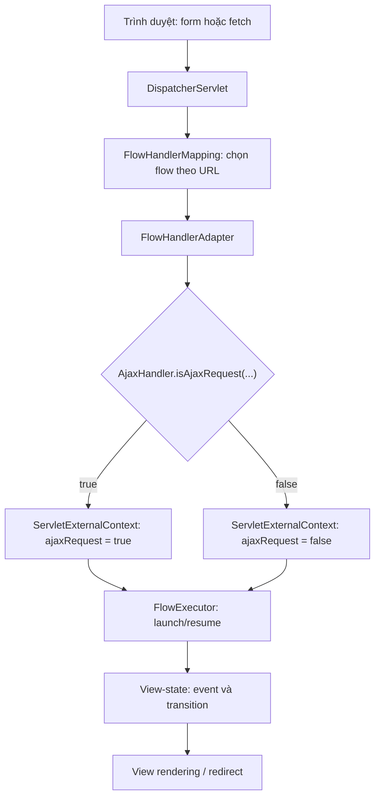
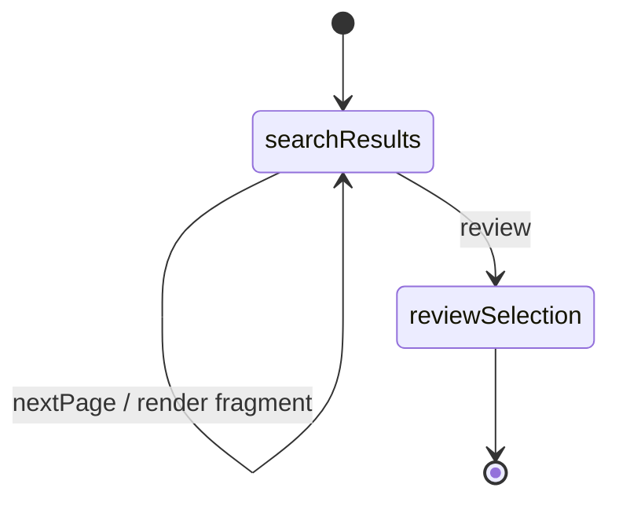

# Nhận diện yêu cầu Ajax ở ranh giới flow

## 1. Vấn đề cần giải quyết

Trong Spring Web Flow, một hành trình web nhiều bước được mô hình hóa bằng **state**, **event** và **transition**. Ví dụ, tại bước nhập địa chỉ giao hàng, người dùng có thể bấm **Tính lại phí vận chuyển** để cập nhật phần tóm tắt mà không tải lại cả trang. Sau đó, họ bấm **Tiếp tục** để chuyển sang bước xác nhận đơn hàng. Hai thao tác cùng thuộc một flow nhưng yêu cầu cách trình bày phản hồi khác nhau:

- Yêu cầu trình duyệt thông thường: ứng dụng có thể render trang đầy đủ hoặc redirect đến URL execution.
- Yêu cầu Ajax: ứng dụng có thể cập nhật một vùng giao diện, giữ nguyên trang và cần xử lý redirect theo giao thức được client hỗ trợ.

Ở **ranh giới flow** (khi request HTTP đi qua Spring MVC để vào Web Flow), hệ thống phải xác định request có được coi là Ajax hay không. Đây là trách nhiệm của tầng tích hợp HTTP, trước khi flow engine xử lý event và transition. Nhận diện sai có thể khiến response trả về cả trang HTML thay vì fragment, hoặc trình duyệt nhận redirect mà không tự điều hướng như mong đợi.

Mục tiêu của bài thuộc chương **Ajax và phân mảnh** là hiểu đường đi của tín hiệu Ajax, biết cấu hình hoặc mở rộng bộ nhận diện, kiểm tra được kết quả trong flow và tránh nhầm lẫn giữa **Ajax**, **event** và **fragment**. Kiến thức này áp dụng cho form binding, validation, quản lý scope/phiên và khôi phục luồng khi người dùng tiếp tục một execution đã hết hạn.

## 2. Ajax được nhận diện ở đâu?

Với ứng dụng sử dụng `DispatcherServlet`, một request thường đi qua các thành phần:



Vai trò của từng lớp:

| Thành phần | Vai trò trong việc nhận diện |
| --- | --- |
| `FlowHandlerMapping` | Tìm handler thích hợp cho URL/flow ID; không tự xác định Ajax chỉ từ URL. |
| `FlowHandlerAdapter` | Cầu nối Spring MVC và Web Flow; giữ chiến lược `AjaxHandler` để phân loại request và xử lý redirect phù hợp. |
| `AjaxHandler` | Chiến lược quyết định request nào là Ajax và cách thông báo redirect cho client Ajax. |
| `ServletExternalContext` / `ExternalContext` | Biểu diễn thông tin HTTP cho runtime; cung cấp cờ `isAjaxRequest()` để logic trong flow có thể quan sát. |
| `FlowExecutor` | Khởi chạy hoặc tiếp tục execution, xử lý event/state/transition; không nên dựa vào tên nút bấm để suy ra kiểu transport. |

Tại thời điểm engine nhận request, **kiểu request đã được diễn giải bởi `AjaxHandler`**. Các bước nghiệp vụ như kiểm tra form, tính giá, chuyển state hoặc gọi subflow vẫn là hành động của flow như bình thường. Việc request gửi bằng JavaScript không tự động biến một transition thành transition mới.

## 3. Tín hiệu nào cho biết request là Ajax?

Không có một quy tắc thống nhất cho mọi phiên bản Web Flow và mọi thư viện JavaScript. Cần kiểm tra **implementation của `AjaxHandler` được cấu hình trong ứng dụng**.

### 3.1. DefaultAjaxHandler trong Spring Web Flow 2.5+ / 3.x / 4.x

API của `org.springframework.webflow.context.servlet.DefaultAjaxHandler` nhận diện Ajax thông qua một trong hai cơ chế:

1. Request có header `Accept` mang giá trị đặc trưng `text/html;type=ajax`.
2. Request có tham số `ajaxSource` (tên được công bố dưới hằng `AJAX_SOURCE_PARAM`).

Các hằng mặc định tương ứng là:

```text
DefaultAjaxHandler.AJAX_ACCEPT_CONTENT_TYPE = "text/html;type=ajax"
DefaultAjaxHandler.AJAX_SOURCE_PARAM        = "ajaxSource"
DefaultAjaxHandler.REDIRECT_URL_HEADER      = "Spring-Redirect-URL"
DefaultAjaxHandler.POPUP_VIEW_HEADER        = "Spring-Modal-View"
```

Chúng mô tả **hợp đồng của DefaultAjaxHandler**, không phải quy tắc chung của HTTP. Đặc biệt, header phổ biến `X-Requested-With: XMLHttpRequest` **không phải tín hiệu được tài liệu DefaultAjaxHandler nêu là điều kiện mặc định**; muốn dựa vào header đó phải kiểm tra hoặc mở rộng chiến lược Ajax đang dùng.

### 3.2. Các ứng dụng Spring JavaScript đời trước

Tài liệu Spring Web Flow 2.4.x mô tả `org.springframework.js.ajax.SpringJavascriptAjaxHandler` làm implementation mặc định để phát hiện request từ Spring JavaScript. Ứng dụng cũ có thể đã thay bằng handler riêng cho thư viện Ajax khác. Ở các phiên bản mới, tài liệu API cũng có `DefaultAjaxHandler` thuộc package `org.springframework.webflow.context.servlet`.

Vì vậy **không sao chép package, constructor hoặc cách nhận diện của một bản Web Flow khác** mà chưa đối chiếu dependency thực tế. Nguyên tắc ổn định giữa các bản là: chọn một `AjaxHandler` thích hợp và gắn nó vào adapter nhận request flow.

### 3.3. Phân biệt các tín hiệu dễ bị nhầm

| Dữ liệu HTTP | Nó biểu đạt điều gì? | Có đủ để khẳng định Ajax? |
| --- | --- | --- |
| `Accept: text/html;type=ajax` | Client muốn kiểu phản hồi Ajax theo hợp đồng Web Flow mặc định nêu trên. | Có, với `DefaultAjaxHandler` tương ứng. |
| Tham số `ajaxSource` | Tín hiệu Ajax từ client theo hợp đồng `DefaultAjaxHandler`; có thể mang thông tin nguồn kích hoạt. | Có, với handler hỗ trợ tham số này. |
| `X-Requested-With: XMLHttpRequest` | Quy ước nhiều thư viện JavaScript dùng để đánh dấu XHR. | Không bảo đảm nếu handler chưa được cấu hình để hiểu nó. |
| `fetch(...)` hoặc `XMLHttpRequest` ở client | Cách JavaScript gửi HTTP request. | Không; server chỉ nhận HTTP và các header/parameter thực tế. |
| `_eventId_refresh`, `_eventId_next` | Tên event chuyển trạng thái của Web Flow. | Không; event cũng xuất hiện trong form submit thông thường. |
| URL chứa flow execution key | Xác định lần chạy của flow cần tiếp tục. | Không; cả request Ajax và request thường đều có thể tiếp tục cùng execution. |
| `Content-Type: application/json` | Kiểu **body request** mà client gửi lên. | Không; khác với `Accept` và không phải dấu hiệu Ajax mặc định. |

Ví dụ, `fetch` theo mặc định thường gửi `Accept: */*`. Nếu frontend gửi mỗi `X-Requested-With` nhưng adapter dùng `DefaultAjaxHandler` chưa được mở rộng, cờ Ajax có thể vẫn là `false`. Ngược lại, form gửi request thông thường không trở thành Ajax chỉ vì bấm nút có tên `_eventId_refresh`.

## 4. Cấu hình nhận diện ở FlowHandlerAdapter

Đoạn Java configuration sau minh họa adapter dùng `DefaultAjaxHandler` khi ứng dụng chạy phiên bản Web Flow có class này. Các bean `FlowExecutor` và `FlowHandlerMapping` giả định đã được khai báo trong cấu hình tích hợp MVC.

```java
import org.springframework.context.annotation.Bean;
import org.springframework.webflow.context.servlet.DefaultAjaxHandler;
import org.springframework.webflow.executor.FlowExecutor;
import org.springframework.webflow.mvc.servlet.FlowHandlerAdapter;

@Bean
public FlowHandlerAdapter flowHandlerAdapter(FlowExecutor flowExecutor) {
    FlowHandlerAdapter adapter = new FlowHandlerAdapter();
    adapter.setFlowExecutor(flowExecutor);
    adapter.setAjaxHandler(new DefaultAjaxHandler());
    return adapter;
}
```

`setAjaxHandler(...)` là điểm mở rộng tại **ranh giới MVC → flow**. Nếu adapter đang dùng đúng handler mặc định mà bạn cần, không nhất thiết phải khai báo lại bean này; ví dụ trên cố ý cho thấy nơi kiểm soát chiến lược. `FlowExecutor` vẫn chạy các state/transition như cũ.

### 4.1. Muốn hỗ trợ thêm X-Requested-With?

Với một frontend hiện hữu chỉ có header `X-Requested-With`, có thể mở rộng `DefaultAjaxHandler` và giữ lại các quy tắc mặc định. Ví dụ sau dành cho các phiên bản sử dụng **Jakarta Servlet** (Web Flow 3.x/4.x); khi dùng Web Flow 2.5.x với Servlet cũ, kiểu request/response phải đổi sang `javax.servlet.http.*`.

```java
import jakarta.servlet.http.HttpServletRequest;
import jakarta.servlet.http.HttpServletResponse;
import org.springframework.webflow.context.servlet.DefaultAjaxHandler;

public class HeaderAwareAjaxHandler extends DefaultAjaxHandler {
    @Override
    protected boolean isAjaxRequestInternal(
            HttpServletRequest request, HttpServletResponse response) {

        boolean supportedByDefault =
                super.isAjaxRequestInternal(request, response);

        boolean markedByClient =
                "XMLHttpRequest".equalsIgnoreCase(
                        request.getHeader("X-Requested-With"));

        return supportedByDefault || markedByClient;
    }
}
```

Và gắn vào adapter:

```java
@Bean
public FlowHandlerAdapter flowHandlerAdapter(FlowExecutor flowExecutor) {
    FlowHandlerAdapter adapter = new FlowHandlerAdapter();
    adapter.setFlowExecutor(flowExecutor);
    adapter.setAjaxHandler(new HeaderAwareAjaxHandler());
    return adapter;
}
```

Cách này để một request được nhận diện Ajax nếu nó thỏa **quy tắc mặc định hoặc quy ước XHR của ứng dụng**. Lớp mở rộng chỉ thay đổi cách phân loại; nó kế thừa xử lý Ajax redirect của `DefaultAjaxHandler`. Không cần tạo một handler khác cho từng flow ID.

**Lưu ý:** Header và query/form parameter đều do client gửi; chúng là tín hiệu để lựa chọn cách đáp ứng giao diện, **không phải bằng chứng xác thực hay phân quyền**. Mọi event nhạy cảm vẫn phải kiểm tra đăng nhập, quyền và CSRF, và tuyệt đối không bỏ qua validation chỉ vì request được đánh dấu Ajax.

## 5. Client gửi Ajax request như thế nào?

Giả sử một trang trong flow có form tính lại giá vận chuyển. JSP nhận `flowExecutionUrl` từ Web Flow:

```jsp
<form id="shippingForm"
      method="post"
      action="${flowExecutionUrl}">
    <label for="postalCode">Mã bưu chính</label>
    <input id="postalCode" name="postalCode">
    <button type="submit" name="_eventId_recalculate">
        Tính lại phí
    </button>
    <!-- Nếu dùng Spring Security, đặt CSRF hidden input theo cấu hình -->
</form>
```

Người dùng chưa bật JavaScript vẫn có thể submit form. Khi muốn gửi bằng `fetch`, JavaScript phải chủ động đặt tín hiệu mà `AjaxHandler` hiểu được:

```javascript
const form = document.querySelector("#shippingForm");

form.addEventListener("submit", async (event) => {
    event.preventDefault();

    const data = new FormData(form);
    const button = event.submitter;
    if (button && button.name) {
        data.append(button.name, button.value || "");
    }

    const response = await fetch(form.action, {
        method: "POST",
        credentials: "same-origin",
        headers: {
            Accept: "text/html;type=ajax"
        },
        body: data
    });

    // Đây chỉ là bước nhận phản hồi, chưa phải renderer fragment.
    if (!response.ok) {
        console.error("Flow request failed:", response.status);
        return;
    }

    const redirect = response.headers.get("Spring-Redirect-URL");
    if (redirect) {
        // Ứng dụng cần quy định cách xử lý redirect an toàn
        // và đồng bộ URL/flow execution của trình duyệt.
        console.log("Ajax redirect requested:", redirect);
        return;
    }

    const htmlOrProtocolResponse = await response.text();
    console.log("Partial response received:",
                htmlOrProtocolResponse.length);
});
```

Ở ví dụ này:

1. `form.action` là **URL của execution đang diễn ra**, không phải đường dẫn controller tạo mới mỗi lần.
2. `FormData` chuyển các input cùng tên event `_eventId_recalculate`; nếu có hidden CSRF token, nó cũng đi theo form.
3. `Accept: text/html;type=ajax` được đặt **tường minh** để tương thích với `DefaultAjaxHandler`.
4. `credentials: "same-origin"` giữ cookie phiên cho yêu cầu cùng origin; mất session có thể khiến Web Flow không tìm lại được execution.
5. Đoạn mã chủ ý **chưa gắn response vào DOM**. Cách xử lý HTML fragment hoặc thông điệp protocol phải khớp chính xác với view technology và thư viện client của dự án.

Nếu đang sử dụng Spring JavaScript hoặc thư viện tích hợp riêng, ưu tiên hợp đồng Ajax của thư viện đó thay vì trộn cơ chế `fetch` tự viết với renderer fragment cũ. `fetch` không tự chuyển `Spring-Redirect-URL` thành chuyển trang trình duyệt; client phải xử lý điều hướng theo chính sách ứng dụng.

## 6. Nhận diện Ajax khác với chọn fragment để render

Đây là hai quyết định liên quan nhưng **không đồng nhất**:

**Nhận diện Ajax:** `AjaxHandler` xác định request có đặc tính Ajax; Web Flow có thể tránh redirect thông thường hoặc dùng thông báo redirect dành cho Ajax.

**Chọn fragment:** flow/view xác định vùng HTML nào cần cập nhật. Spring Web Flow hỗ trợ lệnh `<render fragments="..."/>` trong transition của một `view-state`. Để thực sự trả một phần giao diện, công nghệ view phải hỗ trợ render fragment riêng biệt (chẳng hạn cấu hình Tiles/Ajax view trong các ví dụ Spring JS).

### 6.1. Ví dụ transition giữ nguyên state

Giả sử một trang kết quả tìm kiếm có fragment `searchResultsFragment`:

```xml
<view-state id="searchResults" view="hotels/search">
    <on-render>
        <evaluate expression="hotelService.search(searchCriteria)"
                  result="viewScope.hotels" />
    </on-render>

    <transition on="nextPage">
        <evaluate expression="searchCriteria.nextPage()" />
        <render fragments="searchResultsFragment" />
    </transition>

    <transition on="review" to="reviewSelection" />
</view-state>
```

Đây là một **đoạn bên trong file định nghĩa flow**; các biến `searchCriteria` và bean `hotelService` cần được định nghĩa phù hợp trong flow/application context. `nextPage` là event handler **không có `to`**, nên flow tiếp tục ở `searchResults` và có thể render lại fragment. `review` chuyển sang state khác.



**Không có chuyện mọi request Ajax mặc định chỉ trả fragment.** Nếu view resolver trả HTML trang đầy đủ, client Ajax vẫn có thể nhận nguyên trang đó. Muốn partial rendering thực sự, phải có các định nghĩa fragment và view implementation tương thích; với JSP đơn thuần dùng `InternalResourceViewResolver`, không mặc định có khả năng tự cắt ra `searchResultsFragment` chỉ vì flow khai báo `<render>`.

### 6.2. Khi nào cần chuyển trang?

Web Flow thông thường dùng redirect khi đi vào view-state để URL/Refresh/Back của trình duyệt hoạt động ổn định. Ajax phù hợp với các thao tác **ở nguyên state** như phân trang, kiểm tra biểu mẫu và cập nhật một khối thông tin. Khi chuyển sang state khác, Web Flow có thể yêu cầu redirect; client cần nhận diện và xử lý kết quả đó. Nếu muốn nhúng cả flow nhiều state vào một vùng Ajax, tham khảo cơ chế `mode=embedded` dành cho trường hợp sử dụng tương ứng, thay vì mặc định kỳ vọng mọi transition giữa state đều trả fragment.

## 7. Có thể kiểm tra cờ Ajax bên trong flow không?

Sau khi adapter xác định request, Web Flow biểu diễn thông tin này qua `ExternalContext.isAjaxRequest()`. Một service hoặc action được gọi trong flow có thể đọc:

```java
import org.springframework.webflow.execution.RequestContext;

public final class RequestKindInspector {
    public boolean isAjax(RequestContext requestContext) {
        return requestContext.getExternalContext().isAjaxRequest();
    }
}
```

Đoạn trên minh họa API đọc cờ **sau khi request đã qua ranh giới MVC/Web Flow**. Không nên dùng cờ này để thay thế các kiểm tra quyền, validation hoặc tính toán nghiệp vụ. Một event `recalculate` có thể dùng chung handler nghiệp vụ cho cả Ajax và submit đầy đủ; phần giao diện được quyết định bởi view rendering.

Để test phần flow mà không cần HTTP, `MockExternalContext` của Spring Web Flow cho phép đặt `setAjaxRequest(true)` rồi đọc `isAjaxRequest()`. Tuy nhiên, test như vậy chỉ kiểm tra **flow nhận cờ đúng**, chưa chứng minh `FlowHandlerAdapter` đã nhận diện header/parameter của request thật. Phần nhận diện cần một kiểm thử tích hợp ở tầng Servlet/MVC.

## 8. Bộ kịch bản kiểm thử cần có

Giả sử server sử dụng `DefaultAjaxHandler`, và bạn gửi request đến **URL execution hợp lệ** sau khi đã mở flow:

| Kịch bản | Dữ liệu request | Kỳ vọng |
| --- | --- | --- |
| 1. Submit thông thường | Không có header Ajax, không có `ajaxSource` | `isAjaxRequest() == false`; flow vẫn nhận event. |
| 2. Header mặc định của Web Flow | `Accept: text/html;type=ajax` | `isAjaxRequest() == true`. |
| 3. Parameter theo hợp đồng | Có tham số `ajaxSource` | `isAjaxRequest() == true` nếu handler hỗ trợ. |
| 4. Chỉ có XHR header | `X-Requested-With: XMLHttpRequest` | Với `DefaultAjaxHandler` chưa mở rộng, không được mặc định kỳ vọng `true`. |
| 5. Header XHR và handler mở rộng | Như kịch bản 4 với `HeaderAwareAjaxHandler` | `isAjaxRequest() == true`. |
| 6. Event không khớp | Có marker Ajax, nhưng `_eventId_unknown` | Ajax được nhận diện; flow vẫn có thể từ chối hoặc không tìm thấy transition. |
| 7. Execution hết hạn | Ajax marker hợp lệ nhưng key/session không còn | Phải xử lý lỗi phục hồi; marker Ajax không tạo lại execution đã mất. |
| 8. Cập nhật fragment | Ajax marker, event tại state hiện tại, `<render fragments="..."/>` và view hỗ trợ | Phần view được chỉ định được render theo giao thức tương thích. |
| 9. Chuyển state | Ajax marker cùng event có `to` sang state khác | Kiểm tra response redirect và logic client; không kỳ vọng cập nhật DOM tự động. |

Khi kiểm thử bằng công cụ HTTP, phải giữ **cookie phiên**, URL execution và CSRF token (nếu áp dụng). Các ví dụ lệnh sau dùng URL minh họa, hãy thay bằng giá trị lấy từ trang flow thật:

```bash
# Request thường: mở flow để lấy cookie/session và execution URL.
curl -i -c cookies.txt "http://localhost:8080/shop/checkout"

# Gửi Ajax tới URL execution nhận được từ form của flow.
# Thay <flow-execution-url> bằng URL thực và bổ sung CSRF token nếu cần.
curl -i -b cookies.txt \
  -H "Accept: text/html;type=ajax" \
  -X POST \
  --data-urlencode "_eventId_recalculate=" \
  "<flow-execution-url>"
```

Để so sánh, bỏ header `Accept` đặc biệt và gửi lại từ **một execution hợp lệ**. Tránh dùng lại URL cũ sau khi execution đã chuyển state hoặc hết hạn vì kết quả khi đó có thể bị chi phối bởi vòng đời flow thay vì cách nhận diện Ajax.

Trong Chrome/Edge DevTools, mở **Network** rồi so sánh `Request Headers`, `Form Data`, `Response Headers` và `Response Body`. Đặc biệt kiểm tra `Spring-Redirect-URL` khi có chuyển hướng Ajax, và xác nhận body chỉ chứa fragment nếu view resolver thực sự được cấu hình làm việc đó.

## 9. Những lỗi thực tế và cách truy nguyên

| Hiện tượng | Nguyên nhân có thể | Việc cần kiểm tra |
| --- | --- | --- |
| `fetch` chạy nhưng server coi là request thường | Frontend chỉ gửi `Accept: */*` hoặc header không được handler hiểu | Kiểm tra `Accept`/`ajaxSource` và `FlowHandlerAdapter.ajaxHandler`. |
| Có `X-Requested-With` nhưng cờ Ajax là `false` | Handler mặc định không dùng header này | Thêm marker được hỗ trợ hoặc cấu hình handler riêng. |
| Ajax được nhận diện nhưng trả cả trang HTML | View resolver không hỗ trợ partial rendering, fragment chưa được khai báo | Kiểm tra `<render fragments="..."/>`, định nghĩa fragment và renderer thực tế. |
| Click Ajax không thay đổi dữ liệu | Form không gửi event đúng, transition không có action hoặc binding lỗi | Kiểm tra `_eventId_*`, field form, validator và action. |
| Đang ở trang nhưng URL flow bị thay đổi bất ngờ | Event chuyển sang view-state khác và flow phát redirect | Kiểm tra `to`, chế độ embedded và `Spring-Redirect-URL`. |
| Redirect sau Ajax không điều hướng được trình duyệt | `fetch` không tự hiểu giao thức redirect đặc thù | Triển khai redirect client phù hợp và kiểm tra header phản hồi. |
| Lúc được lúc mất khi mở nhiều tab | Request chạy trên execution key cũ, race giữa các lần POST | Giữ URL execution mới nhất, chống double submit và thử chạy tuần tự. |
| Ajax bị 401/403 hoặc lỗi CSRF | Thiếu cookie/CSRF token hoặc session hết hạn | Giữ thông tin phiên đúng cách, không vô hiệu hóa bảo vệ. |
| Bị lỗi khi dùng lại trang sau thời gian dài | Session hoặc repository không còn execution | Cung cấp luồng phục hồi/khởi động lại và thông báo phù hợp. |
| Tên package AjaxHandler không khớp | Tài liệu đang theo bản Web Flow khác | Kiểm tra Javadoc và dependency thực tế, phân biệt `javax` và `jakarta`. |

Một quy trình chẩn đoán hiệu quả là **kiểm tra request trước**, sau đó đến **AjaxHandler/ExternalContext**, rồi **event/transition**, cuối cùng mới kiểm tra **fragment renderer hoặc redirect**. Cách này giúp xác định đúng lớp lỗi thay vì sửa luồng điều hướng khi header mới là vấn đề.

## 10. Bài tập vận dụng

Trong một flow đặt hàng có state `shipping`, cần nút **Tính lại phí** cập nhật fragment `shippingQuote` và nút **Tiếp tục** chuyển tới `review`. Hãy thiết kế:

1. Một `AjaxHandler` có thể nhận ra `Accept: text/html;type=ajax`, đồng thời cân nhắc có cần nhận `X-Requested-With` không.
2. Một form luôn POST về `flowExecutionUrl`, gửi event `recalculate` hoặc `continue`, giữ CSRF token và cookie phiên.
3. Một transition không đổi state cho `recalculate` có `<render fragments="shippingQuote"/>`, một transition có `to="review"` cho `continue`.
4. View resolver/fragment rendering hỗ trợ vùng `shippingQuote`, kèm cách frontend cập nhật DOM hoặc theo giao thức thư viện Ajax đang dùng.
5. Test hai chế độ Ajax và submit thường; test dữ liệu không hợp lệ, session hết hạn, nút bấm liên tục và chuyển state.

**Tiêu chí đạt:** handler xác định đúng kiểu request; cả hai kiểu request đều sử dụng cùng quy tắc nghiệp vụ; Ajax cập nhật được fragment khi ở nguyên state; chuyển bước, validation và xử lý redirect phù hợp vòng đời execution.

## 11. Ghi nhớ

- **Ajax là thuộc tính của request tại ranh giới HTTP → Web Flow**; sự kiện `_eventId_*` và execution key là hai khái niệm khác.
- **`AjaxHandler` là điểm quyết định nhận diện.** `DefaultAjaxHandler` hỗ trợ `Accept: text/html;type=ajax` hoặc `ajaxSource`; `X-Requested-With` không được mặc định coi là đủ nếu chưa kiểm tra handler.
- **`FlowHandlerAdapter` đưa kết quả xuống `ExternalContext.isAjaxRequest()`**; flow vẫn điều khiển state, event và transition như bình thường.
- **Nhận diện Ajax không đồng nghĩa render fragment.** Phải có `<render fragments="..."/>` và view renderer hỗ trợ.
- **Khôi phục execution, xử lý redirect và kiểm soát phiên** vẫn cần được thiết kế kể cả khi giao diện không tải lại cả trang.

### Tài liệu tham khảo

- [Spring Web Flow – DefaultAjaxHandler JavaDoc](https://docs.spring.io/spring-webflow/docs/current/api/org/springframework/webflow/context/servlet/DefaultAjaxHandler.html): hợp đồng nhận diện Ajax và thông báo redirect.
- [Spring Web Flow – Constant Field Values](https://docs.spring.io/spring-webflow/docs/current/api/constant-values.html): giá trị chính thức của `AJAX_ACCEPT_CONTENT_TYPE`, `AJAX_SOURCE_PARAM` và các response header.
- [Spring Web Flow – FlowHandlerAdapter JavaDoc](https://docs.spring.io/spring-webflow/docs/2.5.x/api/org/springframework/webflow/mvc/servlet/FlowHandlerAdapter.html): `getAjaxHandler()` và `setAjaxHandler(...)` ở tầng tích hợp MVC.
- [Spring Web Flow – Rendering Views](https://docs.spring.io/spring-webflow/docs/3.0.x/reference/#rendering-views): event handler và `<render fragments="..."/>`.
- [Spring Web Flow – Ajax and Fragments](https://docs.spring.io/spring-webflow/docs/3.0.x/reference/#spring-javascript-quick-reference): tích hợp Spring JavaScript, view fragments và Ajax redirect.
