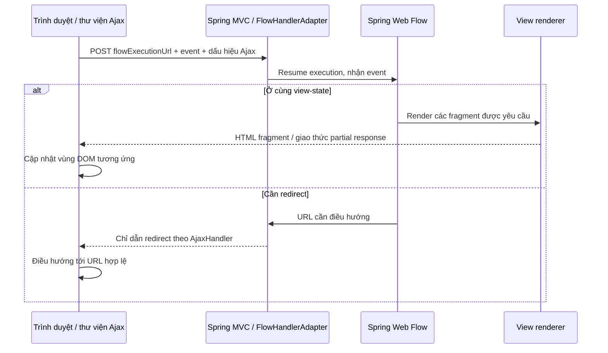
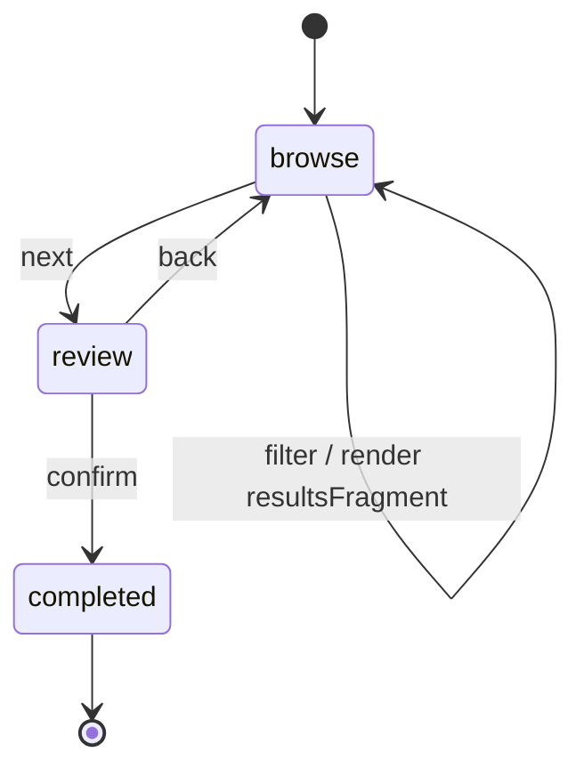

# AjaxHandler và giao thức phản hồi của thư viện giao diện

Trong chương **Ajax và phân mảnh**, chúng ta đã biết một flow có thể cập nhật một phần giao diện sau sự kiện mà không tải lại toàn bộ trang. Câu hỏi tiếp theo là: **Spring Web Flow nhận biết request Ajax bằng cách nào, và trình duyệt cần hiểu phản hồi gì để cập nhật đúng giao diện hoặc điều hướng?**

Đây là vai trò của **`AjaxHandler`** và **giao thức phản hồi** giữa Web Flow và thư viện giao diện. Bài học thuộc module **SPRING_WEB_FLOW**, tập trung vào việc tổ chức các hành trình web nhiều bước bằng state, event, transition, phối hợp Spring MVC, form binding/validation, quản lý flow execution và xử lý lỗi khi dùng Ajax.

Mục tiêu sau bài học:

1. Phân biệt **nhận diện Ajax request**, **render HTML fragment** và **gửi chỉ dẫn redirect** — ba việc liên quan nhưng do những thành phần khác nhau thực hiện.
2. Hiểu hai thao tác của `AjaxHandler`: `isAjaxRequest(...)` và `sendAjaxRedirect(...)`.
3. Biết giao thức mà `DefaultAjaxHandler` dùng để nhận diện request và chuyển hướng phản hồi trong các phiên bản Web Flow có lớp này.
4. Phác thảo cách tích hợp thư viện giao diện tùy chọn với `FlowHandlerAdapter`, view renderer và client JavaScript.
5. Thiết kế kiểm thử cho cập nhật fragment, redirect, lỗi validation, phiên hết hạn và các request gửi lặp.

> **Phạm vi phiên bản:** Spring Web Flow đã có nhiều thế hệ thư viện. Ở các API 2.5.x và 4.x, `AjaxHandler` nằm trong package `org.springframework.webflow.context.servlet`; chữ ký dùng `javax.servlet` ở dòng cũ và `jakarta.servlet` ở dòng mới. Tài liệu tham khảo lịch sử vẫn có ví dụ Spring JavaScript/Dojo, Tiles và Spring JS; các ví dụ đó cần được đánh giá theo dependency thực tế, vì Spring JS resources hiện được duy trì chủ yếu cho tương thích ngược.

## 1. Vấn đề khi chuyển từ form truyền thống sang Ajax

Xét màn **tìm khóa học** trong một flow đăng ký. Người dùng điền từ khóa, nhấn **Lọc** và chỉ cần vùng danh sách khóa học cập nhật. Sau đó họ nhấn **Tiếp tục** để sang bước xác nhận.

Với request HTML thông thường:

1. Trình duyệt gửi POST kèm dữ liệu form và event.
2. Web Flow bind dữ liệu, xử lý transition.
3. Khi chuyển sang view-state khác, framework có thể áp dụng **POST–Redirect–GET**.
4. Trình duyệt thực hiện redirect và tải trang đích.

Với Ajax, mục tiêu thường là:

1. JavaScript gửi request tới **URL của flow execution hiện tại**.
2. Web Flow vẫn xử lý event, binding, validation, action và transition.
3. Khi chỉ cập nhật vùng danh sách, server gửi HTML fragment phù hợp.
4. Khi cần chuyển trang, server phát **chỉ dẫn redirect mà thư viện JavaScript hiểu**, để browser điều hướng đúng cách.

Nếu Ajax client chỉ xử lý HTML mà server trả redirect, trình duyệt có thể theo HTTP 302 bên trong `fetch`/XHR, nhưng **cửa sổ chính không tự điều hướng**. Ngược lại, nếu server trả HTML của trang đầy đủ và JavaScript nhét cả tài liệu đó vào một thẻ `<div>`, layout sẽ bị lồng trang, mất event handler hoặc không còn action URL hợp lệ.



**Đừng gộp ba trách nhiệm này thành một “Ajax mode” duy nhất:** `AjaxHandler` không tự sinh HTML fragment, và việc view biết render fragment không tự khiến `fetch` hiểu được redirect.

## 2. AjaxHandler là hợp đồng giữa Web Flow và hệ thống Ajax phía client

Trong các API Web Flow có `org.springframework.webflow.context.servlet.AjaxHandler`, interface mang hai thao tác cốt lõi:

```java
// Chữ ký khái niệm dựa trên API Web Flow sử dụng Jakarta Servlet.
// Với phiên bản cũ, thay jakarta.servlet.* bằng javax.servlet.*.
public interface AjaxHandler {

    boolean isAjaxRequest(
        HttpServletRequest request,
        HttpServletResponse response
    );

    void sendAjaxRedirect(
        String targetUrl,
        HttpServletRequest request,
        HttpServletResponse response,
        boolean popup
    ) throws IOException;
}
```

**`isAjaxRequest(request, response)`** trả về liệu request hiện tại có thuộc loại Ajax theo giao thức của thư viện client hay không. Tín hiệu có thể là giá trị `Accept`, tham số request hoặc header riêng; cách nhận diện phụ thuộc implementation.

**`sendAjaxRedirect(targetUrl, request, response, popup)`** yêu cầu server mã hóa chỉ dẫn chuyển hướng theo cách mà client hiểu. Tham số `popup` mang ý nghĩa chuyển hướng có liên quan đến cửa sổ/hộp thoại nổi theo hỗ trợ của thư viện giao diện; nó **không** thay cho mọi chính sách popup của trình duyệt.

| Thành phần | Trách nhiệm |
| --- | --- |
| `AjaxHandler` | Nhận biết request Ajax và gửi chỉ dẫn redirect theo client protocol |
| `FlowHandlerAdapter` / `FlowController` | Liên kết HTTP/Spring MVC với `FlowExecutor`, sử dụng handler được cấu hình |
| `FlowExecutor` | Tiếp tục flow execution, tìm state/event/transition hợp lệ |
| `<render fragments="..."/>` | Đề nghị render lại các fragment của view |
| View renderer (Tiles, JSF hoặc custom) | Chọn, tạo và tuần tự hóa nội dung HTML/partial response |
| JavaScript/JSF runtime | Gửi event, xử lý phản hồi, thay vùng DOM hoặc điều hướng |

Một implementation của `AjaxHandler` không bắt buộc phải trả JSON. Trong Web Flow truyền thống, nhiều view trả **HTML fragments**; khi cần redirect, thông tin đích có thể được gửi qua **response header** hoặc cấu trúc XML theo giao thức của thư viện.

Giao thức là **thỏa thuận hai chiều**. Server và client phải thống nhất: request nào được xem là Ajax, fragment được định danh thế nào, redirect được mã hóa ra sao và client xử lý lỗi/hết phiên bằng cách nào.

## 3. DefaultAjaxHandler: dấu hiệu request và chỉ dẫn redirect

Các Javadoc của `DefaultAjaxHandler` (đã xuất hiện từ Web Flow 2.5, cũng có ở API 4.x) mô tả hai phương án nhận diện Ajax:

- Header `Accept` chứa giá trị được định nghĩa ở hằng số `AJAX_ACCEPT_CONTENT_TYPE`.
- Request có tham số mang tên `AJAX_SOURCE_PARAM`.

Các giá trị hằng được ghi nhận trong API hiện hành:

| Hằng số | Giá trị giao thức |
| --- | --- |
| `AJAX_ACCEPT_CONTENT_TYPE` | `text/html;type=ajax` |
| `AJAX_SOURCE_PARAM` | `ajaxSource` |
| `REDIRECT_URL_HEADER` | `Spring-Redirect-URL` |
| `POPUP_VIEW_HEADER` | `Spring-Modal-View` |

Ví dụ request Ajax chỉ để cập nhật một fragment:

```http
POST /courses/search?execution=e1s2 HTTP/1.1
Host: example.test
Accept: text/html;type=ajax
Content-Type: application/x-www-form-urlencoded

_eventId_filter=&query=spring
```

`/courses/search?execution=e1s2` và giá trị `e1s2` là **minh họa**, không phải chuỗi execution key phải tự sinh. Trong view thật, hãy lấy URL do Web Flow cung cấp (ví dụ `flowExecutionUrl`).

Một client có thể dùng tham số `ajaxSource=filterButton` làm tín hiệu thay thế nếu cấu hình phù hợp. Không suy luận rằng header `X-Requested-With: XMLHttpRequest` **một mình** đủ để `DefaultAjaxHandler` nhận diện Ajax: tên và giá trị mà từng handler kiểm tra mới là hợp đồng thực tế.

### Redirect trong phản hồi Ajax

Khi Web Flow cần redirect với `DefaultAjaxHandler`, response có thể mang header:

```http
HTTP/1.1 200 OK
Spring-Redirect-URL: /courses/confirmation
```

Giá trị URL và status ở trên chỉ để minh họa cách một **phản hồi mang chỉ dẫn redirect** có thể xuất hiện; mã trạng thái thực tế phụ thuộc adapter/cấu hình. `Spring-Redirect-URL` là tín hiệu mà JavaScript phải kiểm tra và xử lý như **điều hướng**, thay vì cố parse body thành HTML fragment. Nếu redirect liên quan popup, `Spring-Modal-View` có thể báo cách client cần xử lý giao diện nổi.

Không phải response nào cũng có hai header trên. Nếu request chỉ cập nhật một fragment trong cùng state, hệ thống view có thể trả nội dung HTML để client thay đúng vùng, không cần redirect.

### Vì sao Ajax redirect không giống HTTP 302 thông thường?

Với form thông thường, HTTP 302/303 điều hướng trực tiếp trong browser. Với `fetch` hoặc XHR, redirect HTTP có thể được xử lý **bên trong yêu cầu Ajax**; thanh địa chỉ và toàn bộ trang hiện tại không nhất thiết đổi theo. Vì vậy Web Flow cần cách giao tiếp rõ ràng để thư viện Ajax chủ động điều hướng ở đúng cấp độ giao diện.

Client cần ưu tiên đọc chỉ dẫn redirect trước khi xử lý body:

```text
if (response.hasAjaxRedirectInstruction) {
    navigate(response.targetUrl)
} else if (response.isSupportedFragmentResponse) {
    updateDomFragments(response.fragments)
} else {
    handleUnexpectedResponse()
}
```

Đây là mã giả về **giao thức**, không phải API của một thư viện cụ thể.

## 4. Hai kiểu hành trình: cập nhật cùng state và chuyển state

Một flow có thể dùng Ajax để lọc dữ liệu ở cùng màn hình, nhưng vẫn cho người dùng chuyển sang view-state khác ở bước xác nhận.



Sự khác biệt nằm ở cách Web Flow xử lý transition và render view:

| Trường hợp | Flow engine | Kỳ vọng phía client |
| --- | --- | --- |
| Event `filter` ở lại `browse` | Bind/validate và render lại fragment | Thay vùng kết quả |
| `next` chuyển từ `browse` sang `review` | Chuyển tới view-state mới | Tuân theo redirect/full-page hoặc embedded policy |
| `confirm` kết thúc flow | Chạy nghiệp vụ và end-state | Xử lý redirect/trang hoàn tất phù hợp |
| Validation lỗi | Thường giữ view-state đang nhập | Hiển thị lỗi tại fragment chứa field/message |
| Execution hết hạn | Không resume execution bình thường | Xử lý phiên hết hạn, yêu cầu bắt đầu lại |

### Khi nào Web Flow redirect?

Ở chế độ mặc định, Web Flow thường áp dụng **POST–Redirect–GET khi vào view-state khác**, hữu ích cho Back/Refresh. Khi xử lý Ajax **ở lại cùng view-state**, redirect thường không cần thiết; fragment có thể được render ngay.

Nếu muốn **nhúng một flow có nhiều view-state trong một vùng của trang hoặc modal**, tài liệu Web Flow mô tả cách mở flow ở `mode=embedded`. Chế độ này thay đổi hành vi redirect **đối với Ajax** để flow có thể chuyển qua nhiều màn mà vẫn nằm trong vùng nhúng.

```text
/courses/registration?mode=embedded
```

`mode=embedded` chỉ cần truyền khi khởi tạo flow theo cơ chế được phiên bản đó hỗ trợ; không có nghĩa là mọi response đều tự có định dạng HTML fragment thích hợp. Vẫn phải thiết kế renderer và JavaScript/JSF integration thống nhất với client.

## 5. Cấu hình AjaxHandler trong tích hợp Spring MVC

Với cấu hình Spring MVC truyền thống, Web Flow được nối vào `FlowExecutor` bằng `FlowHandlerMapping` và `FlowHandlerAdapter`. Handler Ajax được gắn với adapter xử lý request flow. Ví dụ Java config:

```java
import org.springframework.context.annotation.Bean;
import org.springframework.context.annotation.Configuration;
import org.springframework.webflow.context.servlet.AjaxHandler;
import org.springframework.webflow.context.servlet.DefaultAjaxHandler;
import org.springframework.webflow.execution.FlowExecutor;
import org.springframework.webflow.mvc.servlet.FlowHandlerAdapter;

@Configuration
public class FlowMvcConfig {

    @Bean
    public AjaxHandler flowAjaxHandler() {
        return new DefaultAjaxHandler();
    }

    @Bean
    public FlowHandlerAdapter flowHandlerAdapter(
            FlowExecutor flowExecutor,
            AjaxHandler flowAjaxHandler) {

        FlowHandlerAdapter adapter = new FlowHandlerAdapter();
        adapter.setFlowExecutor(flowExecutor);
        adapter.setAjaxHandler(flowAjaxHandler);
        return adapter;
    }
}
```

Ví dụ giả định ứng dụng đã cung cấp một bean `FlowExecutor` và cấu hình `FlowHandlerMapping`. Không đăng ký một bean adapter thứ hai nếu framework đã có một adapter đang hoạt động; hãy cập nhật adapter thực tế đang xử lý flow. API config và package có thể khác theo phiên bản dự án.

Nếu sử dụng cấu hình XML Spring MVC:

```xml
<bean id="flowHandlerAdapter"
      class="org.springframework.webflow.mvc.servlet.FlowHandlerAdapter">
    <property name="flowExecutor" ref="flowExecutor"/>
    <property name="ajaxHandler" ref="flowAjaxHandler"/>
</bean>

<bean id="flowAjaxHandler"
      class="org.springframework.webflow.context.servlet.DefaultAjaxHandler"/>
```

**Chỉ định `AjaxHandler` không tự cài đặt fragment renderer.** Bạn vẫn cần view technology có khả năng tạo partial response, hoặc viết một view/resolver custom mà client hiểu.

## 6. Render fragment trong flow XML

Spring Web Flow hỗ trợ phần tử `<render>` trong transition để yêu cầu cập nhật một hoặc nhiều phần của **view hiện tại**. Ví dụ flow tìm khóa học:

```xml
<?xml version="1.0" encoding="UTF-8"?>
<flow xmlns="http://www.springframework.org/schema/webflow"
      xmlns:xsi="http://www.w3.org/2001/XMLSchema-instance"
      xsi:schemaLocation="
        http://www.springframework.org/schema/webflow
        http://www.springframework.org/schema/webflow/spring-webflow.xsd">

    <var name="searchCriteria"
         class="com.example.course.SearchCriteria"/>

    <view-state id="browse"
                view="course/browse"
                model="searchCriteria">
        <on-render>
            <evaluate expression="courseService.search(searchCriteria)"
                      result="viewScope.courses"/>
        </on-render>

        <transition on="filter">
            <render fragments="resultsFragment,summaryFragment"/>
        </transition>

        <transition on="next" to="review"/>
        <transition on="cancel" to="cancelled"
                    bind="false" validate="false"/>
    </view-state>

    <view-state id="review" view="course/review">
        <transition on="back" to="browse"/>
        <transition on="confirm" to="completed"/>
    </view-state>

    <end-state id="completed" view="course/completed"/>
    <end-state id="cancelled" view="course/cancelled"/>
</flow>
```

Giải thích:

- `filter` là event trong `browse` và transition **không có `to`**, nên logic điều hướng giữ lại view-state hiện tại.
- `<render fragments="resultsFragment,summaryFragment"/>` yêu cầu render lại **hai fragment** được xác định bằng tên/ID mà view technology hỗ trợ.
- `<on-render>` nạp lại danh sách dựa trên `searchCriteria` trước khi render. Nếu cần tránh truy vấn lại ở những trường hợp khác, hãy điều chỉnh lifecycle và vị trí load data theo nghiệp vụ.
- `next` chuyển sang view-state khác; khi không chạy embedded mode, cần dự liệu redirect theo chính sách mặc định.
- `courseService.search` là bean nghiệp vụ minh họa; `SearchCriteria` cũng là class do ứng dụng cung cấp.

**`fragments` không đồng nghĩa một CSS selector bất kỳ.** Tên fragment phải được hỗ trợ bởi view resolver/rendering technology, ví dụ một phần của bố cục Tiles hoặc component ID trong JSF. Một phần tử HTML có `id="resultsFragment"` là cần thiết cho việc client thay DOM theo ID, nhưng **chỉ thêm ID vào JSP chưa bảo đảm renderer tự tách đúng fragment**.

## 7. View renderer quyết định hình dạng HTML fragment

Spring Web Flow chịu trách nhiệm lựa chọn state/event. Việc lấy HTML của một phần trang là trách nhiệm của **công nghệ view**. Với một số phiên bản Spring Web Flow trước đây, tài liệu dùng **Spring JavaScript + Apache Tiles** cùng các lớp như `AjaxUrlBasedViewResolver` và `FlowAjaxTiles3View`.

Ví dụ cấu hình lịch sử thuộc hệ sinh thái Tiles 3:

```xml
<bean id="tilesViewResolver"
      class="org.springframework.webflow.mvc.view.AjaxUrlBasedViewResolver">
    <property name="viewClass"
              value="org.springframework.webflow.mvc.view.FlowAjaxTiles3View"/>
</bean>
```

Lớp `FlowAjaxTiles3View` được thiết kế để nhận biết yêu cầu Ajax, sử dụng các fragment mà `<render>` chỉ định khi execution đang chạy và render tương ứng qua Tiles. Tuy nhiên **Tiles 3 và Spring JavaScript resources là công nghệ legacy**; không nên mang ví dụ này vào một dự án Spring hiện đại nếu chưa xác nhận dependency và API còn phù hợp.

Các hướng triển khai cần phân biệt:

| Công nghệ UI | Đặc điểm phản hồi | Việc phải phối hợp |
| --- | --- | --- |
| JSP/Thymeleaf + JavaScript tự viết | HTML fragment hoặc giao thức partial response do ứng dụng định nghĩa | Custom view rendering và client parser/DOM update |
| Spring JS + Tiles (legacy) | HTML fragments theo cơ chế Ajax-aware view đã cung cấp | Dùng đúng resolver/view, client library và dependency tương thích |
| JSF Ajax | Partial response theo chuẩn JSF; component IDs và redirect riêng | Dùng JSF integration/`JsfAjaxHandler` thích hợp |
| Trang HTML truyền thống | Full HTML / HTTP redirect | Không cần AjaxHandler cho form thông thường |

Không thể chỉ đổi `Accept` thành JSON rồi chờ Web Flow tự tạo payload JSON. Nếu muốn JSON, ứng dụng phải cung cấp endpoint/renderer/contract xử lý JSON tương ứng; AjaxHandler không tự tuần tự hóa dữ liệu nghiệp vụ sang JSON.

## 8. Tự thiết kế giao thức cho thư viện JavaScript khác

Giả sử ứng dụng dùng thư viện Ajax mới, gửi header riêng `X-Flow-Ajax: true` và muốn nhận chỉ dẫn redirect qua `X-Flow-Redirect`. Khi đó có thể viết một `AjaxHandler` tùy biến.

Ví dụ theo API sử dụng **Jakarta Servlet** (Spring Web Flow thế hệ mới):

```java
package com.example.webflow;

import java.io.IOException;
import jakarta.servlet.http.HttpServletRequest;
import jakarta.servlet.http.HttpServletResponse;
import org.springframework.webflow.context.servlet.AjaxHandler;

public final class CustomAjaxHandler implements AjaxHandler {

    @Override
    public boolean isAjaxRequest(
            HttpServletRequest request,
            HttpServletResponse response) {
        return "true".equalsIgnoreCase(
            request.getHeader("X-Flow-Ajax")
        );
    }

    @Override
    public void sendAjaxRedirect(
            String targetUrl,
            HttpServletRequest request,
            HttpServletResponse response,
            boolean popup) throws IOException {

        // Ví dụ về protocol do chính ứng dụng quy định.
        // Client phải đọc các header này trước khi xử lý body.
        response.setHeader("X-Flow-Redirect", targetUrl);
        response.setHeader("X-Flow-Popup", Boolean.toString(popup));
    }
}
```

Gắn handler này vào `FlowHandlerAdapter`:

```java
@Bean
public AjaxHandler flowAjaxHandler() {
    return new CustomAjaxHandler();
}
```

Nếu dự án dùng `javax.servlet.*`, cần thay import theo phiên bản; không trộn `javax` và `jakarta` trong cùng dependency graph. Hệ thống cần định nghĩa, kiểm thử và bảo vệ **URL redirect được phép**, nhất là khi giá trị có thể đi từ input người dùng.

Custom handler trên mới xử lý **nhận diện Ajax và redirect**. Để hoàn thành tích hợp, phải làm thêm ba việc:

1. View renderer trả fragment có cấu trúc nhất quán với client (ví dụ vùng HTML có ID xác định).
2. Client gửi event `_eventId_filter` và các field/CSRF token qua đúng URL flow execution.
3. Client đọc `X-Flow-Redirect` trước khi giải mã body, đồng thời cập nhật fragment và action URL/snapshot hợp lệ khi không redirect.

Nếu sử dụng `DefaultAjaxHandler`, không cần tự tạo header `X-Flow-Redirect`: hãy tuân theo giao thức mặc định `Spring-Redirect-URL`, `Spring-Modal-View` đã mô tả ở trên.

## 9. Phía trình duyệt: phân nhánh giữa redirect và cập nhật DOM

Đây là một ví dụ JavaScript **minh họa giao thức** cho `DefaultAjaxHandler`. Nó giả định view renderer được cấu hình để trả HTML chứa vùng `resultsFragment`, form có ID `courseForm` và action URL hợp lệ của execution. Nếu renderer trả các fragment theo một envelope khác, phần đọc nội dung phải thay đổi theo đúng giao thức đó.

```javascript
const form = document.getElementById("courseForm");

form.addEventListener("submit", async (event) => {
  const button = event.submitter;

  // Chỉ xử lý Ajax đối với event filter.
  // Những submit khác vẫn theo form HTML bình thường.
  if (!button || button.name !== "_eventId_filter") {
    return;
  }

  event.preventDefault();
  button.disabled = true;

  try {
    const body = new FormData(form);
    // FormData(form) không tự thêm submitter ở một số cách khởi tạo.
    body.append("_eventId_filter", "");

    const response = await fetch(form.action, {
      method: "POST",
      headers: {
        Accept: "text/html;type=ajax"
      },
      body,
      credentials: "same-origin"
    });

    // Chỉ dẫn điều hướng do DefaultAjaxHandler trả về.
    const redirect = response.headers.get("Spring-Redirect-URL");
    if (redirect) {
      const target = new URL(redirect, window.location.href);
      if (target.origin !== window.location.origin) {
        throw new Error("URL điều hướng không được phép");
      }
      window.location.assign(target.href);
      return;
    }

    if (!response.ok) {
      throw new Error("Không thể cập nhật danh sách");
    }

    const html = await response.text();
    const nextDocument =
      new DOMParser().parseFromString(html, "text/html");

    const incoming =
      nextDocument.getElementById("resultsFragment");
    const existing =
      document.getElementById("resultsFragment");

    if (!incoming || !existing) {
      throw new Error("Sai hợp đồng HTML fragment");
    }

    existing.replaceWith(incoming);
    // Nếu một phần form được render lại, phải cập nhật
    // action URL / execution key trong markup mới.
  } catch (error) {
    document.getElementById("ajaxStatus").textContent =
      "Không thể tải lại kết quả. Hãy thử lại.";
  } finally {
    button.disabled = false;
  }
});
```

Các hạn chế thực tế phải xử lý khi triển khai:

- Ví dụ chỉ hỗ trợ **một** vùng DOM, dù XML có thể yêu cầu nhiều fragment. Với nhiều vùng, renderer và client cần envelope/thuật toán ánh xạ fragment rõ ràng.
- Server có thể trả một đoạn HTML **không chứa phần tử bao `resultsFragment`**; parser trong ví dụ khi đó sẽ báo lỗi. Hãy thiết kế output fragment nhất quán hoặc thay parser cho phù hợp.
- `fetch` có thể tự theo HTTP redirect thông thường. Mã chỉ dẫn chuyển hướng riêng của AjaxHandler giúp client chủ động thay đổi trang khi gặp trường hợp tương ứng.
- `form.action` phải thuộc execution hiện tại. Sau transition hoặc snapshot mới, hãy cập nhật URL của form từ response/view đã render; gửi event với execution key cũ có thể dẫn đến stale execution.
- Nếu form có CSRF token, `FormData` cần gửi token theo cấu hình Spring Security. Nếu ứng dụng dùng CSRF header thay vì hidden input, client phải thêm header đó.
- HTML mới chỉ được đưa vào DOM từ nguồn tin cậy và phải escape dữ liệu người dùng ở server. Không dùng `innerHTML` cho chuỗi lỗi/thông báo do bên thứ ba kiểm soát.

Mẫu JavaScript không thay cho bộ xử lý Ajax chính thức của Spring JS hoặc JSF; nó chỉ cho thấy **client phải hiểu hợp đồng phản hồi**. Với JSF, không dùng đoạn DOM parser này để xử lý `<partial-response>`; cần để JSF Ajax runtime cập nhật component.

## 10. JSF AjaxHandler: giao thức có thể nằm trong response body

Không phải thư viện nào cũng biểu diễn redirect qua một response header. Với **JSF Ajax**, `JsfAjaxHandler` (thuộc `org.springframework.faces.webflow` trong các API có module Spring Faces) có thể nhận diện yêu cầu partial Ajax của JSF và **đưa chỉ dẫn redirect vào nội dung phản hồi** theo giao thức JSF.

Một phản hồi partial của JSF về mặt ý tưởng có dạng:

```xml
<?xml version="1.0" encoding="UTF-8"?>
<partial-response>
    <redirect url="/registration/completed"/>
</partial-response>
```

Đây là **ví dụ định dạng giao thức**, không phải yêu cầu phải tự sinh XML này trong mọi ứng dụng JSF. JSF runtime có trách nhiệm nhận và xử lý partial response, thay vùng component hoặc điều hướng dựa trên những phần tử mà nó hiểu.

Trong JSF, phần tử `<render fragments="..."/>` thường tham chiếu tới ID component mà JSF có thể re-render, không nhất thiết trùng với tên Tiles fragment. Cần kiểm tra naming container và client ID của component, ví dụ `searchForm:resultsFragment`, để server và client thống nhất mục tiêu cập nhật.

**Bài học chính:** `AjaxHandler` gắn với **thư viện giao diện**, vì mỗi thư viện có cách nhận diện Ajax và cơ chế redirect riêng. Dùng handler của một giao thức rồi parse phản hồi theo giao thức khác sẽ dẫn tới lỗi dù state/event trên server đã đúng.

## 11. Binding, validation, scope và flow execution vẫn giữ nguyên ý nghĩa

Ajax chỉ thay **cách gửi request và cách cập nhật trang**. Nó không bỏ qua quy tắc của Web Flow.

### Binding và validation

Nếu `browse` có `model="searchCriteria"`, dữ liệu gửi qua Ajax vẫn phải được bind/convert/validate theo cấu hình `view-state` và `transition`. Lỗi validation vẫn cần được render vào fragment hiển thị lỗi; nếu chỉ trả `resultsFragment` mà bỏ `messagesFragment`, người dùng có thể không nhìn thấy lý do không chuyển bước được.

```xml
<transition on="filter">
    <render fragments="resultsFragment,messagesFragment"/>
</transition>
```

Nếu event `filter` cho phép dữ liệu còn thiếu, hãy thiết kế validation phù hợp; đừng bỏ validation tùy tiện chỉ để request Ajax không bị chặn. Event quan trọng có tác dụng ghi dữ liệu cần tiếp tục kiểm tra nghiệp vụ ở service.

### Scope

| Scope | Ví dụ dữ liệu trong flow Ajax | Điều cần nhớ |
| --- | --- | --- |
| `requestScope` | Thông số request hiện tại | Không tồn tại qua nhiều request Ajax |
| `viewScope` | Danh sách phân trang, trạng thái lọc của một màn | Có thể được đọc khi render lại cùng view-state |
| `flowScope` | Bản nháp đăng ký, lựa chọn người dùng | Giữ qua các state của một execution |
| `flashScope` | Thông báo cho lần render/chuyển tiếp gần nhất | Không dùng làm kho dữ liệu bền vững |
| Database | Đơn đăng ký đã commit | Độc lập với vòng đời flow |

**Flow execution key** phải được quản lý nhất quán. Nếu trình duyệt gửi hai request Ajax song song với cùng snapshot, một response đến chậm có thể cập nhật giao diện bằng dữ liệu lỗi thời hoặc gửi tiếp event với execution key đã hết hiệu lực.

Biện pháp thực tế gồm hủy/khóa request cũ khi người dùng nhập liên tục, gán request sequence ID ở client, cập nhật action URL mới từ response hợp lệ và chỉ nhận phản hồi mới nhất cho cùng vùng DOM. Tuy nhiên các biện pháp giao diện này **không** thay thế transaction/idempotency nếu event có tác dụng ghi dữ liệu.

## 12. Embedded mode, popup và chuyển state

Ba bối cảnh giao diện nên được xử lý rõ ràng:

**Cập nhật cùng view-state.** Một event tìm kiếm/đổi trang có thể làm mới fragment mà không redirect. Đây là trường hợp Ajax phổ biến và dễ kiểm thử nhất.

**Chuyển sang view-state khác trong trang chính.** Web Flow thường sử dụng redirect để duy trì POST–Redirect–GET. Client cần xử lý `Spring-Redirect-URL` hoặc chỉ dẫn tương đương của handler đang dùng. Nếu muốn giữ vùng nhúng, cần đánh giá embedded mode và khả năng render fragment của view mới.

**Flow bên trong modal/popup.** Handler có thể mang cờ `popup` hoặc giao thức riêng cho hộp thoại. Cờ này không bảo đảm thư viện sẽ tự mở modal; phía UI phải hỗ trợ và xử lý nó. Khi flow kết thúc, modal cũng cần đóng hoặc chuyển trạng thái đúng theo thiết kế, đồng thời không mất kết quả nghiệp vụ đã commit.

Đừng dùng redirect Ajax như một cách tự động bỏ qua phân quyền, CSRF hoặc điều kiện nghiệp vụ. Bất kỳ transition nào phát sinh thao tác ghi vẫn cần xác thực ở server.

## 13. Mẫu kiểm thử cho AjaxHandler và giao thức phản hồi

Nên kiểm tra từng tầng độc lập: handler nhận diện request, flow xử lý state/event, renderer tạo fragment và client áp dụng response.

| Kịch bản | Đầu vào | Kết quả mong đợi |
| --- | --- | --- |
| Request thường | Không có tín hiệu Ajax | Không bị nhận nhầm là Ajax; HTML/redirect thông thường |
| Ajax qua `Accept` | `Accept: text/html;type=ajax` | `DefaultAjaxHandler` nhận diện đúng theo phiên bản |
| Ajax qua tham số | `ajaxSource` được gửi đúng tên | Handler nhận diện theo quy tắc |
| Header không thuộc protocol | Chỉ `X-Requested-With` | Không giả định handler mặc định nhận diện |
| Cập nhật fragment | Event `filter` ở `browse` | Giữ state và render đúng danh sách fragment |
| Hai fragment | `resultsFragment,summaryFragment` | Cả hai vùng được xử lý đúng theo renderer |
| Lỗi validation | Query/form không hợp lệ | Giữ state, hiển thị lỗi field ở fragment |
| Chuyển view | Event `next` | Client thực hiện redirect hoặc embedded update phù hợp |
| Redirect header | Response có `Spring-Redirect-URL` | Client điều hướng, không nhét response vào panel |
| JSF partial redirect | Response JSF Ajax | JSF runtime hiểu chỉ dẫn, không dùng HTML parser chung |
| Phiên/execution hết hạn | Gửi execution key cũ | Báo hết hạn rõ ràng, không tự chạy lại action |
| Response đến ngược thứ tự | Hai Ajax request A/B, B về trước | Dữ liệu cũ từ A không ghi đè vùng đã cập nhật |
| Lệnh ghi được gửi lặp | Hai event xác nhận | Service bảo đảm idempotency/transaction |
| CSRF sai hoặc thiếu | POST Ajax không có token hợp lệ | Server từ chối theo chính sách bảo mật |
| Redirect không được phép | Location là URL ngoài whitelist | Client không mở URL tùy ý |

### Unit test handler

Có thể kiểm thử riêng `CustomAjaxHandler` trong ví dụ:

```text
given request.header["X-Flow-Ajax"] = "true"
when  handler.isAjaxRequest(request, response)
then  result == true

given request.header["X-Flow-Ajax"] is absent
when  handler.isAjaxRequest(request, response)
then  result == false

when  handler.sendAjaxRedirect("/registration/review", request, response, false)
then  response.header["X-Flow-Redirect"] == "/registration/review"
and   response.header["X-Flow-Popup"] == "false"
```

Đây là **mã giả**, không phải API JUnit/Mockito chạy trực tiếp. Có thể hiện thực bằng mock `HttpServletRequest`/`HttpServletResponse` tương ứng.

### Kiểm thử tích hợp và trình duyệt

Một bộ kiểm thử đầu-cuối nên xác minh:

1. Request gửi đúng `flowExecutionUrl`, event và dấu hiệu Ajax.
2. Response có HTML fragment đúng và client thay chính xác vùng DOM tương ứng.
3. Sau partial update, form/event tiếp theo vẫn dùng flow execution còn hợp lệ.
4. Khi server trả chỉ dẫn redirect, thanh địa chỉ hoặc vùng embedded/modal được cập nhật đúng theo contract.
5. Không có thao tác ghi nghiệp vụ ngoài action-state xác nhận; retry vẫn bảo vệ dữ liệu.

Nếu test flow bằng mock service cho kết quả pass nhưng browser vẫn không cập nhật, hãy kiểm tra **wire protocol và renderer** thay vì chỉ kiểm tra state. Ngược lại, DOM hiển thị đúng không chứng minh transaction/idempotency đã an toàn.

## 14. Sự cố thường gặp và cách phân tích

| Hiện tượng | Nguyên nhân có thể xảy ra | Cách kiểm tra |
| --- | --- | --- |
| Ajax bấm nút nhưng tải lại cả trang | Handler không nhận diện request; JS không chặn submit | Kiểm tra `Accept`/tham số Ajax, event và mã phía client |
| Panel chứa nguyên trang HTML | Server trả full view, client tưởng fragment | Kiểm tra view resolver, render fragments và response body |
| Redirect xảy ra trong `fetch`, URL chính không đổi | Thiếu cơ chế điều hướng client phù hợp | Kiểm tra `Spring-Redirect-URL` hoặc protocol của handler |
| Nhấn Next không cập nhật state mong muốn | Event gửi sai tên hoặc execution key cũ | Kiểm tra `_eventId_*`, flow execution URL và snapshot |
| Validation lỗi nhưng không thấy thông báo | Fragment thông báo chưa được render | Kiểm tra `messagesFragment`, message context, DOM mapping |
| JSF Ajax không hiểu response | Dùng renderer/handler của HTML/Tiles cho JSF | Kiểm tra partial response và `JsfAjaxHandler` |
| Cập nhật vùng DOM sai | ID component/fragment không khớp | So sánh ID server, client và naming container |
| Đôi khi hiển thị kết quả tìm kiếm cũ | Response Ajax đến không đúng thứ tự | Thêm bảo vệ thứ tự request, hủy request cũ |
| Sau vài lần lọc thì lỗi “stale execution” | Đang gửi action URL/key cũ | Render/cập nhật URL execution mới khi cần |
| Bấm confirm hai lần tạo bản ghi trùng | Chỉ chặn nút ở client, service không idempotent | Kiểm thử transaction và khóa idempotency |

Đặc biệt, **đừng xử lý mọi HTTP 200 như fragment thành công**. Một trang đăng nhập, trang lỗi chung hoặc response redirect có thể về cùng request Ajax; client phải nhận dạng contract và trạng thái phiên trước khi cập nhật DOM.

### Công cụ debug hiệu quả

Mở tab Network của trình duyệt và so sánh request bình thường với request Ajax: method, URL, query/POST body, `Accept`, `Content-Type`, CSRF, response status, response headers, body và thời điểm request kết thúc. Log server cần gắn flow ID, state, event và correlation ID để dễ nối với request ở browser, nhưng tránh ghi thông tin cá nhân hoặc execution token nhạy cảm vào log công khai.

Khi một request không đi theo nhánh mong muốn, hãy kiểm tra theo thứ tự: **AjaxHandler có nhận diện đúng không → Web Flow có nhận event đúng không → flow chuyển state nào → view renderer trả cái gì → client giải mã và cập nhật ra sao**.

## 15. Bài thực hành: tích hợp một thư viện Ajax khác

Từ flow `browse` ở mục 6, hãy xây dựng một trang có vùng `resultsFragment` và hai nút: **Lọc bằng Ajax** và **Tiếp tục**.

1. Thiết lập `DefaultAjaxHandler` và xác nhận request `filter` được nhận diện khi gửi `Accept: text/html;type=ajax`.
2. Tạo renderer tương thích để trả fragment danh sách và thông báo; kiểm tra `<render fragments="resultsFragment,summaryFragment"/>` có phản hồi chính xác.
3. Viết phía JavaScript xử lý fragment và `Spring-Redirect-URL`.
4. Bổ sung form CSRF, trạng thái loading, xử lý mất mạng và bảo vệ response đến chậm.
5. Đổi sang `CustomAjaxHandler` dùng `X-Flow-Ajax`/`X-Flow-Redirect`, rồi cập nhật JavaScript tương ứng.
6. Kiểm thử flow thường khi JavaScript tắt hoặc không được nạp: trang vẫn cần một đường submit HTML phù hợp.
7. Mở rộng sang `mode=embedded` nếu muốn giữ flow nhiều view-state trong một modal; kiểm tra redirect của trạng thái cuối.

Kết quả mong đợi gồm sơ đồ request/response, cấu hình handler, XML transition có `<render>`, HTML/JS, bộ test handler và test trình duyệt. Chỉ khi cả server **và** client thống nhất giao thức thì Ajax mới cập nhật đúng giao diện mà vẫn duy trì điều hướng flow.

## 16. Nguồn tham khảo kỹ thuật

Các tài liệu chính thức giúp đối chiếu API của phiên bản được chọn:

- [Spring Web Flow — Reference Guide, Rendering Fragments](https://docs.spring.io/spring-webflow/docs/3.0.0/reference/) — xem phần *Rendering Fragments* và *Embedding a Flow on a Page*.
- [Spring Web Flow — AjaxHandler API](https://docs.spring.io/spring-webflow/docs/current/api/org/springframework/webflow/context/servlet/AjaxHandler.html) — interface phát hiện Ajax và gửi redirect.
- [Spring Web Flow — DefaultAjaxHandler API](https://docs.spring.io/spring-webflow/docs/current/api/org/springframework/webflow/context/servlet/DefaultAjaxHandler.html) — quy tắc `Accept`/`ajaxSource` và redirect headers.
- [Spring Web Flow — Constant Field Values](https://docs.spring.io/spring-webflow/docs/current/api/constant-values.html) — các giá trị `text/html;type=ajax`, `Spring-Redirect-URL` và `Spring-Modal-View`.
- [Spring Web Flow — JsfAjaxHandler API](https://docs.spring.io/spring-webflow/docs/current/api/org/springframework/faces/webflow/JsfAjaxHandler.html) — redirect theo giao thức JSF.
- [Spring Web Flow — FlowAjaxTiles3View API (2.5.x)](https://docs.spring.io/spring-webflow/docs/2.5.x/api/org/springframework/webflow/mvc/view/FlowAjaxTiles3View.html) — renderer Tiles cho hệ thống legacy.

**Điều cần ghi nhớ:** `AjaxHandler` xác định **request có thuộc giao thức Ajax nào** và **redirect phải được biểu diễn ra sao**. `<render fragments="..."/>` cùng view renderer quyết định **nội dung nào được gửi trở lại**, còn thư viện giao diện quyết định **nội dung đó được áp dụng ở đâu**. Ba phần phối hợp đúng sẽ giúp Spring Web Flow vừa duy trì state/event/transition đáng tin cậy, vừa cung cấp trải nghiệm cập nhật từng phần mà không làm sai binding, validation, flow scope và cơ chế phục hồi.
