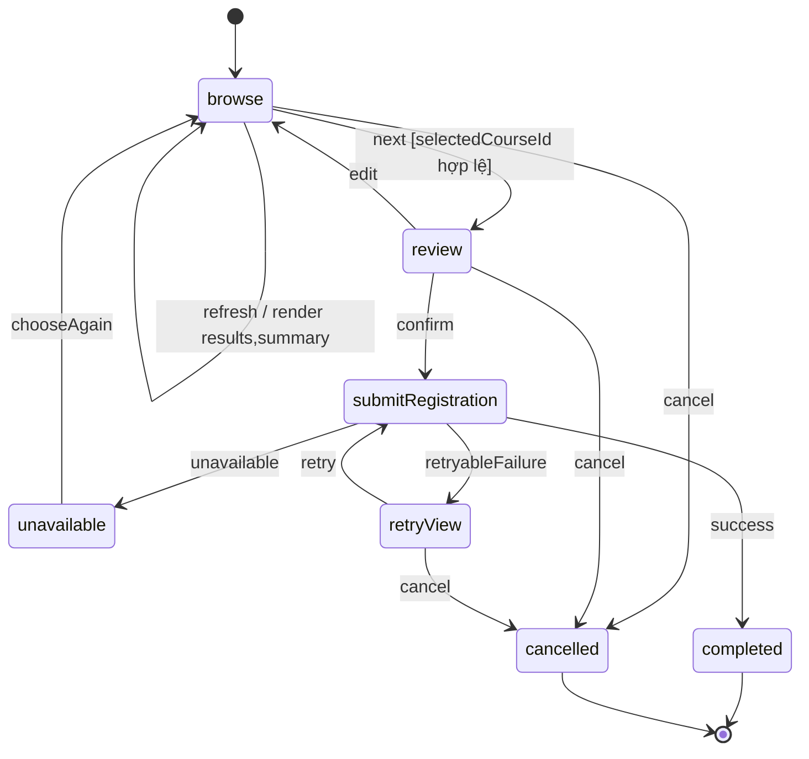
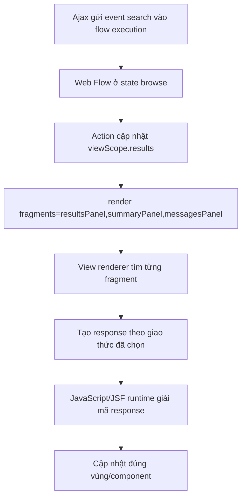

# Phần tử render và danh sách fragments trong Spring Web Flow

Trong một hành trình nhiều bước, đôi khi người dùng cần **làm mới một phần màn hình** nhưng vẫn ở nguyên trạng thái hiện tại. Ví dụ: ở bước chọn khóa học, họ thay từ khóa, bấm **Tìm kiếm**, và chỉ vùng kết quả cùng thông báo số lượng được cập nhật. Họ không cần tải lại phần điều hướng, header hay toàn bộ trang đăng ký.

Spring Web Flow có phần tử **`<render>`**, thường gặp dưới dạng **`<render fragments="..."/>`** trong transition của `view-state`. Nó mô tả **những phần của view đang hoạt động cần được render**, để hệ thống view/Ajax có thể trả phản hồi phù hợp. Để dùng đúng, phải phân biệt ba lớp: **Web Flow chọn fragment**, **view renderer tạo nội dung fragment**, và **thư viện giao diện đưa nội dung đó vào đúng vùng DOM**.

Bài thuộc chương **Ajax và phân mảnh** của module **SPRING_WEB_FLOW**. Các kiến thức liên quan gồm state, event, transition, form binding/validation, flow/view scope, tích hợp Spring MVC, kiểm thử request Ajax và phục hồi khi execution hết hạn. Mục tiêu là thực hành thiết kế `<render fragments="..."/>` từ XML tới giao diện, đồng thời hiểu giới hạn của mỗi thành phần.

Sau bài học, bạn có thể:

1. Mô tả ý nghĩa của `<render>` và thuộc tính `fragments`; phân biệt chúng với transition `to` và `on-render`.
2. Dùng transition nội bộ của `view-state` để xử lý event và render lại một hay nhiều fragment.
3. Thiết kế hợp đồng tên fragment giữa flow XML, view renderer và JavaScript/JSF client.
4. Xử lý lỗi binding/validation, dữ liệu `viewScope` và lựa chọn phải giữ trong `flowScope` khi cập nhật một phần trang.
5. Kiểm thử partial rendering, Ajax redirect, nội dung trả về, request tới flow execution cũ và race condition.

> **Lưu ý công nghệ:** cú pháp `<render fragments="..."/>` thuộc Spring Web Flow; nhưng việc “cắt” HTML thành fragment phụ thuộc bộ render tương thích. Các ví dụ dùng Spring JavaScript/Apache Tiles trong tài liệu lịch sử không mặc nhiên hoạt động trên mọi stack Spring hiện đại. Với JSF, giao thức Ajax và ID component lại có quy tắc riêng. Những ví dụ tích hợp cần đối chiếu chính xác version Spring Web Flow, Spring MVC, view technology và thư viện phía trình duyệt.

## 1. Tại sao cần phần tử render?

Một `view-state` thường đại diện cho màn hình mà người dùng đang tương tác. Có hai loại sự kiện chính:

- **Sự kiện chuyển bước:** từ màn `browse` sang `review` khi chọn khóa học xong.
- **Sự kiện ở lại màn:** lọc kết quả, phân trang, làm mới gợi ý, mở danh sách phụ thuộc.

Nếu mọi lần lọc đều chuyển sang state mới rồi tải toàn bộ trang, UX có thể giật, mất vị trí cuộn, mất focus và tốn tài nguyên render. Khi sự kiện **không rời view-state**, Spring Web Flow có thể chỉ định phần cần render lại:

```xml
<view-state id="browse" view="catalog/browse">
    <transition on="search">
        <render fragments="resultsPanel"/>
    </transition>
</view-state>
```

Đoạn trên diễn đạt ý định: nhận event `search` khi ở `browse`, giữ view đang hoạt động, và yêu cầu render `resultsPanel`. Nó **chưa** cho biết danh sách kết quả đến từ đâu; action truy vấn dữ liệu và bộ view renderer sẽ được bổ sung ở các mục sau.

Ba cách xử lý cần tách bạch:

| Thành phần | Quyết định gì? | Không tự làm gì? |
| --- | --- | --- |
| `<transition on="search">` | Event nào được xử lý ở state hiện tại | Không tự truy vấn dữ liệu hoặc cập nhật DOM |
| `<render fragments="resultsPanel"/>` | Phần nào của view được yêu cầu render | Không tự cắt một JSP/HTML tùy ý |
| View/Ajax integration | Fragment được tạo và đóng gói thành response ra sao | Không tự quyết định event nghiệp vụ nào hợp lệ |
| JavaScript/JSF runtime | Chèn kết quả vào vùng/component tương ứng | Không bảo đảm dữ liệu nghiệp vụ đã hợp lệ hay giao dịch đã commit |

Điểm quan trọng: **`<render>` là hướng dẫn render của flow**, không phải lệnh JavaScript trực tiếp và không phải một URL riêng cho fragment.

## 2. Cú pháp `<render>` và danh sách fragments

Dạng thường dùng:

```xml
<transition on="refresh">
    <render fragments="resultsPanel"/>
</transition>
```

Khi có nhiều vùng:

```xml
<transition on="search">
    <render fragments="resultsPanel,summaryPanel,messagesPanel"/>
</transition>
```

Trong trường hợp này:

- `resultsPanel` là vùng kết quả tìm kiếm.
- `summaryPanel` là vùng tóm tắt: bộ lọc đang áp dụng, tổng số kết quả.
- `messagesPanel` là vùng thông điệp, chẳng hạn không có kết quả hoặc cảnh báo.

Thuộc tính `fragments` biểu thị **danh sách định danh fragment** được yêu cầu render, thường được viết bằng cách phân tách tên bởi dấu phẩy trong cấu hình Spring Web Flow. Tên phải phù hợp với **công nghệ view**: đó có thể là fragment trong cấu trúc bố cục, hoặc một component/view fragment có ID mà renderer hiểu.

**Không nhầm dấu phẩy là CSS selector.** `fragments="resultsPanel,summaryPanel"` không tự động tương đương với `document.querySelectorAll("#resultsPanel,#summaryPanel")`. Spring Web Flow lưu yêu cầu render; view renderer có nhiệm vụ biết cách giải quyết từng fragment; phía client mới cập nhật DOM tương ứng.

Đối với một renderer hoặc JSF integration cụ thể, hãy xác nhận cú pháp danh sách và ID thực tế theo version. Những tên trùng nhau trong XML và HTML không đủ để chứng minh renderer có khả năng partial rendering.

### Đặt tên fragment rõ trách nhiệm

Một bộ tên có chủ đích dễ bảo trì hơn tên mơ hồ:

| Tên nên dùng | Mục đích | Cần cập nhật khi |
| --- | --- | --- |
| `resultsPanel` | Danh sách khóa học phù hợp | Từ khóa, bộ lọc, trang thay đổi |
| `summaryPanel` | Số lượng kết quả và bộ lọc hiện tại | Tìm kiếm hoặc phân trang |
| `messagesPanel` | Lỗi/warning/thông báo kết quả | Validation hoặc lỗi truy vấn |
| `paginationPanel` | Nút chuyển trang | Tổng kết quả hoặc trang hiện tại thay đổi |
| `searchFormPanel` | Form và execution URL hiện hành | Renderer tạo action URL mới hoặc form được thay thế |

Tránh tên chung như `body` nếu một trang có nhiều vùng cần cập nhật độc lập; ngược lại, không chia thành hàng chục fragment nhỏ nếu một nhóm luôn thay cùng lúc và renderer/client phải làm quá nhiều việc.

## 3. `<render>`, `on-render` và `to` khác nhau như thế nào?

Ba cấu trúc có thể cùng xuất hiện trong một `view-state` nhưng phục vụ các mục đích riêng:

| Cấu trúc | Ý nghĩa | Ví dụ |
| --- | --- | --- |
| `<render fragments="..."/>` | Chỉ định fragment cần đưa vào phản hồi render của transition | Cập nhật danh sách và tổng số kết quả |
| `<on-render> ... </on-render>` | Chạy action khi view-state sắp được render theo lifecycle | Nạp lại danh sách trước khi render |
| `to="review"` trên transition | Thay đổi state đích | Sang bước xem lại khóa học đã chọn |

Một event tìm kiếm giữ nguyên state:

```xml
<transition on="search">
    <evaluate expression="catalogService.search(query)"
              result="viewScope.results"/>
    <render fragments="resultsPanel,summaryPanel"/>
</transition>
```

Một event chuyển bước:

```xml
<transition on="next" to="review"/>
```

Với transition **không có `to`**, flow có thể xử lý hành động rồi tiếp tục render view hiện hành mà **không thực hiện việc rời và vào lại `view-state`**. Ngược lại, một transition có đích `to="browse"` là yêu cầu chuyển state; ngay cả khi tên đích trùng tên hiện tại, lifecycle và view scope có thể thay đổi. Đối với tương tác tại chỗ, đừng dùng self-transition có `to` như giải pháp thay thế vô điều kiện.

### Tình huống dùng `on-render`

Nếu dữ liệu phải được tải mỗi khi render view, có thể cấu hình:

```xml
<view-state id="browse" view="catalog/browse">
    <on-render>
        <evaluate expression="catalogService.search(query)"
                  result="viewScope.results"/>
    </on-render>
    <transition on="search">
        <render fragments="resultsPanel,summaryPanel"/>
    </transition>
</view-state>
```

Đây là **một chiến lược khác**, không nên chèn nguyên vào ví dụ chính nếu ví dụ chính đã gọi service tìm kiếm ngay trong transition. Kết hợp cả hai mà không cân nhắc có thể tạo **hai lần truy vấn** cho một event. `on-render` nên chứa công việc đọc/tính toán an toàn khi chạy lại, không đặt thao tác thanh toán hoặc tạo đơn trong hook render.

## 4. Bài toán xuyên suốt: tìm khóa học trong flow đăng ký

Thiết kế một hành trình:

1. Người dùng bắt đầu ở `browse`, nhập từ khóa và cấp độ khóa học.
2. Nhấn **Tìm kiếm**: server lọc kết quả, giữ `browse`, cập nhật `resultsPanel` và `summaryPanel`.
3. Nhấn **Làm mới**: truy vấn lại danh sách, vẫn ở cùng màn.
4. Chọn một khóa học, nhấn **Tiếp tục**: bind `selectedCourseId`, validate rồi sang `review`.
5. Ở `review`, người dùng có thể quay lại `browse` hoặc xác nhận ghi đăng ký.
6. Khi service phát hiện khóa học đã đóng nhận học viên, flow có nhánh nghiệp vụ `unavailable` quay về lựa chọn; lỗi kỹ thuật được xử lý riêng.



Mũi tên `browse → browse` trong Mermaid chỉ mô tả **kết quả giao diện vẫn ở cùng màn hình**. XML tương ứng dùng **transition không có `to`** để giữ ngữ cảnh view-state, không nhất thiết là một lần tự chuyển state thật.

## 5. Chọn scope cho dữ liệu render và dữ liệu nghiệp vụ

Dùng hai nhóm biến:

- `query`: bản nháp bộ lọc và `selectedCourseId` cần tồn tại khi chuyển màn. Có thể khai báo là `<var>` trong flow, được quản lý như dữ liệu của **flow execution**.
- `viewScope.results`: kết quả tìm kiếm hiện tại chỉ phục vụ màn `browse`. Nó có thể được thay mỗi lần `search`/`refresh` và không cần mang sang `review`.

| Dữ liệu | Vị trí đề xuất | Lý do |
| --- | --- | --- |
| `query.keyword` | `flowScope` qua model `query` | Giữ bộ lọc nếu người dùng quay lại |
| `query.level` | `flowScope` | Giữ lựa chọn cấp độ |
| `query.selectedCourseId` | `flowScope` | Chuyển tới `review` và service |
| `viewScope.results` | `viewScope` của `browse` | Chỉ cần khi render kết quả |
| Message binding/validation | Message context/view tùy integration | Gắn với lỗi nhập liệu hiện tại |
| Đăng ký đã commit | Database | Phải còn sau khi flow kết thúc |
| Request ID/idempotency key | Model do server quản lý và storage phù hợp | Ngăn gửi xác nhận lặp |

Cần nhớ `viewScope` thường tồn tại trong **một lần vào và tương tác với view-state**. Khi event `search` xử lý tại chỗ, view scope có thể được cập nhật qua nhiều HTTP request. Khi `next` rời sang `review`, đừng phụ thuộc vào `viewScope.results` cũ. Nếu người dùng quay lại `browse`, hãy tải lại danh sách bằng `on-entry` hoặc một action thích hợp.

Không đưa toàn bộ danh sách kết quả vào hidden input để mang sang review: client có thể sửa dữ liệu đó và danh sách có thể lỗi thời. Chỉ chuyển ID lựa chọn rồi để service xác nhận lại trạng thái khóa học trước khi đăng ký.

## 6. Model bộ lọc và hợp đồng service

Một JavaBean mẫu:

```java
package com.example.catalog;

import java.io.Serializable;
import java.util.UUID;

public class CourseQuery implements Serializable {
    private static final long serialVersionUID = 1L;

    private String keyword = "";
    private String level = "ALL";
    private String selectedCourseId;

    // Server sinh cho một yêu cầu đăng ký logic.
    private final String requestId = UUID.randomUUID().toString();

    public CourseQuery() {}

    public String getKeyword() { return keyword; }
    public void setKeyword(String keyword) {
        this.keyword = keyword;
    }

    public String getLevel() { return level; }
    public void setLevel(String level) {
        this.level = level;
    }

    public String getSelectedCourseId() {
        return selectedCourseId;
    }
    public void setSelectedCourseId(String selectedCourseId) {
        this.selectedCourseId = selectedCourseId;
    }

    public String getRequestId() { return requestId; }
}
```

Interface service minh họa:

```java
package com.example.catalog;

public interface CourseCatalogService {
    CourseSearchResult search(CourseQuery query);

    boolean canSelect(String courseId);
}
```

`CourseSearchResult` là DTO do ứng dụng định nghĩa, chẳng hạn chứa `items`, `totalCount` và thông tin phân trang. Để render trong JSP hoặc view khác, mỗi mục kết quả có thể gồm `id`, `title`, `description` đã được phép hiển thị.

Cần giới hạn độ dài từ khóa, mức phân trang và số lượng kết quả ở server, không tin tưởng tham số lọc do trình duyệt gửi. Khi chọn `selectedCourseId`, service phải kiểm tra ID có tồn tại, có được phép xem/chọn và còn khả dụng; danh sách đã render không phải bằng chứng chắc chắn rằng khóa học vẫn mở.

## 7. Flow XML hoàn chỉnh có danh sách fragments

Ví dụ `catalog-registration-flow.xml`. Nó giả định bean `courseCatalogService`, `registrationAction`, class `CourseQuery` và các view đã được ứng dụng cấu hình.

```xml
<?xml version="1.0" encoding="UTF-8"?>
<flow xmlns="http://www.springframework.org/schema/webflow"
      xmlns:xsi="http://www.w3.org/2001/XMLSchema-instance"
      xsi:schemaLocation="
        http://www.springframework.org/schema/webflow
        http://www.springframework.org/schema/webflow/spring-webflow.xsd"
      start-state="browse">

    <var name="query" class="com.example.catalog.CourseQuery"/>

    <view-state id="browse"
                view="catalog/browse"
                model="query">

        <!-- Mỗi lần vào browse, kết quả view-local được nạp lại. -->
        <on-entry>
            <evaluate expression="courseCatalogService.search(query)"
                      result="viewScope.results"/>
        </on-entry>

        <!-- Chỉ những trường UI này được phép bind. -->
        <binder>
            <binding property="keyword"/>
            <binding property="level"/>
            <binding property="selectedCourseId"/>
        </binder>

        <!-- Event tìm kiếm chỉ cập nhật các vùng của browse. -->
        <transition on="search"
                    bind="true"
                    validate="false">
            <evaluate expression="courseCatalogService.search(query)"
                      result="viewScope.results"/>
            <render fragments="resultsPanel,summaryPanel,messagesPanel"/>
        </transition>

        <transition on="refresh"
                    bind="false"
                    validate="false">
            <evaluate expression="courseCatalogService.search(query)"
                      result="viewScope.results"/>
            <render fragments="resultsPanel,summaryPanel"/>
        </transition>

        <!-- Đi sang màn khác: không dùng render tại chỗ. -->
        <transition on="next"
                    to="review"
                    bind="true"
                    validate="true"/>

        <transition on="cancel"
                    to="cancelled"
                    bind="false"
                    validate="false"/>
    </view-state>

    <view-state id="review" view="catalog/review">
        <transition on="edit" to="browse"/>
        <transition on="confirm" to="submitRegistration"/>
        <transition on="cancel" to="cancelled"/>
    </view-state>

    <action-state id="submitRegistration">
        <evaluate expression="registrationAction.submit(query)"/>
        <transition on="success" to="completed"/>
        <transition on="unavailable" to="unavailable"/>
        <transition on="retryableFailure" to="retryView"/>
    </action-state>

    <view-state id="unavailable" view="catalog/unavailable">
        <transition on="chooseAgain" to="browse"/>
        <transition on="cancel" to="cancelled"/>
    </view-state>

    <view-state id="retryView" view="catalog/retry">
        <transition on="retry" to="submitRegistration"/>
        <transition on="cancel" to="cancelled"/>
    </view-state>

    <end-state id="completed" view="catalog/completed"/>
    <end-state id="cancelled" view="catalog/cancelled"/>
</flow>
```

### Đọc chính xác từng transition

| Transition | Binding/validation | State có thay đổi? | Render |
| --- | --- | --- | --- |
| `search` | Bind bộ lọc; ví dụ tắt validation của cả model | Không | `resultsPanel`, `summaryPanel`, `messagesPanel` |
| `refresh` | Không bind dữ liệu gửi ở request | Không | `resultsPanel`, `summaryPanel` |
| `next` | Bind và validate model theo cấu hình | Có, sang `review` | View `review` theo chính sách render/redirect |
| `cancel` | Không bind/validate | Có, kết thúc | Kết quả hủy |
| `edit` ở `review` | N/A cho form `browse` | Có, quay về `browse` | Nạp lại kết quả ở `on-entry` |
| `confirm` | Không gửi trực tiếp event kết quả | Có, sang action-state | Theo kết quả service |

**Vì sao `search` dùng `validate="false"`?** Bản nháp `query` có thể có ràng buộc bắt buộc đối với `selectedCourseId` khi người dùng bấm **Tiếp tục**. Nếu validator của cả model chạy mọi lần tìm kiếm, người dùng chưa chọn khóa học sẽ bị chặn không thể tìm. Vì vậy ta cho phép tìm kiếm với bộ lọc chưa có lựa chọn, nhưng **service tìm kiếm vẫn phải kiểm tra và chuẩn hóa** từ khóa/`level`. Ở event `next`, cần cấu hình validator cho selection đúng cách và kiểm tra lại ở service; không nhầm `validate="true"` với việc tự động có đủ mọi quy tắc mà không cần validator.

Lưu ý: `refresh` với `bind="false"` không lưu các thay đổi vừa nhập nhưng chưa nhấn **Tìm kiếm**. Nó truy vấn dựa trên `query` đang ở flow scope, không nhất thiết dựa trên những gì đang hiện trong ô nhập DOM. Nếu sản phẩm muốn refresh đồng thời áp dụng giá trị mới, hãy đổi chính sách binding của event đó và kiểm thử.

### Hai kiểu lỗi cần xử lý riêng

Nếu email, từ khóa hoặc `level` không phù hợp, đây là lỗi input/binding hoặc validation. Nếu dịch vụ tìm kiếm timeout, đó là lỗi kỹ thuật; không được chuyển thành “không có khóa học” hay tạo `results` rỗng như một kết luận nghiệp vụ. Cấu hình action/exception handler và view lỗi phải phản ánh đúng trạng thái chưa xác định.

## 8. Render fragment không đồng nghĩa render HTML bất kỳ

Yêu cầu:

```xml
<render fragments="resultsPanel,summaryPanel"/>
```

chỉ hữu ích khi view technology có thể **giải quyết từng tên fragment** và xây dựng response mà client hiểu.

Ví dụ renderer và client đã thống nhất:

| Fragment name từ Web Flow | Vùng HTML phía client | Nội dung server |
| --- | --- | --- |
| `resultsPanel` | `#resultsPanel` | Danh sách khóa học |
| `summaryPanel` | `#summaryPanel` | Tổng số kết quả và bộ lọc |
| `messagesPanel` | `#messagesPanel` | Lỗi/warning/thông điệp |
| `paginationPanel` | `#paginationPanel` | Nút phân trang |

Định danh HTML có thể trùng tên fragment để dễ mapping, nhưng **chỉ đặt `id="resultsPanel"` trong JSP không khiến Web Flow tự bóc phần đó thành partial response**. View resolver hoặc renderer phải biết tạo kết quả từng vùng. Phía browser cần parser/adapter tương ứng để áp dụng response.

### Mô hình render theo hợp đồng



Nếu bước **E** không được hỗ trợ, phần tử `<render>` không thể một mình tạo chức năng partial update. Nếu bước **G** không biết response có cấu trúc gì, DOM cũng không được cập nhật dù server đã render đúng.

## 9. Các công nghệ view và ý nghĩa của tên fragment

Có nhiều cơ chế xây dựng giao diện với Spring Web Flow. Mỗi cơ chế có cách ánh xạ tên fragment riêng.

| View technology | Cách hiểu fragments | Điều kiện tích hợp |
| --- | --- | --- |
| Spring JavaScript + Apache Tiles (legacy) | Tên vùng/fragment được renderer biết từ bố cục Tiles | View resolver Ajax-aware, Tiles definitions, client Spring JS phù hợp |
| JSF/Facelets Ajax | ID component hoặc vùng cần render trong JSF component tree | Spring Faces/JSF integration, `JsfAjaxHandler`, JSF partial-response runtime |
| JSP + JavaScript tự viết | Tên do ứng dụng định nghĩa | Custom partial view renderer và client parser phải đồng ý contract |
| Thymeleaf + JavaScript tự viết | Fragment/template do ứng dụng xác định | Custom resolver/controller/view strategy tương thích với Web Flow |
| HTML full-page thông thường | Không cần cập nhật partial | Trình duyệt thực hiện render/redirect bình thường |

### Spring JavaScript và Apache Tiles (công nghệ legacy)

Một số ứng dụng Web Flow cũ sử dụng `AjaxUrlBasedViewResolver` và `FlowAjaxTiles3View` cùng Apache Tiles. Các lớp này giúp render fragment từ Tiles khi request được nhận diện là Ajax. Các cấu hình lịch sử có thể có dạng:

```xml
<bean id="flowTilesViewResolver"
      class="org.springframework.webflow.mvc.view.AjaxUrlBasedViewResolver">
    <property name="viewClass"
              value="org.springframework.webflow.mvc.view.FlowAjaxTiles3View"/>
</bean>
```

Đây là **fragment cấu hình tham khảo theo API của dòng Spring Web Flow/Tiles tương thích**, không phải cấu hình hoàn chỉnh cho phiên bản Spring hiện đại. Cần đối chiếu sự tồn tại của class, dependency và cách Spring MVC chọn view resolver. Apache Tiles 3 là công nghệ ngừng phát triển; không lấy ví dụ này làm lựa chọn mặc định cho dự án mới.

### JSF/Facelets: component ID có naming container

Với JSF, request Ajax có thể nhắm tới component cụ thể. Ví dụ:

```xml
<h:form id="searchForm"
        xmlns:h="http://xmlns.jcp.org/jsf/html"
        xmlns:f="http://xmlns.jcp.org/jsf/core">

    <h:inputText id="keyword" value="#{query.keyword}"/>

    <h:commandButton value="Tìm kiếm" action="search">
        <f:ajax execute="@form"
                render="resultsPanel summaryPanel messagesPanel"/>
    </h:commandButton>

    <h:messages id="messagesPanel"/>

    <h:panelGroup id="summaryPanel">
        <h:outputText value="#{viewScope.results.totalCount}"/>
    </h:panelGroup>

    <h:panelGroup id="resultsPanel">
        <!-- Các component hiển thị danh sách. -->
    </h:panelGroup>
</h:form>
```

Đây là ví dụ **minh họa riêng cơ chế `f:ajax render` của JSF**, không có nghĩa là chỉ cần copy vào flow JSP ở mục trước. Với Jakarta Faces 4, phải thay các namespace JSF cũ bằng URI `jakarta.faces.html` / `jakarta.faces.core` và dùng bản Spring Faces tương thích. Cần xác minh cách biểu thức truy cập Web Flow `viewScope` được JSF EL resolver đưa ra, đồng thời kiểm tra component IDs thực tế (ví dụ `searchForm:resultsPanel`) vì JSF naming container có thể thay đổi client ID.

Đối với Web Flow + JSF, `<render fragments="..."/>` và `<f:ajax render="...">` đều có thể liên quan đến partial rendering nhưng thuộc **hai tầng API khác nhau**. Không mặc định danh sách tên và cú pháp của chúng luôn được diễn giải y hệt; kiểm tra cơ chế integration ở phiên bản sử dụng.

## 10. Một view mẫu hiển thị các vùng có tên rõ ràng

Giả sử renderer đã expose `viewScope.results` thành biến `results` của JSP. Đoạn minh họa nội dung cho `catalog/browse`:

```jsp
<%@ taglib prefix="c" uri="http://java.sun.com/jsp/jstl/core" %>
<%@ taglib prefix="form" uri="http://www.springframework.org/tags/form" %>

<h1>Chọn khóa học</h1>

<form:form id="catalogForm"
           modelAttribute="query"
           action="${flowExecutionUrl}"
           method="post">

    <label for="keyword">Từ khóa</label>
    <form:input id="keyword" path="keyword"/>

    <label for="level">Cấp độ</label>
    <form:select id="level" path="level">
        <form:option value="ALL" label="Tất cả"/>
        <form:option value="BEGINNER" label="Cơ bản"/>
        <form:option value="ADVANCED" label="Nâng cao"/>
    </form:select>

    <button type="submit" name="_eventId_search">
        Tìm kiếm
    </button>

    <button type="submit" name="_eventId_refresh">
        Làm mới
    </button>

    <div id="messagesPanel" role="status">
        <form:errors path="*" cssClass="field-error"/>
    </div>

    <section id="summaryPanel">
        <p>
            Có <c:out value="${results.totalCount}"/> kết quả.
        </p>
    </section>

    <section id="resultsPanel">
        <c:forEach items="${results.items}" var="course">
            <div class="course-option">
                <label>
                    <form:radiobutton path="selectedCourseId"
                                      value="${course.id}"/>
                    <c:out value="${course.title}"/>
                </label>
            </div>
        </c:forEach>
    </section>

    <button type="submit" name="_eventId_next">
        Tiếp tục
    </button>

    <button type="submit" name="_eventId_cancel">
        Hủy
    </button>
</form:form>
```

Các thuộc tính trong markup chỉ thể hiện **cấu trúc vùng và cơ chế binding**. Để Ajax cập nhật từng `section`, renderer cần có khả năng cung cấp các vùng được yêu cầu, ví dụ một response chứa cả `summaryPanel`, `resultsPanel` và `messagesPanel`. Một JSP được render toàn trang không tự trở thành một API fragment vì trong HTML có vài `id`.

**Lưu ý về CSRF:** form POST phải gửi token hợp lệ nếu Spring Security bật CSRF protection. `form:form` có thể tích hợp cơ chế tự chèn token nhờ cấu hình MVC/Security; khi dùng form/JS tùy biến cần kiểm tra request thực tế.

**Lưu ý về dữ liệu an toàn:** `<c:out>` escape nội dung do người dùng hoặc service cung cấp. Đừng chèn kết quả không tin cậy trực tiếp bằng `innerHTML` ở client mà không có contract bảo đảm escape/sanitization.

## 11. Client cần hiểu giao thức phản hồi trước khi thay DOM

Spring Web Flow không mặc định biến mọi request Ajax thành JSON. Tùy `AjaxHandler`/view renderer:

- Request có thể được nhận diện qua `Accept: text/html;type=ajax` hoặc tham số `ajaxSource` trong cấu hình `DefaultAjaxHandler`.
- Response có thể chứa HTML fragments theo view renderer.
- Một redirect có thể được mã hóa bằng header `Spring-Redirect-URL` để JavaScript điều hướng.
- JSF sử dụng **`partial-response`** theo giao thức JSF; không thể dùng HTML parser đơn giản để đọc như kết quả JSP.

Đối với renderer HTML do ứng dụng tự thiết kế, hãy định nghĩa *contract* trước khi viết JavaScript. Ví dụ:

> Response thành công chứa các phần tử bao với ID `resultsPanel`, `summaryPanel`, `messagesPanel`. Client parse HTML, tìm đúng ID và thay các phần tử tương ứng. Nếu có header redirect hợp lệ, client điều hướng thay vì parse fragment. Response không đúng contract bị coi là lỗi, không thay bừa vào DOM.

Ví dụ JavaScript **minh họa** với contract HTML đó:

```javascript
let latestSearchId = 0;

// Giả định form vẫn còn trong DOM sau khi thay ba panel.
async function submitSearch(form) {
  const searchId = ++latestSearchId;
  const body = new FormData(form);
  body.append("_eventId_search", "");

  const response = await fetch(form.action, {
    method: "POST",
    credentials: "same-origin",
    headers: {
      Accept: "text/html;type=ajax"
    },
    body
  });

  if (searchId !== latestSearchId) return;

  const redirect = response.headers.get("Spring-Redirect-URL");
  if (redirect) {
    const url = new URL(redirect, window.location.href);

    // Không điều hướng tới origin bên ngoài nếu chưa được phép.
    if (url.origin !== window.location.origin) {
      throw new Error("Redirect không được phép");
    }
    window.location.assign(url.href);
    return;
  }

  if (!response.ok) {
    throw new Error("Yêu cầu tìm kiếm thất bại");
  }

  const html = await response.text();
  const documentFromServer =
      new DOMParser().parseFromString(html, "text/html");

  for (const id of [
    "resultsPanel",
    "summaryPanel",
    "messagesPanel"
  ]) {
    const current = document.getElementById(id);
    const incoming = documentFromServer.getElementById(id);
    if (!current || !incoming) {
      throw new Error("Thiếu fragment: " + id);
    }
  }

  // Chỉ thay DOM sau khi đã xác nhận đủ các vùng yêu cầu.
  for (const id of [
    "resultsPanel",
    "summaryPanel",
    "messagesPanel"
  ]) {
    const current = document.getElementById(id);
    const incoming = documentFromServer.getElementById(id);
    current.replaceWith(incoming);
  }
}
```

Đoạn này **không phải thư viện Ajax chính thức của Spring Web Flow** và chỉ xử lý trường hợp server trả HTML có wrapper ID. Nếu renderer dùng một envelope XML/JSON khác, phải viết parser đúng định dạng. Chỉ riêng `<render fragments="..."/>` không bảo đảm response có đúng HTML như ví dụ.

Điểm cần bổ sung khi đưa vào ứng dụng thật:

1. Gắn sự kiện submit cho form tìm kiếm, `preventDefault()` chỉ với nút Ajax; nút `next` vẫn có thể dùng POST/full-page.
2. Chèn CSRF token vào request theo chính sách Spring Security.
3. Từ view/fragment mới, **cập nhật URL execution** nếu server thay đổi action URL hoặc snapshot.
4. Kiểm soát lỗi mạng, loading, trạng thái disable nút và khả năng truy cập qua bàn phím.
5. Bỏ qua response đến muộn; một request ID ở client chỉ giải quyết hiển thị, không thay thế kiểm soát concurrency của server.
6. Hạn chế tối đa thay nguyên form nếu nó gây mất focus và event handler; nếu phải thay form, dùng event delegation hoặc gắn lại listener theo cách đáng tin cậy.

## 12. Tại sao render nhiều fragments giúp UI nhất quán?

Giả sử sự kiện tìm kiếm trả về 8 kết quả thay vì 25. Nếu chỉ render `resultsPanel`, phần `summaryPanel` vẫn hiện “25 kết quả”. Nếu phân trang phụ thuộc tổng số kết quả, `paginationPanel` cũng có thể trở nên sai.

Vì vậy, danh sách fragments nên chứa **mọi vùng phụ thuộc vào dữ liệu đã thay đổi**:

```xml
<transition on="search">
    <evaluate expression="courseCatalogService.search(query)"
              result="viewScope.results"/>
    <render fragments="resultsPanel,summaryPanel,paginationPanel,messagesPanel"/>
</transition>
```

Nhưng nhiều fragments không có nghĩa nhiều thao tác database. Action `search` chỉ cần tạo **một kết quả truy vấn nhất quán** trong `viewScope.results`; các vùng render đọc từ cùng đối tượng đó. Tránh mỗi fragment tự chạy lại query rồi nhận các snapshot dữ liệu khác nhau.

Một nguyên tắc hữu ích:

- **Một event → một lần tính dữ liệu nguồn có chủ đích → nhiều fragment đọc cùng kết quả.**
- **Một lỗi validation → tất cả vùng hiển thị lỗi có liên quan cần được cập nhật.**
- **Một state transition thật → xử lý điều hướng/redirect theo state mới, không ép kết quả trang mới vào các vùng của view cũ.**

Nếu cập nhật quá nhiều fragment gây payload lớn hơn full-page, hãy đo hiệu năng thực tế thay vì mặc định Ajax luôn nhanh hơn.

## 13. Binding, validation và các nhánh lỗi khi render từng phần

Ajax không bỏ qua Web Flow binding/validation. Khi form gửi event `search`, các property được `<binder>` cho phép vẫn có thể được bind vào model; khi gửi event `next`, validation cần xác định khóa học đã chọn có hợp lệ hay không.

### Khi search cho phép bộ lọc chưa hoàn chỉnh

Ở XML chính, `search` dùng `validate="false"` vì chưa cần bắt buộc `selectedCourseId`. Dù thế, vẫn phải kiểm tra đầu vào tại service tìm kiếm:

- Giới hạn số ký tự của `keyword`.
- Chỉ chấp nhận `level` trong tập cho phép.
- Giới hạn trang/sort field để tránh truy vấn đắt.
- Escape nội dung khi đưa lên HTML.
- Áp dụng phân quyền trước khi trả danh sách khóa học.

### Khi người dùng bấm Next

`next` có `bind="true" validate="true"`. Nếu thiếu `selectedCourseId`, validator phù hợp phải gắn lỗi vào model. Vì transition không hoàn tất, flow có thể ở nguyên `browse`. Cần bảo đảm view renderer/Ajax client **hiển thị lỗi**, không chỉ render `resultsPanel` rồi bỏ qua vùng message.

**Một chi tiết quan trọng:** khi binding/validation của view-state thất bại, framework có thể render lại view theo cơ chế lỗi mà **không chạy các action/`<render>` nằm trong thân transition như ở đường thành công**. Vì vậy, không được coi việc viết `<render fragments="messagesPanel"/>` trong một transition là lời hứa rằng mọi lỗi validation đều trả về chính fragment đó. Hãy kiểm thử response khi gửi dữ liệu sai và cấu hình view/message handling thích hợp.

### Khi search service thất bại

Một request truy vấn kết quả có thể timeout. Không biến timeout thành “0 kết quả” vì đây là **lỗi kỹ thuật**, không phải kết luận nghiệp vụ. Có thể hiển thị thông báo tạm thời trong vùng `messagesPanel` khi tầng action đã phân loại lỗi; lỗi bất ngờ vẫn phải theo handler kỹ thuật và được log/giám sát.

### Khi flow execution hết hạn

Request Ajax có URL execution cũ có thể dẫn tới lỗi không tìm thấy execution, redirect login hoặc trang lỗi. Client **không** được nhét nguyên trang login vào `resultsPanel`. Cần nhận diện response ngoài contract, hiển thị hướng khởi động lại/khôi phục flow an toàn, và không tự phát lại lệnh ghi nghiệp vụ.

## 14. Đổi view-state, PRG và embedded mode

Trong Spring Web Flow, **POST–Redirect–GET** thường được dùng khi chuyển sang một view-state khác để tránh browser hỏi gửi lại form khi refresh. Ajax ở cùng view-state lại có thể render fragment trực tiếp.

| Tình huống | Hành vi mong đợi |
| --- | --- |
| `browse` nhận `search` | Giữ state; trả fragment phù hợp |
| `browse` nhận `refresh` | Giữ state; tải dữ liệu lại và trả fragment |
| `browse` nhận `next` | Sang `review`; client xử lý render/redirect theo cấu hình |
| `review` nhận `confirm` | Thực thi action; kết thúc hoặc rẽ nhánh nghiệp vụ |
| Ajax cần redirect | Ajax handler gửi chỉ dẫn mà client hiểu, ví dụ `Spring-Redirect-URL` |
| Flow chạy embedded | Có thể chuyển qua nhiều view-state trong vùng nhúng với cấu hình/giao thức phù hợp |

Đừng sử dụng `<render fragments="resultsPanel"/>` như cách cố gắng cập nhật `review` sau khi đã chuyển state: fragment `resultsPanel` thuộc view `browse` và có thể không tồn tại ở view mới.

**Embedded mode** là trường hợp flow chạy bên trong một vùng của trang/modal; hành vi redirect và partial rendering phụ thuộc công nghệ UI. Nó không thay thế yêu cầu xây dựng fragment renderer và client xử lý đúng protocol.

## 15. Hiệu năng, snapshot, concurrency và bảo mật

### Tránh dữ liệu lớn trong view scope

Kết quả tìm kiếm chỉ dùng ở một view-state có thể đặt trong `viewScope`, nhưng không nên giữ hàng nghìn entity JPA, stream chưa đóng hoặc resource kết nối. Dùng DTO gọn, phân trang và tải lại khi cần. Tùy flow execution repository, scope có thể tham gia snapshot/serialization; dữ liệu quá lớn gây tăng bộ nhớ hoặc lỗi khôi phục.

### Phản hồi đến sai thứ tự

Nếu người dùng gõ nhanh và gửi nhiều request Ajax, response tìm kiếm cũ có thể tới sau response mới. Client phải tránh dùng kết quả cũ ghi đè UI. Nhưng nếu cả hai request cùng **ghi vào một flow execution** trên server, vấn đề không chỉ là hiển thị: cần kiểm tra cơ chế locking/snapshot và chính sách cancel/serialize requests. Khi gửi lại event với execution key cũ, server có thể từ chối do stale execution.

### Không coi fragment HTML là vùng đáng tin tự động

HTML trả về có thể chứa nội dung từ người dùng hoặc dữ liệu ngoài. Server cần escape đúng ngữ cảnh, client chỉ đưa HTML từ nguồn tin cậy vào DOM và không biến response lỗi/redirect thành markup. Header redirect cũng phải được giới hạn URL cho phép, tránh open redirect.

### Không gửi event ghi dữ liệu bằng GET

Tìm kiếm/lọc thường là thao tác đọc; event xác nhận đăng ký lại có side effect. Với các event ghi, dùng POST và CSRF protection. Tuy nhiên POST không tự ngăn lệnh ghi lặp: service phải có transaction, quyền truy cập và cơ chế idempotency.

## 16. Bộ kiểm thử cho `<render fragments="..."/>`

Cần kiểm tra **ba tầng độc lập**: flow có yêu cầu đúng fragment không, renderer có tạo response đúng contract không, và browser có cập nhật giao diện chính xác không.

| ID | Tình huống | Điều cần assert |
| --- | --- | --- |
| T1 | Khởi động flow | State `browse`, dữ liệu `viewScope.results` được nạp |
| T2 | `search` với bộ lọc hợp lệ | Vẫn `browse`, service nhận query mới, `results` được cập nhật |
| T3 | `refresh` không bind | Vẫn `browse`, query trong model không bị thay bởi input chưa xác nhận |
| T4 | Render một fragment | Response tương ứng có `resultsPanel` theo renderer |
| T5 | Render ba fragments | `resultsPanel`, `summaryPanel`, `messagesPanel` đầy đủ, không chồng lẫn |
| T6 | Kết quả thay từ 25 còn 8 | UI kết quả và tổng số nhất quán |
| T7 | Search không có kết quả | Hiển thị “không tìm thấy” hợp lệ, không hiểu thành lỗi hệ thống |
| T8 | Input lọc không hợp lệ | Service từ chối/chuẩn hóa đúng chính sách, UI không hiển thị kết quả sai |
| T9 | `next` khi chưa chọn course | Không qua `review`; message được render |
| T10 | `next` với course hợp lệ | Đến `review` và xử lý chuyển view đúng |
| T11 | `review` → `edit` | Về `browse`, query trong flow scope còn, results nạp lại |
| T12 | Ajax redirect | Client đọc header/protocol, không nhét trang đích vào panel |
| T13 | Renderer không trả đủ fragment | Client báo lỗi contract, không cập nhật DOM nửa chừng |
| T14 | Request Ajax tới execution đã hết hạn | Báo hết phiên, không tự chạy lại confirm |
| T15 | Hai request search đến ngược thứ tự | UI giữ kết quả mới nhất hợp lệ |
| T16 | Event xác nhận gửi hai lần | Service bảo đảm một yêu cầu logic, không ghi trùng |
| T17 | CSRF sai | Server từ chối theo chính sách |
| T18 | Dữ liệu chứa ký tự HTML | Content được escape, không thực thi script |
| T19 | Renderer trả full HTML thay fragment | Client không coi là partial response thành công |
| T20 | User logout rồi search Ajax | Response login/unauthorized được nhận diện riêng |

### Mã giả kiểm thử ở tầng flow

```text
startFlow("catalogRegistration")
  -> assertCurrentState("browse")
  -> assertViewScope("results", initialResults)

submitEvent("search", keyword="webflow", level="BEGINNER")
  -> assertCurrentState("browse")
  -> assertFlowScope("query.keyword", "webflow")
  -> assertViewScope("results", filteredResults)
  -> assertCatalogSearchCalledOnce()

submitEvent("refresh", keyword="ignored because bind=false")
  -> assertCurrentState("browse")
  -> assertFlowScope("query.keyword", "webflow")
  -> assertViewScope("results", refreshedResults)

submitEvent("next", selectedCourseId="COURSE-101")
  -> assertCurrentState("review")
  -> assertFlowScope("query.selectedCourseId", "COURSE-101")

submitEvent("edit")
  -> assertCurrentState("browse")
  -> assertQueryPreserved()
  -> assertResultsLoadedOnEntry()
```

Đây là pseudocode, **không phải API thực của test framework**. Spring Web Flow test support có thể kiểm tra state/event/scope với mock services. Việc xác nhận response chứa các fragments và DOM được thay đúng vị trí cần **integration/E2E test** với view renderer và browser.

### Kiểm thử renderer và client contract

Một test trình duyệt nên:

1. Mở form, lưu text/HTML của `resultsPanel` và `summaryPanel` trước thao tác.
2. Gửi search Ajax qua đúng `flowExecutionUrl` và tên event.
3. Đọc Network: method, `Accept`/tham số nhận diện Ajax, CSRF, response status/header/body.
4. Assert các fragment mục tiêu đã thay, vùng ngoài mục tiêu (header/navigation) không bị thay ngoài ý định.
5. Assert form/action URL của execution sau render vẫn hợp lệ cho event tiếp theo.
6. Cho server trả chỉ dẫn redirect, xác minh client điều hướng thay vì parse fragment.
7. Mô phỏng trả response thiếu vùng hoặc response cũ đến trễ; UI vẫn không ghi đè dữ liệu mới.
8. Mở hai execution độc lập, xác nhận state/bản nháp không lẫn giữa chúng.

## 17. Các sai lầm thường gặp

**Chỉ đặt `id="resultsPanel"` ở JSP rồi mong `<render>` hoạt động.** HTML ID chỉ phục vụ mapping phía trình duyệt; view renderer phải hỗ trợ trích xuất fragment.

**Đưa `<render>` vào transition chuyển state với kỳ vọng thay fragment của trang cũ.** Khi sang `review`, UI cần xử lý view mới/redirect, không đơn giản thay phần của `browse`.

**Viết `to="browse"` cho mọi lần lọc.** Việc tự chuyển state có thể làm chạy lại lifecycle và thay đổi `viewScope`; nếu cần giữ màn tại chỗ, dùng transition nội bộ không có `to`.

**Gọi tìm kiếm ở cả transition và `on-render` mà không xét số lần thực thi.** Một request có thể gọi dịch vụ hai lần, làm tăng chi phí và tạo dữ liệu không nhất quán.

**Chỉ render danh sách mà quên tổng số và thông báo.** UI hiển thị mâu thuẫn khi kết quả thay đổi hoặc validation lỗi.

**Giả định `fragments` là CSS selector.** Đó là tên fragment theo hợp đồng view technology, không phải truy vấn DOM tự động.

**Xử lý mọi HTTP 200 như partial HTML.** Trang đăng nhập, lỗi hoặc HTML toàn trang có thể xuất hiện sau redirect/timeout; client phải kiểm tra giao thức và ID.

**Không xử lý JSF partial-response riêng.** XML response của JSF cần JSF Ajax runtime hoặc parser đúng chuẩn, không thay bằng DOM parser HTML tổng quát.

**Giữ execution URL cũ trong JavaScript.** Sau snapshot/transition, action URL có thể thay; cần dùng URL do Web Flow cung cấp trong view mới.

**Tin vào kết quả tìm kiếm đã render để xác nhận đăng ký.** Khóa học có thể hết chỗ hoặc thay đổi quyền truy cập; service phải xác minh lại khi commit.

## 18. Bài thực hành: danh sách phụ thuộc vào bộ lọc

Từ màn `browse`, hãy mở rộng thành hai bộ lọc **lĩnh vực** và **cấp độ**:

1. Khi thay lĩnh vực, gửi event `changeCategory`, lấy lại danh sách cấp độ phù hợp.
2. Cập nhật các fragment `levelPanel`, `resultsPanel`, `summaryPanel` và `messagesPanel`.
3. Giữ `category` trong model thuộc flow scope; dữ liệu cấp độ cho riêng view đặt trong `viewScope.availableLevels`.
4. Khi user đổi lĩnh vực, reset lựa chọn cấp độ không còn hợp lệ trước khi render lại.
5. Dùng transition **không có `to`** cho `changeCategory`, tránh rời khỏi màn hình.
6. Khi bấm **Tiếp tục**, validate cả lựa chọn course và quyền truy cập.
7. Tạo client/parser đọc response theo đúng giao thức mà renderer cung cấp.
8. Kiểm thử request đồng thời, timeout, execution key cũ và kết quả khóa học thay đổi.
9. Bổ sung đường fallback full-page nếu JavaScript không hoạt động, miễn là UX và backend cho phép.
10. Với hệ thống JSF, thử chuyển sang `f:ajax` và xác minh component IDs/partial response thay vì dùng parser HTML của JSP.

Bài nộp nên có sơ đồ state, XML `<render>` với danh sách fragments, quy tắc scope, ví dụ view, contract response, kiểm thử ở tầng flow và trình duyệt.

## 19. Checklist trước khi hoàn tất

- [ ] Event dùng để cập nhật tại chỗ được khai báo tại đúng `view-state`.
- [ ] Transition nội bộ không dùng `to` khi cần giữ nguyên view-state.
- [ ] `<render fragments="..."/>` liệt kê đúng các vùng cần cập nhật.
- [ ] Mọi tên fragment được view renderer hỗ trợ và client ánh xạ rõ ràng.
- [ ] Dữ liệu dùng chung cho nhiều vùng render đến từ cùng nguồn nhất quán.
- [ ] `on-entry`, `on-render` và action trong transition không gây truy vấn lặp ngoài ý muốn.
- [ ] `viewScope` chỉ giữ dữ liệu của view; `flowScope` giữ lựa chọn xuyên bước.
- [ ] Binding/validation và thông báo lỗi được xử lý ngay cả khi event thất bại.
- [ ] Chuyển state thật được xử lý bằng navigation/redirect phù hợp, không chèn nhầm HTML.
- [ ] Ajax request gửi đúng execution URL, event và CSRF token.
- [ ] JSF partial response không bị parse như HTML fragment tùy ý.
- [ ] Client chống response đến trễ, nhận diện lỗi hết phiên và redirect.
- [ ] Nội dung HTML được escape; hành động ghi vẫn được bảo vệ bởi service.
- [ ] Có test flow, test renderer và E2E test cho nhiều fragments.

**Kết luận:** `<render fragments="..."/>` cho phép một transition của Spring Web Flow **nêu rõ các phần view cần cập nhật** khi xử lý sự kiện, đặc biệt trong Ajax interaction giữ nguyên `view-state`. Nhưng chỉ dẫn này chưa phải toàn bộ hệ thống partial rendering. Bạn cần thiết kế **danh sách fragment nhất quán**, cung cấp **view renderer hiểu các tên đó**, dùng **Ajax client xử lý đúng response/redirect**, đồng thời giữ nguyên nguyên tắc binding, validation, scope, bảo mật và kiểm thử của một hành trình web nhiều bước.
