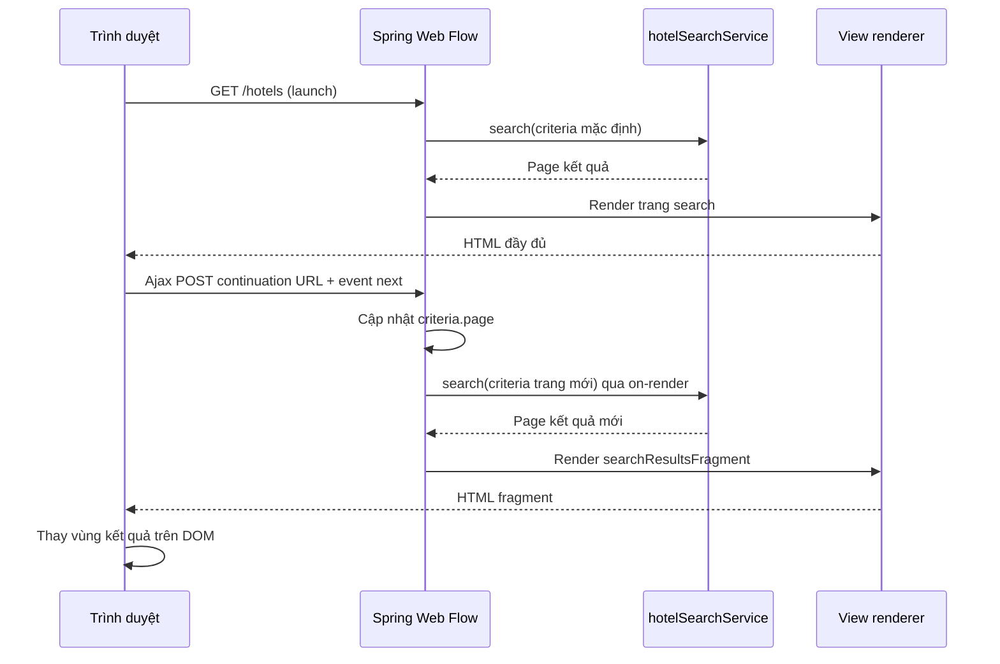

# Transition ở cùng màn hình để cập nhật dữ liệu

## 1. Bài toán: cập nhật kết quả mà không rời màn hình hiện tại

Trong **Spring Web Flow (SWF)**, một `view-state` thường hiển thị một màn hình và chờ người dùng phát event. Khi event được xử lý, flow có thể chuyển sang state khác hoặc **ở lại state hiện tại** để cập nhật dữ liệu và render lại một phần giao diện.

Ví dụ trang tìm kiếm phòng khách sạn có:

- Form nhập thành phố, ngày nhận/trả phòng và số khách.
- Khu vực danh sách phòng phù hợp.
- Nút **Tìm kiếm**, **Trang trước**, **Trang sau**.
- Khu vực thông báo lỗi hoặc số kết quả.

Người dùng muốn bấm Trang sau và chỉ cập nhật danh sách kết quả. Form, tiêu đề trang và các phần xung quanh vẫn giữ nguyên. Đây là trường hợp phù hợp với **same-state transition** kết hợp **partial rendering**.

Spring Web Flow cung cấp hai cơ chế ở phía flow:

1. **Event handler:** khai báo transition không có thuộc tính `to`. Flow xử lý event nhưng vẫn ở view-state hiện tại.
2. **Render action:** dùng `<render fragments="..."/>` trong transition để yêu cầu render lại một hoặc nhiều fragment của view.

Khi request được gửi bằng Ajax và hạ tầng view hỗ trợ fragment rendering, trình duyệt nhận HTML của vùng cần cập nhật rồi thay vùng tương ứng trên trang. Nếu không dùng Ajax, cùng event vẫn có thể được xử lý như một lần submit thông thường và trang được render lại theo chính sách điều hướng của Web Flow.

**Mục tiêu bài học:** hiểu ranh giới giữa state transition, Ajax request và fragment renderer; xây dựng một trang tìm kiếm có phân trang; giữ execution và dữ liệu qua nhiều request; kiểm thử cả luồng Ajax lẫn fallback không JavaScript.

## 2. Same-state transition là gì?

Một transition trong view-state có thể chỉ xử lý một event và các action đi kèm, không chuyển sang state khác:

```xml
<view-state id="searchResults" view="search">
    <transition on="next">
        <evaluate expression="searchCriteria.nextPage()" />
        <render fragments="searchResultsFragment" />
    </transition>
</view-state>
```

Transition trên không có `to="..."`. Đây là **event handler** của view-state `searchResults`. Sau khi xử lý event `next`, flow vẫn ở `searchResults` và yêu cầu render fragment `searchResultsFragment`.

So sánh:

```xml
<!-- Chuyển sang view-state khác -->
<transition on="proceed" to="reviewBooking" />

<!-- Ở lại view-state hiện tại -->
<transition on="next">
    <evaluate expression="searchCriteria.nextPage()" />
    <render fragments="searchResultsFragment" />
</transition>
```

| Đặc điểm | Transition có `to` | Transition không có `to` |
| --- | --- | --- |
| State sau xử lý | Chuyển tới state đích | Vẫn là state hiện tại |
| Cách dùng phổ biến | Next bước, review, hoàn tất | Tìm kiếm, phân trang, lọc, refresh vùng dữ liệu |
| View được render | View của state đích | View hiện tại hoặc các fragment được yêu cầu |
| Phù hợp Ajax cập nhật một vùng | Có thể, nhưng không phải mục tiêu chính của same-state handler | Rất phù hợp |
| Ví dụ | `enterDetails → review` | `searchResults → searchResults` |

**Không phải cứ transition không có `to` là tự động chỉ render một phần trang.** Nếu không chỉ định `<render>`, Web Flow có thể render lại toàn bộ view hiện tại. Muốn partial rendering, cần chỉ rõ fragment và cấu hình view/Ajax tương ứng.

### 2.1. Event handler vẫn là một lần xử lý flow

Same-state transition không bỏ qua flow engine. Request vẫn cần:

- Được gửi tới đúng flow execution bằng continuation URL.
- Mang event ID khớp với transition.
- Đi qua binding/validation nếu view-state có model và transition cho phép.
- Chạy action trong transition theo thứ tự khai báo.
- Cập nhật scope, sau đó render view/fragment.

Điểm khác biệt là flow **không rời view-state hiện tại**. Do đó, các biến trong `viewScope` vẫn thuộc cùng vòng đời view-state; chúng không bị hủy như khi flow thoát khỏi state.

### 2.2. Khi nào nên dùng?

Same-state transition hữu ích cho:

- Tìm kiếm và lọc dữ liệu.
- Phân trang danh sách.
- Sắp xếp kết quả theo giá, ngày hoặc tên.
- Làm mới trạng thái tồn kho hoặc tình trạng chỗ trống.
- Cập nhật thông báo, số lượng, tổng tiền hiển thị.
- Kiểm tra một điều kiện và hiện lỗi ngay trên màn hình hiện tại.

Nếu event cần đưa người dùng sang bước nghiệp vụ mới, chẳng hạn từ nhập thông tin sang xác nhận, hãy dùng transition có `to`. Không biến toàn bộ quy trình thành một state duy nhất chỉ để tránh tải lại trang.

## 3. Fragment là phần nào của view?

**Fragment** là một vùng có thể được render độc lập bởi công nghệ view đang sử dụng. Ở phía trình duyệt, vùng HTML nhận được sẽ thay thế một phần DOM hiện tại.

Ví dụ trang tìm kiếm:

```text
Trang search
├── searchForm
│   ├── city
│   ├── checkIn / checkOut
│   └── nút Tìm kiếm
├── searchSummary
└── searchResultsFragment
    ├── số kết quả
    ├── danh sách khách sạn
    └── điều khiển phân trang
```

Khi người dùng chuyển trang, chỉ `searchResultsFragment` cần được cập nhật. Form tìm kiếm không cần thay đổi.

### 3.1. Fragment ID được hiểu ở tầng view renderer

Trong flow:

```xml
<render fragments="searchResultsFragment" />
```

`searchResultsFragment` là **định danh fragment mà view technology/integration phải nhận diện được**. Không nên mặc định nó luôn là một DOM ID HTML tùy ý:

- Với tích hợp Spring MVC dùng Tiles, fragment thường tương ứng với **attribute name** trong định nghĩa Tiles.
- Với JSF, cơ chế partial rendering có thể dùng component ID của JSF.
- Với một templating engine khác, cần một view implementation/resolver hỗ trợ tách và render các phần của template.

Một thẻ HTML `<div id="searchResultsFragment">` giúp trình duyệt xác định vùng cần thay thế, nhưng **chỉ thêm thuộc tính id không tự làm cho JSP renderer có khả năng trả riêng vùng đó**.

### 3.2. Nhiều fragment

Có thể yêu cầu render nhiều fragment bằng cách phân tách tên bằng dấu phẩy:

```xml
<render fragments="searchResultsFragment,searchSummary" />
```

Ví dụ, sau khi lọc, cả danh sách và số lượng kết quả đều thay đổi. Hãy chọn đúng fragment cần cập nhật để tránh gửi lại cả layout lớn hoặc làm mất trạng thái của các vùng không liên quan.

## 4. Ví dụ hoàn chỉnh: tìm kiếm và phân trang khách sạn

Giả sử ứng dụng có:

- `SearchCriteria`: form model chứa thành phố, từ khóa và số trang.
- `hotelSearchService`: service tìm kiếm.
- View `hotels/search`.
- Fragment kết quả `searchResultsFragment`.

### 4.1. Form model

```java
public class SearchCriteria {

    private String city;
    private String keyword;
    private int page = 0;
    private int pageSize = 10;

    public String getCity() {
        return city;
    }
    public void setCity(String city) {
        this.city = city;
    }
    public String getKeyword() {
        return keyword;
    }
    public void setKeyword(String keyword) {
        this.keyword = keyword;
    }
    public int getPage() {
        return page;
    }
    public void setPage(int page) {
        this.page = page;
    }
    public int getPageSize() {
        return pageSize;
    }
    public void setPageSize(int pageSize) {
        this.pageSize = pageSize;
    }
    public void resetPage() {
        this.page = 0;
    }
    public void nextPage() {
        this.page++;
    }
    public void previousPage() {
        this.page = Math.max(0, this.page - 1);
    }
}
```

Đây là form model minh họa. Trong ứng dụng thật, không nên tin `pageSize` hoặc `page` do client gửi. Có thể chỉ bind `city` và `keyword`, giữ page/pageSize ở scope hoặc giới hạn giá trị trong service. Service cần kiểm tra trang nằm trong phạm vi hợp lệ và áp dụng giới hạn kích thước trang.

### 4.2. Flow XML

```xml
<?xml version="1.0" encoding="UTF-8"?>
<flow xmlns="http://www.springframework.org/schema/webflow"
      xmlns:xsi="http://www.w3.org/2001/XMLSchema-instance"
      xsi:schemaLocation="
          http://www.springframework.org/schema/webflow
          http://www.springframework.org/schema/webflow/spring-webflow.xsd">

    <var name="searchCriteria"
         class="com.example.hotels.SearchCriteria" />

    <view-state id="searchResults"
                view="hotels/search"
                model="searchCriteria">

        <!-- Chạy khi render ban đầu và cả khi render lại fragment. -->
        <on-render>
            <evaluate
                expression="hotelSearchService.search(searchCriteria)"
                result="viewScope.results" />
        </on-render>

        <!-- Bind input mới, không chạy model validation đầy đủ. -->
        <transition on="search" validate="false">
            <evaluate expression="searchCriteria.resetPage()" />
            <render fragments="searchResultsFragment,searchSummary" />
        </transition>

        <transition on="next" bind="false" validate="false">
            <evaluate expression="searchCriteria.nextPage()" />
            <render fragments="searchResultsFragment,searchSummary" />
        </transition>

        <transition on="previous" bind="false" validate="false">
            <evaluate expression="searchCriteria.previousPage()" />
            <render fragments="searchResultsFragment,searchSummary" />
        </transition>
    </view-state>
</flow>
```

Giải thích:

1. `<var>` tạo `searchCriteria` cho flow execution.
2. `model="searchCriteria"` cho phép dữ liệu form được bind vào model khi có view event.
3. `<on-render>` nạp kết quả trước khi view được render. Nó chạy ở lần render đầu và những lần render tiếp theo, bao gồm partial rendering.
4. Event `search` bind input mới, đặt lại trang về 0 rồi yêu cầu render hai fragment.
5. Event `next`/`previous` chỉ thay đổi trang; `bind="false"` tránh bind lại dữ liệu form không cần thiết trong các nút phân trang.
6. Các transition không có `to` giữ flow ở state `searchResults`.

**Chú ý tránh truy vấn hai lần:** ví dụ đặt lời gọi `hotelSearchService.search(...)` trong `on-render`. Vì `on-render` chạy trước mỗi lần render, transition chỉ thay đổi criteria rồi gọi `<render>`. Không gọi lại cùng service trong transition nếu không có nhu cầu riêng, nếu không một Ajax event có thể truy vấn lặp.

Nếu muốn kiểm tra dữ liệu form đầy đủ khi tìm kiếm, hãy cấu hình validator phù hợp thay vì tắt validation một cách tùy tiện. `validate="false"` bỏ qua model validation ở transition; binding vẫn diễn ra. Việc kiểm tra quyền, giới hạn truy vấn và dữ liệu đầu vào ở service vẫn cần thiết.

### 4.3. Sơ đồ xử lý



Sơ đồ mô tả cùng một flow execution qua nhiều request. Request Ajax vẫn phải mang **continuation URL/execution key** phù hợp và session cookie của người dùng. Ajax chỉ thay đổi cách truyền/nhận nội dung ở phía trình duyệt; nó không bỏ qua flow engine.

## 5. Render fragment ở phía view

Flow yêu cầu render fragment bằng tên `searchResultsFragment` và `searchSummary`. View phải khai báo những phần tương ứng theo cơ chế composition mà view resolver đang sử dụng.

### 5.1. Cấu trúc JSP minh họa

```jsp
<%@ taglib prefix="form" uri="http://www.springframework.org/tags/form" %>
<%@ taglib prefix="c" uri="http://java.sun.com/jsp/jstl/core" %>

<section id="searchForm">
    <form:form id="hotelSearchForm"
               modelAttribute="searchCriteria"
               method="post"
               action="${flowExecutionUrl}">
        <label for="city">Thành phố</label>
        <form:input path="city" id="city" />

        <label for="keyword">Từ khóa</label>
        <form:input path="keyword" id="keyword" />

        <button type="submit"
                id="searchButton"
                name="_eventId_search"
                value="search">
            Tìm kiếm
        </button>
    </form:form>
</section>

<section id="searchSummary">
    <p>
        <c:out value="${viewScope.results.totalElements}" />
        kết quả phù hợp
    </p>
</section>

<section id="searchResultsFragment">
    <c:forEach items="${viewScope.results.content}" var="hotel">
        <article>
            <h2><c:out value="${hotel.name}" /></h2>
            <p><c:out value="${hotel.city}" /></p>
        </article>
    </c:forEach>

    <form method="post" action="${flowExecutionUrl}">
        <button type="submit"
                name="_eventId_previous"
                value="previous">
            Trang trước
        </button>
        <button type="submit"
                name="_eventId_next"
                value="next">
            Trang sau
        </button>
    </form>
</section>
```

JSP trên minh họa cấu trúc dữ liệu và event. Trong cấu hình **Tiles**, phần layout có thể được chia thành các attribute riêng; tên attribute dùng để render fragment phải khớp với tên trong `<render fragments="..."/>`. Nếu view resolver chỉ render một JSP đầy đủ mà không hỗ trợ tách fragment, việc đặt `id` lên `<section>` chưa đủ để server trả riêng section đó.

### 5.2. Ví dụ composition bằng Tiles

Một cấu trúc Tiles có thể chia trang thành các phần:

```xml
<definition name="hotels/search" extends="standardLayout">
    <put-attribute name="body" value="hotels/searchBody" />
</definition>

<definition name="hotels/searchBody"
            template="/WEB-INF/jsp/hotels/search.jsp">
    <put-attribute name="searchForm"
                   value="/WEB-INF/jsp/hotels/searchForm.jsp" />
    <put-attribute name="searchSummary"
                   value="/WEB-INF/jsp/hotels/searchSummary.jsp" />
    <put-attribute name="searchResultsFragment"
                   value="/WEB-INF/jsp/hotels/searchResults.jsp" />
</definition>
```

Trong mô hình này, `searchSummary` và `searchResultsFragment` là các phần được composition engine nhận diện. View resolver/Ajax view implementation cần được cấu hình để trả đúng các attribute khi request là Ajax. Với Spring MVC + Web Flow, tài liệu Spring Web Flow có ví dụ sử dụng `AjaxUrlBasedViewResolver` và `FlowAjaxTilesView`/`FlowAjaxTiles3View` tùy phiên bản Tiles.

**Đừng copy nguyên tên class Tiles từ ví dụ cũ mà chưa kiểm tra version.** Ứng dụng dùng Tiles 2, Tiles 3, JSP thuần, Thymeleaf hoặc JSF có tích hợp khác nhau. Yêu cầu cốt lõi là view layer phải render được fragment mà flow yêu cầu.

## 6. Gửi Ajax event từ trình duyệt

Flow chỉ định event và fragment; phía trình duyệt cần gửi request bất đồng bộ khi người dùng tương tác.

### 6.1. Với Spring JavaScript (tích hợp legacy)

Spring Web Flow từng cung cấp tích hợp với **Spring JavaScript** thông qua `AjaxEventDecoration`. Ví dụ:

```jsp
<script type="text/javascript"
        src="<c:url value='/resources/spring/Spring.js' />"></script>
<script type="text/javascript"
        src="<c:url value='/resources/spring/Spring-Dojo.js' />"></script>

<script type="text/javascript">
    Spring.addDecoration(new Spring.AjaxEventDecoration({
        elementId: "searchButton",
        event: "onclick",
        formId: "hotelSearchForm"
    }));
</script>
```

Decoration gắn event click vào nút và gửi form bằng Ajax. Response handler của Spring JS nhận fragment rồi cập nhật vùng tương ứng. Vì flow đã khai báo `<render fragments="..."/>`, server có thể quyết định fragment nào cần render; không cần để client tự chọn tên fragment nếu server-side flow definition đã chỉ rõ.

**Lưu ý vòng đời thư viện:** `spring-js-resources` là module legacy, hiện không còn được khuyến nghị cho dự án mới và chỉ còn được cung cấp tùy chọn để tương thích ngược. Chỉ dùng ví dụ này khi ứng dụng đang duy trì stack Spring JS cũ.

### 6.2. Với Ajax library khác

Web Flow cần nhận biết request là Ajax để áp dụng hành vi phù hợp, đặc biệt là không gửi redirect toàn trang khi đang cập nhật một phần. Tích hợp Spring JS có `SpringJavascriptAjaxHandler` mặc định trong cấu hình tương ứng. Nếu dùng thư viện khác, có thể cần cung cấp implementation `AjaxHandler` riêng cho `FlowHandlerAdapter` hoặc `FlowController`.

Với `fetch`, jQuery, HTMX hoặc thư viện hiện đại khác, request cần:

- Gửi về **continuation URL** mà view hiện tại cung cấp.
- Gửi đúng event ID, ví dụ `_eventId_next`.
- Giữ session cookie theo chính sách browser.
- Gửi CSRF token nếu Spring Security yêu cầu.
- Được AjaxHandler của ứng dụng nhận diện là Ajax.
- Nhận response fragment theo định dạng mà client có thể thay thế vào DOM.

Không nên tự viết Ajax request chỉ gửi event mà quên execution key hoặc cookie. Khi đó server có thể không resume được flow đang chạy.

### 6.3. Fallback khi JavaScript không hoạt động

Một form HTML chuẩn với `method="post"`, `action="${flowExecutionUrl}"` và nút submit có `name="_eventId_next"` vẫn có thể hoạt động khi JavaScript bị tắt. Request sẽ đi theo đường submit thông thường:

1. Web Flow nhận execution key và event.
2. Same-state transition xử lý action.
3. View hiện tại được render theo chính sách redirect/render thông thường.
4. Trình duyệt có thể nhận trang đầy đủ thay vì chỉ fragment.

Đây là **progressive enhancement**: Ajax cải thiện trải nghiệm, còn semantics form và event vẫn hoạt động ở phía server.

## 7. Binding, validation và dữ liệu của cùng view-state

Một same-state transition thường thao tác với form model và dữ liệu hiển thị trong `viewScope`.

### 7.1. View scope phù hợp cho dữ liệu chỉ dùng ở màn hình hiện tại

`viewScope` được tạo khi flow vào view-state và bị hủy khi flow rời state. Nó phù hợp với:

- Kết quả tìm kiếm đang hiển thị.
- Trang hiện tại của danh sách.
- Các lựa chọn tạm thời chỉ liên quan tới màn hình.
- Dữ liệu phụ trợ để render fragment.

Vì same-state transition không rời view-state, dữ liệu `viewScope` có thể được thao tác qua nhiều request của cùng màn hình. Nếu chuyển sang state khác, không nên kỳ vọng `viewScope` cũ tiếp tục tồn tại.

### 7.2. Khi nào dùng `validate="false"`?

Với form lọc, người dùng có thể nhập một từ khóa ngắn hoặc để trống một số trường để tìm kiếm. Nếu model có validator yêu cầu mọi field hoàn chỉnh, transition `search` có thể bị chặn dù yêu cầu lọc là hợp lệ.

Có thể dùng:

```xml
<transition on="search" validate="false">
    <evaluate expression="searchCriteria.resetPage()" />
    <render fragments="searchResultsFragment" />
</transition>
```

`validate="false"` tắt **model validation** cho event này, nhưng việc binding vẫn có thể diễn ra. Nó không tắt mọi kiểm tra đầu vào và không thay thế kiểm tra trong service.

Nếu dữ liệu cần kiểm tra trước khi tìm kiếm, hãy validate các trường liên quan theo quy tắc phù hợp hoặc gọi một validator/service riêng. Không bỏ qua kiểm tra kích thước truy vấn, quyền truy cập hay giới hạn dữ liệu chỉ vì đây là Ajax.

### 7.3. Phân trang không nên bind lại form không cần thiết

Khi người dùng bấm `next` hoặc `previous`, mục tiêu chỉ là đổi trang kết quả. Có thể dùng `bind="false" validate="false"`:

```xml
<transition on="next" bind="false" validate="false">
    <evaluate expression="searchCriteria.nextPage()" />
    <render fragments="searchResultsFragment" />
</transition>
```

Điều này tránh bind lại các trường trong form nếu nút phân trang không gửi chúng. Tuy nhiên, nếu criteria mới chỉ tồn tại trong request trước đó mà chưa được lưu vào model, việc tắt binding sẽ khiến dữ liệu đó không được cập nhật. Hãy xác định form model đã có giá trị cần dùng hay chưa trước khi chọn cách này.

## 8. Khác nhau giữa same-state Ajax và embedded flow

Hai khái niệm này thường bị nhầm:

### 8.1. Same-state Ajax

Một flow ở `searchResults` nhận event `next`, cập nhật kết quả và vẫn ở `searchResults`. Khi request được nhận diện là Ajax, Web Flow có thể trả fragment mà không redirect toàn trang. Cách này phù hợp cho tìm kiếm, lọc, phân trang và validation ngay trên một màn hình.

### 8.2. Embedded flow

Nếu một flow được nhúng trong một trang cha hoặc modal và cần **đi qua nhiều view-state** mà vẫn chỉ cập nhật vùng chứa flow, có thể cần chạy flow ở chế độ embedded. Trong tài liệu Web Flow, chế độ này có thể được chỉ định bằng tham số launch `mode=embedded`; khi gọi subflow, có thể truyền input `mode` với giá trị `embedded`.

Ví dụ caller:

```xml
<subflow-state id="bookingPanel" subflow="booking">
    <input name="mode" value="'embedded'" />
</subflow-state>
```

Embedded mode thay đổi hành vi redirect của flow khi xử lý Ajax. Nó hữu ích khi flow nằm trong một vùng trang lớn hơn và muốn giữ nguyên phần xung quanh ngay cả khi chuyển sang view-state khác.

| Tình huống | Same-state Ajax | Embedded flow |
| --- | --- | --- |
| Event giữ nguyên view-state | Phù hợp | Cũng có thể dùng |
| Phân trang danh sách | Phù hợp | Không bắt buộc |
| Validation và cập nhật lỗi tại cùng view | Phù hợp | Không bắt buộc |
| Chuyển qua nhiều view-state bên trong một vùng nhúng | Không đủ để bảo đảm không redirect | Phù hợp hơn |
| Giữ layout trang cha/modal qua nhiều state | Không phải mục tiêu chính | Là mục tiêu của embedded mode |

Mặc định, Web Flow có thể redirect khi vào view-state, ngay cả khi flow vẫn ở cùng state đối với request không phải Ajax. Với Ajax same-state event, redirect thường được tránh. Tuy nhiên, transition sang **view-state mới** vẫn có thể dẫn tới redirect; nếu cần nhúng toàn bộ hành trình, hãy đánh giá embedded mode thay vì chỉ thêm `<render>`.

## 9. Xử lý thông báo và lỗi trên cùng màn hình

Một event Ajax có thể gặp lỗi tìm kiếm, dữ liệu không hợp lệ hoặc service tạm thời không sẵn sàng. Thay vì chuyển sang state lỗi riêng trong mọi trường hợp, có thể thêm thông báo vào `MessageContext` rồi render fragment thông báo cùng vùng kết quả.

Ví dụ POJO action:

```java
import org.springframework.binding.message.MessageBuilder;
import org.springframework.binding.message.MessageContext;

public class HotelSearchAction {

    public void search(SearchCriteria criteria,
                       MessageContext messageContext) {
        if (criteria.getCity() == null || criteria.getCity().isBlank()) {
            messageContext.addMessage(
                new MessageBuilder()
                    .error()
                    .source("city")
                    .defaultText("Hãy nhập thành phố cần tìm.")
                    .build()
            );
        }
    }
}
```

Ví dụ trên minh họa cách ghi message vào context; ứng dụng cần kết nối action/validator đúng với flow và tránh gọi service tìm kiếm nếu tiêu chí không hợp lệ. Có thể render:

```xml
<transition on="search" validate="false">
    <evaluate expression="hotelSearchAction.search(searchCriteria, messageContext)" />
    <render fragments="searchMessages,searchResultsFragment" />
</transition>
```

Trong view, `searchMessages` là fragment được view renderer hỗ trợ và có thể hiển thị các message từ context. Nếu dùng JSP, cách truy cập message có thể qua Spring form errors/message tags hoặc cơ chế view integration của ứng dụng; nếu dùng JSF, message có thể được hiển thị qua component message tương ứng.

### 9.1. Không dùng cùng một nhánh lỗi cho mọi tình huống

Phân biệt:

- **Lỗi input:** giữ nguyên view-state, hiển thị lỗi ở fragment thông báo/form.
- **Không có kết quả:** vẫn là kết quả tìm kiếm hợp lệ; hiển thị trạng thái rỗng.
- **Lỗi nghiệp vụ có thể xử lý:** thêm thông báo và cho phép người dùng sửa tiêu chí.
- **Lỗi hạ tầng:** ghi log có correlation ID, hiển thị thông báo phù hợp và không lộ chi tiết nội bộ.
- **Lỗi cần đổi quy trình:** chuyển sang state lỗi hoặc recovery state nếu người dùng cần hành động khác.

## 10. Bảo mật và tính đúng đắn khi cập nhật fragment

Partial rendering không làm request an toàn hơn một request HTTP thông thường. Cần giữ các nguyên tắc:

1. **CSRF:** Ajax POST phải gửi CSRF token theo cấu hình Spring Security.
2. **Authorization:** service kiểm tra quyền truy cập dữ liệu; không tin ID/criteria do client gửi.
3. **Output encoding:** dữ liệu kết quả và thông báo phải escape theo ngữ cảnh HTML; tránh chèn raw HTML từ người dùng vào fragment.
4. **Giới hạn truy vấn:** giới hạn page size, độ dài keyword và phạm vi filter để tránh truy vấn tốn tài nguyên.
5. **Idempotency:** event chỉ đọc như search/page thường ít side effect, nhưng nếu transition cập nhật dữ liệu thì cần xử lý gửi lặp.
6. **Execution key:** dùng continuation URL do Web Flow cung cấp; không tự tạo hoặc ghép key.
7. **Race condition:** hai Ajax request nhanh liên tiếp có thể đến không đúng thứ tự mong muốn; cân nhắc vô hiệu nút khi đang gửi, request sequence ở client và kiểm soát trạng thái ở server.

### 10.1. Không để request cũ ghi đè kết quả mới

Ví dụ người dùng nhập “Ha” rồi ngay sau đó nhập “Hanoi”. Hai Ajax request có thể chạy song song; request “Ha” trả về sau request “Hanoi” và ghi đè kết quả mới hơn ở giao diện.

Các cách xử lý phía client có thể gồm:

- Hủy request trước khi gửi request tìm kiếm mới nếu thư viện hỗ trợ.
- Dùng sequence number và chỉ áp dụng response mới nhất.
- Debounce input khi tìm kiếm theo từng ký tự.
- Vô hiệu nút hoặc hiển thị trạng thái đang tải khi thao tác không nên chạy song song.

Phía server vẫn cần kiểm soát truy vấn và state; không xem việc client bỏ qua response cũ là biện pháp bảo vệ dữ liệu nghiệp vụ.

## 11. Kiểm thử same-state transition và fragment rendering

Kiểm thử cần xác nhận cả **flow state** và **phần giao diện được cập nhật**.

### 11.1. Kiểm thử flow-level

| Ca thử | Event | Kết quả mong đợi |
| --- | --- | --- |
| Tìm kiếm lần đầu | `search` | Ở lại `searchResults`, criteria được bind |
| Trang sau | `next` | Vẫn ở `searchResults`, page tăng và kết quả thay đổi |
| Trang trước | `previous` | Vẫn ở state, page không nhỏ hơn 0 |
| Tiêu chí không hợp lệ | `search` | Vẫn ở state, có message/lỗi theo validator |
| Không có kết quả | `search` | Vẫn ở state, hiển thị empty state |
| Event khác | `unknown` | Không được tự chuyển state |
| Event chuyển bước | `openDetails` có `to` | Chuyển sang state chi tiết, không còn là same-state handler |

Pseudocode:

```text
launchFlow("hotelSearch")
assertCurrentState("searchResults")

signalEvent("search", { city: "Hanoi", keyword: "lake" })
assertCurrentState("searchResults")
assertViewScope("results").hasContent()

signalEvent("next")
assertCurrentState("searchResults")
assertSearchCriteriaPage(1)

signalEvent("previous")
assertCurrentState("searchResults")
assertSearchCriteriaPage(0)
```

Đây là pseudocode mô tả assertion, không phải API có thể chạy nguyên văn. Hãy dùng test support của phiên bản Web Flow trong dự án.

### 11.2. Kiểm thử HTTP/Ajax

Với MockMvc hoặc browser test, xác minh:

- Form action trỏ tới continuation URL hiện hành.
- Request gửi đúng event ID `_eventId_search`, `_eventId_next`.
- Session cookie/execution key được giữ qua các request.
- Request Ajax được AjaxHandler nhận diện.
- Response chỉ chứa fragment được cấu hình, theo view renderer.
- Client thay đúng vùng DOM mà không xóa form hoặc layout bên ngoài.
- Khi JavaScript bị tắt, form submit thông thường vẫn có thể xử lý event.

Không hardcode execution key. Với MockMvc, giữ cùng `MockHttpSession`; với browser test, dùng cùng browser context/cookie jar.

### 11.3. Kiểm thử lỗi và race

| Ca thử | Cách thực hiện | Điều cần xác nhận |
| --- | --- | --- |
| CSRF thiếu | Gửi Ajax POST không có token | Bị chặn theo cấu hình security |
| Session hết hạn | Gửi continuation URL cũ sau khi mất session | Lỗi được xử lý rõ ràng, không lộ dữ liệu |
| Key sai | Gửi key không thuộc execution | Không resume nhầm flow |
| Service chậm | Giả lập tìm kiếm mất nhiều thời gian | UI có loading state và xử lý timeout |
| Hai request liên tiếp | Gửi search “Ha” rồi “Hanoi” | Response cũ không ghi đè response mới |
| View thiếu fragment | Cấu hình sai tên fragment | Test phát hiện lỗi renderer, không chỉ kiểm tra status 200 |
| Full submit fallback | Tắt JavaScript rồi bấm Tìm kiếm | Server vẫn xử lý event và render view |

## 12. Lỗi thường gặp và cách khắc phục

| Hiện tượng | Nguyên nhân có thể | Hướng xử lý |
| --- | --- | --- |
| Bấm nút nhưng toàn trang tải lại | Ajax decoration không chạy hoặc request không được nhận diện Ajax | Kiểm tra JavaScript, AjaxHandler và network request |
| Flow chuyển sang state khác | Transition vô tình có `to` | Bỏ `to` nếu mục tiêu là event handler giữ state |
| Server trả cả trang thay vì fragment | Không có `<render>`, view không hỗ trợ fragment hoặc Ajax chưa được nhận diện | Kiểm tra flow action, view resolver và AjaxHandler |
| Fragment không xuất hiện | Tên fragment sai hoặc không tồn tại trong view composition | Đối chiếu `fragments` với ID/attribute mà renderer hỗ trợ |
| DOM không được thay thế | Client response handler không gắn với vùng fragment | Kiểm tra Ajax callback và selector/element |
| Dữ liệu form mất sau Ajax | Model chưa bind, form action/key sai hoặc scope không phù hợp | Kiểm tra `model`, event, continuation URL và scope |
| Service bị gọi hai lần | Gọi trong transition và `on-render` cùng lúc | Chọn một nơi thực hiện truy vấn; nhớ on-render chạy cả partial render |
| Validation chặn tìm kiếm | Validator bắt buộc field không phù hợp với tiêu chí tìm kiếm | Điều chỉnh validation hoặc dùng `validate="false"` kèm kiểm tra cần thiết |
| Nút phân trang làm thay đổi form ngoài ý muốn | Binding lại các field không cần thiết | Cân nhắc `bind="false"` cho event phân trang |
| Chuyển state làm refresh toàn trang trong vùng nhúng | Flow đang ở chế độ redirect mặc định | Đánh giá embedded mode |
| Spring JS không chạy trong ứng dụng mới | Module Spring JS là legacy hoặc resource không được phục vụ | Dùng Ajax library được hỗ trợ và cấu hình AjaxHandler phù hợp |
| Ajax trả lỗi 403 | Thiếu CSRF token hoặc không đủ quyền | Gửi token và kiểm tra security rule |
| Kết quả cũ ghi đè kết quả mới | Nhiều request tìm kiếm trả về sai thứ tự | Debounce/cancel/sequence phía client |

### 12.1. Quy trình debug một lần cập nhật

Đi theo chuỗi:

1. **Browser:** click có tạo request Ajax hay chỉ submit form?
2. **Request:** method, URL, cookie, execution key, event ID và CSRF có đúng không?
3. **Flow:** request có resume đúng execution và active state không?
4. **Transition:** transition có khớp event và có vô tình đặt `to` không?
5. **Action:** criteria có được cập nhật, service có được gọi đúng một lần không?
6. **Render:** `<render fragments>` yêu cầu fragment nào? `on-render` có chạy đúng không?
7. **View resolver:** renderer có thể trả fragment theo định danh đã khai báo không?
8. **Client:** response có được thay vào đúng vùng DOM không?

Chỉ kiểm tra HTTP status 200 chưa đủ chứng minh partial rendering thành công. Hãy kiểm tra **response body, content type, fragment name và DOM sau cập nhật**.

## 13. Bài tập thực hành

### Bài 1 — Chuyển trang mà không rời state

Một flow có state `searchResults` và người dùng cần bấm Trang sau. Hãy viết transition:

```xml
<transition on="next" bind="false" validate="false">
    <evaluate expression="searchCriteria.nextPage()" />
    <render fragments="searchResultsFragment" />
</transition>
```

**Giải thích:** không có `to` nên flow ở lại `searchResults`; action tăng page; render action yêu cầu cập nhật fragment kết quả.

### Bài 2 — Tại sao service chạy hai lần?

Flow vừa gọi `hotelSearchService.search(criteria)` trong transition `search`, vừa gọi cùng service trong `on-render`.

**Câu hỏi:** khi partial render, điều gì có thể xảy ra?

**Đáp án:** `on-render` chạy trước các lần render tiếp theo, bao gồm partial rendering. Nếu transition và on-render đều truy vấn, một request có thể gọi service hai lần. Có thể để transition chỉ cập nhật criteria và để on-render tải kết quả.

### Bài 3 — Fragment ID sai

Flow khai báo:

```xml
<render fragments="hotelResults" />
```

Nhưng Tiles definition chỉ có attribute `searchResultsFragment`.

**Đáp án:** tên fragment không khớp. Hãy thống nhất định danh được view renderer hỗ trợ, ví dụ dùng `searchResultsFragment` trong flow nếu đó là Tiles attribute cần render.

### Bài 4 — Same-state hay embedded?

Một trang dashboard có widget tìm kiếm khách sạn. Người dùng lọc và phân trang trong cùng view-state, nhưng sau đó bấm Chọn khách sạn để sang view-state `reviewBooking`. Nếu muốn toàn bộ flow tiếp tục nằm trong modal mà không refresh layout bên ngoài, chỉ dùng same-state transition có đủ không?

**Đáp án:** không. Same-state transition giải quyết cập nhật trong cùng state. Khi chuyển sang state mới, Web Flow mặc định có thể redirect. Nếu flow cần được nhúng qua nhiều state trong một vùng, hãy xem xét embedded mode và Ajax handling cho toàn bộ hành trình.

### Bài 5 — Kiểm tra request bị thiếu execution key

Một JavaScript tự gửi POST tới `/hotels` với `_eventId_next` nhưng không dùng action URL do Web Flow render.

**Câu hỏi:** vì sao request có thể không tiếp tục được execution?

**Đáp án:** start URL không nhất thiết chứa execution key của flow đang chạy. Hãy gửi tới continuation URL hiện hành, giữ session cookie và CSRF token. Không tự dựng key hoặc hardcode URL.

## 14. Tiêu chí hoàn thành

- [ ] Flow có một view-state tìm kiếm với form model và dữ liệu kết quả.
- [ ] Transition `search`, `next` và `previous` không có `to` khi mục tiêu là giữ nguyên màn hình.
- [ ] `<on-render>` nạp kết quả cho lần render đầu và những lần partial render sau.
- [ ] `<render fragments>` chỉ định đúng các fragment cần cập nhật.
- [ ] View technology có thể render các fragment theo tên đã khai báo.
- [ ] Ajax request giữ continuation URL, session cookie, event ID và CSRF.
- [ ] Trình duyệt thay đúng vùng kết quả và giữ nguyên form/layout bên ngoài.
- [ ] Form vẫn có fallback submit thông thường khi JavaScript không hoạt động.
- [ ] Test xác nhận state không đổi, dữ liệu cập nhật và không gọi service trùng.
- [ ] Nếu flow chuyển qua nhiều view-state trong một vùng nhúng, đã đánh giá embedded mode.

## 15. Ghi nhớ

- **Same-state transition** là transition trong view-state không có `to`; nó xử lý event và giữ flow ở state hiện tại.
- **Event handler không tự động là partial rendering**. Dùng `<render fragments="..."/>` để yêu cầu cập nhật một hoặc nhiều phần view.
- Fragment ID phải được view technology/renderer hỗ trợ; một HTML `id` đơn thuần không khiến JSP tự render riêng phần tử.
- `<on-render>` chạy ở lần render đầu và các lần render tiếp theo, bao gồm partial render. Tránh gọi cùng service ở cả transition lẫn on-render nếu không cần.
- Ajax request vẫn cần **continuation URL, execution key, session cookie, event ID và CSRF** phù hợp.
- Spring JS là thư viện legacy; khi dùng Ajax library khác, cần cấu hình AjaxHandler tương ứng và bảo đảm view renderer trả được fragment.
- **Same-state Ajax** phù hợp cho tìm kiếm, lọc và phân trang; **embedded mode** dành cho flow cần đi qua nhiều view-state bên trong một vùng trang.
- Kiểm thử cả flow state, fragment response, DOM update, lỗi session/CSRF, fallback không JavaScript và các request chạy đua.

## Tài liệu tham khảo

- Spring Web Flow 3.0 Reference Guide — Rendering Views, Event Handlers và Rendering Fragments: https://docs.spring.io/spring-webflow/docs/3.0.0/reference/
- Spring Web Flow 3.0 Reference Guide — Spring JavaScript và xử lý Ajax: https://docs.spring.io/spring-webflow/docs/3.0.0/reference/
- Spring Web Flow 2.5 Reference Guide — Spring JavaScript Quick Reference: https://docs.spring.io/spring-webflow/docs/2.5.x/reference/html/spring-js.html
