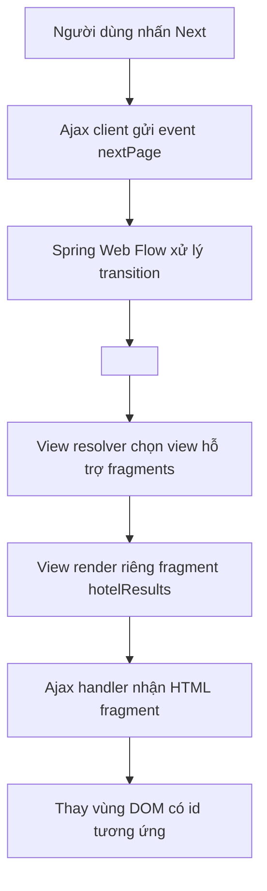

# Điều kiện công nghệ view phải hỗ trợ render phân mảnh

Trong một màn hình tìm kiếm, người dùng có thể chuyển trang kết quả, đổi bộ lọc hoặc cập nhật một bảng mà không cần tải lại toàn bộ trang. Spring Web Flow hỗ trợ cách tương tác này bằng **Ajax event** và thẻ **`<render fragments="..."/>`**. Tuy nhiên, khai báo `<render>` trong flow mới chỉ nói cho Web Flow biết **phần nào cần được cập nhật**. Để trả được đúng phần HTML đó, công nghệ view và view resolver phải biết cách tìm, render riêng và trả về fragment tương ứng.

Đây là điều kiện trung tâm của bài học: **công nghệ view phải hỗ trợ render phân mảnh**. Một trang HTML/JSP bình thường có thể render toàn bộ trang, nhưng không tự động biết cách tách một vùng để trả riêng cho Ajax. Với Spring MVC, có thể dùng tích hợp chuyên biệt của Thymeleaf hoặc cấu trúc view theo Tiles; với JSF, cần dùng cơ chế component tree và Ajax handler dành riêng cho JSF.

## 1. Mục tiêu học tập

Sau bài học, bạn có thể:

1. Giải thích vì sao Ajax partial response cần view technology hỗ trợ fragment rendering.
2. Phân biệt Ajax transport, lựa chọn fragment trong flow và khả năng render một phần view.
3. Dùng `<render fragments="..."/>` trong transition để yêu cầu cập nhật một vùng của view hiện tại.
4. Cấu hình Thymeleaf với `AjaxThymeleafViewResolver` và `FlowAjaxThymeleafView`.
5. Xác định fragment bằng `th:fragment` hoặc DOM selector và gắn đúng DOM `id`.
6. Hiểu cách Tiles ánh xạ fragment tới các attribute trong view definition.
7. Nhận biết giới hạn của JSP resolver thông thường và cách JSF xử lý Ajax theo component tree.
8. Chẩn đoán lỗi khi server trả toàn trang, fragment không tìm thấy hoặc trình duyệt không thay thế đúng vùng.
9. Kiểm thử cả nội dung response và vùng DOM được cập nhật.

## 2. Partial rendering thực sự cần những gì?

Một lần cập nhật fragment có ít nhất bốn phần phối hợp:

1. **Client** phát Ajax request gắn với event của flow, ví dụ `nextPage`.
2. **Spring Web Flow** xử lý event, chạy action và xác định các fragment cần render.
3. **View resolver/view implementation** hiểu cấu trúc template, chọn đúng fragment và tạo response HTML chỉ chứa phần đó.
4. **Client-side Ajax handler** nhận response và thay nội dung vùng DOM tương ứng.

`<render>` chỉ giải quyết phần lựa chọn fragment trong flow. Nó không biến một JSP resolver thông thường thành fragment renderer và cũng không tự tạo JavaScript để thay DOM.



Nếu một mắt xích không hỗ trợ fragment, ứng dụng thường gặp một trong các lỗi:

- Server trả toàn bộ HTML document thay vì vùng cần cập nhật.
- Server không biết tên fragment là gì hoặc không thể render riêng nó.
- Client nhận fragment nhưng không tìm được phần tử DOM để thay.
- Request được nhận như Ajax nhưng view vẫn thực hiện full-page rendering.

### 2.1. Điều kiện ở view technology

Một view phù hợp phải có khả năng:

- Tổ chức trang thành các phần có thể tham chiếu độc lập.
- Biết tên hoặc selector của phần cần render.
- Render phần đó với model hiện tại của flow.
- Trả HTML fragment theo định dạng mà client Ajax hiểu.

Ví dụ, với Thymeleaf, `th:fragment` đặt tên phần template và view tích hợp Web Flow trích xuất fragment theo yêu cầu. Với Tiles, từng attribute trong definition có thể được render riêng. Với JSF, component tree và Ajax render targets cung cấp cơ chế tương ứng theo hệ sinh thái JSF.

### 2.2. Điều kiện ở view resolver

View resolver phải tạo đúng loại `View` cho yêu cầu Ajax. Nếu resolver luôn tạo một view chỉ render toàn template, view đó không có cách xử lý danh sách fragment mà Web Flow yêu cầu.

Với Thymeleaf, dùng `AjaxThymeleafViewResolver` và `FlowAjaxThymeleafView`. Với Tiles, dùng `AjaxUrlBasedViewResolver` và `FlowAjaxTiles3View` theo cấu hình Spring Web Flow. Việc dùng đúng template engine nhưng vẫn đăng ký resolver mặc định có thể khiến partial rendering không hoạt động.

### 2.3. Điều kiện ở client

Client phải:

- Gửi đúng event và flow execution URL.
- Gửi request theo cơ chế Ajax mà `AjaxHandler` nhận diện.
- Nhận response fragment.
- Thay đúng DOM element được đánh dấu bằng ID tương ứng.

Một request có header hoặc tên thư viện chứa “ajax” chưa chắc đã được Spring Web Flow nhận diện theo đúng giao thức mà handler hiện tại hỗ trợ. Nếu dùng thư viện khác Spring JavaScript, cần tích hợp `AjaxHandler` phù hợp.

## 3. Phân biệt ba khái niệm thường bị nhầm

| Khái niệm | Thành phần chịu trách nhiệm | Câu hỏi được giải quyết |
| --- | --- | --- |
| Ajax request/transport | Browser, JavaScript, `AjaxHandler` | Request này có phải Ajax và phản hồi có cần redirect đặc biệt không? |
| Fragment selection | Flow definition, `<render>` | Sau event này cần cập nhật những vùng nào? |
| Fragment rendering | View technology, view implementation, view resolver | Làm thế nào để tạo HTML chỉ cho các vùng đó? |

Ví dụ, dùng fetch hoặc jQuery gửi event không đủ để làm view render một phần. Tương tự, Thymeleaf có khả năng render fragment trong Spring MVC nhưng ứng dụng Web Flow vẫn cần resolver/view tích hợp để Web Flow truyền đúng danh sách fragment.

## 4. Khai báo fragment trong flow

Trong Spring Web Flow, thẻ `<render>` được đặt bên trong transition của `view-state`:

```xml
<view-state id="reviewHotels" view="hotels/review">
    <transition on="nextPage">
        <evaluate expression="searchCriteria.nextPage()" />
        <render fragments="hotelResults" />
    </transition>
</view-state>
```

Khi event `nextPage` xảy ra:

1. `searchCriteria.nextPage()` cập nhật trang hiện tại.
2. `<render fragments="hotelResults"/>` yêu cầu render fragment `hotelResults`.
3. Transition không có thuộc tính `to` nên flow ở lại `reviewHotels`.
4. View được render lại theo yêu cầu partial response nếu request và view stack hỗ trợ.

Có thể yêu cầu nhiều fragment bằng danh sách phân cách bởi dấu phẩy:

```xml
<transition on="applyFilters">
    <evaluate expression="searchCriteria.applyFilters()" />
    <render fragments="filterSummary,hotelResults,resultCount" />
</transition>
```

Tên trong `fragments` phải khớp với cách công nghệ view đăng ký fragment. Với Thymeleaf, chúng thường là tên `th:fragment`; với Tiles, chúng có thể là tên attribute trong definition. Đừng mặc định tên state hoặc tên file template cũng chính là tên fragment.

### 4.1. Event handler giữ nguyên state

Transition không có `to` là event handler: nó chạy action rồi render lại view hiện tại. Khi kết hợp `<render>`, Web Flow có thể chỉ render những vùng đã chỉ định.

```xml
<view-state id="editSearch" view="hotels/search">
    <transition on="changeSort">
        <set name="searchCriteria.sortBy"
             value="requestParameters.sortBy" />
        <render fragments="sortControl,hotelResults" />
    </transition>
</view-state>
```

Nếu transition có `to` để đi sang một state khác, đó là điều hướng sang view-state mới. Hãy thiết kế riêng việc chuyển màn hình và việc cập nhật một vùng của màn hình hiện tại; không dùng `<render>` như thể nó là một cơ chế thay thế navigation.

## 5. Ví dụ Thymeleaf: đánh dấu fragment trong template

Thymeleaf hỗ trợ render một phần template. Với Spring Web Flow, fragment cần có tên để flow tham chiếu và một DOM ID để client có thể thay đúng vùng.

```html
<!DOCTYPE html>
<html xmlns:th="http://www.thymeleaf.org">
<head>
    <title>Tìm khách sạn</title>
</head>
<body>
    <main>
        <h1>Tìm khách sạn</h1>
        <section id="hotelResults" th:fragment="hotelResults">
            <p th:text="|Trang ${searchCriteria.page}|">Trang 1</p>
            <ul>
                <li th:each="hotel : ${hotels}"
                    th:text="${hotel.name}">Khách sạn mẫu</li>
            </ul>
        </section>
    </main>
</body>
</html>
```

Trong ví dụ:

- `th:fragment="hotelResults"` là tên fragment mà flow yêu cầu.
- `id="hotelResults"` là DOM ID mà client có thể dùng để thay vùng HTML.
- `hotels` và `searchCriteria` là dữ liệu model mà template dùng để render.

Tài liệu tích hợp Thymeleaf + Spring Web Flow yêu cầu fragment được chỉ định có thuộc tính `id` để thư viện Spring JavaScript trên trình duyệt có thể thay markup. Tên fragment và DOM ID có thể giống nhau để dễ bảo trì.

### 5.1. Dùng DOM selector thay cho th:fragment

Nếu template đã có ID ổn định, có thể chọn phần tử bằng DOM selector:

```xml
<transition on="nextPage">
    <evaluate expression="searchCriteria.nextPage()" />
    <render fragments="[//section[@id='hotelResults']]" />
</transition>
```

Template tương ứng:

```html
<section id="hotelResults">
    <ul>
        <li th:each="hotel : ${hotels}"
            th:text="${hotel.name}">Khách sạn mẫu</li>
    </ul>
</section>
```

Với cách dùng selector, không cần `th:fragment`. Cần bảo đảm selector tìm được đúng một vùng ổn định và view implementation hỗ trợ cú pháp selector mà bạn sử dụng.

### 5.2. Fragment lồng nhau

Một trang có thể có vùng kết quả lớn và vùng đếm kết quả nhỏ:

```html
<section id="searchPanel" th:fragment="searchPanel">
    <div id="resultCount" th:fragment="resultCount">
        <span th:text="${page.totalElements}">0</span> kết quả
    </div>
    <div id="hotelResults" th:fragment="hotelResults">
        <!-- Bảng kết quả -->
    </div>
</section>
```

Nếu chỉ thay `hotelResults`, vùng đếm kết quả sẽ không đổi. Nếu dữ liệu trang thay đổi cả tổng số kết quả, hãy yêu cầu render cả hai:

```xml
<render fragments="resultCount,hotelResults" />
```

Đừng yêu cầu render một fragment cha và một fragment con cùng lúc nếu client thay vùng cha trước khiến target con không còn trong DOM. Hãy chọn các vùng không chồng lấn hoặc chỉ render fragment cha.

## 6. Cấu hình Thymeleaf cho Spring Web Flow

Khi dùng Spring Framework 6, tích hợp Thymeleaf cần Spring Web Flow 3.0 trở lên. Với Spring Framework 5, tài liệu Thymeleaf nêu Spring Web Flow 2.5. Cần dùng đúng artifact Thymeleaf tương ứng với dòng Spring:

| Nền tảng Spring | Tích hợp Thymeleaf | Spring Web Flow |
| --- | --- | --- |
| Spring Framework 5.x | `thymeleaf-spring5` | Dòng 2.5 phù hợp |
| Spring Framework 6.x | `thymeleaf-spring6` | 3.0 trở lên |

Không trộn class package `spring5` và `spring6` trong cùng cấu hình. Các ví dụ dưới đây dùng Spring 6 và Thymeleaf Spring 6.

### 6.1. Đăng ký AjaxThymeleafViewResolver

Thay vì dùng `ThymeleafViewResolver` mặc định, tích hợp Web Flow dùng resolver hỗ trợ Ajax:

```java
import org.springframework.context.annotation.Bean;
import org.springframework.context.annotation.Configuration;
import org.springframework.web.servlet.ViewResolver;
import org.thymeleaf.spring6.SpringTemplateEngine;
import org.thymeleaf.spring6.webflow.view.AjaxThymeleafViewResolver;
import org.thymeleaf.spring6.webflow.view.FlowAjaxThymeleafView;

@Configuration
public class ThymeleafWebFlowViewConfiguration {

    @Bean
    public ViewResolver thymeleafViewResolver(
            SpringTemplateEngine templateEngine) {

        AjaxThymeleafViewResolver resolver =
                new AjaxThymeleafViewResolver();
        resolver.setViewClass(FlowAjaxThymeleafView.class);
        resolver.setTemplateEngine(templateEngine);
        return resolver;
    }
}
```

`AjaxThymeleafViewResolver` xử lý tích hợp Ajax ở tầng resolver; `FlowAjaxThymeleafView` là view chuyên dùng cho Spring Web Flow để xác định và render fragment mà flow yêu cầu.

### 6.2. Nối resolver vào MvcViewFactoryCreator

Flow cần sử dụng resolver đó khi tạo view:

```java
import java.util.Collections;
import org.springframework.context.annotation.Bean;
import org.springframework.context.annotation.Configuration;
import org.springframework.webflow.config.AbstractFlowConfiguration;
import org.springframework.webflow.engine.builder.ViewFactoryCreator;
import org.springframework.webflow.mvc.builder.MvcViewFactoryCreator;
import org.springframework.web.servlet.ViewResolver;

@Configuration
public class WebFlowViewFactoryConfiguration
        extends AbstractFlowConfiguration {

    @Bean
    public ViewFactoryCreator viewFactoryCreator(
            ViewResolver thymeleafViewResolver) {

        MvcViewFactoryCreator creator = new MvcViewFactoryCreator();
        creator.setViewResolvers(
                Collections.singletonList(thymeleafViewResolver));
        creator.setUseSpringBeanBinding(true);
        return creator;
    }

    @Bean
    public FlowBuilderServices flowBuilderServices(
            ViewFactoryCreator viewFactoryCreator) {

        return getFlowBuilderServicesBuilder()
                .setViewFactoryCreator(viewFactoryCreator)
                .build();
    }
}
```

Đây là phần cấu hình liên quan đến view factory. Ứng dụng vẫn cần đăng ký flow registry, flow executor, handler mapping/adapter và các bean service theo cấu hình Spring Web Flow thông thường. Không tạo hai `ViewFactoryCreator` khác nhau rồi vô tình để flow registry dùng creator mặc định.

### 6.3. Resolver thông thường khác resolver Ajax ở đâu?

| Resolver | View được tạo | Hành vi |
| --- | --- | --- |
| `ThymeleafViewResolver` | `ThymeleafView` | Render template theo tên view |
| `AjaxThymeleafViewResolver` + `FlowAjaxThymeleafView` | View tương thích Ajax của Web Flow | Nhận diện Ajax và render các fragment được Web Flow chỉ định |

Việc template có `th:fragment` chưa đủ nếu resolver vẫn tạo view không biết cách lấy fragment theo yêu cầu Web Flow.

## 7. Tiles: dùng attribute làm fragment

Trong ứng dụng Spring MVC dùng JSP, Tiles có thể tổ chức trang thành các attribute riêng. Khi kết hợp resolver/view tương thích Ajax của Spring Web Flow, mỗi attribute có thể được render riêng.

### 7.1. Tiles definition

```xml
<definition name="hotels/index" extends="standardLayout">
    <put-attribute name="body" value="hotels/indexBody" />
</definition>

<definition name="hotels/indexBody"
            template="/WEB-INF/hotels/index.jsp">
    <put-attribute name="hotelSearchForm"
                   value="/WEB-INF/hotels/hotelSearchForm.jsp" />
    <put-attribute name="bookingsTable"
                   value="/WEB-INF/hotels/bookingsTable.jsp" />
</definition>
```

Trong ví dụ, `hotelSearchForm` và `bookingsTable` là các attribute có thể được chỉ định làm fragment. View chính vẫn có layout và body đầy đủ khi request thông thường.

### 7.2. Dùng resolver/view hỗ trợ Tiles fragment

Theo cấu hình Spring Web Flow 3.0 Reference:

```xml
<bean id="tilesViewResolver"
      class="org.springframework.webflow.mvc.view.AjaxUrlBasedViewResolver">
    <property name="viewClass"
              value="org.springframework.webflow.mvc.view.FlowAjaxTiles3View" />
</bean>
```

Resolver nhận diện Ajax request và tạo view tương thích để render các attribute tương ứng. Ví dụ transition trong flow:

```xml
<view-state id="reviewBookings" view="hotels/index">
    <transition on="refreshBookings">
        <evaluate expression="bookingService.refreshBookings()" />
        <render fragments="bookingsTable" />
    </transition>
</view-state>
```

Ở đây tên fragment `bookingsTable` phải khớp attribute trong Tiles definition. Nó không phải tên file JSP hay ID của state.

### 7.3. Khi nào chọn Tiles?

Tiles phù hợp khi ứng dụng hiện có cấu trúc layout/attribute và muốn tiếp tục dùng JSP cho các phần giao diện. Nếu dự án mới đã dùng Thymeleaf, không cần đưa Tiles vào chỉ để có partial rendering; hãy cấu hình tích hợp Thymeleaf Web Flow tương ứng.

## 8. JSP thông thường không tự có fragment renderer

Một cấu hình kiểu:

```xml
<bean class="org.springframework.web.servlet.view.InternalResourceViewResolver">
    <property name="prefix" value="/WEB-INF/jsp/" />
    <property name="suffix" value=".jsp" />
</bean>
```

thường tạo `InternalResourceView`/`JstlView` để forward tới JSP và render toàn trang. Nó không có hợp đồng chung để nhận tên `hotelResults` rồi trích xuất riêng một phần của JSP.

Điều đó không có nghĩa JSP không thể tham gia partial rendering. Có thể:

- Dùng JSP làm template cho Tiles và để Tiles attribute là các fragment.
- Dùng một custom view/renderer biết cách render riêng phần JSP.
- Chuyển phần giao diện cần cập nhật sang một template engine có fragment integration phù hợp.

Điểm cần kiểm tra là **view được Web Flow sử dụng có thể render riêng fragment hay không**, không phải chỉ kiểm tra phần mở rộng file JSP, HTML hay XHTML.

## 9. JSF có mô hình Ajax riêng

Spring Web Flow tích hợp JSF thông qua component tree. Với JSF, Web Flow 3.0 yêu cầu JSF 4.0 trở lên; cấu hình dùng `JsfFlowHandlerAdapter` và `JsfAjaxHandler` thay cho handler Ajax mặc định của Spring JavaScript.

Ví dụ cấu hình adapter:

```xml
<bean class="org.springframework.faces.webflow.JsfFlowHandlerAdapter">
    <property name="flowExecutor" ref="flowExecutor" />
</bean>
```

JSF component có thể chỉ định vùng render bằng cơ chế Ajax của JSF:

```xml
<html xmlns="http://www.w3.org/1999/xhtml"
      xmlns:h="jakarta.faces.html"
      xmlns:f="jakarta.faces.core">
<h:form id="hotelSearch">
    <h:commandLink id="nextPage"
                   value="Trang tiếp"
                   action="nextPage">
        <f:ajax execute="@this" render="hotelResults" />
    </h:commandLink>

    <h:panelGroup id="hotelResults" layout="block">
        <h:dataTable value="#{hotels}" var="hotel">
            <h:column>
                <h:outputText value="#{hotel.name}" />
            </h:column>
        </h:dataTable>
    </h:panelGroup>
</h:form>
</html>
```

Ở đây `f:ajax` và component ID điều khiển partial lifecycle/render của JSF. Không nên lấy cấu hình `AjaxThymeleafViewResolver` áp vào JSF; mỗi công nghệ view có cách tích hợp riêng.

## 10. Client Ajax và AjaxHandler

Spring Web Flow có thể nhận biết Ajax thông qua `AjaxHandler`. Mặc định, cấu hình Spring JavaScript sử dụng handler tương thích với Spring JS. Nếu ứng dụng dùng thư viện Ajax khác, có thể cần cung cấp handler riêng cho `FlowHandlerAdapter` hoặc `FlowController`.

Một form phát event `nextPage` có thể dùng button:

```html
<form id="searchForm" method="post" action="">
    <button id="nextPage"
            type="submit"
            name="_eventId_nextPage">
        Trang tiếp
    </button>
</form>
```

Với Spring JavaScript, có thể trang trí nút để gửi Ajax request:

```html
<script src="/resources/dojo/dojo.js"></script>
<script src="/resources/spring/Spring.js"></script>
<script src="/resources/spring/Spring-Dojo.js"></script>

<script>
    Spring.addDecoration(
        new Spring.AjaxEventDecoration({
            formId: "searchForm",
            elementId: "nextPage",
            event: "onclick"
        })
    );
</script>
```

Các URL tài nguyên là ví dụ; cần cấu hình resource handler/servlet mapping phù hợp. Với thư viện khác, phải gửi event theo flow execution URL và dùng AjaxHandler tương thích. Chỉ gửi request bằng fetch không tự bảo đảm Spring Web Flow nhận dạng response như một fragment update.

### 10.1. Ai quyết định fragment nào được trả?

Khi flow definition đã khai báo:

```xml
<render fragments="hotelResults" />
```

thì server biết fragment cần trả từ flow definition. Cách này tách lựa chọn fragment khỏi mã client. Với Spring MVC controller thuần, client có thể phải gửi tham số fragment để resolver biết phần cần render; đó là một cách tích hợp khác.

### 10.2. AjaxHandler không thay thế View

`AjaxHandler` hỗ trợ nhận diện request Ajax và điều chỉnh một số hành vi như redirect. Nó không tự phân tích template hoặc bóc HTML tùy ý. Muốn render phân mảnh vẫn cần view implementation tương ứng.

## 11. Ví dụ tích hợp: phân trang kết quả khách sạn

Bài toán: màn hình `reviewHotels` hiển thị danh sách khách sạn và nút Trang tiếp. Khi người dùng nhấn nút, flow tăng số trang, tải dữ liệu mới và chỉ thay `hotelResults`.

### 11.1. Flow definition

```xml
<flow xmlns="http://www.springframework.org/schema/webflow">

    <var name="searchCriteria"
         class="com.example.hotel.SearchCriteria" />

    <on-start>
        <set name="searchCriteria.page" value="0" />
        <set name="searchCriteria.pageSize" value="10" />
    </on-start>

    <view-state id="reviewHotels" view="hotels/review">
        <on-render>
            <evaluate expression="hotelService.findPage(searchCriteria)"
                      result="viewScope.hotelPage" />
        </on-render>

        <transition on="nextPage">
            <evaluate expression="searchCriteria.nextPage()" />
            <render fragments="hotelResults,resultCount" />
        </transition>

        <transition on="previousPage">
            <evaluate expression="searchCriteria.previousPage()" />
            <render fragments="hotelResults,resultCount" />
        </transition>
    </view-state>
</flow>
```

Các event `nextPage` và `previousPage` không có `to` nên flow vẫn ở `reviewHotels`. Sau khi action cập nhật tiêu chí, view được render lại theo danh sách fragment yêu cầu. `on-render` tải trang kết quả mới vào `viewScope.hotelPage`.

### 11.2. Template Thymeleaf

```html
<main xmlns:th="http://www.thymeleaf.org">
    <h1>Khách sạn</h1>

    <div id="resultCount" th:fragment="resultCount">
        <span th:text="${hotelPage.totalElements}">0</span>
        kết quả
    </div>

    <section id="hotelResults" th:fragment="hotelResults">
        <article th:each="hotel : ${hotelPage.content}">
            <h2 th:text="${hotel.name}">Tên khách sạn</h2>
            <p th:text="${hotel.city}">Thành phố</p>
        </article>
    </section>

    <form id="searchForm" method="post" action="">
        <button type="submit"
                id="previousPage"
                name="_eventId_previousPage">
            Trang trước
        </button>
        <button type="submit"
                id="nextPage"
                name="_eventId_nextPage">
            Trang tiếp
        </button>
    </form>
</main>
```

Template có hai fragment name và hai DOM ID tương ứng. Khi flow yêu cầu `hotelResults,resultCount`, view phải render cả hai vùng từ cùng model mới.

### 11.3. Hành vi khi không dùng Ajax

Một view-state transition vẫn có thể hoạt động như request thông thường nếu client không gửi Ajax decoration. Khi đó, view có thể render toàn trang tùy cấu hình và view implementation. Đây là cách giữ trải nghiệm cơ bản hoạt động ngay cả khi JavaScript không có hoặc bị tắt, miễn form vẫn gửi đúng event.

## 12. Khi nào không nên dùng fragment rendering?

Partial rendering hữu ích khi vùng cập nhật nhỏ và độc lập. Tuy nhiên, không phải mọi thao tác đều phù hợp:

- Nếu event chuyển sang state mới, thường cần render view mới hoặc redirect thay vì cập nhật fragment cũ.
- Nếu toàn bộ trang thay đổi cấu trúc, tải lại trang có thể đơn giản và dễ đồng bộ hơn.
- Nếu fragment phụ thuộc quá nhiều vùng khác, phải cập nhật nhiều fragment và dễ phát sinh trạng thái DOM không nhất quán.
- Nếu client là SPA chỉ nhận JSON và tự dựng component, không cần trả HTML fragment; hãy thiết kế endpoint/API hoặc tích hợp phù hợp.
- Nếu view không có khả năng render riêng, không nên chỉ thêm `<render>` rồi mong framework tự cắt HTML.

## 13. Lỗi thường gặp và cách chẩn đoán

| Hiện tượng | Nguyên nhân thường gặp | Cách kiểm tra |
| --- | --- | --- |
| Server trả toàn bộ trang HTML | Resolver tạo view thường, không phải Ajax-aware view | Kiểm tra loại resolver và view class |
| Fragment trả rỗng | Tên trong `fragments` không khớp tên fragment/attribute | So sánh flow XML với template/Tiles definition |
| Browser không thay nội dung | Fragment thiếu DOM ID hoặc ID không khớp | Kiểm tra HTML response và DOM hiện tại |
| Có Ajax request nhưng redirect cả trang | AjaxHandler không nhận diện thư viện/client | Kiểm tra handler và request marker |
| Flow không cập nhật trang | Event parameter sai hoặc execution key không đúng | Xem Network request, `_eventId_*` và flow execution URL |
| View render được fragment khi MVC nhưng không khi Web Flow | Flow view factory dùng resolver khác | Kiểm tra `MvcViewFactoryCreator` |
| Thymeleaf có fragment nhưng vẫn trả full template | Dùng `ThymeleafViewResolver` thay vì resolver Web Flow Ajax | Đăng ký `AjaxThymeleafViewResolver` + `FlowAjaxThymeleafView` |
| JSP không trích được vùng | JSP view thông thường không có fragment contract | Dùng Tiles/custom view hoặc công nghệ hỗ trợ |
| Tiles fragment không tìm thấy | Tên fragment không phải Tiles attribute | Kiểm tra Tiles definition |
| Fragment lồng nhau bị cập nhật sai | Render đồng thời parent và child hoặc ID trùng | Chọn vùng không chồng lấn, duy nhất |
| Dữ liệu fragment cũ | Action không cập nhật model hoặc `on-render` không chạy như mong đợi | Kiểm tra thứ tự action, render và model |
| Ajax response có lỗi HTML | Validation/exception trả view lỗi khác | Kiểm tra message context, status/response và log server |

### 13.1. Quy trình kiểm tra theo thứ tự

1. **Request:** Network tab có gửi đúng flow URL, execution key và event ID không?
2. **Flow:** Transition có được xử lý và `<render>` có nằm trong đúng transition không?
3. **Model:** Action có cập nhật dữ liệu trước khi view render không?
4. **View factory:** Flow có dùng đúng view resolver không?
5. **Fragment selector:** Tên fragment có tồn tại trong template hoặc Tiles definition không?
6. **Markup:** Response có chứa fragment cần thiết và DOM ID không?
7. **Client:** Ajax handler có nhận response và thay đúng element không?

Bật log `DEBUG` có chọn lọc cho Spring Web Flow và view integration trong môi trường phát triển. Tránh log toàn bộ request/form data nếu chứa thông tin cá nhân hoặc token.

## 14. Kiểm thử fragment rendering

Một test chỉ xác nhận transition đã chạy chưa đủ để chứng minh fragment rendering hoạt động. Cần kiểm tra cả server response và client-side DOM.

### 14.1. Kiểm thử flow transition

Với `AbstractXmlFlowExecutionTests` hoặc integration test flow tương ứng:

- Bắt đầu flow ở `reviewHotels`.
- Gửi event `nextPage`.
- Xác minh flow vẫn ở cùng view-state.
- Xác minh tiêu chí trang đã thay đổi và service được gọi với trang mới.
- Xác minh fragment được yêu cầu đúng theo cấu hình view.

Test flow đơn vị không tự kiểm tra view resolver có trả fragment HTML đúng hay không; phần đó cần integration test với view technology thật.

### 14.2. Kiểm thử HTTP response

Gửi request Ajax tới flow và kiểm tra:

1. Response không chứa toàn bộ layout/document nếu hợp đồng yêu cầu fragment.
2. Response có markup vùng `hotelResults`.
3. Response có DOM ID ổn định để client thay nội dung.
4. Response không chứa fragment khác ngoài danh sách được yêu cầu, trừ wrapper mà view implementation quy định.
5. Lỗi validation/exception có response phù hợp để client hiển thị thông báo.

### 14.3. Kiểm thử trình duyệt

Trong browser integration test:

- Ghi nhận nội dung bảng trước khi nhấn Next.
- Nhấn nút và chờ Ajax response.
- Xác minh URL/flow execution không bị điều hướng sai.
- Xác minh DOM node giữ nguyên hoặc được thay đúng theo chiến lược client.
- Xác minh kết quả và bộ đếm đã thay đổi.
- Kiểm tra console không có lỗi JavaScript.

Nếu dùng Spring JavaScript, kiểm tra resource JS được tải và decoration được đăng ký. Nếu dùng thư viện khác, kiểm tra callback xử lý fragment của thư viện đó.

## 15. Bài tập thực hành

Một màn hình quản lý đơn hàng hiển thị bộ lọc, số lượng kết quả và bảng đơn hàng. Hãy cấu hình Ajax để chỉ cập nhật vùng bảng và bộ đếm khi người dùng thay đổi bộ lọc.

Yêu cầu:

1. Tạo `view-state id="reviewOrders"` dùng template Thymeleaf `orders/review`.
2. Khai báo event `applyFilters` và gọi action cập nhật tiêu chí tìm kiếm.
3. Dùng `<render fragments="orderCount,orderTable"/>`.
4. Tạo hai fragment Thymeleaf có `th:fragment` và DOM ID tương ứng.
5. Cấu hình `AjaxThymeleafViewResolver` và `FlowAjaxThymeleafView`.
6. Nối resolver vào `MvcViewFactoryCreator` đang dùng bởi flow builder.
7. Tạo Ajax request phát event `applyFilters`.
8. Viết test flow xác minh state không đổi và test HTTP/browser xác minh chỉ hai vùng được cập nhật.
9. Thử bỏ `id` khỏi một fragment và mô tả lỗi ở phía client.
10. Thử thay resolver bằng `ThymeleafViewResolver` mặc định và giải thích vì sao fragment rendering không còn được xử lý theo hợp đồng Web Flow.

**Câu hỏi tự kiểm tra:**

- Vì sao `<render fragments="orderTable"/>` chưa đủ nếu resolver không hỗ trợ fragment?
- Tại sao fragment Thymeleaf cần cả `th:fragment` và `id` trong tích hợp Spring JavaScript?
- Với Tiles, tên fragment lấy từ đâu?
- Vì sao `AjaxHandler` không thể tự tách một JSP thành các vùng HTML?
- Khi dùng JSF, tại sao nên dùng `JsfFlowHandlerAdapter` và cơ chế Ajax của component thay vì cấu hình Thymeleaf resolver?

## 16. Checklist trước khi bật partial rendering

- [ ] Flow transition phát event đúng và có `<render fragments="..."/>`.
- [ ] Transition không có target nếu mục tiêu là render lại view hiện tại.
- [ ] Tên fragment khớp với định nghĩa trong view technology.
- [ ] View technology có khả năng render riêng phần được chọn.
- [ ] View resolver tạo đúng Ajax-aware view.
- [ ] Flow `ViewFactoryCreator` sử dụng resolver đó.
- [ ] AjaxHandler nhận diện request của client.
- [ ] Fragment có DOM ID ổn định để client thay thế.
- [ ] Không render đồng thời các vùng DOM chồng lấn ngoài ý muốn.
- [ ] Model được cập nhật trước khi fragment được render.
- [ ] Có test server response và browser DOM, không chỉ test flow transition.
- [ ] Có đường fallback hoặc hành vi full-page phù hợp khi JavaScript không hoạt động.

## 17. Ghi nhớ

- Partial rendering yêu cầu view technology có thể phân tách trang thành các phần được tham chiếu và render riêng.
- `<render>` chỉ chỉ định fragment mà flow muốn cập nhật; nó không tự cung cấp khả năng fragment rendering cho mọi view.
- Với Thymeleaf + Spring 6, dùng Spring Web Flow 3.0+ và tích hợp `thymeleaf-spring6`; cấu hình `AjaxThymeleafViewResolver` với `FlowAjaxThymeleafView`.
- Nối resolver vào `MvcViewFactoryCreator` mà flow builder sử dụng; nếu chỉ cấu hình MVC resolver thông thường, flow có thể vẫn render toàn trang.
- Với Thymeleaf, `th:fragment` đặt tên fragment và `id` cho client biết vùng DOM cần thay. Có thể dùng DOM selector thay cho `th:fragment`.
- Với Tiles, fragment tương ứng các attribute trong Tiles definition và cần view resolver/view hỗ trợ Ajax của Web Flow.
- JSP thông thường không tự có cơ chế trích xuất fragment; có thể dùng JSP cùng Tiles hoặc custom view.
- JSF dùng component tree và `JsfAjaxHandler`/`JsfFlowHandlerAdapter`; cấu hình view phải theo tích hợp JSF.
- Kiểm thử phải bao gồm request, fragment response và DOM update thực tế.

### Tài liệu tham khảo

- [Spring Web Flow 3.0.0 Reference Guide — Rendering Fragments](https://docs.spring.io/spring-webflow/docs/3.0.0/reference/index.html#_rendering_fragments)
- [Spring Web Flow 3.0.0 Reference Guide — Handling Ajax Requests](https://docs.spring.io/spring-webflow/docs/3.0.0/reference/index.html#_handling_ajax_requests)
- [Thymeleaf + Spring Tutorial 3.1 — Spring WebFlow integration và AJAX fragments](https://www.thymeleaf.org/doc/tutorials/3.1/thymeleafspring.html#spring-webflow-integration)
- [Thymeleaf Spring 6 API — FlowAjaxThymeleafView](https://www.thymeleaf.org/apidocs/thymeleaf-spring6/3.1.3.RELEASE/org/thymeleaf/spring6/webflow/view/FlowAjaxThymeleafView.html)
- [Spring Framework Reference — View Technologies](https://docs.spring.io/spring/reference/web/webmvc-view.html)
