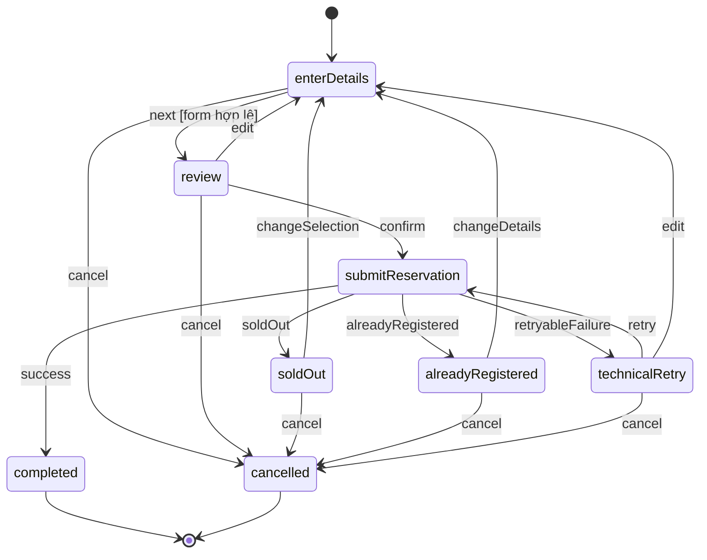
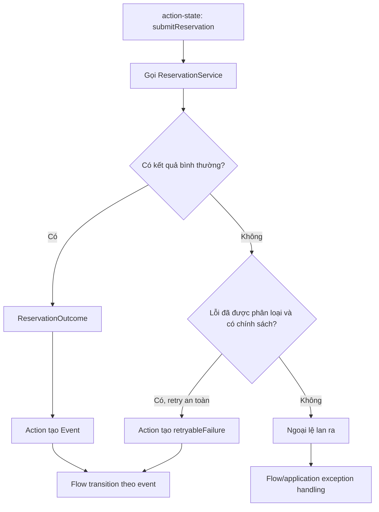

# Phân biệt kết quả nghiệp vụ thất bại với lỗi kỹ thuật trong Spring Web Flow

Một hành trình web nhiều bước thường có cả **kết quả nghiệp vụ không được chấp nhận** và **lỗi kỹ thuật làm hệ thống chưa thể xử lý yêu cầu**. Hai tình huống có thể đều khiến người dùng chưa đạt mục tiêu, nhưng cách thể hiện trong **Spring Web Flow** rất khác nhau.

Ví dụ với flow đăng ký workshop:

- Người dùng chọn 3 chỗ, nhưng workshop chỉ còn 1 chỗ. Hệ thống đang hoạt động đúng; kết quả hợp lệ của nghiệp vụ là **không đủ chỗ**. Flow cần hiển thị lựa chọn khác hoặc cho quay lại sửa.
- Người dùng chọn 1 chỗ còn trống, nhưng kết nối cơ sở dữ liệu bị gián đoạn. Hệ thống **chưa xác định được** việc ghi yêu cầu có thành công hay không. Flow cần xử lý lỗi kỹ thuật an toàn, có thể cho thử lại khi phù hợp.
- Phương thức Java ném `NullPointerException` vì lỗi lập trình. Đây là lỗi kỹ thuật ngoài dự kiến; không nên biến nó thành thông báo “đã hết chỗ”.

Bài học thuộc chương **Ngoại lệ và phục hồi** của module **SPRING_WEB_FLOW**. Mục tiêu là đặt ra tiêu chí phân loại, thiết kế state/event/transition cho từng trường hợp, tách kết quả nghiệp vụ khỏi exception hạ tầng, giữ đúng scope khi phục hồi và kiểm thử cả hành trình lỗi.

## 1. Hai câu hỏi khác nhau: “yêu cầu có hợp lệ không?” và “hệ thống đã xử lý được chưa?”

**Kết quả nghiệp vụ thất bại** (*business rejection / negative business outcome*) nghĩa là ứng dụng đã kiểm tra yêu cầu và đưa ra kết luận theo quy tắc đã định nghĩa. Ví dụ: hết chỗ, quá hạn đăng ký, đơn hàng không đủ điều kiện đổi trả, hoặc một người không thể đăng ký lần thứ hai bằng yêu cầu độc lập.

**Lỗi kỹ thuật** (*technical failure*) nghĩa là phần mềm hoặc hạ tầng không hoàn thành được việc xử lý bình thường. Ví dụ: database không phản hồi, service ngoài timeout, lỗi chuyển đổi dữ liệu ngoài dự kiến, cấu hình bean sai hoặc lỗi lập trình.

| Tiêu chí | Kết quả nghiệp vụ không được chấp nhận | Lỗi kỹ thuật |
| --- | --- | --- |
| Ý nghĩa | Hệ thống đã đưa ra một kết luận nghiệp vụ hợp lệ | Hệ thống gặp sự cố trong quá trình đưa ra hoặc lưu kết quả |
| Nguyên nhân thường gặp | Hết chỗ, hết hạn, vi phạm điều kiện đăng ký | Timeout, mất kết nối, lỗi cấu hình, bug |
| Có phải trạng thái dự kiến? | Thường có, được liệt kê trong yêu cầu | Có thể dự kiến ở mức rủi ro, nhưng không phải kết luận nghiệp vụ |
| Biểu diễn trong flow | Event có tên rõ nghĩa và transition tới state nghiệp vụ | Event kỹ thuật đã phân loại **hoặc** ngoại lệ chuyển tới cơ chế xử lý lỗi |
| Có nên thử lại nguyên request? | Thường không hiệu quả nếu điều kiện nghiệp vụ chưa thay đổi | Chỉ khi an toàn, có kiểm soát và đủ thông tin để retry |
| Thông báo cho người dùng | Giải thích chính xác điều kiện bị từ chối và cách xử lý | Thông báo gián đoạn/phục hồi, tránh khẳng định sai trạng thái giao dịch |
| Ghi nhận vận hành | Chỉ số sản phẩm/nghiệp vụ | Log, metrics, trace, alert nếu cần |

Điều quan trọng: **“Không thành công” không tự động đồng nghĩa “đã có exception”**. Một service có thể thực thi hoàn toàn bình thường và trả về kết quả `SOLD_OUT`. Ngược lại, exception không được xử lý có thể khiến engine không nhận được event nào để đi tiếp.

Trong Spring Web Flow, event là **kết quả điều khiển** mà flow engine dùng để chọn transition. Exception là **sự cố hoặc tín hiệu lỗi** trong lúc thực thi code. Có thể chuyển một số exception đã biết thành event một cách có chủ đích, nhưng không được coi mọi exception là một nhánh nghiệp vụ.

## 2. Trước tiên tách ba lớp thất bại

Không nên gom mọi vấn đề vào một trang `error`. Trong một flow có form nhập, tối thiểu cần phân biệt ba lớp:

1. **Sai dữ liệu đầu vào:** email sai định dạng, số lượng chỗ bằng 0, trường bắt buộc trống. Xử lý qua **binding/validation** tại `view-state`; người dùng thường ở lại form để sửa.
2. **Bị từ chối theo quy tắc nghiệp vụ:** dữ liệu đúng kiểu và hợp lệ, nhưng không đủ chỗ hoặc hết hạn. Service trả về **kết quả nghiệp vụ**; flow chuyển sang một state giải thích lý do.
3. **Không xử lý được vì lỗi kỹ thuật:** truy vấn timeout, hệ thống ngoài không trả lời, exception bất ngờ. Action hoặc tầng xử lý lỗi quyết định việc hiển thị trang tạm lỗi, thử lại hoặc báo lỗi chung.

Có thêm lớp thứ tư cần phân biệt với cả ba: **lỗi quyền truy cập và bảo mật**. Chẳng hạn người dùng cố đăng ký hoặc sửa tài nguyên mà họ không được phép thao tác. Quyết định xác thực/phân quyền phải do thành phần bảo mật và service thực thi, không dựa vào việc trình duyệt có thể gửi một event. Một lỗi bảo mật không được âm thầm chuyển thành `soldOut` hoặc `retryableFailure`.

Ví dụ:

| Tình huống | Phân loại | Trách nhiệm chính |
| --- | --- | --- |
| `seats = -2` | Input validation | Bean validation / validator |
| `email = "khong-phai-email"` | Input validation | Binding / validation |
| Chọn 4 chỗ nhưng chỉ còn 2 | Kết quả nghiệp vụ | Reservation service |
| Workshop đã đóng đăng ký | Kết quả nghiệp vụ | Reservation service |
| Email đã đăng ký trước đó bằng yêu cầu khác | Kết quả nghiệp vụ, tùy quy tắc trùng | Reservation service |
| DB timeout trong lúc lưu | Lỗi kỹ thuật có thể tạm thời | Service / action / transaction |
| Lệnh ghi đã commit nhưng response timeout | Lỗi kỹ thuật, **trạng thái ghi chưa rõ** | Service và cơ chế idempotency |
| Bean action không tồn tại hoặc code ném `NullPointerException` | Lỗi kỹ thuật ngoài dự kiến | Handler lỗi, logging, điều tra |
| Flow execution key đã hết hạn | Lỗi vòng đời execution/phiên | Cơ chế xử lý hết hạn của ứng dụng |

Một business outcome chỉ đáng tin cậy khi được trả về **sau phép kiểm tra nghiệp vụ hợp lệ**. Ví dụ, timeout khi lấy số chỗ trống **không thể** được diễn giải thành “đã hết chỗ”.

## 3. Thiết kế đường đi trước khi viết mã

Xét hành trình:

- `enterDetails`: nhập email, workshop và số chỗ.
- `review`: xem lại dữ liệu.
- `submitReservation`: gọi service đặt chỗ.
- `completed`: kết thúc thành công.
- `soldOut` và `alreadyRegistered`: giải thích hai kết quả nghiệp vụ.
- `technicalRetry`: sự cố tạm thời đã được phân loại, có phương án phục hồi.
- `cancelled`: kết thúc do người dùng hủy.



Sơ đồ mô tả **những kết quả mà action chủ động trả thành event**. Nó không khẳng định mọi lỗi lập trình hoặc mất kết nối đều biến thành `retryableFailure`. Một exception chưa được xử lý có thể đi ra ngoài action-state, tới cơ chế xử lý exception của Web Flow hoặc tầng web, tùy cấu hình.

Bảng event chỉ rõ nguồn gốc:

| State phát sinh | Event | Nguồn | Đích |
| --- | --- | --- | --- |
| `enterDetails` | `next` | Người dùng, sau bind/validate thành công | `review` |
| `review` | `confirm` | Người dùng | `submitReservation` |
| `submitReservation` | `success` | Service xử lý và xác nhận thành công | `completed` |
| `submitReservation` | `soldOut` | Service xác nhận không đủ chỗ | `soldOut` |
| `submitReservation` | `alreadyRegistered` | Service xác nhận trùng theo quy tắc nghiệp vụ | `alreadyRegistered` |
| `submitReservation` | `retryableFailure` | Action nhận diện lỗi kỹ thuật tạm thời thuộc chính sách retry | `technicalRetry` |
| `technicalRetry` | `retry` | Người dùng xác nhận thử lại | `submitReservation` |
| Bất kỳ action phù hợp | Exception ngoài dự kiến | Code/hạ tầng, **không có event** | Handler ngoại lệ của hệ thống |

Tên `success`, `soldOut`, `retryableFailure` chỉ là tên event do ứng dụng định nghĩa; Spring Web Flow không tự động hiểu `soldOut` như một loại exception đặc biệt.

## 4. Định nghĩa flow XML có đường từ chối và phục hồi riêng

File XML sau là một **khung triển khai minh họa**. Nó giả định ứng dụng đã đăng ký flow, bean `reservationAction`, các view và validator; các class nghiệp vụ không phải API dựng sẵn của Spring Web Flow.

```xml
<?xml version="1.0" encoding="UTF-8"?>
<flow xmlns="http://www.springframework.org/schema/webflow"
      xmlns:xsi="http://www.w3.org/2001/XMLSchema-instance"
      xsi:schemaLocation="
        http://www.springframework.org/schema/webflow
        http://www.springframework.org/schema/webflow/spring-webflow.xsd"
      start-state="enterDetails">

    <var name="reservationDraft"
         class="com.example.booking.ReservationDraft"/>

    <view-state id="enterDetails"
                view="booking/details"
                model="reservationDraft">
        <binder>
            <binding property="workshopId"/>
            <binding property="email"/>
            <binding property="seats"/>
        </binder>
        <transition on="next" to="review"
                    bind="true" validate="true"/>
        <transition on="cancel" to="cancelled"
                    bind="false" validate="false"/>
    </view-state>

    <view-state id="review" view="booking/review">
        <transition on="edit" to="enterDetails"/>
        <transition on="confirm" to="submitReservation"/>
        <transition on="cancel" to="cancelled"/>
    </view-state>

    <action-state id="submitReservation">
        <evaluate expression="reservationAction.submit(reservationDraft)"/>
        <transition on="success" to="completed"/>
        <transition on="soldOut" to="soldOut"/>
        <transition on="alreadyRegistered" to="alreadyRegistered"/>
        <transition on="retryableFailure" to="technicalRetry"/>
    </action-state>

    <view-state id="soldOut" view="booking/soldOut">
        <transition on="changeSelection" to="enterDetails"/>
        <transition on="cancel" to="cancelled"/>
    </view-state>

    <view-state id="alreadyRegistered"
                view="booking/alreadyRegistered">
        <transition on="changeDetails" to="enterDetails"/>
        <transition on="cancel" to="cancelled"/>
    </view-state>

    <view-state id="technicalRetry" view="booking/retry">
        <transition on="retry" to="submitReservation"/>
        <transition on="edit" to="enterDetails"/>
        <transition on="cancel" to="cancelled"/>
    </view-state>

    <end-state id="completed" view="booking/completed"/>
    <end-state id="cancelled" view="booking/cancelled"/>
</flow>
```

Các điểm cần chú ý:

- `<view-state model="reservationDraft">` chịu trách nhiệm bind dữ liệu của form. Nếu input sai, validation có thể giữ flow tại `enterDetails` và đưa lỗi tới view.
- `<binder>` cho phép bind ba property nhập liệu. Khóa yêu cầu do server sinh sẽ không được bind từ trình duyệt.
- `<action-state>` gọi đúng một action điều phối, sau đó chọn transition theo event được trả về.
- `soldOut` và `alreadyRegistered` là **view-state nghiệp vụ**: hiển thị lý do cụ thể và hướng giải quyết.
- `technicalRetry` là **view-state phục hồi**: không thể hiện yêu cầu đã bị từ chối theo nghiệp vụ.
- `cancel` tại form bỏ qua binding và validation, vì dữ liệu sai không được ngăn người dùng hủy.
- `completed` chỉ được đi tới sau khi service xác nhận hoàn thành.
- XML chưa khai báo một transition bắt mọi exception. Các lỗi bất ngờ cần được xử lý bằng cơ chế ngoại lệ ở cấp ứng dụng/flow execution theo cấu hình thực tế.

Việc viết XML không tự động cấu hình Bean Validation, bảo mật, CSRF, transaction hoặc idempotency. Các thành phần đó phải được thiết kế và tích hợp tương thích với phiên bản Spring MVC/Spring Web Flow của ứng dụng.

## 5. Xây dựng hợp đồng kết quả nghiệp vụ tường minh

Action của flow không nên phải đoán “hết chỗ” từ một chuỗi exception SQL. Service nghiệp vụ nên phát biểu kết quả bằng một kiểu có ý nghĩa.

Một hợp đồng tối giản:

```java
package com.example.booking;

public enum ReservationOutcome {
    CONFIRMED,
    SOLD_OUT,
    ALREADY_REGISTERED
}
```

```java
package com.example.booking;

public interface ReservationService {

    ReservationOutcome reserveOnce(
        String requestId,
        String workshopId,
        String email,
        int seats
    );
}
```

Trong một hệ thống thật, `reserveOnce` phải được hiện thực tại tầng service với transaction và quy tắc chống xử lý trùng. Tên `requestId` thể hiện **khóa idempotency của yêu cầu logic**, không phải khóa phiên Web Flow.

Ví dụ bản nháp cho form:

```java
package com.example.booking;

import java.io.Serializable;
import java.util.UUID;

public class ReservationDraft implements Serializable {
    private static final long serialVersionUID = 1L;

    private String workshopId;
    private String email;
    private int seats = 1;

    // Sinh ở server, không đưa vào danh sách field cho form binding.
    private final String requestId = UUID.randomUUID().toString();

    public String getWorkshopId() {
        return workshopId;
    }
    public void setWorkshopId(String workshopId) {
        this.workshopId = workshopId;
    }

    public String getEmail() {
        return email;
    }
    public void setEmail(String email) {
        this.email = email;
    }

    public int getSeats() {
        return seats;
    }
    public void setSeats(int seats) {
        this.seats = seats;
    }

    public String getRequestId() {
        return requestId;
    }
}
```

Để validation hoạt động, có thể bổ sung `@NotBlank`, `@Email`, `@Min` và `@Max` vào các field thích hợp, đồng thời cấu hình Bean Validation/validator cho flow. Chọn namespace `javax.validation` hoặc `jakarta.validation` theo thế hệ framework đang sử dụng.

Hợp đồng `ReservationOutcome` có ba giá trị:

- `CONFIRMED`: yêu cầu đã được ghi hoặc đã được ghi **trước đó bằng cùng requestId** và service đã xác minh kết quả.
- `SOLD_OUT`: yêu cầu đã được xử lý nhưng điều kiện chỗ không thỏa mãn.
- `ALREADY_REGISTERED`: quy tắc không cho một người đăng ký hai lần bằng **hai yêu cầu logic khác nhau**.

Đừng trả `ALREADY_REGISTERED` chỉ vì retry lại **cùng** `requestId` sau một HTTP timeout. Retry cùng yêu cầu nên có khả năng trả lại kết quả `CONFIRMED` của giao dịch ban đầu.

Trong các hệ thống cần nhiều thông tin hơn một enum, có thể dùng kiểu kết quả chứa `status`, mã lý do, số chỗ còn lại hoặc thông tin hướng dẫn. Chỉ đưa các thông tin an toàn và cần thiết ra view; không trả lỗi SQL, ID nội bộ nhạy cảm hay stack trace.

## 6. Chuyển kết quả nghiệp vụ thành event; phân loại lỗi kỹ thuật ở action

Ví dụ một action sử dụng đúng hợp đồng service:

```java
package com.example.booking;

import org.slf4j.Logger;
import org.slf4j.LoggerFactory;
import org.springframework.dao.TransientDataAccessException;
import org.springframework.stereotype.Component;
import org.springframework.webflow.execution.Event;

@Component("reservationAction")
public class ReservationAction {
    private static final Logger log =
        LoggerFactory.getLogger(ReservationAction.class);

    private final ReservationService reservationService;

    public ReservationAction(ReservationService reservationService) {
        this.reservationService = reservationService;
    }

    public Event submit(ReservationDraft draft) {
        try {
            ReservationOutcome outcome =
                reservationService.reserveOnce(
                    draft.getRequestId(),
                    draft.getWorkshopId(),
                    draft.getEmail(),
                    draft.getSeats()
                );

            switch (outcome) {
                case CONFIRMED:
                    return new Event(this, "success");
                case SOLD_OUT:
                    return new Event(this, "soldOut");
                case ALREADY_REGISTERED:
                    return new Event(this, "alreadyRegistered");
                default:
                    throw new IllegalStateException(
                        "Unsupported reservation outcome: " + outcome
                    );
            }
        } catch (TransientDataAccessException ex) {
            // Chỉ chuyển loại lỗi đã được phân loại trong chính sách.
            log.warn("Temporary booking failure for requestId={}",
                     draft.getRequestId(), ex);
            return new Event(this, "retryableFailure");
        }
    }
}
```

**Điều kiện tiên quyết:** ví dụ giả định `ReservationService.reserveOnce` được cài đặt với transaction và idempotency phù hợp, đồng thời ứng dụng đã chấp nhận `TransientDataAccessException` là nhóm sự cố có thể đi tới màn phục hồi. Một số lỗi timeout có kết quả commit chưa xác định; màn phục hồi phải xử lý khả năng đó, không hứa rằng giao dịch chắc chắn chưa được lưu.

Action cố ý **không** bắt `Exception` hoặc `RuntimeException` một cách tổng quát. Nếu có bug, lỗi cấu hình bean, `NullPointerException` hay lỗi toàn vẹn dữ liệu chưa được nhận diện, hệ thống cần log và đi theo cơ chế xử lý ngoại lệ chung. Biến mọi exception thành `soldOut` hoặc `retryableFailure` sẽ che lỗi và có thể làm người dùng gửi lại giao dịch không an toàn.

Có thể chọn mô hình khác: service ném exception nghiệp vụ có kiểu rõ ràng, ví dụ `WorkshopSoldOutException`, và action bắt nó để trả `soldOut`. Tuy nhiên khi trường hợp đó là **kết quả dự kiến thường xuyên**, enum/typed result giúp API dễ đọc, tránh dùng exception làm luồng điều khiển thông thường. Dù chọn cách nào, quy tắc phân loại phải nhất quán giữa service và flow.

### Không được suy luận nghiệp vụ từ mọi lỗi database

Một lỗi `DataIntegrityViolationException` có thể là vi phạm unique key đúng quy tắc “đã đăng ký”, nhưng cũng có thể là khóa ngoại thiếu, dữ liệu hỏng hoặc migration sai. Chỉ ánh xạ thành `ALREADY_REGISTERED` khi service biết **chính xác ràng buộc nào** bị vi phạm và đã xác minh ý nghĩa nghiệp vụ. Một catch chung trên tất cả lỗi ràng buộc là không đủ an toàn.

## 7. Exception chưa được xử lý không tương đương một event `error`

Một hiểu nhầm thường gặp khi viết Spring Web Flow:

> “Nếu action-state ném exception, engine sẽ tự phát event `error` và chạy transition `on="error"`.”

Cách hiểu này không đúng nếu ứng dụng chưa cấu hình hành vi tương ứng. Trong Web Flow, transition từ action-state thường được lựa chọn từ **event** do action trả ra. Một exception chưa được xử lý có thể khiến flow execution thất bại, được xử lý bởi cơ chế ngoại lệ của Web Flow hoặc tầng Spring MVC/web container theo cấu hình.

Cần tách hai đường:



Với lỗi bất ngờ, giải pháp có thể bao gồm `FlowExecutionExceptionHandler` hoặc cơ chế xử lý lỗi toàn cục, tùy phiên bản và cách đăng ký của dự án. Tránh thêm một đoạn XML “bắt mọi ngoại lệ” khi chưa xác minh contract của thư viện và chính sách bảo mật của ứng dụng.

**Nguyên tắc vận hành:** trang báo lỗi kỹ thuật nên dùng thông báo trung tính (ví dụ “Chúng tôi chưa xác nhận được kết quả, vui lòng kiểm tra trạng thái hoặc thử lại theo hướng dẫn”). Log nội bộ giữ exception và correlation ID; trang của người dùng không hiện stack trace, JDBC URL, tên bảng hoặc thông tin nhạy cảm.

## 8. Lỗi tạm thời, lỗi vĩnh viễn và kết quả ghi chưa xác định

Ngay trong nhóm kỹ thuật, cũng không nên đặt mọi lỗi vào cùng chính sách retry.

| Nhóm lỗi kỹ thuật | Ví dụ | Ứng xử phù hợp |
| --- | --- | --- |
| Tạm thời và có thể retry | Kết nối bị gián đoạn ngắn, deadlock được nhận diện | Retry có kiểm soát, giới hạn số lần và có idempotency |
| Không thể phục hồi bằng retry tức thì | Cấu hình bean sai, SQL schema sai, sai serialization | Ghi log và báo lỗi hệ thống; cần sửa code/cấu hình |
| Kết quả ghi không xác định | Timeout sau khi gửi lệnh commit hoặc gọi dịch vụ thanh toán | Tra cứu trạng thái yêu cầu trước; retry bằng **cùng khóa** nếu được bảo đảm |
| Lỗi xác thực hoặc phân quyền | Token hết hạn, người dùng không đủ quyền | Luồng xác thực/phân quyền riêng, không lặp thao tác ghi |
| Flow execution hết hạn | Execution key đã bị loại khỏi repository | Hướng dẫn khởi động lại hoặc khôi phục bản nháp an toàn |

### Vì sao timeout không đồng nghĩa “thất bại”?

Xét chuỗi sự kiện:

1. Client nhấn **Xác nhận**.
2. Service ghi đặt chỗ vào database.
3. Transaction commit thành công.
4. Kết nối tới client bị ngắt trước khi server gửi kết quả.

Client nhận timeout nhưng bản ghi **đã tồn tại**. Nếu nhấn lại và hệ thống tạo một requestId khác, có thể xuất hiện hai giao dịch. Vì vậy:

- `requestId` phải được tạo ở server trước lần xác nhận và giữ ổn định trong lần chạy flow.
- Service kiểm tra kết quả hiện có theo `requestId` trước khi tạo bản ghi.
- Database có ràng buộc duy nhất hoặc cơ chế idempotency tương đương.
- Khi retry, service dùng lại **cùng requestId**.
- Nếu đã có kết quả, service trả lại kết quả trước đó.
- Nếu không thể xác định trạng thái, UI phải mô tả trạng thái là **chưa xác nhận**, không khẳng định “chưa tạo”.

Một màn `technicalRetry` thích hợp có thể hiển thị: “Chúng tôi chưa thể xác nhận kết quả đăng ký. Bạn có thể kiểm tra trạng thái hoặc thử lại.” Hệ thống thật nên ưu tiên **tra cứu trạng thái hiện tại** trước khi cho gửi lại lệnh ghi.

### Không lặp vô hạn

Retry tự động vô hạn trong flow là nguy hiểm: tạo tải lên dịch vụ đang lỗi và khiến người dùng mắc trong vòng lặp. Có thể giới hạn số lần retry, áp dụng backoff trong tầng service/client phù hợp, sau đó chuyển sang hướng dẫn kiểm tra trạng thái hoặc liên hệ hỗ trợ. Không dùng sleep chặn luồng HTTP lâu để mô phỏng backoff.

## 9. Scope và phiên: giữ dữ liệu đúng nhưng không giữ lỗi sai

Một lần thực thi flow chứa thông tin cần đi qua nhiều state. Quyết định scope có ảnh hưởng trực tiếp tới khả năng phục hồi:

| Dữ liệu | Nơi nên quản lý | Lý do |
| --- | --- | --- |
| `reservationDraft` | `flowScope` | Giữ form khi người dùng xem lại, sửa hoặc retry |
| `requestId` | Bên trong bản nháp do server quản lý và lưu bền vững khi cần | Giữ danh tính yêu cầu logic giữa các lần thử |
| Lỗi binding/validation | Message context của view hiện tại | Hiển thị lỗi cạnh field, không biến thành lỗi toàn flow |
| Lý do nghiệp vụ `soldOut` | Outcome rõ nghĩa hoặc view model | Cung cấp hướng dẫn thay đổi lựa chọn |
| Correlation ID | Context vận hành, log/trace | Liên kết request và lỗi, không lộ dữ liệu nhạy cảm |
| Bản ghi đăng ký đã commit | Database | Tồn tại ngoài vòng đời flow |

Trong XML, khai báo `<var name="reservationDraft" .../>` cho phép sử dụng một bản nháp trong phạm vi flow. Nếu người dùng từ `soldOut` quay lại `enterDetails`, các trường khác không cần nhập lại. Khi sang `technicalRetry`, cùng bản nháp/cùng `requestId` được dùng cho nhánh retry.

**Không** ghi bản nháp vào một thuộc tính session cố định dùng chung cho mọi lần thực thi, vì hai tab có thể ghi đè nhau. Cũng không coi flow scope như nơi lưu bền vững: execution có thể hết hạn hoặc bị loại khỏi repository.

Trường hợp người dùng rời khỏi flow lâu rồi quay lại, ứng dụng có thể cần bản nháp ở database và quy trình khôi phục riêng. Khi khởi tạo flow mới từ bản nháp, phải kiểm tra lại quyền truy cập, validation và điều kiện nghiệp vụ; không dựa vào event key cũ để thực hiện lệnh ghi.

### Kết thúc flow khi trạng thái ghi chưa rõ

Nếu hệ thống cho phép `cancel` từ màn `technicalRetry`, “hủy” ở đây chỉ nên được hiểu là **ngừng tương tác với flow**. Khi kết quả commit chưa xác định, không được tuyên bố rằng giao dịch chắc chắn đã bị hủy. Nếu nghiệp vụ yêu cầu đảo giao dịch đã commit, đó là một thao tác bù trừ riêng với xác thực và điều kiện hợp lệ.

## 10. Thiết kế giao diện lỗi có thể hành động

Thông điệp cần phù hợp với điều đã biết.

| State | Thông điệp gợi ý | Hành động |
| --- | --- | --- |
| `enterDetails` và form sai | “Email chưa đúng định dạng.” | Sửa field và gửi lại |
| `soldOut` | “Khung giờ/workshop này không còn đủ chỗ.” | Chọn lựa chọn khác |
| `alreadyRegistered` | “Thông tin này đã được đăng ký theo yêu cầu trước đó.” | Xem lại hoặc dùng yêu cầu khác theo quy tắc |
| `technicalRetry` | “Chưa thể xác nhận kết quả do gián đoạn hệ thống.” | Kiểm tra trạng thái, thử lại an toàn |
| Lỗi kỹ thuật không phục hồi được | “Không thể hoàn tất thao tác lúc này.” | Dùng đường hỗ trợ/khởi động lại khi phù hợp |
| Flow hết hạn | “Phiên thao tác đã hết hạn.” | Bắt đầu flow mới hoặc mở bản nháp đã lưu |

View không tự quyết định kết luận nghiệp vụ từ chuỗi exception. Lý do được cung cấp qua outcome an toàn hoặc một view model do server kiểm soát.

Form của view-state gửi event tới URL thực thi flow do Web Flow cung cấp. Ví dụ các nút có thể dùng tên `_eventId_changeSelection`, `_eventId_retry`, `_eventId_cancel` đúng với transition. Các nút gửi lệnh ghi cần dùng POST và CSRF protection theo cấu hình Spring Security. Không thực hiện việc đặt chỗ trong lúc render một view, vì refresh trang có thể gây side effect ngoài ý muốn.

Nếu cùng một lỗi xuất hiện liên tục, UI có thể cung cấp mã tham chiếu hỗ trợ. Mã này chỉ nên là correlation ID không tiết lộ dữ liệu riêng tư; log phải được kiểm soát truy cập và có chính sách lưu giữ phù hợp.

## 11. Quan sát và phân tích lỗi để không nhầm số liệu

Nếu hệ thống đếm mọi `soldOut` như HTTP 500 hoặc incident kỹ thuật, biểu đồ vận hành sẽ báo sai. Ngược lại, nếu mọi timeout đều được chuyển sang view `soldOut`, nhóm vận hành sẽ không thấy lỗi thật.

Có thể tách các số liệu:

- `booking_business_rejected_total{reason="sold_out"}`: người dùng bị từ chối hợp lệ.
- `booking_business_rejected_total{reason="already_registered"}`: trùng theo quy tắc.
- `booking_technical_failure_total{type="transient_data_access"}`: lỗi kỹ thuật được phân loại.
- `booking_retry_total{outcome="confirmed"}`: lần retry sau đó xác nhận thành công.
- `booking_unhandled_exception_total`: lỗi không dự kiến cần điều tra.

Tên metric là ví dụ ứng dụng, không phải metric mặc định do Spring Web Flow xuất ra. Tránh nhãn có độ đa dạng cao như email, fullName, requestId hoặc exception message; các dữ liệu này gây lộ thông tin và làm hệ thống metrics quá tải.

Log của lỗi kỹ thuật nên mang requestId/correlation ID, state hiện tại, event trước đó, loại exception và kết quả xử lý. Không log nguyên form nếu chứa dữ liệu cá nhân. Với lỗi nghiệp vụ, log mức phù hợp để phân tích sản phẩm; không cần tạo stack trace cho mỗi lần hết chỗ.

## 12. Kiểm thử phải chứng minh được ba nhóm hành vi

Mỗi nhóm thất bại cần có test độc lập. Một test chỉ assert đã chuyển tới “trang lỗi” là chưa đủ.

| Kịch bản | Input/service outcome | Kỳ vọng flow | Kỳ vọng lưu dữ liệu |
| --- | --- | --- | --- |
| Form thiếu email | `next` với email trống | Ở `enterDetails`, hiện lỗi validation | Không gọi `reserveOnce` |
| Form hợp lệ | `next` | Tới `review` | Chưa gọi `reserveOnce` |
| Đã hết chỗ | `reserveOnce` trả `SOLD_OUT` | Tới `soldOut` | Không tạo đăng ký |
| Đã đăng ký bằng yêu cầu khác | Trả `ALREADY_REGISTERED` | Tới `alreadyRegistered` | Không tạo thêm đăng ký |
| Xác nhận thành công | Trả `CONFIRMED` | Tới `completed` | Tạo/khôi phục đúng một kết quả |
| Lỗi DB tạm thời | Ném `TransientDataAccessException` | Tới `technicalRetry` | Chưa được phép kết luận trạng thái ghi |
| Retry cùng yêu cầu | Lặp lại event `retry` | Tới kết quả phù hợp | Cùng `requestId`, không ghi trùng |
| Exception ngoài dự kiến | Ném `NullPointerException` từ code | Đi theo handler lỗi, không giả thành `soldOut` | Không che lỗi bằng business outcome |
| Hủy khi form sai | `cancel` | `cancelled` | Không gọi service |
| Thay đổi lựa chọn | `soldOut` phát `changeSelection` | Về `enterDetails`, giữ bản nháp | Chưa ghi |
| Execution hết hạn | Event với execution key cũ | Xử lý hết hạn an toàn | Không tạo giao dịch mới |

Ví dụ mã giả mô tả các assertion:

```text
startFlow("booking")
  -> currentState == "enterDetails"

submitForm(workshopId="WS-01", email="an@example.com", seats=2)
signal("next")
  -> currentState == "review"
  -> reserveOnce.calls == 0

mockServiceOutcome(SOLD_OUT)
signal("confirm")
  -> currentState == "soldOut"
  -> bookingRecord.created == false

signal("changeSelection")
  -> currentState == "enterDetails"
  -> draft.workshopId == "WS-01"
  -> draft.requestId == originalRequestId

// Một kịch bản khác: hành trình mới
mockServiceThrows(TransientDataAccessException)
signal("confirm")
  -> currentState == "technicalRetry"

mockServiceOutcome(CONFIRMED)
signal("retry")
  -> currentState == "completed"
  -> requestId == originalRequestId
  -> bookingRecord.countFor(requestId) == 1
```

Đây là pseudocode để xác định tiêu chí kiểm thử, không phải API chạy trực tiếp. Khi triển khai có thể dùng hỗ trợ test flow của Spring Web Flow, mock service ở tầng action và assert flow scope/state. **Idempotency và transaction phải có kiểm thử tích hợp riêng** với ràng buộc database thật hoặc môi trường tương đương: chỉ test state không chứng minh tránh được race condition.

Đặc biệt cần test kịch bản **commit thành công rồi mất response**. Khi chạy lại với cùng khóa, service phải trả kết quả đã tồn tại; nếu vẫn tạo hai bản ghi, logic flow đúng cũng không cứu được tính nhất quán dữ liệu.

## 13. Các sai lầm cần tránh

### Biến mọi kết quả âm thành exception

Ví dụ service dùng `throw new RuntimeException("sold out")` rồi action bắt `RuntimeException` để phát event `error`. Cách làm này khiến lỗi lập trình, lỗi database và hết chỗ không thể phân biệt. Hãy sử dụng kiểu kết quả hoặc exception nghiệp vụ chuyên biệt và chỉ bắt đúng trường hợp cần xử lý.

### Bắt mọi exception rồi thông báo “vui lòng thử lại”

Không phải lỗi nào cũng phục hồi bằng retry. Lỗi cấu hình, câu SQL sai hay state không còn hợp lệ có thể lặp lại mãi. Hãy phân loại lỗi, log thông tin cần thiết và đặt giới hạn phục hồi.

### Tin rằng có transition `on="error"` là đã bắt được exception

Transition nhận **event**; exception lan ra engine theo cơ chế khác. Nếu muốn event `retryableFailure`, action phải tạo event khi đã phân loại được trường hợp đó, hoặc phải có handler chuyên biệt được cấu hình đúng.

### Dùng retry tạo requestId mới

Điều này biến một yêu cầu logic thành hai giao dịch khác nhau. Giữ nguyên idempotency key; service có trách nhiệm ghi nhận và trả lại kết quả của lần trước.

### Hiển thị “không thành công” khi outcome chưa rõ

Timeout xảy ra sau commit là ví dụ điển hình. Dùng thông điệp “chưa xác nhận được” và cung cấp khả năng tra cứu trạng thái.

### Dùng session chung làm nguồn dữ liệu

Hai tab có thể ghi đè nhau và mang theo lỗi/thông báo cũ. Dùng `flowScope` cho bản nháp của execution, lưu dữ liệu bền vững ở database khi có yêu cầu khôi phục dài hạn.

### Cho phép lỗi kỹ thuật vượt qua xác thực quyền

Việc truy vấn lần đầu lỗi không phải lý do để bỏ kiểm tra quyền ở lần retry. Mọi lần gọi service ghi phải tiếp tục áp dụng xác thực, phân quyền, điều kiện nghiệp vụ và transaction thích hợp.

## 14. Bài thực hành: bổ sung từ chối nghiệp vụ và lỗi kỹ thuật vào flow đổi lịch

Hãy xây dựng flow **đổi lịch khám** với các yêu cầu:

1. Người dùng chọn lịch mới, xem lại và xác nhận.
2. Nếu lịch mới vừa kín, service trả `SLOT_UNAVAILABLE`; flow hiển thị state nghiệp vụ cho phép chọn lại.
3. Nếu lịch không thuộc phạm vi được phép đổi, service từ chối bằng một outcome rõ nghĩa hoặc cơ chế phân quyền phù hợp.
4. Nếu database timeout, action chỉ tạo event retry khi lỗi đã được phân loại và tầng lưu có cơ chế chống ghi trùng.
5. Nếu exception chưa nhận diện xuất hiện, hệ thống đi theo handler ngoại lệ thay vì giả định lịch đã kín.
6. Bản nháp và khóa yêu cầu được giữ khi quay về sửa hoặc thử lại.
7. Nếu response bị mất sau commit, retry cùng khóa phải trả kết quả của lần đầu.

Đầu ra mong đợi gồm sơ đồ Mermaid, bảng event/transition, XML flow tối thiểu, interface service có outcome nghiệp vụ, action chuyển outcome thành event, và bộ test bao phủ các nhánh kể trên.

Khi tự đánh giá, hãy trả lời: **(a)** dữ liệu sai được xử lý ở validation hay service; **(b)** hệ thống đã biết kết luận nghiệp vụ hay chưa; **(c)** exception nào đủ điều kiện chuyển thành event phục hồi; **(d)** retry có thể tạo side effect lặp không; **(e)** flow đã hết hạn thì giao dịch được xác minh ra sao; **(f)** người dùng thấy thông báo đúng với mức chắc chắn của hệ thống hay chưa.

Khi phân biệt rõ kết quả nghiệp vụ thất bại với lỗi kỹ thuật, mô hình state/event/transition của Spring Web Flow phản ánh đúng điều hệ thống thực sự biết. Người dùng nhận được hướng xử lý phù hợp, service giữ được tính toàn vẹn giao dịch và nhóm phát triển có đủ tín hiệu để kiểm thử, giám sát và phục hồi sự cố.
