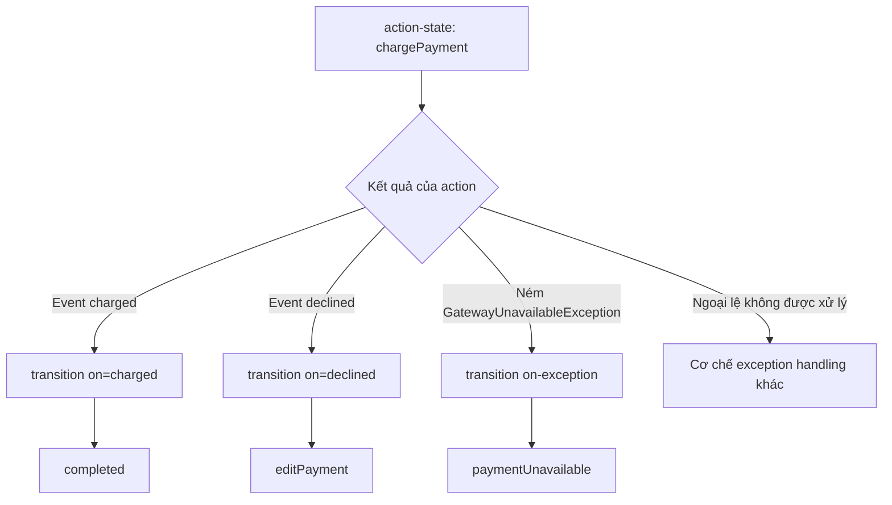
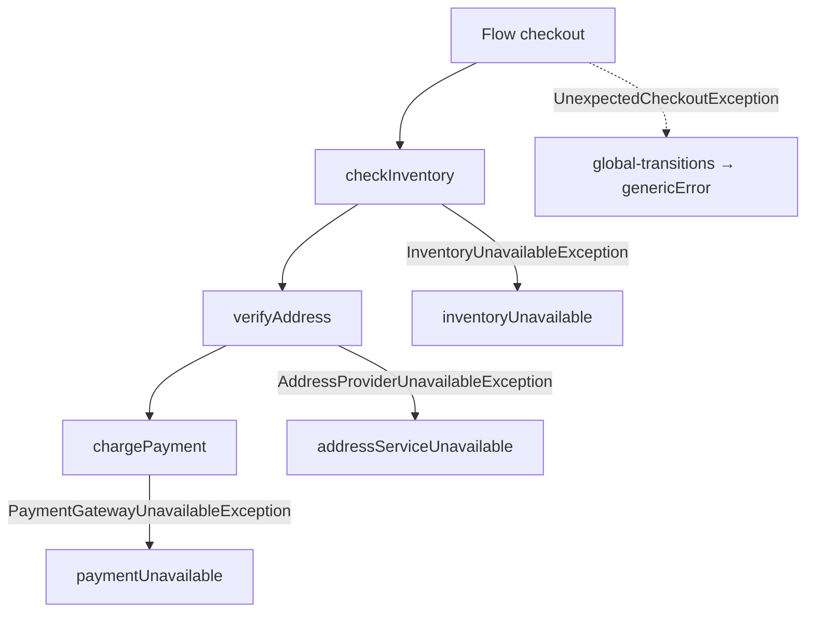

# Transition on-exception ở phạm vi thích hợp

Trong **Spring Web Flow**, một hành trình web thường trải qua nhiều màn hình và bước xử lý tự động: người dùng nhập thông tin, xác nhận, hệ thống gọi dịch vụ nghiệp vụ rồi hiển thị kết quả. Những bước đó được mô hình hóa bằng **state, event, transition và subflow**, thay vì phân tán mã điều hướng trong nhiều controller của Spring MVC. Khi một hành động phát sinh ngoại lệ, flow cần quyết định liệu có thể phục hồi tại bước hiện tại, phải chuyển đến màn hình lỗi hay để hạ tầng ứng dụng xử lý.

Spring Web Flow cho phép khai báo **transition dựa trên ngoại lệ** với thuộc tính `on-exception`. Trọng tâm của bài học trong chương **Ngoại lệ và phục hồi** là lựa chọn **phạm vi đặt transition thích hợp**: đặt gần state nơi có thể xảy ra lỗi khi lỗi chỉ có ý nghĩa với bước đó, hay sử dụng transition ở phạm vi toàn flow khi nhiều state cùng cần một đường xử lý dự phòng.

Một cấu hình hợp lý cần phân biệt ngoại lệ Java với event nghiệp vụ, tránh che giấu lỗi chương trình, giữ đúng dữ liệu trong các scope, hỗ trợ thử lại an toàn và được kiểm thử ở cả mức flow execution lẫn tích hợp HTTP.

## 1. Phân biệt event nghiệp vụ và ngoại lệ

Giả sử quy trình thanh toán có các kết quả:

- Khách thanh toán thành công: action trả event `charged`.
- Ngân hàng từ chối thẻ theo quy tắc nghiệp vụ: action trả event `declined` để khách sửa phương thức thanh toán.
- Cổng thanh toán tạm thời mất kết nối: service ném `PaymentGatewayUnavailableException`.
- Ứng dụng có lỗi lập trình bất ngờ, như `NullPointerException`.

Đây là những trường hợp khác nhau:

| Tình huống | Loại kết quả | Cách điều hướng thường phù hợp |
| --- | --- | --- |
| Thanh toán thành công | Event `charged` | Transition `on="charged"` tới bước xác nhận |
| Thẻ bị từ chối | Event `declined` | Transition `on="declined"` quay về màn hình nhập |
| Cổng thanh toán không khả dụng | Ngoại lệ kỹ thuật được phân loại | Transition `on-exception="...PaymentGatewayUnavailableException"` đến màn hình phục hồi |
| Lỗi chương trình không dự đoán được | Ngoại lệ không mong đợi | Log, theo dõi và xử lý lỗi an toàn; không giả làm kết quả thành công |

**`on="..."` khớp event, còn `on-exception="..."` khớp ngoại lệ.** Một exception không tự động biến thành event có ID `error`, `failed` hay `declined`. Ngược lại, action đã bắt exception và chủ động trả `new Event(this, "failed")` thì flow nhìn thấy **event**; transition `on-exception` sẽ không được kích hoạt bởi exception đã bị xử lý hoàn toàn.



Hãy chọn cách biểu diễn dựa trên ý nghĩa nghiệp vụ. **Kết quả dự kiến** như hết hàng, mã giảm giá không hợp lệ hoặc từ chối thanh toán thường dễ hiểu hơn dưới dạng event. **Lỗi hạ tầng** như dịch vụ gián đoạn có thể phù hợp với ngoại lệ được phân loại và transition phục hồi.

## 2. Cú pháp transition dựa trên ngoại lệ

Ví dụ một state gọi cổng thanh toán:

```xml
<action-state id="chargePayment">
    <evaluate expression="paymentAction.charge(flowScope.checkout)" />

    <transition on="charged" to="completed" />
    <transition on="declined" to="editPayment" />

    <transition
        on-exception="com.example.checkout.PaymentGatewayUnavailableException"
        to="paymentUnavailable" />
</action-state>
```

Các thành phần quan trọng:

| Thành phần | Ý nghĩa |
| --- | --- |
| `<action-state id="chargePayment">` | State thực thi xử lý không cần màn hình |
| `<evaluate expression="..."/>` | Gọi action hoặc service qua hệ thống biểu thức của Web Flow |
| `<transition on="charged".../>` | Chuyển tiếp theo event do action trả |
| `<transition on-exception="..."/>` | Chuyển tiếp khi ngoại lệ phù hợp được cơ chế flow bắt và đối chiếu |
| `to="paymentUnavailable"` | State đích trong cùng định nghĩa flow |

Giá trị `on-exception` thường là **tên đầy đủ của lớp ngoại lệ Java**. Ví dụ dùng ngoại lệ do ứng dụng định nghĩa: `com.example.checkout.PaymentGatewayUnavailableException`. Lớp này phải tồn tại trên classpath và tương thích với exception thực tế đi ra từ lời gọi action.

Điểm cần nhớ: **`on-exception` không phải Java `catch` ở tầng service và không thay thế xử lý transaction.** Nó định nghĩa một nhánh điều hướng trong Web Flow cho ngoại lệ phù hợp ở giai đoạn engine có thể xử lý.

## 3. Phạm vi cục bộ: đặt exception transition ở state liên quan

Khi một lỗi có ý nghĩa **riêng đối với một bước**, nên đặt transition ngay trong state đó. Ví dụ cổng thanh toán không khả dụng cần đưa về màn hình hỗ trợ thử lại, trong khi lỗi truy cập dịch vụ kiểm tra địa chỉ có thể cần quay về bước chọn địa chỉ.

```xml
<action-state id="verifyAddress">
    <evaluate expression="addressAction.verify(flowScope.deliveryAddress)" />
    <transition on="verified" to="reviewOrder" />
    <transition on="rejected" to="editAddress" />
    <transition
        on-exception="com.example.checkout.AddressProviderUnavailableException"
        to="addressServiceUnavailable" />
</action-state>

<action-state id="chargePayment">
    <evaluate expression="paymentAction.charge(flowScope.checkout)" />
    <transition on="charged" to="completed" />
    <transition on="declined" to="editPayment" />
    <transition
        on-exception="com.example.checkout.PaymentGatewayUnavailableException"
        to="paymentUnavailable" />
</action-state>
```

Nếu dùng một màn hình lỗi chung cho cả hai ngoại lệ, có thể làm mất ngữ cảnh: khi lỗi xác minh địa chỉ, người dùng không nên nhìn thấy nút **Thử thanh toán lại**. Đặt handler tại state giúp nhìn ngay trong XML thấy **bước nào có thể lỗi, lỗi nào được phục hồi và người dùng sẽ quay về đâu**.

### Khi nào cục bộ là phù hợp?

1. Ngoại lệ chỉ phát sinh từ một action hoặc nhóm xử lý rất nhỏ.
2. Cách phục hồi cần dựa vào **bước đang xử lý**: chỉnh biểu mẫu, thử lại service hoặc chọn phương án khác.
3. State đích cần dữ liệu đang lưu trong `flowScope` và vẫn hợp lệ sau khi xảy ra lỗi.
4. Muốn bảo đảm exception ở bước khác không bị chuyển sai về màn hình này.
5. Cần kiểm thử riêng nhánh thất bại của action cùng tên exception cụ thể.

Đặt `on-exception` tại state liên quan cũng làm rõ trách nhiệm của flow. Một thay đổi trong cách gọi cổng thanh toán chỉ cần kiểm tra đường xử lý của `chargePayment` và màn hình `paymentUnavailable`, thay vì chỉnh logic lỗi chung cho toàn bộ ứng dụng.

## 4. Phạm vi toàn flow: dùng global-transitions khi có quy tắc chung

Một flow có thể có nhiều bước cùng chịu một chính sách phục hồi. Spring Web Flow hỗ trợ khai báo các transition dùng chung trong phần `<global-transitions>` của định nghĩa flow. Ngoài các event chung như `cancel`, nơi này có thể chứa transition khớp ngoại lệ.

```xml
<global-transitions>
    <transition on="cancel" to="cancelled" />
    <transition
        on-exception="com.example.checkout.UnexpectedCheckoutException"
        to="genericError" />
</global-transitions>
```

Ví dụ `UnexpectedCheckoutException` đại diện cho một lớp lỗi mà ứng dụng đã quyết định phải đưa đến trang lỗi chung khi xảy ra trong phạm vi xử lý flow. Các state không có nhánh khôi phục riêng vẫn có thể có một đường điều hướng an toàn.

**Global transition không có nghĩa bắt được mọi lỗi phát sinh ở mọi tầng của hệ thống.** Nó vẫn hoạt động trong phạm vi điều khiển của engine đối với một flow execution phù hợp. Lỗi HTTP xảy ra trước khi engine tạo hoặc tìm lại execution, lỗi cấu hình làm flow không build được, hay lỗi xử lý request ở tầng filter/servlet không mặc nhiên được xử lý bằng `global-transitions`.

### So sánh nơi đặt transition

| Nơi khai báo | Phạm vi thiết kế | Trường hợp nên chọn |
| --- | --- | --- |
| Bên trong một `action-state` | Lỗi liên quan trực tiếp tới action ở state đó | Cổng thanh toán mất kết nối, dịch vụ kho tạm lỗi |
| Bên trong `view-state` hoặc state có transition phù hợp | Lỗi cần xử lý gắn với bước tương tác/điều hướng cụ thể | Lỗi đã được phân loại từ thao tác tại state, nếu cơ chế Web Flow hỗ trợ ở giai đoạn đó |
| Bên trong `<global-transitions>` | Quy tắc áp dụng chung cho các state của flow | Lỗi kỹ thuật được chuẩn hóa và đưa đến một trang lỗi chung |
| Hệ thống xử lý exception ngoài flow | Lỗi không thuộc hoặc không còn nằm trong một execution có thể xử lý | Flow key hết hạn, lỗi filter, không tìm được flow, lỗi hạ tầng servlet |

**Ưu tiên phạm vi nhỏ đủ xử lý đúng lỗi.** Tránh dùng `on-exception="java.lang.Exception"` để đưa tất cả ngoại lệ đến một view rồi coi như đã phục hồi thành công. Cách đó có thể che giấu bug, ngoại lệ bảo mật và các trạng thái nghiệp vụ chưa hoàn tất.

## 5. Cách lựa chọn giữa transition cục bộ và global

Giả sử flow đặt hàng có `checkInventory`, `verifyAddress` và `chargePayment`. Ba action đều có thể ném ngoại lệ, nhưng cách phục hồi khác nhau:

| Bước và ngoại lệ | Phạm vi đề xuất | Điểm đến | Lý do |
| --- | --- | --- | --- |
| `checkInventory` → `InventoryUnavailableException` | Cục bộ | `inventoryUnavailable` | Cho người dùng thử lại kiểm tra kho hoặc đổi hàng |
| `verifyAddress` → `AddressProviderUnavailableException` | Cục bộ | `addressServiceUnavailable` | Có thể tiếp tục sửa địa chỉ hoặc chọn phương thức giao khác |
| `chargePayment` → `PaymentGatewayUnavailableException` | Cục bộ | `paymentUnavailable` | Thử thanh toán lại phải có cơ chế chống ghi trùng |
| Nhiều state → `UnexpectedCheckoutException` | Global | `genericError` | Cùng một chính sách hiển thị lỗi an toàn |
| HTTP không tìm được execution do key hết hạn | Tầng web / repository exception handling | Trang phiên hết hạn hoặc khởi động lại | Có thể chưa có active state để áp dụng transition của flow |



Khi có cả transition cục bộ và transition toàn flow có khả năng khớp cùng một ngoại lệ, nên **thiết kế các loại lỗi đủ rõ ràng và kiểm thử lựa chọn nhánh thực tế**. Không dựa vào suy đoán về thứ tự khớp khi nhiều handler cùng bắt một cây kế thừa exception; chi tiết ưu tiên và ngoại lệ được bọc có thể phụ thuộc phiên bản và điểm phát sinh lỗi.

## 6. Ví dụ flow hoàn chỉnh: lỗi cổng thanh toán và trang phục hồi

Ví dụ sau mô tả một hành trình có form, xác nhận, action thanh toán, nhánh ngoại lệ cục bộ và đường dự phòng toàn flow.

```xml
<?xml version="1.0" encoding="UTF-8"?>
<flow xmlns="http://www.springframework.org/schema/webflow"
      xmlns:xsi="http://www.w3.org/2001/XMLSchema-instance"
      xsi:schemaLocation="
          http://www.springframework.org/schema/webflow
          http://www.springframework.org/schema/webflow/spring-webflow.xsd">

    <var name="checkout" class="com.example.checkout.CheckoutForm" />

    <view-state id="editPayment"
                view="checkout/payment"
                model="checkout">
        <binder>
            <binding property="paymentMethod" required="true" />
        </binder>
        <transition on="review" to="reviewPayment" />
        <transition on="cancel" to="cancelled"
                    bind="false" validate="false" />
    </view-state>

    <view-state id="reviewPayment" view="checkout/review-payment">
        <transition on="edit" to="editPayment" />
        <transition on="confirm" to="chargePayment" />
    </view-state>

    <action-state id="chargePayment">
        <evaluate expression="paymentAction.charge(flowScope.checkout)" />
        <transition on="charged" to="completed" />
        <transition on="declined" to="editPayment" />
        <transition
            on-exception="com.example.checkout.PaymentGatewayUnavailableException"
            to="paymentUnavailable" />
    </action-state>

    <view-state id="paymentUnavailable" view="checkout/payment-unavailable">
        <transition on="retry" to="chargePayment" />
        <transition on="edit" to="editPayment" />
        <transition on="cancel" to="cancelled" />
    </view-state>

    <view-state id="genericError" view="checkout/error">
        <transition on="cancel" to="cancelled" />
    </view-state>

    <global-transitions>
        <transition
            on-exception="com.example.checkout.UnexpectedCheckoutException"
            to="genericError" />
    </global-transitions>

    <end-state id="completed" view="checkout/completed" />
    <end-state id="cancelled" />
</flow>
```

Các lớp `CheckoutForm`, `PaymentAction`, ngoại lệ và các view là thành phần ứng dụng minh họa. `CheckoutForm` cần có property `paymentMethod` và dữ liệu thanh toán phù hợp; validator phải được cấu hình để không cho event `review` đi tiếp với form không hợp lệ.

Trong flow này:

1. Người dùng nhập thông tin ở `editPayment` và gửi `review`.
2. Binding và validation thành công thì transition đến `reviewPayment`.
3. `confirm` đưa flow vào `chargePayment`.
4. Action trả `charged` hoặc `declined` thì engine dùng transition `on` tương ứng.
5. Nếu action ném `PaymentGatewayUnavailableException` và exception được Web Flow khớp trong phạm vi state này, engine chuyển tới `paymentUnavailable`.
6. Nếu một lỗi `UnexpectedCheckoutException` xuất hiện tại điểm được cơ chế transition toàn flow xử lý, flow dùng đường dự phòng `genericError`.

Đường `paymentUnavailable → retry → chargePayment` cần được kiểm thử cẩn thận vì một lần gọi cổng thanh toán có thể đã hoàn thành ở phía nhà cung cấp trước khi client nhận lỗi.

### Java action minh họa

```java
package com.example.checkout;

import org.springframework.stereotype.Component;
import org.springframework.webflow.execution.Event;

@Component("paymentAction")
public class PaymentAction {

    private final PaymentService paymentService;

    public PaymentAction(PaymentService paymentService) {
        this.paymentService = paymentService;
    }

    public Event charge(CheckoutForm checkout) {
        // requestKey phải ổn định qua các lần thử lại cùng một lần thanh toán.
        ChargeResult result = paymentService.charge(
            checkout.getPaymentRequestKey(),
            checkout.getPaymentMethod(),
            checkout.getAmount());

        if (result == ChargeResult.APPROVED) {
            return new Event(this, "charged");
        }
        return new Event(this, "declined");
    }
}
```

Mẫu trên giả định `paymentService.charge(...)` có thể ném `PaymentGatewayUnavailableException` khi gặp lỗi kết nối và không xử lý ngoại lệ đó ngay trong `PaymentAction`. Nếu action bắt ngoại lệ rồi trả một event `failed`, transition `on-exception` không còn nhìn thấy ngoại lệ theo cách thiết kế này; khi đó XML phải dùng transition `on="failed"`.

**Không đưa nội dung thẻ hoặc token nhạy cảm vào log, message hay flowScope chỉ để thuận tiện xử lý ngoại lệ.** Dữ liệu lưu trong flow execution có thể tồn tại qua nhiều request hoặc được đưa vào session theo cấu hình repository.

## 7. Ngoại lệ có thể bị bọc: kiểm tra kiểu thực tế khi khớp

Khai báo `on-exception="com.example.checkout.PaymentGatewayUnavailableException"` chỉ có ý nghĩa nếu cơ chế transition có thể nhận diện ngoại lệ theo kiểu đó ở thời điểm nó đối chiếu.

Một lời gọi qua proxy Spring, tầng giao dịch, hệ thống biểu thức hoặc service trung gian có thể làm xuất hiện một **ngoại lệ bọc** (wrapper exception). Ví dụ một implementation có thể ném `PaymentGatewayUnavailableException` trực tiếp; implementation khác có thể bọc nguyên nhân trong một loại exception khác.

```text
Business service
  throws PaymentGatewayUnavailableException
       │
       └── evaluation / proxy / invocation layer
            ├── vẫn đưa ra exception ban đầu
            └── hoặc đóng gói thành wrapper exception
                         └── cause: PaymentGatewayUnavailableException
```

Không nên khẳng định mọi phiên bản Web Flow sẽ tự lần qua toàn bộ chuỗi `cause` để khớp `on-exception`. Hãy **kiểm thử với đúng các bean/proxy và phiên bản thư viện đang sử dụng**, ghi nhận loại exception mà engine xử lý thực tế.

Nếu service có thể ném nhiều loại lỗi hạ tầng, một lựa chọn là chuẩn hóa chúng ở **ranh giới adapter nghiệp vụ** thành một loại exception rõ nghĩa cho flow. Việc chuẩn hóa không được làm mất `cause` và thông tin chẩn đoán; cũng không nên biến mọi lỗi lập trình thành “cổng thanh toán đang bận”.

## 8. Lỗi trong view-state và lỗi validation không cùng một nhánh

Form binding và validation có cơ chế báo lỗi riêng. Giả sử người dùng gửi `quantity="abc"` vào property `Integer quantity`:

- Bước chuyển kiểu có thể báo lỗi binding, để view hiển thị “Số lượng phải là số”.
- `quantity=-5` chuyển kiểu thành công nhưng validator bác bỏ vì số lượng phải dương.
- Cả hai trường hợp thường giữ người dùng ở `view-state` đang nhập form.

```xml
<view-state id="editQuantity" view="checkout/quantity"
            model="checkout">
    <binder>
        <binding property="quantity" required="true" />
    </binder>
    <transition on="next" to="reviewPayment" />
    <transition on="cancel" to="cancelled"
                bind="false" validate="false" />
</view-state>
```

**Không dùng `on-exception` để thay cho việc hiển thị lỗi binding/validation thông thường.** Những lỗi này thường được ghi nhận trong message context của Web Flow, không được biểu diễn thành ngoại lệ kỹ thuật cần nhảy đến `genericError`. Đường điều hướng chuẩn là chặn event `next`, hiển thị lại form và giúp người dùng sửa dữ liệu.

Nếu bản thân validator hoặc converter ném một exception **không được dự kiến**, đó là vấn đề khác. Khi muốn bắt lỗi tại state, phải kiểm tra chính xác giai đoạn thực thi và cơ chế ngoại lệ được Web Flow phiên bản đang dùng hỗ trợ; không nên mặc định mọi lỗi của view rendering hoặc HTTP đều chạy qua transition của state.

## 9. Subflow: nơi lỗi được phục hồi và nơi outcome được trả về

Một `subflow-state` trong flow cha gọi một định nghĩa flow con. Flow con có thể chứa nhiều `view-state`, `action-state` và có xử lý ngoại lệ của riêng nó. Cần chọn nơi phục hồi dựa trên **flow nào có đủ ngữ cảnh để xử lý**.

Giả sử flow cha `checkout` gọi flow `addressVerification`:

```xml
<subflow-state id="verifyAddress" subflow="addressVerification">
    <input name="address"
           value="flowScope.checkout.shippingAddress" />
    <transition on="verified" to="reviewPayment" />
    <transition on="rejected" to="editAddress" />
    <transition on="temporarilyUnavailable" to="addressHelp" />
</subflow-state>
```

Ở flow con, một action kiểm tra địa chỉ có thể xử lý ngoại lệ cục bộ:

```xml
<action-state id="checkAddress">
    <evaluate expression="addressAction.check(flowScope.address)" />
    <transition on="verified" to="verified" />
    <transition on="rejected" to="rejected" />
    <transition
        on-exception="com.example.checkout.AddressProviderUnavailableException"
        to="temporarilyUnavailable" />
</action-state>

<end-state id="verified" />
<end-state id="rejected" />
<end-state id="temporarilyUnavailable" />
```

Flow con chủ động chuyển lỗi có thể phục hồi thành **end-state `temporarilyUnavailable`**, rồi flow cha nhận outcome tương ứng. Đây là hợp đồng rõ ràng giữa hai flow: flow con biết nguyên nhân lỗi, còn flow cha quyết định trang hỗ trợ phù hợp với hành trình của mình.

**Không giả định ngoại lệ của flow con tự biến thành outcome ở flow cha.** Nếu exception xảy ra trước khi flow con khởi động, ở giai đoạn input mapping, hoặc không được xử lý trong flow con, cần kiểm tra cơ chế lan truyền và xử lý exception thực tế. Transition `on="temporarilyUnavailable"` của flow cha chỉ hoạt động khi flow con **kết thúc với outcome đó**.

## 10. Exception nằm ngoài execution: xử lý ở tầng web

Không phải lỗi nào của hành trình cũng xuất hiện khi engine đang có một state để áp dụng `on-exception`.

| Nguồn lỗi | Ví dụ | Vị trí xử lý thích hợp |
| --- | --- | --- |
| Action đang thực thi trong flow | Service kho ném ngoại lệ phân loại | `on-exception` cục bộ hoặc chính sách toàn flow |
| Lỗi form dự kiến | Giá trị không parse được, validator từ chối | Binder/validator và message context của view-state |
| Flow con kết thúc với outcome lỗi | `temporarilyUnavailable` | Transition `on` của `subflow-state` trong flow cha |
| Flow execution key sai/hết hạn | Request không thể tìm execution đang chạy | Cơ chế xử lý lỗi repository/web/MVC phù hợp |
| URL không khớp flow đã đăng ký | Không tìm được flow ID để khởi động | Flow registry, handler mapping và cấu hình 404 |
| Lỗi filter, CSRF, xác thực | HTTP bị từ chối trước khi tới Web Flow | Spring Security/filter/exception handler |
| Lỗi render template hoặc servlet container | JSP/Thymeleaf lỗi sau khi chọn view | View technology và xử lý lỗi web |

Trong ứng dụng tích hợp Spring MVC, `FlowHandlerMapping` và `FlowHandlerAdapter` kết nối URL với `FlowExecutor`. Nếu lỗi xảy ra **trước khi** engine có thể tìm được execution hoặc **sau khi** flow đã chọn view và lỗi nằm ở trình render, `global-transitions` không phải cơ chế thay thế cho `HandlerExceptionResolver`, `@ControllerAdvice` hay chính sách lỗi của servlet.

Ví dụ khi `FlowExecutionRepository` báo key đã hết hạn, ứng dụng có thể hiển thị trang “Phiên thao tác đã kết thúc” và đề nghị người dùng bắt đầu lại. Đường xử lý này cần được kiểm thử qua HTTP và session, thay vì chỉ gửi event vào một flow execution còn hợp lệ.

## 11. Dữ liệu trong scope, giao dịch và tính nhất quán khi phục hồi

Một transition `on-exception` có thể đưa người dùng đến trang thử lại, nhưng **không tự hoàn tác mọi tác dụng phụ** của action đã lỗi.

Ví dụ action `chargePayment` đã gửi yêu cầu tới cổng thanh toán; cổng thanh toán chấp nhận giao dịch nhưng phản hồi mạng bị mất. Nếu người dùng bấm `retry` ngay, có nguy cơ thanh toán hai lần. Flow cần phối hợp với service để bảo đảm việc gửi lại cùng một yêu cầu được xử lý nhất quán.

Các nguyên tắc:

1. **Idempotency key:** giữ một khóa nghiệp vụ ổn định cho cùng lần thanh toán; service và cổng thanh toán (nếu hỗ trợ) dùng khóa đó để nhận diện request lặp.
2. **Transaction boundary:** đặt transaction cơ sở dữ liệu ở tầng service theo yêu cầu; chuyển state trong flow không đồng nghĩa tự mở hoặc rollback giao dịch bên ngoài.
3. **Không giữ transaction xuyên thời gian chờ người dùng:** sau khi chuyển vào `view-state` phục hồi, có thể có nhiều request và khoảng thời gian chờ dài.
4. **Scope theo vòng đời:** những dữ liệu cần để thử lại như order ID, request key hoặc trạng thái nghiệp vụ phù hợp nên tồn tại qua các state, ví dụ trong `flowScope` nếu phù hợp.
5. **Tái kiểm tra:** khi người dùng quay lại sửa form, dữ liệu phụ thuộc như tổng tiền, phí giao hàng hoặc tồn kho có thể cần tính lại.
6. **Thông điệp an toàn:** view lỗi hiển thị mô tả chung và mã tra cứu sự cố, không hiển thị chi tiết kết nối, chuỗi SQL hay thông tin nhạy cảm.

| Vấn đề sau exception | Transition giải quyết được? | Cần bổ sung |
| --- | --- | --- |
| Chọn trang để người dùng thử lại | Có, nếu exception phù hợp được engine xử lý | View và event retry rõ ràng |
| Hoàn tác một giao dịch DB đang mở | Không mặc nhiên | Transaction management tại service |
| Hoàn tác API đã gọi ở hệ thống ngoài | Không | Cơ chế idempotency, đối soát hoặc bù trừ |
| Ghi log phục vụ chẩn đoán | Không mặc nhiên đầy đủ | Logging/observability ở tầng phù hợp |
| Bảo đảm object trong scope còn hợp lệ | Không | Kiểm tra dữ liệu và xử lý dữ liệu cũ |
| Khôi phục execution đã hết hạn | Không | Chiến lược repository và xử lý HTTP/session |

## 12. Kiểm thử exception transition ở từng phạm vi

Để kiểm tra cấu hình thật, nên dùng **flow-execution test** với định nghĩa XML đã nạp, fake/mock service và event do engine xử lý. Test chỉ gọi `PaymentAction.charge(...)` trực tiếp chưa thể chứng minh `on-exception` chuyển đến đúng state.

### Ma trận trường hợp cần bao phủ

| Given / When | Then cần xác nhận |
| --- | --- |
| `chargePayment` trả `charged` | Flow kết thúc ở `completed`; không hiện trang lỗi |
| `chargePayment` trả `declined` | Trở lại `editPayment`; không chạy transition exception |
| `chargePayment` ném `PaymentGatewayUnavailableException` | Vào `paymentUnavailable` bằng transition cục bộ |
| Một state phát `UnexpectedCheckoutException` theo hợp đồng toàn flow | Vào `genericError` nếu nằm trong phạm vi xử lý của global transition |
| Action ném một exception không có handler phù hợp | Không bị coi là event thành công; lỗi đi qua cơ chế exception handling còn lại |
| Payment exception bị bọc trong exception khác | Kiểm tra loại exception engine nhận và nhánh được chọn |
| Người dùng bấm `retry` sau lỗi cổng thanh toán | Action được gọi lại đúng cách; service không tạo thanh toán trùng |
| Người dùng bấm `cancel` tại `paymentUnavailable` | Flow kết thúc `cancelled` và trạng thái nghiệp vụ được xử lý phù hợp |
| Form thiếu hoặc sai dữ liệu | Binder/validator giữ tại `editPayment`; action chưa được gọi |
| Flow con xử lý provider error rồi kết thúc `temporarilyUnavailable` | Flow cha nhận outcome và chuyển `addressHelp` |
| Execution key hết hạn trước khi resume | HTTP/repository xử lý; không phụ thuộc global transition trong execution không có sẵn |

### Phác thảo flow-execution test

Trong Spring Web Flow 2.x có test support để khởi động flow, gửi event qua mock external context và assert state. Ví dụ ở mức **ý tưởng kiểm thử**:

```text
Given:
  flow checkout đã nạp với XML thật
  execution ở reviewPayment
  fake paymentService sẽ ném PaymentGatewayUnavailableException
When:
  resumeFlow bằng event confirm
Then:
  active state = paymentUnavailable
  không có outcome completed
  số lần gọi paymentService.charge = 1
  khóa nghiệp vụ trong flowScope vẫn phù hợp cho lần retry
```

Để chứng minh phạm vi cục bộ đúng, tạo một test khác cho ngoại lệ không liên quan ném từ state khác và assert nó **không** bị chuyển nhầm sang `paymentUnavailable`. Với global transition, kiểm tra một exception được chủ động phát tại state không có handler cục bộ và xác nhận đường dự phòng như thiết kế.

**Kiểm thử từng loại ngoại lệ qua đúng stack thực tế** là quan trọng vì khi sử dụng proxy, transaction interceptor hoặc expression engine, loại exception nhìn thấy ở ranh giới Web Flow có thể khác loại exception gốc.

### Kiểm thử tích hợp Spring MVC

Với `FlowHandlerMapping`, `FlowHandlerAdapter` và `FlowExecutor` đã cấu hình, hãy chạy một hành trình nhiều request:

1. GET URL flow để khởi động `checkout`.
2. Submit form hợp lệ, giữ đúng session/execution key, đến `reviewPayment`.
3. Submit `confirm` trong khi fake cổng thanh toán ném exception.
4. Xác nhận trang `checkout/payment-unavailable` được resolver chọn và thông báo không lộ stack trace.
5. Gửi event `retry` bằng URL/key hiện hành, kiểm tra kết quả khi service hoạt động trở lại.
6. Gửi request với key cũ/hết hạn ở một test độc lập, xác nhận chính sách phục hồi HTTP phù hợp.

Không dùng một execution key tự đoán cho mọi request; cơ chế lưu/khôi phục của `FlowExecutionRepository` có thể tạo key mới giữa các trạng thái tùy cấu hình. Khi test với MockMvc hoặc servlet container, cần duy trì session/cookie và các cơ chế bảo vệ POST như CSRF nếu ứng dụng bật.

## 13. Những lỗi thiết kế thường gặp

| Sai lầm | Hậu quả | Hướng xử lý |
| --- | --- | --- |
| Dùng `on-exception` để xử lý mọi kết quả nghiệp vụ | Nhánh điều hướng khó hiểu, nhiều exception dự kiến | Dùng event cho từ chối/hết hàng thông thường |
| Khai báo handler cổng thanh toán trong global-transitions | Lỗi ở state khác có thể đưa đến màn hình thanh toán sai ngữ cảnh | Đặt exception transition ở `chargePayment` |
| Đặt `on-exception="java.lang.Exception"` cho mọi flow | Che giấu lỗi lập trình và ngoại lệ không nên phục hồi | Phân loại exception; dùng fallback có kiểm soát |
| Giả định exception tự tạo event `failed` | Transition `on="failed"` không chạy | Xác định action trả event hay ném ngoại lệ |
| Bắt exception ở Java rồi không ném lại, nhưng vẫn trông chờ `on-exception` | Handler không có exception để khớp | Chọn một hợp đồng xử lý và cập nhật XML |
| Chỉ kiểm tra lớp exception gốc | Wrapper exception có thể ảnh hưởng matching | Test với bean/proxy thật và quan sát cause chain |
| Coi binding/validation error là lỗi hệ thống | Người dùng bị đẩy sang trang lỗi thay vì sửa form | Hiển thị lỗi trong `view-state` qua message context |
| Dựa vào global transition để bắt key hết hạn | Engine có thể chưa khôi phục execution | Xử lý lỗi repository ở tầng MVC/HTTP |
| Retry action thanh toán không có idempotency | Tạo giao dịch trùng | Dùng request key, đối soát và bảo vệ tại service |
| Hiển thị `exception.message` trực tiếp | Lộ chi tiết kỹ thuật hoặc thông tin nhạy cảm | Thông báo thân thiện, ghi log chẩn đoán riêng |
| Không test các nhánh lỗi hiếm | Handler sai chỉ lộ khi sự cố thật xảy ra | Fake exception và kiểm tra state, scope, side effect |

## 14. Bài thực hành: thiết kế hai tầng phục hồi

Hãy xây dựng một flow `checkout` với các state `reviewPayment`, `chargePayment`, `paymentUnavailable`, `genericError` và `completed`. Mục tiêu là phân biệt đường khôi phục có ngữ cảnh và đường fallback:

1. Viết `PaymentAction` có ba kết quả: event `charged`, event `declined` và ném `PaymentGatewayUnavailableException` khi nhà cung cấp tạm gián đoạn.
2. Đặt `on-exception` cho `PaymentGatewayUnavailableException` tại `chargePayment`, chuyển tới `paymentUnavailable`.
3. Tạo `global-transitions` cho một loại `UnexpectedCheckoutException` có ý nghĩa ở nhiều state, chuyển tới `genericError`.
4. Tại `paymentUnavailable`, cung cấp event `retry` và `cancel`; thiết kế khóa idempotency được giữ ổn định cho cùng một lần thanh toán.
5. Test event `charged` và `declined` trước, sau đó test exception ở state `chargePayment` và kiểm tra state đích.
6. Tại một state khác, giả lập `UnexpectedCheckoutException` để kiểm tra global transition và bảo đảm không rẽ nhầm về màn hình thanh toán.
7. Test một exception chưa được xử lý theo hợp đồng; xác nhận nó không bị coi là thanh toán thành công.
8. Test việc service ném exception qua proxy để xác nhận kiểu exception mà Web Flow đối chiếu.
9. Dùng integration test với Spring MVC để kiểm tra view lỗi, session/execution key và hành vi sau retry.
10. Test thêm lỗi form thông thường và execution key hết hạn nhằm chứng minh chúng được xử lý ở các lớp phù hợp.

Tiêu chí hoàn thành không chỉ là màn hình lỗi xuất hiện, mà còn là **lỗi đúng được xử lý tại đúng phạm vi**, dữ liệu và transaction vẫn nhất quán, và người dùng có đường phục hồi an toàn.

Khi dùng Spring Web Flow, hãy xem `on-exception` như **một quy tắc chuyển trạng thái cho ngoại lệ được phân loại**, không phải giải pháp bắt mọi lỗi của ứng dụng. Handler cục bộ diễn đạt chính xác một bước có thể phục hồi như thế nào; `global-transitions` mô tả chính sách chung của flow; còn lỗi trước hoặc ngoài execution thuộc trách nhiệm của hạ tầng web. Kết hợp kiểm thử event, exception, state, scope, transaction, session và retry giúp hành trình nhiều bước giữ được tính đúng đắn ngay cả khi hệ thống gặp sự cố.
