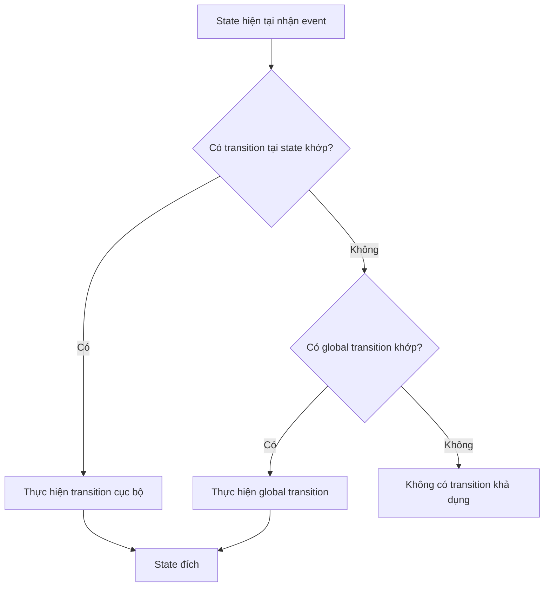
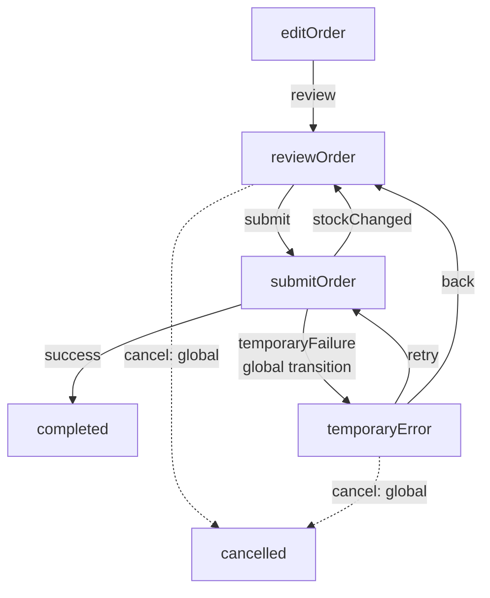
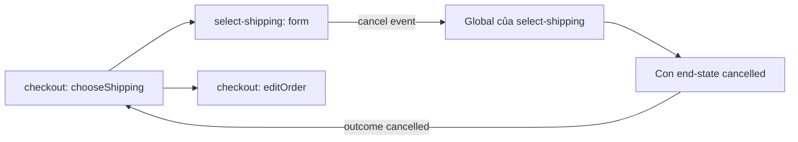

# Xử lý lỗi chung bằng global transitions

Một hành trình web nhiều bước thường có những tình huống cần xử lý giống nhau ở nhiều màn hình: người dùng chọn **Hủy**, phiên nghiệp vụ đã hết hạn, dịch vụ thanh toán tạm thời không khả dụng hoặc một thông báo yêu cầu quay về bước an toàn. Nếu sao chép cùng một `<transition>` vào hàng chục `view-state`, mỗi lần đổi chính sách khôi phục phải sửa nhiều nơi và rất dễ bỏ sót một màn hình.

Trong **Spring Web Flow (SWF)**, `<global-transitions>` cho phép định nghĩa những transition dùng chung ở cấp **một flow**. Khi state hiện tại không chọn được transition riêng tương ứng, Web Flow có thể xét transition toàn cục. Đây là công cụ hữu ích để chuẩn hóa điều hướng và phục hồi sau **event lỗi đã được nhận diện**; ngoài ra, Web Flow còn hỗ trợ `on-exception` để điều hướng khi một loại exception được ném ra trong quá trình thực thi flow.

Hai cơ chế này không giống nhau. Đặc biệt, `on="error"` không tự động bắt mọi Java exception. Bài học tập trung vào cách thiết kế, cấu hình, kiểm thử và chẩn đoán **xử lý lỗi chung bằng global transitions** mà vẫn giữ được ngữ nghĩa nghiệp vụ của từng state.

## 1. Mục tiêu học tập

Sau bài học, bạn có thể:

1. Giải thích phạm vi và thứ tự chọn giữa transition tại state với global transition.
2. Dùng `<global-transitions>` để xử lý event `cancel`, `sessionExpired` hoặc `temporaryFailure` ở nhiều bước.
3. Chuyển lỗi nghiệp vụ từ service/action thành event có tên rõ ràng để điều hướng tập trung.
4. Phân biệt `on="..."` với `on-exception="..."` và biết khi nào nên dùng từng cách.
5. Thiết kế state hiển thị lỗi, cho phép thử lại hoặc kết thúc an toàn.
6. Dùng flow inheritance để chia sẻ chính sách lỗi giữa nhiều flow khi thật sự cần.
7. Kiểm thử transition cục bộ, global transition, form validation, subflow và lỗi xảy ra ngoài flow execution.

## 2. Global transition nằm ở đâu trong mô hình flow?

Giả sử flow `checkout` có ba màn hình `editOrder`, `reviewOrder` và `temporaryError`. Từ các màn hình đó, người dùng đều có thể gửi event `cancel`.

Không dùng global transition, mỗi state phải khai báo riêng:

```xml
<view-state id="editOrder">
    <transition on="cancel" to="cancelled" />
</view-state>

<view-state id="reviewOrder">
    <transition on="cancel" to="cancelled" />
</view-state>

<view-state id="temporaryError">
    <transition on="cancel" to="cancelled" />
</view-state>

<end-state id="cancelled" />
```

Khi dùng global transition, ta khai báo tại cấp flow:

```xml
<global-transitions>
    <transition on="cancel" to="cancelled" />
</global-transitions>
```

Trong trường hợp phù hợp, định nghĩa chung cho phép những state có thể nhận event `cancel` sử dụng cùng đường đi tới `cancelled`. Điều này giảm lặp cấu hình, đồng thời diễn đạt rõ chính sách “người dùng có thể hủy hành trình từ các bước được hỗ trợ”.



Theo API `Flow.getGlobalTransitionSet()`, tập transition toàn cục là tập **ứng viên khi không có state-level transition phù hợp**. Vì thế global transition là **đường dự phòng trong phạm vi flow**, không phải một interceptor luôn chạy trước mọi state. `end-state` đã kết thúc execution nên không còn xử lý event điều hướng như `view-state`.

### 2.1. Một số thuật ngữ quan trọng

| Thuật ngữ | Ý nghĩa | Ví dụ |
| --- | --- | --- |
| Event ID | Tên sự kiện dùng để chọn transition | `cancel`, `temporaryFailure` |
| State transition | Transition định nghĩa bên trong state | `<transition on="retry" to="submitOrder"/>` |
| Global transition | Transition khai báo trong `<global-transitions>` của flow | `<transition on="cancel" to="cancelled"/>` |
| Outcome | Kết quả một `end-state` hoặc subflow trả về | `cancelled`, `completed` |
| Exception | Lỗi Java xảy ra khi thực thi | `PaymentGatewayUnavailableException` |
| Error view | State hiển thị thông báo/lựa chọn phục hồi | `temporaryError` |

Một event `temporaryFailure` có thể là kết quả **được action chủ động trả về**. Trong khi đó, exception là đối tượng lỗi được **ném ra**; cần được xử lý theo đường khác nếu chưa được chuyển thành event.

## 3. Phạm vi và thứ tự ưu tiên

Global transition thuộc về **một định nghĩa flow**. Nó không tự động có hiệu lực trên tất cả flow trong registry, mọi controller của Spring MVC hay toàn bộ ứng dụng.

### 3.1. Transition cục bộ được ưu tiên

Ví dụ:

```xml
<view-state id="editOrder">
    <transition on="cancel" to="confirmCancellation" />
</view-state>

<view-state id="confirmCancellation">
    <transition on="yes" to="cancelled" />
    <transition on="no" to="editOrder" />
</view-state>

<end-state id="cancelled" />

<global-transitions>
    <transition on="cancel" to="cancelled" />
</global-transitions>
```

Khi `editOrder` nhận `cancel`, transition **cục bộ** đưa người dùng tới `confirmCancellation`. Khi một state khác không có transition cục bộ cho `cancel` nhưng có thể nhận event đó, transition **global** có thể đưa người dùng trực tiếp tới `cancelled`.

Điểm này hữu ích khi một vài state cần xác nhận hủy, còn các state khác được phép kết thúc ngay.

### 3.2. Chỉ áp dụng khi có event hoặc exception tương ứng

`<global-transitions>` không tự tạo ra event. Nếu form không gửi `_eventId_cancel`, hệ thống không tự kích hoạt global transition `on="cancel"`. Tương tự, nếu action trả `retryLater` thì global transition `on="temporaryFailure"` sẽ không khớp.

### 3.3. Global không thay thế kiểm tra điều kiện

Một transition có thể có điều kiện hoặc hành động riêng. Nếu cùng một event xuất hiện ở nhiều ngữ cảnh nhưng yêu cầu điều kiện nghiệp vụ khác nhau, đừng xóa logic tại state chỉ để gom hết vào global. Hãy để transition cục bộ xử lý ngoại lệ; chỉ đưa **chính sách thật sự dùng chung** lên cấp flow.

## 4. Phân biệt ba nguồn lỗi

Trong thực tế, “flow bị lỗi” có thể bắt nguồn từ những tình huống rất khác nhau:

| Tình huống | Ví dụ | Cách xử lý phù hợp |
| --- | --- | --- |
| Event nghiệp vụ có thể dự đoán | Giỏ hàng hết hạn, tồn kho không đủ, cổng thanh toán yêu cầu thử lại | Action trả event có tên rõ ràng; state/global transition quyết định đường đi |
| Exception ném ra khi flow đang thực thi | Service ném `PaymentGatewayUnavailableException` | Bắt exception tại action rồi chuyển thành event; hoặc dùng transition `on-exception` có chủ đích |
| Lỗi ngoài hoặc trước flow execution | URL execution key không tồn tại, session/repository không thể khôi phục | Xử lý tại tầng executor, Spring MVC/`FlowHandler`, lỗi HTTP hoặc điểm khởi động lại |

Một global transition `on="temporaryFailure"` **không nhận** được exception nếu action chưa bắt và chuyển nó thành event. Ngược lại, một `on-exception="..."` không có nghĩa mọi thất bại hoặc mọi message lỗi form đều bị bắt.

## 5. Cấu hình global transitions để xử lý lỗi nghiệp vụ

Mẫu cơ bản:

```xml
<flow xmlns="http://www.springframework.org/schema/webflow"
      xmlns:xsi="http://www.w3.org/2001/XMLSchema-instance"
      xsi:schemaLocation="http://www.springframework.org/schema/webflow
                          https://www.springframework.org/schema/webflow/spring-webflow.xsd">

    <!-- Các state, action và end-state đặt ở đây. -->

    <global-transitions>
        <transition on="cancel" to="cancelled" />
        <transition on="temporaryFailure" to="temporaryError" />
    </global-transitions>
</flow>
```

Ý nghĩa:

- `on="cancel"`: xử lý event hủy ở những nơi không có transition cục bộ phù hợp.
- `on="temporaryFailure"`: xử lý event lỗi có thể phục hồi khi action/service chủ động trả event này.
- `to="cancelled"` và `to="temporaryError"`: tham chiếu đến **state ID hợp lệ trong flow**.

Đích `temporaryError` thường là `view-state` hiển thị hướng dẫn thử lại, còn `cancelled` có thể là `end-state` để chấm dứt hành trình.

Nếu đặt sai target, ví dụ `to="temporaryErrors"` khi chỉ có `id="temporaryError"`, việc thêm global transition không giúp phục hồi; thay vào đó có thể phát sinh lỗi phân giải state. Hãy bảo đảm mọi target có định nghĩa rõ ràng.

## 6. Ví dụ hoàn chỉnh: flow thanh toán với một chính sách lỗi chung

Trong ví dụ này, người dùng có thể chỉnh sửa giỏ hàng, xem lại, đặt hàng và nếu hệ thống tạm thời lỗi thì thử lại. Hủy là hành động dùng chung; lỗi tạm thời được action biểu diễn bằng một event để flow chuyển sang màn hình phục hồi.

### 6.1. Định nghĩa `checkout-flow.xml`

```xml
<flow xmlns="http://www.springframework.org/schema/webflow"
      xmlns:xsi="http://www.w3.org/2001/XMLSchema-instance"
      xsi:schemaLocation="http://www.springframework.org/schema/webflow
                          https://www.springframework.org/schema/webflow/spring-webflow.xsd">

    <input name="cartId" type="long" required="true" />

    <on-start>
        <evaluate expression="checkoutService.createForm(cartId)"
                  result="flowScope.checkoutForm" />
    </on-start>

    <view-state id="editOrder" model="checkoutForm">
        <transition on="review" to="reviewOrder" />

        <!-- Form có thể còn lỗi nhập liệu; hủy phải đi được. -->
        <transition on="cancel" to="cancelled"
                    bind="false" validate="false" />
    </view-state>

    <view-state id="reviewOrder">
        <transition on="submit" to="submitOrder" />
        <transition on="back" to="editOrder" />
    </view-state>

    <action-state id="submitOrder">
        <!-- Action trả String: success, stockChanged hoặc temporaryFailure. -->
        <evaluate expression="checkoutAction.submit(checkoutForm)" />

        <transition on="success" to="completed" />
        <transition on="stockChanged" to="reviewOrder" />
        <!-- temporaryFailure được xử lý qua global-transitions. -->
    </action-state>

    <view-state id="temporaryError" view="checkout/temporaryError">
        <transition on="retry" to="submitOrder"
                    bind="false" validate="false" />
        <transition on="back" to="reviewOrder"
                    bind="false" validate="false" />
        <!-- cancel sẽ được global-transitions xử lý. -->
    </view-state>

    <end-state id="completed" />
    <end-state id="cancelled" />

    <global-transitions>
        <transition on="cancel" to="cancelled" />
        <transition on="temporaryFailure" to="temporaryError" />
    </global-transitions>
</flow>
```

Định nghĩa này giả định ứng dụng đã đăng ký bean `checkoutService` và `checkoutAction`, view của các state tồn tại và service luôn kiểm tra quyền truy cập giỏ hàng. State `editOrder` có transition hủy riêng để có thể bỏ qua bind/validate khi form chưa hợp lệ. Ở `reviewOrder` hoặc `temporaryError`, event `cancel` rơi về global transition nếu không có transition cục bộ cùng event.

### 6.2. Action chuẩn hóa lỗi thành event

Một lớp action có thể gọi service và chuyển kết quả nghiệp vụ thành tên event đã công bố. Ví dụ:

```java
package com.example.checkout;

public final class CheckoutAction {

    private final CheckoutService checkoutService;

    public CheckoutAction(CheckoutService checkoutService) {
        this.checkoutService = checkoutService;
    }

    public String submit(CheckoutForm form) {
        try {
            // Service kiểm tra quyền, tồn kho và dùng idempotency key.
            checkoutService.placeOrder(form);
            return "success";
        } catch (StockChangedException ex) {
            // Người dùng cần xem lại thông tin đơn hàng.
            return "stockChanged";
        } catch (PaymentGatewayUnavailableException ex) {
            // Thất bại tạm thời: điều hướng qua chính sách chung.
            return "temporaryFailure";
        }
    }
}
```

Trong `action-state`, Web Flow ánh xạ kết quả `String` thành event ID cùng tên. Vì vậy `return "temporaryFailure"` cho phép global transition `on="temporaryFailure"` có thể được chọn nếu không có transition cục bộ tương ứng.

Không phải mọi Java exception đều nên chuyển thành `temporaryFailure`. Ví dụ lỗi lập trình `NullPointerException` hoặc lỗi vi phạm dữ liệu cần được ghi nhận và xử lý theo chính sách riêng, thay vì âm thầm cho người dùng thử lại.

### 6.3. Diễn tiến khi có lỗi tạm thời



Không có state nào tên `temporaryFailure`: đây là **event ID**. `temporaryError` mới là **state ID** hiển thị lỗi. `completed` và `cancelled` là các `end-state`.

## 7. Form validation có thể chặn điều hướng chung

Tình huống phổ biến: người dùng nhập số lượng `abc` thay vì số nguyên, sau đó nhấn **Hủy**. Nếu transition hủy vẫn yêu cầu binding và validation, giao diện có thể tiếp tục hiển thị lỗi chuyển kiểu mà người dùng không rời khỏi form được.

Trên `view-state` có model, nên định nghĩa rõ hành vi hủy:

```xml
<view-state id="editOrder" model="checkoutForm">
    <transition on="review" to="reviewOrder" />
    <transition on="cancel" to="cancelled"
                bind="false" validate="false" />
</view-state>
```

Một global transition cũng có thể khai báo thuộc tính xử lý binding cho tình huống chung nếu schema và cấu hình Web Flow đang dùng hỗ trợ, nhưng khi UX của từng form khác nhau, transition riêng tại view-state giúp người đọc thấy rõ chính sách của form đó.

**Hai trường hợp cần phân biệt:**

| Hiện tượng | Nguyên nhân có thể | Hướng kiểm tra |
| --- | --- | --- |
| Nhấn Hủy, event `cancel` được phát nhưng view vẫn đứng yên | Binding/validation hoặc action trên transition chặn chuyển | Cấu hình `bind`, `validate`, message errors |
| Nhấn Hủy nhưng server không nhận event `cancel` | Form chưa gửi đúng parameter | Network request, tên `_eventId_cancel` |

Sự có mặt của `<global-transitions>` không chứng minh rằng mọi request có thể vượt qua quy tắc binding/validation của state hiện hành.

## 8. Cách phát event chung từ giao diện

Với form HTML thông thường trong Web Flow, có thể phát event bằng tên nút:

```html
<form method="post" action="${flowExecutionUrl}">
    <button type="submit" name="_eventId_review">
        Xem lại
    </button>
    <button type="submit" name="_eventId_cancel">
        Hủy
    </button>
</form>
```

Khi submit nút Hủy, Web Flow nhận event ID `cancel`. Nhãn hiển thị “Hủy”, “Cancel” hay “Abbrechen” không quyết định event; tên parameter mới là phần cần khớp với `on="cancel"`.

Trong form có một hành động, cũng có thể dùng hidden parameter:

```html
<input type="hidden" name="_eventId" value="cancel" />
```

Nếu request không có event parameter và view không phát event, transition chung sẽ không được gọi. Khi sử dụng Ajax hoặc JavaScript tự dựng request, cần kiểm tra payload thật thay vì chỉ dựa vào hành động click của người dùng.

## 9. `on-exception`: chuyển sang state phục hồi khi có exception

Ngoài `on="eventName"`, Spring Web Flow hỗ trợ tiêu chí `on-exception` cho một số transition. Một trường hợp có chủ đích là định tuyến một exception đã biết sang màn hình hướng dẫn thử lại:

```xml
<global-transitions>
    <transition
        on-exception="com.example.checkout.PaymentGatewayUnavailableException"
        to="temporaryError" />
</global-transitions>
```

Khác với `on="temporaryFailure"`, cấu hình này nhắm tới **kiểu exception** chứ không nhắm tới một chuỗi event do action trả về. Nó được xem xét trong cơ chế xử lý lỗi của **flow execution đang hoạt động**. Đích `temporaryError` vẫn phải là state hợp lệ trong flow.

### 9.1. Hai chiến lược có thể thay thế nhau

| Khía cạnh | Action bắt lỗi rồi trả event | Global `on-exception` |
| --- | --- | --- |
| Dữ liệu đầu vào của việc điều hướng | String/Event do action trả | Exception type |
| Ví dụ | `temporaryFailure` | `PaymentGatewayUnavailableException` |
| Vị trí chuyển lỗi sang ngữ nghĩa nghiệp vụ | Trong action/service adapter | Trong định nghĩa transition lỗi |
| Khi phù hợp | Lỗi dự đoán được, cần message và quyết định nghiệp vụ | Exception đã phân loại rõ, chính sách chuyển đến state chung |
| Rủi ro | Bắt quá rộng làm che lỗi lập trình | Bắt quá rộng làm mất nguyên nhân thực hoặc tạo vòng lặp |

Không cần dùng **cả hai** cho cùng một lỗi chỉ vì muốn “an toàn hơn”. Chọn một đường điều khiển rõ ràng và test nó. Với nhiều lỗi nghiệp vụ có thể dự đoán, cách **bắt exception trong action và trả event** thường dễ kiểm soát và dễ kiểm thử hơn.

### 9.2. Không dùng `java.lang.Exception` làm giải pháp mặc định

Ví dụ sau thường **không nên** dùng trong production:

```xml
<global-transitions>
    <transition on-exception="java.lang.Exception"
                to="temporaryError" />
</global-transitions>
```

Nó có thể gom cả lỗi dữ liệu, lỗi lập trình và tình huống không thể khôi phục vào một màn hình “Thử lại”, tạo vòng lặp vô tận hoặc che giấu vấn đề cần sửa. Chỉ chọn các lớp exception thật sự biểu diễn một kiểu lỗi mà người dùng có đường phục hồi hợp lệ.

### 9.3. Exception có thể xảy ra ở nhiều pha

Ví dụ, exception ném khi khởi động flow và chưa có current state đòi hỏi cơ chế xử lý thận trọng hơn exception ném từ một action ở state đã xác định. Mọi nhánh xử lý lỗi phải đưa execution về trạng thái nhất quán. Không được mặc định mọi exception, bao gồm lỗi repository/khôi phục execution, đều được global transition xử lý.

## 10. Global transitions và `FlowExecutionExceptionHandler`

Spring Web Flow còn có giao diện `FlowExecutionExceptionHandler` cho lỗi xảy ra trong lúc flow execution đang hoạt động. Một handler có thể được đăng ký qua `<exception-handler bean="..."/>` ở phạm vi được schema hỗ trợ.

Ví dụ khai báo ở một state:

```xml
<action-state id="submitOrder">
    <evaluate expression="checkoutAction.submit(checkoutForm)" />
    <transition on="success" to="completed" />
    <exception-handler bean="checkoutExceptionHandler" />
</action-state>
```

Bean `checkoutExceptionHandler` phải triển khai đúng interface của Web Flow. Đây là **cơ chế nâng cao**, không phải cách đơn giản để tạo trang lỗi. Theo tài liệu framework, handler tự viết phải quản lý việc đưa execution sang state nhất quán; xử lý sai có thể để flow ở trạng thái không thể tiếp tục.

Với bài toán “lỗi thanh toán tạm thời → màn hình thử lại”, thứ tự cân nhắc thường là:

1. Service/action biến lỗi dự đoán thành **event nghiệp vụ**.
2. Dùng transition cục bộ hoặc global `on="..."` để điều hướng.
3. Khi thật sự phù hợp, dùng `on-exception` cho loại exception cụ thể.
4. Chỉ dùng `FlowExecutionExceptionHandler` tùy biến khi cần kiểm soát thấp hơn và có test vòng đời đầy đủ.

## 11. Không bắt được lỗi ngoài phạm vi flow execution

Một global transition chỉ phát huy tác dụng khi Web Flow có đủ ngữ cảnh để xử lý transition trong flow.

Ví dụ:

- Trình duyệt gửi **execution key** đã mất; repository không khôi phục được execution.
- Người dùng truy cập URL flow sai hoặc flow ID không được registry đăng ký.
- Lỗi xảy ra trong filter bảo mật hoặc quá trình routing HTTP trước khi Web Flow được gọi.
- Session HTTP đã hết hạn khiến dữ liệu cần phục hồi không còn.

Các trường hợp này có thể được xử lý bằng cơ chế ngoại lệ ở tầng Web Flow/MVC, một `FlowHandler` tùy biến hoặc trang hướng dẫn khởi chạy lại hành trình. `FlowHandler.handleException(...)` dành cho ngoại lệ flow chưa được Web Flow xử lý và có thể đưa người dùng tới URL lỗi thích hợp.

**Không tạo cảm giác phục hồi giả:** Nếu execution không còn, việc hiển thị `temporaryError` bên trong execution cũ có thể không khả thi. Hãy cung cấp đường bắt đầu một execution mới và phục hồi dữ liệu nghiệp vụ đã được lưu bền vững tại service/database khi phù hợp.

## 12. Global transitions không tự bảo đảm retry an toàn

Trong flow checkout, người dùng thấy lỗi kết nối khi nhấn Đặt hàng. Họ chọn `retry` từ `temporaryError`. Có ít nhất hai khả năng:

1. Giao dịch thực sự thất bại trước khi ghi kết quả.
2. Giao dịch đã ghi thành công nhưng response bị mất, khiến client tưởng thất bại.

Nếu cứ chạy lại `checkoutService.placeOrder(...)` mà không kiểm soát, có thể tạo **hai đơn hàng hoặc hai giao dịch thanh toán**.

Vì thế một state retry cần hợp tác với service:

```java
public PlaceResult placeOrder(
        Long cartId, String idempotencyKey) {
    // Ý tưởng nghiệp vụ: dùng idempotencyKey để tra cứu kết quả
    // đã xử lý trước đó, trước khi thực hiện một giao dịch mới.
    return checkoutService.placeIdempotently(
            cartId, idempotencyKey);
}
```

`idempotencyKey` trong ví dụ là khóa yêu cầu ổn định do phía server kiểm soát/kiểm tra. Thiết kế cụ thể phụ thuộc cổng thanh toán và cơ sở dữ liệu; callback hay global transition không tự cung cấp cơ chế này.

Phục hồi tốt cũng cần:

- Có giới hạn số lần thử và chính sách backoff khi lỗi dịch vụ lặp lại.
- Chỉ retry các thao tác có thể thực hiện lại an toàn.
- Phân biệt lỗi cần người dùng sửa dữ liệu với lỗi hạ tầng có thể thử lại.
- Lưu trạng thái nghiệp vụ cần thiết ngoài `flowScope` nếu phải tiếp tục sau khi session mất.
- Không hiển thị stack trace, mã bí mật hoặc dữ liệu nhạy cảm trên trang lỗi.

## 13. Chia sẻ chính sách chung giữa nhiều flow

Mỗi flow có `<global-transitions>` của riêng nó. Nếu nhiều flow cùng cần chính sách `cancel` và `temporaryFailure`, có thể dùng **flow inheritance** để chia sẻ cấu hình chung. Đây là cơ chế tùy chọn; không phải mọi flow đều cần kế thừa.

### 13.1. Định nghĩa flow cha dùng làm mẫu

Ví dụ `common-error-policy-flow.xml`:

```xml
<flow xmlns="http://www.springframework.org/schema/webflow"
      abstract="true">

    <view-state id="temporaryError"
                view="/WEB-INF/flows/common/temporaryError.jsp"/>

    <end-state id="cancelled" />

    <global-transitions>
        <transition on="cancel" to="cancelled" />
        <transition on="temporaryFailure" to="temporaryError" />
    </global-transitions>
</flow>
```

Đây là ví dụ thiết kế: view dùng đường dẫn tuyệt đối để tránh việc con ở thư mục khác phân giải nhầm đường dẫn tương đối.

### 13.2. Flow con kế thừa bằng `parent`

Ví dụ:

```xml
<flow xmlns="http://www.springframework.org/schema/webflow"
      parent="common-error-policy">

    <view-state id="editProfile">
        <transition on="continue" to="reviewProfile" />
    </view-state>

    <view-state id="reviewProfile">
        <transition on="save" to="saveProfile" />
    </view-state>

    <action-state id="saveProfile">
        <evaluate expression="profileAction.save()" />
        <transition on="success" to="profileSaved" />
    </action-state>

    <end-state id="profileSaved" />
</flow>
```

Để inheritance hoạt động, `common-error-policy` phải được đăng ký trong `FlowDefinitionRegistry` với đúng ID. Tên trong `parent` không tự tìm theo tên bean hoặc tên package Java.

### 13.3. Những giới hạn của inheritance

- Nội dung kế thừa được **merge** theo quy tắc của Web Flow; không nên giả định mọi phần tử ở con có thể tùy ý ghi đè cha theo cơ chế kế thừa Java.
- Đích của global transition phải tồn tại **trong flow kết quả sau merge**.
- Các đường dẫn view/resource trong mẫu dùng chung nên có cách phân giải nhất quán; đường dẫn tương đối thường dễ sai khi con đặt ở thư mục khác.
- Một hành trình đổi email có thể muốn `cancel` quay về cài đặt thay vì kết thúc toàn bộ flow. Khi chính sách khác nhau, nên dùng local transition phù hợp hoặc một mẫu khác, tránh ép tất cả cùng một chính sách.
- Test cả flow kế thừa và flow không kế thừa để biết phạm vi áp dụng thực tế.

## 14. Subflow: global của cha không tự thay thế global của con

Một flow cha `checkout` có thể gọi subflow `select-shipping`. Subflow là một flow definition riêng, có state và outcome của chính nó:

```xml
<!-- Trong flow checkout (cha). -->
<subflow-state id="chooseShipping"
               subflow="select-shipping">
    <input name="cartId" value="flowScope.cartId" />
    <transition on="selected" to="reviewOrder" />
    <transition on="cancelled" to="editOrder" />
</subflow-state>
```

Nếu người dùng gửi `cancel` **khi đang ở view của subflow**, transition cần được xử lý trong ngữ cảnh flow con. Global transition của cha không nên được hiểu như một quy tắc HTTP toàn cục tự động phủ mọi state của flow con.

Giả sử flow con khai báo:

```xml
<end-state id="cancelled" />

<global-transitions>
    <transition on="cancel" to="cancelled" />
</global-transitions>
```

Flow con kết thúc bằng outcome `cancelled`; khi quay về cha, `<subflow-state>` phát event `cancelled` cho cha xử lý và chuyển tới `editOrder`.



**Điểm dễ nhầm:** event `cancel` trong form con và outcome `cancelled` do end-state con phát ra là **hai tên khác nhau**. Global của cha `on="cancel"` không tự xử lý outcome `cancelled`. Muốn đổi hành vi ở cha, phải kiểm tra transition trên `subflow-state` hoặc chính sách toàn cục phù hợp ở cha.

Nếu flow con gặp exception và chuyển đến một end-state lỗi, flow cha còn phải có transition cho **outcome lỗi** nếu muốn tiếp tục. Việc có global transition ở con không tự cung cấp đường đi hợp lệ ở cha.

## 15. Dùng global transitions cho lỗi xác định được, không cho mọi lỗi

Xét các nhóm sự cố:

| Loại sự cố | Có thể dùng global transition? | Lưu ý |
| --- | --- | --- |
| Người dùng hủy ở nhiều view | Có, với event `cancel` | Chú ý bind/validate tại view có model |
| Hành trình hết hạn theo quyết định của service | Có, với event `businessExpired` | Chuyển tới màn hình khôi phục hoặc end-state thích hợp |
| Cổng thanh toán không sẵn sàng | Có, sau khi action chuyển thành `temporaryFailure` hoặc với exception type cụ thể | Retry phải an toàn và không trừ tiền hai lần |
| Dữ liệu form sai định dạng | Thường xử lý ngay tại view | Giữ dữ liệu nhập và hiển thị validation |
| Không còn quyền truy cập tài nguyên | Có thể điều hướng khi đã phân loại, nhưng service/security phải thực thi quyền | Không để global transition biến lỗi truy cập thành thành công |
| Bug lập trình như `NullPointerException` | Không nên điều hướng đại trà tới retry | Cần ghi log, báo lỗi hệ thống và sửa nguyên nhân |
| Không khôi phục được flow execution | Không được trông chờ global transition | Xử lý tại executor/MVC và đề xuất khởi chạy lại |

Chính sách lỗi tốt chỉ có một số event **có ngữ nghĩa rõ**. Tránh tạo một event `error` dùng cho tất cả: khi không biết lỗi do form, tồn kho, mạng hay phân quyền, rất khó chọn UX khôi phục đúng.

## 16. Tránh vòng lặp trong state xử lý lỗi

Một lỗi thiết kế nguy hiểm:

```xml
<view-state id="temporaryError">
    <on-entry>
        <!-- Hàm có thể ném lại cùng exception. -->
        <evaluate expression="remoteService.retryImmediately()" />
    </on-entry>
</view-state>

<global-transitions>
    <transition on-exception="com.example.RemoteTimeoutException"
                to="temporaryError" />
</global-transitions>
```

Nếu `remoteService.retryImmediately()` liên tục ném `RemoteTimeoutException`, flow có thể lặp lại chuyển đến state lỗi và không cho người dùng can thiệp.

Cách tốt hơn là state lỗi chỉ **hiển thị trạng thái và lựa chọn**:

```xml
<view-state id="temporaryError"
            view="common/temporaryError">
    <transition on="retry" to="retryOperation"
                bind="false" validate="false" />
    <transition on="cancel" to="cancelled"
                bind="false" validate="false" />
</view-state>
```

Service ở `retryOperation` chịu trách nhiệm giới hạn retry và chống lặp side effect. Hãy cân nhắc transition riêng ở state lỗi để người đọc thấy rõ mọi lựa chọn có thể thực hiện, kể cả khi tên `cancel` cũng xuất hiện ở global transitions.

## 17. Hiển thị thông báo lỗi cho người dùng

Global transition chỉ thực hiện **điều hướng**, không tự sinh thông điệp hữu ích. Khi action bắt exception và chuyển thành event, nó có thể thêm message vào `MessageContext`:

```java
import org.springframework.binding.message.MessageBuilder;
import org.springframework.binding.message.MessageContext;

public String submit(
        CheckoutForm form,
        MessageContext messages) {
    try {
        checkoutService.placeOrder(form);
        return "success";
    } catch (PaymentGatewayUnavailableException ex) {
        messages.addMessage(new MessageBuilder()
                .error()
                .code("checkout.payment.temporarilyUnavailable")
                .defaultText("Dịch vụ thanh toán đang bận. Vui lòng thử lại.")
                .build());
        return "temporaryFailure";
    }
}
```

Trong XML, truyền `messageContext` khi gọi action:

```xml
<action-state id="submitOrder">
    <evaluate
        expression="checkoutAction.submit(checkoutForm, messageContext)" />
    <transition on="success" to="completed" />
    <!-- temporaryFailure được xử lý bởi global transition. -->
</action-state>
```

Ví dụ trên là **biến thể có truyền MessageContext** của action ở phần 6, không nên dùng đồng thời hai chữ ký `submit` trong cùng cấu hình mà chưa đồng bộ Java/XML.

View `temporaryError` cần cấu hình cách hiển thị messages theo công nghệ render (JSP, Thymeleaf, JSF). Với hệ thống đa ngôn ngữ, key `checkout.payment.temporarilyUnavailable` có thể được giải quyết qua Spring MessageSource.

Không đưa exception message nguyên văn hoặc stack trace tới người dùng. Message cho người dùng nên mô tả **cách xử lý tiếp theo**, còn log kỹ thuật có flow ID, state ID, exception class và correlation ID để hỗ trợ điều tra.

## 18. Kiểm thử global transitions bằng flow execution tests

Spring Web Flow có hỗ trợ kiểm thử như `AbstractXmlFlowExecutionTests` và `MockExternalContext`. Test cần nạp đúng XML flow, mock các bean/action được gọi, sau đó bắt đầu flow và gửi event.

### 18.1. Tối thiểu phải có những trường hợp nào?

| Trường hợp | Event / điều kiện | Kết quả kỳ vọng |
| --- | --- | --- |
| Hủy từ `reviewOrder` | `cancel` | Global dẫn tới end-state `cancelled` |
| Hủy từ `temporaryError` | `cancel` | Global dẫn tới `cancelled` |
| Hủy từ `editOrder` khi form sai | `cancel` | Local `bind="false"`, `validate="false"` cho phép kết thúc |
| Event chỉ có ở state hiện tại | `review` từ `editOrder` | Local transition tới `reviewOrder` |
| Local trùng event với global | `cancel` ở state yêu cầu xác nhận hủy | Ưu tiên transition tại state |
| Lỗi nghiệp vụ tạm thời | Action trả `temporaryFailure` | Đến view `temporaryError` |
| Hàng tồn kho thay đổi | Action trả `stockChanged` | Đến `reviewOrder` theo local transition |
| Action thành công | Action trả `success` | Đến `completed` |
| Action ném exception đã phân loại | `PaymentGatewayUnavailableException` với global `on-exception` tương ứng | Đến error state và execution còn nhất quán |
| Action ném exception khác | `NullPointerException` | Không mặc định chuyển thành lỗi retry |
| Subflow hủy | Con kết thúc `cancelled` | Cha nhận đúng outcome và transition trở về |
| Execution key đã mất | Repository không khôi phục được | Lớp ngoài flow trả xử lý/điểm khởi chạy lại thích hợp |

### 18.2. Ví dụ khung test cho event hủy

```java
// Nằm trong test kế thừa AbstractXmlFlowExecutionTests.
// Fixture phải nạp checkout-flow.xml và mock checkoutService.
public void testCancelFromReviewUsesGlobalTransition() {
    MutableAttributeMap input = new LocalAttributeMap();
    input.put("cartId", 42L);

    startFlow(input, new MockExternalContext());
    assertCurrentStateEquals("editOrder");

    signalEvent("review");
    assertCurrentStateEquals("reviewOrder");

    signalEvent("cancel");
    assertFlowExecutionEnded();
    assertFlowExecutionOutcomeEquals("cancelled");
}
```

Đây là khung minh họa, cần import API, cấu hình resource và mock tương ứng với version của bộ test. Một số test còn phải cấp dữ liệu model hợp lệ để event `review` vượt qua binding/validation.

### 18.3. Test riêng cho exception transition

Trong test có cấu hình `on-exception`:

1. Cho action ném đúng exception đã cấu hình.
2. Xác minh flow tới `temporaryError`.
3. Từ `temporaryError` phát `back` hoặc `cancel` và kiểm tra state tiếp theo.
4. Cho action ném exception **khác loại** để bảo đảm cấu hình không nuốt mọi lỗi.
5. Cho exception xảy ra trước khi flow có state nếu hệ thống có nhánh rủi ro này; xác nhận cách xử lý không để execution hỏng.

Test đặc biệt quan trọng với exception transition vì một state lỗi phải **thực sự có khả năng hiển thị và tiếp tục hoặc kết thúc**, không chỉ được tham chiếu đúng ID.

## 19. Debug khi global transition không chạy

Trước khi sửa XML, kiểm tra theo thứ tự sau:

1. **Flow ID:** request đang trong flow nào? `<global-transitions>` có nằm trong đúng flow đó không?
2. **State ID:** state hiện tại là gì? Có transition cục bộ cùng event được ưu tiên không?
3. **Event ID:** form đã gửi `_eventId_cancel` hay action đã trả đúng `temporaryFailure` chưa?
4. **Validation:** view có model đang giữ request lại do lỗi bind/validate không?
5. **Tiêu chí transition:** global `on` hoặc `on-exception` có khớp loại event/exception thực tế không?
6. **Target:** state trong `to` có tồn tại và load được view/action không?
7. **Flow inheritance:** flow có thực sự kế thừa phần common policy và đăng ký đúng parent ID không?
8. **Subflow:** event đang xử lý trong flow con hay outcome đã trở về flow cha?
9. **Execution lifetime:** exception xảy ra khi execution còn hoạt động hay ngay lúc khôi phục repository?

Để xem log chi tiết trong môi trường phát triển:

```properties
logging.level.org.springframework.webflow=DEBUG
```

Nội dung log tùy thuộc phiên bản. Khi thu thập thông tin chẩn đoán, ưu tiên **flow/state/event ID**, tên exception và correlation ID; không log dữ liệu biểu mẫu nhạy cảm.

### 19.1. Một số sai lầm thường gặp

| Sai lầm | Hậu quả |
| --- | --- |
| Đặt `<global-transitions>` bên trong `view-state` | Sai vị trí khai báo của flow XML |
| Dùng `on="exception"` và mong bắt Java exception | Event không được tự sinh theo tên đó |
| `to` trỏ tới view name thay vì state ID | Không giải quyết được state đích |
| Quên truyền event từ form | Không có transition được kích hoạt |
| Cho rằng global luôn chạy trước local | Hiểu sai thứ tự ưu tiên, dẫn đến nhánh khó đoán |
| Áp dụng `cancel` toàn cục nhưng bỏ qua bind/validate tại form | Có thể chặn hủy khi form lỗi |
| Bắt mọi `Exception` để đưa về retry | Che lỗi nghiêm trọng, có thể tạo vòng lặp |
| Dùng global của cha để xử lý trực tiếp view con | Sai ranh giới flow và outcome |
| Retry thao tác thanh toán không có idempotency | Có nguy cơ ghi giao dịch trùng |
| Mong xử lý execution key hết hạn bằng global | Flow có thể chưa được khôi phục để điều hướng |

## 20. Bài tập thực hành

Hãy thiết kế flow `account-upgrade` gồm các state:

- `editPlan`: người dùng chọn gói mới.
- `reviewPlan`: xác nhận thông tin.
- `applyUpgrade`: action gọi service nâng cấp.
- `temporaryError`: hiển thị lỗi hệ thống có thể thử lại.
- `upgradeCompleted` và `cancelled`: hai end-state.

Yêu cầu:

1. Định nghĩa global transition `cancel → cancelled` và `temporaryFailure → temporaryError`.
2. `editPlan` là form có model; thêm local transition `cancel` để hủy được ngay cả khi form sai kiểu.
3. Action `applyUpgrade` trả event `success`, `notEligible` hoặc `temporaryFailure`; `notEligible` cần quay về `reviewPlan` kèm thông báo.
4. Cung cấp event `retry` ở `temporaryError`, nhưng service phải có cơ chế chống nâng cấp hai lần.
5. Bổ sung một phiên bản `on-exception` chỉ bắt `UpgradeGatewayTimeoutException`, so sánh với việc bắt trong action và trả event.
6. Mô tả cách mở `account-upgrade` trong một flow cha; xử lý outcome `cancelled` mà không nhầm với event `cancel`.
7. Viết ít nhất năm test: global cancel, local cancel khi validation lỗi, temporary failure, business rejection và thử lại thành công.

**Câu hỏi tự kiểm tra:** Nếu service ném `NullPointerException`, global `on="temporaryFailure"` có tự chạy không? Nếu flow đã mất execution key, còn có thể tới `temporaryError` từ global transition không? Nếu state `reviewPlan` có local `on="cancel"` để hỏi xác nhận, transition nào được chọn?

## 21. Kết luận và checklist thiết kế

- Khai báo `<global-transitions>` ở cấp **flow**, dùng cho những event/exception có chính sách điều hướng chung.
- Khi event được phát, Web Flow ưu tiên transition **tại state**; global được xét khi không có state-level transition phù hợp.
- `on="temporaryFailure"` khớp **event**, không tự bắt Java exception. Muốn dùng `on-exception`, hãy chọn **exception type cụ thể** và kiểm thử cơ chế xử lý.
- Với lỗi nghiệp vụ dự đoán được, thường nên **bắt lỗi trong action/service adapter → trả event rõ ràng → xử lý bằng transition**.
- Một form có binding/validation có thể chặn thao tác Hủy; khai báo hành vi `bind="false" validate="false"` khi phù hợp và kiểm thử với dữ liệu nhập sai.
- Global của flow cha không tự thay thế chính sách điều hướng của subflow; cần hiểu **event**, **outcome** và **state ID** ở từng cấp.
- Exception xảy ra trước khi khôi phục được execution cần cơ chế xử lý ngoài flow, ví dụ `FlowHandler.handleException` hoặc handler ở tầng MVC.
- Màn hình lỗi chỉ thực sự “phục hồi” khi nó cho phép một hành động hợp lệ, có dữ liệu đủ để tiếp tục và không tạo side effect trùng.

### Tài liệu tham khảo

- [Spring Web Flow Reference Guide 3.0.x — Global Transitions](https://docs.spring.io/spring-webflow/docs/3.0.x/reference/#_global_transitions)
- [Spring Web Flow Reference Guide 3.0.x — Handling Exceptions in Actions](https://docs.spring.io/spring-webflow/docs/3.0.x/reference/#_handling_exceptions)
- [Spring Web Flow Reference Guide 3.0.x — Flow Inheritance](https://docs.spring.io/spring-webflow/docs/3.0.x/reference/#_flow_inheritance)
- [`Flow` Javadoc — `getGlobalTransitionSet()`](https://docs.spring.io/spring-webflow/docs/3.0.0/api/org/springframework/webflow/engine/Flow.html)
- [`FlowExecutionExceptionHandler` Javadoc](https://docs.spring.io/spring-webflow/docs/3.0.0/api/org/springframework/webflow/engine/FlowExecutionExceptionHandler.html)
- [`FlowHandler` Javadoc — `handleException`](https://docs.spring.io/spring-webflow/docs/3.0.1/api/org/springframework/webflow/mvc/servlet/FlowHandler.html)
