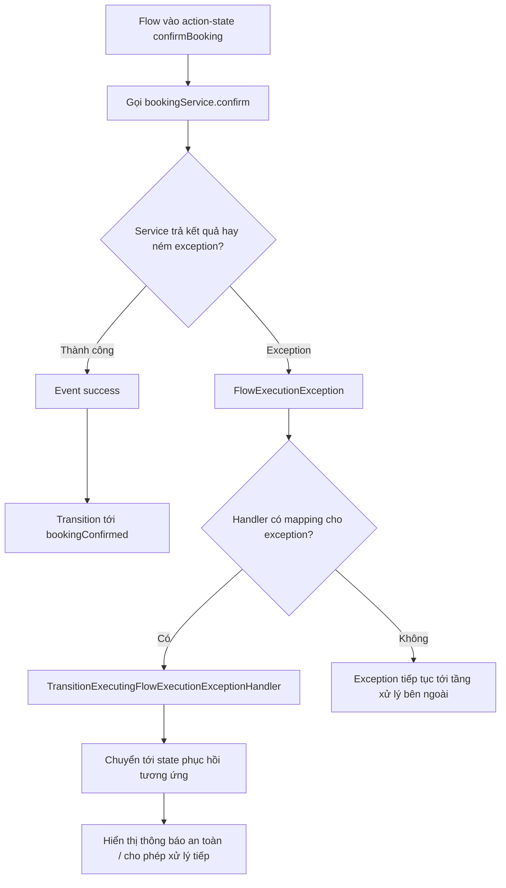

# Dùng TransitionExecutingFlowExecutionExceptionHandler khi phù hợp

Trong **Spring Web Flow** (`SPRING_WEB_FLOW`), một service được gọi từ action có thể ném exception khi thao tác nghiệp vụ thất bại. Ví dụ, phòng vừa được khách khác đặt, cổng thanh toán tạm thời không phản hồi hoặc dữ liệu tham chiếu không còn tồn tại. Flow cần đưa người dùng tới một state có thể giải thích tình huống và cho phép họ chọn bước tiếp theo.

Với lỗi nghiệp vụ đã dự kiến, cách thường dùng là bắt exception trong action, thêm message rồi trả về event để flow đi theo transition thông thường. Khi cần định tuyến một exception chưa được xử lý trong state hiện tại tới state phục hồi riêng, Spring Web Flow cung cấp **`TransitionExecutingFlowExecutionExceptionHandler`**. Handler này ánh xạ kiểu exception sang ID của state đích và thực hiện chuyển state trong flow execution.

Bài thuộc chương **Ngoại lệ và phục hồi** giải thích cách cấu hình handler, cách đọc exception và nguyên nhân gốc, cách chọn state phục hồi, và các trường hợp nên dùng hoặc nên tránh. Ví dụ dùng Spring Web Flow XML cùng Java configuration; API được đối chiếu với dòng 2.5.x và 3.0.x.

## 1. Khi một action ném exception, flow cần xử lý điều gì?

Giả sử flow đặt phòng đang ở state `confirmBooking`. Khi action gọi service, một trong hai tình huống có thể xảy ra:

- Service xác nhận thành công và trả về thông tin đặt phòng.
- Service ném exception vì phòng không còn trống hoặc hệ thống thanh toán đang gián đoạn.

Nếu không có cơ chế xử lý phù hợp, exception được bọc trong `FlowExecutionException` và flow execution có thể không tiếp tục được theo đường đi bình thường. Handler có nhiệm vụ quyết định exception nào có thể xử lý và state nào sẽ nhận quyền điều khiển tiếp theo.



Điều quan trọng là handler **điều khiển flow state**. Nó không tự sửa dữ liệu, khôi phục giao dịch database, hoàn tiền hoặc làm cho service thất bại trở thành thành công. Các việc đó thuộc service, transaction và chính sách phục hồi của ứng dụng.

## 2. TransitionExecutingFlowExecutionExceptionHandler là gì?

Lớp này nằm trong package:

```java
org.springframework.webflow.engine.support
```

Nó triển khai interface `FlowExecutionExceptionHandler` và ánh xạ một kiểu exception cụ thể sang một state mới. API chính:

| API | Vai trò |
| --- | --- |
| Constructor không tham số | Tạo handler ban đầu chưa có mapping |
| `add(Class<? extends Throwable>, String targetStateId)` | Ánh xạ kiểu exception sang ID state đích |
| `add(Class<? extends Throwable>, TargetStateResolver)` | Dùng resolver để xác định state đích theo exception |
| `canHandle(FlowExecutionException)` | Kiểm tra handler có mapping phù hợp hay không |
| `handle(FlowExecutionException, RequestControlContext)` | Thực hiện xử lý exception trong request hiện tại |
| `getActionList()` | Truy cập danh sách action được thực hiện khi handler xử lý exception |

Ví dụ ngắn:

```java
TransitionExecutingFlowExecutionExceptionHandler handler =
        new TransitionExecutingFlowExecutionExceptionHandler();

handler.add(RoomNotAvailableException.class, "roomUnavailable");
```

Nếu exception phù hợp với `RoomNotAvailableException`, handler sẽ chuyển flow tới state có ID `roomUnavailable`. State đó phải được khai báo trong flow đang xử lý exception.

`add(...)` trả về chính handler, nên có thể nối nhiều mapping trong một biểu thức. Cách này phù hợp khi một state cần định tuyến vài loại lỗi đã biết tới các màn hình phục hồi khác nhau.

## 3. Đăng ký handler thành Spring bean

Flow XML tham chiếu handler bằng tên bean. Có thể tạo bean bằng Java configuration:

```java
package com.example.booking.config;

import org.springframework.context.annotation.Bean;
import org.springframework.context.annotation.Configuration;
import org.springframework.webflow.engine.support.TransitionExecutingFlowExecutionExceptionHandler;
import com.example.booking.RoomNotAvailableException;
import com.example.booking.PaymentGatewayUnavailableException;

@Configuration
public class BookingFlowExceptionConfiguration {

    @Bean
    public TransitionExecutingFlowExecutionExceptionHandler
            bookingExceptionHandler() {

        return new TransitionExecutingFlowExecutionExceptionHandler()
                .add(RoomNotAvailableException.class, "roomUnavailable")
                .add(PaymentGatewayUnavailableException.class,
                     "paymentUnavailable");
    }
}
```

Bean có hai mapping:

- `RoomNotAvailableException` dẫn tới `roomUnavailable`.
- `PaymentGatewayUnavailableException` dẫn tới `paymentUnavailable`.

Configuration class phải được component scan hoặc import vào Spring application context đang được Web Flow sử dụng. Nếu bean không nằm trong context mà flow builder nhìn thấy, thuộc tính `bean` của phần tử `exception-handler` sẽ không phân giải được.

Nếu ứng dụng chủ yếu dùng XML, có thể đăng ký một class con của handler và thêm các mapping trong constructor:

```java
package com.example.booking;

import org.springframework.webflow.engine.support.TransitionExecutingFlowExecutionExceptionHandler;

public class BookingFlowExceptionHandler
        extends TransitionExecutingFlowExecutionExceptionHandler {

    public BookingFlowExceptionHandler() {
        add(RoomNotAvailableException.class, "roomUnavailable");
        add(PaymentGatewayUnavailableException.class,
            "paymentUnavailable");
    }
}
```

Sau đó khai báo bean:

```xml
<bean id="bookingExceptionHandler"
      class="com.example.booking.BookingFlowExceptionHandler" />
```

Chọn một cách cấu hình phù hợp với cách tổ chức application context của dự án. Các mapping nên được thiết lập khi khởi tạo bean, không thay đổi theo từng request.

## 4. Gắn handler vào state bằng exception-handler

Flow Definition Language cho phép thêm phần tử `<exception-handler>` vào một state. Thuộc tính `bean` tham chiếu bean triển khai `FlowExecutionExceptionHandler`.

Ví dụ:

```xml
<flow xmlns="http://www.springframework.org/schema/webflow"
      xmlns:xsi="http://www.w3.org/2001/XMLSchema-instance"
      xsi:schemaLocation="
          http://www.springframework.org/schema/webflow
          https://www.springframework.org/schema/webflow/spring-webflow.xsd"
      start-state="confirmBooking">

    <var name="booking"
         class="com.example.booking.Booking" />

    <action-state id="confirmBooking">
        <evaluate expression="bookingService.confirm(flowScope.booking)"
                  result="flowScope.confirmation" />

        <transition on="success" to="bookingConfirmed" />

        <exception-handler bean="bookingExceptionHandler" />
    </action-state>

    <view-state id="roomUnavailable"
                view="booking/room-unavailable" />

    <view-state id="paymentUnavailable"
                view="booking/payment-unavailable" />

    <end-state id="bookingConfirmed" />
</flow>
```

Khi action trong `confirmBooking` ném một exception có mapping, handler được gắn vào state đó sẽ xử lý exception và chuyển flow tới state tương ứng. Nếu service trả kết quả thành công, action-state vẫn đi theo transition `on="success"` bình thường.

Một handler có thể được gắn vào nhiều state. Hãy xác nhận mọi state đích trong mapping đều tồn tại và có ý nghĩa trong flow nơi handler được sử dụng. Nếu hai flow có tập state khác nhau, đừng dùng chung một mapping bean chỉ vì tên exception giống nhau.

## 5. Mapping exception sang state đích

`add(exceptionClass, targetStateId)` định nghĩa một cặp:

- Kiểu exception cần xử lý.
- ID state mà flow sẽ chuyển tới khi exception đó xảy ra.

Ví dụ:

```java
@Bean
public TransitionExecutingFlowExecutionExceptionHandler
        bookingExceptionHandler() {

    return new TransitionExecutingFlowExecutionExceptionHandler()
            .add(RoomNotAvailableException.class, "chooseAnotherRoom")
            .add(PaymentGatewayUnavailableException.class,
                 "retryPaymentLater")
            .add(CustomerProfileMissingException.class,
                 "completeCustomerProfile");
}
```

Flow phải khai báo đủ các state đích:

```xml
<view-state id="chooseAnotherRoom"
            view="booking/choose-room" />

<view-state id="retryPaymentLater"
            view="booking/payment-unavailable" />

<view-state id="completeCustomerProfile"
            view="booking/complete-profile" />
```

Không dùng tên class exception làm state ID theo suy đoán. State đích là ID của state trong flow definition, phải khớp chính xác với chuỗi truyền vào `add`.

Nếu state đích không tồn tại, flow không thể thực hiện transition hợp lệ. Hãy kiểm tra các mapping cùng flow definition khi khởi tạo và trong integration test.

## 6. Handler tìm exception trong cause chain

Trong thực tế, exception gốc thường bị bọc bởi các lớp trung gian. Ví dụ service ném `RoomNotAvailableException`, sau đó Web Flow bọc nó trong `FlowExecutionException`. Một adapter hoặc lớp truy cập dữ liệu cũng có thể bọc exception sâu hơn.

`TransitionExecutingFlowExecutionExceptionHandler` tìm mapping qua **chuỗi cause** của exception. API `getTargetStateResolver(Throwable)` mô tả việc thử các exception trong cause chain để tìm resolver phù hợp.

Ví dụ:

```java
try {
    bookingService.confirm(booking);
} catch (RoomNotAvailableException ex) {
    throw new BookingOperationException(
            "Unable to confirm booking", ex);
}
```

Nếu `BookingOperationException` không có mapping nhưng cause chain chứa `RoomNotAvailableException` đã được đăng ký, handler có thể tìm mapping của exception gốc.

Khi kiểm tra lỗi, hãy xem toàn bộ chuỗi `Caused by`:

```text
FlowExecutionException
  caused by BookingOperationException
    caused by RoomNotAvailableException
```

Nếu code tạo exception mới mà không giữ nguyên cause, thông tin exception gốc sẽ mất và handler không thể tìm mapping dựa trên cause đó. Hãy dùng constructor có tham số `cause` hoặc cơ chế tương đương khi bọc exception.

## 7. Handler đưa exception vào flash scope

Khi xử lý exception, handler đưa hai đối tượng vào flash scope:

| Tên attribute | Giá trị |
| --- | --- |
| `flowExecutionException` | Đối tượng `FlowExecutionException` đã được xử lý |
| `rootCauseException` | Exception gốc tìm được trong cause chain; có thể null |

Tên hai attribute này tương ứng với các hằng:

```java
TransitionExecutingFlowExecutionExceptionHandler
        .FLOW_EXECUTION_EXCEPTION_ATTRIBUTE

TransitionExecutingFlowExecutionExceptionHandler
        .ROOT_CAUSE_EXCEPTION_ATTRIBUTE
```

Trong flow EL, có thể truy cập bằng:

```text
flashScope.flowExecutionException
flashScope.rootCauseException
```

Flash scope được giữ đến lần render view tiếp theo rồi bị xóa. Vì vậy, state phục hồi có thể dùng dữ liệu exception trong lần render kế tiếp để phục vụ chẩn đoán hoặc ghi log có kiểm soát.

**Không hiển thị trực tiếp stack trace, tên class nội bộ hoặc message của exception cho người dùng.** Những nội dung đó có thể tiết lộ cấu trúc hệ thống, câu truy vấn, đường dẫn hoặc dữ liệu nhạy cảm. Hãy hiển thị thông báo nghiệp vụ thân thiện và giữ chi tiết kỹ thuật trong log được bảo vệ.

## 8. Thiết kế state phục hồi cho người dùng

State đích nên trả lời câu hỏi: người dùng có thể làm gì tiếp theo sau lỗi?

Ví dụ phòng không còn trống:

```xml
<view-state id="roomUnavailable"
            view="booking/room-unavailable">
    <transition on="chooseAnotherRoom"
                to="selectRoom" />
    <transition on="cancel"
                to="bookingCancelled" />
</view-state>
```

View `booking/room-unavailable` có thể thông báo:

- Phòng vừa chọn không còn khả dụng.
- Dữ liệu đặt phòng vẫn được giữ nếu flow có thể tiếp tục an toàn.
- Người dùng có thể chọn phòng khác hoặc hủy quy trình.

State phục hồi không nên tự động lặp lại thao tác thất bại khi người dùng chưa yêu cầu. Đặc biệt, với thanh toán hoặc gửi lệnh tới hệ thống ngoài, kết quả có thể chưa rõ ràng: timeout không luôn có nghĩa giao dịch đã thất bại. Hãy tra cứu trạng thái giao dịch hoặc dùng idempotency key trước khi cho phép thử lại.

## 9. Dùng TargetStateResolver khi state đích cần tính động

Ngoài overload nhận `targetStateId`, handler còn có overload:

```java
add(Class<? extends Throwable> exceptionClass,
    TargetStateResolver targetStateResolver)
```

`TargetStateResolver` cho phép xác định state đích bằng logic tùy chỉnh thay vì một chuỗi cố định. Có thể dùng khi cùng một loại exception cần dẫn tới các state khác nhau theo ngữ cảnh flow.

Ví dụ về ý tưởng:

- Lỗi tồn kho ở bước chọn phòng dẫn tới `chooseAnotherRoom`.
- Cùng lỗi tồn kho ở bước xác nhận cuối dẫn tới `reviewBooking`.
- Lỗi thanh toán trong một flow đặc biệt dẫn tới state hỗ trợ riêng.

Đây là trường hợp nâng cao. Chỉ dùng resolver động khi quy tắc chọn state thực sự phụ thuộc ngữ cảnh. Nếu mapping tĩnh đủ rõ, `add(ExceptionType.class, "stateId")` dễ đọc và dễ kiểm thử hơn.

Khi viết resolver, phải bảo đảm state ID trả về tồn tại trong flow hiện tại và có thể được kích hoạt trong ngữ cảnh lỗi. Không trả state tùy ý từ dữ liệu client.

## 10. Phân biệt exception handler với bắt lỗi trong action

Spring Web Flow Reference Guide khuyến nghị nói chung nên bắt các exception nghiệp vụ trong action và trả về event kết quả để flow xử lý bằng transition chuẩn. `TransitionExecutingFlowExecutionExceptionHandler` là lựa chọn nâng cao khi muốn định tuyến exception chưa được xử lý trong state.

**Cách A — bắt exception trong POJO action:**

```java
import org.springframework.binding.message.MessageBuilder;
import org.springframework.webflow.execution.RequestContext;

public String confirmBooking(
        Booking booking,
        RequestContext context) {

    try {
        BookingConfirmation confirmation =
                bookingService.confirm(booking);

        context.getFlowScope().put("confirmation", confirmation);
        return "success";

    } catch (RoomNotAvailableException ex) {
        context.getMessageContext().addMessage(
                new MessageBuilder()
                        .error()
                        .defaultText("Phòng vừa được khách khác đặt.")
                        .build());

        return "roomUnavailable";
    }
}
```

Flow:

```xml
<action-state id="confirmBooking">
    <evaluate expression="bookingAction.confirmBooking(booking, flowRequestContext)" />
    <transition on="success" to="bookingConfirmed" />
    <transition on="roomUnavailable" to="chooseAnotherRoom" />
</action-state>
```

Ở đây exception được chuyển thành event `roomUnavailable`. Flow dùng transition thông thường để chọn state.

**Cách B — để exception truyền ra khỏi action và dùng handler:**

```java
public BookingConfirmation confirmBooking(Booking booking) {
    return bookingService.confirm(booking);
}
```

Flow:

```xml
<action-state id="confirmBooking">
    <evaluate expression="bookingAction.confirmBooking(flowScope.booking)"
              result="flowScope.confirmation" />
    <transition on="success" to="bookingConfirmed" />
    <exception-handler bean="bookingExceptionHandler" />
</action-state>
```

Ở đây exception được xử lý bởi exception handler gắn vào state. Không có event nghiệp vụ riêng được trả từ action.

| Tiêu chí | Bắt exception trong action | TransitionExecutingFlowExecutionExceptionHandler |
| --- | --- | --- |
| Điểm xử lý | Trong method action | Exception handler của state |
| Kết quả | Event như `roomUnavailable` | Mapping exception class tới state ID |
| Thêm message nghiệp vụ | Action chủ động ghi vào MessageContext | State phục hồi hiển thị nội dung an toàn; handler đưa exception vào flash scope |
| Phạm vi | Quy tắc xử lý gắn với action cụ thể | Exception đã đăng ký mapping tại state có handler |
| Khi phù hợp | Lỗi nghiệp vụ dự kiến, cần message và nhánh rõ | Exception chưa được action xử lý nhưng có state phục hồi phù hợp |

Không nên dùng handler chỉ để tránh viết một `try/catch` đơn giản. Chọn cách thể hiện rõ nhất hợp đồng nghiệp vụ và đường phục hồi.

## 11. Phân biệt handler với on-exception transition

Flow definition có thể biểu diễn nhiều dạng điều khiển ngoại lệ. Cần phân biệt:

- `on-exception` trên transition là tiêu chí để một transition khớp exception theo flow definition.
- `<exception-handler bean="..."/>` tham chiếu một bean triển khai `FlowExecutionExceptionHandler` để xử lý exception theo logic handler.
- `TransitionExecutingFlowExecutionExceptionHandler` dùng mapping trong Java để chuyển exception class sang state đích.

Không khai báo đồng thời nhiều cơ chế cho cùng một exception mà không xác định rõ thứ tự và phạm vi. Khi có nhiều handler, hãy kiểm tra handler nào được gắn vào state, handler nào được gắn ở flow level nếu ứng dụng cấu hình, và handler nào có thể xử lý exception cụ thể.

Với bài toán đơn giản, chọn một cơ chế duy nhất cho mỗi lỗi để tránh việc cùng một exception bị xử lý hai lần hoặc đi vào nhánh không mong muốn.

## 12. Những exception không nên chuyển thành state nghiệp vụ

Không phải exception nào cũng nên được đưa tới một màn hình phục hồi nghiệp vụ.

Ví dụ không nên map rộng:

```java
.add(Exception.class, "genericError")
```

Mapping quá rộng có thể che giấu lỗi lập trình, lỗi cấu hình hoặc sự cố hạ tầng nghiêm trọng. Người vận hành sẽ khó nhận ra lỗi thật vì flow cứ chuyển sang một trang chung.

Nên ưu tiên mapping những loại exception có ý nghĩa rõ:

- `RoomNotAvailableException`: người dùng có thể chọn phòng khác.
- `PaymentGatewayUnavailableException`: người dùng có thể kiểm tra trạng thái thanh toán hoặc quay lại sau.
- `CustomerProfileMissingException`: người dùng có thể bổ sung hồ sơ.

Các lỗi như `NullPointerException`, lỗi invariant hoặc lỗi cấu hình không nên bị chuyển thành state nghiệp vụ chỉ để che màn hình lỗi. Hãy để chúng đi qua logging và exception handling chung của ứng dụng để được điều tra.

## 13. Transaction và tác dụng phụ không tự được rollback bởi handler

Handler chuyển flow sang state khác, nhưng điều đó không đồng nghĩa transaction database tự rollback.

Giả sử service thực hiện:

1. Ghi một phần dữ liệu đặt phòng.
2. Gọi cổng thanh toán.
3. Cổng thanh toán timeout.
4. Ném `PaymentGatewayUnavailableException`.

Handler có thể chuyển flow sang `paymentUnavailable`. Nhưng trạng thái database và giao dịch bên cổng thanh toán phải được xử lý theo transaction/service policy riêng.

Cần xác định:

- Transaction boundary nằm ở service nào.
- Exception có khiến transaction rollback theo cấu hình hay không.
- Checked exception có cần khai báo `rollbackFor` hay không.
- Thao tác với hệ thống ngoài có cơ chế idempotency/reconciliation không.
- Retry có thể tạo đơn hoặc trừ tiền hai lần không.

Ví dụ nếu exception là checked exception và chính sách nghiệp vụ yêu cầu rollback:

```java
@Transactional(rollbackFor = PaymentGatewayUnavailableException.class)
public PaymentResult charge(PaymentRequest request) {
    // Thực hiện thao tác thanh toán theo transaction policy.
}
```

Đoạn này chỉ minh họa cấu hình transaction; transaction database không thể tự hoàn tác một lệnh đã được hệ thống thanh toán bên ngoài chấp nhận. Với hệ thống phân tán, cần cơ chế kiểm tra trạng thái hoặc compensation phù hợp.

## 14. Lỗi xảy ra trong lúc khởi tạo flow và handler tùy chỉnh

`FlowExecutionExceptionHandler` là API điều khiển flow, không chỉ là callback để ghi log. Phương thức `handle` phải đưa flow execution về một state hợp lệ bằng cách thực hiện transition thông qua `RequestControlContext`.

Nếu tự viết handler sai, flow execution có thể ở trạng thái không hợp lệ hoặc không thể tiếp tục. Tài liệu API nêu rõ trường hợp exception xảy ra khi flow session khởi động: handler tùy chỉnh phải chịu trách nhiệm đưa flow về trạng thái nhất quán, cụ thể là transition về start state; không được chỉ return khi chưa có current state.

Vì vậy:

- Ưu tiên dùng built-in `TransitionExecutingFlowExecutionExceptionHandler` nếu mapping class → state là đủ.
- Chỉ tự implement `FlowExecutionExceptionHandler` khi có yêu cầu mà built-in không đáp ứng.
- Nếu viết custom handler, hiểu rõ `canHandle`, `handle` và cách `RequestControlContext.execute(Transition)` hoạt động.
- Kiểm thử exception ở cả state đang hoạt động và thời điểm khởi tạo flow.
- Không để handler nuốt exception rồi bỏ flow ở trạng thái chưa xác định.

## 15. Chẩn đoán khi handler không được gọi hoặc không chuyển state

| Triệu chứng | Nguyên nhân có thể | Cách kiểm tra |
| --- | --- | --- |
| Exception vẫn thoát ra ngoài | Bean chưa gắn vào state hoặc bean không phân giải được | Kiểm tra `<exception-handler bean="..."/>` và application context |
| Handler không nhận exception | Không có mapping phù hợp với exception/cause chain | Đọc toàn bộ `Caused by` và kiểu exception thực tế |
| Handler được gọi nhưng state không tồn tại | `targetStateId` gõ sai hoặc state không nằm trong flow | Đối chiếu mapping với ID state |
| Chuyển sang sai màn hình | Mapping exception quá rộng hoặc resolver chọn sai state | Rà mapping cụ thể và logic resolver |
| Root cause null | Exception không có cause hoặc wrapper không giữ cause | Kiểm tra cách bọc exception |
| Trang lỗi hiển thị message kỹ thuật | View đọc và hiển thị trực tiếp exception | Thay bằng thông báo an toàn; giữ chi tiết trong log |
| Flash attribute không còn | View đã render và flash scope bị xóa | Đọc attribute trong lần render kế tiếp |
| Lỗi bị xử lý hai lần | Nhiều cơ chế handler/transition cùng nhắm tới exception | Rà handler gắn tại state và flow |
| Retry tạo giao dịch trùng | Service không idempotent hoặc trạng thái giao dịch chưa rõ | Kiểm tra trạng thái trước khi retry |
| Flow không thể tiếp tục sau exception lúc start | Custom handler không chuyển flow về state hợp lệ | Xem lại contract của FlowExecutionExceptionHandler |

Log nên ghi nhận flow ID, state ID, kiểu exception, root cause class, target state được chọn và correlation ID. Không ghi stack trace hoặc dữ liệu nhạy cảm vào log công khai.

Có thể bật log Web Flow trong môi trường phát triển:

```properties
logging.level.org.springframework.webflow=DEBUG
```

Tên logger và lượng log có thể thay đổi theo phiên bản. Không nên bật debug log chi tiết trong production lâu hơn thời gian cần điều tra.

## 16. Kiểm thử mapping exception và state phục hồi

Integration test nên chứng minh cả việc nhận diện exception và transition tới state đích.

| Kịch bản | Exception | Kết quả mong đợi |
| --- | --- | --- |
| Phòng vừa được đặt | `RoomNotAvailableException` | State `roomUnavailable` |
| Cổng thanh toán tạm ngừng | `PaymentGatewayUnavailableException` | State `paymentUnavailable` |
| Exception bị bọc | `BookingOperationException` có cause là `RoomNotAvailableException` | State `roomUnavailable` nếu cause chain được giữ |
| Exception không có mapping | `UnexpectedSystemException` | Không bị handler này nuốt; chuyển tới tầng xử lý lỗi ngoài |
| State đích sai ID | Exception đã map | Test phát hiện lỗi flow definition |
| Root cause có mặt | Exception có cause | Flash scope chứa `rootCauseException` |
| Không có root cause | Exception không có cause | Không giả định attribute root cause luôn khác null |
| Retry thanh toán | Gateway timeout | Không tạo giao dịch trùng |
| Exception trong state khác | Exception xảy ra ngoài state có handler | Xác nhận handler có phạm vi đúng như cấu hình |
| Lỗi khi khởi động flow | Exception ở startup | Xác nhận flow execution vẫn ở trạng thái hợp lệ theo handler được dùng |

Trong flow test, có thể dùng các assertion của Web Flow test framework để xác nhận state hiện tại, ví dụ:

```java
assertCurrentStateEquals("roomUnavailable");
```

Ngoài state đích, hãy xác nhận:

- Handler có thực sự được gọi cho exception đã đăng ký không.
- Exception bọc có giữ cause chain không.
- Flash scope có các attribute mong đợi trước khi view render không.
- View phục hồi hiển thị thông báo an toàn.
- Flow có thể tiếp tục hoặc kết thúc đúng chính sách.
- Database và hệ thống ngoài không bị tác dụng phụ trùng lặp.

Unit test cho service chỉ xác nhận exception được ném; nó không chứng minh Web Flow chọn đúng state.

## 17. Bài thực hành: phân biệt lỗi nghiệp vụ với exception cần handler

Flow:

```xml
<action-state id="confirmOrder">
    <evaluate expression="orderService.confirm(flowScope.order)"
              result="flowScope.confirmation" />
    <transition on="success" to="orderConfirmed" />
    <exception-handler bean="orderExceptionHandler" />
</action-state>

<view-state id="stockUnavailable"
            view="order/stock-unavailable" />

<view-state id="paymentUnavailable"
            view="order/payment-unavailable" />

<end-state id="orderConfirmed" />
```

Bean handler:

```java
@Bean
public TransitionExecutingFlowExecutionExceptionHandler
        orderExceptionHandler() {

    return new TransitionExecutingFlowExecutionExceptionHandler()
            .add(StockUnavailableException.class, "stockUnavailable")
            .add(PaymentProviderUnavailableException.class,
                 "paymentUnavailable");
}
```

Service có thể ném một trong hai exception trên. Ngoài ra, action có thể bắt một exception nghiệp vụ khác và trả event `invalidOrder` để xử lý bằng transition thông thường.

**Câu hỏi:**

1. Khi service ném `StockUnavailableException`, state nào được chọn?
2. Nếu exception bị bọc trong `OrderConfirmationException` và cause chain còn nguyên, handler có thể tìm mapping nào?
3. Hai attribute nào được handler đưa vào flash scope?
4. Vì sao không nên map `Exception.class` tới một state lỗi chung?
5. Khi nào nên bắt exception trong action và trả event thay vì dùng handler?
6. Nếu payment gateway timeout, tại sao không nên cho người dùng bấm thử lại ngay mà không kiểm tra trạng thái giao dịch?

**Gợi ý lời giải:**

- `StockUnavailableException` được map tới `stockUnavailable`.
- Nếu cause chain còn `StockUnavailableException`, handler có thể tìm mapping theo exception gốc.
- Flash scope có `flowExecutionException` và `rootCauseException`.
- Mapping quá rộng che lỗi lập trình/hạ tầng và khiến flow xử lý mọi lỗi như lỗi nghiệp vụ.
- Bắt exception trong action phù hợp với lỗi nghiệp vụ dự kiến, cần message và event riêng. Handler phù hợp với exception chưa được action xử lý nhưng có mapping tới state phục hồi.
- Timeout không chứng minh giao dịch chưa được chấp nhận; phải tra trạng thái hoặc dùng idempotency để tránh trừ tiền/tạo đơn hai lần.

**Điểm cần nhớ:** `TransitionExecutingFlowExecutionExceptionHandler` ánh xạ exception type sang state ID, thực hiện transition và đưa exception cùng root cause vào flash scope. Hãy dùng nó khi một exception chưa được xử lý cần đưa flow tới state phục hồi đã thiết kế. Với lỗi nghiệp vụ dự kiến, bắt lỗi trong action và trả event thường dễ hiểu hơn. Dù dùng cách nào, state phục hồi, transaction, retry và bảo mật thông tin lỗi phải được thiết kế cùng nhau.

## Tài liệu tham khảo chính thức

- [Spring Web Flow 2.5.x Reference Guide — Using an exception-handler Element](https://docs.spring.io/spring-webflow/docs/2.5.x/reference/html/actions.html)
- [TransitionExecutingFlowExecutionExceptionHandler API — Spring Web Flow 2.5.1](https://docs.spring.io/spring-webflow/docs/2.5.1.RELEASE/api/org/springframework/webflow/engine/support/TransitionExecutingFlowExecutionExceptionHandler.html)
- [TransitionExecutingFlowExecutionExceptionHandler API — Spring Web Flow 3.0.1](https://docs.spring.io/spring-webflow/docs/3.0.1/api/org/springframework/webflow/engine/support/TransitionExecutingFlowExecutionExceptionHandler.html)
- [FlowExecutionExceptionHandler API — Spring Web Flow 2.5.1](https://docs.spring.io/spring-webflow/docs/2.5.x/api/org/springframework/webflow/engine/FlowExecutionExceptionHandler.html)
- [State API — Spring Web Flow 2.5.1](https://docs.spring.io/spring-webflow/docs/2.5.x/api/org/springframework/webflow/engine/State.html)

Đối chiếu tài liệu của đúng phiên bản Web Flow đang dùng, đặc biệt khi ứng dụng có custom exception handler, flow-level exception handling hoặc tích hợp transaction riêng.
