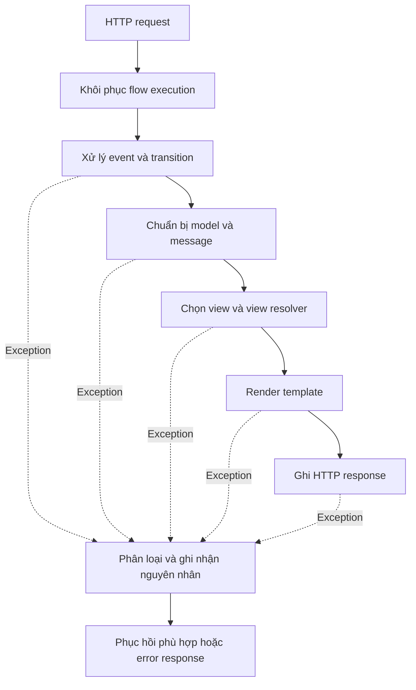

# Xử lý lỗi render mà không làm mất dấu nguyên nhân

## Bối cảnh và mục tiêu

Bài học thuộc chương **Ngoại lệ và phục hồi** của module `SPRING_WEB_FLOW`. Spring Web Flow mô hình hóa hành trình web nhiều bước bằng state, event, transition và subflow. Khi flow chuyển tới một view state, ứng dụng phải chuẩn bị model, chọn view, phân giải template và ghi nội dung vào HTTP response. Một lỗi ở bất kỳ giai đoạn nào cũng có thể khiến người dùng chỉ nhìn thấy trang lỗi chung, trong khi nguyên nhân thật nằm ở một property null, template thiếu, message không được phân giải, formatter sai hoặc kết nối bị ngắt.

Một lỗi render thường xuất hiện sau khi flow đã xử lý event hoặc thậm chí đã thực hiện một tác dụng phụ nghiệp vụ. Nếu ứng dụng bắt ngoại lệ rồi chỉ ghi một dòng “render failed”, thay thế nguyên nhân bằng một thông báo chung hoặc thử chạy lại toàn bộ transition, việc điều tra sẽ khó hơn và có thể gây cập nhật lặp. Mục tiêu của bài học là giữ lại đầy đủ dấu vết kỹ thuật, phân loại đúng nơi lỗi phát sinh và phục hồi giao diện an toàn.

Sau bài học, bạn có thể:

- Phân biệt lỗi trong quá trình thực thi flow với lỗi chuẩn bị model, phân giải view và render template.
- Giữ nguyên exception cause chain khi ghi log hoặc chuyển ngoại lệ qua các tầng.
- Ghi nhận flow ID, state, event, view và correlation ID để truy vết.
- Chọn đúng tầng xử lý lỗi: flow handler, Spring MVC hoặc servlet error handling.
- Trả thông báo an toàn cho người dùng mà không lộ stack trace hay dữ liệu nội bộ.
- Thiết kế phục hồi và kiểm thử mà không vô tình chạy lại tác dụng phụ nghiệp vụ.

## 1. Render là một chuỗi bước, không phải một thao tác đơn lẻ

Trong một flow nhiều bước, việc hiển thị màn hình thường đi qua các giai đoạn:

1. **Tiếp nhận request:** Spring MVC và flow handler nhận request, xác định flow execution và event cần xử lý.
2. **Thực thi flow:** Spring Web Flow khôi phục execution, xử lý event, chạy transition/action và xác định state hiện tại.
3. **Chuẩn bị model:** ứng dụng tải dữ liệu cần thiết, chuẩn bị form object, message và các thuộc tính view.
4. **Chọn và phân giải view:** flow xác định view ID; view resolver hoặc cơ chế tích hợp tìm template/đích render.
5. **Render template:** JSP, Thymeleaf hoặc view technology khác truy cập model, message source, formatter và tạo nội dung.
6. **Ghi response:** nội dung được ghi vào response stream và gửi về trình duyệt.

Một lỗi hiển thị có thể phát sinh ở nhiều điểm. Ví dụ, action tải dữ liệu ném exception trước khi view được chọn; template truy cập một property không tồn tại; formatter không chuyển đổi được giá trị; hoặc client ngắt kết nối trong lúc response đang được ghi.



Điểm quan trọng là phải xác định **giai đoạn nào thất bại**. Nếu lỗi xảy ra trong action chuẩn bị dữ liệu, thay template có thể không giải quyết được. Nếu template thiếu, sửa service nghiệp vụ có thể chỉ làm che khuất nguyên nhân.

## 2. Phân biệt lỗi flow và lỗi render

Lỗi trong quá trình thực thi flow và lỗi trong quá trình render có thể được bọc trong các ngoại lệ ở tầng cao hơn, nhưng chúng có nguyên nhân và cách phục hồi khác nhau.

| Nhóm lỗi | Ví dụ | Dấu hiệu cần kiểm tra |
| --- | --- | --- |
| Flow execution | Event không hợp lệ, transition không tồn tại, lỗi trong action | Flow ID, state ID, event, action và execution key |
| Chuẩn bị model | Service ném exception, dữ liệu null, truy cập database thất bại | Model attribute, service call, transaction và root cause |
| Binding/formatting | Kiểu dữ liệu không tương thích, formatter lỗi | Field, kiểu đích, locale và giá trị đầu vào đã được che |
| View resolution | Không tìm thấy view hoặc template | View ID, logical view name, resolver và đường dẫn tài nguyên |
| Template rendering | Expression truy cập property sai, fragment thiếu, lỗi cú pháp template | Template, dòng/fragment, model và exception gốc |
| Message/i18n | Message key hoặc bundle không được cấu hình như mong đợi | Message code, locale, MessageSource và fallback |
| Ghi response | Client đóng kết nối, response đã commit, lỗi encoding | Response status, output stream, thời điểm commit và client disconnect |

Một số lỗi có thể được framework bọc trong `FlowExecutionException`, `ServletException` hoặc ngoại lệ riêng của view technology. Không nên chỉ nhìn lớp exception ngoài cùng rồi kết luận. Cần lần theo chuỗi `cause` tới nguyên nhân sâu nhất và xem stack trace để biết vị trí phát sinh đầu tiên có ý nghĩa.

Cũng cần phân biệt lỗi render với lỗi nghiệp vụ. Ví dụ, service xác nhận đặt chỗ có thể đã commit thành công, nhưng template trang hoàn tất bị lỗi. Người dùng thấy lỗi không có nghĩa đặt chỗ thất bại. Nếu họ submit lại, ứng dụng có thể tạo giao dịch trùng. Trước khi retry, phải xác định tác dụng phụ đã xảy ra hay chưa.

## 3. Những nguyên nhân render thường gặp

### Model thiếu hoặc sai cấu trúc

Template mong đợi `booking.customer.name`, nhưng model không có `booking`, `customer` là null hoặc thuộc tính đã đổi tên. Một số template engine sẽ ném exception khi expression không thể đánh giá; một số cấu hình có thể hiển thị rỗng. Không nên sửa bằng cách bắt mọi exception rồi thay giá trị mặc định mà không xác định dữ liệu nào thực sự bắt buộc.

Cách kiểm tra:

- Model attribute có được thêm ở đúng state không?
- Tên attribute trong flow và template có khớp không?
- Service có trả về dữ liệu rỗng hợp lệ hay đã thất bại?
- Template có giả định một quan hệ luôn tồn tại không?
- Dữ liệu có bị xóa hoặc thay đổi giữa lúc load và lúc render không?

### Template hoặc view không tồn tại

View ID được flow chọn có thể không khớp cấu hình view resolver, tên template hoặc vị trí tài nguyên. Một lỗi đổi tên file hoặc sai chữ hoa/thường có thể chỉ xuất hiện trên hệ điều hành triển khai có phân biệt hoa thường.

Hãy ghi nhận logical view name và resolver đã chọn. Kiểm tra tài nguyên được đóng gói trong artifact triển khai, không chỉ kiểm tra file trong workspace phát triển.

### Formatter, conversion và locale

Một giá trị có thể hợp lệ trong model nhưng không được formatter hỗ trợ theo locale hiện tại. Ví dụ, template yêu cầu hiển thị ngày hoặc số theo locale, nhưng formatter tùy chỉnh nhận kiểu dữ liệu khác hoặc cấu hình locale không đúng.

Cần phân biệt lỗi parse đầu vào ở giai đoạn binding với lỗi định dạng đầu ra khi render. Ghi nhận field, kiểu Java, formatter và locale; không ghi giá trị nhạy cảm của người dùng.

### Message và i18n

View hoặc validator có thể yêu cầu message code không tồn tại trong bundle của locale đang dùng. Tùy MessageSource và cách gọi, framework có thể dùng default text, hiển thị key hoặc ném exception. Hãy xác minh message resolver, basename, encoding, locale và fallback thay vì mặc định rằng mọi key thiếu đều tạo cùng một loại lỗi.

### Lazy loading và vòng đời persistence

Template truy cập một quan hệ lazy sau khi persistence context đã đóng có thể gặp lỗi như `LazyInitializationException`. Việc render template không nên trở thành nơi tùy tiện truy vấn toàn bộ graph entity. Hãy chuẩn bị view model/DTO ở service hoặc query layer với đúng dữ liệu cần hiển thị.

### Response đã commit hoặc client ngắt kết nối

Nếu lỗi xảy ra sau khi một phần response đã được gửi, ứng dụng không thể luôn thay response đó bằng một trang lỗi hoàn chỉnh. Client disconnect cũng có thể xuất hiện như IOException trong lúc ghi output. Tránh cố render lại cùng response hoặc ghi stack trace vào nội dung đã gửi dở.

## 4. Giữ nguyên exception cause chain

Nguyên tắc quan trọng nhất khi xử lý lỗi là không làm mất ngoại lệ gốc. Khi bắt lỗi để thêm ngữ cảnh, hãy ghi lại exception đầy đủ hoặc bọc nó trong một exception mới có giữ cause.

Ví dụ Java:

```java
try {
    return bookingViewService.prepare(bookingId);
} catch (DataAccessException ex) {
    throw new BookingViewPreparationException(
            "Không thể chuẩn bị dữ liệu cho màn hình đặt chỗ",
            ex
    );
}
```

Constructor của `BookingViewPreparationException` cần chuyển cause vào lớp cha, ví dụ `super(message, cause)`. Khi đó log có thể hiển thị cả exception ở tầng ứng dụng lẫn nguyên nhân database ban đầu.

Cách làm làm mất dấu nguyên nhân:

```java
catch (Exception ex) {
    throw new RuntimeException("Render failed");
}
```

Đoạn này bỏ qua `ex`, khiến stack trace không còn nguyên nhân ban đầu. Một cách khác cũng có hại là chỉ ghi `ex.getMessage()` rồi trả về một view rỗng; message thường không đủ để biết vị trí và chuỗi gọi gây lỗi.

Nếu cần chuyển tiếp nguyên ngoại lệ, có thể ném lại chính đối tượng exception:

```java
catch (RuntimeException ex) {
    logger.error("Không thể chuẩn bị view", ex);
    throw ex;
}
```

Chỉ bắt loại exception mà tầng hiện tại có thể xử lý hoặc bổ sung ngữ cảnh hữu ích. Tránh bắt `Throwable` để che cả lỗi hệ thống nghiêm trọng như `OutOfMemoryError`. Nếu bắt một checked exception rồi bọc, phải giữ cause.

## 5. Ghi log đủ ngữ cảnh để truy vết

Một stack trace chỉ hữu ích khi có thể gắn nó với flow execution, state và request đã tạo ra lỗi. Log nên có các trường ngữ cảnh có cấu trúc:

| Trường | Ý nghĩa |
| --- | --- |
| `timestamp` | Thời điểm xảy ra lỗi |
| `traceId` / `correlationId` | Liên kết log giữa request, flow và service downstream |
| `flowId` | Định nghĩa flow đang chạy |
| `stateId` | State tại thời điểm lỗi |
| `eventId` | Event vừa được xử lý, nếu có |
| `viewId` / `viewName` | View đang được chọn hoặc render |
| `executionRef` | Tham chiếu execution đã được che/mã hóa để điều tra |
| `principalRef` | Định danh người dùng đã được giảm thiểu theo chính sách log |
| `locale` | Locale dùng để render |
| `exceptionType` | Lớp exception ở tầng ngoài và root cause |
| `deploymentVersion` | Phiên bản ứng dụng đang chạy |

Không ghi nguyên session cookie, CSRF token, mật khẩu, access token, nội dung form nhạy cảm hoặc toàn bộ execution key nếu nó có thể được dùng để tiếp tục flow. Có thể dùng mã tương quan riêng hoặc giá trị băm đã được quản lý để liên kết log mà không tiết lộ bí mật.

### Ghi log exception đúng cách

Ví dụ với SLF4J:

```java
logger.error(
    "Flow view rendering failed: flowId={}, stateId={}, viewId={}, traceId={}",
    flowId,
    stateId,
    viewId,
    traceId,
    exception
);
```

Đối số cuối là exception để logger ghi stack trace và cause chain. Không chuyển exception thành chuỗi bằng `exception.getMessage()` rồi bỏ đối tượng gốc.

Nên thống nhất một nơi ghi log đầy đủ cho mỗi lỗi để tránh cùng một exception bị ghi stack trace nhiều lần ở mọi tầng. Tầng dưới có thể bổ sung ngữ cảnh bằng exception có cause; tầng chịu trách nhiệm xử lý request ghi log cuối cùng cùng correlation ID. Nếu một lỗi được xử lý có chủ đích và không cần log ở mức error, hãy ghi ở mức phù hợp nhưng vẫn giữ đủ thông tin để chẩn đoán.

### Correlation ID qua các tầng

Một request render có thể gọi nhiều service hoặc dịch vụ ngoài. Hãy tạo hoặc nhận correlation ID ở biên request, đưa nó vào MDC/log context và truyền qua các lời gọi downstream nếu giao thức hỗ trợ. Khi request kết thúc, context dạng ThreadLocal cần được dọn đúng cách để không rò sang request khác trên thread pool.

Với xử lý bất đồng bộ, cần truyền context một cách tường minh; không giả định MDC tự đi theo mọi executor hoặc message queue.

## 6. Chọn đúng tầng xử lý exception

Không phải mọi lỗi hiển thị đều nên được xử lý trong flow definition. Cần đặt handler ở tầng biết đủ ngữ cảnh và có khả năng phục hồi phù hợp.

| Tầng | Phù hợp với | Trách nhiệm |
| --- | --- | --- |
| Action/service nghiệp vụ | Lỗi nghiệp vụ có thể dự đoán hoặc lỗi tích hợp mà service có thể chuyển thành kết quả miền | Trả kết quả rõ ràng hoặc ném exception miền có giữ cause |
| Flow exception handler | Exception phát sinh và được truyền qua quá trình thực thi flow | Chọn nhánh phục hồi của flow, ghi ngữ cảnh flow và điều hướng tới state lỗi phù hợp |
| Spring MVC exception resolver / controller advice | Exception ở tầng request/controller/view integration mà MVC quản lý | Ánh xạ exception thành response hoặc trang lỗi |
| Servlet container error handling | Lỗi thoát khỏi các tầng ứng dụng hoặc lỗi request ở cấp servlet | Trả error page cuối cùng theo cấu hình container |
| Logging/monitoring | Tất cả lỗi cần theo dõi | Lưu dấu vết, metric và cảnh báo mà không thay đổi kết quả nghiệp vụ |

Spring Web Flow có cơ chế `FlowExecutionExceptionHandler` để xử lý các exception được framework đưa qua ngữ cảnh flow. Có thể cấu hình handler ở phạm vi flow theo schema và phiên bản đang dùng, ví dụ khai báo bean handler trong flow definition:

```xml
<flow>
    <exception-handler bean="bookingFlowExceptionHandler"/>

    <!-- Các state và transition của flow -->
</flow>
```

Đây là ví dụ cấu hình khái quát; cần xác nhận namespace/schema và phạm vi handler trong phiên bản Spring Web Flow của ứng dụng. Không giả định flow handler sẽ bắt mọi lỗi của view technology hoặc lỗi xảy ra sau khi response đã commit. Một số lỗi có thể được xử lý ở tầng Spring MVC hoặc servlet container tùy thời điểm và đường đi của request.

### Flow handler nên làm gì?

Một flow exception handler phù hợp có thể:

- Xác định flow ID, state ID và execution liên quan.
- Phân loại exception có thể phục hồi và exception không thể phục hồi.
- Chuyển tới state lỗi an toàn nếu execution còn ở trạng thái có thể tiếp tục.
- Gắn một mã tham chiếu để người dùng liên hệ hỗ trợ.
- Ghi lại exception gốc hoặc chuyển tiếp để tầng logging chịu trách nhiệm ghi đầy đủ.
- Giữ nguyên trạng thái nghiệp vụ đã commit; không giả định exception đồng nghĩa transaction đã rollback.

Handler không nên tự động chạy lại action vừa thất bại nếu action có thể tạo tác dụng phụ. Cũng không nên thay mọi lỗi bằng một transition thành công hoặc bỏ qua exception mà không để lại log.

## 7. Phân loại lỗi và chọn cách phục hồi

Một chính sách tốt không cố gắng phục hồi mọi lỗi theo cùng cách. Hãy phân loại theo khả năng thử lại, trạng thái response và tác dụng phụ đã xảy ra.

| Nhóm | Ví dụ | Hướng xử lý |
| --- | --- | --- |
| Lỗi dữ liệu/đầu vào | Field không chuyển đổi được, model thiếu dữ liệu bắt buộc | Render lại form với lỗi gắn đúng field nếu response còn khả năng trả |
| Lỗi cấu hình/template | Template không tồn tại, expression sai, view resolver không tìm thấy view | Ghi log đầy đủ, trả error page an toàn; sửa lỗi triển khai |
| Lỗi phụ thuộc tạm thời | Service đọc dữ liệu timeout trước khi có tác dụng phụ | Có thể cho thử lại có giới hạn nếu thao tác an toàn |
| Lỗi nghiệp vụ | Đơn đã bị hủy, quyền không còn, tài nguyên hết chỗ | Hiển thị nhánh nghiệp vụ phù hợp; không retry mù |
| Lỗi sau khi đã commit | Giao dịch đã lưu nhưng trang kết quả lỗi | Tra cứu trạng thái theo mã giao dịch/idempotency key; không tạo lại |
| Lỗi ghi response | Client đóng kết nối hoặc response đã commit một phần | Ghi nhận ở mức phù hợp; không cố ghi một error page thứ hai vào response đã commit |

### Retry cần có điều kiện

Chỉ retry khi biết thao tác có thể lặp an toàn hoặc có idempotency. Một lỗi timeout không chứng minh dịch vụ downstream chưa xử lý request. Nếu request tạo đơn đã đến server nhưng response bị mất, retry không có idempotency có thể tạo đơn thứ hai.

Với lỗi render thuần túy, thường chỉ cần render lại sau khi đã sửa/refresh dữ liệu phù hợp; không cần chạy lại transition nghiệp vụ trước đó. Nếu phải tải lại model, hãy tách thao tác đọc khỏi action có tác dụng phụ.

### Response đã commit

Khi response đã bắt đầu gửi, status code và header có thể không còn thay đổi được. Trong trường hợp này, cố chuyển sang trang lỗi khác có thể tạo thêm exception hoặc nội dung lỗi chồng lên response cũ. Ghi log nguyên nhân, kết thúc xử lý request và để request tiếp theo có cơ chế phục hồi phù hợp. Không giả định rằng mọi exception đều cho phép trả một trang lỗi HTML mới.

## 8. Trả thông báo an toàn cho người dùng

Người dùng cần biết điều gì đã xảy ra và bước tiếp theo nên làm gì, nhưng không cần stack trace hoặc chi tiết nội bộ.

Một trang lỗi render có thể hiển thị:

- Một câu mô tả ngắn: “Không thể hiển thị bước này vào lúc này.”
- Hướng dẫn an toàn: “Vui lòng tải lại trang hoặc quay về danh sách.”
- Mã tham chiếu hỗ trợ: ví dụ `ERR-7F2A`.
- Nút quay lại một state hợp lệ nếu flow execution còn khả dụng.
- Thông tin về việc thao tác trước đó đã hoàn tất hay cần kiểm tra lại, nếu ứng dụng có thể xác định chắc chắn.

Không hiển thị:

- Stack trace, tên class nội bộ hoặc đường dẫn filesystem.
- SQL, cấu trúc database hoặc câu lệnh truy vấn.
- Session ID, CSRF token, execution key nguyên vẹn hoặc access token.
- Dữ liệu cá nhân của người khác.
- Thông báo exception thô từ dịch vụ ngoài.

Nếu không xác định được thao tác nghiệp vụ đã hoàn tất hay chưa, hãy nói rõ trạng thái cần được kiểm tra thay vì khẳng định thất bại. Ví dụ: “Không thể tải trang kết quả. Hãy kiểm tra trạng thái đơn hàng trước khi thử lại.” Điều này tránh khiến người dùng thực hiện lại một thao tác đã thành công.

## 9. Ví dụ: giao dịch thành công nhưng view hoàn tất bị lỗi

Giả sử flow đặt hàng có state xác nhận. Người dùng bấm `confirm`; action gọi service lưu đơn và service trả về mã đơn. Sau đó flow chuyển tới view hoàn tất, nhưng template truy cập nhầm `order.customer.displayName` trong khi `customer` là null.

Nếu ứng dụng chỉ trả trang lỗi và người dùng bấm lại `confirm`, có thể tạo đơn thứ hai. Cách thiết kế an toàn:

1. Service tạo đơn trong transaction và sử dụng idempotency key gắn với thao tác xác nhận.
2. Kết quả thành công được lưu hoặc có thể tra cứu bằng idempotency key.
3. Flow lưu mã đơn hoặc ID kết quả để hiển thị.
4. Nếu render thất bại, log giữ nguyên template exception và cause chain.
5. Trang lỗi hiển thị mã tham chiếu, không nói rằng đơn chắc chắn thất bại.
6. Khi người dùng thử lại hoặc mở trang trạng thái, ứng dụng tra cứu kết quả đã có thay vì tạo đơn mới.

Mã minh họa cho ý tưởng idempotency ở tầng service:

```java
public OrderResult confirmOrder(
        OrderCommand command,
        String idempotencyKey) {

    return orderService.findResult(idempotencyKey)
            .orElseGet(() ->
                    orderService.createOnce(command, idempotencyKey));
}
```

Đoạn mã chỉ minh họa hợp đồng. Trong triển khai đồng thời, việc tra cứu và tạo kết quả cần được bảo vệ bằng unique constraint, transaction hoặc cơ chế atomic phù hợp; cấu trúc `findResult` rồi `createOnce` không tự đảm bảo không có race condition nếu service không thực hiện đồng bộ hóa.

## 10. Quy trình điều tra một lỗi render

Khi một state chỉ hiển thị error page hoặc màn hình trắng, hãy đi theo trình tự:

1. **Ghi nhận request:** lấy trace/correlation ID, thời điểm, flow ID và URL đã được che thông tin nhạy cảm.
2. **Xác định flow context:** state ID, event ID, execution reference và subflow đang hoạt động.
3. **Xác định giai đoạn:** lỗi xuất hiện khi chạy action, chuẩn bị model, resolve view, render template hay ghi response.
4. **Đọc exception chain:** tìm exception gốc, class, message và frame đầu tiên thuộc code ứng dụng hoặc template.
5. **Kiểm tra dữ liệu model:** xác minh attribute cần thiết có tồn tại, đúng kiểu và đúng vòng đời không.
6. **Kiểm tra view:** xác minh view ID, template resource, resolver, fragment và message bundle.
7. **Kiểm tra locale/formatter:** tái hiện với đúng locale và dữ liệu đầu vào đã được làm sạch.
8. **Kiểm tra tác dụng phụ:** xác định action trước lỗi đã commit hoặc gọi dịch vụ ngoài chưa.
9. **Kiểm tra response:** xem response đã commit hay client đã ngắt kết nối.
10. **Tạo test hồi quy:** tái hiện lỗi với cùng state, event, model và locale; xác minh lỗi được xử lý mà không làm mất cause hoặc chạy lặp nghiệp vụ.

Ví dụ log có cấu trúc:

```text
level=ERROR
traceId=8f2a...
flowId=booking
stateId=confirmation
eventId=confirm
viewId=booking/complete
locale=vi
exceptionType=TemplateRenderingException
rootCause=NullPointerException
deploymentVersion=2026.11.25
message="Flow view rendering failed"
```

Các giá trị trên chỉ là ví dụ minh họa. Trong log thực tế, execution reference và principal cần được che hoặc thay bằng định danh an toàn; không ghi token hay nội dung form nhạy cảm.

## 11. Kiểm thử để bảo đảm không mất dấu nguyên nhân

Một bộ kiểm thử phù hợp nên xác minh cả hành vi người dùng lẫn khả năng chẩn đoán:

| Ca kiểm thử | Cách tạo lỗi | Điều cần xác minh |
| --- | --- | --- |
| Model thiếu thuộc tính | Không cung cấp một model attribute mà view yêu cầu | Log có state/view và root cause; response không lộ chi tiết nội bộ |
| Property null | Cho quan hệ tùy chọn null trong template | Template xử lý đúng hoặc lỗi được ghi đủ ngữ cảnh |
| Template không tồn tại | Cấu hình view ID trỏ tới tài nguyên thiếu | View resolution error được nhận diện và có error response an toàn |
| Message key thiếu | Bỏ key trong bundle thử nghiệm | Fallback hoặc lỗi được ghi theo chính sách đã chọn |
| Formatter lỗi | Gửi kiểu/locale không được formatter hỗ trợ | Xác định đúng field, formatter và locale |
| Service lỗi trước commit | Service đọc dữ liệu ném exception | Có thể thử lại nếu thao tác an toàn; cause chain còn nguyên |
| Service lỗi sau commit | Giao dịch lưu thành công nhưng render thất bại | Người dùng không tạo bản ghi trùng khi kiểm tra/thử lại |
| Response đã commit | Mô phỏng lỗi khi ghi response | Không cố ghi error page thứ hai; lỗi được ghi nhận |
| Client disconnect | Ngắt kết nối trong lúc response được gửi | Log phân biệt lỗi kết nối với lỗi template |
| Subflow render lỗi | Gây lỗi ở view của flow con | Log nhận diện flow/state con và execution liên quan |
| Locale khác nhau | Tái hiện cùng view với nhiều locale | Message/formatter được chẩn đoán theo locale |
| Cause chain | Bọc một exception service bằng exception flow/view | Root cause vẫn xuất hiện trong log hoặc telemetry |

Kiểm thử flow handler riêng không thay thế kiểm thử Spring MVC/view rendering. Tương tự, test template độc lập không chứng minh flow execution giữ đúng state khi render thất bại. Nên có kiểm thử tích hợp qua request thực tế để bao phủ flow handler, security filter, view resolver và template engine.

## 12. Checklist triển khai

- [ ] Biết rõ các giai đoạn từ flow execution tới ghi HTTP response.
- [ ] Log được flow ID, state ID, event ID, view ID và correlation ID.
- [ ] Ghi exception object để giữ stack trace và cause chain.
- [ ] Khi bọc exception, luôn giữ cause.
- [ ] Không bắt mọi exception rồi trả view rỗng hoặc kết quả thành công.
- [ ] Phân biệt FlowExecutionException với lỗi view/MVC/servlet theo nơi phát sinh.
- [ ] Cấu hình flow exception handler cho lỗi phù hợp và xác minh phạm vi trong phiên bản đang dùng.
- [ ] Có error resolver hoặc error page ở tầng MVC/servlet cho lỗi ngoài flow handler.
- [ ] Không chạy lại action có tác dụng phụ chỉ vì render thất bại.
- [ ] Dùng idempotency cho thao tác có thể bị submit lại.
- [ ] Không thử ghi error page mới nếu response đã commit.
- [ ] Không ghi token, session cookie, execution key nguyên vẹn hoặc dữ liệu nhạy cảm vào log.
- [ ] Thông báo người dùng có mã tham chiếu và hướng dẫn phù hợp.
- [ ] Có test cho model, template, formatter, message, subflow và lỗi sau commit.

## 13. Bài tập thực hành

Xây dựng flow đặt lịch gồm các bước chọn lịch, xác nhận và hoàn tất. Khi xác nhận, service lưu lịch thành công; view hoàn tất có thể phát sinh lỗi nếu thiếu dữ liệu người đặt.

1. Tạo một lỗi trong model preparation và một lỗi riêng trong template rendering. Ghi rõ chúng xảy ra ở giai đoạn nào.
2. Bọc một exception service bằng exception miền có giữ cause; xác minh log còn root cause ban đầu.
3. Thêm flow exception handler cho exception thuộc phạm vi flow và cấu hình error handling ở tầng MVC cho lỗi view phù hợp.
4. Tạo correlation ID và log flow ID, state ID, event ID, view ID cùng exception đầy đủ.
5. Mô phỏng service đã commit nhưng template hoàn tất bị lỗi. Xác minh người dùng không thể tạo lịch thứ hai khi thử lại.
6. Mô phỏng response đã commit hoặc client disconnect; xác minh ứng dụng không cố ghi một error page thứ hai.
7. Kiểm tra thông báo người dùng không chứa stack trace, session ID, token hoặc dữ liệu nội bộ.
8. Viết test hồi quy cho lỗi ở flow cha và subflow, với ít nhất hai locale.

**Tiêu chí hoàn thành:** người học phân biệt được lỗi flow với lỗi render; lần theo được cause chain tới vị trí phát sinh; ghi được ngữ cảnh đủ để tìm đúng execution/state/view; chọn đúng tầng xử lý; và chứng minh phục hồi không làm mất lỗi gốc hoặc lặp tác dụng phụ.

## Kết luận

Lỗi render cần được điều tra theo đúng giai đoạn phát sinh: thực thi flow, chuẩn bị model, phân giải view, render template hay ghi response. Hãy giữ exception cause chain, ghi log có flow/state/event/view và correlation ID, rồi xử lý ở tầng phù hợp. Flow exception handler, Spring MVC và servlet error handling có phạm vi khác nhau; không nên giả định một handler bắt được mọi lỗi. Đặc biệt, render thất bại không chứng minh tác dụng phụ nghiệp vụ đã thất bại. Khi xác định trạng thái giao dịch, dùng idempotency cho thao tác ghi và trả thông báo an toàn, ứng dụng có thể phục hồi trải nghiệm người dùng mà vẫn giữ được dấu vết cần thiết để tìm nguyên nhân.

