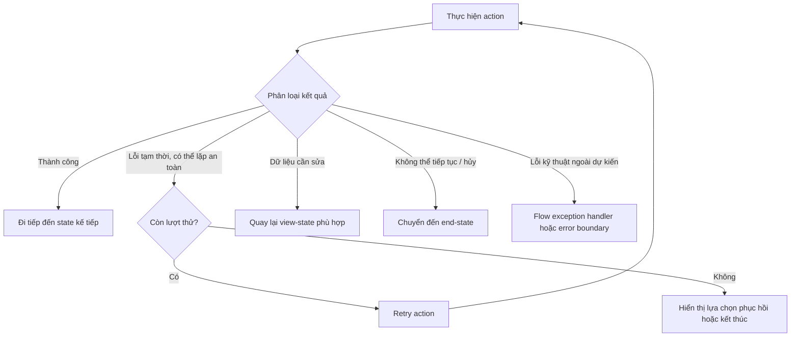

# Quyết định thử lại, quay lại hoặc kết thúc hành trình

Một flow nhiều bước không phải lúc nào cũng đi thẳng từ đầu đến cuối. Khi gọi service, người dùng có thể nhập dữ liệu chưa hợp lệ, tài nguyên có thể đã thay đổi, hệ thống ngoài có thể tạm thời không phản hồi hoặc một lỗi không thể phục hồi có thể xảy ra. Thiết kế flow tốt phải quyết định rõ trong từng tình huống: cho phép thử lại thao tác, đưa người dùng về bước cần sửa, hay kết thúc execution.

Spring Web Flow cung cấp state, event, transition và exception handler để mô hình hóa những quyết định này. Flow điều phối hành trình và phản hồi cho người dùng; service chịu trách nhiệm xác minh quy tắc nghiệp vụ, transaction, retry an toàn và các side effect. Không nên xem mọi exception là lý do để thử lại, cũng không nên xem việc quay lại một state là cách hoàn tác dữ liệu đã commit.

## 1. Ba hướng phục hồi và mục đích của chúng

| Hướng xử lý | Khi nào phù hợp | Hành vi trong flow |
|---|---|---|
| **Thử lại (retry)** | Lỗi tạm thời, thao tác có thể lặp an toàn và vẫn còn lượt thử | Chạy lại action hoặc gọi lại service theo chính sách retry |
| **Quay lại (back)** | Người dùng có thể sửa dữ liệu, chọn phương án khác hoặc xác nhận lại thông tin mới | Chuyển về một view-state thích hợp và tải lại dữ liệu cần thiết |
| **Kết thúc (end)** | Người dùng hủy, yêu cầu không thể tiếp tục hoặc đã đạt trạng thái cuối | Chuyển đến `end-state` và hoàn tất flow execution |

Quyết định nên dựa trên loại lỗi và trạng thái nghiệp vụ. Ví dụ, timeout khi gọi dịch vụ vận chuyển có thể cho phép retry; địa chỉ không còn thuộc khu vực giao hàng nên quay lại bước chọn địa chỉ; đơn hàng đã bị hủy hoặc người dùng không còn quyền thực hiện thì cần dừng hành trình.



## 2. Phân loại lỗi trước khi chọn hướng xử lý

Không nên quyết định retry chỉ dựa trên việc một exception được ném ra. Hãy phân loại theo nguyên nhân, khả năng phục hồi và việc thao tác có thể đã tạo side effect hay chưa.

| Nhóm tình huống | Ví dụ | Hướng xử lý thường phù hợp |
|---|---|---|
| Validation đầu vào | Thiếu email, ngày kết thúc trước ngày bắt đầu | Ở lại view hoặc quay về bước nhập liệu |
| Quy tắc nghiệp vụ không thỏa | Đơn đã hết hạn, mã giảm giá không còn hiệu lực | Quay lại để chọn phương án khác hoặc kết thúc |
| Lỗi hạ tầng tạm thời | Timeout, dịch vụ ngoài trả lỗi tạm thời, kết nối bị gián đoạn | Retry có giới hạn nếu thao tác an toàn |
| Xung đột đồng thời | Optimistic lock thất bại, tồn kho vừa bị người khác lấy | Tải lại dữ liệu, quay về bước review và yêu cầu xác nhận lại |
| Lỗi quyền hoặc xác thực | Người dùng không còn quyền, phiên đăng nhập hết hạn | Chuyển đến bước xác thực phù hợp hoặc kết thúc |
| Lỗi lập trình/cấu hình | Null pointer, flow ID sai, bean không tồn tại | Ghi nhận lỗi, xử lý qua exception handler/error boundary; không retry mù quáng |

Một lỗi có thể xuất hiện ở nhiều lớp. Ví dụ, timeout khi gửi yêu cầu thanh toán không cho biết chắc chắn nhà cung cấp đã nhận giao dịch hay chưa. Trước khi retry, service phải tra cứu trạng thái giao dịch hoặc dùng idempotency key để ngăn tạo khoản thanh toán trùng.

## 3. Mô hình hóa kết quả nghiệp vụ thành event

Các trường hợp dự kiến nên được biểu diễn bằng event có ý nghĩa, để flow chọn transition. Ví dụ action gửi đơn hàng có thể trả `success`, `rejected` hoặc `retryableFailure`.

```xml
<action-state id="submitOrder">
    <evaluate expression="submissionAction.execute(flowRequestContext)" />
    <transition on="success" to="confirmation" />
    <transition on="rejected" to="reviewOrder" />
    <transition on="retryableFailure" to="retryDecision" />
    <transition on="retryLimitReached" to="failed" />
</action-state>

<view-state id="retryDecision" view="retryDecision">
    <transition on="retry" to="submitOrder" />
    <transition on="back" to="reviewOrder" />
    <transition on="cancel" to="cancelled" />
</view-state>

<end-state id="confirmation" />
<end-state id="cancelled" />
<end-state id="failed" />
```

Đây là ví dụ minh họa cấu trúc flow. `submissionAction` trả về event dựa trên kết quả đã phân loại; flow định nghĩa rõ nơi đến cho mỗi event. View `retryDecision` có thể hiển thị thông báo, số lượt đã thử và các lựa chọn tiếp tục, quay lại hoặc hủy.

Không nên để view tự gửi một tên state tùy ý để điều hướng. Người dùng chỉ chọn event thuộc giao ước của view-state, còn flow definition quyết định event đó có transition hợp lệ hay không.

## 4. Xử lý lỗi dự kiến trong action

Một action có thể bắt các lỗi nghiệp vụ hoặc lỗi tạm thời đã biết để chuyển chúng thành event. Chỉ bắt những loại exception mà ứng dụng hiểu rõ cách xử lý; lỗi không mong đợi nên tiếp tục đi đến exception handler.

```java
import org.springframework.binding.message.MessageBuilder;
import org.springframework.webflow.execution.Action;
import org.springframework.webflow.execution.Event;
import org.springframework.webflow.execution.RequestContext;

public class SubmissionAction implements Action {
    private static final int MAX_ATTEMPTS = 3;

    private final SubmissionService submissionService;

    public SubmissionAction(SubmissionService submissionService) {
        this.submissionService = submissionService;
    }

    @Override
    public Event execute(RequestContext context) {
        Integer previous = (Integer) context.getFlowScope().get("submitAttempts");
        int attempt = previous == null ? 0 : previous;
        attempt++;
        context.getFlowScope().put("submitAttempts", attempt);

        SubmitCommand command = (SubmitCommand)
                context.getFlowScope().get("submitCommand");
        String idempotencyKey = (String)
                context.getFlowScope().get("submissionIdempotencyKey");

        try {
            submissionService.submit(command, idempotencyKey);
            return new Event(this, "success");
        } catch (TemporaryGatewayException ex) {
            if (attempt < MAX_ATTEMPTS) {
                context.getFlowScope().put("retryMessageCode", "submission.temporarilyUnavailable");
                return new Event(this, "retryableFailure");
            }
            return new Event(this, "retryLimitReached");
        } catch (BusinessRuleViolationException ex) {
            context.getMessageContext().addMessage(new MessageBuilder()
                    .error()
                    .code(ex.getMessageCode())
                    .defaultText("Đơn hàng không thể được gửi với thông tin hiện tại.")
                    .build());
            return new Event(this, "rejected");
        }
    }
}
```

Các lớp `SubmissionService`, `SubmitCommand`, `TemporaryGatewayException` và `BusinessRuleViolationException` là kiểu minh họa cần được định nghĩa theo ứng dụng. Ví dụ giới hạn ba lần thử tổng cộng, tính cả lần đầu. `submissionIdempotencyKey` phải được tạo cho một thao tác nghiệp vụ và giữ ổn định qua các lần retry của chính thao tác đó; không tạo key mới mỗi lần gửi lại.

Action không bắt `Exception` hoặc `Throwable` một cách tổng quát. Nếu database lỗi do cấu hình, code phát sinh lỗi lập trình hoặc hệ thống gặp tình huống chưa biết cách phục hồi, lỗi cần được ghi nhận và chuyển đến exception handler. Nuốt exception rồi trả `success` hoặc `rejected` sẽ che mất nguyên nhân thật.

## 5. Retry phải có giới hạn và an toàn khi lặp

Retry có thể làm một hệ thống tạm thời phục hồi, nhưng cũng có thể nhân đôi side effect hoặc làm tình trạng quá tải nghiêm trọng hơn. Trước khi cho phép retry, cần trả lời ba câu hỏi:

1. **Lỗi có tạm thời không?** Timeout hoặc lỗi dịch vụ tạm thời có thể phục hồi; dữ liệu sai, không đủ quyền hoặc quy tắc nghiệp vụ bị vi phạm thường không tự hết khi gọi lại.
2. **Có biết kết quả lần gọi trước không?** Nếu request đã đến hệ thống đích nhưng response bị mất, thao tác có thể đã thành công. Cần tra cứu trạng thái hoặc dùng idempotency key.
3. **Còn ngân sách retry không?** Giới hạn số lần thử, thời gian tổng và khoảng cách giữa các lần thử để tránh vòng lặp vô hạn.

Một chính sách retry nên xác định:

- Số lần thử tối đa, tính rõ lần đầu hay chỉ các lần lặp.
- Nhóm exception hoặc mã phản hồi được phép retry.
- Timeout cho mỗi lần gọi và thời hạn tổng của hành trình.
- Khoảng chờ tăng dần (exponential backoff), có thể thêm jitter để nhiều request không retry cùng thời điểm.
- Điều kiện dừng sớm khi lỗi chuyển thành lỗi vĩnh viễn hoặc người dùng hủy.
- Cách ghi log và hiển thị trạng thái cho người dùng.

Với retry do người dùng bấm nút, có thể đợi đến request tiếp theo thay vì giữ HTTP request mở. Với retry tự động, dùng cơ chế retry có giới hạn ở service hoặc hệ thống xử lý nền. Không gọi `Thread.sleep` trong action của flow để chờ giữa các lần thử; việc đó giữ thread server trong khi người dùng không nhận được phản hồi.

### Idempotency và chống thực hiện trùng

Idempotency nghĩa là gửi lại cùng một yêu cầu logic không tạo thêm side effect ngoài kết quả của lần xử lý đầu. Ví dụ, gửi cùng một idempotency key cho thao tác tạo thanh toán phải trả lại kết quả đã biết hoặc trạng thái đang xử lý, thay vì thu tiền lần nữa.

Service nên kiểm tra key ở nơi lưu trữ có tính nhất quán, thường bằng một bản ghi yêu cầu có ràng buộc duy nhất hoặc cơ chế idempotency do nhà cung cấp hỗ trợ. Chỉ giữ key trong flow scope không đủ để chống trùng nếu session mất hoặc request đến một node khác. Cơ chế bảo vệ cần tồn tại ở tầng nghiệp vụ/dữ liệu.

Nếu thao tác tạo một tài nguyên mới, có thể dùng request ID duy nhất và lưu kết quả theo ID đó. Khi retry, service tra cứu request ID trước khi tạo tài nguyên mới. Với thao tác gọi hệ thống ngoài, cần hiểu chính sách idempotency và thời gian lưu key của nhà cung cấp.

## 6. Khi nào nên quay lại state trước?

Quay lại phù hợp khi người dùng có thể sửa thông tin hoặc lựa chọn khác để tiếp tục. Ví dụ:

- Địa chỉ giao hàng không còn nằm trong khu vực phục vụ: quay lại bước chọn địa chỉ.
- Mã giảm giá hết hạn: quay lại bước review để bỏ mã hoặc chọn mã khác.
- Dữ liệu đã thay đổi do người khác cập nhật: tải lại bản mới, hiển thị khác biệt và yêu cầu xác nhận lại.
- Form thiếu trường hoặc không đúng định dạng: giữ người dùng ở view-state hiện tại và hiển thị message tại trường tương ứng.

Không nên quay lại một state chỉ để che lỗi kỹ thuật. Nếu database không truy cập được, hiển thị lại form như thể dữ liệu sai sẽ làm người dùng bối rối. Hãy thông báo sự cố tạm thời, cho phép retry khi an toàn hoặc chuyển đến trạng thái lỗi phù hợp.

### Back transition và nút Back của trình duyệt

Một transition có event `back` là hành động điều hướng được định nghĩa trong flow:

```xml
<view-state id="reviewOrder" view="reviewOrder">
    <transition on="back" to="editOrder" />
    <transition on="confirm" to="submitOrder" />
</view-state>
```

Đây là lựa chọn rõ ràng của người dùng trong giao diện. Nó khác với nút Back của trình duyệt, vốn có thể tải lại một URL hoặc snapshot execution cũ. Không nên dựa vào lịch sử trình duyệt như cơ chế rollback nghiệp vụ.

Khi quay lại state trước, cần xem xét dữ liệu nào phải tải lại. Nếu trạng thái database có thể đã thay đổi, gọi service để lấy dữ liệu mới thay vì tiếp tục dùng một entity hoặc DTO cũ mà không kiểm tra. Nếu người dùng sửa command khiến đây trở thành một thao tác nghiệp vụ mới, cần reset bộ đếm retry và tạo idempotency key mới cho thao tác mới.

## 7. Kết thúc flow khi không thể hoặc không cần tiếp tục

`end-state` biểu thị flow đã hoàn tất. Các trường hợp phù hợp gồm:

- Người dùng chủ động hủy hành trình.
- Thao tác đã hoàn tất và kết quả cuối cùng được xác nhận.
- Yêu cầu không còn hợp lệ và không có lựa chọn phục hồi phù hợp.
- Chính sách bảo mật yêu cầu dừng xử lý.
- Đã hết số lần thử và ứng dụng không thể tiếp tục an toàn.

Ví dụ:

```xml
<end-state id="completed" />
<end-state id="cancelled" />
<end-state id="failed" />
```

Flow có thể chuyển đến `completed` sau khi service xác nhận thao tác thành công, `cancelled` khi người dùng hủy, hoặc `failed` khi hành trình không thể phục hồi. Tùy ứng dụng, flow có thể cung cấp output ở end state để caller nhận mã kết quả hoặc định danh nghiệp vụ cần thiết.

Kết thúc flow chỉ hoàn tất execution của Spring Web Flow. Nó không tự rollback transaction đã commit, không xóa bản ghi đã tạo và không hoàn tiền cho giao dịch đã thành công. Nếu một bước trước đó đã tạo side effect, việc hủy ở bước sau cần một thao tác bù trừ rõ ràng ở service/domain.

Ví dụ, nếu hệ thống đã giữ chỗ thành công rồi người dùng hủy thanh toán, service có thể cần giải phóng chỗ. Nếu khoản thanh toán đã được capture, cần quy trình hoàn tiền. Không nên giả định chuyển đến `end-state cancelled` sẽ tự động đảo ngược các hành động này.

## 8. Dùng FlowExecutionExceptionHandler cho lỗi ngoài dự kiến

Kết quả nghiệp vụ dự kiến nên được chuyển thành event. Những exception không thể xử lý tại action có thể được giao cho flow-level exception handler. Spring Web Flow hỗ trợ `FlowExecutionExceptionHandler`; một implementation như `TransitionExecutingFlowExecutionExceptionHandler` có thể ánh xạ loại exception sang state trong flow.

Ví dụ cấu hình bean handler:

```xml
<bean id="flowExceptionHandler"
      class="org.springframework.webflow.engine.support.TransitionExecutingFlowExecutionExceptionHandler">
    <property name="exceptionMappings">
        <props>
            <prop key="com.example.SessionExpiredException">restartRequired</prop>
            <prop key="com.example.OrderNotFoundException">failed</prop>
        </props>
    </property>
</bean>
```

Gắn handler vào flow definition:

```xml
<flow xmlns="http://www.springframework.org/schema/webflow"
      start-state="reviewOrder">
    <exception-handler bean="flowExceptionHandler" />

    <view-state id="reviewOrder" view="reviewOrder">
        <transition on="confirm" to="submitOrder" />
    </view-state>

    <view-state id="restartRequired" view="restartRequired" />
    <end-state id="failed" />
</flow>
```

Các class exception và state ID trong ví dụ là minh họa. State đích phải tồn tại trong flow. Cấu hình và package API cần khớp phiên bản Spring Web Flow mà ứng dụng sử dụng. Có thể viết handler riêng khi cần phân loại phức tạp hơn, bổ sung log, correlation ID hoặc chính sách phục hồi đặc thù.

Không nên ánh xạ mọi exception về cùng một state `retry`. Lỗi hết hạn phiên, không tìm thấy đơn hàng, lỗi phân quyền và lỗi lập trình có cách xử lý khác nhau. Nếu handler không xử lý được một exception, lỗi cần tiếp tục được báo ra error boundary phù hợp thay vì bị biến thành một kết quả giả.

## 9. Transaction rollback và phục hồi

Retry chỉ an toàn khi trạng thái transaction của lần thử trước đã được xử lý đúng. Với Spring `@Transactional`, mặc định transaction thường rollback khi method thoát ra bằng unchecked exception (`RuntimeException` hoặc `Error`); checked exception không mặc nhiên gây rollback nếu không cấu hình `rollbackFor` hoặc quy tắc tương ứng.

Ví dụ:

```java
@Transactional(rollbackFor = ExternalServiceException.class)
public SubmissionResult submit(SubmitCommand command) throws ExternalServiceException {
    // Thực hiện thay đổi database và gọi tích hợp theo thiết kế nghiệp vụ.
}
```

Nếu service bắt exception rồi không ném lại, transaction có thể tiếp tục commit trừ khi đã được đánh dấu rollback-only. Vì vậy, không nên nuốt exception chỉ để action có thể trả một event chung. Hãy xác định rõ exception nào là kết quả nghiệp vụ, exception nào phải rollback và exception nào được phép retry.

Không giữ transaction database mở trong khi chờ người dùng quyết định retry/back. Mỗi lần gọi service nên là một đơn vị công việc ngắn. Nếu quy trình có nhiều bước commit riêng và cần phục hồi khi bước sau thất bại, hãy thiết kế trạng thái nghiệp vụ và thao tác bù trừ (saga/compensation) thay vì trông đợi một transaction kéo dài qua nhiều view-state.

## 10. Xử lý lỗi khi dữ liệu đã thay đổi

Một lỗi phổ biến trong flow nhiều bước là dữ liệu thay đổi giữa lúc hiển thị form và lúc người dùng xác nhận. Ví dụ, một đơn hàng được người khác cập nhật hoặc tồn kho đã hết. Đây thường không phải lỗi có thể giải quyết bằng cách gửi lại nguyên request.

Với optimistic locking, service có thể phát hiện version không còn khớp. Khi đó:

1. Transaction cập nhật thất bại và rollback theo cấu hình.
2. Action nhận diện lỗi xung đột đã biết hoặc service trả kết quả conflict.
3. Flow quay về state review hoặc một state thông báo xung đột.
4. Service tải dữ liệu hiện hành để người dùng xem lại.
5. Người dùng xác nhận lại hoặc thay đổi lựa chọn trước khi thử thao tác mới.

Không retry mù quáng cùng một command cũ sau optimistic lock conflict. Dữ liệu đầu vào có thể không còn phù hợp với trạng thái mới. Hãy refresh và yêu cầu người dùng quyết định.

## 11. Thông báo, log và dữ liệu phục vụ phục hồi

Người dùng cần thông điệp đủ rõ để biết bước tiếp theo, còn log cần đủ thông tin để nhóm vận hành chẩn đoán. Hai mục đích này không nên dùng cùng một nội dung thô.

- Hiển thị thông báo thân thiện, ví dụ “Dịch vụ đang bận, bạn có thể thử lại sau ít phút”.
- Lưu mã lỗi ổn định trong flow scope hoặc message context nếu view cần trình bày theo locale.
- Ghi log loại exception, flow ID, state ID, execution/correlation ID, số lần thử và mã nghiệp vụ cần thiết.
- Không ghi password, access token, session identifier bí mật, dữ liệu thanh toán hoặc toàn bộ nội dung form nhạy cảm.
- Trả thông tin kỹ thuật chi tiết cho log có kiểm soát; không hiển thị stack trace hoặc thông tin nội bộ cho người dùng.

Nếu cần giữ số lần thử trong flow, có thể dùng `flowScope.submitAttempts`. Đây là dữ liệu điều phối của execution, không phải bộ đếm chống trùng có tính bền vững. Với thao tác có rủi ro tạo side effect trùng, trạng thái idempotency phải được bảo vệ ở service/database hoặc hệ thống đích.

## 12. Kiểm thử các nhánh phục hồi

Kiểm thử không chỉ xác minh đường đi thành công. Cần bao phủ từng nhóm kết quả và ranh giới transaction:

1. **Thành công:** action trả `success`, flow đi đến end state hoặc state xác nhận đúng.
2. **Lỗi tạm thời lần đầu:** action trả `retryableFailure`, flow hiển thị lựa chọn retry.
3. **Retry thành công:** lần thử tiếp theo hoàn tất, flow không tạo side effect trùng.
4. **Hết lượt thử:** action trả `retryLimitReached`, flow đi đến state lỗi hoặc kết thúc theo chính sách.
5. **Lỗi nghiệp vụ:** action trả `rejected`, message được hiển thị và người dùng có thể sửa dữ liệu.
6. **Quay lại:** event `back` chuyển đến đúng view-state và dữ liệu cần thiết được tải lại.
7. **Hủy:** event `cancel` kết thúc flow; các side effect đã commit được xử lý theo chính sách bù trừ nếu cần.
8. **Exception ngoài dự kiến:** exception handler ánh xạ loại lỗi đã cấu hình đến state đích; lỗi chưa được ánh xạ đi đến error boundary phù hợp.
9. **Request lặp:** gửi lại cùng idempotency key không tạo giao dịch hoặc bản ghi trùng.
10. **Rollback:** kiểm tra unchecked và checked exception theo chính sách rollback đã khai báo.
11. **Xung đột đồng thời:** optimistic locking đưa người dùng về bước review thay vì retry dữ liệu cũ.
12. **Session hoặc execution hết hạn:** người dùng nhận hướng dẫn bắt đầu lại phù hợp; không để transaction hoặc tài nguyên mở.

Nên có unit test cho service retry/idempotency, action phân loại event và kiểm thử tích hợp cho flow transition/exception handler. Kiểm thử chỉ mock action mà không chạy flow sẽ không phát hiện transition thiếu hoặc state đích sai.

## 13. Lỗi thiết kế thường gặp

- **Retry mọi exception:** lỗi dữ liệu, phân quyền hoặc lập trình không tự hết khi gọi lại. Chỉ retry nhóm lỗi tạm thời đã xác định.
- **Không giới hạn retry:** có thể tạo vòng lặp và làm hệ thống quá tải. Đặt số lần thử, timeout và thời hạn tổng.
- **Retry thao tác không idempotent:** có thể tạo đơn hoặc thu tiền nhiều lần. Dùng idempotency key và kiểm tra trạng thái trước khi thực hiện lại.
- **Dùng nút Back như rollback:** transition chỉ thay đổi hành trình. Dữ liệu đã commit cần thao tác bù trừ nếu nghiệp vụ yêu cầu.
- **Kết thúc flow nhưng bỏ qua side effect:** `end-state` không tự hoàn tiền, giải phóng chỗ hoặc xóa dữ liệu đã lưu.
- **Bắt và nuốt exception:** transaction có thể commit ngoài dự kiến và nguyên nhân bị mất. Phân loại lỗi và quy định rollback rõ ràng.
- **Ánh xạ mọi exception vào một state:** người dùng nhận hướng xử lý sai và lỗi vận hành bị che khuất. Ánh xạ theo loại lỗi.
- **Giữ transaction trong lúc chờ người dùng:** gây giữ lock và connection quá lâu. Mỗi thao tác nghiệp vụ nên có transaction ngắn.
- **Giữ số lần retry chỉ ở giao diện:** request có thể bị sửa hoặc execution được khôi phục. Quyết định retry phải được kiểm tra ở server.
- **Retry dữ liệu sau xung đột:** command cũ có thể không còn hợp lệ. Tải lại dữ liệu và yêu cầu xác nhận.

## 14. Nguyên tắc áp dụng

1. Phân loại lỗi thành validation, nghiệp vụ, tạm thời, xung đột, quyền và lỗi ngoài dự kiến.
2. Dùng event cho kết quả nghiệp vụ dự kiến; dùng flow exception handler cho exception cần ánh xạ ở cấp flow.
3. Chỉ retry lỗi tạm thời và thao tác có idempotency; giới hạn số lần thử và thời gian.
4. Dùng explicit `back` transition khi người dùng cần sửa hoặc xác nhận lại dữ liệu.
5. Dùng `end-state` cho hành trình đã hoàn tất, bị hủy hoặc không thể tiếp tục.
6. Không xem back/end là rollback; thiết kế compensation cho side effect đã commit.
7. Giữ transaction ngắn và cấu hình rollback phù hợp với loại exception.
8. Ghi log có correlation ID nhưng không làm lộ dữ liệu nhạy cảm.
9. Kiểm thử retry, back, end, exception mapping, idempotency, rollback và xung đột dữ liệu.

Spring Web Flow cho phép mô hình hóa phục hồi bằng các event và transition rõ ràng. Khi retry chỉ dành cho lỗi tạm thời có thể lặp an toàn, back đưa người dùng về đúng bước để sửa dữ liệu, còn end-state kết thúc những hành trình không thể tiếp tục, ứng dụng xử lý lỗi có kiểm soát mà vẫn bảo vệ được tính nhất quán của nghiệp vụ và dữ liệu.
