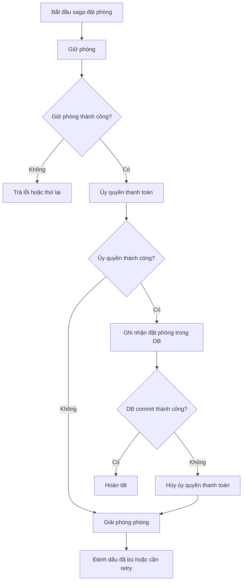

# Bù trừ tác động bên ngoài đã xảy ra trước khi lỗi

Trong chương **Ngoại lệ và phục hồi**, có những lỗi xuất hiện sau khi ứng dụng đã làm thay đổi một hệ thống bên ngoài. Ví dụ, dịch vụ kho đã giữ chỗ thành công nhưng cổng thanh toán từ chối giao dịch; hoặc thanh toán đã được xác nhận nhưng bước ghi nhận đơn hàng trong cơ sở dữ liệu thất bại. Rollback transaction cơ sở dữ liệu không thể tự hoàn tác những tác động đã xảy ra ở hệ thống khác.

Với **SPRING_WEB_FLOW**, flow có thể điều phối các bước của hành trình nhiều màn hình và hiển thị trạng thái phục hồi. Để xử lý tác động bên ngoài, ứng dụng cần các hành động bù trừ (compensation) và trạng thái nghiệp vụ đủ bền vững để tiếp tục phục hồi sau lỗi, timeout hoặc khởi động lại. Mẫu thiết kế thường dùng cho bài toán này là Saga.

## 1. Vì sao rollback không đủ?

Một transaction DB chỉ kiểm soát các tài nguyên tham gia transaction manager tương ứng. Nếu service gọi một API HTTP, cổng thanh toán, dịch vụ gửi email hoặc hệ thống kho độc lập, các thao tác đó không tự động trở thành một phần của transaction DB.

Giả sử quy trình đặt phòng thực hiện lần lượt:

1. Giữ một phòng ở hệ thống kho.
2. Yêu cầu cổng thanh toán xác thực khoản tiền.
3. Ghi nhận đặt phòng đã xác nhận trong DB.

Nếu bước 1 và 2 thành công nhưng bước 3 thất bại, DB có thể rollback các thay đổi cục bộ, nhưng phòng vẫn đang được giữ và khoản thanh toán vẫn có thể đang được ủy quyền. Ứng dụng phải gọi các API khác để giải phóng phòng và hủy ủy quyền thanh toán.

| Cơ chế | Phạm vi tác động | Điều có thể bảo đảm |
|---|---|---|
| Rollback DB transaction | Các thay đổi trong transaction DB hiện tại. | Các thay đổi DB được rollback theo transaction manager. |
| Compensation | Một tác động bên ngoài đã hoàn tất trước đó. | Gửi một thao tác nghiệp vụ mới để đưa hệ thống về trạng thái chấp nhận được. |
| Retry | Một bước hoặc hành động bù chưa hoàn tất. | Thử lại thao tác nếu thao tác đó an toàn khi thực hiện nhiều lần. |

Compensation không phải là rollback phân tán tức thời. Nó là một thao tác nghiệp vụ mới, có thể thất bại, mất thời gian hoặc chỉ khôi phục được trạng thái tương đương. Ví dụ, hoàn tiền không xóa được việc tiền từng bị thu; gửi email xin lỗi không thể thu hồi email đầu tiên.

## 2. Saga và thứ tự bù trừ

Saga chia một quy trình lớn thành các bước nghiệp vụ nhỏ. Mỗi bước thường có một thao tác chính và, nếu có thể, một thao tác bù tương ứng. Nếu bước sau thất bại, coordinator thực hiện các thao tác bù cho những bước trước đã thành công, thường theo thứ tự ngược lại.

Ví dụ đặt phòng:

| Thứ tự | Thao tác chính | Hành động bù |
|---|---|---|
| 1 | Giữ phòng trong hệ thống kho. | Giải phóng mã giữ phòng. |
| 2 | Ủy quyền khoản thanh toán. | Hủy ủy quyền thanh toán. |
| 3 | Xác nhận đặt phòng trong DB. | Nếu bước này đã commit, cần một nghiệp vụ hủy đặt phòng riêng; không thể chỉ rollback transaction cũ. |

Nếu bước 3 thất bại trước khi commit, coordinator bù bước 2 rồi bước 1: hủy ủy quyền thanh toán, sau đó giải phóng phòng. Nếu tiền đã được capture (thu thật) thay vì chỉ authorize (ủy quyền), hành động bù có thể là refund (hoàn tiền), thường bất đồng bộ và có trạng thái riêng.



Thứ tự bù thường đi ngược thứ tự thực hiện để tháo các phụ thuộc gần nhất trước. Tuy nhiên, thứ tự cụ thể phải dựa vào quy tắc nghiệp vụ và yêu cầu của từng hệ thống; không phải mọi tác động đều có thể đảo ngược.

## 3. Thiết kế thao tác bù có thể chạy lại an toàn

Mỗi thao tác chính và thao tác bù nên có một mã định danh ổn định, chẳng hạn `sagaId`, `stepId` và `idempotencyKey`. Khi timeout xảy ra, ứng dụng có thể không biết API đích đã xử lý request hay chưa. Nếu gửi lại request với cùng khóa idempotency, hệ thống đích có thể trả kết quả của lần xử lý trước thay vì tạo thêm một tác động.

Một bản ghi bước saga có thể lưu các trường sau:

| Trường | Ý nghĩa |
|---|---|
| `sagaId` | Định danh duy nhất của một hành trình nghiệp vụ. |
| `stepName` | Tên bước, ví dụ `RESERVE_ROOM` hoặc `AUTHORIZE_PAYMENT`. |
| `status` | `PENDING`, `SUCCEEDED`, `COMPENSATION_PENDING`, `COMPENSATED` hoặc `FAILED`. |
| `requestKey` | Khóa idempotency dùng khi gọi hệ thống đích. |
| `externalReference` | Mã giữ chỗ hoặc mã giao dịch do hệ thống bên ngoài trả về. |
| `attemptCount` | Số lần đã thử thao tác chính hoặc bù. |
| `lastError` | Mã lỗi và thông tin chẩn đoán đã được lọc an toàn. |
| `updatedAt` | Thời điểm cập nhật gần nhất để phục vụ retry và giám sát. |

Không chỉ lưu trạng thái trong `flowScope`. Flow scope hữu ích cho dữ liệu của một flow execution, nhưng không đủ làm nhật ký saga bền vững nếu người dùng đóng trình duyệt, HTTP session hết hạn hoặc ứng dụng khởi động lại. Trạng thái saga và các external reference quan trọng cần được lưu trong DB hoặc kho bền vững khác.

## 4. Ví dụ coordinator và hành động bù

Ví dụ sau minh họa coordinator giữ mã tham chiếu của từng tác động. Các repository và client là các thành phần do ứng dụng triển khai; mã đã lược bỏ phần mapping lỗi, timeout và lưu trạng thái chi tiết để tập trung vào trình tự.

```java
public SagaResult executeBooking(String bookingId, String sagaId) {
    String reservationId = null;
    String paymentAuthorizationId = null;

    try {
        reservationId = inventoryClient.reserve(
                bookingId, sagaId + ":reserve");
        sagaStore.markSucceeded(sagaId, "RESERVE_ROOM", reservationId);

        paymentAuthorizationId = paymentClient.authorize(
                bookingId, sagaId + ":authorize");
        sagaStore.markSucceeded(
                sagaId, "AUTHORIZE_PAYMENT", paymentAuthorizationId);

        // Cùng transaction DB: cập nhật booking và trạng thái saga hoàn tất.
        bookingCommandService.confirmAndCompleteSaga(bookingId, sagaId);
        return SagaResult.completed(bookingId);

    } catch (Exception failure) {
        sagaStore.markCompensationStarted(sagaId, failure);

        boolean paymentReversed = true;
        boolean roomReleased = true;

        if (paymentAuthorizationId != null) {
            try {
                paymentReversed = paymentClient.voidAuthorization(
                        paymentAuthorizationId, sagaId + ":void-payment");
            } catch (Exception compensationFailure) {
                sagaStore.recordCompensationError(
                        sagaId, "VOID_PAYMENT", compensationFailure);
                paymentReversed = false;
            }
        }

        if (reservationId != null) {
            try {
                roomReleased = inventoryClient.release(
                        reservationId, sagaId + ":release-room");
            } catch (Exception compensationFailure) {
                sagaStore.recordCompensationError(
                        sagaId, "RELEASE_ROOM", compensationFailure);
                roomReleased = false;
            }
        }

        if (paymentReversed && roomReleased) {
            sagaStore.markCompensated(sagaId);
            return SagaResult.failedAndCompensated(sagaId);
        }

        sagaStore.markCompensationPending(sagaId);
        return SagaResult.compensationPending(sagaId);
    }
}
```

Đây là khung minh họa, chưa phải coordinator production hoàn chỉnh. `confirmAndCompleteSaga` cần cập nhật đặt phòng và trạng thái saga hoàn tất trong cùng transaction DB; nếu chỉ một trong hai được commit, hệ thống có thể hiểu sai kết quả. Trong hệ thống thật, cần lưu trạng thái sau mỗi bước, phân biệt lỗi nghiệp vụ với lỗi hạ tầng, giới hạn thời gian gọi, xử lý kết quả không xác định và đưa từng thao tác bù chưa xong vào hàng đợi retry. Không nên chỉ dựa vào biến cục bộ `reservationId` hoặc `paymentAuthorizationId`, vì tiến trình có thể dừng giữa hai lệnh.

Các API `voidAuthorization` và `release` cần hỗ trợ idempotency hoặc có thể tra cứu trạng thái trước khi thực hiện. Nếu hành động bù đã thành công nhưng response bị mất, lần retry tiếp theo phải nhận ra tài nguyên đã được giải phóng và không tạo ra lỗi thứ cấp.

## 5. Phân biệt authorize, capture, void và refund

Với thanh toán, lựa chọn thao tác bù phụ thuộc vào trạng thái giao dịch:

| Trạng thái thanh toán | Hành động phù hợp khi cần hủy |
|---|---|
| Chưa gửi yêu cầu thanh toán | Không cần thao tác với cổng thanh toán. |
| Đã authorize, chưa capture | Gửi yêu cầu void/cancel authorization nếu cổng thanh toán hỗ trợ. |
| Đã capture | Tạo yêu cầu refund; việc hoàn tiền có thể cần thời gian xử lý và có thể thất bại. |
| Không rõ kết quả do timeout | Tra cứu giao dịch bằng idempotency key hoặc external reference trước khi quyết định void, refund hay retry. |

Không gửi refund một cách mù quáng khi request authorize bị timeout. Cổng thanh toán có thể đã authorize hoặc thậm chí capture giao dịch dù client chưa nhận được response. Hãy truy vấn trạng thái từ hệ thống đích bằng mã yêu cầu duy nhất trước khi chọn hành động tiếp theo.

Với các tác động như gửi email hoặc SMS, thường không thể thu hồi nội dung đã gửi. Compensation có thể là gửi thông báo đính chính, mở yêu cầu hỗ trợ hoặc ghi nhận sự cố để nhân viên xử lý. Hãy thiết kế nghiệp vụ sao cho các tác động không thể đảo ngược được trì hoãn đến sau các bước có khả năng thất bại cao, nếu điều đó phù hợp với yêu cầu sản phẩm.

## 6. Phối hợp saga với Spring Web Flow

Spring Web Flow quản lý trải nghiệm và điều hướng của người dùng. Coordinator/service quản lý các bước nghiệp vụ, trạng thái bền vững và hành động bù. Flow có thể hiển thị kết quả theo outcome của coordinator:

```xml
<view-state id="reviewBooking">
    <transition on="confirm" to="executeBooking" />
</view-state>

<action-state id="executeBooking">
    <evaluate expression="bookingSagaAction.execute(flowRequestContext)" />
    <transition on="completed" to="bookingCompleted" />
    <transition on="compensated" to="bookingFailed" />
    <transition on="compensationPending" to="recoveryPending" />
</action-state>

<end-state id="bookingCompleted" view="booking/confirmation" />
<view-state id="bookingFailed" />
<view-state id="recoveryPending" />
```

`bookingSagaAction` là action do ứng dụng đăng ký; nó gọi coordinator và phát event phù hợp với kết quả. Đoạn XML minh họa cách ánh xạ outcome sang state, cần được nối với bean/action và cơ chế xử lý exception cụ thể của ứng dụng.

Ba kết quả có ý nghĩa khác nhau:

- `completed`: nghiệp vụ chính đã hoàn tất và trạng thái đã được commit.
- `compensated`: thao tác chính thất bại, các tác động đã thực hiện được bù thành công.
- `compensationPending`: ít nhất một hành động bù chưa hoàn tất; hệ thống cần tiếp tục retry hoặc chuyển sang xử lý thủ công.

Không hiển thị cùng một thông báo cho `compensated` và `compensationPending`. Ở trường hợp đang chờ bù, cần thông báo trung thực rằng yêu cầu đang được xử lý, lưu mã tham chiếu hỗ trợ và cung cấp cách theo dõi kết quả. Tránh tuyên bố đã hủy hoàn toàn khi cổng thanh toán hoặc hệ thống kho chưa xác nhận.

## 7. Không giữ transaction DB trong lúc gọi hệ thống bên ngoài

Một cách triển khai dễ gây sự cố là mở transaction DB, gọi nhiều API từ xa, đợi response rồi mới commit. Cách này giữ connection và có thể giữ lock trong suốt thời gian mạng chậm hoặc hệ thống bên ngoài không phản hồi.

Thay vào đó, mỗi bước cục bộ nên dùng transaction ngắn để lưu trạng thái hoặc kết quả của bước. Các lệnh gọi mạng được thực hiện ngoài transaction dài; khi nhận response, service mở transaction ngắn để ghi trạng thái tiếp theo. Cần thiết kế để khôi phục được khoảng trống giữa external call và lần ghi trạng thái DB.

Một mẫu hữu ích là transactional outbox:

1. Trong một transaction DB, lưu trạng thái saga và một outbox command cần gửi.
2. Sau commit, worker đọc command và gọi hệ thống bên ngoài.
3. Khi nhận kết quả, worker ghi external reference và trạng thái bước trong transaction mới.
4. Nếu worker dừng hoặc response bị mất, command có thể được gửi lại với cùng idempotency key.

Outbox giúp không mất ý định gọi dịch vụ ngoài khi DB đã commit, nhưng không tự tạo ra exactly-once delivery. Consumer và API đích vẫn cần idempotency để xử lý thông điệp lặp.

## 8. Retry, timeout và kết quả không xác định

Timeout không luôn có nghĩa thao tác thất bại. Có thể request chưa đến hệ thống đích, đã được xử lý nhưng response bị mất, hoặc vẫn đang xử lý. Hãy phân loại tình huống trước khi retry:

| Tình huống | Cách xử lý |
|---|---|
| Lỗi tạm thời và biết chắc chưa thực hiện | Retry có giới hạn, backoff và jitter. |
| Đã thành công nhưng response bị mất | Tra cứu theo idempotency key; ghi nhận kết quả đã có. |
| Đang xử lý | Poll trạng thái hoặc nhận callback/webhook; không tạo yêu cầu mới bằng khóa khác. |
| Từ chối nghiệp vụ rõ ràng | Dừng retry thao tác chính và bắt đầu bù những bước đã thành công nếu cần. |
| Hành động bù thất bại tạm thời | Đánh dấu `COMPENSATION_PENDING`, lên lịch retry. |
| Hành động bù không thể tự phục hồi | Đưa vào hàng đợi xử lý thủ công và cảnh báo vận hành. |

Retry cần có giới hạn số lần, khoảng chờ tăng dần và cơ chế dead-letter hoặc hàng đợi lỗi để không lặp vô hạn. Không retry lỗi xác thực, dữ liệu không hợp lệ hoặc từ chối nghiệp vụ như thể đó là lỗi mạng.

## 9. Theo dõi và phục hồi sau khi ứng dụng khởi động lại

Một saga có thể kéo dài hơn một HTTP request hoặc một phiên người dùng. Vì vậy, trạng thái phục hồi phải tồn tại ngoài bộ nhớ của flow. Nên lưu:

- ID saga và ID nghiệp vụ gốc.
- Trạng thái tổng thể: `RUNNING`, `COMPENSATING`, `COMPENSATION_PENDING`, `COMPENSATED`, `COMPLETED` hoặc `MANUAL_INTERVENTION`.
- Trạng thái từng bước, external reference và idempotency key.
- Số lần thử, thời điểm thử gần nhất, thời điểm thử tiếp theo và lỗi cuối.
- Dấu vết correlation để nối log của Web Flow, service, worker và hệ thống đích.

Khi ứng dụng khởi động lại, worker có thể tìm các saga còn `RUNNING` hoặc `COMPENSATION_PENDING`, tra cứu trạng thái hệ thống ngoài rồi tiếp tục bước còn thiếu. Nếu flow execution của người dùng không còn, người dùng vẫn có thể mở trang trạng thái bằng mã tham chiếu và xem kết quả saga đã lưu.

Không lưu thông tin thẻ, secret, token truy cập hoặc dữ liệu xác thực nhạy cảm trong flow scope, log hoặc saga record. Chỉ lưu external reference và dữ liệu tối thiểu cần để tra cứu/compensate; bảo vệ quyền truy cập vào trang trạng thái.

## 10. Kiểm thử hành động bù

Kiểm thử phải bao gồm lỗi xảy ra sau mỗi bước đã tạo tác động bên ngoài, không chỉ kiểm tra happy path:

| Kịch bản | Điều cần xác nhận |
|---|---|
| Giữ phòng thất bại | Không gọi thanh toán; flow đi đến nhánh lỗi. |
| Giữ phòng thành công, authorize thất bại | Giải phóng phòng bằng đúng reservation reference. |
| Giữ phòng và authorize thành công, DB commit thất bại | Void authorization rồi giải phóng phòng theo thứ tự bù. |
| Void thất bại tạm thời | Saga ở `COMPENSATION_PENDING`; retry dùng cùng idempotency key. |
| Timeout khi authorize | Tra cứu trạng thái trước khi gửi authorize lần nữa hoặc void. |
| Response của lệnh bù bị mất | Retry không giải phóng hoặc hoàn tiền hai lần. |
| Tiến trình dừng giữa các bước | Sau restart, worker đọc saga record và tiếp tục phục hồi. |
| Email đã gửi trước khi lỗi | Không giả vờ thu hồi được email; ghi nhận tác động và gửi thông báo đính chính nếu nghiệp vụ yêu cầu. |

Mock server hoặc fake client có thể mô phỏng timeout, response lỗi và response bị mất sau khi đã thực hiện tác động. Ngoài unit test cho coordinator, cần integration test xác nhận trạng thái saga được lưu bền vững và worker retry đúng bước.

## 11. Những lỗi thường gặp

| Hiện tượng | Nguyên nhân cần kiểm tra |
|---|---|
| DB rollback nhưng phòng vẫn bị giữ | Chưa gọi compensation cho reservation đã thành công. |
| Hoàn tiền hoặc giải phóng tài nguyên bị lặp | Hành động bù thiếu idempotency key hoặc không kiểm tra trạng thái đã bù. |
| Saga bị kẹt sau khi ứng dụng restart | Trạng thái chỉ nằm trong flow scope hoặc biến bộ nhớ, không có saga log bền vững. |
| Timeout khiến hệ thống tạo giao dịch thứ hai | Retry bằng khóa mới mà không tra cứu kết quả của request trước. |
| Hiển thị “đã hủy” khi thao tác bù còn lỗi | Flow không phân biệt `COMPENSATED` với `COMPENSATION_PENDING`. |
| Giữ connection DB trong thời gian gọi API lâu | Transaction bao trùm lời gọi mạng hoặc thời gian chờ người dùng. |
| Email không thể thu hồi | Tác động không thể đảo ngược đã xảy ra; cần thông báo đính chính hoặc quy trình xử lý hỗ trợ. |

Khi điều tra, hãy lập lại timeline của saga theo `sagaId`: bước nào đã bắt đầu, bước nào có xác nhận thành công, external reference nào đã được cấp, hành động bù nào đã chạy và response nào chưa rõ. Từ đó quyết định retry, tra cứu trạng thái hay chuyển xử lý thủ công.

## 12. Thực hành

Xây dựng saga cho quy trình đặt phòng có giữ phòng, ủy quyền thanh toán và ghi nhận đặt phòng.

1. Tạo saga record bền vững với trạng thái tổng thể và trạng thái từng bước.
2. Gọi inventory service để giữ phòng với idempotency key ổn định; lưu reservation reference sau khi xác nhận thành công.
3. Gọi payment service để authorize; lưu authorization reference và trạng thái bước.
4. Gọi service DB để xác nhận đặt phòng trong một transaction ngắn.
5. Cố ý làm bước DB thất bại; kiểm tra coordinator void authorization trước rồi release reservation.
6. Làm cho một lệnh bù timeout; xác nhận saga chuyển `COMPENSATION_PENDING` và worker retry an toàn.
7. Mô phỏng ứng dụng dừng giữa quá trình bù; khởi động lại worker và phục hồi từ saga record.
8. Cho Spring Web Flow hiển thị riêng kết quả hoàn tất, đã bù và đang chờ phục hồi.

Bạn hoàn thành bài khi giải thích được vì sao rollback DB không thể đảo ngược API bên ngoài, thiết kế được compensation theo thứ tự phù hợp, và chứng minh hệ thống có thể retry/phục hồi mà không tạo tác động trùng.
