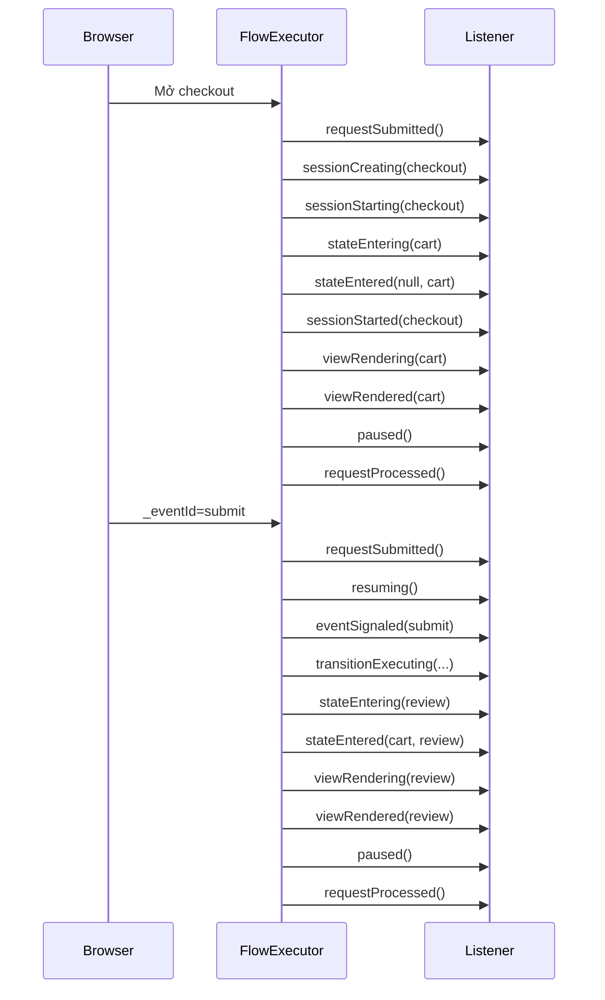

# FlowExecutionListener và các điểm quan sát vòng đời

## 1. Vì sao một luồng nhiều bước cần listener?

Trong **Spring Web Flow (SWF)**, một hành trình như đăng ký tài khoản, đặt hàng hoặc điền hồ sơ có thể kéo dài qua nhiều HTTP request. Một `FlowExecution` giữ trạng thái đang chạy của hành trình; bên trong có thể có một hoặc nhiều `FlowSession` khi flow cha gọi subflow. Các sự kiện (`Event`) được xử lý theo transition để chuyển giữa `view-state`, `action-state`, `decision-state`, `subflow-state` và `end-state`.

Khi cần biết người dùng đã đi qua bước nào, flow nào kết thúc với kết quả gì, thao tác nào gây lỗi, hoặc cần áp dụng một hành vi chung cho nhiều flow, không nên rải câu lệnh log hay mã phụ trợ vào từng controller và từng state. **`FlowExecutionListener`** cung cấp các callback tại những thời điểm xác định của vòng đời thực thi. Nó phù hợp cho:

- **Audit:** ghi nhận flow được bắt đầu, sự kiện nghiệp vụ, bước chuyển và kết quả kết thúc.
- **Observability:** đếm số flow bắt đầu/thành công/thất bại, đo thời gian chờ giữa các bước, phát hiện bước hay lỗi.
- **Cross-cutting concerns:** kiểm tra quyền ở đầu flow hoặc trước khi vào state, khởi tạo/giải phóng tài nguyên có vòng đời phù hợp.
- **Chẩn đoán:** theo dõi chuyển trạng thái, subflow, lần tạm dừng/tiếp tục và exception.

Listener là **điểm móc thực thi**: callback chạy trong quá trình engine xử lý flow, vì vậy mã listener có thể ảnh hưởng đến thời gian đáp ứng hoặc làm gián đoạn flow nếu ném exception. Hãy thiết kế nó với chủ đích rõ ràng.

## 2. Phân biệt các vòng đời và đối tượng liên quan

| Khái niệm | Phạm vi | Điều dễ nhầm |
|---|---|---|
| `FlowDefinition` | Bản mô tả flow: states, transitions, input/output | Là cấu hình; không phải một lượt chạy |
| `FlowExecution` | Một lượt thực thi cụ thể của flow gốc | Có thể tạm dừng và được khôi phục qua nhiều request |
| `FlowSession` | Một lần đi vào flow definition trong execution | Flow cha và mỗi lần gọi subflow có session riêng |
| `RequestContext` | Ngữ cảnh của lần xử lý request hiện tại | Chứa ngữ cảnh execution và dữ liệu request; không nên lưu lâu trong singleton |
| `Event` | Tín hiệu như `next`, `submit`, `success`, `error` | Có event nhưng có thể không có transition phù hợp |
| `TransitionDefinition` | Quy tắc chuyển từ một state đến đích | Được chọn trước khi state đích thực sự được vào |
| `FlowExecutionListener` | Quan sát/can thiệp tại các cột mốc engine công bố | Không phải bộ lọc Servlet, interceptor Spring MVC hay listener HTTP session |

**Một HTTP session có thể chứa nhiều flow execution; một flow execution có thể trải qua nhiều HTTP request.** Việc browser Back, flow snapshot và lưu trữ execution liên quan đến repository, không đồng nghĩa mỗi request tạo mới execution. Khi flow cha gọi `payment` subflow, một `FlowSession` mới được tạo trong **cùng flow execution**; subflow kết thúc chưa chắc làm toàn bộ execution kết thúc.

Sơ đồ khái niệm:

```text
HTTP request 1 (khởi chạy flow)
  FlowExecution: checkout#A
    FlowSession: checkout
      cart -> tạm dừng để chờ người dùng

HTTP request 2 (tiếp tục execution#A)
  FlowExecution: checkout#A
    FlowSession: checkout
      cart --submit--> review -> tạm dừng

HTTP request 3 (tiếp tục execution#A)
  FlowExecution: checkout#A
    FlowSession: checkout
      review -> subflow-state(payment)
        FlowSession: payment
          authorize -> end-state(paid)
      checkout -> end-state(done)
```

Ở ví dụ này, các callback `sessionCreating`, `sessionStarting` và `sessionStarted` có thể xảy ra **nhiều lần** trong một execution (mỗi flow session, kể cả subflow). Ngược lại, `requestSubmitted` và `requestProcessed` gắn với lần request mà engine xử lý, chứ không phải một lần khởi động subflow.

## 3. Toàn bộ nhóm callback đáng biết

Trong các phiên bản SWF hỗ trợ phương thức `default` (ví dụ nhánh 2.5.x), có thể `implements FlowExecutionListener` và override đúng callback cần dùng. Các API cũ cũng có `FlowExecutionListenerAdapter`; adapter đã được đánh dấu deprecated ở các API có default methods.

### 3.1. Nhóm request và tạm dừng/tiếp tục

| Callback | Thời điểm | Gợi ý dùng |
|---|---|---|
| `requestSubmitted(RequestContext)` | Request được gửi đến engine, trước khi xử lý request | Bắt đầu theo dõi thời gian xử lý; ghi log mức debug |
| `requestProcessed(RequestContext)` | Hoàn tất xử lý request trong flow | Kết thúc đo thời gian; không mặc định là flow đã hoàn tất |
| `paused(RequestContext)` | Execution tạm dừng, thường vì cần người dùng nhập liệu | Ghi nhận state chờ; phân biệt thời gian tương tác với thời gian CPU |
| `resuming(RequestContext)` | Execution đã được kích hoạt lại sau khi pause, trước xử lý event | Theo dõi lượt tiếp tục hoặc dấu hiệu stale state |

Một lượt request có thể chạy qua nhiều state và nhiều transition; đừng mặc định chỉ có một cặp callback state cho mỗi request. Callback `paused` cũng **không** có nghĩa Java thread bị block chờ browser: request kết thúc và trạng thái execution được duy trì theo cơ chế lưu trữ cấu hình.

### 3.2. Nhóm khởi tạo và kết thúc flow session

| Callback | Thời điểm | Điểm lưu ý |
|---|---|---|
| `sessionCreating(RequestContext, FlowDefinition)` | Ngay trước khi tạo session mới | Có thể từ chối khởi chạy bằng runtime exception nếu cần |
| `sessionStarting(RequestContext, FlowSession, MutableAttributeMap<?>)` | Session đã được tạo nhưng chưa start | Có thể thêm dữ liệu vào **input map** để flow nhận input mapping |
| `sessionStarted(RequestContext, FlowSession)` | Session đã start, state khởi đầu đã được vào | Phù hợp ghi audit bắt đầu session |
| `sessionEnding(RequestContext, FlowSession, String, MutableAttributeMap<?>)` | Session chuẩn bị kết thúc | Có thể thay đổi **output map** trước khi trả về |
| `sessionEnded(RequestContext, FlowSession, String, AttributeMap<?>)` | Session đã kết thúc | Kết quả `outcome` thường là ID của `end-state` |

**Đọc kỹ tính mutable:** `sessionStarting` nhận `MutableAttributeMap<?> input` và `sessionEnding` nhận `MutableAttributeMap<?> output`; `sessionEnded` nhận `AttributeMap<?> output` chỉ để đọc. Chỉ sửa input/output khi có hợp đồng nghiệp vụ xác định và kiểm thử đường đi của flow, bởi việc sửa ở đây ảnh hưởng dữ liệu mà flow tiếp nhận hoặc trả ra.

Nếu session vừa kết thúc là session gốc, toàn bộ execution kết thúc. Nếu đó là subflow, flow cha có thể nhận output/outcome rồi tiếp tục. **Đếm `sessionEnded` không đồng nghĩa đếm số hành trình người dùng hoàn tất.**

### 3.3. Nhóm event, transition và state

| Callback | Ý nghĩa | Ví dụ |
|---|---|---|
| `eventSignaled(RequestContext, Event)` | Event đã được phát trong state hiện tại, trước chuyển trạng thái | `submit`, `cancel`, `success` |
| `transitionExecuting(RequestContext, TransitionDefinition)` | Transition phù hợp đã được chọn, chưa chuyển | Audit quyết định điều hướng |
| `stateEntering(RequestContext, StateDefinition)` | Đang chuẩn bị vào state đích | Kiểm soát truy cập theo state |
| `stateEntered(RequestContext, StateDefinition, StateDefinition)` | Đã chuyển vào state mới | Ghi nhận state trước/sau |

Tham số thứ hai và thứ ba của `stateEntered` lần lượt là **`previousState` và `newState`**. Trường `previousState` có thể là `null` trong tình huống khởi đầu, nên cần xử lý an toàn.

`eventSignaled` **không bảo đảm** một transition sẽ xảy ra: một event có thể không match với điều kiện chuyển, hoặc bị xử lý theo đường khác. `transitionExecuting` thể hiện transition được lựa chọn, nhưng việc vào state đích có thể bị ngăn bởi cơ chế veto hoặc phát sinh exception. Chỉ ghi nhận "đã tới bước X" sau `stateEntered`.

### 3.4. Nhóm render và exception

| Callback | Thời điểm | Cần tránh suy luận |
|---|---|---|
| `viewRendering(RequestContext, View, StateDefinition)` | Trước khi render một view trong `view-state`, trước render actions | Không đồng nghĩa browser đã nhận HTML |
| `viewRendered(RequestContext, View, StateDefinition)` | Sau khi render view hoàn tất ở phía engine | Không bảo đảm client hiển thị thành công |
| `exceptionThrown(RequestContext, FlowExecutionException)` | Khi phát sinh exception trong execution, **trước** exception handler đã đăng ký | Không mặc nhiên là lỗi chưa được xử lý hoặc flow đã chết |

Hai callback render chỉ dành cho việc render view trong hệ thống flow; không thay thế việc đo toàn bộ thời gian mạng hay trình duyệt. `exceptionThrown` hữu ích để đo và ghi log lỗi nhưng **không thay thế** `exception-handler` trong flow, cơ chế xử lý lỗi của ứng dụng hoặc yêu cầu giao dịch rollback.

## 4. Dòng sự kiện qua một hành trình đặt hàng

Xét flow `checkout` có `cart` (xem giỏ), `review` (xác nhận), subflow `payment` và `done` (kết thúc). Một trace điển hình có thể nhìn như sau:



Đây là **trace minh họa**, không phải lời hứa mọi callback luôn xuất hiện với một thứ tự đơn giản: một request có thể chứa nhiều event, decision/action state tự chuyển, lỗi render, veto, hoặc subflow. Khi subflow `payment` được gọi, một vòng `sessionCreating → sessionStarting → sessionStarted` mới xuất hiện cho `payment`; sau `sessionEnded(payment, "paid", ...)`, execution gốc có thể trở về `checkout`.

Điểm quan sát chọn theo điều muốn đo:

- **"Người dùng đã tới bước review chưa?"** Dùng `stateEntered`.
- **"Người dùng vừa bấm submit?"** Dùng `eventSignaled`, kiểm tra `event.getId()`.
- **"Đã hoàn tất thanh toán?"** Dùng outcome của subflow thích hợp và bảo đảm nghiệp vụ đã xác nhận thành công; không kết luận từ việc chỉ vào state `payment`.
- **"Flow gốc đã kết thúc?"** Xác định đó là root session khi xử lý `sessionEnded` hoặc kết hợp ngữ cảnh execution phù hợp.
- **"Lỗi đã được xử lý chưa?"** Theo dõi đường xử lý exception và trạng thái kết thúc; callback `exceptionThrown` riêng lẻ chưa đủ.

## 5. Viết listener quan sát luồng: ví dụ Java

Ví dụ sau thu thập log có chủ đích cho một hành trình. Class triển khai thẳng `FlowExecutionListener`, dùng các callback mặc định của interface và không giữ trạng thái theo người dùng trong bean singleton.

```java
package com.example.checkout.flow;

import org.slf4j.Logger;
import org.slf4j.LoggerFactory;
import org.springframework.webflow.definition.StateDefinition;
import org.springframework.webflow.execution.Event;
import org.springframework.webflow.execution.FlowExecutionException;
import org.springframework.webflow.execution.FlowExecutionListener;
import org.springframework.webflow.execution.FlowSession;
import org.springframework.webflow.execution.RequestContext;
import org.springframework.binding.collection.AttributeMap;

public final class CheckoutFlowListener implements FlowExecutionListener {

    private static final Logger log =
            LoggerFactory.getLogger(CheckoutFlowListener.class);

    @Override
    public void sessionStarted(RequestContext context, FlowSession session) {
        log.info("flow-session.started flow={}",
                session.getDefinition().getId());
    }

    @Override
    public void eventSignaled(RequestContext context, Event event) {
        log.debug("flow.event id={}", event.getId());
    }

    @Override
    public void stateEntered(
            RequestContext context,
            StateDefinition previousState,
            StateDefinition newState) {

        String from = previousState == null
                ? "<start>" : previousState.getId();
        log.info("flow.state {} -> {}", from, newState.getId());
    }

    @Override
    public void sessionEnded(
            RequestContext context,
            FlowSession session,
            String outcome,
            AttributeMap<?> output) {

        log.info("flow-session.ended flow={} outcome={}",
                session.getDefinition().getId(), outcome);
        // Không log toàn bộ output: có thể chứa dữ liệu cá nhân/nhạy cảm.
    }

    @Override
    public void exceptionThrown(
            RequestContext context,
            FlowExecutionException exception) {

        log.warn("flow.execution.exception type={}",
                exception.getClass().getSimpleName());
        // Callback để quan sát; xử lý lỗi nằm trong flow/ứng dụng.
    }
}
```

Ở ví dụ này, `CheckoutFlowListener` có thể được khai báo là Spring bean bình thường. Log event/state/session ID giúp truy vết luồng mà không lộ form data. Nếu cần gắn cùng `traceId` hoặc correlation ID, hãy dùng cơ chế tracing/logging context của hạ tầng request và lưu ý vòng đời của MDC, thay vì đặt một `currentUserId` hoặc `currentFlowId` vào field mutable của listener.

**Vì sao code không gọi `context.getCurrentState()` ở mọi callback?** Ở các thời điểm như `sessionCreating`, state hiện tại có thể chưa được thiết lập. Các đối tượng được truyền trực tiếp vào callback (ví dụ `newState`, `session`, `event`) là nguồn rõ ràng hơn cho cột mốc đó.

## 6. Đăng ký listener với FlowExecutor

Một class Java chỉ `implements FlowExecutionListener` **chưa đủ** để engine tự gọi. Listener cần được kết nối với cơ chế khởi tạo `FlowExecutor`. Có hai hình thức phổ biến:

### 6.1. Cấu hình XML

Trong cấu hình Spring đã khai báo namespace `webflow`, có thể thêm listener vào `flow-executor`:

```xml
<bean id="checkoutFlowListener"
      class="com.example.checkout.flow.CheckoutFlowListener"/>

<webflow:flow-executor id="flowExecutor" flow-registry="flowRegistry">
    <webflow:flow-execution-listeners>
        <webflow:listener ref="checkoutFlowListener"
                          criteria="checkout"/>
    </webflow:flow-execution-listeners>
</webflow:flow-executor>
```

`criteria="checkout"` làm listener áp dụng cho flow definition `checkout`; có thể liệt kê nhiều ID bằng dấu phẩy, chẳng hạn `criteria="checkout,registration"`. Bỏ `criteria` khi muốn áp dụng rộng hơn cho các flow được executor quản lý. Phần `flowRegistry` phải được khai báo riêng và trỏ tới các flow definitions đúng tên.

### 6.2. Cấu hình Java

Nếu dùng `AbstractFlowConfiguration` và `FlowExecutorBuilder`, có thể đăng ký theo mẫu:

```java
@Bean
public FlowExecutionListener checkoutFlowListener() {
    return new CheckoutFlowListener();
}

@Bean
public FlowExecutor flowExecutor() {
    return getFlowExecutorBuilder(flowRegistry())
            .addFlowExecutionListener(checkoutFlowListener(), "checkout")
            .build();
}
```

Đoạn trên đặt trong class cấu hình Web Flow đã có `flowRegistry()` và phương thức builder phù hợp, chẳng hạn class kế thừa `AbstractFlowConfiguration`. Cú pháp `addFlowExecutionListener(listener)` không có criteria áp dụng listener theo phạm vi mặc định của builder. Khi triển khai, hãy bảo đảm cấu hình web (ví dụ `FlowHandlerAdapter`, `FlowHandlerMapping`) thực sự dùng đúng `FlowExecutor` vừa cấu hình; tạo thêm một executor không được sử dụng sẽ khiến listener dường như "không chạy".

**Lưu ý về subflow và criteria:** criteria lọc theo flow definition mà listener áp dụng. Khi yêu cầu giám sát cả `checkout` và subflow `payment`, hãy kiểm tra quy tắc áp dụng listener của phiên bản đang dùng và đăng ký các flow cần quan sát tương ứng. Không suy luận rằng lọc `checkout` sẽ tự động ghi lại mọi callback riêng của `payment` trong mọi cấu hình.

## 7. Listener khác gì action, exception handler và interceptor?

| Nhu cầu | Cơ chế phù hợp | Lý do |
|---|---|---|
| Lưu đơn hàng, gọi cổng thanh toán, tính phí | `evaluate`, `Action`, service được gọi từ state | Là nghiệp vụ cụ thể, cần kết quả để flow quyết định transition |
| Quan sát người dùng qua state, đo số lần event | `FlowExecutionListener` | Có callback chung trên các vòng đời flow |
| Chuyển sang màn hình lỗi khi exception xảy ra | `exception-handler` / error transition | Đây là logic phục hồi/điều hướng của flow |
| Lọc toàn bộ HTTP request, thêm header, CORS | Servlet Filter / Spring MVC interceptor | Bao phủ tầng request, kể cả route không phải flow |
| Kiểm soát quyền vào flow/state | `SecurityFlowExecutionListener` và cấu hình security | Tận dụng cơ chế bảo mật của Web Flow |
| Quản lý persistence context theo vòng đời flow | Listener persistence tích hợp (ví dụ JPA/Hibernate theo phiên bản) | Phối hợp tài nguyên qua nhiều bước flow |

Không dùng listener để âm thầm thay thế transition của flow, xử lý nghiệp vụ thanh toán hoặc gửi dữ liệu quan trọng sang dịch vụ bên ngoài một cách đồng bộ trong callback `viewRendering`. Những nghiệp vụ đó cần idempotency, chính sách retry và transaction rõ ràng.

## 8. Các điểm mở rộng nâng cao

Ngoài tự viết listener đơn giản, Spring Web Flow còn có lớp phục vụ **chọn tập listener cho từng flow definition**. API `FlowExecutionListenerLoader` có phương thức:

```java
FlowExecutionListener[] getListeners(FlowDefinition flowDefinition);
```

Các triển khai như `StaticFlowExecutionListenerLoader` hoặc `ConditionalFlowExecutionListenerLoader` cho phép chọn tập listener cố định hoặc có điều kiện. Phần lớn ứng dụng có thể dùng đăng ký ở `FlowExecutor` với `criteria`; chỉ cần làm việc ở cấp `Loader` hoặc factory khi phải xây hạ tầng cấu hình linh hoạt hơn.

Có hai đặc điểm vận hành cần nhớ:

1. Listener thường được gắn với một execution khi execution được tạo hoặc phục hồi từ `FlowExecutionRepository`. Thay đổi danh sách listener giữa lúc một execution đã hoạt động không nên được coi là thao tác cập nhật nóng tự động cho execution đó.
2. Một listener được đăng ký dạng Spring singleton có thể phục vụ nhiều flow execution và request ở các thread khác nhau. Giữ listener **stateless**, hoặc dùng cấu trúc đồng bộ thích hợp cho bộ đếm dùng chung; trạng thái thuộc riêng một lượt chạy phải được quản lý qua cơ chế context/scope phù hợp.

Đối với kiểm soát truy cập, `sessionCreating` có thể ném runtime exception để từ chối khởi chạy; `stateEntering` có thể chặn việc vào state (API định nghĩa `EnterStateVetoException`). Đây là các quyết định có chủ đích, cần phân biệt với lỗi tình cờ trong mã audit. Không nên dùng exception để điều hướng bình thường khi flow đã có transition và rule nghiệp vụ rõ ràng.

## 9. Observability đúng cách: những dữ liệu nên và không nên ghi

Một bản ghi audit có thể gồm `flowId`, `stateId`, `eventId`, `outcome`, `timestamp` và `traceId` do hệ thống tracing cung cấp. Đây là các trường có số lượng giá trị tương đối kiểm soát được. Có thể dùng chúng để tổng hợp:

```text
flow_started_total{flow="checkout"}
flow_session_ended_total{flow="checkout", outcome="done"}
flow_exception_total{flow="checkout", exception="FlowExecutionException"}
```

Tên metric chỉ mang tính minh họa; cần lựa chọn tên và nhãn theo quy ước của stack quan sát đang dùng. Không gắn execution key, session ID, email hoặc order ID vào **nhãn metric** vì dễ tạo cardinality rất lớn và có rủi ro rò rỉ thông tin. Nếu buộc phải tương quan log theo một request, dùng trace ID và cơ chế phân quyền truy cập log.

Đặc biệt tránh:

- Ghi thẳng toàn bộ `flowScope`, `viewScope`, `requestParameters`, `Event.attributes` hoặc `output` vì có thể chứa mật khẩu, thông tin thanh toán hoặc dữ liệu cá nhân.
- Gọi API mạng đồng bộ trong callback trên mọi transition, vì có thể làm một form nhiều bước trở nên chậm hoặc khó khôi phục.
- Đếm `exceptionThrown` là số lỗi cuối cùng của hệ thống: exception có thể đã được handler xử lý và người dùng vẫn tiếp tục flow.
- Dùng `requestProcessed` để suy đoán giao dịch thành công: đó chỉ là một request đã được xử lý.
- Đếm `stateEntered(review)` là một đơn hàng hoàn tất: người dùng có thể quay lại, hủy, hoặc gặp lỗi sau đó.
- Lưu `RequestContext` vào biến static hoặc singleton để truy cập ở request sau: context chỉ có ý nghĩa trong lượt xử lý hiện tại.

## 10. Thực hành kiểm tra listener

Với flow `checkout` có `cart → review → payment → done`, hãy chạy tuần tự các tình huống và đối chiếu trace:

| Tình huống | Dấu hiệu đúng | Điều phải kiểm tra |
|---|---|---|
| Mở flow mới | Callback tạo/start session và vào state đầu | Listener đã gắn vào executor được ứng dụng sử dụng |
| Submit từ `cart` | `eventSignaled`, chọn transition, `stateEntered(review)` | Event ID có đúng với `on="..."` không |
| Submit sai dữ liệu | Có thể ở lại view-state, render lại | Không được kết luận luôn có `stateEntered` đích |
| Đi vào `payment` subflow | Phát sinh vòng đời session cho subflow | Không nhầm callback session con với kết thúc execution gốc |
| Subflow `payment` kết thúc | `sessionEnded(payment, outcome, ...)` | Outcome có được flow cha map và xử lý đúng |
| Gặp exception đã được handler xử lý | Có thể có `exceptionThrown` và tiếp tục flow | Listener không tự thay thế chính sách recovery |
| Kết thúc `done` | Session gốc kết thúc | Không đánh dấu thành công chỉ từ `requestProcessed` |
| Browser Back / reload / execution key hết hạn | Kết quả phụ thuộc repository, snapshot và phục hồi | Không kỳ vọng mọi request đều tạo session mới |

Khi debug listener không chạy, kiểm tra theo thứ tự: bean đã được khởi tạo chưa; executor sử dụng bởi MVC có đúng không; `criteria` có match ID flow không; callback mong đợi có thật sự xảy ra trong đường đi đó không; request có bị chặn trước khi tới flow không. Với subflow, bổ sung log `session.getDefinition().getId()` để phân biệt source callback.

**Bài tập mở rộng:** tạo listener chỉ ghi nhận một event `confirm` và outcome `done`; sau đó tạo subflow `payment` với hai outcome `paid` và `declined`. Quan sát xem có bao nhiêu `sessionStarted`/`sessionEnded` xuất hiện, và giải thích vì sao con số này khác số HTTP request và số lần kết thúc hành trình đặt hàng.

## 11. Ghi nhớ trước khi triển khai production

`FlowExecutionListener` là cơ chế quan sát cắt ngang ở **cấp vòng đời thực thi Web Flow**. Chọn callback dựa trên **sự kiện cần chứng minh**: event được phát, transition được chọn, state đã vào, view đã render, session đã kết thúc hay exception vừa xuất hiện. Luôn xét subflow, callback trước/sau, tình huống bị veto và sự khác biệt giữa "execution tạm dừng" với "request đã kết thúc". Listener nên có chi phí thấp, không giữ trạng thái user ở field chung, không log dữ liệu nhạy cảm và được gắn rõ ràng với đúng `FlowExecutor`.

### Tài liệu tham khảo

- [Spring Web Flow 2.5.1 – FlowExecutionListener API](https://docs.spring.io/spring-webflow/docs/2.5.x/api/org/springframework/webflow/execution/FlowExecutionListener.html) – chữ ký và thời điểm gọi từng callback.
- [Spring Web Flow 2.5.1 – System Setup, Flow Executor options](https://docs.spring.io/spring-webflow/docs/2.5.1.RELEASE/reference/html/system-setup.html) – cấu hình `flow-execution-listeners`, `criteria` và Java builder.
- [Spring Web Flow – FlowExecutionListenerLoader API](https://docs.spring.io/spring-webflow/docs/current/api/org/springframework/webflow/execution/factory/FlowExecutionListenerLoader.html) – cơ chế chọn listener theo flow definition.
