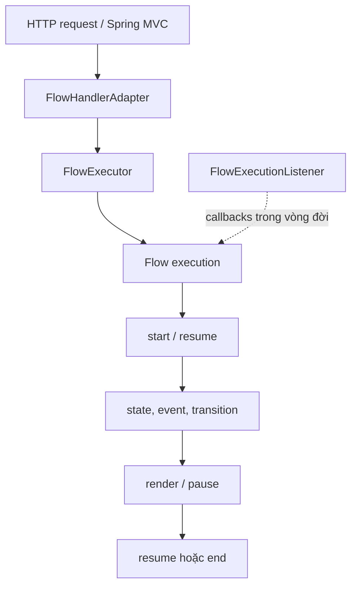
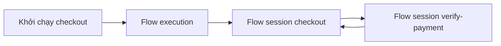

# Đăng ký listener cho toàn bộ hoặc một nhóm flow

Một ứng dụng Spring Web Flow có thể vận hành nhiều hành trình web: đăng ký tài khoản, đặt hàng, thay đổi thông tin thanh toán hoặc khôi phục mật khẩu. Mỗi hành trình gồm các **state**, **event** và **transition**, đôi khi gọi thêm **subflow**. Khi cần ghi nhật ký, đo thời gian, theo dõi lỗi hoặc áp dụng chính sách bảo mật nhất quán, việc chèn thao tác tương tự vào từng `view-state` và `action-state` gây lặp lại cấu hình.

**Flow execution listener** giải quyết nhu cầu này bằng cách nhận callback tại các mốc vòng đời thực thi flow. Spring Web Flow cho phép đăng ký một listener để theo dõi **mọi flow** hoặc chỉ **một tập flow được chọn**. Bài học tập trung vào cách đăng ký và xác định phạm vi áp dụng listener, sau đó thực hành bằng cấu hình XML và Java.

## 1. Mục tiêu học tập

Sau bài học, bạn có thể:

1. Giải thích `FlowExecutionListener` được gọi trong vòng đời của một flow execution.
2. Đăng ký listener dùng chung bằng thẻ `<webflow:flow-execution-listeners>`.
3. Giới hạn listener theo danh sách flow ID bằng thuộc tính `criteria`.
4. Cấu hình tương đương bằng `getFlowExecutorBuilder(...).addFlowExecutionListener(...)`.
5. Viết listener đơn giản cho logging/observability và chọn callback phù hợp.
6. Phân biệt flow listener, action trong flow, Spring MVC interceptor và listener cấp HTTP.
7. Kiểm tra cấu hình với flow được chọn, flow không được chọn và subflow.

## 2. Listener nằm ở đâu trong Spring Web Flow?

Trong ứng dụng Spring MVC sử dụng Web Flow, `FlowHandlerMapping` tìm flow theo URL, còn `FlowHandlerAdapter` chuyển request đến `FlowExecutor`. `FlowExecutor` quản lý việc bắt đầu hoặc tiếp tục một **flow execution**; mỗi execution có thể đi qua nhiều request HTTP, nhiều state, và cả các session của subflow.

`FlowExecutionListener` là giao diện ở package:

```java
org.springframework.webflow.execution.FlowExecutionListener
```

Listener nhận thông báo về các mốc như khởi động flow session, tín hiệu event, chuyển state, chuẩn bị render view, tạm dừng để chờ người dùng và phát sinh exception.



**Điểm đặt cấu hình:** Listener được gắn với **flow executor**, thay vì thêm `<listener>` vào từng XML định nghĩa flow. Nếu chỉ muốn áp dụng cho một nhóm flow, ta đặt điều kiện khi đăng ký tại executor.

### 2.1. Khi nào nên dùng listener?

| Yêu cầu | Có nên dùng flow listener? | Giải thích |
| --- | --- | --- |
| Ghi thông tin flow/state/event để chẩn đoán | Có | Một nơi quan sát nhiều hành trình |
| Đo tổng thời gian hoặc số lần lỗi của flow | Có, nếu thiết kế phép đo đúng | Các mốc start/pause/resume/end tạo điểm đo |
| Áp dụng cơ chế bảo mật Web Flow | Có, qua listener chuyên dụng | Cần kết hợp `SecurityFlowExecutionListener` và khai báo `<secured>` |
| Quản lý persistence context theo vòng đời flow | Có, qua listener chuyên dụng | Dùng theo cơ chế flow-managed persistence |
| Kiểm tra form đăng ký có hợp lệ | Thường không | Dùng form binding, validation và service/action tương ứng |
| Ghi đơn hàng sau khi người dùng bấm “Đặt hàng” | Không phải mục tiêu chính | Nên dùng service trong action-state và transaction rõ ràng |
| Chặn request HTTP trước khi vào MVC | Không | Dùng Servlet Filter/Spring Security filter chain |

Listener là công cụ cho logic **xuyên suốt nhiều flow**, không thay thế các quyết định nghiệp vụ cốt lõi.

## 3. Chọn phạm vi: toàn bộ hay một nhóm flow?

Giả sử registry có ba flow ID:

- `checkout`: thanh toán nhiều bước.
- `registration`: đăng ký tài khoản.
- `catalog-search`: tìm kiếm sản phẩm.

Bạn muốn:

- `auditListener` quan sát **cả ba** flow để ghi thông tin điều hướng.
- `sensitiveFlowListener` chỉ quan sát **checkout** và **registration**.

Khi đó có thể cấu hình:

| Listener | Phạm vi | Mục tiêu |
| --- | --- | --- |
| `auditListener` | Tất cả flow | Theo dõi flow ID, state, event và lỗi |
| `sensitiveFlowListener` | `checkout`, `registration` | Theo dõi các hành trình cần kiểm toán sâu |

Trong trường hợp này, listener được **đăng ký một lần** ở `FlowExecutor` nhưng có thể tham gia **nhiều flow execution khác nhau**. Vì vậy một instance listener dùng chung cần an toàn khi nhiều request/phiên chạy đồng thời.

## 4. Cách 1: Đăng ký bằng XML cho toàn bộ flow

Nếu dự án cấu hình Spring Web Flow bằng Spring XML, thẻ dùng để đăng ký nằm bên trong `<webflow:flow-executor>`:

```xml
<webflow:flow-executor id="flowExecutor"
                       flow-registry="flowRegistry">
    <webflow:flow-execution-listeners>
        <webflow:listener ref="auditListener"/>
    </webflow:flow-execution-listeners>
</webflow:flow-executor>
```

Giải thích:

1. `flowExecutor` là bộ máy thực thi các flow, tham chiếu `flowRegistry`.
2. `<webflow:flow-execution-listeners>` là vùng chứa danh sách listener cho executor đó.
3. `<webflow:listener ref="auditListener"/>` tham chiếu một Spring bean có kiểu `FlowExecutionListener`.
4. Không có `criteria` nghĩa là listener được chọn cho **mọi flow definition** mà executor xử lý.

Lưu ý: đây là **cấu hình của Spring application context**, không phải nội dung file `checkout-flow.xml`. Listener không tự được tìm thấy chỉ vì class của nó nằm trong classpath; cần tạo bean và đăng ký với executor.

### 4.1. Cấu hình XML đầy đủ với ba flow minh họa

Ví dụ sau dùng namespace `webflow` trong một file Spring XML. Các file XML định nghĩa flow cần tồn tại đúng đường dẫn được tham chiếu:

```xml
<?xml version="1.0" encoding="UTF-8"?>
<beans xmlns="http://www.springframework.org/schema/beans"
       xmlns:xsi="http://www.w3.org/2001/XMLSchema-instance"
       xmlns:webflow="http://www.springframework.org/schema/webflow-config"
       xsi:schemaLocation="
         http://www.springframework.org/schema/beans
         https://www.springframework.org/schema/beans/spring-beans.xsd
         http://www.springframework.org/schema/webflow-config
         https://www.springframework.org/schema/webflow-config/spring-webflow-config.xsd">

    <bean id="auditListener"
          class="com.example.webflow.AuditFlowListener"/>

    <bean id="sensitiveFlowListener"
          class="com.example.webflow.SensitiveFlowListener"/>

    <webflow:flow-registry id="flowRegistry">
        <webflow:flow-location id="checkout"
                               path="/WEB-INF/flows/checkout/checkout-flow.xml"/>
        <webflow:flow-location id="registration"
                               path="/WEB-INF/flows/registration/registration-flow.xml"/>
        <webflow:flow-location id="catalog-search"
                               path="/WEB-INF/flows/catalog/catalog-flow.xml"/>
    </webflow:flow-registry>

    <webflow:flow-executor id="flowExecutor"
                           flow-registry="flowRegistry">
        <webflow:flow-execution-listeners>
            <!-- Theo dõi tất cả flow; không có criteria. -->
            <webflow:listener ref="auditListener"/>

            <!-- Chỉ theo dõi hai flow có ID liệt kê. -->
            <webflow:listener ref="sensitiveFlowListener"
                              criteria="checkout,registration"/>
        </webflow:flow-execution-listeners>
    </webflow:flow-executor>
</beans>
```

Đây là cấu hình minh họa cho lớp Spring Web Flow; các bean như `FlowHandlerMapping` và `FlowHandlerAdapter` của Spring MVC sẽ được cấu hình ở phần tích hợp MVC của ứng dụng.

**Quan trọng:** `criteria="checkout,registration"` tham chiếu **flow definition ID**, không phải tên file, tên view-state, URL bất kỳ hay tên Spring bean của listener. Trong ví dụ trên, ID được khai báo tường minh ở các `flow-location` nên có thể đối chiếu chính xác.

## 5. Cách 2: Giới hạn listener theo một nhóm flow

Thuộc tính `criteria` được sử dụng trực tiếp trên `<webflow:listener>`:

```xml
<webflow:flow-execution-listeners>
    <webflow:listener ref="auditListener"/>

    <webflow:listener ref="sensitiveFlowListener"
                      criteria="checkout,registration"/>
</webflow:flow-execution-listeners>
```

Với cấu hình này:

| Flow ID khi bắt đầu execution | `auditListener` | `sensitiveFlowListener` |
| --- | :---: | :---: |
| `checkout` | Có | Có |
| `registration` | Có | Có |
| `catalog-search` | Có | Không |

Danh sách flow ID được ngăn bằng dấu phẩy. Khi thêm flow `renew-subscription` vào nhóm cần giám sát, cần đổi `criteria` thành `checkout,registration,renew-subscription` và đảm bảo registry có ID đó.

### 5.1. Một listener có thể được áp dụng bởi nhiều executor

Nếu ứng dụng định nghĩa nhiều `FlowExecutor`, mỗi executor có danh sách listener riêng. Việc cấu hình một listener cho executor A không tự gắn nó vào mọi executor khác. Phạm vi “toàn bộ” ở đây luôn có nghĩa **toàn bộ flow execution do executor đang được cấu hình tạo/quản lý**.

### 5.2. Cần dựa vào ID thực tế của registry

Nếu flow được khai báo qua `<webflow:flow-location-pattern>`, framework có quy tắc suy ra ID từ vị trí file. Trước khi viết `criteria`, hãy kiểm tra tên flow definition mà registry thực tế công bố. Đừng mặc định tên file `order-flow.xml` sẽ luôn mang ID `order` trong mọi cách cấu hình.

Ví dụ:

```xml
<!-- Nếu registry cung cấp ID "orders/checkout",
     phải dùng đúng ID này trong criteria. -->
<webflow:listener ref="sensitiveFlowListener"
                  criteria="orders/checkout,accounts/registration"/>
```

Thay đổi tên thư mục/flow ID trong registry có thể làm listener không còn được chọn dù cấu hình XML vẫn hợp lệ.

## 6. Đăng ký tương đương bằng Java configuration

Spring Web Flow hỗ trợ builder cho flow executor. Trong cấu hình Java dựa trên `AbstractFlowConfiguration`, có thể thêm listener bằng `addFlowExecutionListener`:

```java
import org.springframework.context.annotation.Bean;
import org.springframework.context.annotation.Configuration;
import org.springframework.webflow.config.AbstractFlowConfiguration;
import org.springframework.webflow.definition.registry.FlowDefinitionRegistry;
import org.springframework.webflow.executor.FlowExecutor;

@Configuration
public class WebFlowExecutorConfig extends AbstractFlowConfiguration {

    // flowRegistry, auditListener và sensitiveFlowListener được tạo
    // thành Spring beans trong cấu hình ứng dụng.
    @Bean
    public FlowExecutor flowExecutor(
            FlowDefinitionRegistry flowRegistry,
            AuditFlowListener auditListener,
            SensitiveFlowListener sensitiveFlowListener) {

        return getFlowExecutorBuilder(flowRegistry)
                // Listener thứ nhất áp dụng cho mọi flow của executor.
                .addFlowExecutionListener(auditListener)
                // Listener thứ hai chỉ áp dụng cho hai flow ID.
                .addFlowExecutionListener(
                        sensitiveFlowListener,
                        "checkout,registration")
                .build();
    }
}
```

Đoạn code giả định các bean `FlowDefinitionRegistry`, `AuditFlowListener` và `SensitiveFlowListener` đã được đăng ký ở ứng dụng. Với một cấu hình Java hoàn chỉnh, cũng cần khai báo registry và liên kết executor với Spring MVC.

Đối chiếu cấu hình:

| XML | Java builder |
| --- | --- |
| `<webflow:listener ref="auditListener"/>` | `addFlowExecutionListener(auditListener)` |
| `<webflow:listener ref="sensitiveFlowListener" criteria="checkout,registration"/>` | `addFlowExecutionListener(sensitiveFlowListener, "checkout,registration")` |
| `<webflow:flow-executor ...>` | `getFlowExecutorBuilder(flowRegistry).build()` |

Hai cấu hình trên là **hai cách thay thế nhau**. Trong một ứng dụng, nên quyết định executor nào thực sự được `FlowHandlerAdapter` sử dụng; tránh tạo hai executor khác nhau rồi tưởng chúng có chung listener.

## 7. Viết một listener quan sát lifecycle

Từ Spring Web Flow 3.x, `FlowExecutionListener` cung cấp các phương thức callback mặc định, nên lớp tùy biến có thể `implements` trực tiếp và chỉ ghi đè những callback cần dùng. Với mã nguồn phiên bản cũ, `FlowExecutionListenerAdapter` từng được dùng để tránh phải cài đặt mọi phương thức; hãy kiểm tra Javadoc của phiên bản đang chạy khi lựa chọn.

Ví dụ ghi nhật ký điều hướng bằng SLF4J:

```java
package com.example.webflow;

import org.slf4j.Logger;
import org.slf4j.LoggerFactory;
import org.springframework.webflow.definition.StateDefinition;
import org.springframework.webflow.execution.Event;
import org.springframework.webflow.execution.FlowExecutionException;
import org.springframework.webflow.execution.FlowExecutionListener;
import org.springframework.webflow.execution.FlowSession;
import org.springframework.webflow.execution.RequestContext;

public final class AuditFlowListener implements FlowExecutionListener {

    private static final Logger log =
            LoggerFactory.getLogger(AuditFlowListener.class);

    @Override
    public void sessionStarted(RequestContext context,
                               FlowSession session) {
        log.info("flow_session_started flow={}",
                session.getDefinition().getId());
    }

    @Override
    public void eventSignaled(RequestContext context, Event event) {
        log.debug("flow_event event={}", event.getId());
    }

    @Override
    public void stateEntered(RequestContext context,
                             StateDefinition previousState,
                             StateDefinition state) {
        log.debug("flow_state_entered state={}", state.getId());
    }

    @Override
    public void exceptionThrown(RequestContext context,
                                FlowExecutionException exception) {
        log.warn("flow_exception kind={}",
                exception.getClass().getSimpleName());
    }
}
```

Đăng ký bean Java nếu không dùng XML `<bean>`:

```java
@Bean
public AuditFlowListener auditListener() {
    return new AuditFlowListener();
}
```

Ví dụ chỉ ghi **ID của flow/state/event** và **loại exception**. Trong production, cần giới hạn log phù hợp để không vô tình ghi mật khẩu, OTP, thông tin thẻ, toàn bộ form object hay dữ liệu cá nhân từ input/output maps.

### 7.1. Một số callback và thời điểm xuất hiện

| Callback | Được gọi khi nào? | Ví dụ sử dụng |
| --- | --- | --- |
| `sessionCreating(context, definition)` | Trước khi tạo flow session mới | Kiểm tra điều kiện khởi tạo flow |
| `sessionStarting(context, session, input)` | Session đã được tạo nhưng chưa bắt đầu | Đặt thuộc tính đầu vào kỹ thuật khi có thiết kế rõ |
| `sessionStarted(context, session)` | Flow session đã khởi chạy | Ghi nhận bắt đầu hành trình |
| `eventSignaled(context, event)` | Event phát ra, trước khi chọn/chạy transition | Thống kê event phát sinh |
| `transitionExecuting(context, transition)` | Transition đã được chọn, chuẩn bị chạy | Trace các nhánh điều hướng |
| `stateEntering(context, state)` | Trước khi vào một state | Kiểm soát truy cập tại điểm thích hợp |
| `stateEntered(context, previous, state)` | Sau khi state mới được vào | Nhật ký đường đi |
| `viewRendering(context, view, state)` | Trước khi render view | Theo dõi render, không thay logic form |
| `paused(context)` | Execution tạm dừng, thường chờ tương tác | Ghi nhận lượt hiển thị/chờ |
| `resuming(context)` | Execution được tiếp tục sau khi pause | Ghi nhận lượt quay lại |
| `exceptionThrown(context, exception)` | Exception xuất hiện trong flow execution, trước các handler | Theo dõi sự cố |
| `sessionEnded(context, session, outcome, output)` | Flow session kết thúc | Tổng hợp kết quả hành trình |

Callback nhận `RequestContext` giúp tiếp cận ngữ cảnh **hiện tại** của request/flow. Chỉ lưu những giá trị cần thiết cho mục đích quan sát; không nên giữ `RequestContext` hoặc `FlowSession` trong field của bean singleton để dùng ở request sau.

### 7.2. Listener không bảo đảm một lần callback bằng một lần thao tác nghiệp vụ

Trong luồng nhiều request, người dùng có thể quay lại màn hình, gửi lại form hoặc tiếp tục một execution cũ. Một số event hoặc state có thể xuất hiện nhiều lần. Vì vậy:

- Đo số lượt hiển thị bằng `viewRendered` sẽ khác đếm số flow session bắt đầu.
- `eventSignaled` có thể xuất hiện trước khi transition thực sự hoàn tất.
- Một exception có thể đã được quan sát ở `exceptionThrown` rồi được cơ chế xử lý lỗi của flow tiếp tục xử lý.
- Không tạo đơn hàng, trừ tiền hoặc gửi email giao dịch chỉ vì callback `stateEntered` xảy ra; các thao tác đó cần service và cơ chế idempotency.

## 8. Lọc theo flow ID được thực hiện ở thời điểm nào?

Trong API của Spring Web Flow, các listener phù hợp thường được **gắn vào flow execution khi execution được tạo hoặc được khôi phục từ repository**. `FlowExecutionListenerLoader` là chiến lược chọn mảng listener áp dụng cho một `FlowDefinition`. Một implementation có thể kiểm tra tiêu chí theo ID của definition.

Điều này dẫn đến hai hệ quả quan trọng:

1. Việc thay đổi danh sách bean/listener giữa lúc execution đang chạy không mặc định làm listener mới được gắn vào execution hiện tại.
2. `criteria` được đánh giá ở ranh giới **chọn listener cho flow execution**, không có nghĩa nó là một bộ lọc event chạy riêng ở mọi callback.

Hãy lập test tạo **execution mới** sau khi đổi cấu hình để xác nhận phạm vi áp dụng. Nếu ứng dụng sử dụng snapshot/khôi phục flow execution trong session, nên kiểm thử cả đường resume.

### 8.1. Cẩn thận với subflow

Giả sử `checkout` (flow cha) gọi subflow `verify-payment`. Cả hai tham gia một quá trình thực thi có liên quan:



Nếu muốn log các callback bên trong `verify-payment` khi nó **chỉ được gọi từ checkout**, đừng vội đặt `criteria="verify-payment"` và giả định listener luôn được gắn vào execution của `checkout`. Việc chọn listener dựa trên flow definition khi execution được tạo/khôi phục; subflow có thể là một **flow session bên trong execution đã tồn tại**.

Thiết kế an toàn hơn:

- Nếu listener phục vụ **toàn bộ hành trình checkout**, chọn `criteria="checkout"`.
- Nếu cần theo dõi **mọi lần gọi verify-payment từ nhiều flow cha**, cân nhắc đăng ký listener rộng hơn rồi chỉ xử lý callback của session liên quan.
- Kiểm thử một trường hợp subflow được gọi từ mỗi flow cha để xác nhận hành vi thực tế của phiên bản Web Flow và cách cấu hình executor/repository.

Một listener có thể nhận callback cho session của flow con nhưng quyết định có xử lý hay không bằng thông tin definition của session mà callback cung cấp. Ví dụ:

```java
@Override
public void sessionStarted(RequestContext context, FlowSession session) {
    if ("verify-payment".equals(session.getDefinition().getId())) {
        log.info("payment_verification_session_started");
    }
}
```

Lọc **bên trong callback** và lọc **lúc đăng ký listener** là hai tầng khác nhau. Tầng thứ nhất quyết định *có xử lý một sự kiện cụ thể hay không*; tầng thứ hai quyết định *listener có mặt trên execution hay không*.

## 9. Khi nào cần điều kiện phức tạp hơn danh sách ID?

Đối với phần lớn ứng dụng, `criteria="flowA,flowB"` là đủ. Trong các hệ thống có nhiều flow cùng nhóm chức năng, đôi khi muốn lọc theo quy ước ID hoặc metadata của flow definition.

API Web Flow còn có:

```java
org.springframework.webflow.execution.factory.FlowExecutionListenerCriteria
org.springframework.webflow.execution.factory.FlowExecutionListenerLoader
org.springframework.webflow.execution.factory.ConditionalFlowExecutionListenerLoader
```

Một tiêu chí tùy biến có thể diễn đạt như sau:

```java
import org.springframework.webflow.execution.factory.FlowExecutionListenerCriteria;

FlowExecutionListenerCriteria orderFlows =
        definition -> definition.getId().startsWith("orders/");
```

`ConditionalFlowExecutionListenerLoader` cho phép thêm listener kèm `FlowExecutionListenerCriteria`. Tuy nhiên, dùng loader trực tiếp là **mở rộng ở mức cấu hình factory**: cần nối loader vào thành phần tạo/khôi phục flow execution tương ứng, chứ không chỉ khai báo một bean rồi mặc định Web Flow sẽ sử dụng nó.

Nếu chưa có nhu cầu lựa chọn động phức tạp, nên giữ cấu hình tường minh bằng danh sách flow ID để dễ rà soát và test.

## 10. Một số listener có sẵn và cách giới hạn hợp lý

### 10.1. `SecurityFlowExecutionListener`

Spring Web Flow hỗ trợ khai báo `<secured>` trong flow, state hoặc transition. Những ràng buộc này cần listener bảo mật tương ứng được gắn vào flow execution để thực thi:

```xml
<bean id="securityFlowExecutionListener"
      class="org.springframework.webflow.security.SecurityFlowExecutionListener"/>

<webflow:flow-executor id="flowExecutor"
                       flow-registry="flowRegistry">
    <webflow:flow-execution-listeners>
        <webflow:listener ref="securityFlowExecutionListener"/>
    </webflow:flow-execution-listeners>
</webflow:flow-executor>
```

Nếu giới hạn listener bảo mật bằng `criteria`, phải chắc chắn **mọi flow execution cần thực thi ràng buộc `<secured>`** đều được listener này áp dụng. Nếu không, một flow có khai báo `<secured>` nhưng không được listener chọn có thể không được bảo vệ như dự kiến.

Ngoài ra, security ở Web Flow vẫn cần tích hợp Spring Security và kiểm tra quyền tại các service nhạy cảm. Một callback logging tùy biến không thay thế `SecurityFlowExecutionListener`.

### 10.2. `JpaFlowExecutionListener`

Với cơ chế **flow-managed persistence**, Web Flow có `JpaFlowExecutionListener` để quản lý persistence context theo vòng đời flow khi định nghĩa flow có `<persistence-context/>`.

```xml
<bean id="jpaFlowExecutionListener"
      class="org.springframework.webflow.persistence.JpaFlowExecutionListener">
    <constructor-arg ref="entityManagerFactory"/>
    <constructor-arg ref="transactionManager"/>
</bean>

<!-- Bên trong flow-execution-listeners của flowExecutor: -->
<webflow:listener ref="jpaFlowExecutionListener"
                  criteria="checkout,registration"/>
```

Chỉ chọn các flow thực sự tham gia mô hình persistence này; không cần áp dụng listener JPA vào mọi flow tra cứu tĩnh. Khai báo listener cũng chưa đủ: flow cần cấu hình persistence context phù hợp và ranh giới commit/rollback theo tài liệu của phiên bản framework đang dùng. Đừng suy luận listener tự biến mọi thao tác database trong flow thành một transaction dài.

## 11. Phân biệt listener Web Flow và các điểm mở rộng khác

| Công cụ | Phạm vi | Nên dùng cho |
| --- | --- | --- |
| `FlowExecutionListener` | Vòng đời một hoặc nhiều flow execution | Audit, metrics, security/persistence hook theo Web Flow |
| `<on-start>`, `<on-entry>`, `<on-exit>` | Vị trí cụ thể trong một flow/state | Thao tác nghiệp vụ hoặc chuẩn bị dữ liệu tại bước đó |
| `<transition>` | Event dẫn đến state khác | Điều hướng và xử lý sự kiện nghiệp vụ |
| `FlowExecutionExceptionHandler` | Exception ở flow/state | Chuyển đến nhánh phục hồi có chủ đích |
| Spring MVC `HandlerInterceptor` | Vòng đời xử lý request MVC | Metadata request, xác minh chung ở lớp MVC |
| Servlet Filter / Spring Security filter chain | HTTP request/response | Xác thực và kiểm soát request trước tầng MVC |

Một lần thực thi flow có thể trải qua nhiều request và mỗi request có thể tiếp tục flow execution đã tồn tại. Vì thế dữ liệu từ `FlowExecutionListener` phù hợp để phân tích điều hướng đa bước; còn một Servlet Filter phù hợp cho thông tin request HTTP ở từng lượt.

## 12. Thiết kế listener an toàn khi dùng chung

Listener do Spring quản lý thường là singleton. Nhiều người dùng có thể chạy `checkout` và `registration` đồng thời, vì vậy class listener cần tránh trạng thái mutable dùng chung không bảo vệ.

**Không nên viết:**

```java
public final class UnsafeTimerListener implements FlowExecutionListener {
    private long startedAt; // Sai: nhiều execution ghi đè lên nhau.

    @Override
    public void sessionStarted(RequestContext context, FlowSession session) {
        startedAt = System.nanoTime();
    }
}
```

Hướng thiết kế tốt hơn là đưa metadata đo lường vào hệ thống metrics với khóa quan hệ phù hợp, hoặc lưu trạng thái theo **từng execution/session** khi thật sự cần. Không lưu các object request/session của Web Flow vào field singleton.

Các nguyên tắc vận hành:

1. **Callback ngắn và ổn định:** Tránh gửi HTTP đồng bộ hoặc thực hiện truy vấn database tốn thời gian trong mỗi `stateEntered`.
2. **Không làm hỏng flow vì logging:** Nếu công cụ quan sát lỗi, xác định chính sách xử lý riêng để không vô tình làm gián đoạn hành trình người dùng.
3. **Tôn trọng dữ liệu riêng tư:** Log ID state/event và mã tương quan đã chuẩn hóa; tránh log input/output raw của form.
4. **Tránh phát sự kiện trùng:** Callback không phải transaction boundary hay điểm “exactly once”. Thiết kế công việc có side effect qua service và retry/idempotency.
5. **Kiểm soát số lượng log:** Listener toàn cục ở ứng dụng có nhiều người dùng có thể tạo khối lượng log lớn. Chọn level phù hợp.
6. **Không tự ý sửa flow scope:** Quan sát là trường hợp phổ biến; nếu cần can thiệp logic trong listener, phải hiểu thứ tự callback và viết test rõ ràng.

## 13. Kiểm thử phạm vi áp dụng

Một bộ kiểm thử tối thiểu nên khẳng định cả listener **được gắn đúng nơi** lẫn listener **không bị gắn ở nơi khác**.

### 13.1. Ma trận test cho ba flow

Giả sử có `auditListener` global và `sensitiveFlowListener` chỉ nhận `checkout,registration`.

| Tình huống | Kỳ vọng |
| --- | --- |
| Tạo execution mới cho `checkout` | Cả hai listener được gọi ở callback khởi tạo phù hợp |
| Tạo execution mới cho `registration` | Cả hai listener được gọi |
| Tạo execution mới cho `catalog-search` | Chỉ `auditListener` được gọi |
| Tiếp tục execution `checkout` sau một lần render | Listener vẫn tham gia vòng đời của execution |
| Gọi subflow `verify-payment` từ `checkout` | Xác nhận callback của session con theo runtime, không mặc định dựa vào criteria của tên subflow |
| Chuyển flow ID từ `checkout` sang `orders/checkout` | Test phải phát hiện cấu hình criteria không còn khớp |

Có thể dùng test tích hợp với `FlowExecutor` thực, các bean listener ghi số callback vào một test recorder theo từng execution, rồi khởi chạy các flow trong registry giả lập. Test cần kiểm tra **ID của flow**, **loại callback** và **điều kiện lựa chọn**.

### 13.2. Kiểm tra bộ chọn listener ở mức API

Nếu tự cấu hình `ConditionalFlowExecutionListenerLoader`, có thể kiểm thử bộ chọn độc lập với web request:

```java
// Mã minh họa: checkoutDefinition và catalogDefinition là
// FlowDefinition được tạo trong test.
ConditionalFlowExecutionListenerLoader loader =
        new ConditionalFlowExecutionListenerLoader();

FlowExecutionListenerCriteria onlyCheckout =
        definition -> "checkout".equals(definition.getId());

loader.addListener(auditListener, onlyCheckout);

assertEquals(1, loader.getListeners(checkoutDefinition).length);
assertEquals(0, loader.getListeners(catalogDefinition).length);
```

Các import liên quan nằm ở package `org.springframework.webflow.execution.factory`. Đây là test đơn vị cho điều kiện lựa chọn; cần test tích hợp thêm để chứng minh executor thực sự sử dụng loader được cấu hình.

### 13.3. Kiểm tra lỗi khi đăng ký

Khi listener có vẻ không chạy, kiểm tra theo thứ tự:

1. Spring bean của listener đã được tạo thành công chưa?
2. `FlowHandlerAdapter` đang sử dụng đúng `flowExecutor` được cấu hình listener chưa?
3. `flowRegistry` có đúng flow ID dùng trong `criteria` không?
4. Đang quan sát **execution mới** hay một execution đã tồn tại từ trước thay đổi cấu hình?
5. Callback được chọn có thực sự xảy ra trên đường đi đang test không?
6. Trường hợp subflow có đang nằm trong execution được khởi tạo bởi flow cha khác ID không?
7. Cấu hình log level có đang ẩn các bản ghi `DEBUG` không?

Không thấy log `eventSignaled` không luôn có nghĩa listener chưa gắn: một flow mới bắt đầu và chỉ render view có thể chưa nhận event nào từ người dùng.

## 14. Bài tập thực hành

Một ứng dụng bán hàng sử dụng bốn flow ID: `catalog-search`, `checkout`, `returns` và `register-customer`.

Yêu cầu:

1. Tạo một `NavigationAuditListener` chỉ ghi flow/state/event ID, không ghi thông tin form.
2. Đăng ký `NavigationAuditListener` cho **toàn bộ flow**.
3. Tạo `SensitiveJourneyListener` để đếm các lần khởi động, kết thúc và gặp lỗi.
4. Đăng ký `SensitiveJourneyListener` chỉ cho `checkout` và `returns` bằng XML `criteria`.
5. Viết cấu hình Java tương đương bằng `addFlowExecutionListener`.
6. Nếu `checkout` gọi subflow `payment-confirmation`, mô tả chính xác cách kiểm tra listener có nhận callback của session con.
7. Viết test khởi động `catalog-search` để bảo đảm nó **không** kích hoạt `SensitiveJourneyListener`.

**Gợi ý đáp án cấu hình XML:**

```xml
<webflow:flow-execution-listeners>
    <webflow:listener ref="navigationAuditListener"/>
    <webflow:listener ref="sensitiveJourneyListener"
                      criteria="checkout,returns"/>
</webflow:flow-execution-listeners>
```

**Tự kiểm tra:** Nếu thêm flow mới `subscription-renewal`, listener nào sẽ tự áp dụng? Nếu muốn đo riêng `payment-confirmation` ở tất cả nơi sử dụng, có nên chỉ đặt `criteria="payment-confirmation"` không? Tại sao listener dùng chung không nên lưu `startedAt` trong một field thông thường?

## 15. Tóm tắt

- `FlowExecutionListener` quan sát vòng đời thực thi các hành trình Spring Web Flow, đặc biệt hữu ích cho logging, metrics và các cơ chế mở rộng có phạm vi rộng.
- Để áp dụng cho **toàn bộ flow của một executor**, đăng ký `<webflow:listener ref="..."/>` **không có `criteria`**.
- Để áp dụng cho **một nhóm flow**, thêm `criteria="flowA,flowB"` với **ID đúng như registry**; trong Java dùng `addFlowExecutionListener(listener, "flowA,flowB")`.
- Listener được lựa chọn/gắn vào flow execution khi tạo hoặc khôi phục; với subflow, cần xét flow cha và thời điểm gắn listener.
- Listener singleton cần bảo đảm an toàn đồng thời, tránh giữ state theo người dùng trong field, hạn chế side effect và không log dữ liệu nhạy cảm.
- Kiểm thử cả trường hợp khớp criteria và không khớp; với sự kiện bên trong subflow, thêm test tích hợp thay vì suy đoán theo tên flow con.

### Tham khảo

- [Spring Web Flow Reference Guide 3.0 — Setting Flow Executor options / Attaching Flow Execution Listeners](https://docs.spring.io/spring-webflow/docs/3.0.0/reference/#_attaching_flow_execution_listeners)
- [`FlowExecutionListener` Javadoc 3.0](https://docs.spring.io/spring-webflow/docs/3.0.0/api/org/springframework/webflow/execution/FlowExecutionListener.html)
- [`FlowExecutionListenerCriteriaFactory` Javadoc](https://docs.spring.io/spring-webflow/docs/current/api/org/springframework/webflow/execution/factory/FlowExecutionListenerCriteriaFactory.html)
- [`ConditionalFlowExecutionListenerLoader` Javadoc](https://docs.spring.io/spring-webflow/docs/current/api/org/springframework/webflow/execution/factory/ConditionalFlowExecutionListenerLoader.html)
