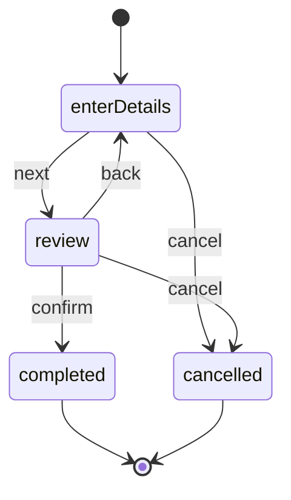
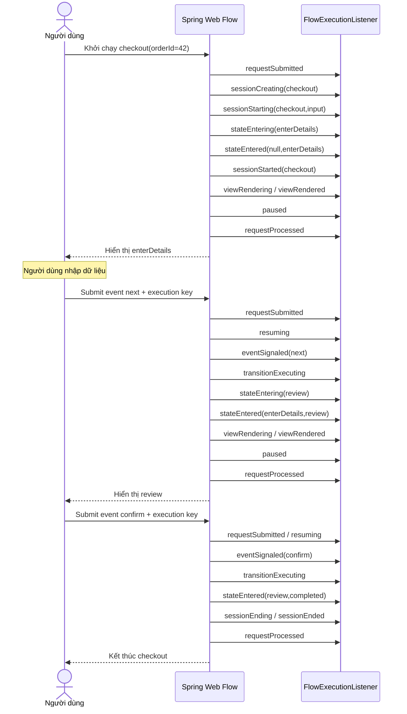

# Theo dõi khởi tạo, chuyển state, tạm dừng và tiếp tục

## 1. Vì sao cần quan sát vòng đời của flow?

Trong **Spring Web Flow (SWF)**, một hành trình web có thể bắt đầu ở form, đi qua nhiều `state`, phản ứng với `event`, thực thi `transition`, gọi `subflow` rồi kết thúc sau nhiều HTTP request. Khi người dùng nói “tôi bấm Tiếp tục nhưng vẫn ở màn hình cũ”, chỉ xem access log của Spring MVC thường không đủ để biết vì sao.

Muốn điều tra, ứng dụng cần trả lời những câu hỏi như:

- Flow nào và **flow session** nào đã được khởi tạo?
- Sự kiện `next` có thật sự được báo cho engine không?
- Engine có khớp transition nào và **đã vào state mới** hay chưa?
- Flow đang dừng chờ người dùng hay đã kết thúc?
- Request tiếp theo có khôi phục và **tiếp tục execution** thành công?
- Khi có subflow, callback liên quan flow cha hay flow con?

Spring Web Flow cung cấp **`FlowExecutionListener`** để quan sát các mốc này. Một listener có thể ghi log, phát metric, tạo tracing span hoặc hỗ trợ tích hợp hạ tầng. Nó có thể nhận thông báo khi session được tạo, event được báo, transition được chọn, state thay đổi, view được render, execution tạm dừng và tiếp tục.

**Mục tiêu bài học:** đọc đúng từng callback, xây một listener quan sát hữu ích và giải thích thứ tự sự kiện trong hành trình nhiều bước mà không trộn lẫn với logic nghiệp vụ hay thay đổi flow một cách khó kiểm soát.

## 2. Phân biệt definition, execution, session và request

Trước khi đọc log callback, phải phân biệt các đối tượng runtime:

| Khái niệm | Ý nghĩa | Một hành trình checkout |
|---|---|---|
| `FlowDefinition` | Bản thiết kế state/event/transition dùng chung | Definition ID `checkout` |
| `FlowExecution` | Một lượt thực thi hành trình | Khách hàng A đang checkout |
| `FlowSession` | Một lượt đi vào flow gốc hoặc subflow trong execution | `checkout` session, sau đó `payment` session |
| `RequestContext` | Ngữ cảnh của **một lượt gọi** vào engine | Request xử lý nút Next |
| `FlowExecutionRepository` | Cơ chế lưu/khôi phục execution theo key | Khôi phục checkout đang ở bước review |

Một **definition** có thể tạo nhiều **execution**. Một execution có thể có nhiều **flow session** khi đi vào subflow. Và một execution có thể trải qua nhiều **request** vì người dùng rời trình duyệt rồi gửi form ở bước sau.

Điều đó giải thích tại sao:

- `sessionStarting` không nhất thiết chỉ chạy một lần trong toàn bộ execution: mỗi lần bắt đầu **subflow session** cũng có các mốc tương ứng.
- `paused` và `resuming` mô tả **trạng thái thực thi** giữa các lượt xử lý, không phải “người dùng bị ngắt kết nối”.
- `requestSubmitted`/`requestProcessed` mô tả một lượt truy cập engine, không tương đương tuyệt đối với từng Servlet filter invocation.
- `stateEntered` cho biết state đã đổi; một `eventSignaled` đơn thuần **chưa chứng minh** transition đã xảy ra.

> Theo API, `RequestContext` là ngữ cảnh của một lượt gọi vào Web Flow, không đồng nhất hoàn toàn với `HttpServletRequest`. Ở tích hợp Spring MVC phổ biến, các lượt đó thường đến từ HTTP, nhưng listener nên ưu tiên API Web Flow thay vì ép buộc mọi nguồn gọi đều là Servlet.

## 3. Bản đồ callback cần nắm

Các callback của `org.springframework.webflow.execution.FlowExecutionListener` có thể phân thành những nhóm sau.

| Nhóm | Callback | Thời điểm và mục đích |
|---|---|---|
| Nhận lượt gọi | `requestSubmitted(context)` | Trước khi engine xử lý một yêu cầu thao tác execution |
| Chuẩn bị session | `sessionCreating(context, definition)` | Trước khi tạo session cho một flow definition; có thể từ chối khởi tạo |
| Bắt đầu session | `sessionStarting(context, session, input)` | Session đã được tạo nhưng chưa bắt đầu; input map vẫn có thể được bổ sung |
| Đã bắt đầu session | `sessionStarted(context, session)` | Startup và state khởi đầu của session đã được thực hiện |
| Sự kiện | `eventSignaled(context, event)` | Event đã được báo, trước bước chuyển state |
| Chọn chuyển trạng thái | `transitionExecuting(context, transition)` | Transition đã khớp nhưng chưa thực hiện xong |
| Sắp vào state | `stateEntering(context, state)` | Trước khi state mới được vào; có thể có veto |
| Đã vào state | `stateEntered(context, previousState, newState)` | Sau khi chuyển sang state mới |
| Render view | `viewRendering(context, view, viewState)` | Trước render và các render action liên quan |
| Render xong | `viewRendered(context, view, viewState)` | Sau khi view hoàn tất render |
| Tạm dừng | `paused(context)` | Execution ngừng xử lý hiện tại và chờ đầu vào tiếp theo |
| Tiếp tục | `resuming(context)` | Execution được kích hoạt lại thành công, trước khi xử lý event |
| Kết thúc session | `sessionEnding(...)`, `sessionEnded(...)` | Trước và sau khi flow session kết thúc |
| Xử lý xong lượt gọi | `requestProcessed(context)` | Sau khi xử lý xong yêu cầu |
| Ngoại lệ | `exceptionThrown(context, exception)` | Khi exception phát sinh, trước các exception handler đã đăng ký |

Đây là các **điểm quan sát**, không phải danh sách các phương thức đều được gọi một lần cho mọi HTTP request. Chẳng hạn: flow không có subflow chỉ có session gốc; event không khớp transition có thể không tạo `stateEntered`; flow kết thúc ngay trong action có thể không đi qua một lượt pause nữa.

Với ứng dụng dùng nhánh Web Flow 2.x, `FlowExecutionListenerAdapter` là lớp tiện ích cung cấp các phương thức rỗng để chỉ override callback cần thiết. Ở những bản Web Flow mới hơn có default methods trên interface, có thể triển khai `FlowExecutionListener` trực tiếp. **Chọn theo version thực tế của dự án**, không trộn API giữa các phiên bản.

## 4. Khởi tạo: sessionCreating, sessionStarting và sessionStarted

### 4.1. Trước khi session tồn tại: sessionCreating

Chữ ký:

```java
void sessionCreating(RequestContext context, FlowDefinition definition);
```

Thời điểm này engine chuẩn bị tạo một `FlowSession` dựa trên `FlowDefinition`. Listener biết **định nghĩa sắp chạy**, ví dụ `checkout` hoặc `payment` nếu chuẩn bị gọi subflow.

Cần nhớ:

- Chưa có session vừa được tạo để hỏi state hiện tại.
- Đây là mốc hợp lý để đếm số session được yêu cầu khởi tạo hoặc kiểm tra điều kiện hạ tầng theo thiết kế.
- API cho phép ném runtime exception để **veto** việc bắt đầu; không dùng cơ chế này tùy tiện cho mọi rule nghiệp vụ.
- Không nên đọc `context.getCurrentState().getId()` ở mốc này: start state có thể chưa được vào, và `getCurrentState()` có thể là `null`.

### 4.2. Sau khi tạo, trước khi chạy: sessionStarting

Chữ ký:

```java
void sessionStarting(
    RequestContext context,
    FlowSession session,
    MutableAttributeMap<?> input);
```

Đây là mốc session đã tồn tại nhưng **chưa start**. Đối số `input` là bản đồ dữ liệu đầu vào có thể sửa; những attribute listener thêm vào đây có thể được xem xét khi engine thực hiện **input mapping** cho flow.

Ví dụ, một listener hạ tầng có thể bổ sung một correlation token **không bí mật** khi contract của flow cho phép. Nhưng nếu cần `orderId`, `customerId` hoặc dữ liệu ràng buộc quyền, tốt hơn vẫn là thiết kế input chính thức và kiểm tra ở service. Không nên âm thầm tạo dữ liệu nghiệp vụ quan trọng trong listener chỉ vì nó chạy trước `on-start`.

Không nhầm `input` của callback với HTTP request parameters; input map có thể đến từ `FlowExecutor.launchExecution`, Spring MVC adapter hoặc flow cha khi gọi subflow.

### 4.3. Sau khi flow session bắt đầu: sessionStarted

Chữ ký:

```java
void sessionStarted(RequestContext context, FlowSession session);
```

Theo contract của API, callback xảy ra khi startup hoàn thành: start state đã được vào và các startup behavior đã được chạy. Đây là điểm quan sát phù hợp để xác nhận flow session thực sự bắt đầu thành công.

Ví dụ:

```text
sessionCreating(checkout)
sessionStarting(checkout, input)
  -> input mapping / on-start / enter start-state
sessionStarted(checkout)
```

Mô hình trên chỉ nêu **các mốc chính**. Trong quá trình vào start state, các callback `stateEntering`/`stateEntered` hoặc action/render khác có thể xuất hiện xen giữa. Không nên viết một unit test phụ thuộc vào một trace tuyến tính duy nhất nếu phiên bản/cấu hình có hook bổ sung.

### 4.4. Với subflow, callback khởi tạo có thể lặp

Nếu `checkout` gọi `payment` qua `subflow-state`, engine bắt đầu một flow session **payment** trong cùng flow execution. Listener được gắn vào execution có thể thấy các callback khởi tạo của **flow session con**, chứ không chỉ của root checkout.

Vì vậy, khi đếm metric:

- `session_started_total` là **số session** (có thể gồm subflow), không phải số execution mới.
- `execution_started_total` nên được xác định riêng ở biên khởi chạy root flow, hoặc đếm session khởi đầu với điều kiện root rõ ràng nếu contract cho phép.
- Đừng báo cáo “checkout được khởi chạy ba lần” chỉ vì một execution checkout đi qua ba subflow session.

## 5. Event, transition và thay đổi state

Ba callback thường được dùng để đọc đường đi thật:

```text
eventSignaled(event)
    └─ transitionExecuting(transition)   [nếu có transition khớp]
           └─ stateEntering(next)        [khi chuẩn bị vào state mới]
                  └─ stateEntered(prev, next)
```

Hãy xem đây là **quan hệ thứ tự mang tính khái niệm**, không bảo đảm mọi callback đều xuất hiện trong mọi tình huống: transition nội bộ, điều kiện chặn, exception hoặc nested action có thể làm trace phức tạp hơn.

### 5.1. eventSignaled — sự kiện đã được phát

```java
void eventSignaled(RequestContext context, Event event);
```

Hữu ích để ghi **ID** của event (ví dụ `next`, `back`, `cancel`) và metadata an toàn. Bên phát có thể là HTML form, action Java hoặc outcome của flow con.

**Đừng suy ra đã đổi state** chỉ từ callback này. Event có thể không khớp transition, bị điều kiện từ chối hoặc gặp exception trong quá trình xử lý. Không log toàn bộ `event.getAttributes()`: payload có thể chứa dữ liệu người dùng, tài liệu hoặc token.

### 5.2. transitionExecuting — đã chọn được transition

```java
void transitionExecuting(
    RequestContext context,
    TransitionDefinition transition);
```

Callback này chạy **khi transition đã match** nhưng trước khi chuyển đổi hoàn tất. Nó giúp phân biệt sự cố “event không được báo” và “event được báo nhưng chưa chọn được transition”.

Bản thân `transitionExecuting` **không chứng minh** state mới đã được vào: một action của transition hoặc một veto có thể làm quá trình bị dừng. Nếu muốn xác nhận đường đi, phải kết hợp với `stateEntered`.

### 5.3. stateEntering — sắp vào state

```java
void stateEntering(
    RequestContext context,
    StateDefinition state);
```

`state.getId()` là state dự kiến vào. Callback có thể xuất hiện lúc khởi tạo start state cũng như lúc chuyển sang state khác. API cho phép ném `EnterStateVetoException` khi phải chặn việc vào state. Tuy nhiên, việc veto có thể thay đổi sâu hành vi flow; các rule nghiệp vụ thông thường nên nằm trong action, transition criterion hoặc service.

### 5.4. stateEntered — đã vào state mới

```java
void stateEntered(
    RequestContext context,
    StateDefinition previousState,
    StateDefinition newState);
```

Đây là callback thích hợp để ghi **from-state → to-state** hoặc increment `state_entered_total`. Khi flow vừa bắt đầu, `previousState` có thể không tồn tại; code phải chấp nhận `null`.

Khi đo `stateEntered`, chỉ dựa vào `newState.getId()` nếu đối số có giá trị; không dùng `context.getCurrentState()` để đoán “state cũ” vì context có thể đã chuyển sang state mới.

### 5.5. Trường hợp transition lỗi

Một chuỗi callback có thể như sau:

```text
eventSignaled(next)
transitionExecuting(next -> review)
stateEntering(review)
exceptionThrown(...)
# không có stateEntered(review) thành công
```

Đừng ghi metric “đã vào review” ở `stateEntering`. Cần ghi đúng định nghĩa đo lường: **attempted state entry** khác với **successful state entry**.

## 6. Tạm dừng và tiếp tục: paused, resuming

### 6.1. paused không phải “thread đang ngủ”

```java
void paused(RequestContext context);
```

Một execution được **paused** khi engine đã xử lý tới điểm tạm dừng, thường là một `view-state` đang chờ người dùng gửi event mới. Nó có thể được lưu hoặc snapshot theo cấu hình `FlowExecutionRepository`.

Điều này **không có nghĩa** Web Flow giữ một Java thread ngủ để đợi người dùng. HTTP response đã được trả hoặc đang hoàn tất, và lần tương tác sau sẽ đi qua một request khác. Flow execution phải có đủ state để **resume** đúng hành trình, nhưng không cần chiếm một thread suốt vài phút người dùng đọc form.

Điều kiện thường gặp:

- Vừa khởi chạy flow và render `enterDetails` → execution tạm dừng tại view.
- Người dùng Submit dữ liệu chưa hợp lệ, view được render lại → execution vẫn chờ event tiếp theo.
- Người dùng chuyển tới `review` và được render view → execution lại tạm dừng.
- Flow đi thẳng đến end-state của **root flow** → execution kết thúc, không chờ resume nữa.

Không suy ra luôn có đúng một lần `paused` cho từng `viewRendered`. Việc render lại, refresh hoặc tình huống exception làm số lần callback phụ thuộc đường thực thi.

### 6.2. resuming báo khôi phục thành công trước khi xử lý event

```java
void resuming(RequestContext context);
```

Contract mô tả callback này xảy ra **sau khi một execution đang paused được kích hoạt lại thành công và trước event processing**. Điều đó giúp chẩn đoán việc tiếp tục:

- Có `resuming` và sau đó `eventSignaled(next)`: execution đã được tiếp tục và đang xử lý event.
- Không có `resuming` dù browser gửi continuation key: có thể request chưa đi đến flow, key không hợp lệ hoặc repository không thể khôi phục; cần xem log của adapter/repository.
- Có `resuming` nhưng không có `stateEntered`: có thể event không match, validation giữ lại view hoặc exception xảy ra.

**`resuming` không xuất hiện ở lần launch mới** chỉ để cho biết flow vừa bắt đầu. Launch là khởi tạo execution, còn resume là tiếp tục một execution đã paused.

### 6.3. Thời gian chờ người dùng khác thời gian xử lý server

Nếu người dùng rời màn hình `shipping` trong 5 phút rồi bấm `next`, thời gian từ `paused` đến `resuming` chủ yếu là **thời gian người dùng chờ/thao tác**, không phải latency của server.

Do đó cần phân biệt:

| Chỉ số | Mốc có thể lấy | Cách hiểu |
|---|---|---|
| Thời gian xử lý một lần gọi vào flow | `requestSubmitted` → `requestProcessed` | Thời gian thực thi engine theo lượt gọi, có thể chưa bao gồm mọi thành phần HTTP |
| Thời gian chờ giữa hai tương tác | `paused` → `resuming` | Thời gian “nghĩ” của người dùng cộng network/session delay |
| Thời gian tới một state | Từ event/start có định nghĩa đến `stateEntered` | Phụ thuộc có action, validation, subflow |
| Thời gian render view | `viewRendering` → `viewRendered` | Chỉ phần render liên quan Web Flow, không phải toàn bộ tải trang trên browser |
| Thời gian hoàn tất hành trình | Root start → root end | Bao gồm nhiều lần người dùng chờ |

Nếu có cảnh báo latency server, không nên dùng đơn thuần `paused → resuming` vì con số này dễ tăng cao khi người dùng đặt tab ở nền mà **server hoàn toàn rảnh**.

## 7. Ví dụ flow dùng để theo dõi lifecycle

Một flow đặt hàng tối giản có ba view-state và hai end-state:

```xml
<?xml version="1.0" encoding="UTF-8"?>
<flow xmlns="http://www.springframework.org/schema/webflow"
      xmlns:xsi="http://www.w3.org/2001/XMLSchema-instance"
      xsi:schemaLocation="
          http://www.springframework.org/schema/webflow
          http://www.springframework.org/schema/webflow/spring-webflow.xsd"
      start-state="enterDetails">

    <input name="orderId" type="long" required="true" />

    <view-state id="enterDetails">
        <transition on="next" to="review" />
        <transition on="cancel" to="cancelled" />
    </view-state>

    <view-state id="review">
        <transition on="back" to="enterDetails" />
        <transition on="confirm" to="completed" />
        <transition on="cancel" to="cancelled" />
    </view-state>

    <end-state id="completed" />
    <end-state id="cancelled" />
</flow>
```

Đây là skeleton để học về event và listener. Cần cấu hình view resolver/template cho `enterDetails`/`review`, đồng thời đặt validation và action nghiệp vụ trước khi thực sự xác nhận đơn hàng. Không sử dụng flow trên nguyên trạng để thực hiện thanh toán.

Sơ đồ:



## 8. Một listener Java quan sát các mốc chính

Ví dụ dưới đây sử dụng API kiểu Web Flow 2.5.x, kế thừa `FlowExecutionListenerAdapter` để chỉ override callback cần dùng. Chú trọng **log metadata không nhạy cảm**, không ghi form contents, không gọi service để sửa state và không lưu thông tin theo người dùng trong field của bean singleton.

```java
package com.example.checkout.observability;

import org.slf4j.Logger;
import org.slf4j.LoggerFactory;
import org.springframework.webflow.core.collection.AttributeMap;
import org.springframework.webflow.definition.FlowDefinition;
import org.springframework.webflow.definition.StateDefinition;
import org.springframework.webflow.definition.TransitionDefinition;
import org.springframework.webflow.execution.Event;
import org.springframework.webflow.execution.FlowExecutionListenerAdapter;
import org.springframework.webflow.execution.FlowSession;
import org.springframework.webflow.execution.RequestContext;

public final class CheckoutLifecycleListener
        extends FlowExecutionListenerAdapter {

    private static final Logger log =
            LoggerFactory.getLogger(CheckoutLifecycleListener.class);

    private static final String START_NANOS = "listener.startNanos";

    @Override
    public void requestSubmitted(RequestContext context) {
        // requestScope gắn với lượt xử lý, không dùng field singleton.
        context.getRequestScope().put(START_NANOS, System.nanoTime());
        log.debug("flow request submitted");
    }

    @Override
    public void sessionCreating(
            RequestContext context, FlowDefinition definition) {
        log.info("flow session creating: flow={}", definition.getId());
    }

    @Override
    public void sessionStarted(
            RequestContext context, FlowSession session) {
        log.info("flow session started: flow={}",
                session.getDefinition().getId());
    }

    @Override
    public void eventSignaled(RequestContext context, Event event) {
        // Chỉ log ID, không log event.getAttributes().
        log.debug("flow event signaled: event={}", event.getId());
    }

    @Override
    public void transitionExecuting(
            RequestContext context, TransitionDefinition transition) {
        log.debug("flow transition matched");
    }

    @Override
    public void stateEntered(
            RequestContext context,
            StateDefinition previousState,
            StateDefinition newState) {

        String from = previousState == null
                ? "<start>" : previousState.getId();

        log.info("flow state entered: from={}, to={}",
                from, newState.getId());
    }

    @Override
    public void paused(RequestContext context) {
        log.debug("flow execution paused");
    }

    @Override
    public void resuming(RequestContext context) {
        log.debug("flow execution resuming");
    }

    @Override
    public void sessionEnded(
            RequestContext context,
            FlowSession session,
            String outcome,
            AttributeMap<?> output) {

        log.info("flow session ended: flow={}, outcome={}",
                session.getDefinition().getId(), outcome);
    }

    @Override
    public void requestProcessed(RequestContext context) {
        Object value = context.getRequestScope().get(START_NANOS);
        if (value instanceof Long) {
            long elapsedNanos = System.nanoTime() - (Long) value;
            log.debug("flow request processed: elapsedMs={}",
                    elapsedNanos / 1_000_000.0);
        }
    }
}
```

### 8.1. Giải thích một số quyết định trong mã

- **Không có mutable instance field cho execution:** listener có thể phục vụ nhiều người dùng và nhiều execution. Thời điểm bắt đầu request được lưu vào `requestScope` của đúng `RequestContext`.
- **Dùng `System.nanoTime()` để đo khoảng thời gian:** clock này phù hợp để lấy chênh lệch thời gian trong cùng một lượt xử lý, không dùng làm wall-clock timestamp để audit.
- **`stateEntered` dùng tham số được truyền:** callback cho biết state đã được vào; `previousState` có thể là null ở bước đầu.
- **Không ghi `event.getAttributes()`:** một Event có thể chứa dữ liệu riêng tư hoặc graph lớn.
- **`sessionEnded` không luôn đồng nghĩa root execution kết thúc:** flow con cũng có thể kết thúc và trả kết quả về cha; để biết chắc đó là root session, có thể kiểm tra `session.isRoot()` theo API.
- **`requestProcessed` là điểm kết thúc xử lý flow request thông thường:** đường thất bại đột ngột hoặc exception ở tầng ngoài có thể yêu cầu quan sát bổ sung tại MVC filter/metrics instrumentation.

Trong mã trên, `transition` được nhận nhưng không biến thành log toàn bộ metadata vì có thể khiến log quá ồn. Nếu cần biết transition nào được chọn, có thể thêm thông tin được whitelist từ definition hoặc state/event đang xử lý, không nhất thiết serialize mọi expression của transition.

### 8.2. Nếu cần thêm mốc trước state

Có thể override `stateEntering`:

```java
@Override
public void stateEntering(RequestContext context, StateDefinition state) {
    log.debug("flow state entering: state={}", state.getId());
}
```

Điều này giúp đo tỷ lệ **attempted entry** so với **successful entry** (`stateEntered`). Tuy nhiên, tránh để callback này mutate state hoặc ném veto nếu mục đích chỉ là quan sát.

## 9. Đăng ký listener với FlowExecutor

Listener Java là một bean bình thường; nó chỉ nhận callback khi được gắn vào FlowExecutor/FlowExecutionListenerLoader mà ứng dụng thực sự sử dụng.

Ví dụ XML Spring config với namespace Web Flow:

```xml
<bean id="checkoutLifecycleListener"
      class="com.example.checkout.observability.CheckoutLifecycleListener" />

<webflow:flow-executor id="flowExecutor"
                       flow-registry="flowRegistry">
    <webflow:flow-execution-listeners>
        <webflow:listener ref="checkoutLifecycleListener"
                          criteria="checkout" />
    </webflow:flow-execution-listeners>
</webflow:flow-executor>
```

Trong đó:

- `ref` trỏ đến **Spring bean** listener đã đăng ký.
- `criteria="checkout"` giới hạn listener theo flow ID mong muốn. Khi cần nhiều flow, danh sách có thể phân tách bằng dấu phẩy, ví dụ `criteria="checkout,registration"`.
- Nếu bỏ `criteria`, listener có thể áp dụng cho mọi flow mà executor quản lý theo cấu hình.
- `flowRegistry` và các namespace/schema trong file config Spring phải được thiết lập đúng; đoạn trích giả định các phần khác đã có.

Với Java configuration theo cách `AbstractFlowConfiguration` của nhánh SWF 2.x:

```java
@Bean
public FlowExecutor flowExecutor() {
    return getFlowExecutorBuilder(flowRegistry())
            .addFlowExecutionListener(checkoutLifecycleListener(), "checkout")
            .build();
}

@Bean
public CheckoutLifecycleListener checkoutLifecycleListener() {
    return new CheckoutLifecycleListener();
}
```

Đây là **đoạn trích** bên trong lớp cấu hình có `flowRegistry()` và `@Bean` đã được định nghĩa; cần thêm imports tương ứng khi dùng thực tế. Các biến thể cấu hình mới hơn có thể khác cú pháp, nên kiểm tra tài liệu của phiên bản đang chạy.

**Lưu ý với subflow:** criteria được dùng để xác định listener có áp dụng cho execution của **flow được chọn** hay không. Khi một listener đã được gắn vào execution checkout, callback session của `payment` subflow vẫn có thể được quan sát trong cùng execution. Nếu metric cần phân biệt root và active subflow, dựa vào `session.getDefinition().getId()`/`session.isRoot()`, không chỉ tên criteria.

## 10. Dòng thời gian khởi chạy → pause → resume → end

Giả sử người dùng mở `checkout?orderId=42`, xem `enterDetails`, nhấn `next` để vào `review`, rồi nhấn `confirm`.



**Sơ đồ là tuyến quan sát đơn giản hóa, không phải thứ tự callback tuyệt đối cho mọi flow engine/config.** Thời điểm `viewRendering`, `paused`, khởi tạo key, render lại form sau validation và xử lý exception có thể làm chuỗi chi tiết khác nhau. Đặc biệt, callback `sessionStarted` được đảm bảo sau startup đã chạy, nhưng các action/state callbacks có thể xen kẽ trong quá trình đó.

Nếu trong `review` người dùng nhấn Back, execution sẽ được tiếp tục thêm một lần và có thể vào lại `enterDetails`. Điều này **không khởi tạo lại root flow session**: `sessionCreating(checkout)` không phải callback xuất hiện chỉ vì chuyển state `review → enterDetails`.

## 11. Phân biệt pause, refresh, expired execution và lỗi

### 11.1. Refresh không luôn là resume có event mới

Người dùng F5 ở màn hình hiện tại có thể yêu cầu render lại view hoặc đi qua luồng khôi phục tùy cấu hình MVC/repository. Đừng mặc định mỗi refresh có `eventSignaled`, `transitionExecuting` hoặc `stateEntered`. Hãy kiểm tra đường đi thực tế và dùng `viewRendering`/`viewRendered` nếu cần quan sát render.

### 11.2. Execution key cũ hoặc session hết hạn

Khi key không còn được repository nhận diện, ứng dụng có thể báo lỗi expired/stale execution **trước khi có đối tượng execution được resume thành công**. Do đó, listener có thể **không thấy `resuming`** cho request thất bại này.

Muốn đo số lần tiếp tục thất bại do key/snapshot/session, kết hợp log của `FlowHandlerAdapter`, `FlowExecutionRepository` hoặc handler điều hướng lỗi ở tầng MVC. Không dựa vào listener đơn độc để khẳng định mọi request đều đã đi tới flow engine.

### 11.3. Validation failure và quay lại cùng view

Một Submit bị Bean Validation chặn có thể khiến view-state render lại, không chuyển sang state mới. Ta có thể thấy `requestSubmitted`, `resuming` và event-related callbacks tùy đường xử lý, nhưng **không có `stateEntered` sang state đích**. Hãy quan sát `messageContext` ở đúng tầng hoặc đo số validation errors một cách an toàn, không log các field bí mật.

### 11.4. Exception trong state/action

Callback `exceptionThrown(context, exception)` thông báo exception trong execution trước khi các handler tương ứng xử lý. Nó **không thay thế** exception handler và không nên nuốt exception để cho user thấy “đã hoàn tất”.

Sơ đồ diễn giải:

```text
eventSignaled(confirm)
  -> transitionExecuting
  -> action throws exception
  -> exceptionThrown
  -> exception handler / recovery (nếu cấu hình)
  -> kết quả có thể là ở lại view, vào state lỗi,
     hoặc trả lỗi lên tầng tích hợp
```

Khi listener phát metric, đếm **exception occurrence** riêng với **failed request**; một exception được handler phục hồi thành công chưa chắc làm cả request thất bại.

## 12. Thiết kế metric và log không làm nặng execution

### 12.1. Tên chỉ số nên có ý nghĩa rõ

Có thể dùng một nhóm tên ví dụ (không phải metric được SWF phát sẵn):

| Metric đề xuất | Callback nguồn | Ý nghĩa / cảnh báo |
|---|---|---|
| `flow_session_started_total` | `sessionStarted` | Đếm cả root và subflow session nếu không lọc |
| `flow_event_signaled_total` | `eventSignaled` | Event đã báo, không bảo đảm có transition |
| `flow_transition_matched_total` | `transitionExecuting` | Transition được chọn, chưa chắc hoàn tất |
| `flow_state_entered_total` | `stateEntered` | Số lần thực sự vào state |
| `flow_pause_total` | `paused` | Số lần execution chuyển sang paused |
| `flow_resume_total` | `resuming` | Số lần resume thành công |
| `flow_session_ended_total` | `sessionEnded` | Có thể đếm riêng root/subflow |
| `flow_request_duration_seconds` | `requestSubmitted/requestProcessed` | Latency thao tác flow phía server |
| `flow_execution_exception_total` | `exceptionThrown` | Lỗi quan sát trong engine, kể cả đã recovery |

Nếu `flow_resume_total` thấp hơn số người dùng nhấn Submit, chưa chắc hệ thống lỗi. Cần phân biệt submit request trùng, flow đã kết thúc, key stale, form bị chặn ở tầng HTTP, và request chưa đến Web Flow.

### 12.2. Cardinality, dữ liệu nhạy cảm và độ bền

Chỉ nên đưa vào metric labels những giá trị có tập hữu hạn và kiểm soát được, như `flowId`, `stateId`, `eventId` được whitelist, `outcome`, `success/failure`. Không đưa `orderId`, email, raw execution key hay nội dung form vào label.

Các nguyên tắc quan trọng:

1. Listener chạy trên đường xử lý flow, vì vậy callback nên **nhanh và ít side effect**.
2. Không gọi API mạng chậm hoặc ghi database đồng bộ trong mỗi `stateEntered` để phục vụ log thông thường.
3. Không lưu `RequestContext`, `FlowSession` hoặc object graph chứa người dùng vào field của singleton listener.
4. Nếu emit telemetry bất đồng bộ, hãy copy **metadata đã lọc** thành cấu trúc riêng; không đẩy nguyên `RequestContext` sang thread khác.
5. Khi repository lưu snapshot, đừng làm phình `flowScope`/`conversationScope` chỉ để chứa counters; dùng metrics backend cho các số đo không cần tham gia nghiệp vụ.
6. Trong môi trường có Spring Security, kiểm tra quyền tại service/flow guard; listener audit không thay thế authorization.

### 12.3. Phân biệt root flow ID và active flow ID

`context.getFlowExecutionContext().getDefinition()` trả về **root definition**, kể cả khi execution đang chạy subflow. Trong khi đó `context.getActiveFlow()` hoặc `session.getDefinition()` chỉ **flow hiện đang hoạt động** theo từng mốc.

Khi thống kê:

- `rootFlow=checkout, activeFlow=payment` có nghĩa checkout đang ở subflow payment.
- Nếu chỉ dùng root flow ID, có thể hiểu sai callback `sessionStarted(payment)` là checkout khởi chạy lại.
- Nếu chỉ dùng active flow ID, có thể mất bối cảnh hành trình gốc.

Ở một số mốc khởi tạo/kết thúc, execution chưa có active session hoặc đã kết thúc; `getActiveFlow()`/`getActiveSession()` có thể ném `IllegalStateException`. Hãy dùng tham số `FlowDefinition`/`FlowSession` được callback cung cấp, hoặc kiểm tra `isActive()` trước khi đọc active flow.

## 13. Kiểm thử listener theo hành trình thực tế

Hãy chạy flow `enterDetails → review → completed` ở phần 7 với listener đã đăng ký và ghi nhận các mốc.

| Kịch bản | Các callback kỳ vọng về mặt ngữ nghĩa | Điều cần xác minh |
|---|---|---|
| Khởi chạy checkout | Nhóm session create/start; vào start state; pause ở view | Chỉ tạo **một root session** |
| Nhấn Next hợp lệ | Resume, báo `next`, chọn transition, vào `review` rồi pause | State vào đúng; không tạo root session mới |
| Nhấn Back | Resume, báo `back`, vào `enterDetails` | Back là transition của execution hiện tại |
| Confirm | Resume, event/transition, root session end | Execution kết thúc; không pause để chờ input tiếp |
| Hủy từ view | Event `cancel`, session kết thúc ở `cancelled` | Outcome đúng; không ghi nhầm thành `completed` |
| Event không có transition | Có thể có `eventSignaled`, không có transition đến state mong muốn | Không đếm state entered giả |
| Submit sai validation | Có thể render lại view, không vào state mới | Không coi user vẫn ở view là resume thất bại |
| Gọi subflow payment | Thêm nhóm session callbacks cho payment | Phân biệt root session và session con |
| Subflow kết thúc | `sessionEnded(payment,...)` | Root checkout có thể tiếp tục |
| Refresh view | Render/refresh theo tích hợp, không nhất thiết có event mới | Không cộng transition giả |
| Execution key cũ/hết hạn | Request có thể không tới `resuming` | Quan sát thêm repository/MVC error handling |
| Exception ở action | `exceptionThrown` trước handler | Metric phân biệt exception với recovery |

Có thể dùng bộ `spring-webflow-test` để thực hiện event và kiểm tra state hoặc viết kiểm thử tích hợp với FlowExecutor. Đừng chỉ test bằng việc tìm chuỗi `stateEntered` trong source code: kiểm thử cần khởi chạy execution thật hoặc mock callback với các `RequestContext`/`FlowSession` hợp lệ.

### 13.1. Trường hợp cần kiểm thử kỹ

**Hai tab:** nếu mở hai flow execution độc lập, listener có thể phục vụ cả hai đồng thời. Không dùng field như `String currentState` trong singleton listener để giữ state của “người dùng hiện tại”.

**Double submit:** browser gửi hai request gần nhau; kết quả có thể chịu ràng buộc locking/version/continuation của repository. Không coi listener là lớp chống gửi lặp; dùng idempotency ở service và kiểm thử race condition.

**Flow có nhiều action-state liên tiếp:** một lần request có thể kích hoạt nhiều event nội bộ và chuyển nhiều state trước khi pause. Đừng suy “một request = một event” hoặc “một pause = một state đã vào”.

**Rolling deploy:** khi definition và object trong flowScope thay đổi giữa lúc execution cũ đang paused, resume có thể lỗi ở repository hoặc khi vào state. Listener chỉ quan sát các execution khôi phục thành công; vẫn phải theo dõi lỗi hạ tầng.

## 14. Các lỗi triển khai thường gặp

**Lỗi 1 — Không thấy callback dù bean đã tồn tại.** Chưa gắn bean vào đúng `flow-executor`, đăng ký sai `ref`, hoặc `criteria` không khớp flow ID. Kiểm tra FlowExecutor thực tế do Spring MVC dùng.

**Lỗi 2 — Nhầm `sessionStarted` với một HTTP request mới.** Session của flow tồn tại xuyên nhiều request và subflow có session riêng. Đếm request bằng request callbacks, đếm flow session bằng session callbacks.

**Lỗi 3 — Đếm state thành công ở `stateEntering`.** Đây mới là attempt trước chuyển state. Dùng `stateEntered` để xác nhận bước vào state.

**Lỗi 4 — Đếm `eventSignaled` như transition thành công.** Event có thể không khớp hoặc bị veto/exception. Ghép dữ liệu `transitionExecuting`, `stateEntered` và error handling.

**Lỗi 5 — Dùng thời gian `paused → resuming` làm latency server.** Nó gồm thời gian người dùng đọc/nhập liệu. Đo latency server ở các mốc xử lý request và tầng HTTP/DB tương ứng.

**Lỗi 6 — Cố đọc current state khi chưa có hoặc đã kết thúc execution.** `getCurrentState()` có thể null ở startup; đọc `getActiveFlow()` khi inactive có thể lỗi. Dùng tham số callback hoặc kiểm tra trạng thái trước.

**Lỗi 7 — Ghi toàn bộ Event attributes hoặc flowScope vào log.** Có thể rò rỉ thông tin cá nhân, mật khẩu hoặc dữ liệu thanh toán, đồng thời tăng dung lượng log và serialization.

**Lỗi 8 — Chặn flow để “đo” ở listener.** Exception/veto từ callback có thể phá hành trình. Với observability, ưu tiên listener không tác động nghiệp vụ; áp đặt rule trong action/service.

**Lỗi 9 — Nghĩ paused tương đương kết thúc flow.** Paused là trạng thái chờ tiếp tục; kết thúc root flow cần quan sát session end/outcome.

**Lỗi 10 — Nghĩ listener luôn thấy request expired.** Nếu key bị từ chối trước khi resume thành công, callback `resuming` có thể không chạy. Cần có log/metric bổ sung ở biên MVC/repository.

## 15. Bài tập: thiết kế dashboard theo dõi Web Flow

Bạn có ba flow definition:

- `registration`: `enterAccount → verifyEmail → completed`.
- `checkout`: `cart → shipping → review → completed`.
- `payment`: subflow được checkout gọi ở bước xác nhận.

Hãy thiết kế dashboard chỉ dùng dữ liệu từ listener và hạ tầng quan sát bổ sung.

### Yêu cầu

1. Đếm số session bắt đầu, phân biệt `root` và `subflow`.
2. Vẽ biểu đồ event `next`/`back`/`cancel` theo flow ID.
3. Đếm số lần `review` thực sự được vào.
4. Đo thời gian xử lý một lượt thao tác và thời gian user chờ giữa các bước như **hai nhóm số liệu riêng**.
5. Thống kê `completed`/`cancelled`/`failed` bằng outcome của root session, không tính kết quả `payment` thành checkout hoàn tất.
6. Ghi số trường hợp expired/stale key từ MVC/repository vì listener không nhất thiết thấy được lỗi này.
7. Không lưu email, mã đơn hàng hoặc raw execution key trong metric labels.

### Gợi ý thiết kế

```text
sessionStarted(root)        -> root_flow_session_started_total
sessionStarted(subflow)     -> subflow_session_started_total
eventSignaled               -> flow_event_signaled_total{flow,event}
stateEntered                -> flow_state_entered_total{flow,state}
paused                      -> flow_pause_total{rootFlow}
resuming                    -> flow_resume_total{rootFlow}
sessionEnded(root,outcome)  -> root_flow_completed_total{flow,outcome}
exceptionThrown             -> flow_exception_seen_total{flow,type}
MVC/repository error hook   -> flow_continuation_failure_total{reason}
```

Dữ liệu `type`/`reason` cần đưa về tập giá trị giới hạn, không sử dụng nguyên nội dung exception message làm label.

**Tiêu chí hoàn thành:** dashboard mô tả đúng hành vi nhiều request/một execution, không đếm subflow thành root mới, không nhầm thời gian user chờ với server latency, và hỗ trợ điều tra flow đứng ở state nào khi người dùng gặp lỗi.

## 16. Tổng kết

Để **theo dõi khởi tạo, chuyển state, tạm dừng và tiếp tục** trong Spring Web Flow, hãy phân biệt:

- **Session creation:** `sessionCreating`, `sessionStarting`, `sessionStarted`.
- **Event/transition/state:** `eventSignaled`, `transitionExecuting`, `stateEntering`, `stateEntered`.
- **Tạm dừng và khôi phục:** `paused` và `resuming`.
- **Biên request:** `requestSubmitted` và `requestProcessed`.
- **Kết thúc và ngoại lệ:** `sessionEnding`/`sessionEnded`, `exceptionThrown`.

Listener giúp quan sát hành trình, nhưng không thay thế transition/action, validation, transaction hoặc security. Thiết kế listener **không giữ trạng thái người dùng trong singleton**, tránh log payload nhạy cảm và chỉ ghi những gì callback thật sự bảo đảm. Khi cần lý giải một execution không resume được, phải kết hợp thêm dữ liệu từ MVC adapter và repository.

### Tài liệu tham khảo

- [Spring Web Flow 2.5.x — FlowExecutionListener API](https://docs.spring.io/spring-webflow/docs/2.5.x/api/org/springframework/webflow/execution/FlowExecutionListener.html) — danh sách callback và thứ tự ngữ nghĩa.
- [Spring Web Flow 2.5.x — FlowExecutionListenerAdapter API](https://docs.spring.io/spring-webflow/docs/2.5.x/api/org/springframework/webflow/execution/FlowExecutionListenerAdapter.html) — adapter với các callback mặc định rỗng.
- [Spring Web Flow 2.5.1 — System Setup: attaching flow execution listeners](https://docs.spring.io/spring-webflow/docs/2.5.1.RELEASE/reference/html/system-setup.html) — cấu hình `flow-execution-listeners`, `criteria` và Java builder.
- [Spring Web Flow 2.5.x — RequestContext API](https://docs.spring.io/spring-webflow/docs/2.5.x/api/org/springframework/webflow/execution/RequestContext.html) — flow/current state/event, request scope và execution context.
- [Spring Web Flow 2.5.x — FlowExecution API](https://docs.spring.io/spring-webflow/docs/2.5.x/api/org/springframework/webflow/execution/FlowExecution.html) — trạng thái start, pause/resume và end.
- [Spring Web Flow 2.5.x — FlowExecutionContext API](https://docs.spring.io/spring-webflow/docs/2.5.x/api/org/springframework/webflow/execution/FlowExecutionContext.html) — root definition, active session và execution key.
