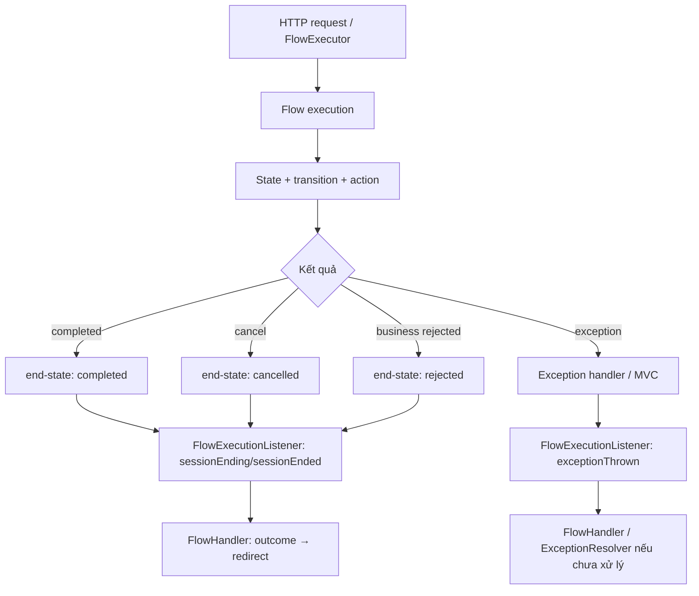

# Ghi nhận kết quả hoàn thành, hủy và lỗi trong Spring Web Flow

## Mục tiêu học tập

Một flow trong Spring Web Flow có thể kết thúc theo nhiều cách: người dùng hoàn tất đăng ký, chủ động hủy, nghiệp vụ từ chối yêu cầu hoặc một lỗi kỹ thuật xảy ra trong lúc xử lý. Ứng dụng thường cần ghi nhận những kết quả này để làm báo cáo, audit, điều hướng tới trang kết quả hoặc hỗ trợ xử lý sự cố.

Chương **Listener và mở rộng** giới thiệu cách quan sát vòng đời flow bằng `FlowExecutionListener`, cách đọc outcome của `end-state`, và cách phân biệt một kết quả nghiệp vụ bình thường với exception. Sau bài học, bạn có thể:

- Biểu diễn `completed`, `cancelled`, `rejected` thành các outcome có tên rõ ràng.
- Chọn callback phù hợp trong `FlowExecutionListener` để ghi nhận event, state, kết thúc session và exception.
- Phân biệt `sessionEnding`, `sessionEnded` và `exceptionThrown`.
- Đăng ký listener trong `FlowExecutor` và giới hạn listener theo flow ID.
- Dùng `FlowHandler` để xử lý outcome hoặc exception ở tầng Spring MVC.
- Thiết kế audit an toàn khi flow có subflow, request được resume hoặc người dùng gửi event nhiều lần.
- Kiểm thử đường hoàn thành, hủy, lỗi nghiệp vụ, exception kỹ thuật và kết thúc flow con.

## 1. Vì sao cần ghi nhận vòng đời flow?

Hãy xét quy trình đặt chỗ:

```text
Chọn lịch → Nhập thông tin → Xem lại → Xác nhận
                              ├── Hoàn tất
                              ├── Hủy
                              └── Bị từ chối / có xung đột
```

Chỉ nhìn vào trang cuối cùng chưa đủ để biết điều gì đã xảy ra. Hệ thống có thể cần trả lời:

- Người dùng đã hoàn thành flow hay tự hủy?
- Yêu cầu bị từ chối do hết chỗ hay do vi phạm chính sách?
- Lỗi phát sinh ở state nào và đã được handler xử lý chưa?
- Một subflow xác minh danh tính kết thúc có làm flow đặt chỗ kết thúc không?
- Flow đã kết thúc và có outcome nào được trả về cho Spring MVC?

Spring Web Flow cung cấp hai extension point liên quan nhưng có nhiệm vụ khác nhau:

1. **`FlowExecutionListener`** quan sát các mốc trong vòng đời flow execution/session: nhận event, chuyển state, render view, pause/resume, kết thúc và exception.
2. **`FlowHandler`** xử lý kết quả hoặc exception khi một flow được gọi qua Spring MVC, ví dụ điều hướng người dùng tới trang biên nhận sau khi flow kết thúc.



Listener giúp **quan sát và ghi nhận**. Nó không tự biến một exception thành một outcome thành công và cũng không thay thế logic transaction của service nghiệp vụ.

## 2. Kết quả flow được biểu diễn bằng `end-state`

Một flow thường có các `end-state` khác nhau để biểu diễn kết quả:

```xml
<end-state id="bookingConfirmed" />
<end-state id="cancelled" />
<end-state id="rejected" />
```

`id` của end-state là outcome của flow session kết thúc. Ví dụ:

| End-state ID | Ý nghĩa nghiệp vụ | Cách xử lý tiếp theo |
| --- | --- | --- |
| `bookingConfirmed` | Đặt chỗ đã được ghi thành công | Hiển thị biên nhận |
| `cancelled` | Người dùng chủ động hủy | Trở về danh sách hoặc trang trước |
| `rejected` | Yêu cầu bị từ chối theo quy tắc nghiệp vụ | Hiển thị lý do từ chối |
| `slotUnavailable` | Không còn chỗ tại thời điểm xác nhận | Cho người dùng chọn lịch khác |

Một ví dụ flow rút gọn:

```xml
<flow xmlns="http://www.springframework.org/schema/webflow"
      xmlns:xsi="http://www.w3.org/2001/XMLSchema-instance"
      xsi:schemaLocation="http://www.springframework.org/schema/webflow
                          https://www.springframework.org/schema/webflow/spring-webflow.xsd">

    <view-state id="reviewBooking" view="booking/review">
        <transition on="confirm" to="saveBooking" bind="false" />
        <transition on="cancel" to="cancelled" bind="false" />
    </view-state>

    <action-state id="saveBooking">
        <evaluate expression="bookingService.confirm(bookingDraft)" />
        <transition on="saved" to="bookingConfirmed" />
        <transition on="unavailable" to="slotUnavailable" />
        <transition on="rejected" to="rejected" />
    </action-state>

    <view-state id="slotUnavailable" view="booking/unavailable">
        <transition on="chooseAnother" to="reviewBooking" />
        <transition on="cancel" to="cancelled" />
    </view-state>

    <end-state id="bookingConfirmed">
        <output name="bookingId" value="bookingDraft.bookingId" />
    </end-state>
    <end-state id="cancelled" />
    <end-state id="rejected" />
</flow>
```

Đây là ví dụ về đường đi; `bookingService`, `bookingDraft`, view và cách tạo `bookingId` là thành phần ứng dụng phải triển khai. Service chỉ nên trả outcome `saved` sau khi thao tác ghi đã commit thành công theo contract của nó. Nếu database báo lỗi, không được tự trả `saved` để flow kết thúc như thành công.

### Outcome khác với event đầu vào

Người dùng gửi event `confirm`, nhưng flow có thể kết thúc bằng outcome `bookingConfirmed`, `slotUnavailable` hoặc `rejected`. Event là **đầu vào điều khiển flow**; outcome là **kết quả mà flow trả về khi kết thúc**.

Không nên đặt outcome theo tên nút bấm:

```text
Event:   confirm
Outcome: bookingConfirmed
```

Tên outcome nên diễn tả trạng thái nghiệp vụ đã đạt được, không chỉ diễn tả thao tác người dùng vừa thực hiện.

## 3. Phân biệt kết quả nghiệp vụ và exception

Không phải mọi tình huống thất bại đều là exception kỹ thuật.

| Tình huống | Cách biểu diễn phù hợp | Ví dụ |
| --- | --- | --- |
| Người dùng hủy trước khi lưu | Outcome bình thường | `cancelled` |
| Hết chỗ khi xác nhận | Outcome nghiệp vụ | `slotUnavailable` |
| Email đã đăng ký trước đó | Outcome nghiệp vụ | `duplicate` hoặc `rejected` |
| Dữ liệu đã bị người khác sửa | Outcome nghiệp vụ nếu service nhận diện được | `conflict` |
| Database timeout hoặc lỗi không mong đợi | Exception | `DataAccessException`, lỗi hạ tầng |
| Flow definition hoặc state không hợp lệ | Exception của flow | `FlowExecutionException` |

Một action có thể bắt **ngoại lệ nghiệp vụ đã dự kiến** rồi trả về một event có ý nghĩa:

```java
@Component("bookingAction")
public class BookingAction {

    private final BookingService bookingService;

    public BookingAction(BookingService bookingService) {
        this.bookingService = bookingService;
    }

    public String confirm(BookingDraft draft) {
        try {
            bookingService.confirm(draft);
            return "saved";
        } catch (SlotUnavailableException ex) {
            return "unavailable";
        } catch (BookingRejectedException ex) {
            return "rejected";
        }
    }
}
```

`BookingService`, `BookingDraft`, `SlotUnavailableException` và `BookingRejectedException` là các kiểu do ứng dụng định nghĩa. Service cần quản lý transaction và rollback đúng cách. Action chỉ chuyển những trường hợp nghiệp vụ đã biết thành outcome event; lỗi hạ tầng hoặc lỗi không mong đợi cần tiếp tục được xử lý theo exception policy.

Flow XML tương ứng:

```xml
<action-state id="saveBooking">
    <evaluate expression="bookingAction.confirm(bookingDraft)" />
    <transition on="saved" to="bookingConfirmed" />
    <transition on="unavailable" to="slotUnavailable" />
    <transition on="rejected" to="rejected" />
</action-state>
```

**Đừng bắt mọi `Exception` rồi trả `saved` hoặc `success`.** Làm như vậy khiến listener và các tầng điều hướng ghi nhận một kết quả sai, đồng thời che mất lỗi cần điều tra.

## 4. `FlowExecutionListener` quan sát những mốc nào?

`org.springframework.webflow.execution.FlowExecutionListener` là interface dành cho thành phần muốn phản hồi tại những điểm xác định trong vòng đời flow execution. Listener được gắn với execution khi execution được tạo hoặc được khôi phục từ repository; thông thường không đăng ký listener mới tùy tiện khi execution đã chạy.

Trong Spring Web Flow 3.x, các method của interface có implementation mặc định. Một listener chỉ cần override những callback mà ứng dụng quan tâm.

### Các callback thường dùng

| Callback | Thời điểm | Mục đích phù hợp |
| --- | --- | --- |
| `requestSubmitted(context)` | Request client gửi tới để thao tác flow, trước khi xử lý | Đếm request, correlation |
| `requestProcessed(context)` | Request đã xử lý xong | Đo thời gian xử lý, kết thúc trace |
| `sessionCreating(context, definition)` | Sắp tạo flow session mới | Kiểm tra điều kiện khởi tạo hoặc từ chối bắt đầu |
| `sessionStarting(context, session, input)` | Session đã tạo nhưng chưa bắt đầu | Bổ sung input/attribute trước khi flow chạy |
| `sessionStarted(context, session)` | Flow session đã bắt đầu | Ghi nhận khởi chạy |
| `eventSignaled(context, event)` | Event được phát trong state hiện tại, trước transition | Theo dõi `confirm`, `cancel`, `back` |
| `transitionExecuting(context, transition)` | Transition đã được match, trước khi thực hiện | Theo dõi transition được chọn |
| `stateEntering(context, state)` | Đã chọn state đích, trước khi vào state | Kiểm tra/veto việc vào state |
| `stateEntered(context, previousState, state)` | Sau khi chuyển vào state mới | Ghi lịch sử điều hướng |
| `viewRendering(context, view, viewState)` | View sắp render, trước render actions | Đo hoặc theo dõi quá trình render |
| `viewRendered(context, view, viewState)` | View đã render xong | Theo dõi kết quả render |
| `paused(context)` | Execution tạm dừng, thường chờ người dùng | Ghi nhận trạng thái chờ |
| `resuming(context)` | Execution được khôi phục thành công trước khi xử lý event mới | Theo dõi tiếp tục flow |
| `sessionEnding(context, session, outcome, output)` | Session được yêu cầu kết thúc, trước khi kết thúc | Ghi nhận outcome sắp kết thúc |
| `sessionEnded(context, session, outcome, output)` | Session đã kết thúc | Ghi nhận kết quả cuối của session |
| `exceptionThrown(context, exception)` | Exception phát sinh trong execution, trước exception handler của flow | Ghi log/correlation và chẩn đoán |

### Đừng nhầm `FlowSession` với HTTP session

`FlowSession` là session của **một flow definition đang chạy** trong execution. Một flow execution có thể có flow session gốc và các session con khi gọi subflow. Nó không phải `HttpSession` của Servlet.

`sessionEnding` và `sessionEnded` được gọi theo vòng đời flow session. Nếu session vừa kết thúc là **root session**, toàn bộ flow execution cũng kết thúc. Nếu đó là session của subflow, flow cha có thể tiếp tục sau khi nhận outcome từ subflow.

Vì thế, listener phải cân nhắc `session.isRoot()` hoặc thông tin quan hệ parent/child trước khi ghi nhận một sự kiện như “toàn bộ quy trình đã kết thúc”.

## 5. Phân biệt `sessionEnding`, `sessionEnded` và `exceptionThrown`

Ba callback này đặc biệt quan trọng khi ghi nhận hoàn thành, hủy và lỗi.

### 5.1. `sessionEnding`: biết outcome trước khi session kết thúc

Chữ ký:

```java
void sessionEnding(
        RequestContext context,
        FlowSession session,
        String outcome,
        MutableAttributeMap<?> output);
```

Callback được gọi khi session đang hoạt động được yêu cầu kết thúc nhưng **trước khi kết thúc thực sự**.

Tham số:

- `context`: ngữ cảnh request đang xử lý flow.
- `session`: flow session sắp kết thúc.
- `outcome`: ID của end-state, thường là ID của end-state đã đạt được.
- `output`: dữ liệu output của session; đây là map có thể sửa, nên listener có thể tác động đến output trả về.

Ví dụ:

```java
@Override
public void sessionEnding(RequestContext context,
                          FlowSession session,
                          String outcome,
                          MutableAttributeMap<?> output) {
    if (!session.isRoot()) {
        return; // Subflow kết thúc, flow cha vẫn có thể chạy.
    }

    if ("bookingConfirmed".equals(outcome)) {
        audit.recordCompletion(session.getDefinition().getId());
    } else if ("cancelled".equals(outcome)) {
        audit.recordCancellation(session.getDefinition().getId());
    }
}
```

`audit` là collaborator do ứng dụng cung cấp. Ví dụ chỉ minh họa cách phân biệt outcome; trong triển khai thật cần lấy correlation ID, actor và dữ liệu nghiệp vụ theo nguồn đáng tin cậy. Không nên lưu toàn bộ `output` hoặc dữ liệu form nhạy cảm vào audit.

### 5.2. `sessionEnded`: xác nhận session đã kết thúc

Chữ ký:

```java
void sessionEnded(
        RequestContext context,
        FlowSession session,
        String outcome,
        AttributeMap<?> output);
```

Callback này chạy **sau khi session kết thúc**. `output` ở đây là `AttributeMap<?>`, không còn là map mutable để thay đổi kết quả.

Khác biệt thực tế:

| Callback | Thời điểm | Có thể sửa output? | Dùng khi |
| --- | --- | --- | --- |
| `sessionEnding` | Trước khi kết thúc | Có, theo API | Cần quan sát hoặc bổ sung output trước khi trả |
| `sessionEnded` | Sau khi kết thúc | Không | Ghi nhận rằng session đã thực sự kết thúc |

Nếu chỉ cần ghi nhận audit, `sessionEnded` thể hiện mốc sau kết thúc rõ ràng. Nếu cần can thiệp output, API cho phép ở `sessionEnding`, nhưng chỉ nên làm khi có lý do cụ thể và hiểu tác động với flow cha/handler.

### 5.3. `exceptionThrown`: exception phát sinh trước khi handler xử lý

Chữ ký:

```java
void exceptionThrown(RequestContext context,
                     FlowExecutionException exception);
```

Callback này được gọi khi exception phát sinh trong quá trình flow execution, **trước khi exception được chuyển tới handler đã đăng ký**.

Điều đó có nghĩa:

- Exception có thể được handler xử lý sau callback.
- Flow có thể được phục hồi và tiếp tục, tùy handler.
- Một callback `exceptionThrown` không đồng nghĩa flow chắc chắn kết thúc với outcome `failed`.
- Nếu exception không được xử lý trong flow, nó có thể tiếp tục lên tầng tích hợp Spring MVC.

Listener nên ghi nhận exception một cách có kiểm soát, không được tự ý nuốt exception để flow tiếp tục như không có lỗi. Nếu exception là lỗi nghiệp vụ đã dự kiến, hãy chuyển thành event/outcome tại action/service; nếu là lỗi kỹ thuật, để cơ chế exception handling xử lý.

## 6. Viết listener ghi nhận hoàn thành, hủy và lỗi

Ví dụ dưới đây dùng trực tiếp `FlowExecutionListener`:

```java
import org.slf4j.Logger;
import org.slf4j.LoggerFactory;
import org.springframework.stereotype.Component;
import org.springframework.webflow.definition.FlowDefinition;
import org.springframework.webflow.definition.StateDefinition;
import org.springframework.webflow.execution.Event;
import org.springframework.webflow.execution.FlowExecutionException;
import org.springframework.webflow.execution.FlowExecutionListener;
import org.springframework.webflow.execution.FlowSession;
import org.springframework.webflow.execution.RequestContext;

@Component
public class LifecycleAuditListener implements FlowExecutionListener {

    private static final Logger log =
            LoggerFactory.getLogger(LifecycleAuditListener.class);

    @Override
    public void sessionStarted(RequestContext context, FlowSession session) {
        log.info("flow_session_started flow={} root={}",
                session.getDefinition().getId(),
                session.isRoot());
    }

    @Override
    public void eventSignaled(RequestContext context, Event event) {
        FlowDefinition flow = context.getActiveFlow();
        log.info("flow_event flow={} event={}",
                flow.getId(),
                event.getId());
    }

    @Override
    public void stateEntered(RequestContext context,
                             StateDefinition previousState,
                             StateDefinition state) {
        log.info("flow_state_changed flow={} from={} to={}",
                context.getActiveFlow().getId(),
                previousState == null ? null : previousState.getId(),
                state.getId());
    }

    @Override
    public void sessionEnded(RequestContext context,
                             FlowSession session,
                             String outcome,
                             org.springframework.webflow.core.collection.AttributeMap<?> output) {
        if (!session.isRoot()) {
            log.info("subflow_session_ended flow={} outcome={}",
                    session.getDefinition().getId(),
                    outcome);
            return;
        }

        log.info("root_flow_ended flow={} outcome={}",
                session.getDefinition().getId(),
                outcome);
    }

    @Override
    public void exceptionThrown(RequestContext context,
                                FlowExecutionException exception) {
        log.error("flow_exception flow={} state={} type={}",
                context.getActiveFlow().getId(),
                exception.getStateId(),
                exception.getClass().getSimpleName());
    }
}
```

`FlowDefinition`, `StateDefinition`, `Event`, `FlowExecutionException`, `FlowSession` và `RequestContext` thuộc API Spring Web Flow. Ví dụ dùng SLF4J và Spring component scanning; ứng dụng phải có các dependency và cấu hình tương ứng.

Listener trên minh họa các callback quan sát. Trong ứng dụng thực tế:

- Dùng correlation ID riêng để liên kết nhiều request của cùng execution.
- Lấy actor từ ngữ cảnh xác thực phía server nếu cần audit người thực hiện.
- Không ghi nguyên flow execution key, token, mật khẩu, dữ liệu thanh toán hoặc toàn bộ output map.
- Không gọi một service ghi nghiệp vụ không idempotent từ `eventSignaled` hoặc `stateEntered`, vì các callback có thể chạy ở nhiều request.
- Cân nhắc lưu audit bền vững qua cơ chế outbox/event nếu yêu cầu audit không được phép mất khi ứng dụng gặp sự cố.

### Vì sao listener không ghi “đơn hàng đã tạo” chỉ dựa vào `bookingConfirmed`?

Outcome `bookingConfirmed` là kết quả flow. Để chứng minh đơn hàng thực sự tồn tại, dữ liệu cần được ghi bởi service và transaction nghiệp vụ. Listener có thể ghi **sự kiện flow đã kết thúc với outcome bookingConfirmed**, nhưng nếu audit phải khớp với commit database tuyệt đối, nên tạo audit/outbox trong cùng transaction với bản ghi nghiệp vụ rồi dùng listener cho quan sát điều hướng.

## 7. Đăng ký listener trong `FlowExecutor`

Listener phải được cấu hình để `FlowExecutor` sử dụng. Với XML namespace:

```xml
<webflow:flow-executor id="flowExecutor"
                       flow-registry="flowRegistry">
    <webflow:flow-execution-listeners>
        <webflow:listener ref="lifecycleAuditListener" />
    </webflow:flow-execution-listeners>
</webflow:flow-executor>

<bean id="lifecycleAuditListener"
      class="com.example.flow.LifecycleAuditListener" />
```

Đoạn này nằm trong Spring application context có khai báo namespace Web Flow và bean `flowRegistry`. Nếu listener dùng `@Component`, cần component scan đúng package; không đồng thời khai báo bean thủ công theo cách gây trùng bean ID.

### Chỉ áp dụng listener cho một số flow

Có thể giới hạn phạm vi bằng `criteria`:

```xml
<webflow:flow-executor id="flowExecutor"
                       flow-registry="flowRegistry">
    <webflow:flow-execution-listeners>
        <webflow:listener ref="lifecycleAuditListener"
                          criteria="registration,booking" />
    </webflow:flow-execution-listeners>
</webflow:flow-executor>
```

Ví dụ này chỉ gắn listener cho flow có ID `registration` và `booking`. Cách giới hạn giúp giảm log không cần thiết và tránh áp dụng logic audit đặc thù cho flow không liên quan.

### Cấu hình bằng Java

Trong ứng dụng dùng Java configuration, có thể thêm listener vào builder:

```java
@Bean
public FlowExecutor flowExecutor() {
    return getFlowExecutorBuilder(flowRegistry())
            .addFlowExecutionListener(lifecycleAuditListener(),
                    "registration,booking")
            .build();
}
```

Đoạn code giả định class cấu hình kế thừa cấu hình Web Flow phù hợp, đã có `flowRegistry()` và bean `lifecycleAuditListener()`. API builder nhận criteria để giới hạn các flow cần theo dõi.

## 8. `FlowHandler`: xử lý outcome khi flow kết thúc trong Spring MVC

`FlowExecutionListener` chạy bên trong vòng đời execution. Khi flow được gọi qua Spring MVC, **`FlowHandler`** là extension point để:

- Xác định flow ID cần gọi.
- Tạo input cho execution mới.
- Xử lý outcome khi flow kết thúc.
- Xử lý exception được đưa ra khỏi flow.

Một handler có thể chuyển người dùng tới trang khác dựa trên outcome:

```java
import jakarta.servlet.http.HttpServletRequest;
import jakarta.servlet.http.HttpServletResponse;
import org.springframework.webflow.core.FlowException;
import org.springframework.webflow.execution.FlowExecutionOutcome;
import org.springframework.webflow.mvc.servlet.AbstractFlowHandler;

public class BookingFlowHandler extends AbstractFlowHandler {

    @Override
    public String handleExecutionOutcome(
            FlowExecutionOutcome outcome,
            HttpServletRequest request,
            HttpServletResponse response) {

        if ("bookingConfirmed".equals(outcome.getId())) {
            Object bookingId = outcome.getOutput().get("bookingId");
            return "/booking/receipt?bookingId=" + bookingId;
        }

        if ("cancelled".equals(outcome.getId())) {
            return "/booking";
        }

        if ("rejected".equals(outcome.getId())) {
            return "/booking/rejected";
        }

        return "/booking/result";
    }

    @Override
    public String handleException(
            FlowException exception,
            HttpServletRequest request,
            HttpServletResponse response) {
        return "/error/flow";
    }
}
```

`jakarta.servlet` được dùng trong ví dụ cho môi trường Servlet hiện đại; nếu ứng dụng đang dùng nền tảng cũ với `javax.servlet`, hãy sử dụng namespace tương ứng với phiên bản Spring/Servlet của dự án. `bookingId` phải là output đã được flow khai báo và được service tạo sau khi ghi thành công.

Đăng ký handler thành bean có **tên trùng với flow ID**:

```xml
<bean name="booking"
      class="com.example.flow.BookingFlowHandler" />
```

Ví dụ giả định flow ID là `booking`. Khi flow kết thúc, handler chọn URL redirect phù hợp với outcome.

### Default behavior và custom behavior

Nếu không override `handleExecutionOutcome`, hành vi mặc định của `AbstractFlowHandler` sẽ redirect tới URL của flow đã kết thúc để bắt đầu một execution mới. Nếu không override `handleException`, các exception chưa xử lý được chuyển tiếp theo cơ chế mặc định của Spring MVC; lỗi truy cập execution đã hết hạn/kết thúc có thể được phục hồi bằng cách khởi chạy lại flow theo cấu hình mặc định.

Khi ứng dụng cần phân biệt `bookingConfirmed`, `cancelled` và `rejected`, hãy override `handleExecutionOutcome`. Khi cần ánh xạ exception chưa xử lý sang trang lỗi phù hợp, hãy override `handleException` hoặc dùng Spring MVC `HandlerExceptionResolver` theo kiến trúc của ứng dụng.

## 9. Xử lý lỗi: listener quan sát, handler quyết định

Có nhiều tầng xử lý lỗi, mỗi tầng có vai trò riêng:

| Thành phần | Vai trò | Ví dụ |
| --- | --- | --- |
| Action/service | Phân biệt kết quả nghiệp vụ dự kiến và lỗi kỹ thuật | `slotUnavailable` là outcome; database timeout là exception |
| `exceptionThrown` listener | Quan sát exception trước handler | Ghi flow ID, state ID và loại exception |
| `FlowExecutionExceptionHandler` | Xử lý exception bên trong flow/state theo cấu hình | Chuyển một lỗi dự kiến sang state phục hồi |
| `FlowHandler.handleException` | Xử lý exception đi ra tầng Spring MVC | Redirect tới trang lỗi |
| Spring MVC `HandlerExceptionResolver` | Xử lý exception được DispatcherServlet tiếp nhận | Render trang lỗi chung hoặc response API |

### 9.1. Lỗi nghiệp vụ dự kiến nên trở thành outcome

Ví dụ:

```text
Service kiểm tra sức chứa
  ├── còn chỗ       → "reserved"
  ├── hết chỗ       → "unavailable"
  └── không đủ quyền → "forbidden"
```

Flow có thể ánh xạ các event này tới `confirmed`, `slotUnavailable` hoặc `accessDenied`. Người dùng có thể hiểu được và có đường đi tiếp theo.

### 9.2. Exception kỹ thuật cần được xử lý đúng

Một lỗi như mất kết nối database không nên được đổi thành `unavailable` nếu điều đó khiến người dùng tưởng rằng slot đã hết. Hãy để exception đi qua cơ chế exception handling phù hợp, ghi nhận bằng listener và trả thông báo hệ thống chính xác.

### 9.3. Listener không nên nuốt exception

Ví dụ sai:

```java
@Override
public void exceptionThrown(RequestContext context,
                            FlowExecutionException exception) {
    log.error("Flow failed", exception);
    // Không throw lại, không có cơ chế xử lý rõ ràng.
}
```

Callback có nhiệm vụ quan sát. Việc không ném lại ở đây không phải cách “xử lý xong” exception cho flow. Hãy để exception handler của Web Flow hoặc tầng MVC xử lý theo thiết kế. Nếu listener cần ngăn một state được vào, hãy dùng callback có khả năng veto như `stateEntering` với `EnterStateVetoException`, không lạm dụng `exceptionThrown`.

## 10. Flow cha, subflow và ý nghĩa của callback kết thúc

Một flow execution có thể chứa nhiều flow session khi gọi subflow:

```xml
<subflow-state id="verifyIdentity" subflow="identityVerification">
    <transition on="verified" to="reviewBooking" />
    <transition on="verificationCancelled" to="cancelled" />
</subflow-state>
```

Flow `identityVerification` có thể kết thúc với outcome `verified` hoặc `verificationCancelled`. Khi session con kết thúc:

- `sessionEnding` và `sessionEnded` được gọi cho **flow session con**.
- Flow cha nhận outcome từ subflow và có thể tiếp tục hoặc kết thúc.
- Nếu flow cha đi tới `end-state`, callback kết thúc được gọi cho **root session** và toàn bộ execution kết thúc.

Ví dụ:

```text
Root flow: booking
  └── Subflow: identityVerification
        ├── verified → trả outcome về booking
        └── verificationCancelled → trả outcome về booking

Booking:
  ├── verified → reviewBooking → bookingConfirmed
  └── verificationCancelled → cancelled
```

Nếu listener ghi “toàn bộ booking flow đã hoàn tất” mỗi khi bất kỳ session nào kết thúc, một subflow bình thường có thể tạo audit giả. Hãy phân biệt root với subflow:

```java
if (session.isRoot()) {
    // Đây là session gốc; kết thúc nó đồng nghĩa execution kết thúc.
} else {
    // Đây là subflow session; flow cha có thể còn hoạt động.
}
```

## 11. Thiết kế audit không làm sai nghiệp vụ

Listener là nơi thuận tiện để quan sát các mốc điều hướng, nhưng audit nghiệp vụ cần dữ liệu đáng tin cậy và chính sách lưu trữ rõ ràng.

### Phân biệt flow audit và business audit

| Loại ghi nhận | Nguồn phù hợp | Nội dung |
| --- | --- | --- |
| **Flow audit** | `FlowExecutionListener` | Flow ID, state, event, outcome, thời điểm |
| **Business audit** | Service nghiệp vụ/transaction | Booking ID, actor, trạng thái trước/sau, quyết định nghiệp vụ |
| **Technical error log** | Listener + exception infrastructure | State lỗi, loại exception, correlation ID |
| **HTTP navigation** | `FlowHandler` hoặc controller | URL redirect theo outcome |

Ví dụ, một listener ghi `bookingConfirmed` cho biết flow đã kết thúc với outcome đó. Nếu cần chứng minh một booking được commit, business audit nên được ghi cùng transaction với booking hoặc qua outbox có tính bền vững.

### Các nguyên tắc quan trọng

1. **Không ghi toàn bộ dữ liệu form.** Chỉ ghi field cần thiết và đã được phép.
2. **Không log flow execution key đầy đủ.** Key có thể cho phép tiếp tục một execution còn hoạt động; hãy che hoặc không log.
3. **Không coi listener callback là exactly-once.** Request có thể được retry, execution có thể được khôi phục và cùng một hành động có thể được phát lại.
4. **Không thực hiện side effect lớn trong callback.** Gọi API bên ngoài hoặc gửi email đồng bộ có thể kéo dài request và làm callback trở thành điểm lỗi mới.
5. **Không thay thế transaction service bằng listener.** Listener không nên là nơi tạo booking, trừ tồn kho hoặc thu tiền.
6. **Đặt correlation ID ổn định.** Có thể liên kết flow, HTTP request và business operation mà không dựa vào key nhạy cảm.
7. **Thiết kế idempotency ở tầng ghi dữ liệu.** Một event `confirm` gửi lại không được tạo hai bản ghi nghiệp vụ.

### Audit qua outbox khi cần độ tin cậy cao

Nếu nghiệp vụ yêu cầu bản ghi audit phải nhất quán với dữ liệu chính, một pattern là ghi booking và một outbox event trong cùng database transaction:

```text
@Transactional confirmBooking(...)
  ├── INSERT booking
  ├── INSERT outbox_event(type=BOOKING_CONFIRMED, bookingId=...)
  └── COMMIT

Outbox publisher
  └── gửi event tới hệ thống audit/message broker
```

Listener vẫn có thể ghi nhận `sessionEnded` để theo dõi flow, nhưng outbox là nguồn đáng tin cậy cho việc đồng bộ sự kiện nghiệp vụ đã commit. Đây là pattern kiến trúc bổ sung, không phải chức năng tự động của `FlowExecutionListener`.

## 12. Kiểm thử hoàn thành, hủy và lỗi

Kiểm thử nên bao phủ cả **outcome của flow**, **callback listener** và **hành vi điều hướng của FlowHandler**.

| Kịch bản | Đường đi | Điều cần xác nhận |
| --- | --- | --- |
| Hoàn thành | `review` → `confirm` → `bookingConfirmed` | Listener ghi outcome hoàn thành; output booking ID đúng |
| Người dùng hủy | `edit` hoặc `review` → `cancelled` | Listener ghi hủy; service ghi booking không bị gọi |
| Hết chỗ | `confirm` → service trả `unavailable` → `slotUnavailable` | Đây là outcome nghiệp vụ, không phải exception kỹ thuật |
| Bị từ chối | `confirm` → `rejected` | Outcome bị từ chối được ghi đúng |
| Exception trong action | Action ném exception | `exceptionThrown` chạy trước handler; không ghi thành công |
| Exception được handler xử lý | Handler phục hồi hoặc chuyển state | Listener đã thấy exception nhưng flow có thể tiếp tục |
| Subflow hoàn tất | Flow con trả `verified` | Listener nhận kết thúc session con, không đánh dấu root flow kết thúc |
| Root flow kết thúc | Root đi tới end-state | `sessionEnded` của root được nhận diện |
| Redirect sau outcome | Flow kết thúc `bookingConfirmed` | `FlowHandler` điều hướng tới receipt |
| Redirect khi hủy | Flow kết thúc `cancelled` | `FlowHandler` điều hướng về trang phù hợp |
| Exception chưa xử lý | Exception đi lên MVC | `handleException` hoặc `HandlerExceptionResolver` xử lý theo cấu hình |
| Gửi Confirm lặp | Client retry event | Không tạo hai booking; listener log không kích hoạt ghi trùng |

### 12.1. Kiểm thử listener độc lập

Có thể dùng Mockito để gọi callback với fixture/mock:

```java
@Test
void recordsRootCancellation() {
    FlowSession session = mock(FlowSession.class);
    FlowDefinition definition = mock(FlowDefinition.class);
    RequestContext context = mock(RequestContext.class);

    when(session.isRoot()).thenReturn(true);
    when(session.getDefinition()).thenReturn(definition);
    when(definition.getId()).thenReturn("booking");

    listener.sessionEnded(context, session, "cancelled", null);

    // Xác nhận audit collaborator ghi nhận flow=booking, outcome=cancelled.
}
```

Đây là phác thảo unit test; `listener` và audit collaborator là fixture của ứng dụng. Nếu kiểm thử listener có ghi audit, hãy assert vào collaborator hoặc output log appender thay vì chỉ xác nhận method không ném exception.

### 12.2. Kiểm thử tích hợp flow

Với công cụ test flow của Spring Web Flow, kiểm tra:

1. Khởi chạy flow và xác nhận state ban đầu.
2. Gửi event `confirm` với dữ liệu hợp lệ.
3. Xác nhận flow kết thúc và `FlowExecutionOutcome.getId()` là `bookingConfirmed`.
4. Xác nhận output chứa `bookingId`.
5. Chạy execution khác với event `cancel`, kiểm tra outcome `cancelled`.
6. Cho service ném một exception, kiểm tra listener nhận `exceptionThrown` và handler được thực thi.
7. Gọi subflow rồi xác nhận session con kết thúc không bị hiểu nhầm là root flow kết thúc.

`FlowExecutionOutcome` cung cấp `getId()` và `getOutput()`. `FlowExecutionResult` có thể cho biết request đã làm flow **ended** hay **paused**, và outcome chỉ có ý nghĩa khi flow ended. Đây là cách phân biệt một request kết thúc với một request chỉ tạm dừng chờ người dùng.

### 12.3. Kiểm thử Spring MVC handler

Ngoài test flow, cần kiểm tra handler:

- Bean handler có tên khớp flow ID.
- `handleExecutionOutcome` nhận đúng outcome và output.
- URL redirect không nhận dữ liệu chưa được kiểm tra.
- `handleException` chỉ xử lý exception theo chính sách; không chuyển lỗi kỹ thuật thành trang xác nhận thành công.

## 13. Các lỗi thường gặp

### 13.1. Ghi nhận hủy trong `eventSignaled` rồi nghĩ flow đã hủy

`eventSignaled` chạy khi event được phát **trước transition**. Event `cancel` có thể không khớp transition hoặc transition có thể thất bại. Nếu cần ghi nhận flow session thực sự kết thúc với outcome `cancelled`, hãy quan sát `sessionEnding`/`sessionEnded`.

### 13.2. Coi `exceptionThrown` là outcome `failed`

Exception có thể được handler xử lý. Nếu flow phục hồi và tiếp tục, không có end-state `failed` nào được đạt. Ghi exception và ghi outcome kết thúc là hai loại sự kiện khác nhau.

### 13.3. Coi subflow kết thúc là root execution kết thúc

Mỗi flow session có vòng đời riêng. Kiểm tra `session.isRoot()` hoặc quan hệ parent trước khi ghi sự kiện “toàn bộ flow đã kết thúc”.

### 13.4. Đăng ký listener nhưng không thấy callback

Kiểm tra listener đã được gắn vào `FlowExecutor` chưa, criteria có khớp flow ID không, và flow đang dùng đúng executor/registry không. Một bean tồn tại trong Spring context không có nghĩa nó tự động được gọi.

### 13.5. Dùng `FlowExecutionListenerAdapter` theo ví dụ cũ

Trong Spring Web Flow 3.x, các method của `FlowExecutionListener` có default implementation. `FlowExecutionListenerAdapter` được đánh dấu deprecated trong API; với code mới, có thể implement interface trực tiếp và override callback cần dùng.

### 13.6. Ghi output map hoặc exception message nguyên văn

Output có thể chứa dữ liệu cá nhân hoặc token. Exception message có thể lộ SQL, đường dẫn hoặc dữ liệu đầu vào. Hãy ghi metadata cần thiết, che dữ liệu nhạy cảm và giữ stack trace trong hệ thống log được kiểm soát.

### 13.7. Listener làm hỏng flow khi audit service lỗi

Nếu listener gọi hệ thống audit ngoài và thao tác đó ném exception, nó có thể ảnh hưởng request flow. Cần xác định audit có phải điều kiện bắt buộc để tiếp tục hay không. Với audit quan trọng, dùng transaction/outbox; với telemetry không thiết yếu, tránh để sự cố telemetry làm hỏng hành trình người dùng.

### 13.8. Cho rằng `FlowHandler` và listener thay thế nhau

Listener quan sát lifecycle trong engine. `FlowHandler` quyết định HTTP response/redirect khi flow kết thúc hoặc exception đi ra tầng MVC. Một ứng dụng có thể cần cả hai, nhưng không cần đặt cùng logic audit ở cả hai nơi nếu không có lý do.

## 14. Bài tập thực hành

Thiết kế flow đăng ký sự kiện với các outcome:

```text
registered
cancelled
duplicate
registrationClosed
```

Yêu cầu:

1. Form cho phép nhập thông tin và xem lại.
2. `confirm` gọi service; service có thể trả `created`, `duplicate` hoặc `closed`.
3. Người dùng có thể hủy trước khi ghi.
4. Listener ghi nhận event, state change, root session kết thúc và exception.
5. `FlowHandler` redirect `registered` tới trang biên nhận, `cancelled` về danh sách sự kiện và các outcome khác tới trang thông báo.

**Nhiệm vụ:**

- Viết các `end-state` phù hợp.
- Viết class implement `FlowExecutionListener`, override ít nhất `eventSignaled`, `sessionEnded`, `exceptionThrown`.
- Đăng ký listener trong `flow-execution-listeners`.
- Viết `FlowHandler` xử lý `FlowExecutionOutcome`.
- Kiểm thử một đường hoàn thành, một đường hủy, một đường duplicate và một exception kỹ thuật.
- Giải thích vì sao không được tạo bản ghi audit “đã đăng ký” chỉ từ event `confirm`.

## 15. Ghi nhớ

- **`end-state` ID là outcome** của flow session khi kết thúc; nên dùng tên diễn tả kết quả như `bookingConfirmed`, `cancelled`, `rejected`.
- **`eventSignaled`** chạy trước transition; nó ghi nhận ý định/event, không chứng minh transition đã thành công.
- **`sessionEnding`** chạy trước khi session kết thúc và nhận outcome cùng output có thể sửa.
- **`sessionEnded`** chạy sau khi session kết thúc; nếu session là root thì toàn bộ flow execution kết thúc.
- **`exceptionThrown`** chạy trước exception handler; exception có thể được xử lý và flow vẫn tiếp tục.
- **`FlowExecutionListener`** là observer cho lifecycle, phải đăng ký trong `FlowExecutor` và có thể giới hạn bằng criteria.
- **`FlowHandler`** xử lý outcome/exception ở tầng Spring MVC và có thể redirect tới trang phù hợp.
- Listener nên ghi metadata có kiểm soát, không lưu dữ liệu nhạy cảm hoặc thực hiện side effect nghiệp vụ không idempotent.
- Transaction, audit nghiệp vụ và tính idempotent phải được thiết kế tại service/database; callback listener không thay thế chúng.

### Tài liệu tham khảo

- [Spring Web Flow 3.0.0 API — `FlowExecutionListener`](https://docs.spring.io/spring-webflow/docs/3.0.0/api/org/springframework/webflow/execution/FlowExecutionListener.html): callback của request, event, state, session, view và exception.
- [Spring Web Flow 3.0.1 API — `FlowExecutionOutcome`](https://docs.spring.io/spring-webflow/docs/3.0.1/api/org/springframework/webflow/execution/FlowExecutionOutcome.html): outcome ID và output của flow khi kết thúc.
- [Spring Web Flow 3.0.1 API — `FlowSession`](https://docs.spring.io/spring-webflow/docs/3.0.1/api/org/springframework/webflow/execution/FlowSession.html): flow session, root/subflow và state hiện tại.
- [Spring Web Flow Reference Guide 3.0.0 — Attaching Flow Execution Listeners](https://docs.spring.io/spring-webflow/docs/3.0.0/reference/#attaching-flow-execution-listeners): đăng ký listener trong `FlowExecutor` và criteria.
- [Spring Web Flow Reference Guide 3.0.0 — Implementing Custom Flow Handlers](https://docs.spring.io/spring-webflow/docs/3.0.0/reference/#implementing-custom-flow-handlers): xử lý outcome và exception trong Spring MVC.
