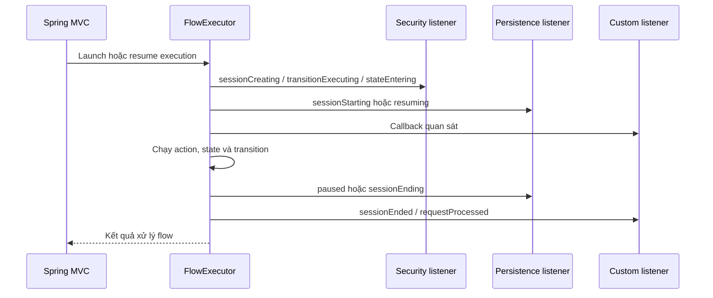

# Thứ tự listener bảo mật, dữ liệu và listener tùy chỉnh

## 1. Vì sao thứ tự listener quan trọng?

Trong **Spring Web Flow**, một flow execution đi qua nhiều giai đoạn: khởi tạo flow session, kiểm tra quyền, xử lý event và transition, mở hoặc phục hồi persistence context, render view, rồi tạm dừng hoặc kết thúc. Các phần việc dùng chung như bảo mật, quản lý dữ liệu và audit có thể được gắn vào vòng đời đó bằng **FlowExecutionListener**.

Một ứng dụng thường có ba nhóm listener:

- **Listener bảo mật:** kiểm tra người dùng có quyền khởi chạy flow, đi vào state hoặc thực hiện transition hay không.
- **Listener dữ liệu/persistence:** mở, gắn, tháo và đóng JPA EntityManager hoặc Hibernate Session theo vòng đời flow.
- **Listener tùy chỉnh:** ghi audit, đo metrics, lưu lịch sử điều hướng, bổ sung correlation ID hoặc quan sát kết quả.

Các listener có thể cùng nhận một callback. Vì vậy thứ tự đăng ký ảnh hưởng đến việc listener nào chạy trước khi listener khác thay đổi trạng thái, commit dữ liệu hoặc ném exception. Ví dụ:

- Listener audit chạy trước kiểm tra quyền có thể ghi nhận một transition mà người dùng không được phép thực hiện.
- Listener tùy chỉnh đọc persistence context sau khi listener JPA đã đóng EntityManager có thể gặp lỗi.
- Listener gửi thông báo thành công trước khi commit hoàn tất có thể thông báo một kết quả chưa được lưu.

Bài này tập trung vào **thứ tự đăng ký và phối hợp** giữa `SecurityFlowExecutionListener`, `JpaFlowExecutionListener`/`HibernateFlowExecutionListener` và listener do ứng dụng viết.

## 2. Listener được gọi ở đâu trong vòng đời flow?

`FlowExecutionListener` là điểm mở rộng quan sát vòng đời một flow execution. Listener được gắn vào execution khi execution được tạo hoặc phục hồi từ repository. Những listener được đăng ký cho executor sẽ được áp dụng theo flow definition phù hợp với criteria.

Các callback thường cần biết:

| Callback | Thời điểm | Công việc phù hợp |
| --- | --- | --- |
| `requestSubmitted` | Request bắt đầu thao tác với execution | Tạo ngữ cảnh quan sát cho request |
| `sessionCreating` | Trước khi tạo flow session | Kiểm tra quyền khởi chạy flow |
| `sessionStarting` | Session đã tạo, trước khi flow chạy | Khởi tạo dữ liệu gắn với session |
| `resuming` | Execution được phục hồi, trước khi xử lý event | Gắn lại tài nguyên cần dùng trong request |
| `eventSignaled` | Event được phát ra trước khi transition chạy | Ghi nhận event đã nhận |
| `transitionExecuting` | Transition đã khớp, trước khi thực thi | Kiểm tra quyền trên transition, audit ý định |
| `stateEntering` | Trước khi vào state đích | Kiểm tra quyền vào state |
| `stateEntered` | Sau khi đã vào state | Ghi nhận state đã tới |
| `viewRendering` / `viewRendered` | Trước/sau khi Web Flow render view | Đo thời gian render |
| `paused` | Execution tạm dừng để chờ tương tác tiếp | Tháo tài nguyên gắn với thread |
| `sessionEnding` | Session sắp kết thúc, trước khi kết thúc | Xử lý dữ liệu trước commit/đóng tài nguyên |
| `sessionEnded` | Sau khi session đã kết thúc | Ghi nhận outcome cuối |
| `exceptionThrown` | Khi exception phát sinh, trước flow exception handler | Ghi nhận lỗi, tháo tài nguyên phù hợp |
| `requestProcessed` | Request xử lý xong | Kết thúc đo lường request |

Không phải mọi listener đều triển khai mọi callback. Ví dụ, `SecurityFlowExecutionListener` tập trung vào `sessionCreating`, `transitionExecuting` và `stateEntering`; listener JPA tập trung vào `sessionStarting`, `resuming`, `paused`, `sessionEnding`, `sessionEnded` và `exceptionThrown`.



Sơ đồ khái quát các nhóm trách nhiệm; callback thực tế được phát theo từng giai đoạn và chỉ gọi listener có triển khai callback tương ứng. Ví dụ, listener bảo mật không nhất thiết nhận callback `sessionEnding`, còn listener JPA không thực hiện kiểm tra quyền state.

## 3. Quy tắc thứ tự đăng ký

### 3.1. Thứ tự trong cấu hình trở thành thứ tự dispatch

Khi cấu hình bằng Java, các lời gọi `addFlowExecutionListener(...)` thêm listener vào danh sách của executor. Khi một callback được phát, Web Flow duyệt danh sách listener theo **thứ tự đăng ký**. Với XML namespace, thứ tự các phần tử `<webflow:listener>` trong `<webflow:flow-execution-listeners>` thể hiện thứ tự danh sách tương ứng.

Ví dụ:

```java
return getFlowExecutorBuilder(flowRegistry)
        .addFlowExecutionListener(securityListener)
        .addFlowExecutionListener(persistenceListener)
        .addFlowExecutionListener(auditListener)
        .build();
```

Với cấu hình này, callback chung được gửi lần lượt đến `securityListener`, `persistenceListener`, rồi `auditListener`. Nếu một callback ném exception và exception thoát khỏi listener dispatcher, các listener phía sau có thể không nhận callback đó.

**Đừng nhầm với `@Order` của Spring.** Khi gọi builder tường minh theo thứ tự như trên, hãy xem chính thứ tự các lời gọi builder là nguồn cấu hình. `@Order` trên class listener không tự sắp xếp lại các lời gọi `addFlowExecutionListener` đã viết. Tương tự, không giả định callback kết thúc tự động chạy theo thứ tự ngược.

### 3.2. Thứ tự áp dụng cho từng callback

Thứ tự đăng ký không có nghĩa listener đầu tiên luôn chạy trước mọi công việc của listener khác trong toàn bộ flow. Mỗi callback là một lần dispatch riêng:

- `sessionCreating` được phát khi flow session mới chuẩn bị được tạo.
- `sessionStarting` được phát sau đó, khi session đã tồn tại nhưng chưa chạy.
- `sessionEnding` được phát trước khi session kết thúc.
- `sessionEnded` được phát sau khi session đã kết thúc.

Một listener có thể chỉ triển khai một trong các callback này. Vì vậy cần đọc **callback cụ thể** mà từng listener sử dụng trước khi quyết định thứ tự.

### 3.3. Criteria giới hạn listener theo flow

Không phải listener nào cũng cần chạy cho mọi flow. `FlowExecutorBuilder` hỗ trợ đăng ký listener cùng criteria là danh sách flow ID phân tách bằng dấu phẩy; XML namespace có thuộc tính `criteria`.

```java
return getFlowExecutorBuilder(flowRegistry)
        .addFlowExecutionListener(securityListener)
        .addFlowExecutionListener(
                auditListener, "checkout,applicationReview")
        .addFlowExecutionListener(
                jpaListener, "checkout")
        .build();
```

Ở ví dụ này:

- Listener bảo mật được gắn cho mọi flow trong executor.
- Listener audit chỉ quan sát `checkout` và `applicationReview`.
- Listener JPA chỉ được gắn với `checkout`, là flow được cấu hình dùng flow-managed persistence context.

Criteria là **flow definition ID**, không phải state ID, event ID hay URL trình duyệt. Giá trị `*` có thể dùng để chỉ tất cả flow theo API criteria của phiên bản tương ứng.

## 4. Listener bảo mật: kiểm tra trước khi cho phép flow tiến lên

### 4.1. SecurityFlowExecutionListener làm gì?

`SecurityFlowExecutionListener` tích hợp các quy tắc bảo mật khai báo trong flow với Spring Security. Listener có thể kiểm tra:

- **Flow:** người dùng có được phép khởi chạy flow hay không (`sessionCreating`).
- **Transition:** người dùng có được phép thực hiện đường chuyển đã chọn hay không (`transitionExecuting`).
- **State:** người dùng có được phép đi vào state đích hay không (`stateEntering`).

Ví dụ khai báo rule:

```xml
<flow xmlns="http://www.springframework.org/schema/webflow">
    <secured attributes="ROLE_USER"/>

    <view-state id="review" view="application/review">
        <transition on="approve" to="approved">
            <secured attributes="ROLE_REVIEWER"/>
        </transition>
    </view-state>

    <end-state id="approved">
        <secured attributes="ROLE_REVIEWER"/>
    </end-state>
</flow>
```

`<secured>` trong flow definition chỉ mô tả rule. **Phải đăng ký `SecurityFlowExecutionListener` vào FlowExecutor thì các rule này mới được thực thi.** Chỉ viết XML `<secured>` mà không có listener sẽ không tạo ra cơ chế bảo vệ runtime.

### 4.2. Đăng ký listener bảo mật

```java
@Bean
public SecurityFlowExecutionListener securityFlowExecutionListener() {
    return new SecurityFlowExecutionListener();
}

@Bean
public FlowExecutor flowExecutor(
        FlowDefinitionRegistry flowRegistry,
        SecurityFlowExecutionListener securityFlowExecutionListener,
        JpaFlowExecutionListener jpaFlowExecutionListener,
        AuditFlowExecutionListener auditFlowExecutionListener) {

    return getFlowExecutorBuilder(flowRegistry)
            .addFlowExecutionListener(securityFlowExecutionListener)
            .addFlowExecutionListener(jpaFlowExecutionListener)
            .addFlowExecutionListener(auditFlowExecutionListener)
            .build();
}
```

Đặt listener bảo mật ở đầu danh sách là lựa chọn hợp lý khi các listener tùy chỉnh cùng callback có thể ghi audit hoặc tạo side effect. Kiểm tra quyền nên xảy ra trước khi các quan sát tùy chỉnh xử lý transition/state bị từ chối.

Trong Spring Web Flow 3.0.1, `SecurityFlowExecutionListener` có thể dùng `AuthorizationManager` thông qua `setAuthorizationManagerInitializer(...)`. Các API `AccessDecisionManager` cũ được đánh dấu deprecated trong dòng API này; khi nâng cấp, hãy dùng cơ chế authorization phù hợp với phiên bản Spring Security và Web Flow đang chạy.

### 4.3. Không nuốt AccessDeniedException

Khi quyền bị từ chối, listener bảo mật có thể ném `AccessDeniedException` hoặc exception liên quan. Exception cần được truyền lên tầng Spring Security để ứng dụng xử lý xác thực/ủy quyền theo cấu hình.

Listener audit hoặc listener xử lý exception tùy chỉnh không nên bắt mọi exception rồi biến chúng thành kết quả thành công, redirect bình thường hoặc end-state hủy. Làm vậy có thể khiến ứng dụng bỏ qua quyết định bảo mật. Nếu cần ghi nhận truy cập bị từ chối, hãy ghi nhận rồi **để exception tiếp tục truyền đi**.

Listener bảo mật của Web Flow cũng không thay thế Spring Security filter chain, method security hoặc kiểm tra quyền trong service. Các endpoint và dữ liệu nghiệp vụ vẫn cần được bảo vệ ở những lớp tương ứng.

## 5. Listener dữ liệu: JPA và Hibernate

### 5.1. Vai trò của JpaFlowExecutionListener

`JpaFlowExecutionListener` triển khai mô hình **Flow Managed Persistence Context (FMPC)**. Với flow được cấu hình dùng persistence context, listener quản lý vòng đời `EntityManager` theo flow:

1. Khi flow session bắt đầu, tạo persistence context và gắn vào flow scope.
2. Trước khi xử lý request resume, gắn context của flow vào thread hiện tại.
3. Khi execution tạm dừng, tháo context khỏi thread.
4. Khi flow kết thúc, nếu end-state là commit state (`commit="true"`), commit thay đổi trong transaction; sau đó tháo và đóng context.
5. Khi exception phát sinh, tháo context khỏi thread trong quá trình xử lý phù hợp.

Ví dụ flow dùng persistence context:

```xml
<flow xmlns="http://www.springframework.org/schema/webflow">
    <persistence-context/>

    <view-state id="review" view="checkout/review">
        <transition on="confirm" to="completed"/>
        <transition on="cancel" to="cancelled"/>
    </view-state>

    <end-state id="completed" commit="true"/>
    <end-state id="cancelled" commit="false"/>
</flow>
```

Đây là trích đoạn minh họa: end-state `completed` yêu cầu commit; `cancelled` kết thúc mà không commit persistence context theo cơ chế flow-managed persistence. Service transaction riêng vẫn phải tuân thủ transaction boundary của nó.

### 5.2. Listener JPA không phải listener audit

`JpaFlowExecutionListener` quản lý tài nguyên và transaction. Nó không chịu trách nhiệm:

- Xác thực hoặc phân quyền người dùng.
- Ghi lịch sử nghiệp vụ theo yêu cầu sản phẩm.
- Gửi email, phát message hoặc gọi dịch vụ ngoài.
- Chọn state tiếp theo hoặc quyết định outcome nghiệp vụ.

Không sửa hoặc subclass listener JPA chỉ để thêm log nghiệp vụ. Hãy dùng listener tùy chỉnh riêng để quan sát lifecycle, còn thao tác dữ liệu vẫn đặt trong service/action có transaction rõ ràng.

Nếu dự án dùng Hibernate trực tiếp, có `HibernateFlowExecutionListener` tương ứng. **Chọn listener phù hợp với cách truy cập persistence của ứng dụng**; không đăng ký đồng thời cả Hibernate và JPA listener cho cùng một persistence context chỉ để “chắc chắn”, vì có thể tạo hai cơ chế quản lý session/context chồng lấn.

### 5.3. Vì sao vị trí của listener JPA quan trọng?

Trong callback `sessionEnding`, listener JPA có thể:

- Kiểm tra end-state có `commit="true"` hay không.
- Thực hiện commit cuối trong transaction.
- Unbind và đóng `EntityManager`.

Các listener được gọi theo thứ tự đăng ký. Vì vậy, listener tùy chỉnh chạy trong **cùng callback `sessionEnding`** sau listener JPA có thể thấy persistence context đã đóng. Nếu listener tùy chỉnh cần quan sát dữ liệu đang được quản lý ngay trước commit, nó phải chạy trước JPA listener và không được tự ý làm thay đổi transaction.

Ngược lại, nếu listener tùy chỉnh chỉ cần biết session đã kết thúc và outcome cuối, hãy dùng `sessionEnded`. Callback này xảy ra sau `sessionEnding`; listener JPA đã thực hiện công việc commit/đóng context trước đó. Không truy cập `EntityManager` đã đóng từ `sessionEnded`.

## 6. Chọn thứ tự giữa security, persistence và custom listener

Không có một thứ tự duy nhất phù hợp cho mọi listener tùy chỉnh. Hãy quyết định theo callback mà custom listener cần tham gia.

### 6.1. Cấu hình mặc định cho audit sau khi session kết thúc

Nếu listener tùy chỉnh chỉ ghi nhận state/outcome và không cần truy cập persistence context, có thể đăng ký:

```text
1. SecurityFlowExecutionListener
2. JpaFlowExecutionListener hoặc HibernateFlowExecutionListener
3. Custom audit/metrics listener
```

Ý nghĩa:

- Security kiểm tra trước các listener tùy chỉnh có thể tạo side effect ở callback tương ứng.
- Persistence listener quản lý context và xử lý commit/close.
- Custom listener ghi nhận outcome ở `sessionEnded`, hoặc metrics ở các callback quan sát khác.

Ví dụ XML:

```xml
<webflow:flow-executor id="flowExecutor"
                       flow-registry="flowRegistry">
    <webflow:flow-execution-listeners>
        <webflow:listener ref="securityListener"/>
        <webflow:listener ref="jpaListener" criteria="checkout"/>
        <webflow:listener ref="auditListener"/>
    </webflow:flow-execution-listeners>
</webflow:flow-executor>
```

Ví dụ Java:

```java
@Bean
public FlowExecutor flowExecutor(
        FlowDefinitionRegistry flowRegistry,
        SecurityFlowExecutionListener securityListener,
        JpaFlowExecutionListener jpaListener,
        AuditFlowExecutionListener auditListener) {

    return getFlowExecutorBuilder(flowRegistry)
            .addFlowExecutionListener(securityListener)
            .addFlowExecutionListener(jpaListener, "checkout")
            .addFlowExecutionListener(auditListener)
            .build();
}
```

### 6.2. Custom listener cần quan sát trước commit

Nếu custom listener có callback `sessionEnding` và cần đọc trạng thái persistence context trước khi JPA commit/đóng, đặt nó **trước** listener JPA:

```java
return getFlowExecutorBuilder(flowRegistry)
        .addFlowExecutionListener(securityListener)
        .addFlowExecutionListener(preCommitAuditListener, "checkout")
        .addFlowExecutionListener(jpaListener, "checkout")
        .build();
```

Ở callback `sessionEnding`, `preCommitAuditListener` chạy trước `jpaListener`. Nó có thể thu thập thông tin cần thiết trong khi context còn hoạt động, nhưng nên tránh:

- Tự gọi `commit()` hoặc `flush()` ngoài chính sách flow.
- Ghi các thay đổi nghiệp vụ không được kiểm soát vào entity đang managed.
- Gửi email/message như thể commit đã chắc chắn thành công.
- Giữ `EntityManager` hoặc entity proxy sau khi callback kết thúc.

Nếu cần lưu audit bền vững cùng transaction nghiệp vụ, ưu tiên ghi audit/outbox trong service transaction. Listener chỉ nên điều phối hoặc quan sát; nó không thay thế transaction nghiệp vụ.

### 6.3. Custom listener cần context cha sau khi subflow kết thúc

Một tình huống cụ thể khác xuất hiện khi flow cha dùng persistence context nhưng subflow không dùng. Listener JPA tháo context của cha khi bắt đầu subflow không dùng persistence context, rồi gắn lại context của cha trong callback `sessionEnded` khi subflow kết thúc.

Nếu custom listener cần truy cập context cha ngay trong callback `sessionEnded`, hãy đăng ký nó **sau** JPA listener để listener JPA có cơ hội gắn lại context trước. Cách này chỉ áp dụng khi custom listener thực sự phụ thuộc context cha; nếu không, tránh truy cập persistence context trong listener.

### 6.4. Bảng chọn thứ tự theo nhu cầu

| Nhu cầu của custom listener | Callback phù hợp | Vị trí đăng ký so với JPA listener |
| --- | --- | --- |
| Ghi state/transition đã được security cho phép | `stateEntered` hoặc callback quan sát tương ứng | Sau security; vị trí so với JPA thường không quan trọng |
| Kiểm tra ý định kết thúc trước commit | `sessionEnding` | Trước JPA |
| Đọc outcome sau khi session kết thúc | `sessionEnded` | Sau JPA nếu cần thấy trạng thái context cha đã được phục hồi |
| Đo request/view | `requestSubmitted`, `requestProcessed`, `viewRendering`, `viewRendered` | Thường không phụ thuộc thứ tự JPA |
| Gửi thông báo chỉ khi dữ liệu đã commit | Ưu tiên outbox/transactional event trong service; có thể quan sát `sessionEnded` | Không dựa duy nhất vào listener nếu cần bảo đảm giao nhận |

## 7. Viết custom FlowExecutionListener

### 7.1. Chọn callback đúng với trách nhiệm

Ví dụ listener audit chỉ ghi nhận flow và outcome, không truy cập entity hoặc dữ liệu nhạy cảm:

```java
package com.example.webflow.audit;

import org.springframework.webflow.execution.AttributeMap;
import org.springframework.webflow.execution.FlowSession;
import org.springframework.webflow.execution.RequestContext;
import org.springframework.webflow.execution.StateDefinition;
import org.springframework.webflow.execution.FlowExecutionListener;

public final class AuditFlowExecutionListener
        implements FlowExecutionListener {

    private final AuditService auditService;

    public AuditFlowExecutionListener(AuditService auditService) {
        this.auditService = auditService;
    }

    @Override
    public void stateEntering(
            RequestContext context, StateDefinition state) {
        String flowId = context.getActiveFlow().getId();
        auditService.recordStateAttempt(flowId, state.getId());
    }

    @Override
    public void sessionEnded(
            RequestContext context,
            FlowSession session,
            String outcome,
            AttributeMap<?> output) {

        if (!session.isRoot()) {
            return;
        }

        auditService.recordFlowOutcome(
                session.getDefinition().getId(), outcome);
    }
}
```

`AuditService` là service do ứng dụng định nghĩa. Ví dụ cố ý không ghi toàn bộ `output`, `flowScope`, request parameter hoặc execution key; các giá trị đó có thể chứa dữ liệu cá nhân, token hoặc thông tin nghiệp vụ nhạy cảm.

Trong API Spring Web Flow 3.x, `FlowExecutionListener` có các default method nên có thể implement trực tiếp những callback cần dùng. Một số ví dụ cũ dùng `FlowExecutionListenerAdapter`; khi làm việc với phiên bản mới, hãy kiểm tra trạng thái deprecated trong Javadoc của dependency dự án.

### 7.2. Listener thường là bean dùng chung

Listener được đăng ký trong executor thường được tái sử dụng cho nhiều flow execution đồng thời. Vì vậy:

- Giữ listener stateless hoặc chỉ chứa dependency thread-safe.
- Không lưu `RequestContext`, `FlowSession`, entity mutable hoặc user-specific state trong field.
- Không dùng một biến `currentFlowId` hoặc `currentEntityManager` toàn cục để nối callback.
- Nếu cần dữ liệu giữa các callback, lưu đúng scope của flow/request hoặc dùng cơ chế correlation có kiểm soát.
- Không gọi dịch vụ mạng đồng bộ trong callback chỉ để ghi metrics.

Một listener tùy chỉnh có thể nhận nhiều callback đồng thời từ các request khác nhau. Dữ liệu trạng thái cục bộ nên nằm trong biến của callback; dữ liệu dài hạn nên được quản lý bởi service/repository phù hợp.

## 8. Ví dụ cấu hình đầy đủ theo ba nhóm listener

Giả sử ứng dụng có:

- Flow `checkout` sử dụng `<persistence-context/>`.
- Flow `applicationReview` có rule bảo mật nhưng không dùng flow-managed JPA context.
- Audit listener theo dõi cả hai flow.

### 8.1. Khai báo bean

```java
@Configuration
public class WebFlowListenerConfiguration
        extends AbstractFlowConfiguration {

    @Bean
    public SecurityFlowExecutionListener securityListener() {
        return new SecurityFlowExecutionListener();
    }

    @Bean
    public JpaFlowExecutionListener jpaListener(
            EntityManagerFactory entityManagerFactory,
            PlatformTransactionManager transactionManager) {
        return new JpaFlowExecutionListener(
                entityManagerFactory, transactionManager);
    }

    @Bean
    public AuditFlowExecutionListener auditListener(
            AuditService auditService) {
        return new AuditFlowExecutionListener(auditService);
    }

    @Bean
    public FlowExecutor flowExecutor(
            FlowDefinitionRegistry flowRegistry,
            SecurityFlowExecutionListener securityListener,
            JpaFlowExecutionListener jpaListener,
            AuditFlowExecutionListener auditListener) {

        return getFlowExecutorBuilder(flowRegistry)
                .addFlowExecutionListener(securityListener)
                .addFlowExecutionListener(jpaListener, "checkout")
                .addFlowExecutionListener(
                        auditListener, "checkout,applicationReview")
                .build();
    }
}
```

Các import persistence trong ví dụ tương ứng Spring Web Flow 3.x/Jakarta Persistence. Dự án dùng phiên bản Servlet/JPA cũ cần điều chỉnh package `javax.*`/`jakarta.*` theo dependency thực tế. Không khai báo một `FlowExecutor` thứ hai nếu ứng dụng đã có executor; hãy thêm listener vào builder của executor hiện hữu.

### 8.2. Định nghĩa flow

Flow `checkout` bật persistence context:

```xml
<flow xmlns="http://www.springframework.org/schema/webflow">
    <persistence-context/>

    <view-state id="review" view="checkout/review">
        <transition on="confirm" to="completed"/>
        <transition on="cancel" to="cancelled"/>
    </view-state>

    <end-state id="completed" commit="true"/>
    <end-state id="cancelled" commit="false"/>
</flow>
```

Flow `applicationReview` có thể khai báo security rule riêng:

```xml
<flow xmlns="http://www.springframework.org/schema/webflow">
    <secured attributes="ROLE_REVIEWER"/>

    <view-state id="review" view="application/review">
        <transition on="approve" to="approved">
            <secured attributes="ROLE_REVIEWER"/>
        </transition>
    </view-state>

    <end-state id="approved"/>
</flow>
```

Rule bảo mật chỉ được thực thi khi `securityListener` được gắn vào FlowExecutor. `jpaListener` chỉ được áp dụng cho flow ID `checkout`; audit listener áp dụng cho hai flow được nêu trong criteria.

## 9. Kiểm thử thứ tự listener

Không nên chỉ nhìn thứ tự bean trong file cấu hình rồi giả định ứng dụng đang chạy đúng. Hãy viết một listener ghi nhận thứ tự callback trong integration test.

### 9.1. Recorder đơn giản

```java
import java.util.ArrayList;
import java.util.List;

import org.springframework.binding.collection.AttributeMap;
import org.springframework.binding.collection.MutableAttributeMap;
import org.springframework.webflow.execution.FlowExecutionListener;
import org.springframework.webflow.execution.FlowSession;
import org.springframework.webflow.execution.RequestContext;
import org.springframework.webflow.execution.StateDefinition;

public final class RecordingFlowListener
        implements FlowExecutionListener {

    private final String name;
    private final List<String> calls;

    public RecordingFlowListener(String name, List<String> calls) {
        this.name = name;
        this.calls = calls;
    }

    @Override
    public void stateEntering(
            RequestContext context, StateDefinition state) {
        calls.add(name + ".stateEntering");
    }

    @Override
    public void sessionEnding(
            RequestContext context,
            FlowSession session,
            String outcome,
            MutableAttributeMap<?> output) {
        calls.add(name + ".sessionEnding");
    }

    @Override
    public void sessionEnded(
            RequestContext context,
            FlowSession session,
            String outcome,
            AttributeMap<?> output) {
        calls.add(name + ".sessionEnded");
    }
}
```

Trong test, tạo hai recorder và đăng ký theo thứ tự:

```java
import java.util.ArrayList;
import java.util.List;

import org.springframework.webflow.executor.FlowExecutor;

List<String> calls = new ArrayList<>();

RecordingFlowListener first =
        new RecordingFlowListener("first", calls);
RecordingFlowListener second =
        new RecordingFlowListener("second", calls);

FlowExecutor executor = getFlowExecutorBuilder(flowRegistry)
        .addFlowExecutionListener(first)
        .addFlowExecutionListener(second)
        .build();
```

Khởi chạy flow test, gửi event để đi vào state tiếp theo rồi kết thúc flow. Với mỗi callback chung, assertion cần xác nhận `first` được ghi trước `second`, ví dụ:

```java
import static org.assertj.core.api.Assertions.assertThat;

assertThat(calls).containsSubsequence(
        "first.stateEntering",
        "second.stateEntering");

assertThat(calls).containsSubsequence(
        "first.sessionEnding",
        "second.sessionEnding");
```

Đây là kiểm thử thứ tự dispatcher bằng listener quan sát. Với listener thật, cần thêm integration test kiểm tra các điều kiện quan trọng:

- Người không đủ quyền bị chặn trước khi custom listener tạo side effect.
- `JpaFlowExecutionListener` mở context khi flow bắt đầu và tháo context khi pause.
- End-state `commit="true"` commit được dữ liệu; end-state hủy không commit flow-managed changes.
- Custom listener không truy cập `EntityManager` sau khi JPA listener đã đóng.
- Subflow không dùng persistence context trả quyền truy cập context cha theo đúng thời điểm.
- Exception trong listener bảo mật vẫn truyền tới Spring Security; audit listener không nuốt exception.

### 9.2. Kiểm thử criteria

Nếu listener được đăng ký với criteria `checkout,applicationReview`, hãy khởi chạy thêm một flow khác, ví dụ `signup`, rồi xác nhận listener đó không nhận callback. Điều này tránh vô tình ghi audit hoặc mở persistence context cho flow không cần.

### 9.3. Kiểm thử lỗi ở listener

Một listener có thể ném exception trong callback. Hãy kiểm thử ít nhất:

- Security listener từ chối quyền: execution không tiếp tục state/transition bị bảo vệ.
- Persistence listener thất bại khi commit: outcome thành công không được giả lập nếu transaction chưa commit.
- Listener audit/metrics gặp lỗi phụ trợ: xác định chính sách rõ ràng; thường không nên để lỗi ghi metrics làm hỏng flow nghiệp vụ.

Không dùng `try/catch (Exception)` bao quanh toàn bộ listener để nuốt mọi lỗi. Với security và persistence, exception có thể là một phần thiết yếu của hợp đồng.

## 10. Những lỗi thường gặp khi sắp xếp listener

| Triệu chứng | Nguyên nhân thường gặp | Cách xử lý |
| --- | --- | --- |
| Flow có `<secured>` nhưng vẫn cho vào state | Chưa đăng ký `SecurityFlowExecutionListener` | Thêm listener vào executor đang phục vụ flow |
| Audit ghi transition dù người dùng bị từ chối | Custom listener được đăng ký trước security và ghi ở callback cùng pha | Đặt security trước listener tạo side effect; chỉ audit outcome đã xác nhận nếu phù hợp |
| `EntityManager` đã đóng khi custom listener đọc dữ liệu | Custom `sessionEnding` chạy sau JPA listener | Đặt custom pre-commit listener trước JPA hoặc chuyển xử lý sang `sessionEnded`/service |
| Subflow kết thúc nhưng parent không có persistence context | Custom `sessionEnded` chạy trước JPA listener tái gắn context cha | Nếu thật sự cần context cha, đặt custom callback sau JPA và kiểm thử |
| Listener chạy trên flow không liên quan | Criteria không giới hạn hoặc flow ID nhập sai | Dùng criteria theo flow ID và test cả flow được/không được chọn |
| Metrics/logging làm flow thất bại | Listener ném exception do hệ thống phụ trợ lỗi | Không để telemetry lỗi chặn nghiệp vụ; ghi lỗi phụ trợ theo chính sách riêng |
| Audit bị ghi hai lần | Cùng một nghiệp vụ được ghi ở transition, sessionEnded và service | Chọn một nguồn sự thật, dùng idempotency/correlation |
| Dữ liệu request của hai execution bị lẫn | Listener singleton lưu trạng thái execution vào field mutable | Stateless listener; lưu dữ liệu đúng flow/request scope |
| AccessDeniedException biến thành trang lỗi chung | Exception handler tùy chỉnh bắt và nuốt lỗi bảo mật | Cho exception truyền tới Spring Security |
| Commit xảy ra dù người dùng hủy | End-state hủy cấu hình commit hoặc service đã commit transaction riêng | Kiểm tra commit và transaction boundary của service |

## 11. Nguyên tắc vận hành

- **Bảo mật trước side effect:** đăng ký `SecurityFlowExecutionListener` sớm; bảo vệ flow, state và transition cần thiết.
- **Một cơ chế persistence cho một persistence context:** chọn JPA hoặc Hibernate listener phù hợp, giới hạn vào flow cần dùng.
- **Đặt custom listener theo callback:** pre-commit cần chạy trước persistence listener; quan sát outcome sau khi session kết thúc dùng `sessionEnded`.
- **Không phụ thuộc vào thứ tự ngoài callback:** nếu một công việc phải xảy ra sau commit, ưu tiên transaction event/outbox thay vì giả định callback bất kỳ là post-commit.
- **Không giữ tài nguyên qua pause:** để persistence listener tháo context khỏi thread; custom listener không giữ `EntityManager`, connection hoặc request context trong field.
- **Giữ listener nhẹ và an toàn đồng thời:** không dùng callback để gọi API từ xa đồng bộ, xử lý tác vụ nặng hoặc lưu payload nhạy cảm.
- **Kiểm thử cấu hình thật:** kiểm tra cả thứ tự, criteria, exception và vòng đời subflow; thứ tự đăng ký cần được xác minh lại sau khi nâng cấp Spring Web Flow.

## 12. Bài tập thực hành

Ứng dụng có hai flow `checkout` và `loanReview`:

- `checkout` dùng JPA flow-managed persistence context.
- `loanReview` yêu cầu `ROLE_LOAN_REVIEWER` để vào state `decision`.
- Cả hai flow đều cần audit outcome và đo số lần state được truy cập.

Hãy thực hiện:

1. Khai báo `SecurityFlowExecutionListener`, `JpaFlowExecutionListener` và `AuditFlowExecutionListener`.
2. Đăng ký security listener trước listener tùy chỉnh có side effect.
3. Giới hạn JPA listener chỉ cho `checkout`.
4. Viết custom `sessionEnded` để ghi outcome mà không log output nhạy cảm.
5. Viết một custom `sessionEnding` thử nghiệm để quan sát trạng thái trước commit; đăng ký nó trước JPA listener và giải thích lý do.
6. Tạo subflow không dùng persistence context bên trong `checkout`; kiểm tra callback nào tháo và gắn lại context cha.
7. Viết integration test xác nhận user không có quyền bị chặn, checkout commit đúng end-state, hủy không commit và listener criteria không áp dụng nhầm sang `loanReview`.
8. Thay đổi thứ tự custom listener và JPA listener, quan sát khác biệt tại `sessionEnding` và `sessionEnded`.

**Tiêu chí đạt:** giải thích được thứ tự dispatch theo thứ tự đăng ký, phân biệt `sessionEnding` với `sessionEnded`, biết khi nào custom listener cần đứng trước/sau persistence listener, và không để listener tùy chỉnh làm suy yếu kiểm tra quyền hoặc transaction.

## 13. Ghi nhớ

- `FlowExecutionListener` quan sát lifecycle của flow; listener được đăng ký vào `FlowExecutor` và có thể giới hạn theo flow ID.
- Các callback được dispatch theo **thứ tự listener đã đăng ký**; thứ tự gọi `addFlowExecutionListener(...)` trong Java hoặc thứ tự phần tử listener trong XML cần được chủ động quản lý.
- `SecurityFlowExecutionListener` thực thi rule `<secured>` ở flow, state và transition; chỉ khai báo `<secured>` mà không đăng ký listener là chưa đủ.
- `JpaFlowExecutionListener`/`HibernateFlowExecutionListener` quản lý persistence context; chọn đúng một cơ chế phù hợp và giới hạn vào flow cần dùng.
- `sessionEnding` xảy ra trước khi session kết thúc; JPA listener có thể commit và đóng context ở giai đoạn này. `sessionEnded` xảy ra sau đó.
- Custom listener cần xem dữ liệu trước commit phải chạy trước JPA listener ở callback `sessionEnding`; listener chỉ cần outcome có thể dùng `sessionEnded`.
- Với subflow không dùng persistence context trong flow cha có JPA context, thứ tự callback `sessionEnded` có thể quyết định custom listener có thấy context cha đã được gắn lại hay chưa.
- Listener thường được dùng chung đồng thời; không lưu trạng thái request/execution vào field mutable và không để lỗi telemetry làm hỏng flow.
- Luôn kiểm thử thứ tự, criteria, exception, commit/cancel và hành vi subflow trên phiên bản Web Flow thực tế.

### Tài liệu tham khảo

- [Spring Web Flow 3.0 Reference Guide – Attaching Flow Execution Listeners](https://docs.spring.io/spring-webflow/docs/3.0.x/reference/#flow-execution-listeners): cấu hình listener bằng XML, Java và criteria theo flow.
- [FlowExecutorBuilder Javadoc](https://docs.spring.io/spring-webflow/docs/3.0.1/api/org/springframework/webflow/config/FlowExecutorBuilder.html): `addFlowExecutionListener` và criteria.
- [FlowExecutionListener Javadoc](https://docs.spring.io/spring-webflow/docs/3.0.1/api/org/springframework/webflow/execution/FlowExecutionListener.html): callback lifecycle và thời điểm gọi.
- [SecurityFlowExecutionListener Javadoc](https://docs.spring.io/spring-webflow/docs/3.0.1/api/org/springframework/webflow/security/SecurityFlowExecutionListener.html): kiểm tra quyền ở flow, transition và state.
- [Spring Web Flow Security Reference](https://docs.spring.io/spring-webflow/docs/3.0.1/reference/#security): yêu cầu đăng ký listener để thực thi rule bảo mật.
- [JpaFlowExecutionListener Javadoc](https://docs.spring.io/spring-webflow/docs/3.0.1/api/org/springframework/webflow/persistence/JpaFlowExecutionListener.html): vòng đời persistence context, pause/resume và commit state.
- [FlowExecutionListenerLoader Javadoc](https://docs.spring.io/spring-webflow/docs/current/api/org/springframework/webflow/execution/factory/FlowExecutionListenerLoader.html): tải listener phù hợp với từng flow definition.
