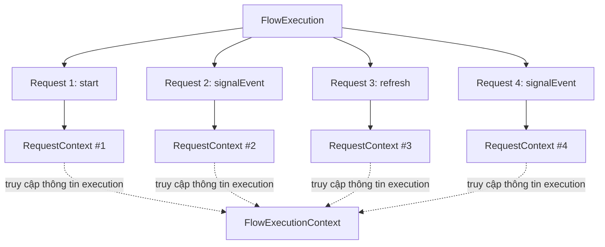
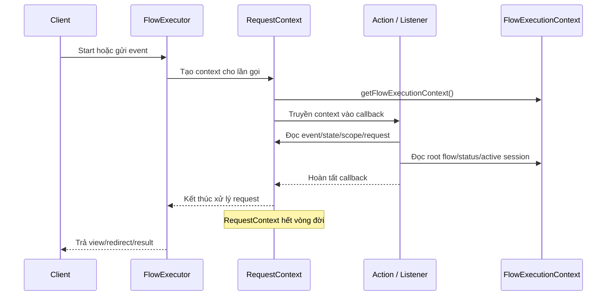

# Truy cập `RequestContext` và `FlowExecutionContext` đúng thời điểm

## Mục tiêu bài học

Trong Spring Web Flow, một request có thể khởi chạy flow, gửi event để tiếp tục flow hoặc yêu cầu render lại view hiện tại. Ở mỗi lần xử lý, framework cung cấp ngữ cảnh để action, listener và transition criterion biết flow nào đang chạy, state nào đang hoạt động, event nào vừa đến và dữ liệu nào có thể đọc hoặc cập nhật.

Hai API trung tâm là:

- **`RequestContext`**: ngữ cảnh điều khiển của một lần gọi vào flow execution. Nó cho phép đọc event, state, request parameter, scope và môi trường client trong lần xử lý hiện tại.
- **`FlowExecutionContext`**: ngữ cảnh mô tả trạng thái tổng thể của một flow execution, gồm flow definition gốc, session đang hoạt động, trạng thái active/ended và outcome.

Truy cập sai thời điểm có thể gây `IllegalStateException`, đọc nhầm state của subflow, dùng nhầm scope hoặc giữ một object đã hết vòng đời. Bài này tập trung vào **khi nào nên đọc API nào và dữ liệu nào còn hợp lệ tại callback đó**.

Sau bài học, bạn có thể:

1. Phân biệt request context của Web Flow với HTTP request của Servlet.
2. Xác định thời điểm `RequestContext` được tạo, sử dụng và giải phóng.
3. Đọc `FlowExecutionContext` để biết root flow, active session, outcome và trạng thái execution.
4. Phân biệt root flow với flow con khi một execution đang chạy subflow.
5. Dùng hai implicit EL variable `flowRequestContext` và `flowExecutionContext`.
6. Truyền context rõ ràng vào POJO action hoặc nhận nó trong `FlowExecutionListener`.
7. Chọn đúng scope và kiểm tra điều kiện trước khi gọi các accessor có thể ném exception.
8. Tránh giữ context qua request, qua thread hoặc sau khi callback kết thúc.
9. Viết test cho vòng đời context và các trường hợp flow chưa bắt đầu, đã kết thúc hoặc đang chạy subflow.

## 1. Vì sao có hai context?

Hãy xét một flow đặt lịch:

```text
Mở flow
  → Nhập thông tin
  → Xem lại
  → Xác nhận
  → Kết thúc với outcome
```

Trong quá trình đó, flow có thể nhận nhiều request:

| Lần gọi vào engine | Việc xảy ra | Thông tin cần biết |
| --- | --- | --- |
| Start | Khởi chạy flow mới | Definition nào được gọi, input nào được truyền |
| Signal event | Người dùng gửi `review`, `back` hoặc `confirm` | Event hiện tại, state đang hoạt động, transition được chọn |
| Refresh | Render lại view hiện tại | View-state hiện tại, URL execution, dữ liệu view |
| Subflow | Flow cha gọi flow xác minh | Flow nào đang active, flow nào là root |
| End | Flow đi tới `end-state` | Execution đã kết thúc chưa, outcome là gì |

`RequestContext` trả lời các câu hỏi gắn với **lần gọi hiện tại**. `FlowExecutionContext` mô tả **execution đang được tiếp tục qua nhiều lần gọi**.



Mỗi lần xử lý có một `RequestContext` riêng. Nó được truyền qua các thành phần nội bộ tham gia xử lý flow và được giải phóng khi lần gọi vào execution kết thúc. `FlowExecutionContext` cung cấp thông tin có thể trải qua nhiều request.

## 2. Phân biệt `RequestContext` và `FlowExecutionContext`

| Tiêu chí | `RequestContext` | `FlowExecutionContext` |
| --- | --- | --- |
| Package | `org.springframework.webflow.execution` | `org.springframework.webflow.execution` |
| Vai trò | Context điều khiển một lần gọi vào flow | Context mô tả execution đang chạy |
| Phạm vi thời gian | Một lần start, signal event hoặc refresh | Xuyên qua nhiều request của cùng execution |
| Trạng thái | Có thông tin request, event, transition, state, view | Có trạng thái active/ended, outcome, root definition và active session |
| Đọc event hiện tại | Có `getCurrentEvent()` | Không có |
| Đọc transition hiện tại | Có `getCurrentTransition()` | Không có |
| Đọc request parameter | Có `getRequestParameters()` | Không có |
| Đọc root flow definition | Qua `getFlowExecutionContext().getDefinition()` | Có `getDefinition()` |
| Đọc active session | Qua `getFlowExecutionContext().getActiveSession()` | Có `getActiveSession()` |
| Scope | Có request, flow, view, flash, conversation | Có conversation và flash scope |
| Thao tác phù hợp | Xử lý request, action, listener, validation, transition | Quan sát trạng thái execution và quan hệ session |

### Một điểm dễ nhầm: “request” ở đây không có nghĩa là HTTP request

`RequestContext` biểu diễn **một lần gọi vào hệ thống flow để thao tác một execution**. Lần gọi đó có thể là:

- `start`: tạo và khởi chạy execution.
- `signalEvent`: tiếp tục execution bằng event.
- `refresh`: khôi phục lựa chọn view cuối để trả response lại.

Nó không phải `HttpServletRequest`. Đối tượng đại diện môi trường client là `ExternalContext`, có thể cung cấp request parameter, request/session map, principal và thông tin môi trường. Nếu cần API Servlet cụ thể, có thể downcast `ExternalContext` trong ứng dụng Servlet, nhưng nên giữ flow artifact độc lập với Servlet khi có thể.

## 3. Vòng đời của `RequestContext`

Một `RequestContext` mới thường được tạo khi một trong các operation của flow execution được gọi:

```text
FlowExecutor.start(...)
FlowExecutor.resume(...)/signalEvent(...)
FlowExecutor.refresh(...)
```

Trong lúc xử lý, context được truyền qua các thành phần như:

- State và transition.
- Action do ứng dụng triển khai.
- Transition criteria.
- Flow execution listener.
- Các thành phần tích hợp nội bộ cần truy cập dữ liệu của request flow.

Khi operation trả về, `RequestContext` hết phạm vi sử dụng và được giải phóng tự động.

### Sơ đồ thời điểm



### Những việc nên làm trong vòng đời này

- Đọc `getCurrentEvent()` khi xử lý event.
- Đọc `getCurrentState()` khi execution đang active.
- Ghi dữ liệu tạm vào `getRequestScope()`.
- Ghi bản nháp cần qua nhiều state vào `getFlowScope()`.
- Ghi thông báo vào `getMessageContext()`.
- Dùng `getExternalContext()` để đọc môi trường client khi cần.
- Dùng `getFlowExecutionContext()` để xem trạng thái execution.

### Không giữ `RequestContext` để dùng về sau

Không lưu `RequestContext` vào:

- Field của Spring singleton bean.
- Static variable.
- Cache dùng chung.
- Job chạy nền.
- Callback được gọi sau khi flow request kết thúc.

Ví dụ sau là sai:

```java
@Component
public class BookingService {

    private RequestContext lastContext;

    public void remember(RequestContext context) {
        // Không giữ context của request trong singleton.
        this.lastContext = context;
    }
}
```

Bean Spring singleton được nhiều request dùng chung, còn `RequestContext` chỉ thuộc một lần gọi. Giữ nó trong field có thể gây đọc nhầm dữ liệu của request khác hoặc truy cập object đã hết vòng đời.

Nếu cần xử lý nền, hãy lấy các giá trị độc lập cần thiết trong callback, ví dụ `bookingId`, actor ID, correlation ID và event type. Truyền các giá trị đó vào job; không truyền `RequestContext` hoặc scope map sang thread khác.

## 4. Những accessor quan trọng của `RequestContext`

API `RequestContext` cung cấp các nhóm thông tin sau.

| Accessor | Trả về | Lưu ý thời điểm |
| --- | --- | --- |
| `getActiveFlow()` | Flow definition đang active | Ném `IllegalStateException` nếu execution không active |
| `getCurrentState()` | State hiện tại | Có thể `null` khi start state chưa được vào; ném exception nếu execution không active |
| `getCurrentEvent()` | Event đang xử lý | `null` nếu chưa có event nào được signal |
| `getCurrentTransition()` | Transition đang thực thi | `null` nếu chưa có transition |
| `getMatchingTransition(eventId)` | Transition sẽ match với event ID | Dùng để kiểm tra transition có thể được chọn; yêu cầu execution active |
| `getCurrentView()` | View đang được sử dụng | `null` nếu flow không ở view-state |
| `inViewState()` | `boolean` | Dùng trước khi truy cập view scope |
| `getRequestParameters()` | `ParameterMap` bất biến | Tham số của lần gọi hiện tại |
| `getExternalContext()` | External client context | Dùng khi cần thông tin môi trường client |
| `getMessageContext()` | Message context | Thêm hoặc đọc message trong request flow |
| `getFlowExecutionContext()` | Execution context | Điểm nối sang thông tin xuyên request |
| `getFlowExecutionUrl()` | URL của execution | Có thể ném exception nếu execution key chưa được gán |

### 4.1. Đọc state an toàn

`getCurrentState()` có thể trả `null` trong lúc flow đang bắt đầu, trước khi start state được vào. Ngoài ra, accessor yêu cầu execution vẫn active.

```java
StateDefinition state = context.getCurrentState();

if (state != null) {
    String stateId = state.getId();
    // Dùng stateId trong callback hiện tại.
}
```

Nếu code có thể chạy ở callback cuối hoặc trong tình huống execution đã kết thúc, cần kiểm tra trạng thái execution trước khi truy cập các accessor yêu cầu active execution.

### 4.2. Đọc event và transition

```java
Event event = context.getCurrentEvent();

if (event != null) {
    String eventId = event.getId();
    TransitionDefinition transition =
            context.getCurrentTransition();
}
```

Không giả định `getCurrentTransition()` luôn có giá trị chỉ vì event đã được gửi. Một event có thể không dẫn tới transition. Nếu muốn biết transition nào sẽ match trước khi thực hiện, dùng:

```java
TransitionDefinition candidate =
        context.getMatchingTransition(event.getId());
```

Kết quả có thể là `null` nếu không có transition phù hợp.

### 4.3. Đọc view đúng thời điểm

`getCurrentView()` có thể trả về view sắp render, đang render, đang xử lý user event hoặc vừa xử lý xong event trước khi state rời đi. Nó không phải object luôn tồn tại trong mọi callback.

```java
if (context.inViewState()) {
    MutableAttributeMap<Object> viewScope =
            context.getViewScope();
    // Chỉ thao tác dữ liệu thuộc view-state hiện tại.
}
```

`getViewScope()` ném `IllegalStateException` nếu flow không active hoặc không ở view-state. Hãy dùng `inViewState()` để thể hiện điều kiện trước khi truy cập.

### 4.4. Đọc request parameter và external context

```java
ParameterMap parameters = context.getRequestParameters();
String keyword = parameters.get("keyword");

ExternalContext external = context.getExternalContext();
Principal principal = external.getCurrentUser();
```

`getRequestParameters()` trả về map input bất biến của request flow. Nếu cần lưu dữ liệu, hãy copy giá trị cần dùng vào scope thích hợp. `ExternalContext` cung cấp facade trung lập với môi trường; tránh lấy `HttpServletRequest` trực tiếp nếu không thật sự cần tính năng Servlet riêng.

## 5. `FlowExecutionContext` mô tả điều gì?

`FlowExecutionContext` là interface cung cấp thông tin về một flow execution. Nó là một view runtime về conversation đang chạy, bao gồm status và active session.

API này cung cấp thông tin có thể trải qua nhiều request theo contract thread-safe của execution context. Tuy nhiên, một số accessor như `getConversationScope()` và `getFlashScope()` vẫn trả về map có thể thay đổi. Chỉ cập nhật các map đó trong lần xử lý flow phù hợp, không dùng chúng như một cách sửa execution từ thread bên ngoài.

Các accessor chính:

| Accessor | Ý nghĩa |
| --- | --- |
| `getDefinition()` | Definition của root flow, luôn là flow gốc kể cả khi đang chạy subflow |
| `getActiveSession()` | Session đang thực thi; có thể là root flow hoặc subflow |
| `getKey()` | Identity key của execution; có thể `null` trước khi key được gán |
| `isActive()` | Execution đang active hay không |
| `hasStarted()` | Execution đã được start hay chưa |
| `hasEnded()` | Execution đã kết thúc hay chưa |
| `getOutcome()` | Outcome khi execution kết thúc; `null` nếu chưa kết thúc |
| `getConversationScope()` | Scope dùng chung cho toàn execution |
| `getFlashScope()` | Flash scope của execution |
| `getAttributes()` | Runtime execution attributes ảnh hưởng đến flow artifacts |

### 5.1. Kiểm tra trạng thái trước khi lấy active session

`getActiveSession()` yêu cầu execution active và có thể ném `IllegalStateException` nếu execution chưa active hoặc đã kết thúc.

```java
FlowExecutionContext execution =
        context.getFlowExecutionContext();

if (execution.isActive()) {
    FlowSession activeSession = execution.getActiveSession();
    String activeFlowId =
            activeSession.getDefinition().getId();
}
```

Nếu execution đã kết thúc, có thể đọc `hasEnded()` và `getOutcome()`:

```java
if (execution.hasEnded()) {
    FlowExecutionOutcome outcome = execution.getOutcome();
    String outcomeId = outcome == null ? null : outcome.getId();
}
```

Theo contract API, `getOutcome()` trả `null` nếu execution chưa kết thúc. Không nên diễn giải `null` là lỗi.

### 5.2. `getDefinition()` là root flow definition

Điểm này rất quan trọng khi có subflow. `FlowExecutionContext.getDefinition()` luôn trả về definition của flow gốc, không thay đổi theo flow đang active.

Ví dụ:

```text
Root flow: checkout
  └── Subflow: identityVerification
        └── Subflow: documentCapture
```

Trong lúc `documentCapture` đang chạy:

- `execution.getDefinition().getId()` trả `checkout`.
- `execution.getActiveSession().getDefinition().getId()` trả `documentCapture`.

Nếu muốn biết flow đang thực thi ngay lúc này, hãy đọc definition của active session hoặc `RequestContext.getActiveFlow()`.

## 6. Phân biệt root flow, active flow và flow session

Một `FlowExecution` có thể quản lý nhiều `FlowSession` theo dạng stack khi flow gọi subflow. Mỗi session là một lần khởi chạy cục bộ của một flow definition trong execution tổng thể.

| API | Trả lời câu hỏi |
| --- | --- |
| `RequestContext.getActiveFlow()` | Flow definition nào đang active trong request hiện tại? |
| `FlowExecutionContext.getDefinition()` | Flow definition gốc nào tạo execution này? |
| `FlowExecutionContext.getActiveSession()` | Session nào đang thực thi hiện tại? |
| `FlowSession.getDefinition()` | Session này dựa trên flow definition nào? |
| `FlowSession.getState()` | State hiện tại của session này là gì? |
| `FlowSession.getParent()` | Session cha của session này là ai? |
| `FlowSession.isRoot()` | Session này có phải root session không? |

### Ví dụ kiểm tra quan hệ cha/con

```java
FlowExecutionContext execution =
        context.getFlowExecutionContext();

if (execution.isActive()) {
    FlowSession session = execution.getActiveSession();

    boolean root = session.isRoot();
    FlowSession parent = session.getParent();
    String currentFlowId = session.getDefinition().getId();
    StateDefinition currentState = session.getState();
}
```

`FlowSession` không phải `HttpSession`. Nó là một session logic trong một flow execution và giữ state cùng flow scope riêng. Khi session đi tới end-state, session bị hủy và flow scope của session đó được dọn dẹp.

### Root flow scope và subflow scope

Mỗi flow session có flow scope cục bộ. Vì thế, `RequestContext.getFlowScope()` truy cập flow scope của **active flow session**. Khi đang ở subflow, đó là flow scope của subflow.

`conversationScope` tồn tại trong suốt top-level execution và được chia sẻ giữa root flow cùng các subflow. Dùng nó khi dữ liệu thực sự cần được chia sẻ xuyên các session, không dùng thay cho flow scope thông thường.

## 7. Chọn context đúng trong từng callback

`RequestContext` có thể được dùng trong nhiều extension point. Thời điểm callback quyết định accessor nào có ý nghĩa.

| Vị trí | Context phù hợp | Điều nên đọc |
| --- | --- | --- |
| POJO action được gọi từ flow | Nhận `RequestContext` làm tham số | Event, state, scope, request parameter, external context |
| Custom `Action` | `execute(RequestContext)` | Đọc/cập nhật dữ liệu trong request flow và trả Event |
| `FlowExecutionListener.requestSubmitted` | `RequestContext` | Flow đang được gọi và thông tin request |
| `eventSignaled` | `RequestContext` + `Event` callback | Event vừa được signal; chưa kết luận transition đã chạy |
| `transitionExecuting` | `RequestContext` + `TransitionDefinition` | Transition được chọn để thực thi |
| `stateEntering` | `RequestContext` + state đích | State sắp được vào |
| `stateEntered` | `RequestContext` + state vừa vào | State mới sau khi transition |
| `viewRendering` | `RequestContext` + view | View sắp/đang render; có thể dùng view scope khi còn ở view-state |
| `sessionEnding` | `RequestContext`, `FlowSession`, outcome | Session sắp kết thúc và outcome |
| `sessionEnded` | `RequestContext`, `FlowSession`, outcome | Session đã kết thúc; cẩn thận accessor yêu cầu active |
| `exceptionThrown` | `RequestContext`, exception | Exception trước khi exception handler xử lý |

### Event được signal không đồng nghĩa transition đã xảy ra

`eventSignaled` chạy khi event được phát trong state hiện tại, trước khi state transition diễn ra. Vì thế:

- `context.getCurrentEvent()` có thể đã có giá trị.
- `context.getCurrentTransition()` có thể chưa có giá trị.
- Event có thể không match transition nào.
- Transition có thể bị chặn hoặc xử lý lỗi trước khi state mới được vào.

Nếu cần ghi nhận transition thực sự được chọn, hãy dùng callback `transitionExecuting`. Nếu cần biết state mới đã vào, dùng `stateEntered`.

### Session kết thúc và active session

Trong callback `sessionEnded`, session truyền vào đã kết thúc. Đừng mặc định `context.getFlowExecutionContext().getActiveSession()` vẫn trả session vừa kết thúc. Hãy dùng tham số `session` mà callback cung cấp để đọc definition, parent/root và outcome liên quan tới session đó.

## 8. Truy cập context bằng EL trong flow definition

Spring Web Flow cung cấp hai implicit EL variable:

- `flowRequestContext`: truy cập API `RequestContext` của lần gọi hiện tại.
- `flowExecutionContext`: truy cập API `FlowExecutionContext` của execution.

Ví dụ đọc ID của flow đang active và root flow:

```xml
<action-state id="captureContext">
    <evaluate expression="contextProbe.inspect(flowRequestContext)"
              result="flowScope.contextSummary" />
    <transition on="success" to="showSummary" />
</action-state>
```

Bean `contextProbe` có thể nhận `RequestContext`:

```java
public class ContextProbe {

    public ContextSummary inspect(RequestContext requestContext) {
        FlowExecutionContext execution =
                requestContext.getFlowExecutionContext();

        String rootFlowId =
                execution.getDefinition().getId();
        String activeFlowId =
                requestContext.getActiveFlow().getId();

        StateDefinition state =
                requestContext.getCurrentState();
        String stateId = state == null ? null : state.getId();

        return new ContextSummary(
                rootFlowId,
                activeFlowId,
                stateId,
                execution.isActive(),
                execution.hasEnded());
    }
}
```

`ContextSummary` là DTO ứng dụng tự định nghĩa. Vì được lưu trong `flowScope`, nó cần serializable khi dùng repository mặc định. Ví dụ chỉ gọi `getActiveFlow()` và `getCurrentState()` trong action khi flow đang active. Nếu action có thể được gọi ở thời điểm execution đã kết thúc, cần điều chỉnh logic và kiểm tra `execution.isActive()` trước.

### Đọc trực tiếp trong expression

Trong một action khi execution đang active, có thể dùng:

```xml
<set name="requestScope.rootFlowId"
     value="flowExecutionContext.definition.id" />

<set name="requestScope.activeFlowId"
     value="flowExecutionContext.activeSession.definition.id" />

<set name="requestScope.activeStateId"
     value="flowRequestContext.currentState.id" />
```

Các expression trên minh họa property access theo JavaBean accessor. Chúng phải được đánh giá ở thời điểm execution active và state đã được xác định. Đặc biệt, `activeSession` không thể truy cập sau khi execution kết thúc; `currentState` có thể chưa tồn tại trong lúc khởi chạy trước khi start state được vào.

### Chọn EL hay Java action?

| Tình huống | Cách phù hợp |
| --- | --- |
| Đọc một thuộc tính context đơn giản | EL |
| Gọi service và truyền context vào method | POJO action nhận `RequestContext` |
| Logic cần kiểu mạnh và nhiều nhánh | Custom `Action` hoặc `MultiAction` |
| Quan sát nhiều mốc lifecycle | `FlowExecutionListener` |
| Điều hướng HTTP sau outcome | `FlowHandler`, không phải `RequestContext` |

Đừng nhồi logic phức tạp vào một expression dài. Khi cần kiểm tra trạng thái, xử lý exception hoặc dùng nhiều API, hãy chuyển sang action Java có kiểu rõ ràng.

## 9. Dùng `RequestContext` trong POJO action

Spring Web Flow cho phép truyền `flowRequestContext` vào một POJO action:

```xml
<action-state id="inspectBooking">
    <evaluate expression="bookingContextAction.inspect(booking, flowRequestContext)" />
    <transition on="success" to="reviewBooking" />
    <transition on="invalid" to="editBooking" />
</action-state>
```

Java:

```java
import org.springframework.binding.message.MessageBuilder;
import org.springframework.stereotype.Component;
import org.springframework.webflow.definition.StateDefinition;
import org.springframework.webflow.execution.RequestContext;

@Component("bookingContextAction")
public class BookingContextAction {

    public String inspect(BookingDraft booking,
                          RequestContext context) {
        if (!context.getFlowExecutionContext().isActive()) {
            return "invalid";
        }

        String activeFlowId = context.getActiveFlow().getId();
        StateDefinition state = context.getCurrentState();

        context.getRequestScope().put(
                "activeFlowId", activeFlowId);

        if (state != null) {
            context.getRequestScope().put(
                    "stateId", state.getId());
        }

        if (booking == null || booking.getHotelId() == null) {
            context.getMessageContext().addMessage(
                    new MessageBuilder()
                            .error()
                            .defaultText("Thông tin đặt phòng chưa đầy đủ")
                            .build());
            return "invalid";
        }

        return "success";
    }
}
```

Đây là ví dụ về action có kiểu rõ ràng. `BookingDraft` là model của ứng dụng. `StateDefinition`, `MessageBuilder` và các import message cần được thêm khi biên dịch ví dụ đầy đủ. `requestScope` chỉ giữ thông tin tạm trong lần gọi hiện tại; nếu cần dùng ở state sau, hãy ghi vào `flowScope` có chủ đích.

### Vì sao không truyền `FlowExecutionContext` thay cho `RequestContext`?

Nếu action cần đọc `currentEvent`, `requestParameters`, `messageContext`, `externalContext` hoặc cập nhật request/flow/view scope, nó cần `RequestContext`. `FlowExecutionContext` không có những API request-specific đó.

Ngược lại, nếu chỉ cần xem root definition, trạng thái active/ended hoặc outcome, `FlowExecutionContext` đủ dùng và diễn đạt đúng mục đích.

## 10. Dùng context trong `FlowExecutionListener`

Listener nhận `RequestContext` trong từng callback. Điều này cho phép quan sát trạng thái mà không phải lấy context từ static holder.

Ví dụ:

```java
import org.slf4j.Logger;
import org.slf4j.LoggerFactory;
import org.springframework.stereotype.Component;
import org.springframework.webflow.definition.StateDefinition;
import org.springframework.webflow.execution.FlowExecutionContext;
import org.springframework.webflow.execution.FlowExecutionListener;
import org.springframework.webflow.execution.RequestContext;

@Component
public class ContextLifecycleListener
        implements FlowExecutionListener {

    private static final Logger log =
            LoggerFactory.getLogger(ContextLifecycleListener.class);

    @Override
    public void stateEntered(RequestContext context,
                             StateDefinition previousState,
                             StateDefinition state) {

        FlowExecutionContext execution =
                context.getFlowExecutionContext();

        String rootFlowId =
                execution.getDefinition().getId();
        String activeFlowId =
                context.getActiveFlow().getId();

        log.info(
                "flow_state_entered rootFlow={} activeFlow={} state={}",
                rootFlowId,
                activeFlowId,
                state.getId());
    }
}
```

Trong callback `stateEntered`, state mới đã được truyền trực tiếp qua tham số `state`; không cần gọi lại `getCurrentState()` chỉ để lấy cùng ID. Dùng `execution.getDefinition()` để nhận root flow và `context.getActiveFlow()` để nhận flow session đang active.

### Ghi nhận event và transition đúng mốc

```java
@Override
public void eventSignaled(RequestContext context, Event event) {
    String activeFlowId = context.getActiveFlow().getId();
    StateDefinition state = context.getCurrentState();

    log.debug("event_signaled flow={} state={} event={}",
            activeFlowId,
            state == null ? null : state.getId(),
            event.getId());
}

@Override
public void transitionExecuting(RequestContext context,
                                TransitionDefinition transition) {
    log.debug("transition_executing flow={} transition={}",
            context.getActiveFlow().getId(),
            transition.getId());
}
```

Các import bổ sung:

```java
import org.springframework.webflow.definition.TransitionDefinition;
import org.springframework.webflow.execution.Event;
```

Ví dụ chỉ log metadata điều hướng. Không ghi toàn bộ request parameter, scope, execution key hoặc dữ liệu form nhạy cảm vào log.

## 11. Chọn scope qua `RequestContext` và `FlowExecutionContext`

Context là điểm truy cập scope, nhưng mỗi scope có vòng đời khác nhau.

| Scope | Truy cập qua `RequestContext` | Vòng đời |
| --- | --- | --- |
| Request | `getRequestScope()` | Một lần gọi vào flow |
| Flash | `getFlashScope()` | Dữ liệu ngắn hạn, được xóa sau lần render view tiếp theo |
| View | `getViewScope()` | Một view-state hiện tại |
| Flow | `getFlowScope()` | Flow session active |
| Conversation | `getConversationScope()` | Toàn bộ root execution và các subflow |

`FlowExecutionContext` cũng cung cấp:

- `getConversationScope()`: dữ liệu chia sẻ qua root flow và subflow.
- `getFlashScope()`: flash data của execution.

### Ví dụ đặt dữ liệu vào đúng scope

```java
// Dữ liệu chỉ dùng trong request hiện tại.
context.getRequestScope().put("startedAt", Instant.now());

// Bản nháp cần giữ trong flow session đang active.
context.getFlowScope().put("bookingDraft", bookingDraft);

// Dữ liệu cần chia sẻ giữa root flow và subflow.
context.getConversationScope().put("correlationId", correlationId);
```

Đoạn code giả định context đang active. `getFlowScope()` yêu cầu execution active; nếu đang ở subflow, đó là flow scope của subflow. `conversationScope` mới là nơi dùng chung cho các flow session trong cùng execution.

### Kiểm tra view scope trước khi dùng

```java
if (context.inViewState()) {
    context.getViewScope().put("highlightedTab", "details");
}
```

Nếu callback có thể chạy khi flow đang ở action-state hoặc end-state, không gọi `getViewScope()` vô điều kiện.

### Không dùng flow scope như cache tổng quát

Flow scope tồn tại lâu hơn request và có thể được lưu/khôi phục. Chỉ đặt dữ liệu cần cho các state trong flow session. Tránh nhét collection lớn, entity graph nặng, connection hoặc resource đang mở vào flow scope. Với repository mặc định, dữ liệu trong flow scope cần phù hợp với serialization.

## 12. `RequestContextHolder` và context theo thread

Spring Web Flow có `RequestContextHolder`, một holder gắn `RequestContext` với thread hiện tại. Nó hữu ích cho integration artifact không thể nhận context qua tham số.

Tuy nhiên:

- Ưu tiên truyền `RequestContext` tường minh vào action/POJO khi có thể.
- Holder chỉ gắn context với thread hiện tại.
- Context không tự được kế thừa bởi child thread do ứng dụng tạo.
- Không gọi `RequestContextHolder` từ scheduled task hoặc asynchronous callback rồi mong nhận được context của request đã kết thúc.

Ví dụ về ý tưởng sử dụng:

```java
import org.springframework.webflow.execution.RequestContext;
import org.springframework.webflow.execution.RequestContextHolder;

RequestContext context =
        RequestContextHolder.getRequestContext();
```

Chỉ dùng trong một integration point thực sự chạy bên trong flow request và khi context đã được Web Flow bind. Nếu không có context gắn với thread, API có thể ném `IllegalStateException`. Đừng biến holder thành service locator toàn cục cho logic nghiệp vụ.

### Xử lý bất đồng bộ đúng cách

Nếu action cần gửi thông báo sau khi flow hoàn tất:

1. Đọc `bookingId`, actor ID và correlation ID trong callback.
2. Tạo message/command độc lập với Web Flow context.
3. Đẩy message vào queue hoặc executor đã cấu hình.
4. Worker nền đọc dữ liệu nghiệp vụ qua service/repository riêng.

Không truyền `RequestContext`, `FlowSession`, `ExternalContext` hoặc mutable scope map sang worker thread.

## 13. Phân biệt `RequestContext`, `ExternalContext` và Servlet request

Tên gọi gần nhau nhưng ba API có vai trò khác:

| API | Đại diện | Ví dụ |
| --- | --- | --- |
| `RequestContext` | Một lần gọi vào flow execution | Event hiện tại, state, transition, flow scopes |
| `ExternalContext` | Môi trường client gọi vào Web Flow | Principal, request parameter map, session map, context path |
| `HttpServletRequest` | HTTP request của Servlet container | Header, native request attributes, Servlet API |

`RequestContext.getExternalContext()` trả về facade trung lập với môi trường. Trong triển khai Servlet, object có thể là `ServletExternalContext` và cung cấp native request. Tuy nhiên, flow có thể được tích hợp trong môi trường khác, nên downcast chỉ khi chức năng thật sự phụ thuộc Servlet.

### Request scope của Web Flow khác request map của external context

Hai map sau không đồng nghĩa:

```java
context.getRequestScope();
context.getExternalContext().getRequestMap();
```

- `RequestContext.getRequestScope()` là scope do Web Flow quản lý cho lần gọi flow hiện tại.
- `ExternalContext.getRequestMap()` là request attribute map của môi trường client, có thể được chia sẻ giữa thành phần Web Flow và thành phần bên ngoài theo integration.

Khi cần lưu dữ liệu cho action kế tiếp trong cùng flow request, dùng request scope của Web Flow. Khi cần phối hợp với một thành phần ngoài flow qua request attributes, mới cân nhắc external request map.

## 14. Các lỗi thường gặp khi truy cập context

### 14.1. Gọi `getActiveSession()` sau khi flow kết thúc

**Triệu chứng:** `IllegalStateException`.

**Nguyên nhân:** execution không còn active nên không có active session.

**Cách xử lý:** kiểm tra `execution.isActive()` trước. Nếu đã kết thúc, đọc `hasEnded()` và `getOutcome()` thay vì active session.

### 14.2. Gọi `getViewScope()` trong action-state

**Triệu chứng:** `IllegalStateException`.

**Nguyên nhân:** flow không ở view-state.

**Cách xử lý:** kiểm tra `context.inViewState()` hoặc chuyển dữ liệu sang request/flow/conversation scope theo vòng đời thực tế.

### 14.3. `getCurrentState()` trả `null`

**Nguyên nhân:** callback chạy trong giai đoạn flow bắt đầu trước khi start state được vào.

**Cách xử lý:** xử lý `null` như trạng thái chưa có current state; không gọi `.getId()` trực tiếp.

### 14.4. `getCurrentEvent()` trả `null`

**Nguyên nhân:** chưa có event nào được signal, chẳng hạn trong lúc start.

**Cách xử lý:** chỉ đọc event khi callback/operation có event; kiểm tra null trước khi truy cập.

### 14.5. Ghi nhầm root flow ID thành active flow ID

**Nguyên nhân:** dùng `FlowExecutionContext.getDefinition()` khi đang chạy subflow.

**Cách xử lý:** `getDefinition()` trả root flow; dùng `getActiveSession().getDefinition()` hoặc `RequestContext.getActiveFlow()` để lấy flow active.

### 14.6. Ghi nhầm flow scope của root và subflow

**Nguyên nhân:** dùng `RequestContext.getFlowScope()` trong subflow rồi nghĩ đó là flow scope của root.

**Cách xử lý:** mỗi flow session có flow scope riêng; dùng conversation scope nếu dữ liệu cần chia sẻ qua các session.

### 14.7. Giữ `RequestContext` trong singleton

**Nguyên nhân:** xem context như một service hoặc object sống suốt conversation.

**Cách xử lý:** dùng context trong callback hiện tại; chỉ trích xuất dữ liệu độc lập cần giữ lại.

### 14.8. Dùng context từ thread nền

**Nguyên nhân:** giả định thread-local holder tự truyền context sang child thread.

**Cách xử lý:** truyền command/DTO độc lập; không truy cập context ngoài thread flow request.

### 14.9. Dùng `getCurrentTransition()` ngay trong `eventSignaled`

**Nguyên nhân:** nhầm event đã được signal với transition đã được chọn.

**Cách xử lý:** dùng `getMatchingTransition(eventId)` nếu cần dự đoán transition; dùng `transitionExecuting` khi cần quan sát transition thực sự được thực thi.

### 14.10. Lấy native request trong flow domain logic

**Nguyên nhân:** downcast `ExternalContext` thành `ServletExternalContext` ở service nghiệp vụ.

**Cách xử lý:** truyền dữ liệu cần thiết qua API trung lập hoặc action adapter; chỉ dùng native request trong adapter tích hợp Servlet.

## 15. Kiểm thử thời điểm truy cập context

Kiểm thử cần xác nhận cả giá trị lẫn thời điểm accessor được gọi.

| Kịch bản | API cần kiểm tra | Kết quả mong đợi |
| --- | --- | --- |
| Bắt đầu flow | `getFlowExecutionContext()` | Root definition đúng |
| Trước khi start state được vào | `getCurrentState()` | Có thể `null`; code xử lý an toàn |
| Event từ view | `getCurrentEvent()` | Trả event hiện tại |
| Event chưa match transition | `getMatchingTransition()` | Có thể `null` |
| Transition đang thực thi | `getCurrentTransition()` | Trả transition hiện tại |
| Vào view-state | `inViewState()` và `getViewScope()` | `true`, view scope truy cập được |
| Ở action-state | `getViewScope()` | Không gọi vô điều kiện |
| Root flow gọi subflow | `getDefinition()` và `getActiveSession()` | Root ID và active flow ID khác nhau |
| Subflow kết thúc | `FlowSession.getParent()` | Parent session tồn tại |
| Root session kết thúc | `FlowExecutionContext.hasEnded()` | Execution ended và có outcome |
| Flow chưa có key | `getKey()`/`getFlowExecutionUrl()` | Không giả định key/URL đã tồn tại |
| Không có context thread-bound | `RequestContextHolder` | Không dựa vào holder ngoài flow request |
| Async worker | Không truyền context | Chỉ nhận DTO/ID độc lập |

### 15.1. Kiểm thử action với `MockRequestContext`

Spring Web Flow cung cấp `MockRequestContext` để unit test action:

```java
import org.junit.jupiter.api.Test;
import org.springframework.webflow.test.MockRequestContext;

import static org.junit.jupiter.api.Assertions.*;

class BookingContextActionTest {

    @Test
    void storesActiveFlowInformationInRequestScope() {
        MockRequestContext context = new MockRequestContext();

        // Fixture flow execution/state được thiết lập theo test harness.
        // Sau khi gắn context active, gọi action và kiểm tra request scope.

        assertNotNull(context.getRequestScope());
    }
}
```

Đây là skeleton minh họa. Với test thực tế, dùng flow execution test support để gắn flow definition và active session; không giả định một `MockRequestContext` mới tạo đã có execution active.

### 15.2. Kiểm thử listener

Có thể mock `RequestContext`, `FlowExecutionContext` và `FlowSession` để kiểm tra listener:

```java
@Test
void recordsRootAndActiveFlowSeparately() {
    RequestContext context = mock(RequestContext.class);
    FlowExecutionContext execution =
            mock(FlowExecutionContext.class);
    FlowDefinition root = mock(FlowDefinition.class);
    FlowDefinition active = mock(FlowDefinition.class);

    when(context.getFlowExecutionContext()).thenReturn(execution);
    when(execution.getDefinition()).thenReturn(root);
    when(root.getId()).thenReturn("checkout");
    when(context.getActiveFlow()).thenReturn(active);
    when(active.getId()).thenReturn("identityVerification");

    // Gọi listener callback và xác nhận log/audit có đủ hai flow ID.
}
```

Ví dụ cần import Mockito, `FlowDefinition`, `RequestContext` và `FlowExecutionContext`; trong test hoàn chỉnh, dùng appender hoặc collaborator để assert dữ liệu log/audit.

### 15.3. Kiểm thử flow integration

Với `AbstractXmlFlowExecutionTests` hoặc test harness tương ứng:

1. Khởi chạy root flow và xác nhận `getDefinition().getId()`.
2. Gửi event để vào subflow.
3. Trong listener, xác nhận root flow ID vẫn giữ nguyên, active session chuyển sang subflow.
4. Kết thúc subflow và xác nhận parent session trở lại active.
5. Kết thúc root flow và xác nhận `hasEnded()` cùng `getOutcome()`.
6. Xác nhận action không giữ `RequestContext` sau khi request xử lý xong.

Không chỉ test happy path. Hãy có test khi flow chưa active, chưa có state, event không match transition và callback kết thúc session.

## 16. Bài tập thực hành

Bạn xây dựng flow đặt lịch có một subflow xác minh danh tính:

```text
booking (root)
  → enterDetails
  → identityVerification (subflow)
      → verifyDocument
      → verified
  → reviewBooking
  → bookingConfirmed
```

Yêu cầu:

1. Trong action trước khi gọi subflow, ghi nhận root flow ID và state hiện tại.
2. Trong listener `stateEntered`, ghi nhận active flow ID và state ID.
3. Trong subflow, chứng minh `FlowExecutionContext.getDefinition()` vẫn trả root flow `booking`.
4. Dùng active session để xác định flow đang chạy là `identityVerification`.
5. Dùng `conversationScope` cho correlation ID cần chia sẻ giữa root và subflow.
6. Dùng `flowScope` riêng cho bản nháp xác minh.
7. Sau khi subflow kết thúc, root flow tiếp tục với outcome `verified`.
8. Khi root flow kết thúc, đọc outcome qua `FlowExecutionContext`.
9. Không giữ `RequestContext` trong bean singleton hoặc job nền.

**Nhiệm vụ:**

- Viết một POJO action nhận `RequestContext`.
- Viết `FlowExecutionListener` quan sát state.
- Viết một expression dùng `flowRequestContext`.
- Viết một expression dùng `flowExecutionContext`.
- Viết test phân biệt root flow và active subflow.
- Giải thích vì sao `getViewScope()` không được gọi trong action-state.

## 17. Ghi nhớ

- `RequestContext` là context của **một lần gọi vào flow execution**, không phải `HttpServletRequest`.
- `RequestContext` được tạo cho start, signal event hoặc refresh; nó hết vòng đời khi lần gọi flow kết thúc.
- `FlowExecutionContext` mô tả execution qua nhiều request, gồm root definition, active session, status và outcome.
- `RequestContext.getActiveFlow()` là flow đang active; `FlowExecutionContext.getDefinition()` luôn là root flow.
- `FlowExecutionContext.getActiveSession()` có thể là root session hoặc subflow session và chỉ gọi khi execution active.
- `RequestContext.getCurrentState()` có thể `null` trước khi start state được vào; `getCurrentEvent()` và `getCurrentTransition()` cũng có thể `null`.
- Dùng `inViewState()` trước `getViewScope()`; dùng `isActive()` trước `getActiveSession()` hoặc accessor yêu cầu execution active.
- `flowRequestContext` và `flowExecutionContext` là hai implicit EL variable để truy cập hai API tương ứng.
- `FlowSession` không phải HTTP session; mỗi session có flow scope riêng, còn conversation scope chia sẻ qua root flow và subflow.
- Ưu tiên truyền context tường minh vào action/listener. Không giữ context sau callback hoặc truyền nó sang thread nền.

### Tài liệu tham khảo

- [Spring Web Flow 3.0.1 API — `RequestContext`](https://docs.spring.io/spring-webflow/docs/3.0.1/api/org/springframework/webflow/execution/RequestContext.html): vòng đời request context, accessor state/event/view/scope và flow execution context.
- [Spring Web Flow 3.0.1 API — `FlowExecutionContext`](https://docs.spring.io/spring-webflow/docs/3.0.1/api/org/springframework/webflow/execution/FlowExecutionContext.html): root definition, active session, key, status, outcome và conversation scope.
- [Spring Web Flow 3.0.1 API — `FlowSession`](https://docs.spring.io/spring-webflow/docs/3.0.1/api/org/springframework/webflow/execution/FlowSession.html): session riêng của flow, parent, root, state và flow scope.
- [Spring Web Flow 3.0.1 API — `FlowExecutionListener`](https://docs.spring.io/spring-webflow/docs/3.0.1/api/org/springframework/webflow/execution/FlowExecutionListener.html): thời điểm các callback lifecycle nhận `RequestContext`.
- [Spring Web Flow 3.0.1 API — `AbstractAction`](https://docs.spring.io/spring-webflow/docs/3.0.1/api/org/springframework/webflow/action/AbstractAction.html): cách triển khai action nhận `RequestContext`.
- [Spring Web Flow 3.0.2 Reference Guide — Special EL Variables](https://docs.spring.io/spring-webflow/docs/3.0.2/reference/#special-el-variables): `flowRequestContext` và `flowExecutionContext`.
- [Spring Web Flow 3.0.2 Reference Guide — Action Implementations](https://docs.spring.io/spring-webflow/docs/3.0.2/reference/#action-implementations): truyền `RequestContext` vào POJO action hoặc custom `Action`.
