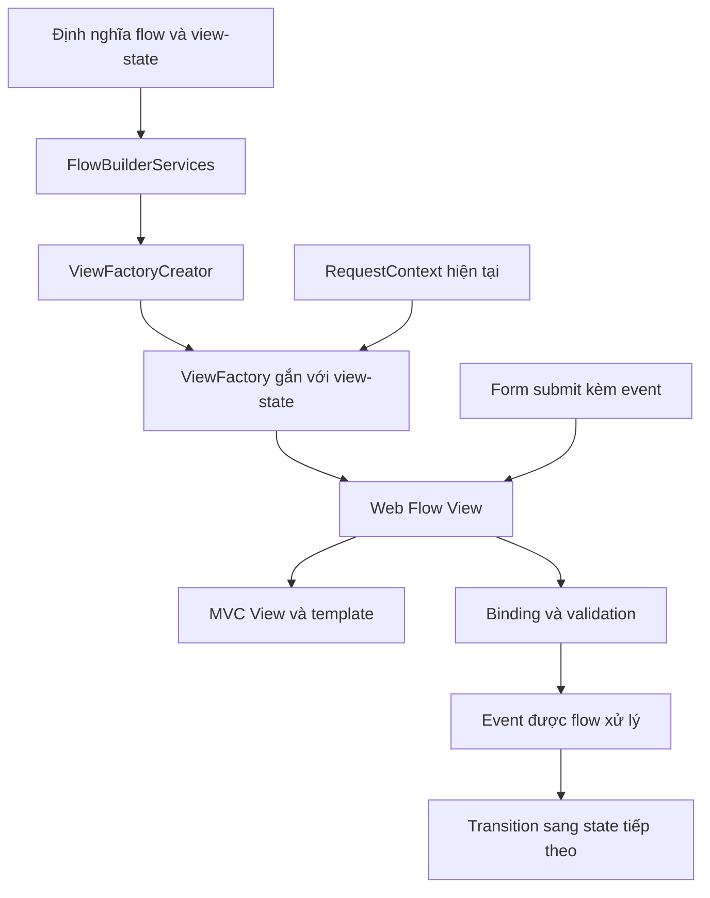

# Tùy chỉnh ViewFactoryCreator khi tích hợp giao diện

Trong một hành trình đăng ký nhiều bước, Spring Web Flow quyết định khi nào hiển thị trang nhập liệu, khi nào chuyển sang trang xác nhận và khi nào kết thúc. Công nghệ giao diện quyết định cách dựng HTML. `ViewFactoryCreator` là điểm nối để bộ dựng flow tạo được các view factory phù hợp với công nghệ giao diện ấy.

Bài thuộc chương **Listener và mở rộng** của module **SPRING_WEB_FLOW**. Mục tiêu là tích hợp giao diện mà vẫn giữ state, event, transition và subflow trong định nghĩa flow; đồng thời bảo toàn form binding, validation và trạng thái của từng phiên thực thi.

Các ví dụ sử dụng API **Spring Web Flow 3.0.1**, Spring MVC và JSP làm mốc minh họa. Đây là lựa chọn cho ví dụ, không phải khẳng định phiên bản của dự án đang học. Khi áp dụng cho phiên bản khác, đối chiếu chữ ký API và bộ phụ thuộc Servlet tương ứng.

## 1. Phân biệt các thành phần có tên gần nhau

Có hai kiểu `View` cần phân biệt:

- `org.springframework.web.servlet.View`: đối tượng render của Spring MVC.
- `org.springframework.webflow.execution.View`: giao diện tham gia vòng đời Web Flow, bao gồm render và xử lý event từ người dùng.

Một template hiển thị được HTML mới chỉ giải quyết phần trình bày. Để biểu mẫu tiếp tục hành trình, Web Flow còn phải nhận event, bind dữ liệu và xử lý trạng thái sau postback. Hợp đồng của Web Flow `View` thể hiện các trách nhiệm này qua những phương thức như `render()`, `processUserEvent()` và `getFlowEvent()`. [API View](https://docs.spring.io/spring-webflow/docs/current/api/org/springframework/webflow/execution/View.html)

| Thành phần | Vai trò | Câu hỏi cần giải quyết |
| --- | --- | --- |
| `ViewFactoryCreator` | SPI dùng khi dựng flow để tạo `ViewFactory` | View-state sẽ dùng loại factory nào? |
| `ViewFactory` | Lấy Web Flow `View` cho request hiện tại | Với `RequestContext` này, view nào phục vụ request? |
| `FlowViewResolver` | Tìm MVC `View` trong ngữ cảnh flow | Tên view được ánh xạ như thế nào? |
| MVC `ViewResolver` | Phân giải tên view theo công nghệ MVC | Tên logic tương ứng template nào? |

`ViewFactory.getView(RequestContext)` là điểm lấy view theo request; không nên dùng một view gắn với request cũ để phục vụ mọi phiên flow. [API ViewFactory](https://docs.spring.io/spring-webflow/docs/current/api/org/springframework/webflow/execution/ViewFactory.html)



Sơ đồ là mô hình khái niệm: bước tạo factory và bước xử lý request diễn ra ở những thời điểm khác nhau. Creator không phải controller xử lý từng lần bấm nút.

## 2. Chọn mức tùy chỉnh phù hợp

Với Spring MVC, điểm bắt đầu là `MvcViewFactoryCreator`. Mặc định nó hỗ trợ tài nguyên view tương đối với flow; nó cũng cho phép tái sử dụng các MVC `ViewResolver` có sẵn. [API MvcViewFactoryCreator](https://docs.spring.io/spring-webflow/docs/3.0.1/api/org/springframework/webflow/mvc/builder/MvcViewFactoryCreator.html)

| Nhu cầu thực tế | Cách triển khai nên xem xét |
| --- | --- |
| Dùng các JSP nằm cạnh định nghĩa flow | Giữ cách phân giải tương đối với flow |
| Dùng chung kho template với controller MVC | Cấu hình `setViewResolvers(...)` |
| Áp dụng quy ước tên mặc định cho state không khai báo `view` | Ghi đè `getViewIdByConvention(...)` |
| Chọn MVC view dựa trên thông tin request hoặc flow | Cung cấp `FlowViewResolver` riêng |
| Thay đổi bản chất tương tác với giao diện | Xem xét triển khai `ViewFactoryCreator` và vòng đời view tương ứng |

Ví dụ, chuyển JSP từ thư mục flow sang `/WEB-INF/views/registration/` chỉ là thay đổi cách tìm template. Không cần viết lại quy trình nhận event hoặc kiểm tra dữ liệu cho yêu cầu này.

Trong khi đó, muốn giao diện nhận một giao thức postback hoàn toàn khác có thể đòi hỏi mở rộng sâu hơn. Khi ấy, trách nhiệm cần khảo sát không dừng ở `ViewResolver`.

## 3. Hai chiến lược phân giải view

### 3.1. Template đặt tương đối với flow

Giả sử flow và trang của nó được tổ chức như sau:

```text
/WEB-INF/flows/registration/
    registration-flow.xml
    details.jsp
    review.jsp
```

Với chiến lược tài nguyên tương đối, một view-state không ghi `view` có thể dùng quy ước từ id của state và hậu tố mặc định `.jsp`. `FlowResourceFlowViewResolver` tạo MVC internal-resource view để render tài nguyên như JSP. [API FlowResourceFlowViewResolver](https://docs.spring.io/spring-webflow/docs/3.0.1/api/org/springframework/webflow/mvc/builder/FlowResourceFlowViewResolver.html)

```xml
<view-state id="details">
    <transition on="next" to="review"/>
</view-state>
```

Cách tổ chức này thuận tiện khi muốn đóng gói mỗi hành trình cùng các trang riêng của nó.

### 3.2. Dùng tên logic qua MVC ViewResolver

Một ứng dụng khác có kho template tập trung:

```text
/WEB-INF/flows/registration/registration-flow.xml
/WEB-INF/views/registration/details.jsp
/WEB-INF/views/registration/review.jsp
/WEB-INF/views/registration/completed.jsp
```

Khi đó flow nên chọn tên logic:

```xml
<view-state id="details" view="registration/details">
    <transition on="next" to="review"/>
</view-state>
```

Creator được nối với chuỗi MVC resolver. `DelegatingFlowViewResolver` là thành phần cầu nối tới chuỗi resolver ấy. [API DelegatingFlowViewResolver](https://docs.spring.io/spring-webflow/docs/3.0.1/api/org/springframework/webflow/mvc/builder/DelegatingFlowViewResolver.html)

Trong ví dụ này, phép ánh xạ mong muốn là:

```text
registration/details
    + prefix /WEB-INF/views/
    + suffix .jsp
    = /WEB-INF/views/registration/details.jsp
```

Đừng thêm `.jsp` vào tên logic nếu resolver đã thêm hậu tố. Nếu viết `view="registration/details.jsp"`, đường dẫn có thể thành `details.jsp.jsp`.

Đổi hậu tố thành `.html` cũng không tự cài đặt template engine xử lý HTML. Phải có resolver và công nghệ render tương ứng với loại template đã chọn.

## 4. Nối creator vào đúng chuỗi cấu hình

Một bean `MvcViewFactoryCreator` tồn tại trong context chưa đủ để chứng minh flow đang dùng nó. Cần nối creator vào `FlowBuilderServices`, rồi dùng bộ services ấy để dựng flow registry.

Ví dụ cấu hình phần lõi cho chiến lược tên logic:

```java
package example.webflow;

import java.util.List;

import org.springframework.context.annotation.Bean;
import org.springframework.context.annotation.Configuration;
import org.springframework.web.servlet.view.InternalResourceViewResolver;
import org.springframework.webflow.config.AbstractFlowConfiguration;
import org.springframework.webflow.definition.registry.FlowDefinitionRegistry;
import org.springframework.webflow.engine.builder.support.FlowBuilderServices;
import org.springframework.webflow.executor.FlowExecutor;
import org.springframework.webflow.mvc.builder.MvcViewFactoryCreator;

@Configuration
public class RegistrationFlowConfiguration extends AbstractFlowConfiguration {

    @Bean
    public InternalResourceViewResolver jspViewResolver() {
        InternalResourceViewResolver resolver = new InternalResourceViewResolver();
        resolver.setPrefix("/WEB-INF/views/");
        resolver.setSuffix(".jsp");
        return resolver;
    }

    @Bean
    public MvcViewFactoryCreator mvcViewFactoryCreator(
            InternalResourceViewResolver jspViewResolver) {
        MvcViewFactoryCreator creator = new MvcViewFactoryCreator();
        creator.setViewResolvers(List.of(jspViewResolver));
        return creator;
    }

    @Bean
    public FlowBuilderServices flowBuilderServices(
            MvcViewFactoryCreator mvcViewFactoryCreator) {
        return getFlowBuilderServicesBuilder()
                .setViewFactoryCreator(mvcViewFactoryCreator)
                .build();
    }

    @Bean
    public FlowDefinitionRegistry flowRegistry(
            FlowBuilderServices flowBuilderServices) {
        return getFlowDefinitionRegistryBuilder(flowBuilderServices)
                .setBasePath("/WEB-INF/flows")
                .addFlowLocationPattern("/**/*-flow.xml")
                .build();
    }

    @Bean
    public FlowExecutor flowExecutor(FlowDefinitionRegistry flowRegistry) {
        return getFlowExecutorBuilder(flowRegistry).build();
    }
}
```

Các builder được cung cấp bởi `AbstractFlowConfiguration`; lớp cấu hình phải tự khai báo các bean cần dùng. [API AbstractFlowConfiguration](https://docs.spring.io/spring-webflow/docs/3.0.1/api/org/springframework/webflow/config/AbstractFlowConfiguration.html)

`setViewFactoryCreator(...)` chọn creator cho `FlowBuilderServices`. Nếu dự án đã có conversion service, validator hoặc expression parser riêng, giữ các cấu hình đó trong cùng bộ services thay vì vô tình thay chúng bằng một bean tối giản khác. [API FlowBuilderServicesBuilder](https://docs.spring.io/spring-webflow/docs/3.0.1/api/org/springframework/webflow/config/FlowBuilderServicesBuilder.html)

Đoạn trên giả định ứng dụng đã có hạ tầng Spring MVC để đưa request vào Web Flow, gồm `DispatcherServlet`, `FlowHandlerMapping` và `FlowHandlerAdapter` trỏ tới registry/executor tương ứng. Nó chỉ minh họa phần cấu hình liên quan đến creator; không phải toàn bộ một ứng dụng triển khai độc lập. Môi trường cũng cần hỗ trợ JSP và thư viện form tag của Spring.

Nếu ứng dụng đã có MVC resolver dùng chung, truyền chính bean đó vào creator. Không cần tạo một resolver thứ hai với prefix, suffix hoặc cấu hình locale khác chỉ dành cho flow.

### Thứ tự resolver có ý nghĩa

Với nhiều resolver, truyền danh sách theo thứ tự muốn thử. Trong triển khai 3.0.1, chuỗi dừng khi nhận được MVC `View` khác `null`; ngoại lệ của resolver không được coi là tín hiệu chuyển sang resolver tiếp theo. [Mã nguồn DelegatingFlowViewResolver 3.0.1](https://raw.githubusercontent.com/spring-projects/spring-webflow/v3.0.1/spring-webflow/src/main/java/org/springframework/webflow/mvc/builder/DelegatingFlowViewResolver.java)

`InternalResourceViewResolver` nên đứng cuối chuỗi vì nó có thể nhận một tên view ngay cả khi tài nguyên đích không tồn tại. Đừng kỳ vọng JSP bị thiếu sẽ tự động kích hoạt một resolver dự phòng. [API InternalResourceViewResolver](https://docs.spring.io/spring-framework/docs/6.0.23/javadoc-api/org/springframework/web/servlet/view/InternalResourceViewResolver.html)

Cũng tránh gọi liên tiếp `setViewResolvers(...)`, `setDefaultViewSuffix(...)` và `setFlowViewResolver(...)` như thể chúng bổ sung ba tầng fallback. Trong mã nguồn 3.0.1, các phương thức này thay chiến lược phân giải đang giữ bên trong creator. Chọn một chiến lược rõ ràng cho cấu hình cuối cùng. [Mã nguồn MvcViewFactoryCreator 3.0.1](https://raw.githubusercontent.com/spring-projects/spring-webflow/v3.0.1/spring-webflow/src/main/java/org/springframework/webflow/mvc/builder/MvcViewFactoryCreator.java)

## 5. Ví dụ biểu mẫu: giao diện phải giữ hợp đồng với flow

Giả sử lớp form `example.webflow.RegistrationForm` là JavaBean có constructor không tham số, các thuộc tính `fullName`, `email`, `newsletter` và getter/setter tương ứng. Nếu cơ chế lưu phiên thực thi yêu cầu serialization, lớp form và dữ liệu nó tham chiếu phải đáp ứng yêu cầu đó.

Định nghĩa flow minh họa:

```xml
<?xml version="1.0" encoding="UTF-8"?>
<flow xmlns="http://www.springframework.org/schema/webflow"
      xmlns:xsi="http://www.w3.org/2001/XMLSchema-instance"
      xsi:schemaLocation="
        http://www.springframework.org/schema/webflow
        https://www.springframework.org/schema/webflow/spring-webflow.xsd">

    <var name="form" class="example.webflow.RegistrationForm"/>

    <view-state id="details" view="registration/details" model="form">
        <binder>
            <binding property="fullName" required="true"/>
            <binding property="email" required="true"/>
            <binding property="newsletter"/>
        </binder>
        <transition on="next" to="review"/>
        <transition on="cancel" to="cancelled" bind="false"/>
    </view-state>

    <view-state id="review" view="registration/review" model="form">
        <transition on="back" to="details" bind="false"/>
        <transition on="confirm" to="completed" bind="false"/>
    </view-state>

    <end-state id="completed" view="registration/completed"/>
    <end-state id="cancelled"/>
</flow>
```

Đây là ví dụ điều hướng, chưa có thao tác lưu đăng ký. Trong ứng dụng thật, hành động xác nhận cần gọi service và xử lý kết quả trước khi kết thúc flow. `required="true"` ở binder cũng không thay thế kiểm tra định dạng email hoặc quy tắc nghiệp vụ.

Trang `/WEB-INF/views/registration/details.jsp` có phần biểu mẫu như sau:

```jsp
<%@ page contentType="text/html; charset=UTF-8" %>
<%@ taglib prefix="form" uri="http://www.springframework.org/tags/form" %>

<form:form modelAttribute="form" method="post" action="${flowExecutionUrl}">
    <div>
        <label for="fullName">Họ tên</label>
        <form:input path="fullName" id="fullName"/>
        <form:errors path="fullName"/>
    </div>
    <div>
        <label for="email">Email</label>
        <form:input path="email" id="email"/>
        <form:errors path="email"/>
    </div>
    <div>
        <form:checkbox path="newsletter" id="newsletter"/>
        <label for="newsletter">Nhận thông tin mới</label>
    </div>
    <button type="submit" name="_eventId" value="next">Tiếp tục</button>
    <button type="submit" name="_eventId" value="cancel">Hủy</button>
</form:form>
```

Phần biểu mẫu của trang `review.jsp` chỉ cần phát event quay lại hoặc xác nhận:

```jsp
<%@ page contentType="text/html; charset=UTF-8" %>
<%@ taglib prefix="form" uri="http://www.springframework.org/tags/form" %>

<form:form modelAttribute="form" method="post" action="${flowExecutionUrl}">
    <p>Kiểm tra thông tin trước khi xác nhận.</p>
    <form:input path="fullName" readonly="true" htmlEscape="true"/>
    <form:input path="email" readonly="true" htmlEscape="true"/>
    <button type="submit" name="_eventId" value="back">Quay lại</button>
    <button type="submit" name="_eventId" value="confirm">Xác nhận</button>
</form:form>
```

Các ô chỉ đọc phục vụ hiển thị; `bind="false"` ở các transition của trang review khiến ví dụ không nhận lại dữ liệu từ chúng. Không dùng `readonly` như một ràng buộc bảo vệ dữ liệu phía server. Trang `completed.jsp` có thể là trang thông báo tĩnh cho ví dụ này.

Khi tùy chỉnh creator, cần giữ ba quan hệ:

1. **URL và phiên thực thi:** form gửi tới `flowExecutionUrl` của lần render hiện tại. Không hard-code một execution key cũ hoặc gửi thẳng tới đường dẫn JSP.
2. **Event và transition:** giá trị `next`, `cancel`, `back`, `confirm` phải khớp event mà flow xử lý. Nếu đổi tên tham số qua `setEventIdParameterName(...)`, giao diện cũng phải đổi theo.
3. **Model và lỗi:** `model="form"`, tên model trong form tag, các thuộc tính JavaBean và cấu hình binder phải thống nhất. Lỗi cần hiển thị trên trang để người dùng sửa được dữ liệu.

Với checkbox, cần giữ cơ chế field marker để trường hợp bỏ chọn có thể được phân biệt với trường hợp trường không được gửi. Khi tự viết HTML thay cho form tag, kiểm tra riêng hành vi này.

## 6. Tùy chỉnh quy ước tên bằng lớp con

Giả sử nhóm thống nhất rằng mọi view-state bỏ thuộc tính `view` sẽ dùng tên logic bắt đầu bằng `journeys/`. Với yêu cầu thuần quy ước này, có thể kế thừa creator MVC:

```java
package example.webflow;

import org.springframework.webflow.mvc.builder.MvcViewFactoryCreator;

public final class JourneyViewFactoryCreator extends MvcViewFactoryCreator {

    @Override
    public String getViewIdByConvention(String viewStateId) {
        return "journeys/" + viewStateId;
    }
}
```

Trong cấu hình ở mục 4, thay phần khởi tạo creator bằng:

```java
JourneyViewFactoryCreator creator = new JourneyViewFactoryCreator();
creator.setViewResolvers(List.of(jspViewResolver));
return creator;
```

Như vậy vẫn dùng chuỗi MVC resolver đã cấu hình. Với state:

```xml
<view-state id="registrationDetails" model="form">
    <transition on="next" to="review"/>
</view-state>
```

Tên mặc định trở thành `journeys/registrationDetails`, rồi resolver tìm `/WEB-INF/views/journeys/registrationDetails.jsp`.

Đây là biến thể độc lập để minh họa quy ước; nó không tự đổi các tên `view="registration/details"` đã khai báo trong ví dụ trước.

`getViewIdByConvention(String)` chỉ nhận state id. Nó không có tham số `RequestContext`, flow id hay người dùng hiện tại. Vì vậy, không dựa vào hook này để chọn tenant hoặc giao diện theo từng phiên. Hợp đồng SPI cũng tách việc suy tên theo quy ước khỏi việc tạo factory bằng biểu thức view id. [API ViewFactoryCreator 3.0.1](https://docs.spring.io/spring-webflow/docs/3.0.1/api/org/springframework/webflow/engine/builder/ViewFactoryCreator.html)

Quy ước trên còn có khả năng trùng tên: hai flow cùng có state `details` sẽ cùng trỏ tới `journeys/details`. Hãy dùng tên state đủ rõ hoặc khai báo `view` tường minh khi mỗi flow cần template khác nhau.

## 7. Khi cần triển khai SPI trực tiếp

Triển khai `ViewFactoryCreator` trực tiếp chỉ hợp lý khi lớp MVC có sẵn cùng các hook của nó không đáp ứng yêu cầu. Đầu vào của `createViewFactory(...)` ở mốc 3.0.1 gồm:

| Đầu vào | Điều cần bảo toàn khi chuyển tiếp |
| --- | --- |
| `Expression viewId` | Biểu thức chọn view; tránh ép thành chuỗi quá sớm |
| `ExpressionParser` | Cách đọc các biểu thức view/model |
| `org.springframework.binding.convert.ConversionService` | Chuyển đổi và định dạng giá trị trong cơ chế binding của Web Flow |
| `BinderConfiguration` | Những trường và ràng buộc binding được flow khai báo |
| Spring `Validator` | Kiểm tra model |
| `ValidationHintResolver` | Phân giải các gợi ý validation |

Không nhầm conversion service thuộc `org.springframework.binding.convert` với interface có tên gần giống thuộc Spring Core. Nếu cần chuyển đổi giữa hai hệ thống, phải sử dụng adapter phù hợp thay vì đổi import cho hết lỗi biên dịch.

Chữ ký có thêm `ValidationHintResolver` trong API được dùng ở đây; tài liệu của các bản cũ có thể có chữ ký khác. Khi nâng cấp, kiểm tra điểm mở rộng này cùng các lớp view liên quan. [Hợp đồng ViewFactoryCreator](https://docs.spring.io/spring-webflow/docs/2.5.x/api/org/springframework/webflow/engine/builder/ViewFactoryCreator.html), [API 2.3.3 để đối chiếu chữ ký cũ](https://docs.spring.io/spring-webflow/docs/2.3.3.RELEASE/api/org/springframework/webflow/engine/builder/ViewFactoryCreator.html)

Nếu chỉ bọc một creator chuẩn để thêm quy ước hoặc quan sát, nên chuyển tiếp đầy đủ các đối số tới delegate. Bỏ sót validator có thể làm trang vẫn render bình thường nhưng mất một phần kiểm tra dữ liệu; bỏ binder configuration có thể khiến phạm vi trường được bind khác với định nghĩa flow.

`MvcViewFactoryCreator` cũng có hook `createMvcViewFactory(...)`. Tuy nhiên, khi tự thay một factory, phải hiểu cả cách factory lấy view lẫn cách Web Flow view xử lý postback. Factory của MVC có các cấu hình về validator và validation hint resolver; một lớp thay thế phải bảo toàn cấu hình cần thiết. [API AbstractMvcViewFactory](https://docs.spring.io/spring-webflow/docs/current/api/org/springframework/webflow/mvc/view/AbstractMvcViewFactory.html)

Đặc biệt, không trả thẳng một MVC `View` ở nơi hợp đồng đòi Web Flow `View`. Hai interface có trách nhiệm khác nhau dù cùng tên ngắn.

## 8. Scope, trạng thái dùng chung và phục hồi lỗi

Một creator thường là bean được dùng lại bởi nhiều flow hoặc nhiều phiên. Thiết kế nó như thành phần cấu hình không giữ dữ liệu người dùng:

- Giữ prefix, danh sách resolver và chính sách phân giải cố định trong cấu hình.
- Lấy dữ liệu request từ `RequestContext` ở tầng có hỗ trợ ngữ cảnh request.
- Đặt model của hành trình trong scope phù hợp; không thêm thuộc tính `currentForm` hay `currentUser` vào creator singleton.
- Không thay danh sách resolver của bean dùng chung trong lúc đang xử lý request.

Ví dụ, hai tab đăng ký có hai model khác nhau. Nếu creator lưu model cuối cùng vào một field, request của tab thứ nhất có thể sử dụng dữ liệu tab thứ hai. Đây là lỗi do trạng thái dùng chung, không phải vấn đề thiếu template.

Phục hồi cũng cần phân biệt loại lỗi:

| Tình huống | Cách xử lý trong thiết kế ứng dụng |
| --- | --- |
| Người dùng nhập sai dữ liệu | Ở lại view-state, hiển thị lỗi và dữ liệu cần sửa |
| Thiếu template hoặc sai resolver | Sửa cấu hình/đóng gói; ghi nhận tên view và state để chẩn đoán |
| Execution key hết hạn hoặc không còn tồn tại | Xử lý tại tầng tích hợp flow; hướng dẫn bắt đầu lại khi phù hợp |
| Service xác nhận thất bại | Mô hình hóa kết quả lỗi hoặc exception handler trong flow theo chính sách nghiệp vụ |

Không biến lỗi resolve view thành event xác nhận thành công. Cũng không giả định rằng hiển thị một trang lỗi tùy ý sẽ tự khôi phục model của phiên thực thi đã mất.

Khi cần chẩn đoán, ưu tiên log flow id, state id, tên logic và resolver được chọn. Không cần ghi toàn bộ dữ liệu form hoặc execution key để giải thích lỗi đường dẫn template.

## 9. Cách kiểm tra thay đổi tích hợp

Kiểm tra creator có thể chia thành ba mức; mỗi mức trả lời một câu hỏi khác nhau.

### Quy ước tên có đúng không?

Một kiểm tra nhỏ cho lớp con ở mục 6:

```java
import static org.junit.jupiter.api.Assertions.assertEquals;

import org.junit.jupiter.api.Test;

class JourneyViewFactoryCreatorTest {

    @Test
    void prefixesDefaultViewName() {
        JourneyViewFactoryCreator creator = new JourneyViewFactoryCreator();

        assertEquals("journeys/registrationDetails",
                creator.getViewIdByConvention("registrationDetails"));
    }
}
```

Kiểm tra này chỉ xác nhận phép tạo tên. Nó không chứng minh template tồn tại hoặc Web Flow đã dùng đúng bean.

### Chuỗi cấu hình có dùng đúng creator không?

Trong kiểm tra tích hợp context, nạp cùng cấu hình được triển khai thật và chạy một flow đại diện. Kiểm tra tên view tới resolver và template được chọn. Một resolver giả có thể ghi nhận tên được yêu cầu và trả một MVC view tối giản để kiểm tra phần kết nối.

Cần có trường hợp với `view` tường minh và trường hợp không khai báo `view`. Nếu chỉ kiểm tra một trường hợp, việc creator bị bỏ qua hoặc quy ước chỉ áp dụng cho tên mặc định có thể chưa lộ ra.

### Hành trình biểu mẫu có còn hoạt động không?

| Kịch bản | Kết quả cần quan sát |
| --- | --- |
| Mở flow mới | Render đúng trang details, có URL tiếp tục hợp lệ |
| Bấm tiếp với trường bắt buộc rỗng | Không sang review; thấy lỗi tại trường |
| Gửi dữ liệu hợp lệ | Sang review, giữ đúng model |
| Bỏ chọn checkbox trước đó đã chọn | Giá trị model chuyển về false |
| Quay lại từ review | Về details với dữ liệu đang có |
| Hủy khi form còn lỗi | Không bị binding chặn nếu transition đã tắt binding |
| Hai phiên hoặc hai tab độc lập | Không dùng lẫn dữ liệu |
| Tên template sai | Thấy lỗi có thể chẩn đoán, không âm thầm sang state thành công |

Nếu hệ thống có Spring Security/CSRF, thực hiện kiểm tra với cấu hình đó đang bật. Token và bộ lọc request phải được tích hợp theo cơ chế của ứng dụng, đồng thời form vẫn gửi event và thông tin tiếp tục flow đúng cách.

## 10. Lỗi thường gặp khi tùy chỉnh

| Biểu hiện | Nguyên nhân cần kiểm tra trước |
| --- | --- |
| Creator mới không có tác dụng | Registry được dựng bằng `FlowBuilderServices` khác |
| Tìm nhầm template cạnh flow | Creator vẫn dùng chiến lược tài nguyên tương đối |
| Đường dẫn có hai hậu tố | Flow ghi phần mở rộng trong khi MVC resolver cũng thêm hậu tố |
| Template engine dự phòng không được thử | Resolver trước đã trả về một view hoặc đã ném exception |
| Render được nhưng bấm nút không chuyển bước | Thiếu event, sai tên tham số hoặc sai URL tiếp tục |
| Validation biến mất sau khi bọc creator | Không chuyển tiếp validator/hint resolver hoặc mất cấu hình model |
| Checkbox bỏ chọn vẫn giữ true | Thiếu field marker hoặc cấu hình prefix không khớp |
| Hai flow dùng nhầm cùng trang | Quy ước chỉ dựa trên state id và tạo tên trùng |
| Chạy tốt một người, lỗi khi nhiều phiên | Lưu dữ liệu request/model trong bean dùng chung |

Thực hành đề xuất: bắt đầu với cấu hình MVC resolver ở mục 4, cho flow dùng tên tường minh, rồi mới bật quy ước của lớp con cho một state thử nghiệm. Quan sát tên logic trước và sau thay đổi, sau đó đi lại toàn bộ hành trình gồm nhập sai, sửa đúng, quay lại và hủy. Cách làm này giúp xác định thay đổi nằm ở phân giải view hay đã ảnh hưởng đến hợp đồng tương tác của Web Flow.