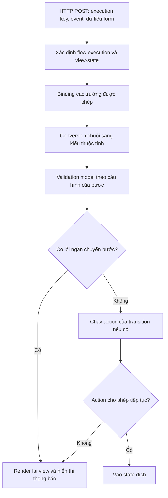

# Tùy chỉnh ExpressionParser, conversion và validation

## 1. Ba điểm mở rộng giải quyết ba câu hỏi khác nhau

Trong Spring Web Flow, một hành trình nhiều bước được tổ chức bằng state, event và transition. Để một `view-state` nhận dữ liệu và chuyển bước đúng, hệ thống còn phải hiểu biểu thức, đổi chuỗi từ HTTP thành kiểu Java và kiểm tra tính hợp lệ của model.

Bài này thuộc chương **Listener và mở rộng** của module **SPRING_WEB_FLOW**. Mục tiêu là nối đúng các dịch vụ mở rộng vào bộ dựng flow, dùng chúng trong form nhiều bước và giúp người dùng sửa dữ liệu khi có lỗi.

| Cơ chế | Câu hỏi cần trả lời | Ví dụ trong luồng đặt phòng |
| --- | --- | --- |
| Expression parser | Biểu thức tham chiếu đối tượng nào và được đánh giá như thế nào? | `bookingAction.confirm(booking, messageContext)` |
| Conversion và formatting | Chuỗi nhập vào biểu diễn giá trị Java nào? | `26/11/2026` thành `LocalDate`, `a-101` thành `RoomCode` |
| Validation | Giá trị đã có đúng quy tắc của bước hiện tại không? | Ngày kết thúc phải sau ngày bắt đầu |

Một ngày không tồn tại như `31/02/2026` là lỗi conversion. Hai ngày có thật nhưng đảo thứ tự là lỗi validation. Một tên bean viết sai trong `evaluate` là lỗi cấu hình hoặc đánh giá expression. Ba lỗi này cần cách xử lý khác nhau.

Listener phù hợp để quan sát vòng đời thực thi, đo thời gian hoặc ghi nhận sự kiện. Việc đổi định dạng ngày hay chọn nhóm validation nên nằm ở dịch vụ tương ứng; chuyển chúng vào listener sẽ khiến hành vi form khó truy vết.

## 2. Đường đi của một lần gửi form

Xét người dùng đang ở bước `schedule` và bấm nút `next`:



Sơ đồ mô tả đường xử lý thông thường của view postback. Cờ `bind`, `validate` và action trên transition có thể thay đổi đường đi. Khi binding một trường thất bại, không nên giả định toàn bộ model đã được cập nhật nguyên tử: một số thuộc tính khác có thể đã nhận giá trị mới, còn thuộc tính lỗi vẫn giữ giá trị trước đó.

Expression tham gia ở nhiều vị trí, từ việc tìm model đến gọi action. Nó không chỉ là một bước chạy sau validation. Biểu thức được parse khi framework xây dựng các thành phần của flow và được đánh giá với ngữ cảnh thực thi khi cần. Hợp đồng Spring Binding hỗ trợ biểu thức thông thường và template. Xem [ExpressionParser API](https://docs.spring.io/spring-webflow/docs/current/api/org/springframework/binding/expression/ExpressionParser.html).

## 3. Chọn một điểm nối cấu hình chung

Các ví dụ dùng Spring MVC, SpEL và Bean Validation theo namespace `jakarta.validation`. Khi áp dụng vào ứng dụng cũ dùng `javax.validation`, phải chọn bộ thư viện đồng bộ với phiên bản Spring/Web Flow của ứng dụng. Không trộn hai namespace trong cùng model và validator provider.

Đây là phần cấu hình dịch vụ của flow, chưa phải toàn bộ ứng dụng web. Ứng dụng còn cần flow executor, handler mapping/adapter, view resolver, template và một Bean Validation provider tương thích.

```xml
<beans xmlns="http://www.springframework.org/schema/beans"
       xmlns:xsi="http://www.w3.org/2001/XMLSchema-instance"
       xmlns:webflow="http://www.springframework.org/schema/webflow-config"
       xsi:schemaLocation="
         http://www.springframework.org/schema/beans
         https://www.springframework.org/schema/beans/spring-beans.xsd
         http://www.springframework.org/schema/webflow-config
         https://www.springframework.org/schema/webflow-config/spring-webflow-config.xsd">

    <bean id="applicationConversionService"
          class="example.booking.BookingConversionService"/>

    <bean id="flowConversionService"
          class="org.springframework.binding.convert.service.DefaultConversionService">
        <constructor-arg ref="applicationConversionService"/>
    </bean>

    <bean id="coreSpelParser"
          class="org.springframework.expression.spel.standard.SpelExpressionParser"/>

    <bean id="flowExpressionParser"
          class="org.springframework.webflow.expression.spel.WebFlowSpringELExpressionParser">
        <constructor-arg index="0" ref="coreSpelParser"/>
        <constructor-arg index="1" ref="flowConversionService"/>
    </bean>

    <bean id="flowValidator"
          class="org.springframework.validation.beanvalidation.LocalValidatorFactoryBean"/>

    <webflow:flow-builder-services id="flowBuilderServices"
          expression-parser="flowExpressionParser"
          conversion-service="flowConversionService"
          validator="flowValidator"/>

    <webflow:flow-registry id="flowRegistry"
          flow-builder-services="flowBuilderServices">
        <webflow:flow-location id="booking"
              path="/WEB-INF/flows/booking/booking-flow.xml"/>
    </webflow:flow-registry>
</beans>
```

Điểm quan trọng là `flowRegistry` phải dùng chính `flowBuilderServices` vừa cấu hình. Chỉ khai báo bean converter hoặc parser trong application context chưa chứng minh các flow đã dùng nó. API của bộ dựng có các điểm nối tương ứng cho parser, conversion service và validator: [FlowBuilderServicesBuilder](https://docs.spring.io/spring-webflow/docs/current/api/org/springframework/webflow/config/FlowBuilderServicesBuilder.html).

Trong ví dụ, parser và bộ dựng flow cùng nhận `flowConversionService`, tránh tạo hai đường conversion có tập converter khác nhau.

## 4. Tùy chỉnh ExpressionParser đúng hợp đồng

### 4.1. Phân biệt parser của Spring với parser của Web Flow

| Tên đầy đủ | Vai trò |
| --- | --- |
| `org.springframework.expression.ExpressionParser` | Hợp đồng expression trong Spring Framework |
| `org.springframework.binding.expression.ExpressionParser` | Hợp đồng Spring Binding mà Web Flow sử dụng |

`SpelExpressionParser` trực tiếp thực hiện hợp đồng thứ nhất. Vì vậy, không truyền nó thẳng vào thuộc tính `expression-parser` của `flow-builder-services`.

`WebFlowSpringELExpressionParser` bọc SpEL và bổ sung các property accessor dành cho Web Flow. Constructor cho phép nhận riêng parser SpEL hoặc nhận thêm Spring Binding conversion service. Đó là lý do cấu hình ở trên có hai tầng parser. Xem [WebFlowSpringELExpressionParser API](https://docs.spring.io/spring-webflow/docs/current/api/org/springframework/webflow/expression/spel/WebFlowSpringELExpressionParser.html).

### 4.2. Phân biệt biểu thức với chuỗi literal

Trong flow XML, ví dụ này là lời gọi phương thức:

```xml
<evaluate expression="bookingAction.confirm(booking, messageContext)"/>
```

Không cần bọc nội dung `expression` bằng `#{...}`. Ngược lại, thuộc tính hỗ trợ template có thể kết hợp văn bản và expression:

```xml
<view-state id="review" view="review-#{flowScope.viewVariant}"/>
```

Trong ví dụ template, `viewVariant` phải do phía máy chủ thiết lập theo tập giá trị được kiểm soát, ví dụ `standard` hoặc `compact`.

Một trường hợp dễ nhầm là `validation-hints`. Nó là expression; muốn truyền chuỗi tên nhóm thì chuỗi phải có dấu nháy đơn bên trong thuộc tính XML:

```xml
<view-state id="schedule" model="booking"
            validation-hints="'schedule'"/>
```

Ở đây, `'schedule'` là literal String. Nếu bỏ dấu nháy đơn, parser sẽ cố tìm thuộc tính hoặc biến tên `schedule`.

### 4.3. Khi nào cần mở rộng sâu hơn?

Nên gọi bean rõ tên cho nghiệp vụ, ví dụ `bookingPolicy.canContinue(booking)`. Chỉ cân nhắc custom property accessor khi có mô hình truy cập dữ liệu lặp lại thực sự cần tích hợp vào expression.

Lớp adapter SpEL cung cấp `addPropertyAccessor(...)`; nếu bổ sung accessor, hãy đăng ký khi khởi tạo, giữ hành vi truy cập hẹp và không lưu dữ liệu request trong accessor dùng chung. Tham khảo [SpringELExpressionParser API](https://docs.spring.io/spring-webflow/docs/current/api/org/springframework/binding/expression/spel/SpringELExpressionParser.html).

Nếu tự thực hiện Spring Binding `ExpressionParser`, cần giữ đúng ý nghĩa của `ParserContext`, kiểu kết quả mong đợi, template, đọc/ghi thuộc tính và lỗi parse/evaluation. Viết lại parser chỉ để thay định dạng ngày sẽ tạo thêm trách nhiệm không cần thiết.

Không lấy nội dung người dùng nhập rồi đưa vào parser như mã expression. Dữ liệu form phải đi qua binding/conversion. Việc đổi parser cũng không thay thế kiểm soát truy cập tài nguyên hoặc nghiệp vụ trong service.

## 5. Conversion service: nối đúng adapter và delegate

| Interface | Bên sử dụng |
| --- | --- |
| `org.springframework.core.convert.ConversionService` | Spring Framework, SpEL, formatting và Spring MVC |
| `org.springframework.binding.convert.ConversionService` | Hợp đồng conversion của Spring Binding/Web Flow |

`org.springframework.binding.convert.service.DefaultConversionService` có constructor nhận Spring Core conversion service để làm delegate. Vì vậy, cấu hình dùng `applicationConversionService` ở tầng Spring, rồi bọc nó thành `flowConversionService`. Xem [DefaultConversionService API](https://docs.spring.io/spring-webflow/docs/current/api/org/springframework/binding/convert/service/DefaultConversionService.html).

Đừng nhầm lớp này với `org.springframework.core.convert.support.DefaultConversionService`: cùng tên ngắn nhưng khác package và khác vai trò.

### 5.1. Value object cho mã phòng

Model giữ mã phòng, còn việc tìm phòng thật và kiểm tra quyền đặt phòng thuộc service. Nhờ vậy converter không phải truy vấn cơ sở dữ liệu mỗi lần form bind lại.

```java
package example.booking;

import java.io.Serializable;
import java.util.Locale;
import java.util.Objects;

public final class RoomCode implements Serializable {
    private static final long serialVersionUID = 1L;
    private final String value;

    public RoomCode(String raw) {
        String normalized = Objects.requireNonNull(raw, "roomCode")
                .trim().toUpperCase(Locale.ROOT);
        if (!normalized.matches("[A-Z]-[0-9]{3}")) {
            throw new IllegalArgumentException("Mã phòng phải có dạng A-101");
        }
        this.value = normalized;
    }

    public String getValue() {
        return value;
    }

    @Override
    public boolean equals(Object other) {
        return other instanceof RoomCode
                && value.equals(((RoomCode) other).value);
    }

    @Override
    public int hashCode() {
        return value.hashCode();
    }

    @Override
    public String toString() {
        return value;
    }
}
```

Converter đầu vào:

```java
package example.booking;

import org.springframework.core.convert.converter.Converter;

public final class StringToRoomCode implements Converter<String, RoomCode> {
    @Override
    public RoomCode convert(String source) {
        return source.isBlank() ? null : new RoomCode(source);
    }
}
```

Giá trị rỗng được trả về `null` để constraint `@NotNull` diễn đạt yêu cầu bắt buộc. Giá trị sai cấu trúc phải gây lỗi conversion; không âm thầm đổi thành mã mặc định. Quy tắc đăng ký và sử dụng converter được mô tả trong [Spring Type Conversion](https://docs.spring.io/spring-framework/reference/core/validation/convert.html).

### 5.2. Formatter hai chiều cho ngày

Với dữ liệu nhập và hiển thị, `Formatter<T>` cung cấp cả `parse` và `print`, đồng thời nhận `Locale`. Formatter phải an toàn khi dùng chung giữa nhiều request. Xem [Spring Field Formatting](https://docs.spring.io/spring-framework/reference/core/validation/format.html).

Ví dụ này cố định hợp đồng giao diện là `dd/MM/uuuu`, bất kể locale. Nếu ứng dụng đổi mẫu ngày theo locale, cần thiết kế cả hai chiều cùng một chính sách.

```java
package example.booking;

import java.text.ParseException;
import java.time.LocalDate;
import java.time.format.DateTimeFormatter;
import java.time.format.DateTimeParseException;
import java.time.format.ResolverStyle;
import java.util.Locale;
import org.springframework.format.Formatter;

public final class BookingDateFormatter implements Formatter<LocalDate> {
    private static final DateTimeFormatter FORMAT = DateTimeFormatter
            .ofPattern("dd/MM/uuuu", Locale.ROOT)
            .withResolverStyle(ResolverStyle.STRICT);

    @Override
    public LocalDate parse(String text, Locale locale) throws ParseException {
        try {
            return LocalDate.parse(text.trim(), FORMAT);
        } catch (DateTimeParseException ex) {
            ParseException failure = new ParseException(
                    "Ngày phải có dạng dd/MM/yyyy và tồn tại",
                    Math.max(0, ex.getErrorIndex()));
            failure.initCause(ex);
            throw failure;
        }
    }

    @Override
    public String print(LocalDate value, Locale locale) {
        return value.format(FORMAT);
    }
}
```

`uuuu` kết hợp với strict parsing phù hợp cho năm của `LocalDate`. Với thiết kế này, `29/02/2028` hợp lệ, còn `29/02/2027` không được tự điều chỉnh sang ngày khác.

Nếu dùng HTML `<input type="date">`, trình duyệt gửi giá trị theo dạng ISO như `2026-11-26`; khi đó hãy dùng chính sách ISO thay cho formatter `dd/MM/uuuu` này. Ví dụ trong bài dùng ô text để hai đầu thống nhất định dạng.

### 5.3. Đăng ký tập conversion của ứng dụng

```java
package example.booking;

import org.springframework.format.support.DefaultFormattingConversionService;

public final class BookingConversionService
        extends DefaultFormattingConversionService {

    public BookingConversionService() {
        addConverter(new StringToRoomCode());
        addConverter(RoomCode.class, String.class, RoomCode::getValue);
        addFormatter(new BookingDateFormatter());
    }
}
```

Converter chiều ngược của `RoomCode` giúp view nhận lại mã như `A-101`. Không dựa vào việc có converter `String -> RoomCode` để suy ra chiều ngược luôn tự hoạt động.

Đăng ký formatter cho toàn bộ `LocalDate` nghĩa là mọi thuộc tính kiểu này sử dụng service đó đều chịu ảnh hưởng. Nếu từng trường có định dạng khác nhau, nên dùng annotation formatting hoặc kiểu giá trị riêng thay vì thay đổi quy tắc toàn cục tùy request.

### 5.4. Dùng chung với Spring MVC

Nếu cấu hình MVC bằng XML và cùng nhìn thấy bean trên, có thể nối MVC vào cùng delegate:

```xml
<!-- Trong cấu hình MVC, với namespace mvc đã được khai báo. -->
<mvc:annotation-driven conversion-service="applicationConversionService"
                       validator="flowValidator"/>
```

Không thêm lần thứ hai một `mvc:annotation-driven` nếu ứng dụng đã có; hãy cập nhật cấu hình đang sở hữu phần MVC. Với Java configuration hoặc Spring Boot, dùng cơ chế cấu hình tương ứng của ứng dụng để chia sẻ tập converter/formatter.

`@InitBinder` trong controller MVC không tự chứng minh binder của flow đã nhận cùng cấu hình. Khi một URL controller đọc được ngày nhưng flow không đọc được, hãy kiểm tra service thực tế ở hai nhánh trước.

## 6. Model và các nhóm validation theo bước

Luồng ví dụ có ba bước: chọn lịch và phòng, nhập liên hệ, rồi xác nhận. Ngày và phòng bắt buộc ở bước đầu; email bắt buộc ở bước liên hệ.

```java
package example.booking;

import java.io.Serializable;
import java.time.LocalDate;
import jakarta.validation.constraints.Email;
import jakarta.validation.constraints.NotBlank;
import jakarta.validation.constraints.NotNull;

public class BookingForm implements Serializable {
    private static final long serialVersionUID = 1L;

    public interface Schedule { }
    public interface Contact { }

    @NotNull(groups = Schedule.class, message = "Hãy chọn phòng")
    private RoomCode roomCode;

    @NotNull(groups = Schedule.class, message = "Hãy nhập ngày bắt đầu")
    private LocalDate startDate;

    @NotNull(groups = Schedule.class, message = "Hãy nhập ngày kết thúc")
    private LocalDate endDate;

    @NotBlank(groups = Contact.class, message = "Hãy nhập email liên hệ")
    @Email(groups = Contact.class, message = "Email không đúng định dạng")
    private String email;

    public RoomCode getRoomCode() { return roomCode; }
    public void setRoomCode(RoomCode roomCode) { this.roomCode = roomCode; }

    public LocalDate getStartDate() { return startDate; }
    public void setStartDate(LocalDate startDate) { this.startDate = startDate; }

    public LocalDate getEndDate() { return endDate; }
    public void setEndDate(LocalDate endDate) { this.endDate = endDate; }

    public String getEmail() { return email; }
    public void setEmail(String email) { this.email = email; }
}
```

`Schedule` và `Contact` là interface đánh dấu. `BeanValidationHintResolver` có thể ánh xạ hint `schedule` và `contact` sang các kiểu lồng tương ứng của model; hint không nhận diện được là lỗi cấu hình, không phải lỗi dữ liệu của người dùng. Xem [BeanValidationHintResolver](https://raw.githubusercontent.com/spring-projects/spring-webflow/main/spring-webflow/src/main/java/org/springframework/webflow/validation/BeanValidationHintResolver.java).

Khi chủ động chọn nhóm `Schedule`, đừng giả định constraint ở nhóm `Default` sẽ tự được kiểm tra cùng. Nếu có quy tắc chung trong `Default`, hãy chọn thêm hint `default` hoặc thiết kế quan hệ kế thừa nhóm rõ ràng.

Nhóm validation chỉ chọn constraint cần chạy. Nó không quyết định trường nào được bind, không kiểm tra quyền truy cập và không làm model tự an toàn để ghi xuống cơ sở dữ liệu.

## 7. Validation theo quy ước và lỗi liên trường

Constraint thuộc tính chưa diễn tả quy tắc `endDate > startDate`. Ta dùng validator riêng với bean name khớp model name là `bookingValidator`:

```java
package example.booking;

import org.springframework.binding.message.MessageBuilder;
import org.springframework.binding.validation.ValidationContext;

public final class BookingValidator {
    public void validateSchedule(BookingForm booking,
                                 ValidationContext context) {
        checkDateRange(booking, context);
    }

    public void validateReview(BookingForm booking,
                               ValidationContext context) {
        checkDateRange(booking, context);
    }

    private void checkDateRange(BookingForm booking,
                                ValidationContext context) {
        // Không suy ra giá trị model là dữ liệu mới nếu trường vừa bind lỗi.
        if (context.getMessageContext().hasErrorMessages()) {
            return;
        }
        if (booking.getStartDate() == null || booking.getEndDate() == null) {
            return;
        }
        if (!booking.getEndDate().isAfter(booking.getStartDate())) {
            context.getMessageContext().addMessage(new MessageBuilder()
                    .error()
                    .source("endDate")
                    .code("booking.endDate.afterStart")
                    .defaultText("Ngày kết thúc phải sau ngày bắt đầu")
                    .build());
        }
    }
}
```

Đăng ký bean trong application context mà flow nhìn thấy:

```xml
<bean id="bookingValidator" class="example.booking.BookingValidator"/>
```

Với `model="booking"` và state `schedule`, quy ước gọi là `validateSchedule(BookingForm, ValidationContext)`. Tên bean dựa trên tên model; không đổi thành `bookingFormValidator` chỉ vì tên lớp Java là `BookingForm`. `ValidationHelper` thực hiện việc tìm bean theo model name và gọi phương thức theo state. Bean Validation và validation theo quy ước có thể cùng hoạt động, nên tránh viết lại cùng quy tắc ở nhiều nơi. Xem [ValidationHelper](https://raw.githubusercontent.com/spring-projects/spring-webflow/main/spring-webflow/src/main/java/org/springframework/webflow/validation/ValidationHelper.java).

`source("endDate")` gắn lỗi vào trường tương ứng; bỏ source phù hợp hơn với lỗi chung của form. Mã `booking.endDate.afterStart` có thể được dịch qua message bundle, còn `defaultText` là thông điệp dự phòng.

`ValidationContext` ở ví dụ thuộc package **`org.springframework.binding.validation`**. Nó cung cấp message context, user event và principal; không nhầm sang lớp tự đặt tên tương tự trong ứng dụng. Xem [ValidationContext API](https://docs.spring.io/spring-webflow/docs/current/api/org/springframework/binding/validation/ValidationContext.html).

Việc bỏ qua kiểm tra liên trường khi đã có lỗi trong ví dụ là lựa chọn để tránh thông báo dây chuyền. Nếu muốn gom nhiều lỗi độc lập trong một lần gửi, có thể thiết kế kiểm tra chi tiết hơn theo từng trường đã bind thành công.

## 8. Ghép thành flow nhiều bước

File dưới đây minh họa phần flow. `bookingAction` là bean của ứng dụng, được mô tả ở phần xử lý lưu phía sau.

```xml
<flow xmlns="http://www.springframework.org/schema/webflow"
      xmlns:xsi="http://www.w3.org/2001/XMLSchema-instance"
      xsi:schemaLocation="
        http://www.springframework.org/schema/webflow
        https://www.springframework.org/schema/webflow/spring-webflow.xsd">

    <var name="booking" class="example.booking.BookingForm"/>

    <view-state id="schedule" view="schedule" model="booking"
                validation-hints="'schedule'">
        <binder>
            <binding property="roomCode"/>
            <binding property="startDate"/>
            <binding property="endDate"/>
        </binder>
        <transition on="next" to="contact"/>
        <transition on="cancel" to="cancelled"
                    bind="false" validate="false"/>
    </view-state>

    <view-state id="contact" view="contact" model="booking"
                validation-hints="'contact'">
        <binder>
            <binding property="email"/>
        </binder>
        <transition on="next" to="review"/>
        <transition on="back" to="schedule" validate="false"/>
        <transition on="cancel" to="cancelled"
                    bind="false" validate="false"/>
    </view-state>

    <view-state id="review" view="review" model="booking"
                validation-hints="'schedule,contact'">
        <binder>
            <binding property="roomCode"/>
            <binding property="startDate"/>
            <binding property="endDate"/>
            <binding property="email"/>
        </binder>
        <transition on="confirm" to="completed">
            <evaluate expression="bookingAction.confirm(booking, messageContext)"/>
        </transition>
        <transition on="back" to="contact"
                    bind="false" validate="false"/>
        <transition on="cancel" to="cancelled"
                    bind="false" validate="false"/>
    </view-state>

    <end-state id="completed" view="completed"/>
    <end-state id="cancelled" view="cancelled"/>
</flow>
```

`<var>` tạo đối tượng của lần thực thi flow; model tiếp tục tồn tại giữa các bước trong flow scope. Đối tượng `Serializable` thuận tiện cho các chiến lược lưu snapshot hoặc phiên cần serialization; các đối tượng con cũng phải phù hợp với chiến lược repository đang dùng.

Danh sách `<binder>` giới hạn các thuộc tính được nhận ở từng view. Ở `contact`, request cố gửi thêm `roomCode` không được dùng như cách hợp lệ để sửa phòng. Tại `review`, ví dụ cho phép bind lại các trường nghiệp vụ rồi kiểm tra cả hai nhóm khi xác nhận. Nếu sản phẩm yêu cầu bước review chỉ đọc, cần thiết kế riêng đường xác nhận và kiểm tra lại model phía máy chủ, thay vì tùy tiện tắt binding rồi giả định mọi validation vẫn chạy như cũ.

Không có trường `price`, `ownerId` hay trạng thái thanh toán trong binder. Service phải xác định giá và chủ thể từ dữ liệu đáng tin cậy của máy chủ.

### 8.1. Back và cancel có ý nghĩa khác nhau

Ở bước `contact`, `back` tắt validation nhưng vẫn cho phép binding, nhờ đó email đang gõ có thể được giữ lại. `validate="false"` không có nghĩa là tắt binding. Nếu trường có conversion lỗi, nút back vẫn có thể không đi tiếp như mong muốn. Với hành vi bỏ hoàn toàn dữ liệu đang nhập, dùng cả `bind="false"` và `validate="false"`, như nút cancel. Cách tắt validation theo transition được mô tả trong [Spring Web Flow Reference Guide](https://docs.spring.io/spring-webflow/docs/current/reference/).

Trong subflow, cũng cần xác định rõ input/output được truyền và nhóm validation của bước nhận. Cấu hình dịch vụ dùng chung không tự biến nhóm của flow cha thành nhóm của mọi state trong flow con.

### 8.2. Nối form với model và thông báo lỗi

Một đoạn JSP cho bước `schedule` có thể viết như sau:

```jsp
<%@ taglib prefix="form" uri="http://www.springframework.org/tags/form" %>

<form:form modelAttribute="booking" method="post"
           action="${flowExecutionUrl}">
    <form:errors path="*" element="div"/>

    <label for="roomCode">Mã phòng</label>
    <form:input path="roomCode" id="roomCode"/>
    <form:errors path="roomCode"/>

    <label for="startDate">Ngày bắt đầu (dd/MM/yyyy)</label>
    <form:input path="startDate" id="startDate"/>
    <form:errors path="startDate"/>

    <label for="endDate">Ngày kết thúc (dd/MM/yyyy)</label>
    <form:input path="endDate" id="endDate"/>
    <form:errors path="endDate"/>

    <button type="submit" name="_eventId_next">Tiếp tục</button>
    <button type="submit" name="_eventId_cancel">Hủy</button>
</form:form>
```

Đoạn này minh họa binding và sự kiện; ứng dụng phải có cấu hình view và các thành phần bảo mật form phù hợp, bao gồm CSRF nếu Spring Security đang yêu cầu. Khi hoàn thiện giao diện, chọn lỗi tổng hợp hoặc lỗi từng trường nếu việc hiển thị cả hai khiến cùng thông điệp xuất hiện lặp lại.

Khi kiểm tra giao diện, hãy nhập sai ngày sau khi đã từng nhập đúng. Đây là tình huống dễ lộ lỗi view hiển thị giá trị cũ của model thay vì giá trị bị từ chối mà người dùng cần sửa.

## 9. Validation không thay thế việc xác nhận nghiệp vụ

Giả sử người dùng đã qua mọi bước, nhưng phòng vừa được người khác đặt. Lỗi này phụ thuộc dữ liệu thay đổi theo thời gian và phải được phát hiện trong giao dịch ghi, không thể giải quyết chỉ bằng `@NotNull` hoặc converter tra cứu phòng.

Hợp đồng gợi ý cho `bookingAction.confirm`:

1. Nhận form đã qua kiểm tra cấu trúc ở flow.
2. Gọi service để xác định lại người dùng, quyền truy cập, phòng, giá và điều kiện đặt chỗ.
3. Kiểm tra và ghi trong giao dịch thích hợp; bảo vệ tính nhất quán khi nhiều request cạnh tranh.
4. Nếu thành công, trả `true` để transition tới `completed`.
5. Với lỗi nghiệp vụ dự kiến như hết phòng, thêm thông điệp vào `MessageContext` và trả `false` để người dùng ở lại `review`.

Không đặt side effect tạo đơn hoặc giữ phòng trong converter, formatter hay validator dùng khi chuyển bước. Các cơ chế này có thể được gọi lại do người dùng quay lại, sửa form hoặc gửi lại request. Hành động lưu cần chiến lược chống tạo trùng phù hợp với nghiệp vụ.

Đối với lỗi bất thường như cơ sở dữ liệu không khả dụng, action/service có thể phát sinh exception để cơ chế xử lý lỗi của ứng dụng quyết định phục hồi. Đừng bắt mọi exception rồi gắn thành “ngày không hợp lệ”: cách đó làm mất phân biệt giữa lỗi người dùng có thể sửa và lỗi hạ tầng.

Khi flow execution hết hạn hoặc execution key không còn hợp lệ, validator không thể khôi phục nó. Ứng dụng cần đường bắt đầu lại hoặc phục hồi bản nháp theo thiết kế riêng. Không lưu request, `Errors`, `MessageContext` hoặc validator singleton vào flow scope để cố giữ lỗi qua mọi phiên.

## 10. Mở rộng cách giải validation hints khi có nhu cầu

Mặc định, nên dùng tên nhóm được `BeanValidationHintResolver` hỗ trợ. Nếu nhiều flow dùng bí danh nghiệp vụ khác với tên lớp, có thể triển khai `ValidationHintResolver` và đăng ký qua `validation-hint-resolver` trên `flow-builder-services`.

Ví dụ nhóm `draft` của sản phẩm có thể ánh xạ về `BookingForm.Schedule`, còn `complete` ánh xạ về cả `Schedule` và `Contact`. Resolver chỉ nên làm việc ánh xạ, không đọc form để tự chạy nghiệp vụ hoặc thay đổi trạng thái đặt phòng.

Hợp đồng mở rộng là:

```java
Object[] resolveValidationHints(
        Object model, String flowId, String stateId, String[] hints);
```

Nếu ánh xạ không được, nên báo lỗi cấu hình rõ ràng thay vì trả về tập nhóm rỗng rồi để dữ liệu lọt qua. Khi có nhiều loại model, đừng ép mọi hint của ứng dụng về nhóm của `BookingForm`. Tham khảo [ValidationHintResolver API](https://docs.spring.io/spring-webflow/docs/current/api/org/springframework/webflow/validation/ValidationHintResolver.html).

## 11. Chẩn đoán theo triệu chứng

| Triệu chứng | Khả năng cần kiểm tra | Hướng xử lý |
| --- | --- | --- |
| Khởi động lỗi kiểu của bean parser | Truyền `SpelExpressionParser` trực tiếp vào điểm nối Spring Binding | Bọc bằng `WebFlowSpringELExpressionParser` |
| Converter có bean nhưng flow vẫn báo lỗi kiểu | Registry dùng builder services khác hoặc adapter dùng delegate khác | Lần theo registry → builder services → conversion service → delegate |
| Controller nhận ngày đúng nhưng flow lỗi | Hai nhánh dùng tập formatter khác nhau | Nối cùng service hoặc cùng cơ chế đăng ký formatter |
| Hints gây lỗi không tìm thấy thuộc tính | Chuỗi literal thiếu nháy đơn | Dùng `validation-hints="'schedule'"` |
| Nhóm đã chọn nhưng email không được kiểm tra | State chỉ chạy `Schedule` hoặc constraint đặt nhầm nhóm | Kiểm tra nhóm của state/transition và constraint |
| Validator riêng không chạy | Sai bean name, state ID hoặc chữ ký method | Đối chiếu `booking`, `bookingValidator`, `validateSchedule` |
| Cùng một lỗi xuất hiện nhiều lần | Constraint và validator viết trùng quy tắc, hoặc view render lặp | Chọn một nơi sở hữu từng quy tắc và một cách trình bày lỗi |
| Bấm back vẫn kẹt do dữ liệu sai kiểu | Tắt validation nhưng chưa tắt binding | Chọn rõ giữ dữ liệu hay bỏ dữ liệu của bước hiện tại |
| Ngày sai được đổi thành ngày khác | Parser không strict hoặc có converter dự phòng âm thầm | Dùng strict parsing và kiểm tra thông điệp lỗi |
| Lưu thành công hai lần | Side effect chạy lặp hoặc thiếu cơ chế chống trùng | Xử lý ở action/service và giao dịch lưu |

Nếu cần log để tìm lỗi, nên ghi flow ID, state ID, event và mã lỗi. Tránh ghi toàn bộ model, email, token hoặc execution key vào log chẩn đoán thông thường.

## 12. Bài thực hành và tiêu chí quan sát

Thực hành trên ứng dụng Web Flow đã chạy được. Các tình huống dưới đây là kế hoạch kiểm chứng ví dụ, không phải tuyên bố rằng ứng dụng đã được chạy kiểm thử trong tài liệu này.

| Thao tác | Kết quả cần quan sát |
| --- | --- |
| Nhập `a-101` và lịch hợp lệ rồi bấm next | Mã trở thành `A-101`; sang bước liên hệ dù email chưa có |
| Nhập `31/02/2026` | Ở lại `schedule`, có lỗi trường ngày và không gọi action xác nhận |
| Nhập `29/02/2028` | Parse thành công; các quy tắc khác được xét độc lập |
| Nhập hai ngày hợp lệ nhưng ngày kết thúc bằng ngày bắt đầu | Lỗi `booking.endDate.afterStart` gắn vào `endDate` |
| Bước contact để email trống rồi bấm next | Ở lại `contact`, báo yêu cầu email |
| Bước contact để email sai rồi bấm back | Trở về lịch theo chính sách tắt validation của transition |
| Gửi thêm thuộc tính ngoài binder của contact | Không dùng thuộc tính đó để sửa các trường của bước lịch |
| Tới review rồi confirm với model hợp lệ | Kiểm tra cả hai nhóm và gọi action lưu |
| Phòng hết chỗ ngay trước khi service ghi | Ở lại review với thông báo nghiệp vụ; không tạo đặt chỗ sai |
| Cancel khi form đang sai | Kết thúc theo nhánh cancelled, không gọi service lưu |
| Chạy flow con có form riêng | Scope, tên model, binder và nhóm của flow con vẫn đúng cấu hình của nó |

Nên có kiểm tra đơn vị cho các ca biên của converter/formatter, kiểm tra validator với nhiều tổ hợp ngày và kiểm tra tích hợp postback của flow. Chỉ gọi trực tiếp `BookingValidator` sẽ không phát hiện lỗi registry chưa nối builder services, tên bean sai hoặc cấu hình form không gửi đúng event.

Sau bài thực hành, hãy thử giải thích ba quyết định: vì sao `31/02/2026` không thuộc validator nghiệp vụ; vì sao `bookingValidator` gắn với tên model thay vì tên lớp; và vì sao model hợp lệ ở flow vẫn phải được service kiểm tra lại khi xác nhận. Ba câu trả lời này giúp chọn đúng điểm mở rộng khi thêm bước mới vào hành trình web.
