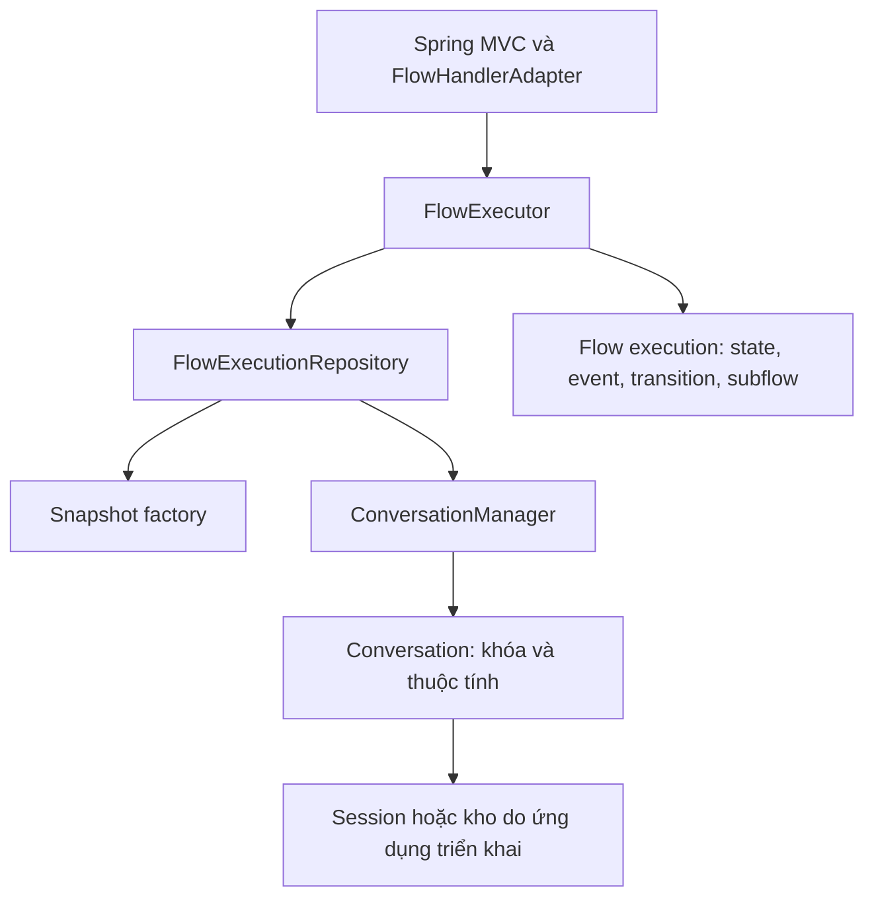

# Mở rộng repository hoặc ConversationManager khi có yêu cầu cụ thể

Trong Spring Web Flow, một hành trình như đăng ký dịch vụ có thể đi qua các bước nhập thông tin, xác minh bằng subflow, xem lại và xác nhận. Giữa hai request, framework phải giữ được execution đang chạy, nhận diện đúng phiên tương tác và khôi phục trạng thái để xử lý event tiếp theo. Repository và `ConversationManager` nằm ở tầng hạ tầng phục vụ công việc này.

Thuộc chương **Listener và mở rộng** của module **SPRING_WEB_FLOW**, bài học này giải thích cách chọn đúng điểm mở rộng khi cơ chế mặc định không còn đáp ứng yêu cầu. Mục tiêu là tiếp tục mô hình hóa điều hướng bằng state, event, transition và subflow, đồng thời kiểm soát nơi lưu trạng thái, giới hạn tài nguyên, cạnh tranh giữa request và cách phục hồi lỗi.

## 1. Xác định yêu cầu trước khi thay thành phần mặc định

Một yêu cầu mở rộng tốt cần mô tả được hành vi quan sát được và tiêu chí nghiệm thu. “Dùng Redis cho hiện đại” chưa xác định vấn đề cần giải quyết. “Sau khi node A dừng, request kế tiếp tới node B tiếp tục được execution trong thời hạn cho phép” là yêu cầu có thể kiểm tra.

| Yêu cầu | Hướng xử lý nên xem xét trước | Khi nào cần mở rộng sâu hơn |
| --- | --- | --- |
| Mỗi session chỉ được mở tối đa tám hành trình | Cấu hình giới hạn execution/conversation | Có quota riêng theo nhóm người dùng hoặc tenant |
| Giảm bộ nhớ dành cho lịch sử nút Back | Giới hạn số snapshot; giảm kích thước model | Chính sách lưu lịch sử đặc thù mà cấu hình không diễn tả được |
| Đo thời gian lưu và khôi phục execution | Decorator quanh repository hoặc tầng lưu trữ | Cần đo các bước nội bộ chưa có điểm quan sát phù hợp |
| Tiếp tục hành trình trên node khác | Đánh giá session replication hoặc session dùng chung và cơ chế khóa | Hệ thống cần kho conversation độc lập cùng khóa liên node |
| Cho phép người dùng lưu đơn và tiếp tục sau nhiều ngày | Lưu bản nháp nghiệp vụ có định danh và phân quyền riêng | Chỉ lưu execution dài hạn nếu đã giải quyết tương thích phiên bản và vòng đời |
| Từ chối lưu snapshot quá lớn | Đo payload và giới hạn model trước | Cần chính sách cưỡng chế tại snapshot factory hoặc repository |

Các lựa chọn về kho dùng chung, quota theo tenant và bản nháp ở bảng trên là phân tích thiết kế ứng dụng; chúng không phải tính năng tự có chỉ vì đã thay một bean Spring.

Một tiêu chí nghiệm thu ví dụ:

> Hai request gửi cùng execution tới hai node không được đồng thời ghi đè trạng thái của nhau. Nếu execution hết hạn, ứng dụng hiển thị đường phục hồi từ bản nháp; không tự gửi lại thao tác xác nhận.

Nếu chỉ cần ghi nhận flow bắt đầu, chuyển state hoặc kết thúc, listener thường đủ. Nếu cần thay cách lưu, lấy khóa hoặc nhận diện execution thì cần nhìn xuống các SPI bên dưới. Đừng đưa điều hướng nghiệp vụ vào repository: transition vẫn thuộc định nghĩa flow, xử lý nghiệp vụ vẫn thuộc service.

## 2. Repository và ConversationManager có trách nhiệm khác nhau

### 2.1. FlowExecutionRepository: lưu và khôi phục execution

`FlowExecutionRepository` là hợp đồng lưu, lấy lại và xóa execution. Các thao tác chính gồm `parseFlowExecutionKey`, `getLock`, `getFlowExecution`, `putFlowExecution` và `removeFlowExecution`. Execution được tra cứu bằng `FlowExecutionKey`; việc lấy, lưu hoặc xóa cần tuân thủ hợp đồng khóa. Đây là repository của runtime Web Flow, không phải Spring Data repository của đơn hàng. Xem [API FlowExecutionRepository](https://docs.spring.io/spring-webflow/docs/current/api/org/springframework/webflow/execution/repository/FlowExecutionRepository.html).

Trong triển khai mặc định, `DefaultFlowExecutionRepository` phối hợp conversation và các snapshot của execution. Một conversation quản lý một tương tác logic; các snapshot cho phép trở lại những điểm trước đó của execution. Khi execution kết thúc, repository mặc định dọn conversation và lịch sử tương ứng. Xem [API DefaultFlowExecutionRepository](https://docs.spring.io/spring-webflow/docs/current/api/org/springframework/webflow/execution/repository/impl/DefaultFlowExecutionRepository.html).

### 2.2. ConversationManager: quản lý vùng tương tác logic

`ConversationManager` cung cấp ba thao tác:

- `beginConversation(parameters)`: bắt đầu một conversation.
- `getConversation(id)`: lấy một conversation đã tồn tại.
- `parseConversationId(encodedId)`: chuyển biểu diễn chuỗi thành `ConversationId`.

Đối tượng `Conversation` cung cấp khóa, thuộc tính và thao tác kết thúc. Đặc biệt, hai lần lấy cùng ID phải tham chiếu tới cùng trạng thái logic, dù không bắt buộc trả cùng Java object. Xem [API ConversationManager](https://docs.spring.io/spring-webflow/docs/current/api/org/springframework/webflow/conversation/ConversationManager.html).

`SessionBindingConversationManager` lưu conversation trong session attribute map. Nó có thể giới hạn số conversation đang tồn tại và loại conversation cũ nhất khi vượt giới hạn. Nếu ứng dụng có nhiều manager cho các executor độc lập, cần dùng `sessionKey` khác nhau. Xem [API SessionBindingConversationManager](https://docs.spring.io/spring-webflow/docs/current/api/org/springframework/webflow/conversation/impl/SessionBindingConversationManager.html).

### 2.3. Nhìn toàn bộ đường đi



Sơ đồ mô tả vai trò, không khẳng định mọi implementation có đúng cùng cấu trúc nội bộ. Nếu chỉ đổi nơi chứa conversation mà vẫn dùng repository mặc định, ứng dụng giữ được phần lớn cơ chế snapshot sẵn có. Nếu đổi cả repository, ứng dụng phải chịu thêm trách nhiệm về execution key, lịch sử và phục hồi execution.

## 3. Phân biệt conversation hạ tầng với các scope của flow

Từ “conversation” xuất hiện ở cả tầng lưu trữ và mô hình scope, nhưng hai khái niệm không đồng nhất.

| Khái niệm | Vai trò trong hành trình nhiều bước |
| --- | --- |
| `requestScope` | Dữ liệu cần trong một request đang xử lý |
| `viewScope` | Dữ liệu gắn với một view-state đang hoạt động |
| `flowScope` | Dữ liệu của một flow session; subflow có flow scope riêng |
| `conversationScope` | Dữ liệu chia sẻ trong tương tác gồm flow gốc và các subflow |
| Thuộc tính của `Conversation` hạ tầng | Nơi repository có thể giữ dữ liệu kỹ thuật phục vụ lưu và khôi phục |
| HTTP session | Bối cảnh phiên người dùng, có thể chứa nhiều conversation độc lập |

API `Conversation` nêu rõ các thuộc tính của nó không đồng nghĩa với `conversationScope` trong execution. `Conversation` cũng không an toàn để chia sẻ tùy ý giữa các thread; cần khóa trước khi thao tác thuộc tính hoặc kết thúc. Xem [API Conversation](https://docs.spring.io/spring-webflow/docs/current/api/org/springframework/webflow/conversation/Conversation.html).

Ví dụ một flow đăng ký có:

```text
flowScope.registrationForm   = dữ liệu đang nhập ở flow gốc
conversationScope.draftId    = ID bản nháp dùng chung với subflow xác minh
HTTP session                = ngữ cảnh phiên và các conversation đang mở
Conversation attributes     = dữ liệu nội bộ do repository quản lý
```

Nếu một manager tùy biến chỉ giữ những biến do lập trình viên khai báo trong `conversationScope`, nó có thể bỏ sót dữ liệu kỹ thuật mà repository cần. Thiết kế phải tôn trọng đầy đủ hợp đồng thuộc tính của `Conversation`, thay vì tự phỏng đoán tên khóa nội bộ.

Cũng không nên hứa rằng nút Back khôi phục toàn bộ dữ liệu chia sẻ về giá trị cũ. `conversationScope` có thể được dùng chung giữa nhiều bản sao vật lý của execution. Cơ chế phục hồi của `FlowExecutionFactory` nhận scope này riêng với execution vừa giải tuần tự hóa. Vì vậy, phải kiểm tra hành vi Back với dữ liệu chia sẻ và tách quyết định nghiệp vụ không thể hoàn tác khỏi lịch sử giao diện. Xem [API FlowExecutionFactory](https://docs.spring.io/spring-webflow/docs/current/api/org/springframework/webflow/execution/FlowExecutionFactory.html).

## 4. Thử cấu hình trước khi viết SPI mới

Ví dụ sau dùng manager sẵn có, đặt giới hạn tám conversation và thời gian chờ khóa ba giây. Đây là các giá trị minh họa cần điều chỉnh theo thời gian xử lý thực tế.

```java
import org.springframework.context.annotation.Bean;
import org.springframework.context.annotation.Configuration;
import org.springframework.webflow.config.FlowExecutorBuilder;
import org.springframework.webflow.conversation.ConversationManager;
import org.springframework.webflow.conversation.impl.SessionBindingConversationManager;
import org.springframework.webflow.definition.registry.FlowDefinitionRegistry;
import org.springframework.webflow.executor.FlowExecutor;

@Configuration
public class WebFlowRuntimeConfig {

    @Bean
    public ConversationManager conversationManager() {
        SessionBindingConversationManager manager =
                new SessionBindingConversationManager();
        manager.setMaxConversations(8);
        manager.setLockTimeoutSeconds(3);
        manager.setSessionKey("registration.conversations");
        return manager;
    }

    @Bean
    public FlowExecutor flowExecutor(
            FlowDefinitionRegistry flowRegistry,
            ConversationManager conversationManager) {

        return new FlowExecutorBuilder(flowRegistry)
                .setConversationManager(conversationManager)
                .setMaxFlowExecutionSnapshots(12)
                .build();
    }
}
```

`FlowDefinitionRegistry` cần được ứng dụng cấu hình sẵn; đoạn mã chỉ trình bày tầng runtime. `FlowHandlerAdapter` của tích hợp Spring MVC phải được nối tới `FlowExecutor` này. Nếu adapter vẫn dùng executor khác, bean manager vừa khai báo sẽ không tác động tới các request thực tế.

`FlowExecutorBuilder` có điểm nối `setConversationManager`. Có thể dùng XML với thuộc tính `conversation-manager` của phần tử `flow-execution-repository` nếu dự án đang cấu hình bằng namespace Web Flow. Xem [API FlowExecutorBuilder](https://docs.spring.io/spring-webflow/docs/current/api/org/springframework/webflow/config/FlowExecutorBuilder.html) và [hướng dẫn cấu hình Web Flow](https://docs.spring.io/spring-webflow/docs/current/reference/index.html).

Ba lưu ý khi thay cấu hình:

1. Tám conversation là giới hạn theo session của manager này, không phải tám người dùng toàn hệ thống.
2. Khi vượt giới hạn, tab cũ có thể mất execution. Sản phẩm cần có phản hồi phù hợp cho tình huống đó.
3. Giới hạn snapshot quyết định mức lịch sử còn sử dụng được. Đặt bằng `0` để tắt snapshot không tương đương một chính sách Back không giới hạn; theo hướng dẫn Web Flow, khóa cũ có thể trỏ tới snapshot không được ghi nhận.

Không suy ra rằng giảm thời gian chờ khóa sẽ làm xử lý nhanh hơn. Nó chỉ thay đổi khoảng chờ trước khi báo không lấy được khóa; một action gọi dịch vụ chậm vẫn cần được đo và xử lý riêng.

## 5. Mở rộng nhỏ bằng decorator trước khi thay kho lưu trữ

Giả sử yêu cầu là đo số lần và độ trễ của thao tác bắt đầu, lấy và phân tích ID conversation. Một decorator có thể giữ nguyên manager đang dùng và bổ sung quan sát.

```java
import java.util.Objects;
import java.util.function.Supplier;
import org.springframework.webflow.conversation.Conversation;
import org.springframework.webflow.conversation.ConversationId;
import org.springframework.webflow.conversation.ConversationManager;
import org.springframework.webflow.conversation.ConversationParameters;

public final class ObservedConversationManager
        implements ConversationManager {

    public interface Recorder {
        void record(String operation, long elapsedNanos, boolean success);
    }

    private final ConversationManager delegate;
    private final Recorder recorder;

    public ObservedConversationManager(
            ConversationManager delegate, Recorder recorder) {
        this.delegate = Objects.requireNonNull(delegate);
        this.recorder = Objects.requireNonNull(recorder);
    }

    @Override
    public Conversation beginConversation(ConversationParameters parameters) {
        return observe("begin", () -> delegate.beginConversation(parameters));
    }

    @Override
    public Conversation getConversation(ConversationId id) {
        return observe("get", () -> delegate.getConversation(id));
    }

    @Override
    public ConversationId parseConversationId(String encodedId) {
        return observe("parse", () -> delegate.parseConversationId(encodedId));
    }

    private <T> T observe(String operation, Supplier<T> action) {
        long started = System.nanoTime();
        boolean success = false;
        try {
            T result = action.get();
            success = true;
            return result;
        } finally {
            try {
                recorder.record(operation, System.nanoTime() - started, success);
            } catch (RuntimeException ignored) {
                // Chính sách của ví dụ: lỗi metric không làm hỏng request.
                // Hệ thống thật cần kênh quan sát lỗi metric độc lập.
            }
        }
    }
}
```

Thay giá trị trả về của bean `conversationManager` bằng decorator này, với `Recorder` do ứng dụng triển khai. Recorder cần thực hiện nhanh, tránh I/O chặn request lâu và dùng nhãn có số lượng hữu hạn như `begin`, `get`, `parse`.

Ví dụ này giữ nguyên đối tượng `Conversation` do delegate trả về. Vì vậy nó không đo thời gian giữ khóa, không đo trực tiếp việc đọc snapshot và không biến session manager thành kho phân tán. Nếu yêu cầu là đo `lock()` hoặc `end()`, cần decorator cho cả `Conversation`, đồng thời bảo toàn quan hệ giữa ID, trạng thái và khóa.

Không dùng execution key, session ID hoặc ID người dùng làm nhãn metric. Chúng tạo số lượng chuỗi thời gian lớn và có thể làm lộ thông tin. Log phục vụ truy vết nên dùng correlation ID riêng, với chính sách che dữ liệu của ứng dụng.

## 6. Khi nào thực sự cần thay ConversationManager?

Một ví dụ đáng cân nhắc là ứng dụng có nhiều node, muốn lưu conversation trong kho dùng chung nhưng vẫn giữ repository và snapshot factory chuẩn. Tại đây, manager mới phải làm nhiều hơn thao tác `GET` và `SET`.

### 6.1. Hợp đồng cần bảo toàn

| Thành phần | Trách nhiệm của implementation tùy biến |
| --- | --- |
| `ConversationId` | Ổn định trong vòng đời conversation; có biểu diễn chuỗi phân tích ngược được |
| `beginConversation` | Tạo bản ghi hợp lệ, áp dụng quota và gắn bối cảnh sở hữu |
| `getConversation` | Trả handle tới cùng trạng thái logic; phát hiện không tồn tại hoặc hết hạn |
| `parseConversationId` | Kiểm tra định dạng; không biến việc parse thành quyền truy cập |
| `Conversation.lock/unlock` | Cung cấp quyền truy cập độc quyền đúng trên phạm vi cần hỗ trợ |
| Đọc, ghi, xóa thuộc tính | Giữ đúng ngữ nghĩa dữ liệu mà repository sử dụng |
| `Conversation.end` | Kết thúc vòng đời, dọn tài nguyên, ngăn request cũ làm sống lại dữ liệu |

Các chính sách quota, TTL, chủ sở hữu và lưu trữ là quyết định của implementation trong ví dụ; interface không tự triển khai chúng.

### 6.2. Thiết kế dữ liệu minh họa

Một mô hình lưu trữ có thể tách metadata, dữ liệu thuộc tính và thông tin khóa:

```text
ConversationRecord
  id
  ownerBinding        // ràng buộc session hoặc người dùng/tenant đã xác thực
  createdAt
  expiresAt
  revision
  lifecycleStatus     // ACTIVE hoặc ENDED
  attributesPayload   // biểu diễn đầy đủ thuộc tính theo codec đã chọn

LockRecord
  conversationId
  ownerToken
  fencingToken
  leaseUntil
```

Đây là mô hình đề xuất cho ứng dụng, không phải schema nội bộ Spring Web Flow. Cách mã hóa `attributesPayload` phải hỗ trợ những loại giá trị repository thực sự lưu. Chuyển tùy tiện toàn bộ object thành JSON không đủ để bảo đảm khôi phục được runtime execution.

Nếu có nhiều handle cho cùng ID trong một request, chúng phải dùng chung trạng thái thay đổi hoặc có cơ chế đọc lại nhất quán. Ví dụ, handle thứ nhất ghi thuộc tính dưới khóa thì handle thứ hai phải thấy giá trị phù hợp; hai bản sao cục bộ không đồng bộ sẽ làm mất cập nhật.

### 6.3. Định nghĩa chính sách hết hạn

Phải chọn rõ TTL là thời gian nhàn rỗi hay thời hạn tuyệt đối. Nếu là thời gian nhàn rỗi, xác định thao tác nào được gia hạn: request thành công, ghi snapshot hay mọi lần đọc? Cho phép mọi truy cập thất bại gia hạn cũng có thể khiến dữ liệu không được dọn như dự kiến.

TTL của conversation, snapshot và dữ liệu scope liên quan cần tương thích. Nếu metadata còn sống nhưng snapshot đã hết hạn, hệ thống không thể tiếp tục như bình thường. Nếu snapshot còn nhưng conversation đã kết thúc, không được tự tạo lại conversation để phục vụ một khóa cũ.

Khóa đang tồn tại cũng không nên vô tình bị xóa giữa một thao tác hợp lệ chỉ vì TTL hết hạn. Thiết kế cần quy định rõ việc gia hạn, kiểm tra trạng thái sau khi lấy khóa và cách xử lý khi tài nguyên bị thu hồi.

## 7. Khóa phải bao phủ toàn bộ chu kỳ đọc – xử lý – ghi

Lỗi phổ biến nhất khi đưa conversation ra kho dùng chung là chỉ khóa quanh lệnh ghi. Hai request vẫn có thể đọc cùng trạng thái cũ, xử lý event riêng rồi lần lượt ghi đè kết quả.

Chu kỳ cần bảo vệ về mặt logic:

```text
nhận execution key
    -> phân tích key và xác định conversation
    -> lấy khóa
    -> kiểm tra lại trạng thái tồn tại/quyền truy cập
    -> khôi phục execution
    -> xử lý event, binding, validation, action và transition
    -> lưu trạng thái tạm dừng hoặc dọn execution đã kết thúc
    -> giải phóng khóa
```

Trong request Web Flow thông thường, executor điều phối chu kỳ này thông qua hợp đồng repository. Không yêu cầu mỗi controller tự lấy khóa hoặc tự lưu execution.

Mã minh họa cách dùng hợp đồng khóa ở tầng hạ tầng:

```java
FlowExecutionLock lock = repository.getLock(key);
lock.lock();
try {
    FlowExecution execution = repository.getFlowExecution(key);
    // Thực hiện công việc hạ tầng cần thiết dưới cùng khóa.
    // Request web thông thường để FlowExecutor điều phối xử lý event.
} finally {
    lock.unlock();
}
```

Đặt `lock()` trước `try` ở ví dụ này có ý nghĩa: nếu không lấy được khóa thì không gọi `unlock()` cho một khóa chưa sở hữu. Mọi đường thoát sau khi lấy khóa thành công đều phải giải phóng nó.

### 7.1. Khóa cục bộ không bảo vệ hai node

`ReentrantLock` hoặc `synchronized` trên node A không ngăn node B ghi cùng conversation. Kho session dùng chung cũng không tự chứng minh rằng thao tác sửa nhiều thuộc tính đã được tuần tự hóa giữa các node. Khi chọn giải pháp session dùng chung, phải kiểm tra cơ chế lưu thay đổi và đồng thời của chính giải pháp đó.

Với kho phân tán, cần một chiến lược khóa hoặc kiểm soát phiên bản đủ để bảo toàn toàn bộ chu kỳ xử lý. Chỉ dùng compare-and-set ở cuối có thể phát hiện xung đột ghi, nhưng các action nghiệp vụ đã chạy trước đó vẫn có thể gây tác dụng phụ hai lần.

### 7.2. Lease hết hạn tạo ra người ghi cũ

Giả sử node A giữ lease mười giây, sau đó dừng lâu do GC. Node B lấy lease mới; khi A hoạt động lại, A có thể vẫn tin rằng mình giữ khóa.

Với thiết kế dùng lease, cần xử lý ít nhất:

- Token chủ sở hữu để chỉ bên giữ khóa hiện tại được giải phóng khóa.
- Gia hạn lease hoặc giới hạn thời gian xử lý phù hợp.
- Fencing token tăng dần hoặc cơ chế tương đương để từ chối ghi từ bên giữ khóa đã lỗi thời.
- Kiểm tra quyền ghi tại nơi lưu dữ liệu, không chỉ kiểm tra trong bộ nhớ ứng dụng.

Các cơ chế này thuộc thiết kế hệ thống phân tán của ứng dụng. Spring Web Flow không tự bổ sung chúng khi một `ConversationManager` mới được đăng ký.

Khóa conversation cũng không thay thế idempotency nghiệp vụ. Hai request nối tiếp nhau vẫn có thể cùng cố xác nhận một đơn. Service xác nhận cần khóa nghiệp vụ, ràng buộc dữ liệu hoặc idempotency key phù hợp.

## 8. Khi nào cần mở rộng FlowExecutionRepository?

Thay repository phù hợp khi yêu cầu tác động tới ngữ nghĩa execution key, lịch sử snapshot, cách phục hồi hoặc chính sách lưu execution mà thay manager không giải quyết được. Ví dụ: kho snapshot có chính sách lưu trữ riêng và cần kiểm soát cả thao tác cập nhật, xóa lịch sử lẫn phục hồi.

Có ba mức can thiệp:

1. **Decorator quanh repository**: thêm đo lường hoặc chính sách ở ranh giới gọi mà vẫn giữ triển khai bên trong.
2. **Kế thừa lớp hỗ trợ phù hợp**: tái sử dụng một phần cơ chế khóa, conversation hoặc snapshot, sau khi kiểm tra các extension point của phiên bản dự án.
3. **Triển khai SPI đầy đủ**: chủ động chịu trách nhiệm về hợp đồng lưu, phục hồi, khóa và lỗi; đồng thời giải quyết cơ chế cấp execution key mà execution factory sử dụng.

Không giả định rằng repository chỉ có hai hàm `save` và `load`. Thay một lớp theo cách đó dễ bỏ sót việc thu hồi key, xóa lịch sử khi kết thúc hoặc khôi phục execution ở một snapshot cũ.

### 8.1. Nối repository với execution factory

`FlowExecutorImpl` nhận definition locator, execution factory và repository qua constructor. `FlowExecutionImplFactory` có `setExecutionKeyFactory` để nối chiến lược cấp key. Với repository mặc định, chính repository đảm nhiệm vai trò key factory. Xem [API FlowExecutorImpl](https://docs.spring.io/spring-webflow/docs/current/api/org/springframework/webflow/executor/FlowExecutorImpl.html) và [API FlowExecutionImplFactory](https://docs.spring.io/spring-webflow/docs/current/api/org/springframework/webflow/engine/impl/FlowExecutionImplFactory.html).

Đoạn cấu hình dưới đây minh họa việc lắp các thành phần bằng tay. Nó dùng repository chuẩn để chỉ rõ các mối nối, chưa triển khai kho tùy biến:

```java
import org.springframework.context.annotation.Bean;
import org.springframework.context.annotation.Configuration;
import org.springframework.webflow.conversation.ConversationManager;
import org.springframework.webflow.definition.registry.FlowDefinitionRegistry;
import org.springframework.webflow.engine.impl.FlowExecutionImplFactory;
import org.springframework.webflow.execution.repository.impl.DefaultFlowExecutionRepository;
import org.springframework.webflow.execution.repository.snapshot.SerializedFlowExecutionSnapshotFactory;
import org.springframework.webflow.executor.FlowExecutor;
import org.springframework.webflow.executor.FlowExecutorImpl;

@Configuration
public class ExplicitWebFlowRuntimeConfig {

    @Bean
    public FlowExecutor flowExecutor(
            FlowDefinitionRegistry flowRegistry,
            ConversationManager conversationManager) {

        FlowExecutionImplFactory executionFactory =
                new FlowExecutionImplFactory();

        SerializedFlowExecutionSnapshotFactory snapshotFactory =
                new SerializedFlowExecutionSnapshotFactory(
                        executionFactory, flowRegistry);

        DefaultFlowExecutionRepository repository =
                new DefaultFlowExecutionRepository(
                        conversationManager, snapshotFactory);
        repository.setMaxSnapshots(12);

        executionFactory.setExecutionKeyFactory(repository);

        return new FlowExecutorImpl(
                flowRegistry, executionFactory, repository);
    }
}
```

Chọn cấu hình này **thay cho** cấu hình `FlowExecutorBuilder` ở phần trước, không đăng ký cả hai bean `flowExecutor`. Bean `ConversationManager` vẫn cần được cung cấp.

Nếu thay repository bằng subclass của `DefaultFlowExecutionRepository`, có thể tiếp tục tận dụng vai trò key factory đã có. Nếu tạo decorator chỉ triển khai `FlowExecutionRepository`, không truyền nó vào `setExecutionKeyFactory` vì hai interface khác nhau. Cần giữ key factory bên trong hoặc cung cấp một implementation tương thích, để key được sinh và key được repository đọc luôn cùng ngữ nghĩa.

Khi tự lắp runtime, cũng cần chuyển các listener loader và execution attributes mà ứng dụng đang dùng sang execution factory. Đoạn cấu hình tối thiểu trên không tự sao chép những tùy chỉnh đã tồn tại trong một builder khác. Nguồn [FlowExecutorBuilder của Spring Web Flow](https://raw.githubusercontent.com/spring-projects/spring-webflow/main/spring-webflow/src/main/java/org/springframework/webflow/config/FlowExecutorBuilder.java) cho thấy quá trình lắp repository, snapshot factory và key factory; khi triển khai thực tế phải đối chiếu với đúng phiên bản dependency của dự án.

### 8.2. Đừng giải tuần tự hóa rồi trả ngay execution

Execution vừa đọc từ bytes còn cần khôi phục những tham chiếu runtime như flow definition và các thành phần liên quan. `SerializedFlowExecutionSnapshotFactory` tạo snapshot bằng Java serialization và hỗ trợ phục hồi execution với definition locator, key, conversation scope cùng key factory. Xem [API SerializedFlowExecutionSnapshotFactory](https://docs.spring.io/spring-webflow/docs/current/api/org/springframework/webflow/execution/repository/snapshot/SerializedFlowExecutionSnapshotFactory.html).

Do đó, mã tự viết kiểu sau chưa đủ:

```text
bytes = store.get(key)
execution = deserialize(bytes)
return execution
```

Phải sử dụng hoặc tái hiện đầy đủ cơ chế phục hồi được SPI yêu cầu. Đây là lý do nên giữ snapshot factory chuẩn khi nhu cầu thực tế chỉ là thay nơi lưu conversation.

## 9. Serialization, dung lượng và tương thích phiên bản

Khi chọn snapshot tuần tự hóa, dữ liệu nằm trong model của form và các scope liên quan phải phù hợp với cơ chế serialization đó. Một form có vài thuộc tính đơn giản dễ quản lý hơn một object graph chứa entity, proxy lazy, service hoặc tài nguyên đang mở.

Ví dụ DTO dành cho trạng thái form:

```java
import java.io.Serializable;

public final class RegistrationDraft implements Serializable {
    private static final long serialVersionUID = 1L;

    private String draftId;
    private String contactEmail;

    public String getDraftId() {
        return draftId;
    }

    public void setDraftId(String draftId) {
        this.draftId = draftId;
    }

    public String getContactEmail() {
        return contactEmail;
    }

    public void setContactEmail(String contactEmail) {
        this.contactEmail = contactEmail;
    }
}
```

DTO này hỗ trợ form binding thông qua getter/setter và không mang service vào snapshot. Các ràng buộc validation vẫn cần được khai báo hoặc triển khai ở tầng validation của ứng dụng; repository không chịu trách nhiệm kiểm tra email hay điều kiện đăng ký.

Những nguyên tắc thiết kế nên áp dụng:

- Lưu ID và dữ liệu biểu mẫu cần thiết; tải lại dữ liệu nghiệp vụ qua service khi phù hợp.
- Đưa file upload vào kho tạm riêng, giữ định danh file thay vì toàn bộ bytes trong execution.
- Đo kích thước thực tế của snapshot và toàn bộ conversation; không chỉ đo số trường trên DTO.
- Giới hạn số execution, số snapshot và kích thước payload theo ngân sách tài nguyên.
- Chỉ giải tuần tự hóa dữ liệu từ kho tin cậy, với kiểm soát truy cập và biện pháp lọc phù hợp cho runtime đang dùng.

Ước lượng dung lượng thô, trước overhead và replication:

```text
10.000 session đang hoạt động
× 4 execution/session
× 12 snapshot/execution
× 40 KiB/snapshot
≈ 18,3 GiB
```

Đây là phép tính giả định để thấy tác động nhân của các giới hạn; đo triển khai thật còn phải tính metadata, conversation scope, khóa, bản sao và chi phí mã hóa.

`serialVersionUID` không bảo đảm một execution của bản ứng dụng cũ sẽ chạy được trên bản mới. Đổi tên state, cấu trúc subflow hoặc lớp model đều có thể ảnh hưởng khôi phục. Với rolling deployment, cần chính sách tương thích, định tuyến theo phiên bản hoặc kết thúc có kiểm soát các execution cũ. Nếu không hỗ trợ migration, hãy cho phép phục hồi từ bản nháp nghiệp vụ thay vì hứa tiếp tục nguyên trạng mọi execution.

## 10. Thiết kế lỗi và phục hồi mà không lặp tác dụng phụ

Kho lưu conversation dùng chung trở thành một phụ thuộc trên đường request. Mỗi nhóm lỗi cần hành vi khác nhau:

| Tình huống | Phản hồi có thể thiết kế | Điều phải tránh |
| --- | --- | --- |
| Key sai định dạng | Thông báo yêu cầu không hợp lệ, cho phép về điểm bắt đầu | Ghép key vào truy vấn hoặc log nguyên dữ liệu chưa kiểm soát |
| Conversation hết hạn hoặc đã bị loại | Thông báo phiên tương tác không còn; mở bản nháp nếu có quyền | Tự tạo conversation rỗng dưới ID cũ |
| Snapshot lịch sử đã bị dọn | Giải thích bước cũ không còn khả dụng; đề xuất lối tiếp tục đã xác minh | Giả vờ đã khôi phục đúng màn hình và dữ liệu cũ |
| Không lấy được khóa | Thông báo hành trình đang được xử lý, cho phép thử lại phù hợp | Tiếp tục chạy action khi chưa sở hữu khóa |
| Kho lưu tạm thời không truy cập được | Giữ lỗi hạ tầng để lớp xử lý lỗi quyết định phản hồi | Giả thành không có conversation hoặc âm thầm chuyển sang bộ nhớ cục bộ |
| Nghiệp vụ đã commit nhưng lưu snapshot thất bại | Tra cứu kết quả nghiệp vụ bằng định danh ổn định | Tự gửi lại thao tác thanh toán/xác nhận |
| Payload không tương thích phiên bản | Cung cấp lối mở lại từ bản nháp và ghi nhận nguyên nhân kỹ thuật | Bắt mọi exception rồi ép execution sang một state tùy ý |

Đây là các chính sách ứng dụng cần hiện thực và kiểm thử. Không phải mọi lỗi ở repository đều chuyển thành một event có thể bắt bằng transition trong flow. Chẳng hạn, không khôi phục được execution có thể xảy ra trước khi có flow context hợp lệ; lúc đó cần xử lý tại lớp tích hợp Web Flow/MVC hoặc cơ chế xử lý exception tương ứng.

Một thứ tự sự cố điển hình:

```text
1. Event confirm được xử lý.
2. Service ghi đơn thành công với submissionId ổn định.
3. Lưu trạng thái execution thất bại do mất kết nối kho.
4. Người dùng bấm thử lại.
```

Ở bước 4, chỉ phục hồi snapshot cũ không cho biết chắc nghiệp vụ đã thất bại. Service phải nhận diện `submissionId` đã xử lý và trả kết quả đã có, hoặc áp dụng cơ chế chống lặp tương đương. Snapshot của giao diện và transaction dữ liệu nghiệp vụ thường không cùng một transaction nguyên tử.

Bản nháp cũng cần kiểm tra chủ sở hữu khi mở lại. ID được giữ trong `conversationScope` giúp liên kết hành trình, nhưng không thay thế kiểm tra quyền trên bản nháp.

## 11. Kiểm thử đúng hợp đồng, không chỉ happy path

Các tình huống dưới đây là kế hoạch kiểm thử dành cho implementation mở rộng. Không thể chứng minh tính đúng của kho phân tán chỉ bằng unit test map trong bộ nhớ.

### 11.1. Contract test cho ConversationManager

1. Tạo conversation, chuyển ID thành chuỗi và parse lại; ID sau parse phải truy cập đúng tương tác.
2. Dưới khóa, ghi rồi đọc lại một thuộc tính; kiểm tra xóa thuộc tính.
3. Lấy cùng ID qua hai handle; thay đổi qua một handle phải hiện diện nhất quán qua handle còn lại theo hợp đồng.
4. Kết thúc conversation; lần truy cập sau phải báo không còn tồn tại, không tự hồi sinh dữ liệu.
5. Kiểm tra quota và TTL, gồm trường hợp request đang chờ khóa khi conversation hết hạn.
6. Kiểm tra hai session/tenant không đọc được conversation của nhau chỉ bằng việc biết ID.

### 11.2. Kiểm thử tích hợp execution

Cho một flow `enterDetails -> verifySubflow -> review -> done`:

- Gửi form hợp lệ, tạo snapshot, khôi phục và xác nhận state cùng model đúng.
- Gửi form không hợp lệ, xác nhận lỗi validation và dữ liệu nhập được xử lý đúng sau redirect/khôi phục theo cấu hình ứng dụng.
- Vào và ra subflow, kiểm tra dữ liệu scope riêng và dữ liệu chia sẻ.
- Dùng key cũ còn trong lịch sử, kiểm tra hành vi Back và dữ liệu dùng chung.
- Kết thúc flow, xác nhận các key cũ không tiếp tục được execution đã hoàn tất.
- Dọn snapshot cũ theo giới hạn, xác nhận đường xử lý lỗi khi truy cập lại key đó.

Test flow thuần túy thường không đi qua repository thật. Cần thêm test qua executor hoặc đường request thực tế để kiểm tra điểm nối, serialization và lưu trữ.

### 11.3. Kiểm thử đồng thời và lỗi trên nhiều node

```text
Chuẩn bị: cùng execution key K, hai instance A và B, một kho dùng chung.

A lấy khóa và dừng tại barrier trước khi ghi.
B gửi request tiếp tục K.
Kiểm tra B chờ hoặc thất bại theo chính sách, không chạy song song trái phép.
Cho A hoàn tất; kiểm tra kết quả và số tác dụng phụ nghiệp vụ.

Lặp lại với A bị dừng, lease hết hạn và A hoạt động trở lại.
Kiểm tra lần ghi từ chủ khóa cũ bị từ chối.
```

Dùng barrier/latch hoặc khả năng điều khiển tiến trình thay cho phỏng đoán bằng `sleep`. Cũng cần tạo lỗi ở ranh giới sau commit nghiệp vụ nhưng trước lưu snapshot, vì đây là tình huống phát hiện thiết kế retry không an toàn.

## 12. Bài thực hành: chọn thay đổi nhỏ nhất đáp ứng yêu cầu

### Bối cảnh

Một ứng dụng đăng ký dịch vụ chạy Spring MVC và Spring Web Flow. Người dùng mở nhiều tab; bộ nhớ tăng do model chứa dữ liệu dư thừa. Đội vận hành muốn đo độ trễ quản lý conversation và đang cân nhắc chuyển dữ liệu sang kho dùng chung.

### Các bước thực hiện

1. Viết tiêu chí nghiệm thu: tối đa tám conversation/session, tối đa mười hai snapshot/execution, đo được thời gian `begin/get/parse`, không rò dữ liệu giữa các tab.
2. Dùng `SessionBindingConversationManager` và cấu hình runtime ở phần 4; rút gọn model, giữ ID thay cho dữ liệu lớn.
3. Bọc manager bằng `ObservedConversationManager`; kiểm tra metric thành công và thất bại, bảo đảm lỗi metric không che lỗi gốc.
4. Kiểm tra Back, validation, subflow và việc tab cũ bị loại khi vượt giới hạn.
5. Nếu cần chịu lỗi node, lập tiêu chí riêng cho session dùng chung hoặc manager phân tán; bổ sung kiểm thử khóa liên node trước khi chuyển kho.
6. Nếu chỉ cần lưu đơn nhiều ngày, triển khai bản nháp nghiệp vụ và khởi tạo execution mới từ bản nháp đã kiểm tra quyền.

### Sản phẩm cần giải thích được

- Vì sao cấu hình hoặc decorator đã đủ cho yêu cầu ban đầu?
- Nếu thay manager, phần nào của repository và snapshot vẫn được giữ lại?
- Nếu thay repository, key factory và cơ chế phục hồi execution được nối thế nào?
- Hệ thống phản hồi thế nào khi execution mất nhưng bản nháp vẫn còn?
- Sau một lần xác nhận thành công nhưng mất snapshot, điều gì ngăn đơn bị tạo lần hai?

Nguyên tắc lựa chọn là gắn mỗi thay đổi hạ tầng với một yêu cầu có thể kiểm chứng. Giữ điều hướng trong flow, binding và validation ở các lớp tương ứng, nghiệp vụ trong service; chỉ mở rộng repository hoặc `ConversationManager` đến mức cần thiết để đáp ứng cách lưu trữ, đồng thời và phục hồi đã cam kết.
