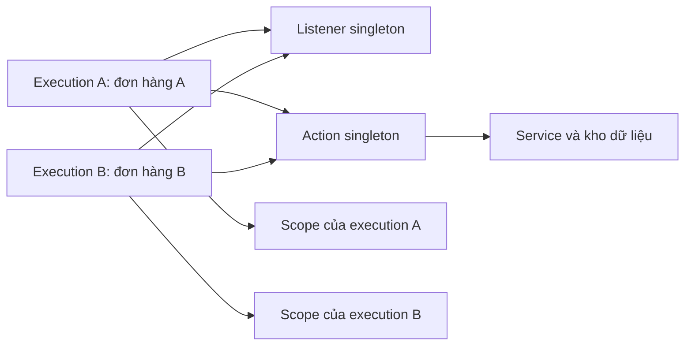

# Giữ thành phần singleton an toàn khi phục vụ nhiều execution

Trong Spring Web Flow, một hành trình đặt hàng có thể đi qua `cart → address → payment → confirmation`. Mỗi lần khởi chạy hành trình tạo ra một flow execution riêng, nhưng listener, action, validator và service được các execution gọi đến thường là những bean singleton dùng chung. Vì thế, tách đúng dữ liệu của từng hành trình khỏi các thành phần dùng chung là điều kiện để mô hình state, event, transition và subflow hoạt động đúng khi có nhiều người dùng.

Bài thuộc chương **Listener và mở rộng** của module **SPRING_WEB_FLOW**. Trọng tâm là thiết kế các điểm mở rộng để chúng không làm lẫn form, kết quả validation, lịch sử điều hướng hoặc dữ liệu audit giữa các execution, kể cả khi ứng dụng tích hợp với Spring MVC và phục hồi sau lỗi.

## 1. Mục tiêu và mô hình thực thi

Sau bài học, bạn có thể:

- Nhận diện dữ liệu nào thuộc bean dùng chung và dữ liệu nào thuộc từng execution.
- Viết listener và action singleton không giữ trạng thái của người gọi trong field.
- Chọn scope cho form, dữ liệu subflow và thông tin phục vụ một lượt xử lý.
- Phân biệt bảo vệ một execution với bảo vệ tài nguyên nghiệp vụ dùng chung.
- Thiết kế kiểm thử phát hiện rò rỉ dữ liệu khi các callback chạy xen kẽ.

Cần phân biệt bốn đối tượng:

| Đối tượng | Vai trò | Quan hệ với dữ liệu thay đổi |
| --- | --- | --- |
| Flow definition | Mô tả các state, transition và quy tắc của flow | Được dùng lại; không chứa form riêng của từng người dùng |
| Flow execution | Một lần thực thi hành trình | Có trạng thái và các flow session của riêng nó |
| Flow session | Một lần thực thi flow gốc hoặc một subflow trong execution | Có flow scope riêng |
| Bean singleton | Listener, action hoặc service được container chia sẻ | Không được dùng field làm chỗ chứa dữ liệu riêng của execution |

Spring mô tả singleton theo **bean và container**. Điều đó quyết định cách tái sử dụng instance, không tự động bổ sung khóa cho phương thức của bạn. Prototype được inject trực tiếp vào singleton cũng chỉ được resolve khi singleton được tạo; cấu hình đó không tự cung cấp một instance mới cho mỗi lần gọi. Xem [Bean Scopes của Spring Framework](https://docs.spring.io/spring-framework/reference/core/beans/factory-scopes.html).

Flow definition và flow execution cũng không phải một đối tượng. Tài liệu [Flow API](https://docs.spring.io/spring-webflow/docs/current/api/org/springframework/webflow/engine/Flow.html) nhấn mạnh definition là đối tượng singleton cần an toàn khi dùng chung, còn execution mô hình hóa một lần chạy cụ thể.



Hai execution có thể thuộc hai người dùng khác nhau, hoặc hai hành trình được khởi chạy độc lập trong cùng một HTTP session. Đừng đồng nhất execution với người dùng, tab trình duyệt hoặc thread.

## 2. Lỗi điển hình: field mang nghĩa “hiện tại”

Xét listener viết lịch sử chuyển state:

```java
// Ví dụ sai: dữ liệu riêng của từng lời gọi nằm trong field dùng chung.
public final class UnsafeNavigationListener implements FlowExecutionListener {
    private String journeyId;
    private String stateId;

    @Override
    public void stateEntered(RequestContext context,
                             StateDefinition previousState,
                             StateDefinition state) {
        journeyId = (String) context.getConversationScope().get("journeyId");
        stateId = state.getId();
        writeAudit(journeyId, stateId);
    }

    private void writeAudit(String journey, String state) {
        // Gửi bản ghi tới nơi lưu trữ audit.
    }
}
```

Đoạn mã rút gọn trên dùng các kiểu `FlowExecutionListener`, `RequestContext` và `StateDefinition` của Spring Web Flow. Lỗi xuất hiện khi các phép ghi và đọc field xen kẽ:

| Thời điểm | Thread A | Thread B |
| --- | --- | --- |
| 1 | Ghi `journeyId = A` | |
| 2 | Ghi `stateId = address` | |
| 3 | | Ghi `journeyId = B` |
| 4 | | Ghi `stateId = payment` |
| 5 | Đọc field và ghi audit | |

Bản ghi do A tạo có thể mang dữ liệu của B, thậm chí kết hợp mã hành trình của một execution với state của execution khác. Trong hệ thống thực tế, audit có thể sai mà không có exception nào xuất hiện.

Các field đáng nghi gồm `currentForm`, `lastEvent`, `currentUser`, `errors`, `activeContext`, `startTime` và `lastResult`. Tên field không quyết định tính an toàn, nhưng thường bộc lộ việc một singleton đang giữ dữ liệu của người gọi.

### Vì sao các cách sửa nhanh chưa giải quyết gốc rễ?

- `volatile` hỗ trợ tính nhìn thấy của một field; nó không biến nhiều thao tác cập nhật thành một giao dịch nhất quán.
- `AtomicReference<Form>` bảo vệ việc thay reference; mọi execution vẫn đang dùng chung một ô chứa form.
- `ConcurrentHashMap` bảo vệ các thao tác được tài liệu của map cam kết; nó không sửa việc chọn sai key, dùng chung value mutable hoặc quên xóa dữ liệu.
- `synchronized` trên một callback có thể ngăn xen kẽ trong callback đó, nhưng dữ liệu vẫn sai nếu được ghi ở callback trước và đọc ở callback sau, giữa hai request.

Thiết kế đúng bắt đầu từ câu hỏi: **Dữ liệu này thuộc về ai, và phải tồn tại trong bao lâu?**

## 3. Quy tắc thiết kế singleton

Một singleton dễ kiểm soát thường chỉ có các field sau:

```java
private final CheckoutService checkoutService;
private final AuditSink auditSink;
private final String applicationName;
```

Các dependency vẫn phải hỗ trợ cách dùng đồng thời tương ứng. `final` chỉ ngăn gán lại reference; một `final ArrayList<?>` vẫn có thể bị thay đổi và gặp race condition.

Dữ liệu của lần gọi hiện tại nên đi qua tham số hoặc biến cục bộ:

```java
String journeyId = (String) context.getConversationScope().get("journeyId");
String stateId = state.getId();
auditSink.accept(journeyId, stateId);
```

Nếu biến cục bộ trỏ tới một DTO mutable lấy từ scope, DTO đó chưa trở thành bất biến. Đặc biệt, không chuyển reference ấy cho một worker bất đồng bộ rồi tiếp tục sửa nó trong luồng xử lý flow. Hãy trích xuất các giá trị cần thiết thành một thông điệp độc lập.

Tài liệu [Action API](https://docs.spring.io/spring-webflow/docs/current/api/org/springframework/webflow/execution/Action.html) yêu cầu singleton action xử lý dữ liệu cục bộ hoặc sử dụng các service nội bộ an toàn khi chạy đồng thời. Khuyến nghị này cũng là nguyên tắc thiết kế hữu ích cho các điểm mở rộng dùng chung khác.

## 4. Chọn scope theo vòng đời dữ liệu

| Nhu cầu | Nơi đặt phù hợp | Lưu ý |
| --- | --- | --- |
| Giá trị trung gian trong một phương thức | Biến cục bộ | Không để reference thoát sang tác vụ nền ngoài ý muốn |
| Dữ liệu dùng giữa các action trong một lượt xử lý flow | `requestScope` | Không dựa vào nó để giữ dữ liệu qua lượt gửi form tiếp theo |
| Trạng thái riêng của màn hình hiện tại | `viewScope` | Chỉ truy cập khi đang ở view-state |
| Form của flow hiện tại | `flowScope` | Flow gốc và subflow có flow scope riêng |
| Mã tương quan chung của flow gốc và subflow | `conversationScope` | Được chia sẻ trong cùng execution |
| Tùy chọn thật sự thuộc phiên đăng nhập | HTTP session hoặc bean session scope thích hợp | Có thể được nhiều request và nhiều execution cùng truy cập |
| Đơn hàng đã lưu, tồn kho, khóa chống xử lý trùng | Tầng nghiệp vụ và kho dữ liệu | Cần quy tắc đồng thời và tính bền vững riêng |

Các vòng đời flow scope và conversation scope được mô tả trong [Spring Web Flow Reference Guide, phần Variable Scopes](https://docs.spring.io/spring-webflow/docs/current/reference/index.html). Với cơ chế snapshot/session tương ứng, dữ liệu cần lưu giữa các request phải đáp ứng yêu cầu serialization; tránh đưa connection, request, thread hoặc executor vào scope.

Một lỗi thường gặp là đặt `currentCheckoutForm` vào HTTP session. Hai execution độc lập của cùng người dùng đều nhìn thấy cùng thuộc tính, nên tab thứ hai có thể thay form mà tab thứ nhất đang chỉnh sửa. Chuyển form sang flow scope giải quyết việc sở hữu dữ liệu theo hành trình; điều này không tự ngăn hai hành trình cập nhật cùng một đơn hàng trong database.

### Subflow cần hợp đồng dữ liệu rõ ràng

Nếu `checkout` gọi subflow `chooseAddress`, nên truyền dữ liệu đầu vào và nhận kết quả đầu ra rõ ràng. Không giả định subflow tự dùng chung flow scope với flow cha.

`conversationScope` phù hợp khi hai flow cần một mã hành trình chung. Với các DTO nghiệp vụ, hãy quyết định rõ đang truyền bản sao, giá trị bất biến hay cùng một reference. Hai tên biến ở hai scope khác nhau vẫn có thể trỏ tới cùng một object mutable.

## 5. Listener singleton không giữ dữ liệu của execution

Ví dụ dưới đây dùng callback để khởi tạo mã tương quan của hành trình và ghi nhận mỗi lần vào state. Cách triển khai trực tiếp `FlowExecutionListener` phù hợp với API có các phương thức mặc định; nếu dự án dùng phiên bản khác, đối chiếu API của dependency đang khóa trước khi áp dụng.

```java
package example.checkout;

import java.util.UUID;

import org.springframework.stereotype.Component;
import org.springframework.webflow.definition.StateDefinition;
import org.springframework.webflow.execution.FlowExecutionListener;
import org.springframework.webflow.execution.FlowSession;
import org.springframework.webflow.execution.RequestContext;
import org.springframework.webflow.core.collection.MutableAttributeMap;

@Component("journeyAuditListener")
public final class JourneyAuditListener implements FlowExecutionListener {

    private static final String JOURNEY_ID = "journeyId";

    private final AuditSink auditSink;

    public JourneyAuditListener(AuditSink auditSink) {
        this.auditSink = auditSink;
    }

    @Override
    public void sessionStarting(RequestContext context,
                                FlowSession session,
                                MutableAttributeMap<?> input) {
        MutableAttributeMap<Object> scope = context.getConversationScope();
        if (scope.get(JOURNEY_ID) == null) {
            scope.put(JOURNEY_ID, UUID.randomUUID().toString());
        }
    }

    @Override
    public void stateEntered(RequestContext context,
                             StateDefinition previousState,
                             StateDefinition state) {
        String journeyId = (String) context.getConversationScope()
                .get(JOURNEY_ID);
        String flowId = context.getActiveFlow().getId();
        String previousId = previousState == null
                ? null : previousState.getId();
        String stateId = state.getId();

        auditSink.accept(journeyId, flowId, previousId, stateId);
    }

    public interface AuditSink {
        void accept(String journeyId, String flowId,
                    String previousStateId, String stateId);
    }
}
```

Trong ví dụ này:

1. Listener chỉ giữ dependency `auditSink`, không giữ form, context hoặc mã execution trong field.
2. Mã hành trình nằm trong conversation scope và được giữ lại khi bắt đầu subflow.
3. Mỗi callback trích xuất dữ liệu qua biến cục bộ; sink nhận các giá trị `String` độc lập với context.
4. Sink phải hỗ trợ nhiều lời gọi đồng thời và có chính sách khi việc ghi audit thất bại. Nó là thành phần do ứng dụng cung cấp, không phải API có sẵn của Spring Web Flow.

Đoạn `get` rồi `put` khi khởi tạo mã không phải thao tác nguyên tử tổng quát. Nó dựa vào việc runtime/repository đã được cấu hình để điều phối truy cập cùng execution. Không gọi các callback thủ công từ nhiều thread trên cùng scope rồi giả định đoạn khởi tạo này tự có khóa.

Theo [FlowExecutionListener API](https://docs.spring.io/spring-webflow/docs/current/api/org/springframework/webflow/execution/FlowExecutionListener.html), `sessionStarting` được gọi trước khi flow session bắt đầu, còn `stateEntered` được gọi sau khi chuyển vào state. Việc vào state không đồng nghĩa transaction nghiệp vụ đã commit; một bản ghi quan sát điều hướng không nên được dùng thay bằng chứng thanh toán thành công.

### Gắn listener vào flow executor

Trong cấu hình đã có flow registry và bean sink, có thể đăng ký listener bằng đoạn XML sau. Đây là phần trích từ cấu hình ứng dụng, không phải toàn bộ file Spring context.

```xml
<webflow:flow-executor id="flowExecutor"
                       flow-registry="flowRegistry">
    <webflow:flow-execution-listeners>
        <webflow:listener ref="journeyAuditListener" />
    </webflow:flow-execution-listeners>
</webflow:flow-executor>
```

Prefix `webflow` cần được khai báo bằng namespace `http://www.springframework.org/schema/webflow-config`. Bean listener phải được component scan hoặc được khai báo tường minh; ứng dụng cũng cần cung cấp một bean triển khai `JourneyAuditListener.AuditSink`.

Khi tích hợp Spring MVC, nhiều HTTP request có thể đi qua cùng flow executor và cùng listener. Việc MVC tìm đúng execution từ request không biến listener singleton thành instance riêng cho request đó.

## 6. Action singleton: truyền form qua tham số

Action nên lấy dữ liệu của execution từ context, gọi service rồi đưa kết quả về scope của execution đó.

```java
package example.checkout;

import org.springframework.webflow.execution.Action;
import org.springframework.webflow.execution.Event;
import org.springframework.webflow.execution.RequestContext;

public final class QuoteAction implements Action {

    private final QuoteService quoteService;

    public QuoteAction(QuoteService quoteService) {
        this.quoteService = quoteService;
    }

    @Override
    public Event execute(RequestContext context) {
        String cartId = (String) context.getFlowScope().get("cartId");
        String quoteId = quoteService.createQuote(cartId);
        context.getFlowScope().put("quoteId", quoteId);
        return new Event(this, "success");
    }

    public interface QuoteService {
        String createQuote(String cartId);
    }
}
```

Giả định `cartId` đã được flow khởi tạo và kiểm tra hợp lệ. `QuoteService` là hợp đồng minh họa của ứng dụng; triển khai thật cần xác minh quyền truy cập giỏ hàng và quy tắc tạo báo giá. Không dùng mã hành trình hay execution key làm bằng chứng người gọi được phép truy cập một tài nguyên.

Flow quyết định chuyển state theo event `success`. Action không tự giữ `lastQuoteId` hoặc lựa chọn view dựa trên dữ liệu còn sót lại từ người gọi trước.

### Form binding và validation

Có thể tạo form riêng của flow bằng khai báo sau trong flow definition:

```xml
<var name="checkoutForm" class="example.checkout.CheckoutForm" />

<view-state id="address" model="checkoutForm">
    <transition on="next" to="payment" />
</view-state>
```

`CheckoutForm` cần được thiết kế phù hợp với cơ chế tạo và lưu trạng thái mà dự án sử dụng. Đừng dùng một bean form singleton cho tất cả execution.

Validator singleton cũng phải xử lý form được truyền vào và ghi lỗi vào đối tượng chứa lỗi của lần gọi hiện tại. Các field như `lastErrors`, `validatedForm` hoặc `currentMessageContext` tạo lại cùng một vấn đề như listener sai ở đầu bài. Giữ `MessageContext` trong field còn kéo dài vòng đời của dữ liệu request ngoài phạm vi sử dụng hợp lệ.

## 7. Khóa execution không phải khóa toàn ứng dụng

Phân biệt ba tình huống:

| Tranh chấp | Ví dụ | Nơi giải quyết |
| --- | --- | --- |
| Hai request thao tác cùng execution | Nhấn gửi hai lần trên một hành trình | Cơ chế repository/lock của execution và xử lý request phù hợp |
| Hai execution gọi cùng singleton | Hai người cùng vào state `payment` | Thiết kế bean không giữ dữ liệu riêng trong field; dependency an toàn đồng thời |
| Hai execution cập nhật cùng tài nguyên | Hai hành trình cùng mua sản phẩm cuối cùng | Transaction, ràng buộc dữ liệu, kiểm tra version hoặc cơ chế điều phối nghiệp vụ |

[FlowExecutionLock API](https://docs.spring.io/spring-webflow/docs/current/api/org/springframework/webflow/execution/repository/FlowExecutionLock.html) định nghĩa khóa độc quyền nhằm tránh xung đột khi nhiều request đồng thời thao tác cùng execution. Phạm vi đó không bao phủ mọi execution đang gọi một bean dùng chung.

Ví dụ, A và B đều gọi `inventoryService.reserve(productId)`. Dù A và B có scope riêng và listener hoàn toàn không trạng thái, thao tác giữ hàng vẫn phải bảo vệ số lượng tồn kho. Với nhiều instance ứng dụng, một khóa Java chỉ tác động trong tiến trình đang giữ nó; cơ chế dữ liệu hoặc điều phối phân tán phải phù hợp với cách triển khai.

Không thêm `synchronized` cho toàn bộ listener chỉ để bảo vệ một field có thể chuyển sang scope. Khóa rộng làm những hành trình độc lập chờ nhau, và còn giữ thread lâu hơn nếu callback gọi dịch vụ bên ngoài.

## 8. Vì sao ThreadLocal không thay flow scope?

Một execution thường dừng để chờ người dùng, rồi tiếp tục ở request sau. Request sau có thể chạy trên thread khác; một thread trong pool cũng có thể phục vụ người dùng khác ngay sau khi request trước kết thúc.

Vì thế, một `ThreadLocal<CheckoutForm>` không có vòng đời của form nhiều bước. Nó dễ gây hai lỗi: mất dữ liệu khi đổi thread và mang dữ liệu cũ sang công việc khác nếu không dọn dẹp đúng.

[RequestContext API](https://docs.spring.io/spring-webflow/docs/current/api/org/springframework/webflow/execution/RequestContext.html) mô tả context cho một lượt gọi vào execution, được runtime giữ cục bộ với thread đang xử lý. Đó không phải cam kết rằng bạn có thể giữ context trong field, trong HTTP session hoặc dùng nó sau khi lượt xử lý kết thúc.

Với MDC để log, chỉ gắn thông tin cho phạm vi công việc hiện tại và khôi phục giá trị cũ trong `finally` nếu có ngữ cảnh bao ngoài. Không đặt MDC một lần khi flow bắt đầu rồi chờ đến khi flow kết thúc mới xóa: hai mốc có thể thuộc hai request và hai thread khác nhau.

## 9. Bất đồng bộ, snapshot và khôi phục lỗi

Tránh gửi một tác vụ nền có dạng:

```java
// Sai: closure giữ context để dùng sau vòng đời request hiện tại.
executor.execute(() -> publish(context.getFlowScope().get("checkoutForm")));
```

Thay vào đó, trích xuất một thông điệp có dữ liệu bất biến ngay trong lượt xử lý hợp lệ:

```java
String journeyId = (String) context.getConversationScope().get("journeyId");
String orderId = (String) context.getFlowScope().get("orderId");

// Chỉ capture các String đã trích xuất, không capture RequestContext hoặc form.
executor.execute(() -> publisher.publish(journeyId, orderId));
```

`executor` và `publisher` ở đây là dependency do ứng dụng cung cấp; đoạn mã chỉ minh họa cách truyền dữ liệu. Hệ thống thực tế phải quy định thời điểm phát thông điệp so với commit, hành vi retry và cách tiếp nhận lỗi của tác vụ nền. Việc chuyển sang bất đồng bộ không bảo đảm thông điệp được lưu bền vững.

Khi flow được khôi phục từ snapshot, state điều hướng và dữ liệu bên ngoài có thể không cùng quay lại một thời điểm. Chẳng hạn người dùng quay về màn hình xác nhận cũ trong khi lệnh thanh toán trước đã thành công. Không dựa vào một field `alreadyPaid` trong singleton để ngăn thanh toán lại; cần một khóa nghiệp vụ ổn định và cơ chế idempotency tại nơi xử lý thanh toán.

Mã `journeyId` trong ví dụ giúp tương quan log. Nó không mặc nhiên là khóa chống lặp cho mọi thao tác: cùng một hành trình có thể tạo nhiều lệnh nghiệp vụ khác nhau, mỗi lệnh cần định danh và quy tắc riêng.

Nếu chỉ cần thống kê, listener có thể áp dụng chính sách bỏ qua lỗi quan sát phù hợp. Nếu audit là dữ liệu bắt buộc của nghiệp vụ, hãy thiết kế việc lưu bền vững và xử lý thất bại tường minh. Không bắt mọi exception rồi bỏ qua mà không biết tính chất dữ liệu bị mất.

## 10. Khi thực sự cần trạng thái dùng chung

Một số singleton cần chứa cache hoặc số đếm. Hãy tách loại dữ liệu này khỏi trạng thái của execution và chỉ giữ những thông tin có chủ đích dùng chung.

Ví dụ đếm số lần vào state:

```java
private final ConcurrentMap<String, LongAdder> entries =
        new ConcurrentHashMap<>();

public void recordEntry(String flowId, String stateId) {
    String key = flowId + ":" + stateId;
    entries.computeIfAbsent(key, ignored -> new LongAdder()).increment();
}
```

Các kiểu trên thuộc `java.util.concurrent` và `java.util.concurrent.atomic`. Ví dụ giả định `flowId` và `stateId` là tập giá trị cấu hình hữu hạn, không phải chuỗi tùy ý từ người dùng.

Thiết kế này chấp nhận số đếm phục vụ quan sát, không dùng để quyết định còn đủ hàng hay đã được phép thanh toán. Giá trị đọc trong lúc đang cập nhật không phải snapshot giao dịch của toàn hệ thống. Counter cũng chỉ phản ánh instance ứng dụng hiện tại nếu chưa có tầng tổng hợp.

Đối với map lưu theo mã execution, còn phải trả lời các câu hỏi khác: khi nào xóa entry, điều gì xảy ra khi người dùng bỏ dở flow, tiến trình khởi động lại thì sao, dữ liệu có bị giữ mãi không, và hai node có nhìn thấy cùng một giá trị không? Nếu dữ liệu chỉ thuộc hành trình, scope thường có vòng đời thích hợp hơn một map tự quản lý.

## 11. Kiểm thử để phát hiện dữ liệu bị lẫn

Một test tuần tự chỉ chứng minh hành vi theo thứ tự đã chạy. Để kiểm tra singleton, phải dùng **cùng một instance** cho nhiều context độc lập.

### 11.1. Kịch bản tối thiểu

Thiết lập hai execution giả lập:

- A có `journeyId = journey-A`, vào state `address`.
- B có `journeyId = journey-B`, vào state `payment`.
- Cả hai gọi cùng `JourneyAuditListener`.
- Sink kiểm thử ghi vào collection hỗ trợ truy cập đồng thời.

Mỗi bản ghi của `journey-A` phải mang `address`; mỗi bản ghi của `journey-B` phải mang `payment`. Chỉ đếm đủ số bản ghi sẽ bỏ sót lỗi tráo dữ liệu.

Có thể tổ chức test bằng JUnit và mock theo giả mã sau:

```text
sink := collection an toàn khi ghi đồng thời
listener := một JourneyAuditListener dùng chung sink
contextA := context riêng với conversationScope chứa journey-A
contextB := context riêng với conversationScope chứa journey-B

khởi tạo barrier cho hai worker
worker A: chờ barrier, gọi stateEntered(contextA, null, address)
worker B: chờ barrier, gọi stateEntered(contextB, null, payment)

đợi cả hai worker hoàn thành với timeout
assert có đúng bản ghi (journey-A, address)
assert có đúng bản ghi (journey-B, payment)
assert không có cặp (journey-A, payment) hoặc (journey-B, address)
đóng executor trong finally
```

Barrier giúp tăng khả năng các lời gọi thực sự chồng lên nhau; timeout làm test thất bại rõ ràng nếu bị treo. Không dùng `Thread.sleep` làm bằng chứng về thứ tự thực thi.

Chạy nhiều vòng có thể tăng xác suất phát hiện race nhưng không chứng minh thiết kế không có race. Với bản triển khai sai, nếu cần tái hiện có tính quyết định, tạo một điểm phối hợp trong bản tái hiện tối giản để dừng A sau khi ghi dữ liệu, cho B ghi đè, rồi mới cho A đọc. Giữ các điểm phối hợp đó trong mã kiểm thử.

### 11.2. Các trường hợp cần bao phủ

| Kịch bản | Điều cần xác nhận |
| --- | --- |
| Hai execution của hai HTTP session | Form và audit không bị tráo |
| Hai execution khởi chạy riêng trong cùng HTTP session | Không chia sẻ nhầm thuộc tính `currentForm` |
| Hai request vào cùng execution | Hành vi của repository/lock đúng với cấu hình triển khai |
| Flow gốc gọi subflow | Conversation giữ mã chung; form riêng đi đúng hợp đồng input/output |
| Quay lại màn hình cũ và gửi lại | Tác dụng phụ nghiệp vụ không bị thực hiện trùng ngoài ý muốn |
| Listener/sink ném lỗi | Ứng dụng xử lý theo chính sách quan sát hoặc audit đã chọn |
| Khôi phục execution sau pause | Không phụ thuộc field hoặc thread còn giữ dữ liệu request trước |

Test trực tiếp listener không kiểm tra được cấu hình đăng ký listener, binding MVC hay khóa của repository. Các phần đó cần test tích hợp đi qua flow executor thực tế. Ví dụ trong bài là hướng dẫn xây dựng test; không giả định rằng các test đã được chạy trên dự án của bạn.

## 12. Thực hành: sửa một extension có trạng thái sai chỗ

Giả sử một action singleton chứa ba field:

```java
private CheckoutForm currentForm;
private List<String> validationErrors;
private String currentJourneyId;
```

Thực hiện các bước sau:

1. Đưa form vào flow scope và đảm bảo binding của view-state trỏ tới form của execution hiện tại.
2. Tạo danh sách lỗi mới cho từng lần validation, hoặc ghi vào đối tượng chứa lỗi của lần gọi theo API validation đang sử dụng.
3. Đưa mã hành trình vào conversation scope nếu cần chia sẻ với subflow.
4. Thay các helper đang đọc field bằng phương thức nhận form, mã hành trình và dữ liệu lỗi qua tham số.
5. Kiểm tra sink, formatter, cache hoặc client bên trong extension có hỗ trợ cách dùng đồng thời hay không.
6. Dùng cùng instance action/listener trong kịch bản A và B để xác nhận không lẫn dữ liệu.

Tiêu chí hoàn thành là A luôn quan sát dữ liệu của A, B luôn quan sát dữ liệu của B, và dữ liệu nghiệp vụ dùng chung vẫn tuân thủ các ràng buộc của nó.

## 13. Câu hỏi tự kiểm tra

**Bean không có field mutable của riêng nó đã chắc chắn an toàn chưa?**

Chưa. Bean có thể gọi một dependency không an toàn đồng thời, giữ reference đến object mutable dùng chung, hoặc thực hiện chuỗi thao tác trên tài nguyên chung mà thiếu bảo vệ phù hợp.

**Một người mở hai tab thì luôn có hai execution không?**

Không. Hai tab có thể gửi cùng execution key, hoặc mỗi tab khởi chạy một execution riêng. Phải xem cách khởi chạy và định tuyến request; tên tab không tạo ranh giới dữ liệu trên server.

**Có nên đổi mọi listener thành prototype?**

Không có bảo đảm rằng việc đổi scope như vậy sẽ cấp một listener mới theo execution. Cần xem thời điểm container tạo dependency và cơ chế đăng ký listener. Listener không giữ dữ liệu riêng của execution thường đơn giản hơn.

**Lưu vào flow scope có làm DTO tự an toàn với tác vụ nền không?**

Không. Ranh giới scope xác định vòng đời và nơi truy cập; nếu chuyển cùng reference mutable sang thread khác thì phải xử lý việc chia sẻ đó riêng.

**Điều gì cần nhớ trước khi thêm một field vào singleton?**

Xác định field có chứa dữ liệu của người gọi hay không. Nếu có, chọn tham số, biến cục bộ hoặc scope theo vòng đời. Nếu dữ liệu chủ đích dùng chung, xác định rõ cơ chế đồng thời, cách thu hồi và ý nghĩa khi chạy nhiều instance.

## 14. Tài liệu đối chiếu

- [Spring Framework — Bean Scopes](https://docs.spring.io/spring-framework/reference/core/beans/factory-scopes.html): vòng đời bean, singleton và giới hạn khi inject prototype.
- [Spring Web Flow — Flow](https://docs.spring.io/spring-webflow/docs/current/api/org/springframework/webflow/engine/Flow.html): ranh giới giữa definition và execution.
- [Spring Web Flow — Action](https://docs.spring.io/spring-webflow/docs/current/api/org/springframework/webflow/execution/Action.html): thực thi action và dữ liệu của người gọi.
- [Spring Web Flow — FlowExecutionListener](https://docs.spring.io/spring-webflow/docs/current/api/org/springframework/webflow/execution/FlowExecutionListener.html): hợp đồng các callback của listener.
- [Spring Web Flow — RequestContext](https://docs.spring.io/spring-webflow/docs/current/api/org/springframework/webflow/execution/RequestContext.html): context của một lượt xử lý và truy cập scope.
- [Spring Web Flow — FlowExecutionLock](https://docs.spring.io/spring-webflow/docs/current/api/org/springframework/webflow/execution/repository/FlowExecutionLock.html): khóa thao tác trên một execution.
- [Spring Web Flow Reference Guide](https://docs.spring.io/spring-webflow/docs/current/reference/index.html): scope, flow executor và cấu hình listener.

Các đường dẫn `current` có thể thay đổi theo bản phát hành. Khi đưa ví dụ vào ứng dụng, đối chiếu tài liệu tương ứng với phiên bản Spring Web Flow và Spring Framework mà dự án đang sử dụng.