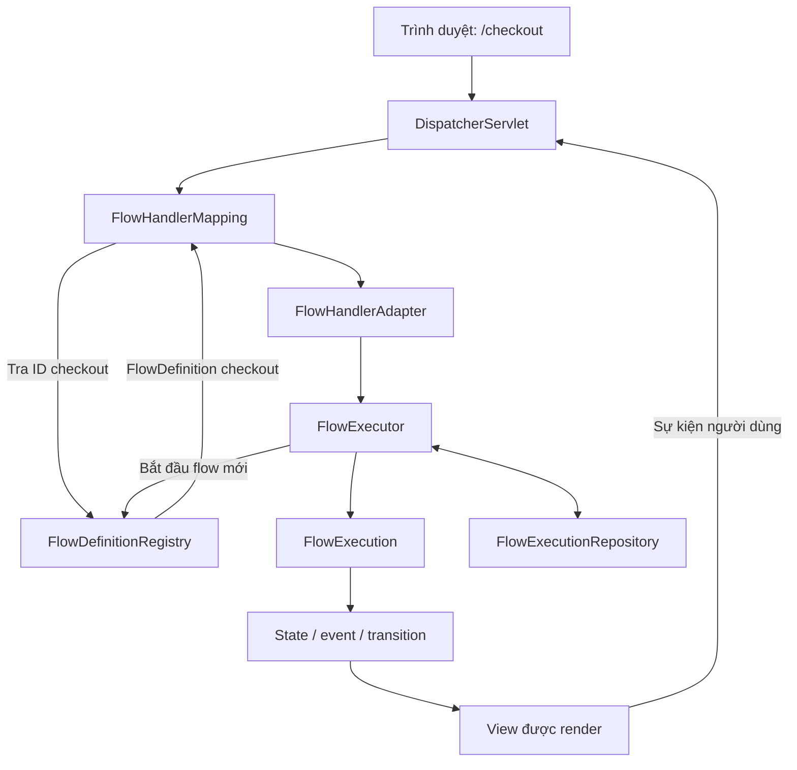
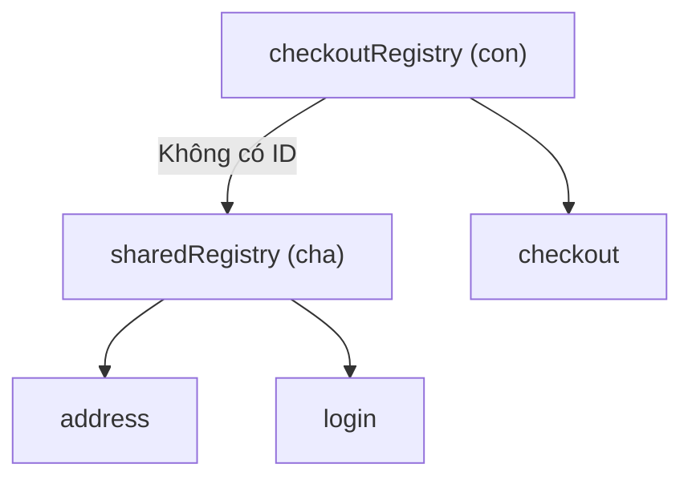

# FlowDefinitionRegistry và việc tra cứu định nghĩa

## 1. Vai trò trong kiến trúc thực thi Spring Web Flow

Trong **Spring Web Flow**, hành trình web nhiều bước được mô tả bằng một **flow definition**: tập hợp các `state` (trạng thái), `event` (sự kiện), `transition` (chuyển trạng thái) và có thể có `subflow` (luồng con). Ví dụ, hành trình đặt hàng gồm xem giỏ hàng, nhập địa chỉ, xác nhận và hoàn tất. Bộ điều khiển Spring MVC không cần tự duy trì hàng loạt điều kiện điều hướng cho từng bước; Web Flow sử dụng định nghĩa để quyết định bước kế tiếp.

`FlowDefinitionRegistry` là **nơi đăng ký và tra cứu các định nghĩa flow theo ID** trong ứng dụng. Khi Web Flow cần xử lý flow tên `checkout` hoặc khi flow `checkout` gọi subflow `address`, hệ thống phải tìm đúng định nghĩa tương ứng. Registry đảm nhiệm việc này.

> **Phân biệt quan trọng:** Registry lưu/tra cứu **mẫu quy trình** (`FlowDefinition`), không lưu **tiến trình đang chạy của từng người dùng** (`FlowExecution`). Hai người mở cùng một flow `checkout` có thể dùng chung định nghĩa nhưng có hai execution với trạng thái và dữ liệu riêng.

Sau bài này, bạn có thể:

- Giải thích quan hệ giữa `FlowDefinitionRegistry`, `FlowDefinition`, `FlowExecutor`, Spring MVC và kho lưu execution.
- Đăng ký flow với ID rõ ràng, đăng ký theo mẫu đường dẫn và hiểu tác động của `base-path`.
- Tra cứu định nghĩa bằng API, sử dụng registry cha và nhận biết lỗi thiếu/không xây dựng được định nghĩa.
- Kiểm tra cấu hình registry và chẩn đoán trường hợp một URL hoặc subflow không tìm thấy flow.

## 2. Registry nằm ở đâu trong đường đi của một request?

Sơ đồ dưới đây mô tả tích hợp Spring MVC thông dụng:



1. `FlowHandlerMapping` kiểm tra xem đường dẫn request có khớp một flow ID trong registry hay không. Ví dụ, request tới `/checkout` có thể được ánh xạ tới flow ID `checkout`.
2. `FlowHandlerAdapter` chuyển việc xử lý cho `FlowExecutor`. Adapter xác định khi nào bắt đầu execution mới hoặc tiếp tục execution đã có dựa trên thông tin của request.
3. Khi bắt đầu execution mới, `FlowExecutor` cần định nghĩa của flow; registry là thành phần cung cấp định nghĩa đó.
4. `FlowExecution` đang chạy theo dõi state hiện tại, xử lý event, transition, input, output và scope; `FlowExecutionRepository` chịu trách nhiệm lưu/khôi phục execution theo cơ chế được cấu hình.
5. Khi gặp `subflow-state`, hệ thống cần định nghĩa flow con theo ID. Registry cho phép các flow tham chiếu nhau theo tên thay vì theo đường dẫn file vật lý.

Không nên suy ra rằng mọi request tiếp tục flow đều phải đọc lại XML và xây dựng lại definition. Registry và lớp `FlowDefinitionHolder` có thể giữ định nghĩa đã xây dựng; tùy cấu hình, nó có thể được nạp lười hoặc làm mới trong chế độ phát triển. Luồng tiếp tục còn phải truy xuất execution hiện hữu từ repository.

| Thành phần | Trách nhiệm | Ví dụ |
| --- | --- | --- |
| `FlowDefinitionRegistry` | Đăng ký, tìm flow definition bằng ID | `checkout` → định nghĩa checkout |
| `FlowDefinition` | Mô tả state, event, transition, hành vi của một loại flow | Định nghĩa có `cart`, `collectAddress`, `review` |
| `FlowExecutor` | Khởi chạy, tiếp tục và điều phối thực thi flow | Tiếp nhận event `submit` |
| `FlowExecution` | Một lần chạy cụ thể với state và dữ liệu riêng | Lượt đặt hàng của người dùng A |
| `FlowExecutionRepository` | Quản lý lưu trữ và phục hồi execution | Phục hồi execution khi người dùng gửi request kế tiếp |
| `FlowHandlerMapping` / `FlowHandlerAdapter` | Gắn flow với cơ chế dispatch của Spring MVC | URL `/checkout` dẫn đến flow ID `checkout` |

Registry thường được cấu hình như bean của ứng dụng, phục vụ nhiều request đồng thời. Nó không thay thế `flowScope`, `viewScope`, `conversationScope` hoặc HTTP session; đó là những nơi dữ liệu của **từng execution** có thể tồn tại.

## 3. API tra cứu của FlowDefinitionRegistry

Các kiểu chính nằm trong package `org.springframework.webflow.definition` và `org.springframework.webflow.definition.registry`:

- `FlowDefinitionRegistry`: interface registry, mở rộng `FlowDefinitionLocator`.
- `FlowDefinitionLocator`: cung cấp phương thức `getFlowDefinition(String id)`.
- `FlowDefinition`: định nghĩa đã được tìm thấy.
- `FlowDefinitionRegistryImpl`: triển khai registry thông dụng.
- `FlowDefinitionHolder`: đối tượng giữ flow definition, có thể hỗ trợ nạp lười và refresh.

Những phương thức cần hiểu:

| API | Mục đích / lưu ý |
| --- | --- |
| `getFlowDefinition(String id)` | Lấy definition theo ID; có thể ném `NoSuchFlowDefinitionException` hoặc `FlowDefinitionConstructionException`. |
| `containsFlowDefinition(String id)` | Kiểm tra registry có phân giải được ID không; có xét registry cha khi được cấu hình. |
| `getFlowDefinitionIds()` | Liệt kê ID được đăng ký trong registry; không xem đây là cam kết liệt kê mọi ID ở toàn bộ cây cha/con. |
| `getFlowDefinitionCount()` | Số định nghĩa được đăng ký tại registry. |
| `registerFlowDefinition(FlowDefinition)` | Đăng ký trực tiếp một định nghĩa đã tạo. |
| `registerFlowDefinition(FlowDefinitionHolder)` | Đăng ký qua holder, hữu ích cho nạp lười/refresh. |
| `setParent(FlowDefinitionRegistry)` / `getParent()` | Tạo quan hệ registry con → registry cha. |

Ví dụ: tại một thành phần chẩn đoán hoặc bài kiểm thử đã được Spring tiêm `FlowDefinitionRegistry`:

```java
import org.springframework.webflow.definition.FlowDefinition;
import org.springframework.webflow.definition.registry.FlowDefinitionRegistry;
import org.springframework.webflow.definition.registry.NoSuchFlowDefinitionException;

public final class FlowLookup {
    private final FlowDefinitionRegistry registry;

    public FlowLookup(FlowDefinitionRegistry registry) {
        this.registry = registry;
    }

    public FlowDefinition requireFlow(String flowId) {
        if (!registry.containsFlowDefinition(flowId)) {
            throw new IllegalArgumentException("Unknown flow ID: " + flowId);
        }
        return registry.getFlowDefinition(flowId);
    }

    public String describeCheckout() {
        FlowDefinition definition = requireFlow("checkout");
        return definition.getId();
    }
}
```

Trong ứng dụng thực tế, thường để Web Flow tự tra cứu thay vì gọi registry trực tiếp trong mỗi controller. Ví dụ minh họa trên giúp thấy **ID là khóa tra cứu**. Nếu chỉ muốn bắt lỗi bằng API gốc, có thể gọi `getFlowDefinition(flowId)` và bắt `NoSuchFlowDefinitionException`. Hai lần gọi `contains...` rồi `get...` không phải thao tác nguyên tử, nên không dùng nó như một bảo đảm rằng định nghĩa không thể đổi giữa hai lệnh.

### Hai lỗi tra cứu khác nhau

**Không tồn tại định nghĩa:** `NoSuchFlowDefinitionException` nghĩa là ID cần tìm không phân giải được từ registry được dùng, kể cả registry cha phù hợp. Hãy kiểm tra tên ID, đường dẫn resource, registry đang được tiêm và cấu hình cha.

**Có resource nhưng không tạo được định nghĩa:** `FlowDefinitionConstructionException` thường chỉ ra lỗi khi xây dựng flow (ví dụ XML không hợp lệ, tham chiếu state sai hoặc lỗi cấu hình dịch vụ xây dựng flow). Lúc này việc sửa URL hay đổi ID chưa đủ; cần đọc nguyên nhân gốc trong stack trace và kiểm tra flow resource.

Ngoài ra, **không tìm được HTTP handler cho URL** là vấn đề ở `FlowHandlerMapping`/chuỗi handler mappings; nó có thể dẫn tới handler khác hoặc lỗi không tìm thấy handler trước khi một lệnh gọi `getFlowDefinition` tường minh được thực hiện. Không đồng nhất mọi lỗi 404 với `NoSuchFlowDefinitionException`.

## 4. Đăng ký định nghĩa và quyết định flow ID

Registry cần biết **resource định nghĩa nằm ở đâu** và **ID nào sẽ dùng để gọi**. Spring Web Flow hỗ trợ khai báo bằng XML namespace hoặc Java configuration.

### 4.1. Đăng ký tường minh bằng XML

Giả sử ứng dụng có cấu trúc:

```text
src/main/webapp/WEB-INF/flows/
├── checkout/
│   └── checkout-flow.xml
└── address/
    └── address-flow.xml
```

Trong cấu hình Spring XML (namespace `webflow` là `http://www.springframework.org/schema/webflow-config`):

```xml
<webflow:flow-registry id="flowRegistry">
    <webflow:flow-location
        path="/WEB-INF/flows/checkout/checkout-flow.xml"
        id="checkout" />
    <webflow:flow-location
        path="/WEB-INF/flows/address/address-flow.xml"
        id="address" />
</webflow:flow-registry>

<webflow:flow-executor
    id="flowExecutor"
    flow-registry="flowRegistry" />
```

Ở đây tên file có hậu tố `-flow.xml` nhưng **ID chính thức** vẫn là `checkout` và `address` do thuộc tính `id` đặt rõ ràng. Khi chuyển file sang vị trí khác, có thể giữ nguyên ID để không làm đổi hợp đồng điều hướng đang sử dụng, miễn cập nhật đúng `path`.

Đoạn trên là phần cấu hình bean; tệp cấu hình thực tế cần có root `beans`, các namespace và schema tương ứng.

### 4.2. Đăng ký bằng Java configuration

Mẫu Java configuration tương ứng dùng `AbstractFlowConfiguration`:

```java
import org.springframework.context.annotation.Bean;
import org.springframework.context.annotation.Configuration;
import org.springframework.webflow.config.AbstractFlowConfiguration;
import org.springframework.webflow.definition.registry.FlowDefinitionRegistry;
import org.springframework.webflow.executor.FlowExecutor;
import org.springframework.webflow.mvc.servlet.FlowHandlerAdapter;
import org.springframework.webflow.mvc.servlet.FlowHandlerMapping;

@Configuration
public class CheckoutFlowConfig extends AbstractFlowConfiguration {

    @Bean
    public FlowDefinitionRegistry flowRegistry() {
        return getFlowDefinitionRegistryBuilder()
                .addFlowLocation(
                        "/WEB-INF/flows/checkout/checkout-flow.xml",
                        "checkout")
                .addFlowLocation(
                        "/WEB-INF/flows/address/address-flow.xml",
                        "address")
                .build();
    }

    @Bean
    public FlowExecutor flowExecutor() {
        return getFlowExecutorBuilder(flowRegistry()).build();
    }

    @Bean
    public FlowHandlerMapping flowHandlerMapping() {
        FlowHandlerMapping mapping = new FlowHandlerMapping();
        mapping.setFlowRegistry(flowRegistry());
        mapping.setOrder(0);
        return mapping;
    }

    @Bean
    public FlowHandlerAdapter flowHandlerAdapter() {
        FlowHandlerAdapter adapter = new FlowHandlerAdapter();
        adapter.setFlowExecutor(flowExecutor());
        return adapter;
    }
}
```

`FlowDefinitionRegistry` được nối với `FlowExecutor` và `FlowHandlerMapping`. `FlowHandlerAdapter` được nối với `FlowExecutor`; đây là phần tích hợp để Spring MVC điều phối request đến engine Web Flow. Ứng dụng vẫn cần cấu hình `DispatcherServlet`, view resolver và các dependency Spring/Web Flow tương thích với phiên bản Spring đang dùng.

### 4.3. Quy ước ID, base path và pattern

Nếu không chỉ định `id`, Web Flow suy ra ID từ tên file (bỏ phần mở rộng) hoặc từ đường dẫn tương đối theo `base-path`, tùy cách đăng ký và bố cục tài nguyên. Điều này dễ dẫn đến hiểu nhầm khi đổi cấu trúc thư mục.

Ví dụ với Java builder:

```java
@Bean
public FlowDefinitionRegistry flowRegistry() {
    return getFlowDefinitionRegistryBuilder()
            .setBasePath("/WEB-INF/flows")
            .addFlowLocationPattern("/**/*-flow.xml")
            .build();
}
```

Cấu hình này phát hiện các file khớp mẫu trong vùng resource đã cho. Khi dùng `base-path`, các flow trong các thư mục con thường nhận ID theo **đường dẫn logic tương đối** từ base path, theo quy tắc đặt ID của Web Flow. Chẳng hạn dự án tổ chức mỗi flow trong thư mục `checkout/` có thể trỏ đến ID `checkout`. Hãy kiểm tra ID thực tế bằng `getFlowDefinitionIds()` và `containsFlowDefinition(...)`, đặc biệt với cấu trúc nhiều cấp và các trường hợp file nằm ngay tại base path.

Khi URL, subflow hoặc API bên ngoài phụ thuộc một ID ổn định, nên dùng `addFlowLocation(path, id)` / `flow-location id="..."` để loại bỏ sự mơ hồ do quy ước tên file.

**Lưu ý:** Đừng đăng ký cùng một flow hai lần qua một `flow-location` tường minh và một pattern bao phủ chính file đó. Định nghĩa trùng ID có thể tạo xung đột hoặc hành vi không mong muốn tùy cơ chế đăng ký; nên cấu hình đường dẫn sao cho dễ kiểm toán.

## 5. Ví dụ: checkout tra cứu một subflow

Ứng dụng đặt hàng có hai định nghĩa đăng ký với ID `checkout` và `address`. Khi người dùng nhấn nút đi tiếp từ giỏ hàng, flow `checkout` vào state `collectAddress` và gọi flow `address`.

**`checkout-flow.xml`** (rút gọn, tập trung vào chuyển trạng thái):

```xml
<?xml version="1.0" encoding="UTF-8"?>
<flow xmlns="http://www.springframework.org/schema/webflow"
      xmlns:xsi="http://www.w3.org/2001/XMLSchema-instance"
      xsi:schemaLocation="
          http://www.springframework.org/schema/webflow
          https://www.springframework.org/schema/webflow/spring-webflow.xsd">

    <view-state id="cart" view="checkout/cart">
        <transition on="next" to="collectAddress" />
    </view-state>

    <subflow-state id="collectAddress" subflow="address">
        <transition on="addressSaved" to="review" />
        <transition on="cancelled" to="cart" />
    </subflow-state>

    <view-state id="review" view="checkout/review">
        <transition on="editAddress" to="collectAddress" />
        <transition on="complete" to="finished" />
    </view-state>

    <end-state id="finished" />
</flow>
```

**`address-flow.xml`**:

```xml
<?xml version="1.0" encoding="UTF-8"?>
<flow xmlns="http://www.springframework.org/schema/webflow"
      xmlns:xsi="http://www.w3.org/2001/XMLSchema-instance"
      xsi:schemaLocation="
          http://www.springframework.org/schema/webflow
          https://www.springframework.org/schema/webflow/spring-webflow.xsd">

    <view-state id="edit" view="address/edit">
        <transition on="save" to="addressSaved" />
        <transition on="cancel" to="cancelled" />
    </view-state>

    <end-state id="addressSaved" />
    <end-state id="cancelled" />
</flow>
```

Cả hai file chỉ minh họa cơ chế lookup, event và transition. Một chức năng thật cần khai báo model, binding, validation, xử lý lưu địa chỉ/đơn hàng, quyền truy cập và xử lý lỗi phù hợp; event `complete` trong ví dụ chưa thực hiện nghiệp vụ thanh toán/ghi đơn hàng.

Luồng xử lý:

1. Request ban đầu gọi flow ID `checkout`. Registry trả về định nghĩa checkout.
2. Người dùng kích hoạt event `next` trong view `cart`; execution chuyển đến `collectAddress`.
3. `subflow="address"` chỉ đến **ID định nghĩa**, không phải tên bean controller hoặc URL tùy ý. Engine cần phân giải flow `address` từ các định nghĩa đã đăng ký.
4. Khi subflow kết thúc ở `addressSaved`, parent nhận kết quả tương ứng và chuyển sang `review`; nếu kết thúc ở `cancelled`, parent quay về `cart`.
5. Việc sửa một view hoặc gửi event ảnh hưởng execution hiện hành. Nó không tạo registry mới cho người dùng đó.

Với subflow cần dữ liệu, có thể khai báo `<input .../>` trên `subflow-state` và `<output .../>` trong flow con, rồi dùng `flowScope` hoặc `conversationScope` theo vòng đời dữ liệu. Registry chỉ giúp tìm đúng định nghĩa để chạy; nó không làm nhiệm vụ mapping dữ liệu giữa hai flow.

## 6. Registry cha, phạm vi module và khả năng tái sử dụng

Một hệ thống có thể có flow dùng chung (ví dụ `login`, `address`) và flow chuyên biệt (ví dụ `checkout`). `FlowDefinitionRegistry` hỗ trợ liên kết registry con với registry cha. Khi registry con không giải quyết được ID, nó thử tra cứu ở registry cha.



Ví dụ Java:

```java
FlowDefinitionRegistry checkoutRegistry =
        getFlowDefinitionRegistryBuilder()
                .setParent(sharedRegistry)
                .addFlowLocation(
                        "/WEB-INF/flows/checkout/checkout-flow.xml",
                        "checkout")
                .build();
```

Ở đây `sharedRegistry` là registry cha đã tạo và đưa vào phạm vi cấu hình này. Tình huống sử dụng `checkoutRegistry.getFlowDefinition("address")` có thể thành công nhờ lookup tiếp lên parent nếu cha đăng ký `address`.

Cần nhớ:

- Quan hệ cha là **cơ chế phân giải definition**, không phải kế thừa state của một execution.
- Nếu registry con đăng ký ID cùng tên với cha, việc tìm kiếm ưu tiên đăng ký cục bộ trước khi fallback lên cha. Tránh cố tình dùng trùng ID trừ khi thực sự hiểu quy ước phân giải.
- `getFlowDefinitionIds()` phản ánh đăng ký của registry cụ thể; hãy dùng `containsFlowDefinition(id)` hoặc `getFlowDefinition(id)` để kiểm tra một ID dự kiến được tìm qua quan hệ cha.
- Khi chia module, hãy giữ quy ước tên ID rõ ràng (ví dụ `order/checkout`, `account/register` nếu phù hợp với routing) để hạn chế va chạm.

## 7. Cách kiểm tra và chẩn đoán vấn đề lookup

### 7.1. Kiểm tra registry ngay trong test Spring

Ví dụ JUnit 5 dưới đây giả định ứng dụng test tải được `CheckoutFlowConfig` và hai resource `/WEB-INF/flows/...` trong web application context:

```java
import static org.junit.jupiter.api.Assertions.*;

import org.junit.jupiter.api.Test;
import org.springframework.beans.factory.annotation.Autowired;
import org.springframework.test.context.junit.jupiter.web.SpringJUnitWebConfig;
import org.springframework.webflow.definition.registry.FlowDefinitionRegistry;
import org.springframework.webflow.definition.registry.NoSuchFlowDefinitionException;

@SpringJUnitWebConfig(classes = CheckoutFlowConfig.class)
class FlowRegistryLookupTest {

    @Autowired
    private FlowDefinitionRegistry registry;

    @Test
    void registersBothFlows() {
        assertTrue(registry.containsFlowDefinition("checkout"));
        assertTrue(registry.containsFlowDefinition("address"));
        assertEquals("checkout",
                registry.getFlowDefinition("checkout").getId());
    }

    @Test
    void rejectsUnknownFlowId() {
        assertFalse(registry.containsFlowDefinition("unknown"));
        assertThrows(NoSuchFlowDefinitionException.class,
                () -> registry.getFlowDefinition("unknown"));
    }
}
```

Test này kiểm tra **contract của registry**; nó chưa xác minh được view render, binding, validation hay các state transition. Để kiểm tra hành vi flow, cần thêm kiểm thử execution (chẳng hạn các hỗ trợ kiểm thử Web Flow như `AbstractXmlFlowExecutionTests`) hoặc bài test tích hợp Spring MVC.

### 7.2. Bảng chẩn đoán nhanh

| Triệu chứng | Khả năng cao | Bước kiểm tra |
| --- | --- | --- |
| URL `/checkout` không vào flow | `FlowHandlerMapping` chưa được đăng ký, thứ tự handler mapping không phù hợp, hoặc ID không khớp | Xác minh bean mapping, `flowRegistry`, servlet mapping và ID `checkout` |
| `containsFlowDefinition("checkout")` là `false` | Chưa đăng ký resource hoặc đăng ký dưới ID khác | In `getFlowDefinitionIds()` ở môi trường test; rà `id`, `path`, `base-path` và pattern |
| Subflow báo không tìm thấy `address` | Thiếu định nghĩa `address` trong registry có thể phân giải | Kiểm tra `subflow="address"`, đăng ký `id="address"` và quan hệ parent |
| Có ID nhưng `getFlowDefinition` ném lỗi xây dựng | XML, biểu thức, state, bean hoặc cấu hình FlowBuilder không hợp lệ | Xem root cause của `FlowDefinitionConstructionException` và resource tương ứng |
| Flow chạy nhưng không trở lại đúng bước sau subflow | Outcome ở `end-state` của subflow không khớp transition của parent | Đối chiếu `addressSaved`/`cancelled` và các `transition on="..."` |
| Reload XML mà hành vi vẫn cũ | Definition đã được xây dựng/giữ bởi holder, chế độ phát triển khác production | Kiểm tra cấu hình phát triển và cơ chế refresh; tránh giả định thay file luôn có hiệu lực tức thì |
| Resume thất bại sau khi mở form lâu | Execution/key đã hết hạn hoặc repository không còn snapshot | Kiểm tra `FlowExecutionRepository`, timeout, cấu hình phiên; đừng nhầm với thiếu definition |

### 7.3. Quy trình kiểm tra tối thiểu khi thêm flow

1. Chọn ID có ý nghĩa nghiệp vụ và quyết định nó có xuất hiện trong URL hoặc `subflow` hay không.
2. Lưu flow XML ở vị trí resource có thể load được, đăng ký `path + id` vào đúng registry.
3. Kiểm tra `containsFlowDefinition(id)` và `getFlowDefinition(id)` trong context của ứng dụng.
4. Kiểm tra một request bắt đầu flow, gửi một event hợp lệ và xác nhận state tiếp theo.
5. Nếu dùng subflow, kiểm tra outcome của cả đường thành công và hủy/quay lại.
6. Với form thực tế, kiểm tra dữ liệu được binding/validation ở đúng state và scope phù hợp, sau đó thử resume sau một request mới.

## 8. Những nguyên tắc thiết kế nên giữ

**ID là hợp đồng giữa các thành phần.** Một flow XML có thể đổi tên hoặc di chuyển, nhưng các nơi gọi nó vẫn tra cứu bằng ID. Đặt tên ID có chủ đích, tránh để refactor thư mục vô tình làm thay đổi URL hoặc `subflow`.

**Tách definition khỏi execution.** Định nghĩa là chương trình mô tả hành trình; execution là một phiên chạy với dữ liệu và trạng thái hiện tại. Registry giải quyết bài toán **tìm chương trình nào để chạy**; repository giải quyết **tiếp tục lần chạy nào**.

**Đừng đưa logic điều hướng rời rạc trở lại controller.** Controller/MVC handler nên làm vai trò kết nối web, còn hành trình nhiều bước được thể hiện bằng state, event, transition và subflow. Business service vẫn thực hiện nghiệp vụ thật, validation và giao dịch; Web Flow không thay thế service layer.

**Giữ khả năng kiểm chứng.** Một lookup test phát hiện sai ID/resource sớm; một execution test kiểm tra state transitions; một integration test kiểm tra request URL và luồng form ngoài trình duyệt.

### Câu hỏi tự luyện

1. Hai người đang chạy `checkout` ở state khác nhau. Registry có cần lưu hai bản `FlowDefinition` riêng không? Vì sao?
2. Registry của bạn biết ID `checkout` nhưng `/checkout` vẫn trả 404. Cần kiểm tra thành phần nào ngoài registry?
3. `checkout` gọi `subflow="address"`, nhưng chỉ registry cha có định nghĩa `address`. Điều kiện gì để lookup thành công?
4. Khi di chuyển file `checkout-flow.xml` sang thư mục khác mà muốn giữ nguyên URL và subflow references, nên làm gì?
5. Đổi `FlowExecutionRepository` có làm thay đổi danh sách ID do `FlowDefinitionRegistry` trả về không?

## Tài liệu tham khảo

- [Spring Web Flow Reference Guide — System Setup, Flow Registry và Spring MVC Integration](https://docs.spring.io/spring-webflow/docs/3.0.x/reference/)
- [Javadoc — FlowDefinitionRegistry](https://docs.spring.io/spring-webflow/docs/3.0.0/api/org/springframework/webflow/definition/registry/FlowDefinitionRegistry.html)
- [Javadoc — FlowDefinitionRegistryImpl](https://docs.spring.io/spring-webflow/docs/3.0.0/api/org/springframework/webflow/definition/registry/FlowDefinitionRegistryImpl.html)
- [Javadoc — FlowDefinitionHolder](https://docs.spring.io/spring-webflow/docs/current/api/org/springframework/webflow/definition/registry/FlowDefinitionHolder.html)

Các ví dụ minh họa mô hình cấu hình phổ biến của Spring Web Flow; khi áp dụng, cần chọn phiên bản Spring Web Flow, Spring Framework và thư viện servlet tương thích theo dự án.
