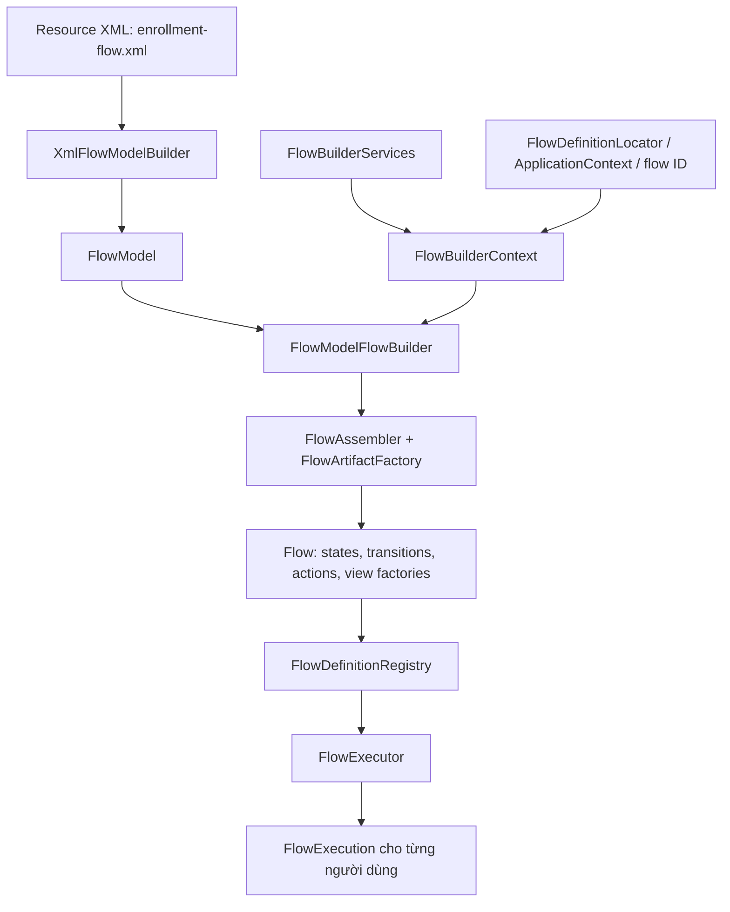

# FlowBuilderServices và các thành phần dựng flow

## 1. Vì sao Spring Web Flow cần một bộ dịch vụ dựng flow?

Trong **Spring Web Flow**, một hành trình web nhiều bước có thể được mô tả bằng XML với các `view-state`, `action-state`, `decision-state`, `subflow-state`, sự kiện và `transition`. Ví dụ, hành trình đăng ký khóa học có các bước nhập thông tin, chọn lịch, xác nhận và hoàn tất. Spring Web Flow cần **biến bản mô tả đó thành một đối tượng flow có thể thực thi**, đồng thời xác định cách phân tích biểu thức, chuyển đổi dữ liệu biểu mẫu, tạo view và kiểm tra tính hợp lệ của model.

`FlowBuilderServices` thuộc package `org.springframework.webflow.engine.builder.support` là **đối tượng tập hợp cấu hình và các dịch vụ dùng trong quá trình xây dựng flow**. Nó cho phép nhiều định nghĩa flow sử dụng cùng chính sách về:

- **Biểu thức**: hiểu các biểu thức truy cập bean, model và scope trong XML.
- **Chuyển đổi kiểu**: biến chuỗi từ request thành kiểu dữ liệu Java, cũng như format giá trị để hiển thị.
- **Tạo view**: thiết lập cách một `view-state` sẽ tạo và render view theo Spring MVC.
- **Validation**: cấu hình validator và cách diễn giải các validation hint/group.
- **Chế độ phát triển**: quyết định có theo dõi thay đổi resource định nghĩa để dựng lại flow hay không.

Đây là một điểm mở rộng quan trọng khi một ứng dụng có nhiều wizard/form: các flow vẫn mô tả **state → event → transition**, trong khi quy tắc parse/binding/validation/rendering được cấu hình tập trung.

> **Ranh giới trách nhiệm:** `FlowBuilderServices` không lưu trạng thái người dùng, không phải `FlowExecutor` và không phải `FlowExecutionRepository`. Nó cung cấp dịch vụ để **xây dựng định nghĩa**; các dịch vụ tương ứng sau đó có thể được gắn vào definition, view factory hoặc binding/validation machinery để dùng khi flow chạy.

Sau bài này, bạn có thể nhận diện chuỗi dựng flow, cấu hình `FlowBuilderServices`, lựa chọn đúng extension point cho từng vấn đề, hiểu tác động với Spring MVC và kiểm tra lỗi thường gặp khi xây dựng hoặc thực thi flow.

## 2. Các thành phần của quá trình dựng flow

Từ tệp XML đến một `Flow` có thể thực thi có nhiều lớp trung gian. Không nên xem `FlowBuilderServices` là một parser duy nhất.

| Thành phần | Chức năng chính | Giai đoạn liên quan |
| --- | --- | --- |
| `FlowDefinitionRegistryBuilder` | Khai báo vị trí/ID các flow và các dịch vụ dùng để dựng chúng | Cấu hình ứng dụng |
| `FlowDefinitionRegistry` | Đăng ký và tìm định nghĩa flow theo ID | Tra cứu definition |
| `XmlFlowModelBuilder` | Đọc resource XML và xây dựng mô hình cấu hình | Phân tích resource |
| `FlowModel` | Biểu diễn cấu trúc khai báo của flow trước khi dựng thành đối tượng chạy được | Mô hình trung gian |
| `FlowModelFlowBuilder` | Dựng đối tượng runtime `Flow` từ `FlowModel` | Xây dựng định nghĩa |
| `FlowBuilderContext` | Cung cấp flow ID, locator, ApplicationContext, factory và các dịch vụ cần thiết cho builder | Ngữ cảnh dựng |
| `FlowBuilderServices` | Gói các service/policy dùng chung như conversion, expression parsing, view factory và validation | Cấu hình chung |
| `FlowArtifactFactory` | Tạo các hiện vật của mô hình thực thi, như `Flow`, `State` và `Transition` | Lắp ráp thành phần |
| `FlowAssembler` | Điều phối các bước mà `FlowBuilder` thực hiện để lắp ráp flow | Lắp ráp |
| `FlowExecutor` | Bắt đầu/tiếp tục execution khi ứng dụng xử lý request | Thời điểm chạy |

Một sơ đồ khái niệm:



Sơ đồ thể hiện **quan hệ trách nhiệm**, không phải cam kết rằng mọi implementation chạy một chuỗi lời gọi tuyến tính đúng như các mũi tên. Web Flow có các lớp holder/registry hỗ trợ xây dựng khi cần và, nếu được bật, phát hiện thay đổi resource để làm mới definition.

### 2.1. `FlowBuilderServices` và `FlowBuilderContext` khác nhau thế nào?

`FlowBuilderServices` giữ **dịch vụ dùng chung**. `FlowBuilderContext` bổ sung **thông tin đặc thù cho một definition đang được dựng**, chẳng hạn:

- `getFlowId()`: ID gắn cho định nghĩa.
- `getFlowDefinitionLocator()`: cách tìm flow khác, đặc biệt khi dùng subflow.
- `getApplicationContext()`: Spring context nơi hệ thống được cấu hình.
- `getFlowAttributes()`: metadata ngoài XML được gắn vào định nghĩa.
- `getFlowArtifactFactory()`: factory tạo phần tử runtime.
- `getConversionService()`, `getExpressionParser()`, `getViewFactoryCreator()`, `getValidator()`, `getValidationHintResolver()`: các service builder sử dụng.

Như vậy, hai registry có thể dùng chung bộ chính sách `FlowBuilderServices` nhưng tạo ra các flow definition khác ID, khác resource và khác ngữ cảnh. Ngược lại, thay đổi cấu hình dịch vụ của một registry có thể ảnh hưởng đồng loạt những flow được registry đó dựng.

### 2.2. `FlowArtifactFactory` không phải `ViewFactoryCreator`

Tên gần giống nhưng trách nhiệm khác nhau:

- `FlowArtifactFactory` tạo **thành phần của state machine** (ví dụ `Flow`, `ViewState`, `Transition`).
- `ViewFactoryCreator` tạo **factory để xuất view** cho `view-state` (ví dụ cơ chế xem JSP/Thymeleaf qua resolver phù hợp).
- `FlowBuilder` lắp ráp các thành phần và cấu hình các factory đó thành định nghĩa.

Ví dụ, XML có `<view-state id="enterDetails" view="enrollment/form" ...>` sẽ cần một `ViewState` của mô hình thực thi và một view factory biết cách xử lý view ID `enrollment/form`. Hai thứ không được tạo bởi cùng một trách nhiệm trừu tượng.

## 3. Năm nhóm cấu hình quan trọng của FlowBuilderServices

### 3.1. `ConversionService`: chuyển kiểu khi binding

HTTP form thường gửi chuỗi:

```text
email=student@example.org
startDate=2026-12-05
attendees=2
```

Nhưng model Java có thể chứa `String`, `LocalDate` và `Integer`. Khi `view-state` khai báo `model` và nhận event hợp lệ, Web Flow dùng binding/conversion để cập nhật thuộc tính của model. Dịch vụ chuyển đổi có thể được chọn từ cấu hình `FlowBuilderServices`.

Điểm cần chú ý là **có hai kiểu tên gần giống nhau**:

- `org.springframework.binding.convert.ConversionService`: hợp đồng conversion của Spring Binding/Web Flow được builder dùng.
- `org.springframework.core.convert.ConversionService` và `org.springframework.format.support.FormattingConversionService`: hệ thống conversion/formatting của Spring Framework.

Trong Web Flow, `org.springframework.binding.convert.service.DefaultConversionService` có thể **ủy quyền** sang conversion/formatting service của Spring. Nếu ứng dụng đăng ký formatter tùy chỉnh cho Spring MVC, nên cấu hình Web Flow tham chiếu cùng dịch vụ nền đó để form bình thường và form trong flow hiểu dữ liệu nhất quán.

Ví dụ một factory bean Java (giả định ứng dụng đã có bean `FormattingConversionService`):

```java
import org.springframework.binding.convert.service.DefaultConversionService;
import org.springframework.context.annotation.Bean;
import org.springframework.context.annotation.Configuration;
import org.springframework.format.support.FormattingConversionService;

@Configuration
public class WebFlowConversionConfig {

    @Bean
    public DefaultConversionService webFlowConversionService(
            FormattingConversionService applicationFormattingService) {
        // Adapter Spring Binding, ủy quyền cho formatter/converter Spring MVC.
        return new DefaultConversionService(applicationFormattingService);
    }
}
```

Sau đó truyền `webFlowConversionService` vào builder qua `setConversionService(...)`. Tên bean `applicationFormattingService` là tên minh họa: cấu hình thực tế phải dùng đúng bean conversion service mà ứng dụng đang sử dụng.

Nếu dữ liệu `startDate` báo lỗi chuyển kiểu, hãy kiểm tra formatter hoặc `@DateTimeFormat`, chuỗi ngày do trình duyệt gửi và locale hiện hành. Không nên xử lý lỗi này bằng cách thay `FlowExecutionRepository`.

### 3.2. `ExpressionParser`: hiểu biểu thức trong định nghĩa

Các phần tử như `<evaluate>` hoặc `<set>` tham chiếu đến đối tượng, bean và scope:

```xml
<on-start>
    <evaluate expression="enrollmentService.createDraft()"
              result="flowScope.draft" />
</on-start>

<view-state id="enterDetails" model="draft">
    <transition on="next" to="review" />
</view-state>
```

Web Flow dùng `ExpressionParser` để diễn giải các biểu thức đó. Builder mặc định dành cho Spring MVC thường sử dụng parser dựa trên **Spring Expression Language (SpEL)**; các cách tích hợp hoặc phiên bản khác có thể có mặc định khác. Khi thay parser, cần cân nhắc biểu thức của **toàn bộ** flow, quyền truy cập bean và các khả năng expression đang dùng.

Lỗi chính tả thuộc tính, bean không tồn tại hoặc lời gọi method không phù hợp có thể biểu hiện ở giai đoạn dựng hoặc khi biểu thức được đánh giá lúc chạy. Không nên giả định mọi biểu thức được thực thi ngay khi XML được load.

### 3.3. `ViewFactoryCreator`: chuẩn bị view cho mỗi `view-state`

`ViewFactoryCreator` quyết định cách tạo `ViewFactory` từ một view ID trong XML. Với tích hợp Spring MVC, triển khai thường dùng là `MvcViewFactoryCreator` thuộc `org.springframework.webflow.mvc.builder`. Nó hỗ trợ các view resolver mà ứng dụng đã định nghĩa.

Ví dụ:

```xml
<view-state id="review" view="enrollment/review" />
```

`enrollment/review` là **logical view ID**. Đường dẫn template thực tế phụ thuộc cấu hình view resolver, resource và phiên bản stack, chứ không tự động đồng nghĩa với một tệp JSP cụ thể.

Nếu muốn đưa view vào hạ tầng Spring MVC có sẵn, có thể cung cấp một bean `MvcViewFactoryCreator` được cấu hình với các `ViewResolver` phù hợp rồi gọi `setViewFactoryCreator(...)` trong Java builder.

Hãy phân biệt:

- `ViewFactoryCreator`: lắp ráp khả năng tạo/render view cho **định nghĩa**.
- `ViewResolver`: ánh xạ tên logical view thành renderer/template trong Spring MVC.
- `FlowHandlerMapping` và `FlowHandlerAdapter`: ánh xạ **request HTTP** và chuyển xử lý sang `FlowExecutor`. Chúng không nằm trong danh sách view services.

### 3.4. `Validator` và `ValidationHintResolver`

Khi một `view-state` có `model`, Web Flow có thể bind rồi validate model trước khi đi tiếp. Builder cho phép cấu hình:

- `setValidator(org.springframework.validation.Validator)`: validator áp dụng cho model trong view state; có thể dùng `LocalValidatorFactoryBean` để hỗ trợ Jakarta Bean Validation khi stack tương thích.
- `setValidationHintResolver(ValidationHintResolver)`: cách chuyển hint khai báo trong flow thành validation group hoặc thông tin dùng khi validate.

Ví dụ một flow áp dụng nhóm validation của bước hiện tại:

```xml
<view-state id="enterDetails"
            model="draft"
            validation-hints="'details'">
    <transition on="next" to="review" />
</view-state>
```

Giá trị `validation-hints` là một **expression**; ở đây chuỗi `'details'` được parser đánh giá rồi resolver diễn giải. Resolver mặc định kiểu `BeanValidationHintResolver` có thể tìm group từ kiểu nested trên model hoặc tên class phù hợp. Cách đặt group cụ thể cần phù hợp với model và phiên bản Bean Validation. Hint không tự thay thế việc khai báo constraint.

Validation theo quy ước của Web Flow cũng có thể tồn tại (chẳng hạn phương thức `validateEnterDetails(...)` ở model hoặc validator riêng); Bean Validation và validation theo quy ước không loại trừ nhau.

Một chuyển trạng thái `cancel` hoặc `back` có thể cần:

```xml
<transition on="back" to="previousStep" validate="false" />
<transition on="cancel" to="cancelled" bind="false" />
```

`validate="false"` bỏ qua validation cho transition đó nhưng binding vẫn có thể chạy; `bind="false"` bỏ qua binding và validation liên quan. Cần chọn đúng theo yêu cầu nghiệp vụ.

### 3.5. Development mode

Trong môi trường phát triển, bạn có thể bật chế độ để Web Flow phát hiện một số thay đổi ở definition và resource phụ thuộc rồi dựng lại:

```xml
<webflow:flow-builder-services
    id="flowBuilderServices"
    development="true" />
```

Với Java builder:

```java
return getFlowBuilderServicesBuilder()
        .setDevelopmentMode(true)
        .build();
```

Thông thường nên dùng `false` cho production: refresh có chi phí, yêu cầu resource quan sát được sự thay đổi và có thể làm hành vi phức tạp hơn với execution đã tồn tại. Development mode **không phải** cơ chế lưu/khôi phục phiên của người dùng và không bảo đảm mọi thay đổi XML sẽ tự sửa được execution đang chạy dở.

## 4. Cấu hình FlowBuilderServices bằng XML

Ví dụ ứng dụng đăng ký flow `enrollment`. Đường dẫn resource là ví dụ điển hình cho web application truyền thống; có thể thay bằng đường dẫn classpath phù hợp khi đóng gói ứng dụng khác.

```xml
<!-- Trong cấu hình Spring beans đã khai báo namespace webflow -->
<webflow:flow-registry
    id="flowRegistry"
    flow-builder-services="flowBuilderServices">
    <webflow:flow-location
        path="/WEB-INF/flows/enrollment/enrollment-flow.xml"
        id="enrollment" />
</webflow:flow-registry>

<webflow:flow-builder-services
    id="flowBuilderServices"
    conversion-service="webFlowConversionService"
    validator="flowValidator"
    development="false" />

<bean id="webFlowConversionService"
      class="org.springframework.binding.convert.service.DefaultConversionService">
    <constructor-arg ref="applicationFormattingService" />
</bean>

<bean id="flowValidator"
      class="org.springframework.validation.beanvalidation.LocalValidatorFactoryBean" />

<webflow:flow-executor
    id="flowExecutor"
    flow-registry="flowRegistry" />
```

Ở cấu hình này:

1. `flowRegistry` biết ID và vị trí file XML.
2. Thuộc tính `flow-builder-services` trên registry chỉ đến bean chứa policy dựng flow.
3. `webFlowConversionService` sử dụng `applicationFormattingService` là service nền do ứng dụng cung cấp; đây là bean bắt buộc phải tồn tại trong context.
4. `flowValidator` là một validator rõ ràng cho form trong các flow.
5. `flowExecutor` sử dụng registry để bắt đầu các flow execution.

Không cần khai báo `expression-parser` hoặc `view-factory-creator` nếu mặc định của builder đã phù hợp. Cách cấu hình này giúp tránh code lặp giữa nhiều flow.

Trong tệp XML hoàn chỉnh, cần có namespace `beans`, `webflow` và `xsi:schemaLocation` tương thích. Việc mapping HTTP còn đòi hỏi đăng ký `FlowHandlerMapping` và `FlowHandlerAdapter` trong Spring MVC.

## 5. Cấu hình tương đương bằng Java

`AbstractFlowConfiguration` cung cấp các builder chuyên dụng cho Web Flow. Mẫu sau minh họa đầy đủ phần kết nối registry, builder services và Spring MVC; `flowValidator` được khai báo rõ, còn conversion/expression/view dùng mặc định. Các import là API của Spring Web Flow 3.x dùng với Spring MVC.

```java
import org.springframework.context.annotation.Bean;
import org.springframework.context.annotation.Configuration;
import org.springframework.validation.beanvalidation.LocalValidatorFactoryBean;
import org.springframework.webflow.config.AbstractFlowConfiguration;
import org.springframework.webflow.definition.registry.FlowDefinitionRegistry;
import org.springframework.webflow.engine.builder.support.FlowBuilderServices;
import org.springframework.webflow.executor.FlowExecutor;
import org.springframework.webflow.mvc.servlet.FlowHandlerAdapter;
import org.springframework.webflow.mvc.servlet.FlowHandlerMapping;

@Configuration
public class EnrollmentWebFlowConfiguration extends AbstractFlowConfiguration {

    @Bean
    public LocalValidatorFactoryBean flowValidator() {
        return new LocalValidatorFactoryBean();
    }

    @Bean
    public FlowBuilderServices flowBuilderServices() {
        return getFlowBuilderServicesBuilder()
                .setValidator(flowValidator())
                .setDevelopmentMode(false)
                .build();
    }

    @Bean
    public FlowDefinitionRegistry flowRegistry() {
        return getFlowDefinitionRegistryBuilder(flowBuilderServices())
                .addFlowLocation(
                        "/WEB-INF/flows/enrollment/enrollment-flow.xml",
                        "enrollment")
                .build();
    }

    @Bean
    public FlowExecutor flowExecutor() {
        return getFlowExecutorBuilder(flowRegistry()).build();
    }

    @Bean
    public FlowHandlerMapping flowHandlerMapping() {
        FlowHandlerMapping mapping = new FlowHandlerMapping();
        mapping.setFlowRegistry(flowRegistry());
        mapping.setOrder(0);
        return mapping;
    }

    @Bean
    public FlowHandlerAdapter flowHandlerAdapter() {
        FlowHandlerAdapter adapter = new FlowHandlerAdapter();
        adapter.setFlowExecutor(flowExecutor());
        return adapter;
    }
}
```

Đây là một cấu hình tham khảo, cần tích hợp với `DispatcherServlet`, các view resolver, provider Bean Validation và tài nguyên XML thực sự. Đối với ứng dụng sử dụng proxy `@Configuration` mặc định, lời gọi giữa các bean factory method được Spring quản lý theo cơ chế configuration class; nếu thay cách khai báo bean, cần kiểm tra vòng đời và inject dependency rõ ràng.

Nếu muốn tùy chỉnh conversion riêng, thay dòng builder bằng:

```java
return getFlowBuilderServicesBuilder()
        .setConversionService(webFlowConversionService())
        .setValidator(flowValidator())
        .setDevelopmentMode(false)
        .build();
```

Đoạn này giả định bạn đã có phương thức/bean `webFlowConversionService()` trả về `org.springframework.binding.convert.ConversionService` phù hợp, chẳng hạn `DefaultConversionService` trong ví dụ trước.

**Tránh nhầm tên builder:** `org.springframework.webflow.config.FlowBuilderServicesBuilder` dành cho Web Flow/Spring MVC; package `org.springframework.faces.config` có builder khác dành cho tích hợp JSF. Không nên sao chép mặc định `JsfViewFactoryCreator` từ ví dụ JSF sang một ứng dụng chỉ dùng Spring MVC.

## 6. Đi xuyên qua một form nhiều bước

Giả sử ứng dụng định nghĩa một flow `enrollment` theo ý tưởng:

- `enterDetails`: người dùng nhập email và ngày bắt đầu.
- `review`: xem lại thông tin.
- `finished`: kết thúc flow.
- `cancelled`: hủy thao tác.

Một XML minh họa:

```xml
<?xml version="1.0" encoding="UTF-8"?>
<flow xmlns="http://www.springframework.org/schema/webflow"
      xmlns:xsi="http://www.w3.org/2001/XMLSchema-instance"
      xsi:schemaLocation="
          http://www.springframework.org/schema/webflow
          https://www.springframework.org/schema/webflow/spring-webflow.xsd">

    <var name="draft" class="com.example.enrollment.EnrollmentDraft" />

    <view-state id="enterDetails"
                view="enrollment/form"
                model="draft">
        <binder>
            <binding property="email" required="true" />
            <binding property="startDate" required="true" />
        </binder>
        <transition on="next" to="review" />
        <transition on="cancel" to="cancelled" bind="false" />
    </view-state>

    <view-state id="review" view="enrollment/review">
        <transition on="back" to="enterDetails" />
        <transition on="confirm" to="finished" />
    </view-state>

    <end-state id="finished" />
    <end-state id="cancelled" />
</flow>
```

Model `EnrollmentDraft` là một JavaBean có constructor không tham số, getter/setter cho `email` (`String`) và `startDate` (`LocalDate`), cùng constraint phù hợp. Nếu execution được lưu vào session hoặc có snapshot, dữ liệu của nó cũng phải đáp ứng yêu cầu serialization của cơ chế repository được dùng. Đoạn XML trên mô tả **điều hướng**, chưa thực hiện nghiệp vụ đăng ký khóa học; trong triển khai thật, cần gọi service nghiệp vụ ở bước xác nhận.

Phân tích theo thời điểm:

| Thời điểm | Thành phần liên quan | Điều xảy ra |
| --- | --- | --- |
| Lúc dựng `enrollment` | XML model builder, flow builder, context và services | Phân tích state và expression; cấu hình view factory và binding/validation strategy |
| Lúc bắt đầu execution | `FlowExecutor`, `Flow` | Tạo một execution, khởi tạo biến `draft`, vào `enterDetails` |
| Lúc render biểu mẫu | `ViewFactory`/Spring MVC view | Chọn template và hiển thị thuộc tính model |
| Lúc người dùng gửi `next` | Binder + `ConversionService` | Chuyển input chuỗi sang kiểu thuộc tính, ghi vào `draft` |
| Sau khi binding thành công | Validator + hint resolver (nếu dùng) | Đánh giá constraint; lỗi sẽ giữ người dùng lại để sửa |
| Khi transition thành công | `FlowExecution` | Chuyển sang `review`, tiếp tục giữ dữ liệu của lần chạy đó |
| Khi quay lại/tiếp tục qua request | `FlowExecutionRepository` | Khôi phục execution nếu còn key/snapshot phù hợp |

Một `FlowBuilderServices` có thể phục vụ nhiều definition. Hệ thống **không** tạo một instance dịch vụ dựng flow mới mỗi lần người dùng bấm `next`. Ngược lại, dữ liệu của `draft` được duy trì trong phạm vi execution phù hợp; không đặt một đối tượng form đang chỉnh sửa vào singleton Spring bean.

### Kiểm tra ranh giới giữa binding và validation

Giả sử `startDate` nhận chuỗi `tomorrow` nhưng converter chỉ chấp nhận `yyyy-MM-dd`. Binding có thể thất bại **trước** khi tới constraint kiểm tra ngày tương lai. Nếu người dùng gửi ngày đúng format nhưng ở quá khứ, quá trình chuyển kiểu có thể thành công, rồi validator báo lỗi nghiệp vụ. Hai trường hợp cần cách sửa khác nhau:

- Lỗi parse: kiểm tra formatter, locale, annotation `@DateTimeFormat` và giá trị đầu vào.
- Lỗi constraint: kiểm tra Bean Validation annotation, group/hint và yêu cầu nghiệp vụ.

## 7. Những lỗi cấu hình thường gặp

| Triệu chứng | Nguyên nhân có thể | Điểm cần kiểm tra |
| --- | --- | --- |
| `getFlowDefinition("enrollment")` thất bại lúc dựng | File không tồn tại, XML sai hoặc bean được tham chiếu không hợp lệ | Resource, namespace/XSD, exception gốc và các Spring bean |
| Ứng dụng không khởi động vì không tìm được `flowBuilderServices` | Registry tham chiếu nhầm bean ID hoặc thứ tự cấu hình context sai | Tên bean, `flow-builder-services` trong registry, @Bean |
| Form lưu `LocalDate` thất bại | Web Flow dùng conversion service chưa có formatter phù hợp | `setConversionService(...)`, underlying Spring formatter, locale |
| Form bind được nhưng validation annotation không chạy | Thiếu validator/provider hoặc không gắn đúng service | `setValidator(...)`, `LocalValidatorFactoryBean`, dependency Bean Validation |
| Validation group không như dự kiến | `validation-hints` hoặc resolver không trỏ tới group đúng | Kiểu kết quả expression, `BeanValidationHintResolver`/custom resolver |
| View logical ID không render | View factory hoặc Spring MVC view resolver sai | `MvcViewFactoryCreator`, resolver và đường dẫn template |
| Sửa XML nhưng flow cũ vẫn xuất hiện | Definition chưa refresh hoặc resource không hỗ trợ phát hiện thay đổi | `development`, deployment, flow holder và cache |
| Request trả 404 dù flow đã dựng | HTTP mapping chưa tìm được handler | `FlowHandlerMapping`, servlet URL mapping, registry ID |
| Resume mất trạng thái sau thời gian dài | Execution/session đã hết hạn hoặc snapshot không còn | Repository, session, số snapshot; không quy lỗi cho builder |

Một số lỗi được phát hiện **khi tạo definition**; những lỗi khác chỉ xuất hiện **khi đi qua một state**. Ví dụ, expression hợp lệ về cú pháp vẫn có thể lỗi vì method/bean không phù hợp với dữ liệu thực tế khi được đánh giá.

### 7.1. Khi nào nên thay FlowBuilderServices?

Dùng `FlowBuilderServices` khi cần một chính sách dùng chung, ví dụ:

- Các wizard dùng cùng formatter cho ngày/thời gian hoặc kiểu giá trị miền.
- Mọi form flow cần cùng Bean Validation provider hoặc logic diễn giải validation group.
- Mọi `view-state` cần cơ chế view factory tùy chỉnh.
- Môi trường phát triển cần bật refresh definition.

Nếu vấn đề là **một transition đi sai state**, thường cần sửa flow XML hoặc logic event. Nếu vấn đề là **request không vào flow**, cần xem MVC handler mapping. Nếu vấn đề là **không resume được execution**, cần xem repository/session. Không nên dùng một thay đổi ở builder services để sửa sai trách nhiệm của các thành phần khác.

### 7.2. Bật development mode có thay thế việc deploy không?

Không. Development mode giúp nhận diện thay đổi ở các resource hỗ trợ, nhưng việc refresh phụ thuộc cơ chế tải resource, lifecycle của app và trạng thái execution đang tồn tại. Production vẫn nên có quy trình deploy/versioning ổn định. Nếu cần thay đổi cấu trúc state khi đang có người dùng ở flow cũ, phải cân nhắc khả năng tương thích giữa definition mới và execution đang được lưu.

## 8. Kiểm thử hợp lý cho cấu hình dựng flow

Kiểm thử có thể chia thành ba lớp:

**Kiểm tra context và registry.** Khởi tạo Spring context có `flowBuilderServices`, `flowRegistry`, các resource XML và service phụ thuộc; khẳng định `flowRegistry.containsFlowDefinition("enrollment")` là `true` và `getFlowDefinition("enrollment")` trả về định nghĩa đúng ID. Bước này xác minh nhiều lỗi cấu hình sớm.

**Kiểm tra behavior của flow.** Dùng hỗ trợ test execution của Spring Web Flow (ví dụ `AbstractXmlFlowExecutionTests` hoặc API test tương ứng phiên bản) để bắt đầu flow, gửi event `next`, kiểm tra state và điều kiện không chuyển khi form invalid.

**Kiểm tra tích hợp HTTP.** Chạy test với `DispatcherServlet`, `FlowHandlerMapping`, `FlowHandlerAdapter`, view resolver, session/repository để kiểm tra mở URL, submit form, redirect và resume. Một test chỉ gọi registry không chứng minh rằng trang thực tế render được.

Ví dụ phần assert cốt lõi sau khi đã khởi tạo Spring context trong test:

```java
FlowDefinitionRegistry registry =
        context.getBean("flowRegistry", FlowDefinitionRegistry.class);

assertTrue(registry.containsFlowDefinition("enrollment"));
assertEquals(
        "enrollment",
        registry.getFlowDefinition("enrollment").getId());
```

`context` ở đây là `ApplicationContext` đã được test fixture dựng, không phải một biến tự xuất hiện trong production. Các import JUnit/Spring cũng được lược bỏ để tập trung vào các assertion. Test này chưa kiểm chứng conversion hoặc validation; với các service đó, cần thêm test postback có input đúng và sai.

## 9. Nguyên tắc thiết kế

1. **Tách cấu hình dùng chung khỏi hành trình nghiệp vụ.** Builder services chọn cách parse/bind/validate/render; XML định nghĩa state, event, transition và subflow.
2. **Dùng đúng service để xử lý lỗi.** Sai định dạng dữ liệu → conversion; sai constraint → validation; view không hiện → view factory/resolver; không thấy URL → handler mapping.
3. **Tôn trọng hợp đồng Spring MVC.** Khi dùng chung formatter, hãy nối đúng conversion service của Spring Binding với nền Spring Core/Formatting; hai interface có tên gần giống nhau không thay thế trực tiếp cho nhau.
4. **Giữ flow definition độc lập với execution.** Một cấu hình builder có thể tạo definition cho hàng nghìn execution; dữ liệu form/phiên phải sống trong scope và repository thích hợp.
5. **Kiểm soát khác biệt phiên bản.** Các API Spring Web Flow 2.x, 3.x và 4.x, Jakarta/Javax Validation, hệ Servlet và view technology có thể khác nhau; đối chiếu Javadoc của phiên bản dự án trước khi sao chép toàn bộ cấu hình.

### Câu hỏi tự luyện

1. `FlowBuilderServices` và `FlowBuilderContext` khác nhau về dữ liệu gì?
2. Vì sao `FlowArtifactFactory` và `MvcViewFactoryCreator` không thể xem là cùng một thành phần?
3. Spring MVC nhận ngày `2026-12-05` đúng, nhưng flow form báo lỗi conversion. Bạn kiểm tra đường nối nào?
4. Một form bind thành công nhưng `@NotBlank` không có hiệu lực. Thành phần nào phải được cấu hình/kiểm tra?
5. Bật `development=true` có giúp khôi phục execution hết hạn không? Vì sao?
6. Nếu muốn flow gửi event `back` mà không validate form hiện tại, nên thay builder services hay khai báo transition?

## Tài liệu tham khảo

- [Spring Web Flow Reference Guide 3.0 — Flow Registry Options, Configuring Custom FlowBuilder Services](https://docs.spring.io/spring-webflow/docs/3.0.0/reference/#_configuring_custom_flowbuilder_services)
- [Spring Web Flow 3.0.1 Javadoc — FlowBuilderServicesBuilder (Spring MVC)](https://docs.spring.io/spring-webflow/docs/3.0.1/api/org/springframework/webflow/config/FlowBuilderServicesBuilder.html)
- [Spring Web Flow 3.0.1 Javadoc — FlowBuilderContext](https://docs.spring.io/spring-webflow/docs/3.0.1/api/org/springframework/webflow/engine/builder/FlowBuilderContext.html)
- [Spring Web Flow 3.0.1 Javadoc — FlowArtifactFactory](https://docs.spring.io/spring-webflow/docs/3.0.1/api/org/springframework/webflow/engine/builder/FlowArtifactFactory.html)
- [Spring Web Flow 3.0.1 Javadoc — MvcViewFactoryCreator](https://docs.spring.io/spring-webflow/docs/3.0.1/api/org/springframework/webflow/mvc/builder/MvcViewFactoryCreator.html)
- [Spring Web Flow Reference Guide 3.0 — Binding, Conversion và Validation](https://docs.spring.io/spring-webflow/docs/3.0.0/reference/#_binding_to_a_model)

Bài này tập trung vào kiến trúc dựng flow và một cấu hình Spring MVC đại diện. Trước khi đưa vào hệ thống thực tế, hãy lựa chọn phiên bản Spring Web Flow, Spring Framework, Bean Validation và thư viện view tương thích.
