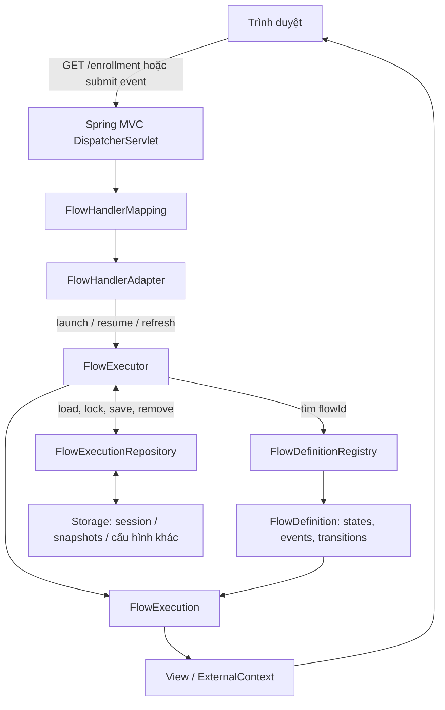
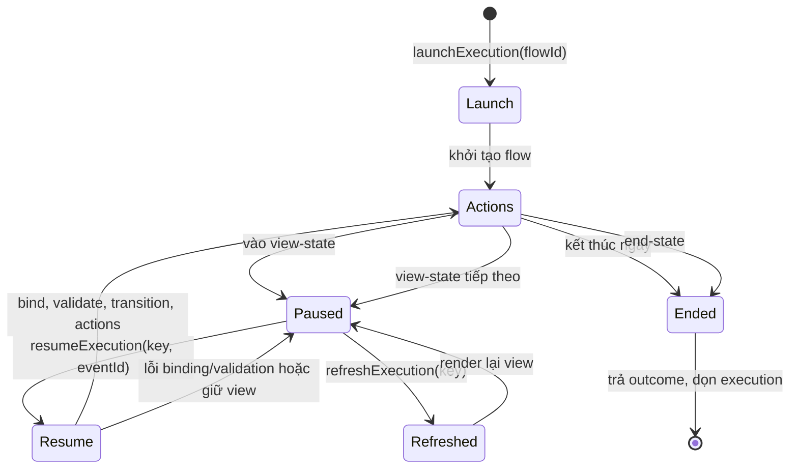
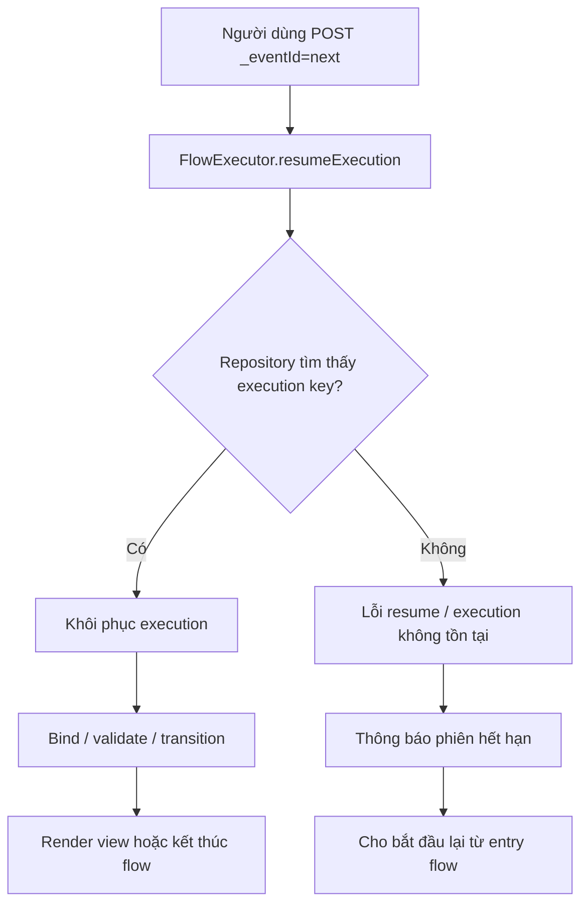

# FlowExecutor như điểm khởi chạy và tiếp tục flow

## 1. FlowExecutor giữ vai trò gì trong kiến trúc thực thi?

Spring Web Flow giúp xây dựng các hành trình web nhiều bước bằng **state**, **event**, **transition** và **subflow**. Thay vì để controller Spring MVC tự phân nhánh giữa trang nhập liệu, trang xem lại, trang xác nhận và các đường quay lại, ứng dụng khai báo các bước của hành trình trong một **flow definition**. Engine chịu trách nhiệm diễn giải định nghĩa đó cho từng lần tương tác.

**`FlowExecutor`** là điểm vào cấp cao để **khởi chạy, tiếp tục và làm mới cách trình bày của một flow execution**. Nó là giao diện giữa yêu cầu thực thi từ lớp web và các đối tượng bên trong Web Flow, gồm định nghĩa flow, execution và cơ chế lưu/khôi phục execution.

Ví dụ, với hành trình đăng ký lớp học:

1. Người dùng mở URL `/enrollment`: ứng dụng yêu cầu `FlowExecutor` bắt đầu một execution của flow có ID `enrollment`.
2. Engine vào state `enterDetails`, render form và **tạm dừng** tại view để chờ hành động tiếp theo.
3. Người dùng gửi event `next` cùng dữ liệu form: ứng dụng yêu cầu `FlowExecutor` tiếp tục execution tương ứng.
4. Engine thực hiện binding, validation và transition sang `review`; một execution key tiếp tục được dùng để xác định lần chạy khi người dùng gửi request tiếp theo.
5. Event `confirm` có thể kích hoạt action nghiệp vụ rồi kết thúc execution, hoặc trở lại view cùng thông báo lỗi.

> **Tách bạch ba khái niệm:** `FlowDefinition` là mô tả hành trình có thể tái sử dụng; `FlowExecution` là một lần chạy cụ thể với state và dữ liệu của người dùng; `FlowExecutor` là dịch vụ điều phối thao tác đối với lần chạy đó. `FlowExecutor` không thay thế database, session hay nghiệp vụ đăng ký.

Bài học thuộc chương **Kiến trúc thực thi** của module `SPRING_WEB_FLOW`. Nội dung tập trung vào đường đi từ HTTP request đến flow execution, API cấp cao của executor, cơ chế định danh/lưu execution, form binding và validation, tích hợp Spring MVC, kiểm thử và xử lý các lỗi tiếp tục flow.

## 2. Bản đồ thành phần: definition, executor và repository



| Thành phần | Trách nhiệm | Không nên nhầm với |
| --- | --- | --- |
| `FlowDefinitionRegistry` | Tra cứu định nghĩa theo flow ID, ví dụ `enrollment` | Nơi giữ trạng thái form của từng người |
| `FlowDefinition` | Khai báo các state, transition, action, subflow | Một phiên chạy cụ thể |
| `FlowExecutor` | Cung cấp thao tác khởi chạy, tiếp tục, làm mới execution | Controller xử lý nghiệp vụ |
| `FlowExecution` | Theo dõi state hiện tại, các scope và event của một lần chạy | Singleton dùng chung mọi người |
| `FlowExecutionRepository` | Lưu/khôi phục execution, quản lý key và các cơ chế khóa/snapshot tùy cấu hình | Registry định nghĩa |
| `ExternalContext` | Giao tiếp với môi trường bên ngoài: request, response, session, principal... | Toàn bộ state machine |
| `FlowHandlerMapping` | Nhận diện URL có thể do flow xử lý | Engine thực thi flow |
| `FlowHandlerAdapter` | Chuyển HTTP request thành lời gọi executor và xử lý kết quả | Định nghĩa state/transition |

Bản đồ trên mô tả **quan hệ trách nhiệm**, không phải lịch chạy chính xác của mọi phương thức. Một số thành phần nội bộ phối hợp thêm trong quá trình launch/resume, và handler/adapter có thể trả redirect thay vì render trực tiếp.

### Vì sao phải có FlowExecutor?

Nếu không có tầng điều phối, mỗi controller dễ phải làm tất cả: xác định bước hiện tại, tìm dữ liệu session, kiểm tra event, bind/validate form, phân nhánh thành công hoặc lỗi, kiểm soát back/forward và dọn state sau khi kết thúc.

Với Web Flow, controller không cần lặp lại những phần điều hướng đó. `FlowExecutor` xử lý **vòng đời execution** theo định nghĩa, còn action/service thực hiện nghiệp vụ thật. Cách chia trách nhiệm này đặc biệt hữu ích khi hành trình có nhiều nhánh, quay lại bước cũ, subflow, dữ liệu form cần giữ qua nhiều request hoặc tình huống phục hồi lỗi.

## 3. Ba thao tác chính của API FlowExecutor

Giao diện `org.springframework.webflow.executor.FlowExecutor` cung cấp các phương thức cốt lõi. Trong các phiên bản Spring Web Flow phổ biến, hợp đồng có dạng:

```java
FlowExecutionResult launchExecution(
    String flowId,
    MutableAttributeMap<?> input,
    ExternalContext context
);

FlowExecutionResult resumeExecution(
    String flowExecutionKey,
    String eventId,
    ExternalContext context
);

FlowExecutionResult refreshExecution(
    String flowExecutionKey,
    ExternalContext context
);
```

Đoạn trên rút gọn phần `throws` và package để thấy vai trò tham số. Khi tích hợp trực tiếp, hãy kiểm tra đúng chữ ký trong Javadoc của phiên bản dự án.

| Thao tác | Đầu vào cốt lõi | Ý nghĩa | Ví dụ |
| --- | --- | --- | --- |
| `launchExecution(...)` | Flow ID, input attributes, external context | Tạo và bắt đầu một lần chạy mới | Mở wizard `enrollment` |
| `resumeExecution(...)` | Execution key, event ID, external context | Khôi phục lần chạy đang tạm dừng rồi phát event | Người dùng gửi `next` |
| `refreshExecution(...)` | Execution key, external context | Khôi phục và hiển thị lại trạng thái hiện tại, không phát một event điều hướng mới | Refresh view hiện hành |
| `FlowExecutionResult` | Kết quả sau mỗi thao tác | Cho biết execution tiếp tục tạm dừng hay đã kết thúc, kèm dữ liệu/khoá phù hợp | Adapter quyết định render/redirect |

Điểm dễ nhầm: `flowId` và `flowExecutionKey` không cùng ý nghĩa.

- `flowId="enrollment"` chỉ đến **loại hành trình** được đăng ký.
- `flowExecutionKey` chỉ đến **một execution cụ thể** cần tiếp tục. Key có thể thay đổi qua các lần lưu/snapshot, vì vậy client phải sử dụng key hiện hành được server cung cấp.
- `eventId="next"` là **tín hiệu hành động** của người dùng tại state hiện tại. Event không tự chứa cấu trúc toàn bộ hành trình.

### 3.1. launchExecution: bắt đầu execution mới

Khi launch:

1. Executor tìm flow definition theo `flowId` trong registry.
2. Nó tạo execution và truyền các input attributes khởi tạo nếu có.
3. Engine khởi tạo flow variables, vào start state và thực thi những action/transition cần thiết.
4. Nếu tới `view-state`, execution **pause** để render và chờ request kế tiếp; repository được dùng để lưu trạng thái cùng key thích hợp.
5. Nếu flow kết thúc ngay, kết quả là completion chứ không phải một paused key để tiếp tục.

Ví dụ:

```text
Request: GET /enrollment
flowId: enrollment
input: { source: "campaign-2026" }

Flow execution mới:
  enterDetails (view-state)
  └─ render form, pause, lưu execution
```

Input attributes khác với form binding: input cung cấp dữ liệu **ở thời điểm launch** theo hợp đồng input của flow; binding diễn ra khi người dùng gửi form tại `view-state`. Không nên tin tưởng input do client gửi nếu nó chứa giá trị có ảnh hưởng đến quyền hạn hoặc giá trị thanh toán.

### 3.2. resumeExecution: tiếp tục khi có event

Khi resume, executor dùng **execution key** để tìm và khôi phục lần chạy, sau đó chuyển `eventId` vào engine. Phần engine xác định event có hợp lệ tại state hiện tại hay không, xử lý action, binding/validation nếu cần, rồi áp dụng transition.

```text
Request: POST /enrollment?execution=<key-hien-tai>
Form fields: email, startDate
Event: next

Resume key -> state enterDetails -> bind -> validate
    ├─ không hợp lệ: giữ tại enterDetails, báo lỗi form
    └─ hợp lệ: transition -> review -> render -> pause
```

Một event ID như `next` không tự bảo đảm transition thành công. Điều kiện thực tế phụ thuộc state đang hoạt động, các transition đã khai báo, validate/bind, action và exception handlers.

### 3.3. refreshExecution: hiển thị lại execution

`refreshExecution` đọc lại execution theo key và tạo kết quả trình bày state hiện tại, **không cố ý phát event điều hướng như `next`**. Nó hữu ích cho các trường hợp muốn yêu cầu hiển thị lại execution thay vì submit lại action. Hành vi chính xác phụ thuộc flow state và tích hợp HTTP đang dùng.

**Lưu ý về refresh trình duyệt:** Nhấn Reload trên browser không mặc nhiên đồng nghĩa ứng dụng sẽ gọi `refreshExecution`. Trình duyệt có thể lặp lại GET hoặc yêu cầu gửi lại POST. Adapter/flow URL handler, redirect strategy và request parameters quyết định lời gọi thực tế. Cần kiểm thử riêng hành vi khi reload, back và mở nhiều tab.

## 4. Vòng đời một FlowExecution



Tình huống tiêu biểu:

| Tình huống | Execution còn hoạt động? | Điều xảy ra |
| --- | --- | --- |
| Mở flow mới và dừng tại form | Có | Execution được pause; cần key hợp lệ để resume |
| Submit form sai định dạng | Thường còn | Binding lỗi, current view được hiển thị lại |
| Nhấn `back` trong flow | Có nếu transition hợp lệ | Engine chuyển state theo definition, dữ liệu scope được duy trì theo quy tắc |
| Flow chạy tới `end-state` | Không còn tiếp tục theo key cũ | Adapter xử lý outcome/end view/redirect theo cấu hình |
| Key thiếu/hết hạn hoặc repository mất snapshot | Không thể resume qua key đó | Cần chiến lược báo lỗi/khởi tạo lại hoặc khôi phục từ dữ liệu nghiệp vụ |
| Nhiều tab dùng key/snapshot khác nhau | Phụ thuộc repository và chính sách khóa/snapshot | Có thể gặp stale key hoặc xung đột; cần kiểm thử |

Trong state machine, một `subflow-state` kích hoạt flow con nhưng vẫn nằm trong ngữ cảnh của execution cấp cao. Việc vào subflow không mặc định tương đương một lần HTTP launch độc lập.

## 5. Tích hợp FlowExecutor vào Spring MVC

Spring MVC thường không gọi `FlowExecutor` trực tiếp từ từng method `@GetMapping`/`@PostMapping` cho toàn bộ wizard. Thay vào đó, dùng hai adapter tích hợp:

- `FlowHandlerMapping` xem URL yêu cầu có trỏ tới một flow ID trong registry không.
- `FlowHandlerAdapter` nhận request phù hợp, chuyển nó thành thao tác launch, resume hoặc refresh tương ứng, tạo `ExternalContext` và biến `FlowExecutionResult` thành HTTP response.

Ví dụ cấu hình Java:

```java
import org.springframework.context.annotation.Bean;
import org.springframework.context.annotation.Configuration;
import org.springframework.webflow.config.AbstractFlowConfiguration;
import org.springframework.webflow.definition.registry.FlowDefinitionRegistry;
import org.springframework.webflow.executor.FlowExecutor;
import org.springframework.webflow.mvc.servlet.FlowHandlerAdapter;
import org.springframework.webflow.mvc.servlet.FlowHandlerMapping;

@Configuration
public class EnrollmentFlowConfiguration
        extends AbstractFlowConfiguration {

    @Bean
    public FlowDefinitionRegistry flowRegistry() {
        return getFlowDefinitionRegistryBuilder()
                .addFlowLocation(
                        "/WEB-INF/flows/enrollment/enrollment-flow.xml",
                        "enrollment")
                .build();
    }

    @Bean
    public FlowExecutor flowExecutor() {
        return getFlowExecutorBuilder(flowRegistry()).build();
    }

    @Bean
    public FlowHandlerMapping flowHandlerMapping() {
        FlowHandlerMapping mapping = new FlowHandlerMapping();
        mapping.setFlowRegistry(flowRegistry());
        mapping.setOrder(0);
        return mapping;
    }

    @Bean
    public FlowHandlerAdapter flowHandlerAdapter() {
        FlowHandlerAdapter adapter = new FlowHandlerAdapter();
        adapter.setFlowExecutor(flowExecutor());
        return adapter;
    }
}
```

Đây là cấu hình minh họa cho các API Spring Web Flow dùng với Spring MVC. Trong ứng dụng thực tế còn cần `DispatcherServlet`, view resolver, resource XML, converter, validator và phiên bản Spring Web Flow/Spring Framework tương thích.

### 5.1. URL, execution key và event parameter

Một cách giao tiếp thông dụng:

```text
Bắt đầu:
GET /enrollment

Tiếp tục:
POST /enrollment?execution=<key-do-server-cap>
Content-Type: application/x-www-form-urlencoded

email=student@example.org
startDate=2026-12-05
_eventId=next
```

Một số form dùng tên nút submit dạng `_eventId_next` thay cho hidden input `_eventId=next`. Cơ chế trích event/key là quy ước của adapter/URL handler, có thể được tùy chỉnh. Đừng coi `execution=e1s1` hoặc bất kỳ key hard-code nào là bền vững; key thật do server cấp.

Trong ví dụ trên:

- Đường dẫn `/enrollment` tìm **flow ID**.
- Tham số `execution` cho biết **execution hiện có**.
- Tham số `_eventId` hoặc tên nút `_eventId_next` cung cấp **event**.
- Các form fields cung cấp dữ liệu để binder cập nhật model tại view-state tương ứng.

Nếu request mới không mang execution key theo quy tắc của ứng dụng, adapter có thể hiểu đó là launch mới; nếu mang key nhưng key không còn hợp lệ, thao tác resume có thể thất bại. Không tự suy luận chỉ từ HTTP method GET/POST rằng execution chắc chắn mới hay cũ.

### 5.2. ExternalContext kết nối engine với môi trường web

`org.springframework.webflow.context.ExternalContext` trừu tượng hóa môi trường bên ngoài engine. Nó có thể cung cấp thông tin request parameter, request/session/application map, security principal và quyền tương tác với response, tùy implementation.

`FlowHandlerAdapter` kết nối Servlet request/response với `ExternalContext` phù hợp. Nhờ đó bản thân flow definition và `FlowExecutor` không phải tạo `HttpServletRequest`/`HttpServletResponse` theo cách thủ công trong phần lớn luồng xử lý.

Khi chạy unit/integration test không có browser, framework test có thể cung cấp external context mô phỏng. Điều này giúp kiểm tra chuyển trạng thái và event mà không phụ thuộc hoàn toàn vào giao diện người dùng.

## 6. Ví dụ hành trình đăng ký lớp học

Giả sử yêu cầu nghiệp vụ: nhập thông tin, xem lại, xác nhận hoặc quay lại; khi xác nhận thành công gọi service đăng ký. Một flow XML minh họa:

```xml
<?xml version="1.0" encoding="UTF-8"?>
<flow xmlns="http://www.springframework.org/schema/webflow"
      xmlns:xsi="http://www.w3.org/2001/XMLSchema-instance"
      xsi:schemaLocation="
        http://www.springframework.org/schema/webflow
        https://www.springframework.org/schema/webflow/spring-webflow.xsd">

    <var name="draft" class="com.example.enrollment.EnrollmentDraft" />

    <view-state id="enterDetails"
                view="enrollment/form"
                model="draft">
        <binder>
            <binding property="email" required="true" />
            <binding property="startDate" required="true" />
        </binder>

        <transition on="next" to="review" />
        <transition on="cancel" to="cancelled" bind="false" />
    </view-state>

    <view-state id="review" view="enrollment/review">
        <transition on="back" to="enterDetails" />
        <transition on="confirm" to="saveRegistration" />
    </view-state>

    <action-state id="saveRegistration">
        <evaluate expression="enrollmentService.register(draft)" />
        <transition on="success" to="finished" />
        <transition on="error" to="review" />
    </action-state>

    <end-state id="finished" />
    <end-state id="cancelled" />
</flow>
```

Giả định `EnrollmentDraft` là JavaBean có thuộc tính `email` và `startDate`, conversion service có thể chuyển ngày, view resolver nhận được các logical view ID, và Spring context có bean `enrollmentService`. Trong thực tế, action `register` nên có cơ chế lỗi/idempotency thích hợp; outcome `success`/`error` cần khớp kết quả của action được gọi hoặc exception handling. Bài ví dụ không tự triển khai thanh toán, authorization hay persistence.

Trình tự tương ứng:

1. **Launch:** `FlowExecutor.launchExecution("enrollment", …)` dùng definition `enrollment`, tạo `draft` và dừng ở `enterDetails`.
2. **Resume với `next`:** binder nhận `email`, `startDate`. Nếu conversion hoặc validation thất bại, người dùng ở lại `enterDetails`; nếu thành công, chuyển sang `review`.
3. **Resume với `back`:** quay từ `review` về `enterDetails` theo transition; model `draft` vẫn giữ trong vòng đời flow.
4. **Resume với `confirm`:** chuyển tới `saveRegistration`; gọi `enrollmentService.register(draft)`. Kết quả thành công kết thúc ở `finished`, lỗi nghiệp vụ quay về `review` theo transition.
5. **Kết thúc:** kết quả executor cho biết flow đã end; UI/adapter chọn response tương ứng. Client không tiếp tục execution cũ bằng key của flow đã kết thúc.

### 6.1. Binding và validation diễn ra ở đâu?

`FlowExecutor` chỉ là cổng điều phối; việc binding/validation được engine và view-state/binder/validator xử lý trong quá trình resume.

Ví dụ:

```text
POST startDate=abc, _eventId=next
    -> resumeExecution(key, "next", context)
    -> bind startDate vào LocalDate
    -> conversion thất bại
    -> hiển thị enterDetails + lỗi

POST startDate=2026-12-05, _eventId=next
    -> resumeExecution(...)
    -> conversion thành công
    -> validation model
    -> transition tới review nếu hợp lệ
```

Không nên tin rằng một lần gọi `resumeExecution` chắc chắn làm thay đổi state: có thể chỉ render lại cùng view vì dữ liệu không hợp lệ.

Một transition `cancel` thường cần `bind="false"` để bỏ qua binding khi người dùng muốn hủy, nhất là nếu form đang có nội dung sai định dạng. Transition `back` cũng có thể dùng `validate="false"` khi yêu cầu cho phép quay lại mà không chặn bởi constraint của bước hiện tại.

## 7. FlowExecutionRepository và ý nghĩa của execution key

Phần lớn ứng dụng web cần duy trì trạng thái qua nhiều HTTP request: người dùng mất vài giây hoặc vài phút để đọc, điền form rồi gửi bước tiếp. HTTP là stateless, vì vậy Web Flow có **`FlowExecutionRepository`** để quản lý vòng đời execution giữa các request.

Tùy cấu hình, repository và các lớp hỗ trợ có thể:

- Ghi lại execution và cấp key/continuation key.
- Phục hồi execution tương ứng với key được gửi lên.
- Quản lý cơ chế khóa để hạn chế truy cập đồng thời vào cùng execution.
- Lưu các snapshot phục vụ back/forward hoặc khôi phục theo giới hạn cấu hình.
- Loại bỏ execution khi đã kết thúc hoặc không còn được giữ.

Đừng coi key là dữ liệu nghiệp vụ có thể tự sinh từ `flowId` hoặc từ ID user. Key là một token do cơ chế execution repository/URL handler của Web Flow quản lý; code client nên dùng giá trị hiện hành mà framework đã đưa vào link/form.

### 7.1. Hai mô hình thường gặp: session và continuation

| Khía cạnh | Repository gắn với session | Repository hỗ trợ continuation/snapshot |
| --- | --- | --- |
| Vị trí state chủ yếu | Server-side session hoặc hạ tầng phiên liên quan | Các snapshot/continuation do repository quản lý |
| Resume | Dùng key cùng session hợp lệ | Dùng key/snapshot phù hợp với chính sách repository |
| Back/forward | Có thể chịu ảnh hưởng của thay đổi state hiện tại | Có thể phục hồi snapshot trước trong giới hạn cho phép |
| Giới hạn | Timeout, số execution trong session | Số execution, số snapshot, serialization/memory |
| Điểm cần kiểm thử | Session timeout, tab song song | Stale key, quay lại key cũ, đồng thời và tài nguyên lưu |

Cấu hình repository quyết định chi tiết, nên không được suy luận rằng **mọi** dự án đều cho phép sử dụng key cũ hoặc khôi phục vô hạn state từ lịch sử trình duyệt.

Trong XML namespace, có thể cấu hình repository cho flow executor:

```xml
<webflow:flow-registry id="flowRegistry">
    <webflow:flow-location
        path="/WEB-INF/flows/enrollment/enrollment-flow.xml"
        id="enrollment" />
</webflow:flow-registry>

<webflow:flow-executor id="flowExecutor"
                       flow-registry="flowRegistry">
    <webflow:flow-execution-repository
        max-executions="5"
        max-execution-snapshots="10" />
</webflow:flow-executor>
```

Các tham số trên là **giới hạn lưu trữ execution/snapshot**, không phải số bước tối đa của một flow. Cần kiểm tra schema của bản Web Flow đang dùng; cách tổ chức factory/repository có thể thay đổi giữa các phiên bản.

### 7.2. Scope không đồng nghĩa HTTP session

| Scope | Vòng đời điển hình | Ví dụ |
| --- | --- | --- |
| `requestScope` | Một request xử lý flow | Thông tin tạm được tạo trong request |
| `flashScope` | Dữ liệu ngắn hạn qua một lần chuyển/render theo quy tắc Web Flow | Thông báo vừa lưu |
| `viewScope` | Trong view-state đang hoạt động | Dữ liệu giao diện chỉ của trang hiện tại |
| `flowScope` | Trong flow hiện tại | `draft` của wizard, dữ liệu dùng qua nhiều bước |
| `conversationScope` | Xuyên qua flow và các subflow trong cùng conversation | Một đối tượng phối hợp nhiều flow con |

Chi tiết vòng đời và serialization phụ thuộc Web Flow/repository, nhưng nguyên tắc là **dữ liệu của từng execution không nên nằm trong singleton Spring bean dùng chung**. Dùng scope phù hợp để tránh người dùng A nhìn thấy dữ liệu draft của người dùng B.

### 7.3. Tab song song và khóa execution

Giả sử người dùng mở hai tab cùng một flow, rồi submit `confirm` gần như đồng thời. Hệ thống cần tính đến hai lớp vấn đề:

1. **Tính nhất quán của execution:** repository/lock/snapshot quyết định liệu hai request cùng key có thể xử lý tuần tự, bị từ chối vì key cũ hay dẫn đến xung đột. Không dựa vào giả định mọi key đều có thể dùng lại.
2. **Tính đúng đắn nghiệp vụ:** dù engine khóa execution tốt, service `register(...)` vẫn cần transaction, kiểm tra quyền và chống thao tác lặp theo ID nghiệp vụ/idempotency key. Một request khác, tab khác hoặc retry từ mạng vẫn có thể tới service.

Cơ chế điều phối flow **không thay thế** ràng buộc duy nhất và transaction ở database.

## 8. Resume khi có subflow

Một flow `enrollment` có thể gọi flow con `selectSchedule`:

```xml
<subflow-state id="chooseSchedule" subflow="selectSchedule">
    <transition on="scheduleSelected" to="review" />
    <transition on="cancelled" to="enterDetails" />
</subflow-state>
```

Engine phân giải definition con qua registry và quản lý quá trình vào/ra subflow trong execution. Khi subflow kết thúc ở outcome `scheduleSelected`, transition của parent được kích hoạt.

Vì vậy, **một lần resume root execution có thể đi qua nhiều state và thậm chí hoàn thành một subflow**, chứ không phải một request chỉ đổi đúng một state. Execution key từ HTTP vẫn đại diện cho lần tương tác cấp cao với flow đó theo cơ chế được cấu hình.

Dữ liệu truyền vào/ra subflow nên được định nghĩa rõ bằng `<input>`/`<output>` và scope thích hợp. Registry chỉ giúp tìm subflow definition; executor quản lý execution; việc ràng buộc model giữa parent và child vẫn cần thiết kế cẩn thận.

## 9. Xử lý lỗi và phục hồi khi resume thất bại

Lỗi ở đây có nhiều loại khác nhau; cùng thấy một trang lỗi không có nghĩa là cùng nguyên nhân.

| Tình huống | Hậu quả có thể xảy ra | Xử lý phù hợp |
| --- | --- | --- |
| Không tìm thấy `flowId` | Launch thất bại vì chưa có definition | Kiểm tra registry, ID, resource và MVC mapping |
| XML/bean/flow definition không xây dựng được | Launch hoặc lookup lỗi | Đọc stack trace gốc, sửa resource, biểu thức, bean |
| Missing/invalid `execution key` | Không tìm được execution để resume | Trang thông báo phiên hết hạn; cung cấp đường bắt đầu lại |
| Session hết hạn | Snapshot/đối tượng session không còn | Yêu cầu xác thực lại hoặc khởi tạo wizard mới |
| Người dùng gửi event không có transition hợp lệ | Có thể lỗi state/event hoặc hành vi từ chối theo cấu hình | Kiểm tra active state, event ID, transition conditions |
| Binding/validation không hợp lệ | Giữ tại view và hiển thị lỗi; execution thường vẫn còn | Đưa thông báo có thể sửa, giữ dữ liệu hợp lệ |
| Service nghiệp vụ ném exception | Flow có thể abort hoặc xử lý bằng exception/transition | Bắt lỗi theo lớp thích hợp; rollback và thông báo rõ |
| Two-tab/stale continuation | Request tiếp tục key cũ hoặc snapshot bị bỏ | Kiểm tra policy snapshot/lock, hướng dẫn reload/bắt đầu lại |
| Trình duyệt submit lại action `confirm` | Nguy cơ thực hiện nghiệp vụ hai lần | Redirect phù hợp, idempotency và constraint database |

### 9.1. Trường hợp key hết hạn



Tên ngoại lệ có thể khác nhau theo tình huống/version (ví dụ `NoSuchFlowExecutionException` khi execution không được tìm thấy, hoặc lỗi khôi phục snapshot). Ở lớp web nên có cơ chế xử lý ngoại lệ đã kiểm thử: trả trạng thái/đường điều hướng phù hợp, tránh hiển thị stack trace và không tự ý chuyển một POST lỗi sang **launch mới rồi thực hiện lại action**.

Với wizard quan trọng, nên lưu **bản nháp nghiệp vụ** vào database qua service có quyền truy cập phù hợp nếu người dùng cần tiếp tục sau session timeout; `flowScope` không phải giải pháp lưu bản nháp vĩnh viễn.

### 9.2. Validation không phải “exception phải restart”

Lỗi form là tình huống bình thường: ví dụ người dùng nhập ngày sai, email trống hoặc vi phạm constraint. Sau resume, engine có thể tiếp tục ở cùng `view-state`, hiển thị binding/validation messages và cấp key tương ứng. Không nên xóa execution hoặc đưa người dùng về bước đầu chỉ vì validation thất bại.

### 9.3. Khi có HTTP redirect

Web Flow và Spring MVC có thể sử dụng redirect giữa các request, nhất là để tránh submit lại POST và đảm bảo hiển thị state đúng. Hãy để `FlowHandlerAdapter` và chiến lược redirect/view của Web Flow điều phối kết quả; đừng tự ghép execution key vào URL trong mọi controller.

Một flow đã kết thúc có thể trả outcome để handler quyết định trang/redirect đích. Tại điểm kết thúc, key cũ không còn là hợp đồng resume hợp lệ. Nếu người dùng reload URL cũ, ứng dụng nên dẫn tới trang trạng thái nghiệp vụ hoặc entry point phù hợp thay vì phụ thuộc vào một execution đã end.

## 10. Mối liên hệ với bảo mật và dữ liệu nghiệp vụ

**Execution key không phải bằng chứng ủy quyền.** Dù key khó đoán, flow vẫn phải xác minh danh tính/quyền truy cập khi thao tác với đơn hàng, hồ sơ hoặc tài nguyên nhạy cảm. Không chấp nhận một ID nghiệp vụ do người dùng tự sửa mà không kiểm tra ownership.

**CSRF vẫn quan trọng.** Web Flow có form POST và event; cần giữ cấu hình Spring Security CSRF đúng với view/form đang dùng. Không nghĩ rằng có execution key thì có thể bỏ CSRF token.

**Không tin input từ client.** `flowId`, event, form field và input parameter đều có thể bị người dùng thao tác. Hãy validate model ở state thích hợp, kiểm tra điều kiện nghiệp vụ tại service và không dùng hidden form field để xác nhận quyền hạn.

**Tránh thực hiện action có tác dụng phụ nhiều lần.** Nếu `confirm` làm tạo đơn, trừ tiền hoặc gửi email, service nên có transaction, idempotency hoặc ràng buộc duy nhất. Flow engine giảm nhầm lẫn điều hướng nhưng không bảo đảm exactly-once cho toàn bộ nghiệp vụ khi xảy ra retry mạng.

**Giới hạn dữ liệu trong scope.** Tránh đưa file upload lớn, connection, entity manager hoặc đối tượng không thể serialize vào flow scope nếu execution repository dùng serialization/snapshot. Chỉ giữ dữ liệu cần thiết và xác minh yêu cầu của repository triển khai.

## 11. Kiểm thử theo cấp độ

### 11.1. Test contract của registry và executor

Trước hết kiểm tra flow ID có thể tra cứu và bean executor được nối đúng:

```java
import static org.junit.jupiter.api.Assertions.*;

import org.junit.jupiter.api.Test;
import org.springframework.beans.factory.annotation.Autowired;
import org.springframework.test.context.junit.jupiter.web.SpringJUnitWebConfig;
import org.springframework.webflow.definition.registry.FlowDefinitionRegistry;
import org.springframework.webflow.executor.FlowExecutor;

@SpringJUnitWebConfig(classes = EnrollmentFlowConfiguration.class)
class EnrollmentFlowWiringTest {

    @Autowired
    private FlowDefinitionRegistry registry;

    @Autowired
    private FlowExecutor executor;

    @Test
    void flowCanBeFoundAndExecutorIsAvailable() {
        assertNotNull(executor);
        assertTrue(registry.containsFlowDefinition("enrollment"));
        assertEquals("enrollment",
                registry.getFlowDefinition("enrollment").getId());
    }
}
```

Đây là test wiring, không chứng minh `launchExecution` và `resumeExecution` hoạt động đúng. Test cần chạy trong web application context có thể load resource `/WEB-INF/flows/...` và các bean liên quan.

### 11.2. Test vòng đời execution

Dùng hỗ trợ kiểm thử Spring Web Flow (ví dụ các test fixture của `org.springframework.webflow.test` tương thích phiên bản) để kiểm chứng các đường quan trọng:

1. **Launch hợp lệ:** flow `enrollment` bắt đầu ở `enterDetails`, model `draft` được khởi tạo.
2. **Submit dữ liệu hợp lệ:** event `next` sau binding/validation chuyển sang `review`.
3. **Submit dữ liệu không hợp lệ:** vẫn ở `enterDetails`, có thông báo lỗi và không gọi service đăng ký.
4. **Quay lại:** event `back` từ `review` quay về `enterDetails` và giữ giá trị draft phù hợp.
5. **Xác nhận:** event `confirm` gọi service một lần cho một ý định nghiệp vụ, sau đó tới `finished`.
6. **Lỗi service:** kết quả lỗi hoặc exception handler giữ trạng thái có thể phục hồi, không tạo đăng ký nửa vời.

### 11.3. Test tích hợp HTTP và repository

Sau test state machine, bổ sung test chạy qua MVC handler và repository để phát hiện vấn đề mà unit test không thấy:

| Kịch bản | Điều cần quan sát |
| --- | --- |
| `GET /enrollment` | Handler mapping chọn flow, view đầu tiên render được |
| POST event với key hiện hành | Resume đúng execution; dữ liệu form được bind |
| POST thiếu key | Ứng dụng có cách xử lý rõ ràng theo quy tắc adapter |
| POST key không tồn tại | Thông báo phiên hết hạn/khởi động lại, không báo lỗi kỹ thuật ra UI |
| Reload/back sau một bước | Hành vi khớp snapshot/redirect policy |
| Hai tab và submit liên tiếp | Không vi phạm tính đúng đắn nghiệp vụ |
| Session timeout | Không crash/không rò rỉ dữ liệu, có đường quay lại |
| Form vi phạm constraint | Giữ input và thông báo lỗi phù hợp |

Với request/response và repository thật, có thể dùng cấu hình test Spring MVC phù hợp dự án. Các test key hết hạn nên chủ động tạo môi trường hết hạn/snapshot không còn bằng công cụ test, tránh dựa vào timeout thực tế kéo dài.

## 12. Checklist triển khai và sai lầm thường gặp

Một quy trình triển khai thực tế:

1. **Định nghĩa flow ID ổn định** (ví dụ `enrollment`), đăng ký resource chính xác trong `FlowDefinitionRegistry`.
2. **Cấu hình `FlowExecutor`** từ registry, lựa chọn repository và các giới hạn execution/snapshot thích hợp.
3. **Tích hợp Spring MVC** bằng `FlowHandlerMapping` và `FlowHandlerAdapter`; bảo đảm không xung đột với request mapping hiện có.
4. **Định nghĩa state/event/transition** trong XML, gồm đường back/cancel/error và subflow nếu có.
5. **Cấu hình binding và validation** phù hợp model, conversion service, form và từng transition.
6. **Quản lý dữ liệu theo scope**; đưa bản nháp cần sống lâu hoặc có giá trị nghiệp vụ sang service/persistence thích hợp.
7. **Thiết kế phục hồi lỗi** cho key hết hạn, session mất, retry, submit hai lần và concurrent tabs.
8. **Kiểm thử launch/resume/refresh ở các cấp**: definition, state machine và HTTP integration.

| Ngộ nhận | Cách hiểu đúng |
| --- | --- |
| “`FlowExecutor` chính là execution của user” | Executor là điểm điều phối; mỗi `FlowExecution` mang state/dữ liệu riêng |
| “Mỗi POST là một launch mới” | Request có thể resume một execution bằng key và event |
| “`flowId` chính là key để tiếp tục flow” | ID định nghĩa và execution key có vai trò khác nhau |
| “Submit event chắc chắn đổi state” | Binding, validation, guard/condition hoặc action có thể giữ nguyên view |
| “Key hợp lệ là đủ an toàn” | Còn cần session/user authorization, CSRF, input validation |
| “Repository giữ form mãi mãi” | Snapshot/session có giới hạn và timeout; cần persistence riêng cho draft lâu dài |
| “Refresh browser giống `refreshExecution`” | Cần xem request thực và hành vi adapter/redirect |
| “Flow engine tự chống double charge” | Cần idempotency và transaction ở tầng nghiệp vụ |

### Câu hỏi tự luyện

1. Khi nào nên gọi `launchExecution`, khi nào nên gọi `resumeExecution`? Hai phương thức này nhận khóa định danh khác nhau thế nào?
2. Một flow đang ở `review`. Event `back` được gửi qua POST cùng execution key; thành phần nào quyết định state kế tiếp?
3. Tại sao `resumeExecution` có thể trả về cùng view `enterDetails` dù đã nhận event `next`?
4. Tác dụng của `FlowExecutionRepository` khác gì so với `FlowDefinitionRegistry`?
5. Điều gì xảy ra nếu người dùng submit một form mang execution key đã hết hạn? Ứng dụng nên xử lý ra sao?
6. Bật snapshot nhiều hơn có bảo đảm service đăng ký chỉ chạy đúng một lần khi người dùng double submit không?
7. Vì sao event ID và execution key chưa đủ để thay thế CSRF protection và authorization?
8. Muốn cho người dùng tiếp tục draft sau một tuần, nên lưu dữ liệu ở `flowScope` hay xây dựng persistence nghiệp vụ? Vì sao?

## Tài liệu tham khảo

- [Spring Web Flow — Reference Guide](https://docs.spring.io/spring-webflow/docs/3.0.x/reference/)
- [Spring Web Flow — FlowExecutor Javadoc](https://docs.spring.io/spring-webflow/docs/3.0.0/api/org/springframework/webflow/executor/FlowExecutor.html)
- [Spring Web Flow — FlowExecutionResult Javadoc](https://docs.spring.io/spring-webflow/docs/3.0.0/api/org/springframework/webflow/executor/FlowExecutionResult.html)
- [Spring Web Flow — FlowExecutionRepository Javadoc](https://docs.spring.io/spring-webflow/docs/3.0.0/api/org/springframework/webflow/execution/repository/FlowExecutionRepository.html)
- [Spring Web Flow — Spring MVC Integration](https://docs.spring.io/spring-webflow/docs/3.0.x/reference/#_spring_mvc_integration)

Các đoạn cấu hình và ví dụ nhằm làm rõ cơ chế thực thi. Khi áp dụng vào codebase thật, cần kiểm tra phiên bản Spring Web Flow, Spring Framework, API Servlet và Bean Validation, cùng định dạng execution key, redirect và repository mà ứng dụng đang dùng.
