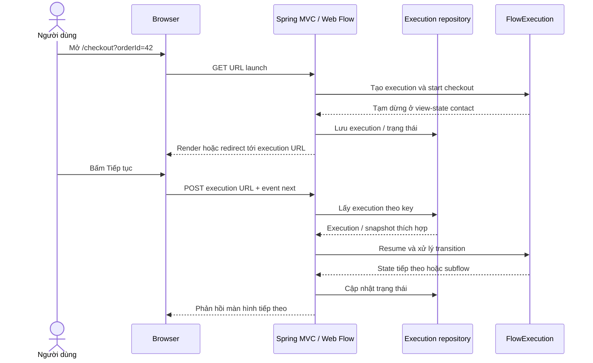
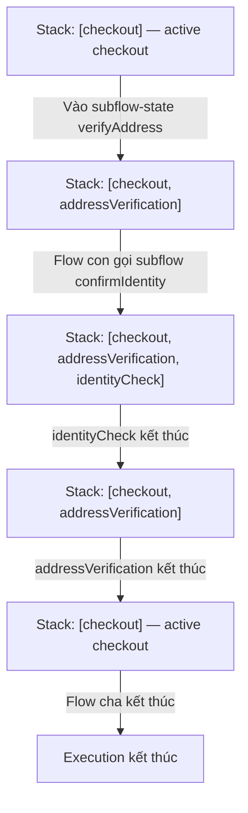
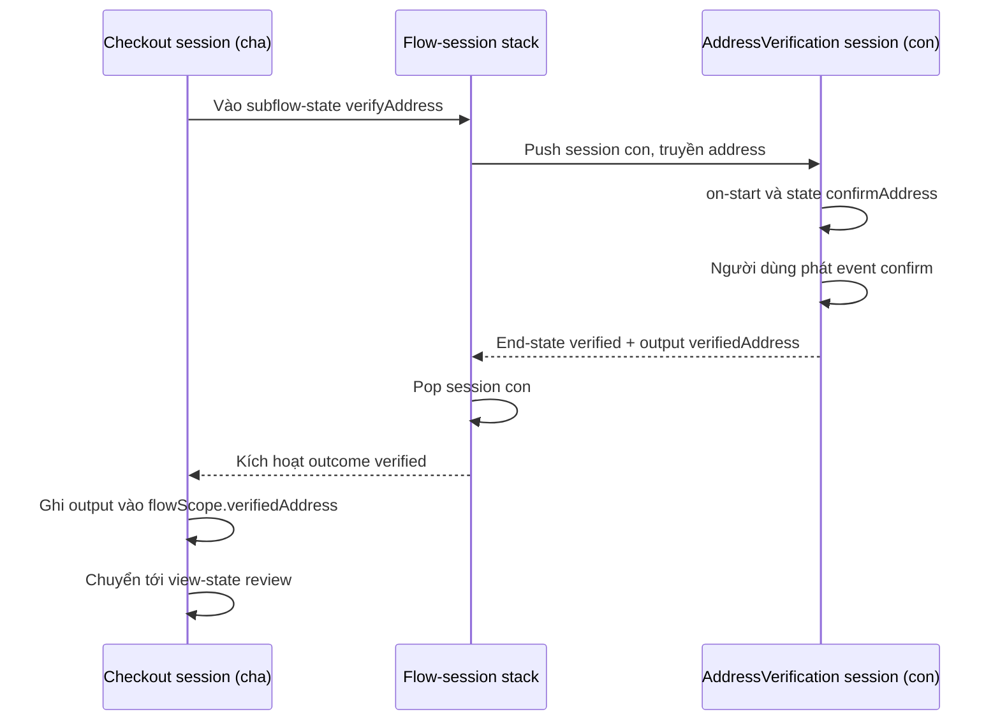

# FlowExecution, FlowSession và ngăn xếp flow cha–con trong Spring Web Flow

Trong một quy trình đặt hàng nhiều bước, người dùng có thể đang nhập thông tin giao hàng thì được chuyển sang một quy trình con để **xác minh địa chỉ**; sau khi xác minh, họ quay về đúng bước của quy trình đặt hàng, giữ nguyên những thông tin đã nhập. Spring Web Flow thực hiện điều này bằng một mô hình thực thi có cấu trúc: **một `FlowExecution` chứa các `FlowSession` được tổ chức như ngăn xếp gọi flow**.

Bài học thuộc chương **Kiến trúc thực thi** của module `SPRING_WEB_FLOW`. Khác với cách rải logic điều hướng qua nhiều controller, Web Flow mô tả hành trình bằng **state, event, transition và subflow**, sau đó quản lý trạng thái của từng lượt thực thi qua nhiều HTTP request. Hiểu quan hệ giữa `FlowExecution`, `FlowSession` và stack cha–con giúp bạn chọn đúng scope, truyền input/output, xử lý Back/Refresh, bảo vệ dữ liệu và kiểm thử các hành trình lồng nhau.

Sau bài học, bạn có thể:

- Phân biệt **Flow definition**, **FlowExecution**, **FlowSession** và **flow execution repository**.
- Giải thích tại sao **một execution có thể có nhiều flow session**, nhưng tại một thời điểm chỉ có một session đang hoạt động ở đỉnh stack.
- Theo dõi cơ chế **push** khi bắt đầu subflow và **pop** khi subflow kết thúc, rồi trả kết quả cho flow cha.
- Thiết kế input/output giữa flow cha và con mà không chia sẻ nhầm `flowScope`.
- Phân biệt `flowScope`, `conversationScope`, `viewScope` và HTTP session.
- Phân tích việc khôi phục execution sau request, refresh, nhiều tab, lỗi và hết hạn.
- Viết các ca kiểm thử xác minh active state, scope và chuỗi return từ subflow.

## 1. Bốn khái niệm nền tảng

Trước khi xét flow lồng nhau, cần xác định chính xác mỗi đối tượng có trách nhiệm gì.

| Thành phần | Trả lời câu hỏi | Đặc điểm |
| --- | --- | --- |
| **Flow definition** | “Hành trình được thiết kế như thế nào?” | Mô tả các state, event, transition, input/output; thường được đăng ký một lần trong flow registry |
| **FlowExecution** | “Đây là lượt chạy nào của hành trình?” | Đại diện cho một lần chạy cụ thể; có ngữ cảnh và trạng thái có thể tiếp tục qua nhiều request |
| **FlowSession** | “Flow nào đang tham gia lượt chạy này?” | Một phiên của một flow definition bên trong execution; giữ state và flow scope tương ứng |
| **FlowExecutionRepository** | “Lưu và lấy lại execution đang chạy bằng cách nào?” | Quản lý khóa/snapshot và việc lưu/khôi phục theo cấu hình |

Ví dụ `checkout` là một **flow definition** có thể được nhiều người truy cập. Nếu một người mở hai tab, mỗi tab khởi chạy `checkout` độc lập, hệ thống có thể có **hai FlowExecution** cùng dựa trên một definition nhưng giữ model và trạng thái riêng. Nếu execution thứ nhất gọi `addressVerification`, nó có thêm một **FlowSession** cho flow con; không nhất thiết tạo một execution HTTP độc lập cho flow con đó.

### Hình dung bằng đối tượng

```text
FlowDefinition: checkout   ────────────┐
                                      │
                          được dùng để khởi chạy
                                      │
                         FlowExecution #A
                         ├─ execution key/snapshot
                         ├─ conversationScope
                         └─ flow-session stack
                            ├─ checkout session (cha)
                            └─ addressVerification session (con, active)

FlowDefinition: checkout   ────────────┐
                                      │
                         FlowExecution #B
                         └─ checkout session (active)
```

`#A` và `#B` chỉ là ký hiệu trong sơ đồ. Chúng **không phải tên class hoặc định dạng khóa** của Spring Web Flow. Cả hai execution có thể thuộc cùng một người dùng và cùng HTTP session, nhưng vẫn là hai hành trình độc lập khi được khởi chạy riêng.

## 2. `FlowExecution`: một lượt chạy xuyên nhiều request

Một Web Flow execution không phải request HTTP. Một người dùng có thể:

1. Gửi GET để **launch** flow `checkout`.
2. Nhìn thấy trang `contact` và nhập thông tin trong vài phút.
3. POST event `next` để vào `verifyAddress`.
4. POST event `confirm` trong flow con.
5. Quay về flow cha và POST event `placeOrder`.

Những request đó cùng phục vụ một **lượt chạy logic**. Trong lúc chờ browser, Web Flow có thể tạm dừng execution và lưu trạng thái theo cơ chế repository. Request tiếp theo mang thông tin execution phù hợp để hệ thống khôi phục lượt chạy này thay vì bắt đầu lại từ state đầu tiên.



Sơ đồ mô tả vai trò của các thành phần, không áp đặt một trình tự internal method call cụ thể cho mọi phiên bản. Cách lưu execution, snapshot, redirect và execution key phụ thuộc cấu hình runtime.

### `FlowExecutor` khác `FlowExecution` thế nào?

- `FlowExecutor` là thành phần được dùng để **launch**, **resume** và thực thi các flow.
- `FlowExecution` là **một lượt chạy cụ thể** mà executor điều khiển.
- `FlowExecutionRepository` giúp quản lý việc lưu/khôi phục lượt chạy theo khóa.
- `FlowHandlerAdapter` và các thành phần tích hợp Spring MVC nhận request HTTP, kết nối với flow executor và tạo response/redirect thích hợp.

Đừng nhầm một bean `flowExecutor` của ứng dụng với một execution của người dùng: một executor có thể xử lý nhiều execution.

## 3. `FlowSession`: trạng thái riêng của mỗi flow bên trong execution

Khi execution bắt đầu chạy flow `checkout`, nó có một **root FlowSession** cho `checkout`. Nếu flow cha gọi `addressVerification`, Web Flow bắt đầu thêm một **FlowSession** cho flow con. Khi flow con hoạt động, nó có state hiện tại và `flowScope` của riêng mình.

| Thuộc tính khái niệm | Session của flow cha `checkout` | Session của flow con `addressVerification` |
| --- | --- | --- |
| Definition được chạy | `checkout` | `addressVerification` |
| State khi con đang chạy | `subflow-state verifyAddress` | `view-state confirmAddress` |
| `flowScope` | `orderDraft`, `checkoutForm`, `orderId` | `address`, `suggestions`, `verified` |
| Trạng thái hoạt động | Tạm dừng chờ subflow kết thúc | Đang active ở đỉnh stack |
| Điều gì làm tiến trình tiếp tục? | Outcome trả về từ subflow | Event do người dùng phát trong flow con |

**FlowSession không đồng nghĩa với `HttpSession`.** Một HTTP session có thể gắn với nhiều execution, và mỗi execution có thể chứa nhiều flow session lồng nhau. Cách execution được lưu có thể sử dụng HTTP session hoặc cơ chế repository khác, nhưng mô hình logic của FlowSession vẫn độc lập với HTTP session.

### Session active và session cha đang chờ

Khi flow con active, event từ browser được giải quyết trong ngữ cảnh flow con đang chạy. Flow cha **không đồng thời xử lý các transition của chính nó** như thể đang ở view-state `contact`. Nó đang chờ kết quả từ `subflow-state`.

Một `FlowExecution` thường có cách truy xuất **active FlowSession** trong API Java của Web Flow; khi debug, hãy xem flow definition ID và state ID của session đang active thay vì chỉ nhìn URL. Nhiều flow khác nhau có thể dùng cùng tên state `review` nhưng mang ý nghĩa khác nhau.

## 4. Ngăn xếp flow cha–con vận hành theo nguyên tắc LIFO

Ngăn xếp flow session hoạt động theo nguyên tắc **Last In, First Out (LIFO)**: flow con được gọi gần nhất nằm trên cùng và được kết thúc trước khi quay về flow đang gọi nó.



Ký hiệu `[checkout, addressVerification]` biểu diễn stack từ **đáy đến đỉnh**. Tại thời điểm có hai phần tử, `addressVerification` là active session; `checkout` vẫn tồn tại nhưng tạm dừng tại state đang gọi subflow.

### Các bước push/pop cụ thể

1. **Launch root flow**: tạo execution và root session `checkout`. Stack có một phần tử.
2. **Vào `subflow-state`**: flow cha chuẩn bị input cho `addressVerification`; session con được push lên đỉnh stack.
3. **Chạy flow con**: active session là `addressVerification`. State, `flowScope` và action của con được xử lý trong ngữ cảnh con.
4. **Flow con vào `end-state`**: Web Flow thu thập output của con và tạo kết quả kết thúc tương ứng.
5. **Pop session con**: session `addressVerification` kết thúc, flow cha trở lại active.
6. **Resume flow cha**: `subflow-state` của cha nhận outcome/event; transition tương ứng dẫn flow cha sang state kế tiếp.
7. **Flow cha kết thúc**: khi root session đi tới `end-state`, toàn execution hoàn tất.

**Quan trọng:** kết thúc **subflow** không nhất thiết kết thúc **toàn FlowExecution**. Chỉ khi luồng gốc đã hoàn tất (và không còn phiên flow cần chạy) thì lượt thực thi mới kết thúc. Ngược lại, nếu subflow bị lỗi, chưa chắc stack có thể được pop và trả về cha bình thường; ứng dụng cần chiến lược xử lý lỗi rõ ràng.

## 5. Ví dụ XML: flow cha gọi flow con và nhận output

Giả sử `checkout` có bước nhập địa chỉ; `addressVerification` là flow con dùng để xác minh địa chỉ rồi trả kết quả. Ta sẽ mô tả hai flow **độc lập về definition** nhưng cùng tham gia một execution khi được gọi qua subflow-state.

### 5.1. Flow cha `checkout`

```xml
<?xml version="1.0" encoding="UTF-8"?>
<flow xmlns="http://www.springframework.org/schema/webflow"
      xmlns:xsi="http://www.w3.org/2001/XMLSchema-instance"
      xsi:schemaLocation="http://www.springframework.org/schema/webflow
                          http://www.springframework.org/schema/webflow/spring-webflow-2.0.xsd">

    <input name="orderId" type="java.lang.Long" required="true" />
    <var name="checkoutForm" class="com.example.checkout.CheckoutForm" />

    <on-start>
        <evaluate expression="orderService.loadAccessibleDraft(orderId)"
                  result="flowScope.orderDraft" />
    </on-start>

    <view-state id="contact" view="checkout/contact" model="checkoutForm">
        <transition on="next" to="verifyAddress" />
        <transition on="cancel" to="cancelled" bind="false" />
    </view-state>

    <subflow-state id="verifyAddress" subflow="addressVerification">
        <input name="address" value="checkoutForm.shippingAddress" />

        <transition on="verified" to="review">
            <set name="flowScope.verifiedAddress"
                 value="currentEvent.attributes.verifiedAddress" />
        </transition>

        <transition on="cancelled" to="contact" />
    </subflow-state>

    <view-state id="review" view="checkout/review">
        <transition on="back" to="contact" />
        <transition on="confirm" to="placeOrder" />
    </view-state>

    <action-state id="placeOrder">
        <evaluate expression="orderService.placeOrder(orderId, checkoutForm, verifiedAddress)" />
        <transition on="success" to="completed" />
        <transition on="rejected" to="review" />
    </action-state>

    <end-state id="completed" view="checkout/completed" />
    <end-state id="cancelled" view="checkout/cancelled" />
</flow>
```

`CheckoutForm`, `orderService`, `loadAccessibleDraft` và `placeOrder` là các thành phần **do ứng dụng tự triển khai**, không phải API có sẵn của Spring Web Flow. Ví dụ giả định model `checkoutForm.shippingAddress` tồn tại và đủ dữ liệu để xác minh. Nếu có validation, cần cấu hình trước khi sang subflow. Method `placeOrder` phải trả outcome phù hợp với `success`/`rejected`; các lỗi thực tế cần được xử lý rõ ràng.

Các điểm cần quan sát:

- `<subflow-state subflow="addressVerification">` xác định flow con sẽ được gọi.
- `<input name="address" value="checkoutForm.shippingAddress" />` tạo input truyền vào flow con; đây **không phải** HTTP request mới tới URL của flow con.
- Transition `on="verified"` chờ outcome từ `end-state id="verified"` của flow con.
- `currentEvent.attributes.verifiedAddress` đọc output do flow con công bố khi trả kết quả.
- Giá trị được chép vào `flowScope.verifiedAddress` **của flow cha** ngay trong transition trở về.

### 5.2. Flow con `addressVerification`

```xml
<?xml version="1.0" encoding="UTF-8"?>
<flow xmlns="http://www.springframework.org/schema/webflow"
      xmlns:xsi="http://www.w3.org/2001/XMLSchema-instance"
      xsi:schemaLocation="http://www.springframework.org/schema/webflow
                          http://www.springframework.org/schema/webflow/spring-webflow-2.0.xsd">

    <input name="address"
           type="com.example.checkout.AddressDraft"
           required="true" />

    <on-start>
        <evaluate expression="addressService.findSuggestions(address)"
                  result="flowScope.suggestions" />
    </on-start>

    <view-state id="confirmAddress" view="address/confirm">
        <transition on="confirm" to="verified" />
        <transition on="cancel" to="cancelled" />
    </view-state>

    <end-state id="verified">
        <output name="verifiedAddress"
                value="addressService.normalizeAndValidate(address)" />
    </end-state>

    <end-state id="cancelled" />
</flow>
```

`AddressDraft`, `addressService.findSuggestions(...)` và `normalizeAndValidate(...)` đều là thành phần minh họa của ứng dụng. Phương thức chuẩn hóa cần kiểm tra dữ liệu và quyền phù hợp; nếu thao tác có thể thất bại theo nghiệp vụ, nên thiết kế outcome/error path thay vì coi việc gọi service luôn thành công.

Trong flow con:

- `<input name="address" ... />` khai báo hợp đồng input của **session con**.
- `<on-start>` khởi tạo dữ liệu cho flow con mỗi khi một session con mới bắt đầu.
- `confirmAddress` là state hiện tại trong session con, không phải state của flow cha.
- `<end-state id="verified">` cung cấp outcome `verified`.
- `<output name="verifiedAddress" ... />` công bố dữ liệu trả về. Flow cha lấy từ thuộc tính của event do subflow kết thúc.

Để sử dụng XML này, ứng dụng phải **đăng ký cả hai flow definition** và cấu hình resolution của `subflow="addressVerification"` trong flow registry. Việc đặt hai file XML cạnh nhau không tự đảm bảo mọi cấu hình đều resolve được flow ID.

### 5.3. Sơ đồ tuần tự khi subflow kết thúc



**Không phải flow cha luôn chạy liên tục song song với flow con.** Trong cùng execution theo mô hình subflow này, flow cha đang tạm dừng tại subflow-state để chờ kết quả; flow con ở đỉnh stack nhận các event thích hợp.

## 6. Input và output tạo hợp đồng giữa cha và con

Nhìn từ kiến trúc module, một subflow giống một thành phần có **đầu vào**, **kết quả** và một tập state nội bộ riêng.

| Ranh giới | Cơ chế XML | Phạm vi ý nghĩa |
| --- | --- | --- |
| Cha → con | `<input>` bên trong `<subflow-state>` | Chọn giá trị cha gửi tới session con |
| Nhận input ở con | `<input>` cấp flow con | Khai báo tên, kiểu, tính bắt buộc của input |
| Kết quả ở con | `<end-state id="...">` | Xác định outcome/kết quả kết thúc |
| Dữ liệu trả về ở con | `<output name="..." value="..." />` | Công bố dữ liệu để flow gọi nhận |
| Con → cha | Transition của `<subflow-state>` | Chọn đường đi theo outcome và đọc output qua event attributes |

Hợp đồng này giúp flow cha không cần biết toàn bộ các state nội bộ của flow con. Ngày mai flow `addressVerification` có thể thêm bước chọn gợi ý hoặc xác thực bằng mã; miễn hợp đồng `address` vào và `verifiedAddress` ra vẫn phù hợp, flow cha ít bị ảnh hưởng.

### Không đánh đồng truyền input với chia sẻ scope

Nếu flow cha lưu `flowScope.orderDraft`, biến đó **không tự xuất hiện** trong `flowScope` của con. Ngay cả khi cả hai flow khai báo cùng tên `flowScope.orderDraft`, chúng vẫn là những scope thuộc **hai FlowSession khác nhau**.

Một cách truyền dữ liệu an toàn là truyền DTO nhỏ hoặc ID có ý nghĩa rồi tải lại thông tin cần thiết trong service của flow con. Nếu truyền tham chiếu tới **đối tượng Java mutable**, cha và con có thể cùng nhìn vào một object về mặt tham chiếu; sửa object đó trong con có thể ảnh hưởng dữ liệu cha trước khi end-state trả output. Vì vậy:

- Ưu tiên giá trị bất biến, ID hoặc bản sao dữ liệu khi yêu cầu cô lập thay đổi.
- Không cho rằng `flowScope` tách biệt đồng nghĩa mọi object được truyền đều được deep-copy.
- Nếu nghiệp vụ cần trả dữ liệu, khai báo `<output>` rõ ràng thay vì dựa vào side effect từ tham chiếu chia sẻ.
- Kiểm tra quyền và tính hợp lệ của ID/DTO đầu vào ngay trong flow con/service; không tin input chỉ vì đến từ flow cha.

## 7. Phân biệt các scope trong kiến trúc thực thi

Scope là điểm dễ nhầm nhất khi luồng có nhiều FlowSession.

| Scope | Gắn với cái gì? | Khi nào nên dùng |
| --- | --- | --- |
| `requestScope` | Request hiện tại | Dữ liệu tạm cho một lần xử lý |
| `flashScope` | Ngữ cảnh ngắn hạn cho các điểm tương tác/render được framework quản lý | Thông báo hoặc dữ liệu hiển thị ngắn hạn |
| `viewScope` | View-state đang hoạt động | Danh mục lựa chọn/bản xem trước chỉ cần tại view |
| `flowScope` | **FlowSession hiện tại** | Form model/context dùng qua nhiều state **của flow đó** |
| `conversationScope` | Conversation liên quan đến execution/stack các flow | Dữ liệu thực sự cần dùng chung giữa flow cha và các subflow |
| HTTP session | Phiên HTTP của người dùng trong web container | Thông tin được quản lý ở tầng web/security, không phải thay thế cho flow scope |

Giả sử `checkout` đang gọi `addressVerification`:

```text
FlowExecution #A
  conversationScope
    └─ checkoutCorrelationId = "req-123"   (ví dụ dùng chung)

  checkout FlowSession
    flowScope
      ├─ orderDraft
      ├─ checkoutForm
      └─ verifiedAddress   (sau khi con trả output)

  addressVerification FlowSession  ← active
    flowScope
      ├─ address
      └─ suggestions
    viewScope của confirmAddress
      └─ thông tin hiển thị tạm
```

`conversationScope` có thể dùng chung xuyên các phiên flow trong một conversation, nhưng **không nên biến nó thành nơi lưu mọi dữ liệu**. Hãy dùng input/output tường minh cho giao tiếp cha–con; chỉ chọn conversation scope khi thực sự có nhu cầu chia sẻ dữ liệu xuyên ranh giới nhiều flow.

### Scope không đồng nghĩa database transaction

Một execution có thể tồn tại qua hàng chục HTTP request, nhưng transaction database thường chỉ bao quanh một thao tác service ngắn. Việc `checkoutForm` còn trong `flowScope` không đồng nghĩa dữ liệu đó đã được commit, hoặc một JPA entity vẫn được quản lý trong persistence context.

Hãy giữ DTO/form model phù hợp với việc lưu/khôi phục execution. Tránh đặt vào scope các đối tượng như `EntityManager`, JDBC connection, stream, object graph khổng lồ, hoặc thông tin nhạy cảm không cần thiết. Khi thực hiện quyết định cuối cùng, service phải tải dữ liệu mới nhất, kiểm tra quyền/phiên bản và commit trong transaction thích hợp.

## 8. Từ HTTP request tới active session

Khi tích hợp với Spring MVC, một request mới và một request resume có bản chất khác nhau.

### 8.1. Launch một execution mới

```http
GET /checkout?orderId=42
```

Flow executor bắt đầu execution cho `checkout`, tạo root FlowSession, đưa input vào context flow và đi tới start state. Nếu flow có `<on-start>`, action khởi tạo chạy cho session gốc. Việc render hoặc redirect phụ thuộc cấu hình adapter và flow URL handler.

### 8.2. Resume execution đã có

```http
POST /checkout?execution=e1s1
Content-Type: application/x-www-form-urlencoded

_eventId=next&recipient=Lan
```

Trong cấu hình URL Web Flow phổ biến, `execution=e1s1` xác định execution/snapshot cần resume, còn `_eventId=next` là event muốn xử lý. `e1s1` chỉ là **ví dụ**, không phải định dạng cố định. Flow executor khôi phục execution và xử lý event **trong FlowSession đang active**, không nhất thiết là root session.

Nếu lúc này active session là flow con `addressVerification`, event `confirm` thuộc state của flow con sẽ được xử lý trong flow con. Event của cha không thể được gửi tùy tiện để bỏ qua các state của con.

### 8.3. Refresh và browser history

Refresh là browser gửi lại request tới URL hiện tại; nó **không tự động** tạo event `back` hoặc `next`. Sau Post/Redirect/Get, Refresh thường gửi GET tới execution URL. Với response HTML trực tiếp từ POST, browser có thể đề nghị gửi lại POST. Khóa execution/snapshot trong lịch sử cũ có thể hết hạn hoặc không còn hợp lệ. Tất cả những điều này ảnh hưởng đến khả năng khôi phục stack tại thời điểm người dùng thao tác.

Back của browser khác với event `back` trong flow: browser di chuyển giữa các mục lịch sử, còn transition `on="back"` được xử lý bởi state machine. Một URL trong history không cam kết server còn giữ snapshot đó.

## 9. Lỗi trong flow con và cách phục hồi

Luồng con có thể gặp dữ liệu sai, quyền truy cập bị thu hồi, service không khả dụng hoặc execution hết hạn. Cần xác định lỗi **xảy ra ở đâu** và có thể trả về cha bằng outcome hay không.

| Tình huống | Cơ chế phù hợp | Điều cần tránh |
| --- | --- | --- |
| Người dùng chủ động hủy flow con | `end-state cancelled` và transition `on="cancelled"` ở cha | Xem hủy flow con là kết thúc tất cả execution một cách mặc định |
| Xác minh địa chỉ thất bại theo nghiệp vụ | Trả outcome rõ ràng như `invalid`, hoặc giữ state để sửa dữ liệu | Cố coi mọi lỗi là exception không thể phục hồi |
| Lỗi kỹ thuật tại action trong flow con | Cơ chế exception handling thích hợp ở Web Flow/MVC, hoặc thiết kế nhánh xử lý có kiểm soát | Giả định exception tự biến thành event `error` |
| Input cha truyền vào thiếu/sai kiểu | Kiểm tra input contract và service | Tiếp tục flow với object `null` hoặc dữ liệu đoán |
| User không có quyền trên đối tượng của con | Bảo vệ flow/state/transition và kiểm tra object-level ở service | Tin rằng cha đã kiểm tra nên con không cần kiểm tra |
| Execution key hết hạn | Thông báo và đường khởi chạy lại/khôi phục draft có lưu riêng | Giả định có thể pop stack từ một execution không khôi phục được |

Ví dụ nếu flow con cho phép người dùng chỉnh địa chỉ tới khi hợp lệ, có thể giữ họ tại `confirmAddress` và hiển thị validation errors. Nếu con chủ động trả outcome `cancelled`, cha có thể chuyển về `contact`. Còn nếu service ném một exception chưa xử lý, **không mặc định** transition `on="cancelled"` của cha sẽ chạy.

### An toàn giao dịch khi flow con kết thúc

Kết thúc flow con chỉ mang nghĩa lifecycle của phiên flow con và hợp đồng output của nó. **Nó không đồng nghĩa transaction database đã commit.** Nếu một subflow lưu draft xuống database, đó là hành động nghiệp vụ riêng cần ranh giới transaction/rollback rõ ràng. Nếu việc xác minh chỉ thay đổi DTO trong execution, người dùng hủy flow cha có thể bỏ trạng thái chưa commit.

## 10. Độ bền trạng thái, nhiều tab và khả năng mở rộng

Một execution có thể được lưu dưới dạng trạng thái/snapshot và có thể cần serialize tùy cấu hình repository. Điều này ảnh hưởng trực tiếp tới kiến trúc flow cha–con:

- **Không giữ quá nhiều dữ liệu trong stack.** Root session và các subflow chưa kết thúc có thể cùng giữ form/context, làm execution lớn hơn khi lưu.
- **Không giữ tài nguyên sống qua request.** Connection, transaction hoặc session ORM không nên được coi là trạng thái dữ liệu có thể lưu lâu dài.
- **Thiết kế form model gọn và tương thích cơ chế lưu trạng thái.** Một số repository cần các object có khả năng serialize; kiểm tra khả năng khôi phục thực tế.
- **Không giả định một execution key hợp lệ mãi mãi.** Repository có chính sách hết hạn, giới hạn snapshots và thu hồi trạng thái.
- **Tách biệt các execution độc lập.** Hai tab launch hai lần nên có form và stack riêng; đừng lưu model của toàn bộ wizard trong một biến HTTP session dùng chung.
- **Nhận diện trường hợp hai tab cùng execution key.** Sao chép URL sang tab khác có thể tạo xung đột snapshot/state; cần kiểm thử chính sách repository và hành vi khi event đến từ trang cũ.

Ví dụ:

```text
Tab A: Checkout execution #A
  stack = [checkout, addressVerification]
  active = addressVerification.confirmAddress

Tab B: Checkout execution #B
  stack = [checkout]
  active = checkout.contact
```

Nếu hai tab được launch độc lập, execution #A và #B không dùng chung flow session stack theo thiết kế. Nếu cả hai tab sao chép **cùng URL execution #A**, chúng không còn là hai execution độc lập; đó là hai client cùng tương tác với một lượt chạy/snapshot, có thể gây tranh chấp state.

## 11. Bảo mật trong kiến trúc nhiều session

Một flow cha được phép chạy không mặc nhiên cấp quyền cho tất cả flow con hoặc mọi thao tác.

| Lớp bảo vệ | Vai trò |
| --- | --- |
| Spring Security HTTP filter | Xác thực request, CSRF và chính sách session |
| `<secured>` ở flow/state/transition | Khai báo quyền khi bắt đầu flow, vào state hoặc đi theo transition |
| `SecurityFlowExecutionListener` | Thực thi các quy tắc bảo mật Web Flow khi được tích hợp đúng |
| Input/output contract | Chỉ truyền dữ liệu cần thiết giữa cha và con |
| Binder allowlist và validation | Giới hạn field nhận từ request và kiểm tra dữ liệu |
| Service/domain authorization | Kiểm tra người dùng có quyền trên `orderId`, địa chỉ và thao tác cụ thể không |

Execution key là thông tin định danh lượt chạy, **không phải bằng chứng phân quyền**. Service trong flow con phải kiểm tra quyền trên dữ liệu nhận từ cha; service ở bước cuối của cha cần kiểm tra lại tính hợp lệ, trạng thái và quyền tại thời điểm ghi. Nếu người dùng bị thu hồi quyền khi đang ở giữa wizard, không được dựa vào việc UI trước đó đã hiển thị nút cho phép.

## 12. Kiểm thử ngăn xếp flow cha–con

Để kiểm thử đúng kiến trúc, không chỉ xác nhận người dùng nhìn thấy trang cuối. Cần theo dõi **active flow/session, state, input/output và scope**, cùng những thay đổi database khi có action ghi.

| Ca kiểm thử | Thao tác | Kỳ vọng |
| --- | --- | --- |
| Launch root flow | Mở `checkout` với `orderId=42` | Execution mới, root session `checkout`, active state `contact` |
| Vào subflow | Từ `contact` phát `next` | Parent ở `verifyAddress`; active session là `addressVerification` |
| Input cha → con | Truyền `shippingAddress` | Flow con nhận `address` đúng hợp đồng |
| Khởi tạo flow con | Vào `addressVerification` | `on-start` của con chạy cho session mới |
| Event trong flow con | Ở `confirmAddress` phát `confirm` | Event được xử lý trong active child session |
| Return success | Child kết thúc `verified` | Child được pop; cha nhận `verifiedAddress`, sang `review` |
| Return cancel | Child kết thúc `cancelled` | Child được pop; cha về `contact` theo transition |
| Flow con gọi cháu | Child gọi `identityCheck` | Đỉnh stack là session cháu; kết thúc theo thứ tự LIFO |
| Cô lập scope | Child có `flowScope.suggestions` | Không tự xuất hiện ở `flowScope` của cha |
| Dữ liệu truyền là mutable | Child thay đổi object input | Test phát hiện chia sẻ tham chiếu nếu cần cô lập |
| Quay lại flow cha | Từ `review` phát `back` | Về `contact`; form cha vẫn giữ dữ liệu theo scope |
| Lỗi service ở child | Service ném exception | Không giả định có outcome; xử lý đúng exception policy |
| Execution hết hạn | Gửi event bằng key cũ | Không resume được hoặc được xử lý theo chính sách recovery |
| Hai execution độc lập | Launch hai tab riêng | Scope và stack không lẫn nhau |
| Subflow không đủ quyền | Người dùng thiếu role/không có quyền trên ID | Denied; không đọc/ghi dữ liệu trái phép |
| Hoàn tất root flow | Sau khi lưu hợp lệ, đi tới `completed` | Execution kết thúc, không còn session active cần xử lý |

### Cách quan sát trong quá trình debug

1. Ghi nhận flow ID/state ID của **active session** khi request bắt đầu và sau transition.
2. Ở lần đầu vào `subflow-state`, xác minh flow cha vẫn tồn tại trong stack, còn active session đã chuyển sang con.
3. Trước khi con kết thúc, kiểm tra output được khai báo bằng `<output>`, tên attribute và outcome của `end-state`.
4. Sau return, xác minh flow cha active trở lại, state của cha chuyển theo transition phù hợp và scope của cha nhận đúng output.
5. Quan sát execution URL và lịch sử request khi dùng Back/Refresh; không suy luận state chỉ từ đường dẫn.
6. Kiểm tra service/database ở bước commit cuối để xác nhận không phát sinh side effect chỉ vì vào subflow hoặc refresh.

Trong test, nên dùng công cụ kiểm thử Web Flow để launch execution, kích hoạt event và quan sát state/scope; ở kiểm thử tích hợp Spring MVC cần xác nhận URL, execution key, form binding/validation và CSRF. Tránh ghi vào log thông tin nhạy cảm, token hoặc execution key còn dùng được.

## 13. Sai lầm phổ biến và cách sửa

| Hiểu lầm | Hậu quả | Cách nhìn đúng |
| --- | --- | --- |
| “Một FlowExecution luôn chỉ có một FlowSession” | Không hiểu subflow và dữ liệu cha–con | Execution có thể có stack nhiều phiên flow |
| “FlowSession là HTTP session” | Dữ liệu wizard giữa nhiều tab bị trộn | FlowSession là phiên flow bên trong execution, không phải phiên HTTP |
| “Flow con là một HTTP request mới bắt buộc” | Thiết kế input/output qua URL không cần thiết | Subflow được gọi trong state machine, không tự đồng nghĩa request HTTP mới |
| “Flow cha tiếp tục chạy trong khi flow con active” | Event xử lý sai state | Cha tạm dừng chờ outcome của subflow-state |
| “Con nhìn thấy toàn bộ flowScope của cha” | Biến null hoặc truy cập dữ liệu ngoài hợp đồng | Truyền input/output tường minh; `conversationScope` khi thật sự cần chia sẻ |
| “Output của con tự ghi vào flowScope cha” | Cha không thấy giá trị cần dùng | Khai báo `<output>` và nhận qua event/transition của cha |
| “Kết thúc subflow là kết thúc execution” | Mất bước tiếp theo của flow cha | Chỉ pop session con, cha được tiếp tục |
| “Dữ liệu trong flowScope đã commit database” | Hủy wizard nhưng vẫn ghi sai dữ liệu | Transaction nghiệp vụ thuộc service, không thuộc scope |
| “Có key thì có quyền” | Nguy cơ truy cập trái phép | Kiểm tra authentication, authorization và input ở service |
| “Browser Back chính là event back” | Lỗi lịch sử/snapshot khó phục hồi | Phân biệt lịch sử browser với state/transition của execution |

## 14. Bài tập thực hành: flow đặt lịch có hai cấp subflow

Thiết kế một hành trình `appointment` gồm `chooseService`, `enterContact`, `confirmBooking`; tại `enterContact` gọi subflow `verifyContact`, và subflow này có thể gọi `verifyOtp`.

1. Vẽ stack ở bốn thời điểm: root vừa launch, đã vào `verifyContact`, đã vào `verifyOtp`, và khi cả hai subflow kết thúc.
2. Khai báo `<subflow-state>` từ cha tới `verifyContact`, truyền `contact` bằng `<input>`; không đọc trực tiếp form của cha từ flowScope con.
3. Trong `verifyContact`, khai báo input cần thiết và `<on-start>` khởi tạo context xác minh.
4. Ở `verifyOtp`, kết thúc với outcome `verified` hoặc `cancelled` và output mã xác minh không nhạy cảm phù hợp; tránh đưa OTP thô vào URL/log.
5. Dùng transition `on="verified"` ở subflow-state để lấy output và quay về đúng state của flow gọi.
6. Giữ dữ liệu người dùng nhập ở root flow khi họ quay lại `enterContact`; kiểm tra scope của mỗi flow session.
7. Thực hiện test: xác minh thành công, hủy giữa chừng, input thiếu, OTP hết hạn, subflow ném exception, hai execution song song, cùng execution key ở hai tab.
8. Chỉ khi user phát event xác nhận cuối cùng mới gọi service đặt lịch có transaction, kiểm tra quyền, khung giờ còn trống và chống tạo lịch trùng.

**Câu hỏi tự đánh giá:**

- Vì sao một execution có thể có ba FlowSession khi chỉ có một browser request đang được xử lý?
- Khi `verifyOtp` active, event được giải quyết ở flow nào và cha đang đứng ở state nào?
- Khi `verifyOtp` kết thúc, session nào được pop trước khi root tiếp tục?
- `flowScope` của con có tự động chứa form của cha không? Đâu là cơ chế truyền dữ liệu đúng?
- Nếu flow con trả outcome `cancelled`, tại sao flow cha vẫn có thể tiếp tục?
- Nếu browser Refresh ở view-state của con, có phải Web Flow sẽ push thêm session con không?
- Khi hai tab launch hai execution độc lập, các stack và flow scope có dùng chung không?

## Ghi nhớ

**FlowExecution** là một lượt chạy có thể tồn tại qua nhiều request. Bên trong nó, mỗi flow đang tham gia được biểu diễn bằng một **FlowSession** với state và flow scope riêng. Các FlowSession tạo thành **ngăn xếp cha–con**: gọi subflow thì push session mới, kết thúc subflow thì pop session và trả outcome/output cho flow gọi, theo nguyên tắc LIFO. Tại mỗi thời điểm, event được xử lý trong active session ở đỉnh stack. Để hành trình nhiều bước đáng tin cậy, hãy truyền input/output tường minh, chọn đúng scope, khôi phục execution bằng cơ chế repository, xử lý lỗi/Refresh đúng ngữ cảnh và kiểm tra quyền, transaction ở tầng service.
