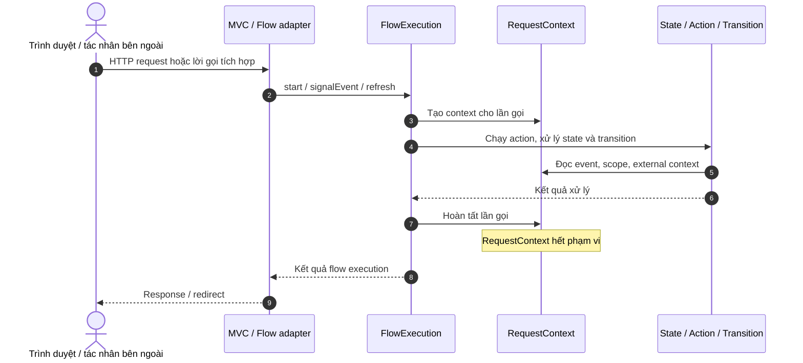
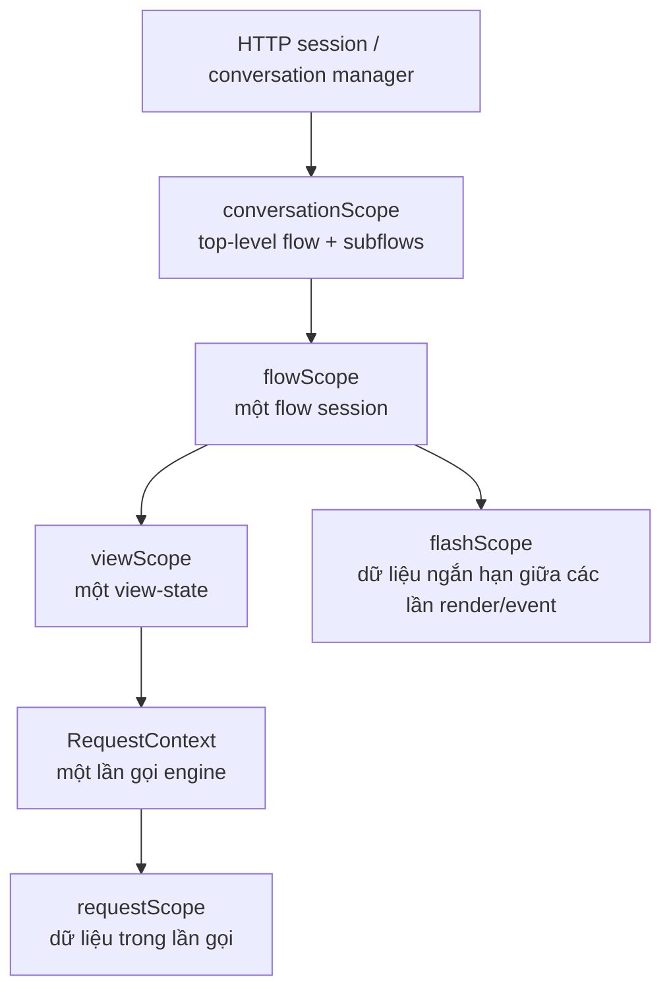

# RequestContext và phạm vi của một lần gọi vào bộ máy Spring Web Flow

## 1. Vì sao cần hiểu đúng RequestContext?

Trong Spring Web Flow (SWF), một flow có thể tồn tại qua nhiều lần tương tác: người dùng mở wizard, gửi biểu mẫu, quay lại bước trước, tải lại màn hình hoặc tiếp tục một subflow. Dữ liệu của hành trình cần được giữ qua các lần tương tác, nhưng thông tin chỉ phục vụ một lần xử lý cần được giải phóng sau khi bộ máy hoàn tất công việc.

SWF cung cấp interface `org.springframework.webflow.execution.RequestContext` để biểu diễn **ngữ cảnh của một lần gọi vào bộ máy thực thi flow**. Đây là đối tượng mà state, action, transition criteria và các thành phần nội bộ có thể dùng để biết lần xử lý hiện tại đang ở flow nào, state nào, event nào, đang có dữ liệu gì trong các scope và môi trường gọi đến cung cấp những thông tin nào.

Điểm dễ nhầm nằm ở chữ *request*. Trong API của SWF, một request context **không đồng nghĩa với một đối tượng HTTP Servlet request**. Nó biểu diễn một lần gọi (một thread) vào flow engine để thao tác với đúng một flow execution. Một HTTP request thường là nguyên nhân dẫn tới một lần gọi như vậy, nhưng hai khái niệm thuộc hai tầng khác nhau.

Ví dụ, người dùng đang ở flow đặt phòng. Khi nhấn nút `next`, servlet container nhận một HTTP POST. Spring MVC/Web Flow adapter tiếp nhận request, khôi phục flow execution, rồi gọi engine để phát event. Trong lần xử lý đó, SWF tạo một `RequestContext`. Khi engine hoàn thành và trả response, context này hết phạm vi sử dụng. Flow execution vẫn được lưu để request tiếp theo có thể tiếp tục.

Bài thuộc chương **Kiến trúc thực thi**, tập trung vào `RequestContext` và phạm vi của một lần gọi vào bộ máy. Sau bài này, bạn có thể:

1. Giải thích `RequestContext` là gì và vì sao nó không phải HTTP request, HTTP session hay flow execution.
2. Mô tả vòng đời context trong các thao tác khởi chạy, phát event/tiếp tục và refresh view.
3. Phân biệt `RequestContext`, `FlowExecutionContext`, `ExternalContext`, `RequestControlContext` và `RequestContextHolder`.
4. Chọn đúng scope cho dữ liệu chỉ sống trong một lần gọi, một view-state, một flow hoặc một conversation.
5. Sử dụng các accessor như `getCurrentEvent()`, `getCurrentState()`, `getRequestParameters()`, `getFlowScope()` và `getMessageContext()` đúng thời điểm.
6. Tránh giữ context qua thread khác, lưu context vào singleton hoặc dùng request scope làm nơi lưu dữ liệu nhiều bước.
7. Kiểm thử action và flow để xác nhận vòng đời, dữ liệu và trạng thái của từng lần gọi.

## 2. RequestContext là ngữ cảnh của một lần gọi vào flow engine

### 2.1. Định nghĩa theo API

Javadoc mô tả `RequestContext` là context cho **một request duy nhất nhằm thao tác với một flow execution**. Từ *request* ở đây được định nghĩa là một lần gọi (một thread) vào hệ thống flow từ một tác nhân bên ngoài để điều khiển chính xác một flow execution.

Một `RequestContext` thường được tạo khi flow execution thực hiện một trong các thao tác cốt lõi:

- `start`: khởi chạy flow execution.
- `signalEvent`: phát một event để tiếp tục/resume flow execution.
- `refresh`: tái tạo lựa chọn view gần nhất của execution để gửi lại response cho client.

Context được truyền qua các bước xử lý của lần gọi. State, action do ứng dụng viết, điều kiện transition và các thành phần của SWF có thể truy cập nó. Khi lần gọi vào flow execution kết thúc, context hết phạm vi và được giải phóng tự động.



Sơ đồ mô tả ranh giới khái niệm. Adapter cụ thể, repository và response strategy có thể khác nhau giữa tích hợp Servlet, JSF, test harness hoặc môi trường khác; nguyên tắc quan trọng là `RequestContext` thuộc **một lần xử lý flow execution**.

### 2.2. Không đồng nhất với HTTP request

Một ứng dụng Spring MVC thường có quan hệ gần như sau:

```text
Một HTTP request được dispatch tới FlowHandlerAdapter
    -> adapter xác định flow execution
    -> engine xử lý một thao tác trên execution
    -> RequestContext được tạo trong thao tác đó
    -> engine trả kết quả
    -> HTTP response được gửi về
```

Quan hệ này khiến hai đối tượng dễ bị gọi chung là “request context”. Tuy nhiên:

| Đối tượng | Tầng sở hữu | Mục đích |
|---|---|---|
| `HttpServletRequest` | Servlet container | Đại diện HTTP request: URL, headers, parameters, attributes, body, session. |
| `ExternalContext` | Spring Web Flow | Facade chuẩn hóa môi trường bên ngoài đã gọi flow; có thể cung cấp request parameters, session map, native context. |
| `RequestContext` | Spring Web Flow execution | Đại diện một lần gọi vào engine để xử lý một flow execution. |
| `requestScope` | SWF flow context | Lưu dữ liệu trong thời gian `RequestContext` hiện tại tồn tại. |
| `FlowExecutionContext` | SWF execution | Mô tả trạng thái của execution, có ý nghĩa vượt qua nhiều lần gọi. |

Có thể có một HTTP request không gọi flow engine, chẳng hạn request tải CSS hoặc request được một MVC controller xử lý độc lập. Trong trường hợp đó không có `RequestContext` của flow. Ngược lại, flow engine có thể được gọi từ test harness hoặc tích hợp không dùng Servlet; khi đó vẫn có `RequestContext` dù không có `HttpServletRequest`.

**Quy tắc:** nếu cần thông tin HTTP cụ thể, lấy qua `ExternalContext` hoặc native request khi thực sự cần. Nếu cần biết trạng thái lần xử lý flow hiện tại, dùng `RequestContext`. Không dùng `RequestContext` thay cho Servlet API.

### 2.3. Một HTTP request không biến RequestContext thành dữ liệu lâu dài

Sau khi engine trả về, `RequestContext` không còn là đối tượng hợp lệ để action hoặc service tiếp tục dùng. Đừng giữ tham chiếu của nó trong:

- Field của Spring singleton service.
- Static field hoặc biến toàn cục.
- HTTP session hay `flowScope`.
- Callback chạy sau khi request kết thúc.
- Task được gửi sang executor/background thread.

Nếu một tác vụ nền cần tiếp tục xử lý, hãy truyền **dữ liệu bất biến cần thiết** như booking ID, user ID đã xác thực, correlation ID hoặc một command DTO nhỏ. Tác vụ đó gọi service theo transaction và security context riêng; không mang `RequestContext` sang thread khác.

## 3. Ba thao tác tạo context: start, signalEvent và refresh

### 3.1. Khởi chạy flow execution — start

Khi một top-level flow được khởi chạy, engine cần tạo execution, ánh xạ input, bắt đầu flow session và đi vào state đầu tiên. Trong quá trình đó, `RequestContext` cho lần start được tạo và dùng xuyên suốt xử lý.

Ví dụ flow đặt phòng:

```xml
<flow xmlns="http://www.springframework.org/schema/webflow"
      start-state="enterDetails">

    <input name="hotelId" type="long" required="true" />

    <var name="bookingForm"
         class="com.example.booking.BookingForm" />

    <on-start>
        <evaluate expression="bookingService.createDraft(hotelId)"
                  result="flowScope.booking" />
    </on-start>

    <view-state id="enterDetails" model="bookingForm">
        <transition on="next" to="review" />
    </view-state>

    <view-state id="review">
        <transition on="confirm" to="completed" />
    </view-state>

    <end-state id="completed" />
</flow>
```

Trong lần start:

1. Flow input `hotelId` được nhận và chuyển kiểu theo cấu hình.
2. Flow execution bắt đầu; context của lần gọi được tạo.
3. Action `on-start` có thể đọc input, gọi service và ghi kết quả vào `flowScope`.
4. Flow đi tới state đầu tiên `enterDetails`.
5. Nếu view-state cần render, view được chuẩn bị và response được tạo.
6. Khi engine trả kết quả, `RequestContext` của lần start hết phạm vi.

`flowScope.booking` có thể tiếp tục tồn tại ở request sau. `RequestContext` dùng để tạo ra và thao tác với dữ liệu đó trong lần gọi đầu, nhưng bản thân context không được lưu cùng `booking`.

### 3.2. Tiếp tục flow bằng event — signalEvent

Khi người dùng gửi form và phát event `next`, adapter khôi phục execution từ repository rồi yêu cầu engine xử lý event. Một `RequestContext` mới được tạo cho lần gọi này.

```text
HTTP POST có event next
    -> khôi phục flow execution hiện tại
    -> tạo RequestContext mới
    -> bind dữ liệu view-state
    -> validate model
    -> tìm transition phù hợp với event
    -> chạy transition action và state tiếp theo
    -> render/redirect
    -> RequestContext hết phạm vi
```

Dữ liệu `flowScope.booking` vẫn thuộc execution đang được tiếp tục. Context mới truy cập được flow scope đó, nhưng nó không phải context cũ từ lần start.

Một flow có thể được tiếp tục nhiều lần, và mỗi lần engine xử lý event là một lần gọi riêng. Vì vậy không nên tạo biến Java static để “ghi nhớ request trước”. Hãy dùng đúng scope hoặc persistence/service nếu dữ liệu phải sống lâu hơn.

### 3.3. Refresh view — dựng lại response hiện tại

`refresh` là thao tác tái tạo lựa chọn view gần nhất để gửi lại response, không nhất thiết là một event nghiệp vụ mới. API `RequestContext` được tạo cho thao tác này cũng có vòng đời riêng.

Ví dụ, adapter hoặc cơ chế response có thể yêu cầu render lại view-state hiện tại. Khi đó:

- Flow execution vẫn ở state hiện hành.
- Một context mới đại diện lần refresh được sử dụng.
- `getCurrentView()` có thể trả về view đang được render nếu execution đang ở view-state.
- `getCurrentEvent()` có thể là `null` nếu chưa có event được phát trong lần gọi đó.
- `on-render` có thể được chạy theo quy tắc render của flow, nên cần tránh đặt tác dụng phụ không idempotent ở đây.

Refresh không phải cách tạo một flow execution mới và cũng không đồng nghĩa browser refresh luôn tạo cùng một thao tác trong mọi adapter. Hãy phân biệt request mang execution key để refresh/resume với request launch flow mới.

### 3.4. Bảng so sánh

| Thao tác engine | Khi nào xảy ra? | Context mới? | Event hiện tại |
|---|---|---|---|
| `start` | Khởi chạy flow execution mới | Có | Thường chưa có event do người dùng phát. |
| `signalEvent` | Tiếp tục execution bằng event | Có | Event đang được xử lý, nếu được phát hợp lệ. |
| `refresh` | Tái tạo response/view hiện hành | Có | Có thể không có event mới. |

Mỗi dòng đại diện một lần gọi engine. Một flow execution có thể tồn tại lâu hơn và đi qua nhiều lần gọi như vậy.

## 4. RequestContext chứa những gì?

`RequestContext` là một interface tập hợp các accessor liên quan tới lần xử lý flow hiện tại. Các nhóm quan trọng:

| Nhóm | API tiêu biểu | Dùng để |
|---|---|---|
| Flow definition và state | `getActiveFlow()`, `getCurrentState()`, `getCurrentTransition()` | Biết flow/state/transition đang được xử lý. |
| Event và view | `getCurrentEvent()`, `getCurrentView()`, `inViewState()` | Kiểm tra event, view và việc execution có đang ở view-state. |
| Dữ liệu theo scope | `getRequestScope()`, `getFlashScope()`, `getViewScope()`, `getFlowScope()`, `getConversationScope()` | Đọc/ghi dữ liệu theo vòng đời phù hợp. |
| Dữ liệu request | `getRequestParameters()` | Đọc parameter của request đã gọi flow; map là immutable. |
| Môi trường bên ngoài | `getExternalContext()` | Truy cập facade của môi trường gọi flow. |
| Execution | `getFlowExecutionContext()`, `getFlowExecutionUrl()` | Xem thông tin execution và URL tiếp tục flow. |
| Message | `getMessageContext()` | Tạo/đọc message thành công, cảnh báo hoặc lỗi cho request. |
| Attribute điều khiển | `getAttributes()` | Truy cập attribute gắn với trạng thái của lần gọi hiện tại. |

Không phải accessor nào cũng có giá trị ở mọi thời điểm. Ví dụ `getCurrentEvent()` có thể trả `null` khi chưa có event; `getCurrentView()` trả `null` khi flow không ở view-state; `getViewScope()` chỉ hợp lệ khi execution đang ở view-state. Action cần kiểm tra trạng thái phù hợp trước khi truy cập.

`getAttributes()` là map attribute của **request context**, có thể được các thành phần flow dùng để truyền thông tin điều khiển trong lần gọi hiện tại. Nó khác `getRequestScope()`: request scope là nơi lưu dữ liệu ứng dụng theo vòng đời context; context attributes là metadata/attribute gắn với quá trình xử lý. Không dùng hai map thay thế nhau nếu chưa xác định rõ contract của attribute.

### 4.1. getCurrentEvent()

Trả về event hiện tại đang được flow xử lý. Event có thể là event từ view, event của subflow hoặc event khác do adapter phát.

Ví dụ:

```java
Event event = context.getCurrentEvent();

if (event != null && "confirm".equals(event.getId())) {
    // Xử lý riêng khi event confirm đang được xử lý.
}
```

Không giả định event luôn tồn tại. Trong lần start hoặc refresh, chưa chắc có event. Cũng không nhầm event ID với tên HTTP method, URL hay tên nút HTML; adapter/view mapping quyết định cách event được gửi vào flow.

### 4.2. getCurrentState() và getCurrentTransition()

- `getCurrentState()` cho biết state hiện tại của execution; trong quá trình khởi chạy trước khi start state được vào, state có thể chưa có.
- `getCurrentTransition()` trả transition đang được thực thi, hoặc `null` nếu lần gọi chưa thực hiện transition.

Ví dụ ghi trace có kiểm soát:

```java
StateDefinition state = context.getCurrentState();
TransitionDefinition transition = context.getCurrentTransition();

String stateId = state == null ? "(starting)" : state.getId();
String transitionId =
        transition == null ? "(none)" : transition.getId();
```

Đây là ví dụ minh họa; cần chọn logger và thông tin correlation phù hợp. Không log nguyên session ID, flow execution key, dữ liệu cá nhân hay toàn bộ model.

### 4.3. getCurrentView() và inViewState()

`getCurrentView()` trả view đang được dùng nếu có; nó có thể đang chuẩn bị render, đang render, đang xử lý event của người dùng hoặc vừa xử lý event trước khi view-state rời đi. Nếu flow không ở view-state, giá trị có thể là `null`.

`inViewState()` cho biết flow hiện đang active và ở một view-state. Trước khi dùng `getViewScope()`, nên kiểm tra trạng thái này nếu action có thể được gọi từ nhiều loại state.

### 4.4. getRequestParameters()

Trả về các input parameter liên quan đến request gọi SWF. Map này **immutable**: đọc được nhưng không thể dùng để thêm hoặc sửa parameter.

```java
ParameterMap parameters = context.getRequestParameters();
String sort = parameters.get("sort");
```

Nếu cần tạo dữ liệu mới, dùng `requestScope` hoặc một scope thích hợp; không sửa `getRequestParameters()`. Nếu cần truy cập request parameter trực tiếp từ môi trường ngoài, `ExternalContext.getRequestParameterMap()` là facade tương ứng.

Parameter do client gửi không đáng tin. `hotelId=42` có thể hợp lệ về cú pháp nhưng không chứng minh user có quyền xem khách sạn đó. Authorization và kiểm tra ownership phải được thực hiện ở service/security layer.

### 4.5. getExternalContext()

`ExternalContext` cung cấp một facade thống nhất cho môi trường gọi flow. Trong ứng dụng Servlet, nó có thể cho phép truy cập request, response, session, context và parameter map. Các API này giúp flow không cần phụ thuộc trực tiếp vào `HttpServletRequest` trong mọi tình huống.

```java
ExternalContext external = context.getExternalContext();

ParameterMap parameters = external.getRequestParameterMap();
MutableAttributeMap<Object> session = external.getSessionMap();
```

Các map ở `ExternalContext` không đồng nghĩa với flow scopes. `sessionMap` là thuộc tính của HTTP session; `flowScope` là dữ liệu của flow execution; `requestMap` là thuộc tính môi trường request; `requestScope` là dữ liệu của lần gọi engine.

Ưu tiên API trừu tượng của `ExternalContext` nếu flow cần chạy trong nhiều môi trường. Chỉ gọi `getNativeRequest()`/`getNativeResponse()` khi cần một tính năng đặc thù Servlet và chấp nhận coupling với nền tảng đó.

### 4.6. getFlowExecutionContext()

Đây là context mô tả flow execution đang hoạt động. Nó cung cấp thông tin có ý nghĩa vượt qua một lần gọi, chẳng hạn flow session, trạng thái active và state hiện tại.

Phân biệt:

- `RequestContext`: “Lần gọi engine này đang xử lý gì?”
- `FlowExecutionContext`: “Execution đang ở trạng thái nào và có thông tin gì?”
- `ExternalContext`: “Môi trường bên ngoài gọi flow cung cấp những gì?”

`FlowExecutionContext` không thay cho object `FlowExecution` hoặc repository; nó là giao diện truy cập thông tin của execution trong khi `RequestContext` đang được xử lý.

### 4.7. getFlowExecutionUrl()

Trả URL dùng để tiếp tục flow execution hiện tại. View có thể dùng URL này để gửi event ở request tiếp theo. URL/key được framework tạo theo cơ chế execution repository và handler; không tự ghép một execution key giả định.

### 4.8. getMessageContext()

`MessageContext` dùng để thêm hoặc truy xuất message gắn với lần xử lý flow, thường là lỗi validation hoặc thông báo nghiệp vụ.

```java
MessageBuilder message = new MessageBuilder()
        .error()
        .defaultText("Không còn phòng phù hợp với ngày đã chọn");

context.getMessageContext().addMessage(message.build());
```

Message được thiết kế để view hiển thị cho người dùng theo cơ chế message của Web Flow. Không dùng message context như log kỹ thuật hoặc kho dữ liệu lâu dài; thông tin chi tiết phục vụ chẩn đoán cần nằm ở logging/tracing server-side.

## 5. Phân biệt RequestContext với các context và holder khác

### 5.1. RequestContext và FlowExecutionContext

| Tiêu chí | RequestContext | FlowExecutionContext |
|---|---|---|
| Phạm vi | Một lần gọi vào flow engine | Thông tin của execution đang chạy, có thể qua nhiều lần gọi |
| Tạo khi | `start`, `signalEvent`, `refresh` | Được truy cập trong execution hiện hành |
| Chứa event hiện tại? | Có accessor `getCurrentEvent()` | Không phải nơi chính để đọc event của lần gọi |
| Chứa request parameters? | Có `getRequestParameters()` | Không phải trách nhiệm của execution context |
| Dữ liệu sống lâu | Có thể truy cập các scope lâu hơn qua accessor | Mô tả execution; không phải scope lưu tùy ý |
| Dùng trong action? | Thường là tham số chính nếu action cần context | Khi cần đọc trạng thái execution |

### 5.2. RequestContext và ExternalContext

`ExternalContext` là một phần mà `RequestContext` cung cấp. Nó đại diện môi trường client gọi flow và chuẩn hóa các map/đối tượng liên quan. Trong ứng dụng web, nó có thể chứa request parameters, request attributes, session attributes và response operations.

Không dùng `ExternalContext` để lưu dữ liệu của flow nhiều bước. Hãy dùng `flowScope` hoặc `conversationScope` tùy vòng đời. Ngược lại, không dùng `flowScope` thay cho native HTTP response khi cần redirect hoặc stream nội dung.

### 5.3. RequestContext và RequestControlContext

`RequestControlContext` là một subinterface mở rộng `RequestContext`, đại diện context có khả năng điều khiển/mutating execution trong phạm vi lần gọi hiện tại. Các thành phần engine sử dụng nó khi cần thao tác điều khiển flow. Hầu hết action ứng dụng chỉ cần interface `RequestContext` để đọc context, thêm message hoặc truy cập scope qua API được cung cấp.

Khi viết action tùy chỉnh, không ép kiểu sang `RequestControlContext` chỉ để gọi API nội bộ nếu một accessor trên `RequestContext` đã đáp ứng yêu cầu. Điều đó giảm phụ thuộc vào implementation và giữ action dễ kiểm thử.

### 5.4. RequestContextHolder và thread-local

`RequestContextHolder` là holder tĩnh dùng để liên kết `RequestContext` hiện tại với **thread đang xử lý**. Nó được dùng bởi một số thành phần tích hợp cần lấy context hiện hành mà không nhận context trực tiếp qua tham số.

```java
RequestContext context =
        RequestContextHolder.getRequestContext();
```

Nếu không có `RequestContext` được bind vào thread, việc lấy context có thể ném `IllegalStateException`. Javadoc cũng nêu context không được kế thừa tự động bởi child thread được tạo từ thread hiện tại.

Điều này có hệ quả thực tế:

- Không gọi `RequestContextHolder.getRequestContext()` từ scheduler hoặc thread pool với kỳ vọng nhận context của request web trước đó.
- Không lưu context vào `ThreadLocal` do ứng dụng tự tạo mà quên cleanup.
- Không giữ context trong singleton service.
- Không truyền context vào `CompletableFuture`, `@Async`, message listener hoặc job chạy nền.
- Nếu cần tác vụ nền, chỉ truyền DTO/ID cần thiết; tải lại dữ liệu và xác thực quyền trong tác vụ đó.

Thread-local chỉ là cơ chế truy cập tiện lợi trong lúc engine đang xử lý, không phải cơ chế lưu context xuyên request.

## 6. Phạm vi của các scope trong Web Flow

`RequestContext` cho phép truy cập nhiều scope. Chúng không có cùng vòng đời. Chọn sai scope là nguyên nhân phổ biến của lỗi mất dữ liệu hoặc giữ object quá lâu.



Sơ đồ biểu diễn quan hệ vòng đời ở mức khái niệm, không phải mọi scope đều là object con theo cấu trúc Java trực tiếp. `RequestContext` được tạo trong một lần gọi và cung cấp accessor tới `requestScope`; các scope dài hơn được quản lý bởi execution/conversation.

### 6.1. requestScope — một lần gọi engine

`requestScope` được tạo khi flow được gọi và bị hủy khi lần gọi vào flow trả về. Trong API, dữ liệu request-scoped tồn tại đúng thời gian `RequestContext` hiện tại.

Ví dụ:

```xml
<evaluate expression="clockService.now()"
          result="requestScope.processedAt" />

<evaluate expression="auditService.describe(requestScope.processedAt)" />
```

Nếu lần gọi hiện tại tiếp tục thực hiện action thứ hai, nó vẫn có thể đọc `requestScope.processedAt`. Nhưng sau khi engine trả response, request scope kết thúc. Lần người dùng nhấn `next` và engine xử lý event sau đó sẽ có `RequestContext` mới, không nên kỳ vọng `requestScope.processedAt` vẫn còn.

Dùng request scope cho:
- Timestamp/correlation data chỉ cần trong một lần xử lý.
- Giá trị tạm giữa nhiều action của cùng một lần gọi.
- Cờ điều khiển hoặc dữ liệu trung gian không cần sang request sau.

Không dùng request scope cho:
- Dữ liệu form cần giữ qua nhiều bước.
- Booking draft cần tồn tại đến khi người dùng xác nhận.
- Kết quả tìm kiếm cần được dùng ở view-state tiếp theo.
- Thông tin cần sống qua nhiều request HTTP.

### 6.2. viewScope — một view-state

`viewScope` được cấp phát khi flow vào một `view-state` và bị hủy khi rời state. Nó hữu ích cho dữ liệu gắn với một màn hình, nhất là khi màn hình có nhiều request như Ajax paging, sort hoặc refresh fragment.

```xml
<view-state id="searchHotels" view="hotel/search">
    <on-render>
        <evaluate expression="hotelService.search(criteria)"
                  result="viewScope.results" />
    </on-render>

    <transition on="nextPage">
        <evaluate expression="criteria.nextPage()" />
        <render fragments="resultsPanel" />
    </transition>
</view-state>
```

Nhiều lần gọi engine có thể diễn ra trong khi flow vẫn ở cùng view-state; `viewScope` tiếp tục tồn tại giữa các lần gọi đó. Điều này khác `requestScope`, vốn chỉ sống trong một lần gọi.

Không truy cập `viewScope` khi flow đang ở action-state hoặc end-state không có view hiện hành. Nếu dữ liệu phải được dùng sau khi rời view-state, chuyển dữ liệu cần thiết vào `flowScope` hoặc một nơi có vòng đời phù hợp.

### 6.3. flowScope — một flow session

`flowScope` sống trong suốt vòng đời của flow session, từ lúc flow bắt đầu tới khi flow kết thúc. Đây thường là nơi giữ model/DTO của wizard nhiều bước.

```xml
<on-start>
    <evaluate expression="bookingService.createDraft(hotelId)"
              result="flowScope.booking" />
</on-start>

<view-state id="enterDetails" model="booking">
    <transition on="next" to="review" />
</view-state>
```

Mỗi lần `RequestContext` mới được tạo khi người dùng tiếp tục flow, action vẫn có thể đọc `flowScope.booking` của execution hiện tại. `flowScope` không đồng nghĩa với session toàn ứng dụng; hai execution độc lập có dữ liệu flow scope riêng.

Với repository mặc định, object trong flow scope thường cần serializable để hỗ trợ lưu execution/session và các tình huống như session replication. Hãy lưu DTO gọn, ID và dữ liệu cần thiết; tránh giữ connection, stream hoặc object graph lớn.

### 6.4. conversationScope — top-level flow và subflows

`conversationScope` được tạo khi top-level flow bắt đầu, được chia sẻ bởi top-level flow và các subflow của nó, rồi bị hủy khi top-level flow kết thúc.

Dùng khi parent và subflow cần chia sẻ dữ liệu trong cùng một conversation, ví dụ booking draft được subflow thêm khách vào. Không dùng nó như cache toàn cục cho mọi flow hoặc mọi người dùng.

Với implementation mặc định, conversation-scoped objects được giữ trong HTTP session và nên serializable để phù hợp với session replication. Dữ liệu trong conversation có thể tồn tại lâu hơn một flow session con, nên tránh đặt dữ liệu nhạy cảm hoặc không cần thiết ở đây.

### 6.5. flashScope — dữ liệu ngắn hạn

`flashScope` dành cho dữ liệu ngắn hạn phục vụ view tiếp theo, chẳng hạn thông báo “Đã lưu thay đổi”. Reference guide mô tả flash scope được tạo khi flow bắt đầu, được dọn sau khi view render và kết thúc cùng flow; API cũng mô tả thời gian tồn tại gắn với lần event tiếp theo. Vì hành vi chi tiết phụ thuộc vòng đời render/event, hãy dùng flash scope cho message ngắn hạn và kiểm thử trên phiên bản/adapter thực tế.

Không dùng flash scope để giữ form nhiều bước hoặc trạng thái nghiệp vụ quan trọng. Nếu người dùng cần thấy dữ liệu qua nhiều màn hình, dùng `flowScope` hoặc lưu vào service/database.

### 6.6. requestParameters không phải scope để ghi

`RequestContext.getRequestParameters()` là map input parameters bất biến của request. Nó cho phép đọc giá trị client gửi, nhưng không phải một scope để thêm giá trị. Muốn tạo biến tạm, ghi vào `requestScope`; muốn giữ qua flow, ghi vào `flowScope`.

### 6.7. Bảng lựa chọn scope

| Cần giữ dữ liệu trong bao lâu? | Nơi phù hợp | Ví dụ |
|---|---|---|
| Một lần gọi engine | `requestScope` | Correlation tag, timestamp tạm. |
| Nhiều request khi vẫn ở một view-state | `viewScope` | Trang kết quả hiện tại, trạng thái phân trang. |
| Toàn bộ flow session | `flowScope` | Booking draft, form wizard. |
| Top-level flow cùng các subflow | `conversationScope` | Dữ liệu chia sẻ giữa bước nhập khách và bước thanh toán. |
| Đến lần render/event gần tiếp theo | `flashScope` | Thông báo thành công ngắn hạn. |
| Dữ liệu client gửi, chỉ đọc | `requestParameters` | `sort`, `page` hoặc tham số đầu vào đã được kiểm tra. |
| Dữ liệu qua nhiều phiên hoặc sau khi flow kết thúc | Database/cache/service | Hồ sơ đã lưu, bản nháp lâu dài, audit record. |

## 7. Viết Action sử dụng RequestContext

### 7.1. Khi nào cần truyền RequestContext vào POJO?

Thông thường, service nghiệp vụ không nên phụ thuộc SWF. Nếu một action chỉ cần booking ID, hãy truyền booking ID vào service. Nếu action thực sự cần thao tác với scope, event hoặc message của flow, có thể:

- Viết POJO action nhận `RequestContext` làm tham số.
- Implement interface `Action` với method `execute(RequestContext)`.
- Dùng `MultiAction` nếu ứng dụng cần một nhóm action method theo convention của SWF.

Ví dụ một action ghi dấu thời điểm xử lý vào request scope:

```java
package com.example.booking.flow;

import java.time.Instant;

import org.springframework.webflow.execution.Action;
import org.springframework.webflow.execution.Event;
import org.springframework.webflow.execution.RequestContext;

public class MarkFlowRequestAction implements Action {

    @Override
    public Event execute(RequestContext context) {
        context.getRequestScope().put("processedAt", Instant.now());

        String eventId = context.getCurrentEvent() == null
                ? "start-or-refresh"
                : context.getCurrentEvent().getId();

        context.getRequestScope().put("processedEvent", eventId);
        return new Event(this, "success");
    }
}
```

Đây là action minh họa cách sử dụng context. `processedAt` và `processedEvent` chỉ tồn tại trong lần gọi engine hiện tại. Nếu view-state render ở một lần gọi khác, không được mong hai biến này vẫn còn.

Nếu cần lưu event vào audit lâu dài, hãy gọi audit service và ghi các trường cần thiết như flow ID, state ID, event ID, user ID đã xác thực và correlation ID. Không lưu `RequestContext` hoặc toàn bộ request object vào database.

### 7.2. Đọc flow scope và message context

Một action có thể lấy model đang được giữ trong flow scope:

```java
public Event validateBooking(RequestContext context) {
    BookingDraft booking =
            (BookingDraft) context.getFlowScope().get("booking");

    if (booking == null) {
        context.getMessageContext().addMessage(
                new MessageBuilder()
                        .error()
                        .defaultText("Không tìm thấy bản nháp đặt phòng")
                        .build());
        return new Event(this, "missing");
    }

    return new Event(this, "success");
}
```

Ví dụ tập trung vào cách truy cập scope/message; class đầy đủ cần import `BookingDraft`, `MessageBuilder`, `Event` và được đăng ký làm bean/action theo cấu hình ứng dụng.

### 7.3. Giữ service độc lập với Web Flow

Không nên viết service kiểu:

```java
@Service
public class BookingService {
    public Booking confirmCurrentFlow() {
        RequestContext context =
                RequestContextHolder.getRequestContext();
        // Đọc flowScope trực tiếp...
    }
}
```

Thiết kế này buộc service nghiệp vụ phụ thuộc vào thread và lifecycle của Web Flow. Khi gọi service từ scheduler, REST endpoint hoặc test unit, không có RequestContext; method có thể thất bại.

Thiết kế rõ ràng hơn:

```java
@Service
public class BookingService {
    public Booking confirm(BookingDraft draft, UserId userId) {
        // Kiểm tra quyền, transaction, idempotency và lưu nghiệp vụ.
        return ...;
    }
}
```

Flow action đọc dữ liệu từ `RequestContext`, rồi gọi service với các tham số rõ ràng. Service không cần biết request context tồn tại.

## 8. RequestContextHolder: tiện ích thread-bound và giới hạn của nó

`RequestContextHolder` cung cấp phương thức tĩnh để lấy `RequestContext` đang được gắn với thread hiện tại. Đây là tiện ích cho integration artifact cần truy cập context mà không nhận context trực tiếp qua tham số.

```java
RequestContext context =
        RequestContextHolder.getRequestContext();
```

Nếu thread hiện tại không có context được gắn, API có thể ném `IllegalStateException`. Context không tự động được kế thừa bởi child thread được tạo từ thread hiện tại.

### 8.1. Ví dụ sai: giữ context trong tác vụ nền

```java
public void submitAuditAsync() {
    RequestContext context = RequestContextHolder.getRequestContext();

    executor.execute(() -> {
        // Sai: callback chạy sau khi lần gọi engine kết thúc.
        Object booking = context.getFlowScope().get("booking");
        auditService.write(booking);
    });
}
```

Sau khi engine trả response, context có thể đã bị dispose. Child thread cũng không có context thread-bound của thread request. Đọc context trong callback là dùng một object ngoài vòng đời hợp lệ.

### 8.2. Ví dụ đúng: truyền dữ liệu cần thiết

```java
public void submitAuditAsync(RequestContext context) {
    BookingDraft booking =
            (BookingDraft) context.getFlowScope().get("booking");

    AuditCommand command = new AuditCommand(
            booking.getId(),
            context.getCurrentState() == null
                    ? null : context.getCurrentState().getId());

    executor.execute(() -> auditService.write(command));
}
```

Ví dụ trên lấy các giá trị cần thiết khi context còn hiệu lực, tạo command DTO độc lập, rồi chuyển DTO cho tác vụ nền. Trong hệ thống thực tế, command cần có định danh user đã xác thực/correlation ID nếu audit yêu cầu; không truyền toàn bộ model nếu không cần.

### 8.3. Không dùng ThreadLocal để truyền context qua hệ thống

Không nên tự tạo một `ThreadLocal<RequestContext>` khác hoặc bật cơ chế copy thread-local cho executor để kéo dài context. Cách đó dễ gây rò dữ liệu giữa request, memory leak trong thread pool và race condition khi execution đã thay đổi. Context thuộc engine call; dữ liệu cần sống lâu phải được đặt ở scope phù hợp hoặc lưu trong persistence layer.

## 9. Những implicit variables liên quan đến RequestContext

Trong biểu thức flow, SWF cung cấp một số biến ngầm định:

| Biến EL | Ý nghĩa | Liên hệ API |
|---|---|---|
| `flowRequestContext` | RequestContext hiện tại | `RequestContext` |
| `flowExecutionContext` | Thông tin flow execution | `FlowExecutionContext` |
| `externalContext` | Môi trường client bên ngoài | `ExternalContext` |
| `currentEvent` | Event hiện tại | `getCurrentEvent()` |
| `flowExecutionUrl` | URL tiếp tục execution | `getFlowExecutionUrl()` |
| `requestParameters` | Parameter đầu vào bất biến | `getRequestParameters()` |
| `messageContext` | Message của lần xử lý flow | `getMessageContext()` |
| `flowScope`, `viewScope`, `requestScope`, `flashScope`, `conversationScope` | Các map dữ liệu theo vòng đời | Các accessor tương ứng |

Ví dụ truyền RequestContext vào một POJO action:

```xml
<evaluate expression="bookingAction.audit(flowRequestContext)" />
```

Java method:

```java
public String audit(RequestContext context) {
    String state = context.getCurrentState() == null
            ? "starting"
            : context.getCurrentState().getId();

    return "state=" + state;
}
```

Dùng `flowRequestContext` khi một action thực sự cần API context. Với biểu thức chỉ cần một giá trị như `booking.id`, hãy đọc biến/model trực tiếp; không truyền context đi khắp service layer khi không cần.

## 10. Thời điểm của context trong lifecycle action

Một `RequestContext` được dùng xuyên suốt một lần gọi, nhưng dữ liệu trong đó thay đổi theo giai đoạn xử lý. Các action hook phổ biến:

| Hook | Khi nào chạy? | Điều có thể chưa tồn tại |
|---|---|---|
| `on-start` | Khi flow bắt đầu | View-state chưa được vào; chưa có current view. |
| `on-entry` | Khi vào state | Một số dữ liệu view chỉ có sau khi view được chuẩn bị. |
| `on-render` | Trước khi view render, gồm cả refresh/partial render theo cơ chế view | Không nên giả định có event mới ở mỗi lần render. |
| Transition action | Trong lúc xử lý event và transition | Event/transition phụ thuộc request đang phát. |
| `on-exit` | Khi state chuẩn bị rời đi | View scope sắp kết thúc; không dùng nó như dữ liệu lâu dài. |
| `on-end` | Khi flow kết thúc | Execution có thể không còn active sau khi kết thúc. |

Ví dụ:

```xml
<flow xmlns="http://www.springframework.org/schema/webflow"
      start-state="review">

    <on-start>
        <evaluate expression="bookingService.createDraft()"
                  result="flowScope.booking" />
    </on-start>

    <view-state id="review" view="booking/review">
        <on-entry>
            <set name="viewScope.enteredAt" value="timeService.now()" />
        </on-entry>

        <on-render>
            <evaluate expression="bookingService.loadSummary(booking)"
                      result="viewScope.summary" />
        </on-render>

        <transition on="confirm" to="completed">
            <evaluate expression="bookingService.confirm(booking)" />
        </transition>

        <on-exit>
            <evaluate expression="auditService.recordLeavingReview(booking.id)" />
        </on-exit>
    </view-state>

    <end-state id="completed" />
</flow>
```

Ví dụ cho thấy:
- `flowScope.booking` được tạo khi flow bắt đầu và có thể được dùng ở nhiều state.
- `viewScope.enteredAt` thuộc view-state `review`.
- `viewScope.summary` được tính trước khi view render; `on-render` có thể chạy lại khi view refresh.
- Transition `confirm` dùng context của lần gọi phát event.
- `on-exit` chạy khi rời state; không nên đặt tác dụng phụ không idempotent vào hook có thể bị gọi lại do thiết kế request/flow.

Các hook trên không tạo ra những `RequestContext` lồng nhau cho mỗi action. Chúng dùng context của lần gọi engine đang thực hiện.

## 11. Kiểm thử vòng đời RequestContext

### 11.1. Kiểm thử action độc lập

Khi unit test action, có thể dùng `MockRequestContext` trong test support của Spring Web Flow. Thiết lập dữ liệu flow scope/request scope, gọi action và xác minh kết quả.

Pseudocode:

```java
@Test
void actionWritesOnlyToCurrentRequestScope() {
    MockRequestContext context = new MockRequestContext();

    Event result = new MarkFlowRequestAction().execute(context);

    assertEquals("success", result.getId());
    assertNotNull(context.getRequestScope().get("processedAt"));
    assertNotNull(context.getRequestScope().get("processedEvent"));
}
```

Đây là ví dụ minh họa API test support; import và constructor cụ thể cần khớp phiên bản SWF mà dự án đang dùng. Test action riêng chỉ xác nhận logic sử dụng context, không chứng minh repository/adapter production đã tạo context đúng.

### 11.2. Kiểm thử flow execution qua nhiều lần gọi

Một bài integration test nên kiểm tra:

1. Khởi chạy flow; xác minh `on-start` ghi dữ liệu vào `flowScope`.
2. Trong cùng lần start, action ghi `requestScope.traceValue`; action tiếp theo đọc được giá trị đó.
3. Kết thúc lần start và nhận response.
4. Gửi event `next` để resume execution; xác minh `flowScope` còn dữ liệu đã tạo.
5. Xác minh `requestScope.traceValue` của lần start không được xem là dữ liệu được đảm bảo cho lần resume.
6. Nếu flow vẫn ở cùng view-state, kiểm tra `viewScope` còn tồn tại giữa các request của view đó.
7. Rời view-state; xác minh view scope không còn dùng được ở state kế tiếp.
8. Gọi refresh; xác minh một lần xử lý mới được tạo và không giả định có event mới.

Không nên assert identity object của hai `RequestContext` qua một biến static. Thay vào đó, kiểm tra hành vi và vòng đời của scope thông qua flow test.

### 11.3. Ma trận kiểm thử

| ID | Tình huống | Kết quả cần xác nhận |
|---|---|---|
| RC01 | Launch flow | Context được dùng trong lần start và không được lưu làm dữ liệu execution. |
| RC02 | Hai action trong cùng lần gọi | Cùng `requestScope` có thể được đọc/ghi trong lần gọi đó. |
| RC03 | Resume bằng event mới | Có context mới; flow scope vẫn giữ dữ liệu. |
| RC04 | Resume sau khi rời view-state | View scope cũ không còn là nơi lưu dữ liệu hợp lệ. |
| RC05 | Refresh view | Context mới cho refresh; không mặc định có current event. |
| RC06 | `getRequestParameters()` | Có thể đọc; không thể sửa map. |
| RC07 | Không ở view-state | `inViewState()` false; không truy cập view scope như thể đang ở view. |
| RC08 | Không có event | `getCurrentEvent()` có thể null và code xử lý an toàn. |
| RC09 | Gọi RequestContextHolder ngoài flow | Không có context bound; xử lý exception đúng. |
| RC10 | Gọi từ child/background thread | Không kỳ vọng context được kế thừa. |
| RC11 | Subflow trong conversation | Conversation scope được chia sẻ theo cấu hình; request scope vẫn thuộc lần gọi hiện tại. |
| RC12 | Session replication | Dữ liệu scope cần serializable theo repository/session strategy đang dùng. |

### 11.4. Kiểm thử không nên làm

- Không tạo `RequestContext` giả trong static field để dùng lại giữa nhiều test.
- Không kiểm tra `requestScope` bằng HTTP session vì chúng có vòng đời khác nhau.
- Không chỉ test controller rồi kết luận `RequestContext` hoạt động; controller có thể chưa dispatch vào flow engine.
- Không chạy action async với `RequestContext` đã được giữ lại.
- Không dựa vào một giá trị `currentEvent` cố định cho cả start, resume và refresh.

## 12. Lỗi thường gặp và cách chẩn đoán

| Triệu chứng | Nguyên nhân thường gặp | Cách kiểm tra |
|---|---|---|
| `RequestContextHolder.getRequestContext()` ném `IllegalStateException` | Code chạy ngoài flow engine call hoặc trên thread khác | Kiểm tra call stack, thread và lifecycle của adapter. |
| `requestScope` mất sau khi người dùng bấm Next | Dữ liệu chỉ sống trong lần gọi trước | Chuyển dữ liệu cần giữ sang `flowScope` hoặc scope phù hợp. |
| `viewScope` không truy cập được trong action-state | Execution không ở view-state | Kiểm tra state và `inViewState()` trước khi dùng. |
| `getCurrentEvent()` trả null | Start/refresh hoặc chưa phát event | Xử lý null; không giả định event luôn tồn tại. |
| `getCurrentView()` trả null | Flow không ở view-state | Kiểm tra state hiện tại và loại action. |
| Sửa `getRequestParameters()` thất bại | Parameter map là immutable | Dùng request scope hoặc scope khác để ghi biến mới. |
| Biến trong flowScope không có ở request sau | Flow đã kết thúc, execution khác hoặc dữ liệu chưa được gán vào đúng scope | Kiểm tra execution key, input, state và result assignment. |
| Dữ liệu bị rò giữa người dùng | Lưu object vào singleton/static/shared cache | Đưa dữ liệu về scope đúng execution/user hoặc service có khóa định danh. |
| Background job lỗi khi đọc context | Context đã hết vòng đời hoặc không được bind ở thread nền | Chỉ truyền DTO/ID cần thiết sang job. |
| `on-render` tạo giao dịch lặp | Hook render có thể chạy nhiều lần | Chuyển tác dụng phụ sang transition/action có idempotency. |
| Session replication lỗi | Object trong scope không serializable hoặc graph quá lớn | Kiểm tra class trong flow/view/conversation scope và session strategy. |
| Test pass nhưng production không có context | Test gọi action trực tiếp, không qua FlowExecutor | Thêm integration test khởi chạy/resume flow thực. |

Khi gặp lỗi, thu thập flow ID, state ID, event, loại operation (`start`, `signalEvent`, `refresh`), thread name và root cause. Tránh log toàn bộ scope, session cookie, execution key, token hoặc dữ liệu người dùng.

## 13. Nguyên tắc thiết kế khi làm việc với RequestContext

1. **Chỉ dùng trong lúc flow engine đang xử lý.** Sau khi method/action trả về, không giữ context cho callback hoặc lần request sau.
2. **Nhận context qua tham số khi có thể.** `Action.execute(RequestContext)` hoặc POJO action nhận context giúp dependency rõ ràng hơn việc service tự lấy từ holder tĩnh.
3. **Giữ business service độc lập.** Service nhận DTO, ID và user identity đã xác thực; không phụ thuộc `RequestContextHolder`.
4. **Chọn scope theo vòng đời thực.** Một lần gọi dùng requestScope; một view-state dùng viewScope; một flow dùng flowScope; top-level flow và subflows dùng conversationScope.
5. **Dữ liệu client là không đáng tin.** `getRequestParameters()` là nguồn input, không phải bằng chứng authorization.
6. **Giữ scope nhẹ và serializable khi cần.** Mặc định repository/session có thể lưu execution; không giữ resource mở hoặc object graph quá lớn.
7. **Không dùng RequestContext làm audit record.** Trích xuất event/state/identity cần thiết rồi ghi qua service.
8. **Kiểm tra null và trạng thái active.** Event, view, transition hoặc state có thể chưa tồn tại ở một số giai đoạn.
9. **Không phụ thuộc Servlet khi không cần.** Dùng ExternalContext; chỉ truy cập native request/response cho tính năng đặc thù.
10. **Kiểm thử cả ba operation.** Start, signalEvent và refresh có ngữ cảnh và điều kiện khác nhau.

## 14. Bài tập thực hành

### Bối cảnh

Flow `checkout` gồm ba bước: `enterAddress`, `chooseDelivery` và `reviewOrder`. Flow tạo `OrderDraft` ở `on-start`, hiển thị danh sách phương thức giao hàng trong `viewScope`, lưu lựa chọn của người dùng vào `flowScope`, rồi gọi subflow `payment`.

### Yêu cầu

1. Viết một action implement `Action` và nhận `RequestContext`.
2. Trong lần start, lưu `startedAt` vào `requestScope` và `OrderDraft` vào `flowScope`.
3. Trong state `chooseDelivery`, tải danh sách phương thức giao hàng vào `viewScope`.
4. Gửi event `next` rồi xác minh context của lần gọi mới đọc được `flowScope.orderDraft`.
5. Rời `chooseDelivery` và xác minh dữ liệu `viewScope.deliveryOptions` không còn là dữ liệu hợp lệ ở state `reviewOrder`.
6. Trong subflow `payment`, đọc dữ liệu cần thiết qua input mapping hoặc conversation scope có chủ đích; giải thích khi nào chọn từng cách.
7. Tạo một action dùng `getCurrentEvent()` và xử lý trường hợp event null.
8. Tạo một test gọi `RequestContextHolder` ngoài flow execution và xác minh ứng dụng không phụ thuộc vào nó trong service.
9. Thử chạy một tác vụ nền; chỉ truyền OrderDraft ID và correlation ID, không truyền `RequestContext`.
10. Ghi lại sự khác nhau giữa một HTTP POST, một lần `signalEvent` và một `RequestContext`.

### Câu hỏi tự đánh giá

- Vì sao `RequestContext` không phải `HttpServletRequest`?
- Một flow execution có thể có bao nhiêu RequestContext trong vòng đời của nó?
- `start`, `signalEvent` và `refresh` khác nhau ở điểm nào?
- Vì sao `requestScope` không phù hợp để giữ model của wizard?
- `viewScope` sống qua nhiều lần gọi engine trong điều kiện nào?
- Khi nào dùng `flowScope`, khi nào dùng `conversationScope`?
- `getRequestParameters()` có thể sửa không? Nếu cần ghi dữ liệu tạm thì ghi ở đâu?
- `RequestContextHolder` có được child thread kế thừa không?
- Vì sao service nghiệp vụ không nên tự lấy context từ holder tĩnh?
- `getCurrentEvent()` và `getCurrentView()` có thể null ở thời điểm nào?

Một lời giải đạt yêu cầu phải chứng minh được **context mới theo từng lần gọi engine**, **scope tồn tại theo đúng vòng đời**, và **flow execution vẫn giữ dữ liệu cần thiết qua các lần resume**.

## 15. Ghi nhớ và tài liệu tham khảo

`RequestContext` là ngữ cảnh nội bộ của **một lần gọi vào Spring Web Flow engine để thao tác với một flow execution**. Nó được tạo cho các thao tác như start, signal event hoặc refresh, được truyền qua quá trình xử lý state/action/transition, rồi hết phạm vi khi engine trả về. Tên gọi có chữ request nhưng không đồng nghĩa HTTP request; nó cũng không phải flow execution hoặc HTTP session.

Khi cần dữ liệu qua nhiều lần gọi, hãy chọn scope đúng vòng đời: `requestScope` cho lần gọi hiện tại, `viewScope` cho view-state, `flowScope` cho flow session, `conversationScope` cho top-level flow và các subflow, `flashScope` cho thông tin ngắn hạn. `ExternalContext` đại diện môi trường bên ngoài; `FlowExecutionContext` mô tả execution; `RequestContextHolder` chỉ cung cấp context gắn với thread đang xử lý. Đừng giữ RequestContext qua request hoặc thread khác. Hãy truyền các ID/DTO cần thiết và giữ service nghiệp vụ độc lập với Web Flow.

### Tài liệu tham khảo

1. [Spring Web Flow 3.0.0 Reference Guide — Variable Scopes](https://docs.spring.io/spring-webflow/docs/3.0.0/reference/index.html) — vòng đời flow, view, request, flash và conversation scope.
2. [Spring Web Flow 3.0.0 Reference Guide — Special EL Variables](https://docs.spring.io/spring-webflow/docs/3.0.0/reference/index.html) — `flowRequestContext`, `flowExecutionContext`, `externalContext`, `currentEvent` và `requestParameters`.
3. [Spring Web Flow 4.0.1 API — RequestContext](https://docs.spring.io/spring-webflow/docs/current/api/org/springframework/webflow/execution/RequestContext.html) — định nghĩa một lần gọi, accessor và vòng đời của RequestContext.
4. [Spring Web Flow 3.0.1 API — RequestContextHolder](https://docs.spring.io/spring-webflow/docs/3.0.1/api/org/springframework/webflow/execution/RequestContextHolder.html) — context gắn với thread hiện tại.
5. [Spring Web Flow 3.0.1 API — FlowExecutionContext](https://docs.spring.io/spring-webflow/docs/3.0.1/api/org/springframework/webflow/execution/FlowExecutionContext.html) — thông tin của flow execution.
6. [Spring Web Flow 3.0.1 API — ExternalContext](https://docs.spring.io/spring-webflow/docs/3.0.1/api/org/springframework/webflow/context/ExternalContext.html) — facade cho môi trường bên ngoài.
7. [Spring Web Flow 3.0.0 Reference Guide — Actions](https://docs.spring.io/spring-webflow/docs/3.0.0/reference/index.html) — action hook, RequestContext trong POJO action và custom Action.
8. [Spring Web Flow 3.0.0 Reference Guide — Testing Flows](https://docs.spring.io/spring-webflow/docs/3.0.0/reference/index.html) — test khởi chạy và gửi event cho flow.
