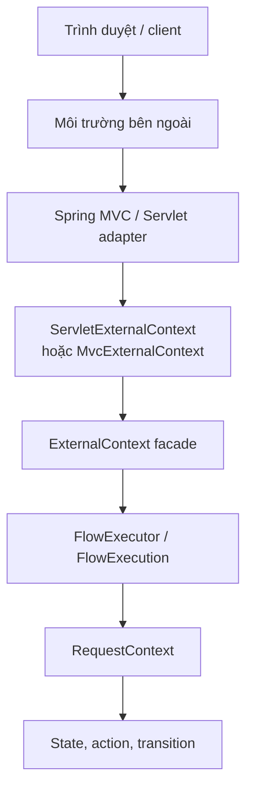

# ExternalContext và ranh giới với môi trường Servlet

Trong **Spring Web Flow**, một flow có thể được gọi từ môi trường web, nhận dữ liệu của request, đọc thông tin người dùng, truy cập session và yêu cầu trình duyệt chuyển hướng. Nếu flow truy cập trực tiếp `HttpServletRequest` hoặc `HttpServletResponse` ở khắp nơi, logic điều hướng sẽ phụ thuộc chặt vào Servlet API và khó kiểm thử độc lập.

`ExternalContext` giải quyết vấn đề đó bằng cách cung cấp một **giao diện chuẩn hóa cho môi trường bên ngoài đã gọi vào flow**. Trong ứng dụng Spring MVC/Servlet, `ServletExternalContext` bọc `ServletContext`, `HttpServletRequest` và `HttpServletResponse`; `MvcExternalContext` bổ sung hành vi phù hợp với Spring MVC. Flow và action có thể dùng facade này để đọc request parameters, session attributes, context path, locale, principal và điều khiển response mà không phải biết mọi chi tiết của container.

Bài học thuộc chương **Kiến trúc thực thi**, tập trung vào `ExternalContext` và ranh giới với môi trường Servlet: phân biệt nó với `RequestContext`, đọc dữ liệu request đúng cách, dùng các map theo đúng phạm vi, truy cập Servlet API khi thật sự cần, xử lý redirect/response, kiểm thử bằng mock context và giữ cho flow có thể kiểm thử độc lập với container.

## 1. ExternalContext là gì?

`ExternalContext` là một **facade** cung cấp cách truy cập đã được chuẩn hóa tới hệ thống bên ngoài gọi Spring Web Flow. Nó đại diện cho ngữ cảnh của một request từ client nhằm thao tác với một flow execution.

Facade này cho phép các thành phần bên trong flow đọc hoặc thao tác những thông tin như:

- Request parameters được gửi từ trình duyệt.
- Request attributes, session attributes và application attributes.
- Context path của ứng dụng.
- Principal của người dùng hiện tại và locale của client.
- Native context, native request và native response của môi trường triển khai.
- Trạng thái Ajax, trạng thái response và các yêu cầu redirect.
- URL tiếp tục flow execution.

`ExternalContext` không phải là một Servlet container mới, cũng không thay thế vòng đời của request/response. Nó **bọc và chuẩn hóa quyền truy cập** vào môi trường gọi vào flow. Trong môi trường khác Servlet, implementation có thể cung cấp những phần không được hỗ trợ bằng map rỗng hoặc `null` theo hợp đồng interface.



Các flow artifact làm việc với `ExternalContext` qua `RequestContext` hiện hành. Adapter của môi trường triển khai chịu trách nhiệm tạo external context thích hợp khi request đi vào Web Flow.

## 2. Phân biệt RequestContext và ExternalContext

Hai tên này thường xuất hiện cùng nhau nhưng đại diện cho **hai ranh giới khác nhau**:

| Khái niệm | `RequestContext` | `ExternalContext` |
| --- | --- | --- |
| Đại diện cho | Một lần gọi vào để thao tác một flow execution | Môi trường client bên ngoài đã tạo ra lần gọi đó |
| Vòng đời | Trong quá trình xử lý một flow request | Gắn với request bên ngoài đang được xử lý |
| Chứa | State hiện tại, event, transition, scope của flow, message context | Request parameters, request/session/application maps, principal, locale, response và native objects |
| Truy cập từ | Action, state, transition criteria, flow artifact | Qua `RequestContext.getExternalContext()` hoặc implicit variable trong EL |
| Có phải Servlet request? | Không | Không nhất thiết; có thể cung cấp native Servlet request nếu triển khai bằng Servlet |

**`RequestContext` không phải `HttpServletRequest`.** Tài liệu API dùng từ “request” để chỉ một lần gọi vào FlowExecution (một lượt xử lý trên thread), không phải một đối tượng HTTP request. `RequestContext` được tạo khi flow được start, resume bằng event hoặc refresh; khi lượt xử lý flow trả về, context nội bộ này hết phạm vi sử dụng.

`RequestContext` cung cấp các phương thức như:

- `getExternalContext()` để lấy facade môi trường bên ngoài.
- `getRequestParameters()` để đọc shortcut tới request parameter map.
- `getRequestScope()`, `getViewScope()`, `getFlowScope()` và `getConversationScope()` để làm việc với scope của Web Flow.
- `getCurrentEvent()`, `getCurrentState()` và `getCurrentTransition()` để biết flow đang xử lý điều gì.
- `getMessageContext()` để ghi nhận thông báo cho view.

Ví dụ:

```java
public Event inspectRequest(RequestContext context) {
    ExternalContext external = context.getExternalContext();

    String campaign = external.getRequestParameterMap()
                              .get("campaign");

    context.getFlowScope().put("campaign", campaign);
    return new Event(this, "success");
}
```

Action nhận `RequestContext` để làm việc với flow execution; từ đó lấy `ExternalContext` khi cần thông tin của client hoặc Servlet environment.

## 3. Các implementation thường gặp

Spring Web Flow 2.5.x có những implementation quan trọng:

| Implementation | Vai trò |
| --- | --- |
| `ExternalContext` | Interface chuẩn hóa |
| `ServletExternalContext` | Bọc môi trường Servlet HTTP |
| `MvcExternalContext` | Kế thừa `ServletExternalContext` và bổ sung chức năng trong môi trường Spring MVC |
| `MockExternalContext` | Implementation giả lập dùng trong unit/flow tests |

### ServletExternalContext

Constructor của `ServletExternalContext` nhận ba đối tượng:

```java
ServletExternalContext(
    ServletContext context,
    HttpServletRequest request,
    HttpServletResponse response
)
```

Có overload nhận thêm `FlowUrlHandler`. Class này cung cấp contextual information về môi trường HTTP Servlet đã tương tác với Spring Web Flow.

### MvcExternalContext

`MvcExternalContext` là subclass của `ServletExternalContext`. Nó ghi đè một số operation để tích hợp chức năng riêng của Spring MVC; ví dụ `getLocale()` trả locale theo môi trường MVC.

Trong ứng dụng Spring MVC, `FlowHandlerAdapter` tạo external context phù hợp cho request hiện tại. Không cần tự tạo `ServletExternalContext` trong từng action hoặc controller thông thường.

### MockExternalContext

`MockExternalContext` không cần Servlet container. Test có thể tạo context, thêm request parameter, đặt principal, locale, context path, session map và đánh dấu request Ajax. Nhờ vậy có thể kiểm tra logic flow/action mà không phải dựng HTTP server.

## 4. Đọc request parameters

`ExternalContext.getRequestParameterMap()` trả về `ParameterMap` chứa các tham số của request đã gọi Web Flow. Map này **immutable**: ứng dụng có thể đọc nhưng không thể thêm hoặc thay đổi tham số thông qua map đó.

`ParameterMap` hỗ trợ đọc chuỗi, mảng nhiều giá trị và chuyển đổi sang kiểu Java phổ biến:

```java
ParameterMap parameters =
    context.getExternalContext().getRequestParameterMap();

String keyword = parameters.get("keyword");
Long bookingId = parameters.getLong("bookingId");
String[] tags = parameters.getArray("tag");
Integer page = parameters.getInteger("page", 1);
```

Có thể dùng shortcut từ `RequestContext`:

```java
ParameterMap parameters = context.getRequestParameters();
String keyword = parameters.get("keyword");
```

Hai cách đọc cùng tập tham số request. `RequestContext.getRequestParameters()` tiện hơn khi code đã có request context; map này cũng là dữ liệu đầu vào immutable.

### Chuyển kiểu và tham số bắt buộc

`ParameterMap` cung cấp các phương thức như `getLong`, `getInteger`, `getBoolean`, `get(name, targetType)`, `getRequiredLong` và `getRequired(name, targetType)`.

Ví dụ:

```java
Long id = parameters.getRequiredLong("bookingId");
Integer quantity = parameters.get("quantity", Integer.class);
String[] selectedRooms = parameters.getRequiredArray("room");
```

Nếu tham số bắt buộc không tồn tại, phương thức `getRequired...` có thể ném `IllegalArgumentException`. Nếu chuỗi không chuyển được sang kiểu đích, conversion có thể ném `ConversionExecutionException`. Vì vậy:

- Chỉ dùng `getRequired...` khi thiếu tham số thực sự là lỗi của request.
- Với dữ liệu người dùng có thể nhập sai, hãy xử lý conversion error như một lỗi đầu vào.
- Không mặc định tham số tồn tại chỉ vì giao diện có input tương ứng.
- Không sửa request parameter map để lưu kết quả xử lý; dùng scope phù hợp của Web Flow.

**Request parameter là dữ liệu đầu vào không đáng tin cậy.** Cần validate định dạng, miền giá trị, quyền truy cập và bất biến nghiệp vụ trước khi sử dụng.

## 5. Request parameters khác request attributes

Đây là một ranh giới quan trọng:

- `getRequestParameterMap()` trả các giá trị client gửi trong query string hoặc form body.
- `getRequestMap()` trả map của **external request attributes** gắn với request, thường là các attribute do Servlet filter, interceptor hoặc thành phần web đặt vào.

Hai map này không phải cùng một tập dữ liệu:

| Dữ liệu | Ví dụ | API |
| --- | --- | --- |
| Query parameter | `?campaign=spring` | `getRequestParameterMap()` |
| Form parameter | `quantity=3` | `getRequestParameterMap()` |
| Servlet request attribute | Attribute do filter đặt trước khi dispatch | `getRequestMap()` |
| Web Flow request scope | Biến tạm trong một lần xử lý flow | `RequestContext.getRequestScope()` |

Ví dụ đọc hai nguồn khác nhau:

```java
ExternalContext external = context.getExternalContext();

String campaign =
    external.getRequestParameterMap().get("campaign");

Object traceId =
    external.getRequestMap().get("traceId");

context.getRequestScope().put("normalizedCampaign",
    campaign == null ? "" : campaign.trim());
```

Ở đây `traceId` là attribute của request bên ngoài, còn `normalizedCampaign` là dữ liệu tạm trong request context nội bộ của Web Flow. Không gán nhầm một map cho map còn lại chỉ vì cả hai đều có chữ “request”.

## 6. Session map, global session map và application map

`ExternalContext` còn cung cấp các map đại diện cho phạm vi của môi trường ngoài:

| API | Phạm vi | Ví dụ sử dụng |
| --- | --- | --- |
| `getSessionMap()` | Session của người dùng hiện tại | Attribute được chia sẻ giữa các request trong session |
| `getGlobalSessionMap()` | Session toàn cục theo abstraction của external context | Dữ liệu session cần truy cập qua global session concept nếu implementation hỗ trợ |
| `getApplicationMap()` | Phạm vi ứng dụng | Attribute cấp ứng dụng được chia sẻ giữa các client |

Trong hầu hết implementation, `getGlobalSessionMap()` và `getSessionMap()` trả cùng một map. Không nên giả định hai map luôn tách biệt.

Ví dụ:

```java
ExternalContext external = context.getExternalContext();

Object cartId = external.getSessionMap().get("cartId");
external.getSessionMap().put("lastVisitedFlow", "checkout");

Object sharedCatalogVersion =
    external.getApplicationMap().get("catalogVersion");
```

Các map này đại diện cho attribute map của môi trường ngoài. Chúng **không phải** các scope nội bộ `flowScope`, `conversationScope` hoặc `viewScope` của Web Flow.

### Chọn đúng nơi lưu

| Nhu cầu | Nơi lưu thường phù hợp |
| --- | --- |
| Giá trị chỉ cần trong một lượt xử lý flow | `RequestContext.getRequestScope()` |
| Dữ liệu của một màn hình | `viewScope` |
| Dữ liệu cần qua nhiều state của cùng flow | `flowScope` |
| Dữ liệu chia sẻ giữa các flow session trong một conversation | `conversationScope` |
| Attribute của Servlet session được ứng dụng khác dùng chung | `ExternalContext.getSessionMap()` |
| Attribute cấp ứng dụng do môi trường web quản lý | `ExternalContext.getApplicationMap()` |

Đừng dùng session map chỉ vì nó tiện truy cập. Dữ liệu đặt trong session có thể sống lâu hơn flow, được chia sẻ bởi nhiều tab/flow và ảnh hưởng đến session replication. Chọn scope theo chủ sở hữu và vòng đời thực tế của dữ liệu.

## 7. Principal và locale của client

`ExternalContext` cung cấp:

- `getCurrentUser()` trả `java.security.Principal` của người dùng hiện tại.
- `getLocale()` trả locale của client.

Ví dụ:

```java
ExternalContext external = context.getExternalContext();

Principal principal = external.getCurrentUser();
String userName = principal == null ? null : principal.getName();

Locale locale = external.getLocale();
```

Trong biểu thức flow:

```xml
<evaluate
    expression="bookingService.createBooking(flowScope.booking, externalContext.currentUser.name)"
    result="flowScope.bookingConfirmation" />
```

Biểu thức này giả định flow chỉ được vào sau khi người dùng đã xác thực. Nếu flow hỗ trợ anonymous user, hãy kiểm tra principal trong action hoặc dùng biểu thức có điều kiện trước khi truy cập thuộc tính `name`.

Nếu ứng dụng cho phép anonymous request, `getCurrentUser()` có thể trả `null`. Không gọi `getName()` mà chưa kiểm tra principal.

**Principal không phải kết quả kiểm tra quyền hoàn chỉnh.** Nó cung cấp danh tính theo hợp đồng của external context; kiểm tra vai trò, quyền truy cập booking, ownership và các quy tắc bảo mật phải do Spring Security/service layer hoặc cơ chế authorization phù hợp thực hiện.

Locale có thể được dùng để chọn định dạng hoặc thông báo. Nếu ứng dụng cần hỗ trợ locale do người dùng chọn trong profile, hãy xác định thứ tự ưu tiên giữa profile, locale resolver và locale của request; không mặc định `getLocale()` luôn phản ánh mọi tùy chọn nghiệp vụ.

## 8. contextPath và URL của flow execution

`getContextPath()` trả **đường dẫn logic tới ứng dụng** đang host external context. Ví dụ ứng dụng được triển khai dưới context path `/shop` thì context path là `/shop`.

Nó không phải:

- URL đầy đủ gồm scheme và host.
- Flow ID.
- Flow execution key.
- Đường dẫn servlet mapping của mọi request.

`ExternalContext.getFlowExecutionUrl(flowId, flowExecutionKey)` tạo URL đã được encode cho execution có key tương ứng. `RequestContext.getFlowExecutionUrl()` trả URL của execution hiện tại, nếu execution đã được gán key.

Ví dụ trong Java:

```java
String contextPath = context.getExternalContext().getContextPath();
String resumeUrl = context.getFlowExecutionUrl();
```

Ví dụ trong view:

```jsp
<form method="post" action="${flowExecutionUrl}">
    <input name="keyword" type="text" />
    <button type="submit" name="_eventId_search">Tìm kiếm</button>
</form>
```

Hãy để Web Flow tạo URL execution theo cấu hình `FlowUrlHandler`; không ghép thủ công context path, flow ID và execution key bằng chuỗi. URL cần phản ánh mapping, encoding và execution key hiện hành.

Nếu cần lấy servlet path hoặc path info mà `ExternalContext` không cung cấp trực tiếp, có thể dùng native request trong một adapter Servlet cụ thể. Giữ phần code phụ thuộc đó ở adapter/web layer thay vì đưa vào mọi action.

## 9. Native context, native request và native response

Khi abstraction không cung cấp một tính năng cần thiết, có thể truy cập object gốc thông qua:

- `getNativeContext()`
- `getNativeRequest()`
- `getNativeResponse()`

Trong ứng dụng Servlet, các giá trị này thường là `ServletContext`, `HttpServletRequest` và `HttpServletResponse` tương ứng.

Ví dụ cần đọc một HTTP header mà interface chuẩn không có method riêng:

```java
import javax.servlet.http.HttpServletRequest;

ExternalContext external = context.getExternalContext();
HttpServletRequest request =
    (HttpServletRequest) external.getNativeRequest();

String correlationId = request.getHeader("X-Correlation-ID");
```

Ví dụ này phụ thuộc Servlet API. Với Spring Web Flow 2.5.x dùng Servlet namespace `javax.servlet`; ở một stack mới hơn, import và loại API phải đồng bộ với phiên bản framework.

### Khi nào nên downcast?

Chỉ downcast khi:

1. Flow chắc chắn chạy trong Servlet environment.
2. Interface chuẩn không có API tương ứng.
3. Code phụ thuộc container được cô lập ở một action/adapter dễ kiểm thử.
4. Test có thể cung cấp native request tương ứng hoặc dùng test MVC thực.

Không nên downcast trong mọi action chỉ để đọc dữ liệu cơ bản như parameter, principal, locale hoặc session map; các API chuẩn đã cung cấp những dữ liệu đó.

**Không giữ native request/response/context trong flowScope hoặc conversationScope.** Chúng gắn với vòng đời request/container, không phải dữ liệu nghiệp vụ bền vững của flow. Không truyền chúng sang background thread hoặc giữ lại sau khi request hoàn tất.

## 10. Điều khiển response và redirect

`ExternalContext` không chỉ đọc request; nó còn biểu diễn trạng thái response và cho phép flow yêu cầu môi trường gọi vào thực hiện redirect:

| API | Ý nghĩa |
| --- | --- |
| `getResponseWriter()` | Lấy writer để ghi response nếu được phép |
| `isResponseAllowed()` | Kiểm tra có được phép ghi render response hay không |
| `isResponseComplete()` | Kiểm tra response đã hoàn tất chưa |
| `recordResponseComplete()` | Ghi nhận flow artifact đã xử lý response |
| `requestFlowExecutionRedirect()` | Yêu cầu redirect tới URL của flow execution |
| `requestFlowDefinitionRedirect(flowId, input)` | Yêu cầu khởi chạy flow definition mới bằng redirect |
| `requestExternalRedirect(location)` | Yêu cầu redirect tới resource tùy ý |
| `requestRedirectInPopup()` | Yêu cầu redirect hiện tại được gửi từ popup |

Các phương thức redirect đánh dấu response complete. Nếu response đã hoàn tất, việc yêu cầu redirect hoặc lấy writer có thể gây `IllegalStateException`.

Ví dụ yêu cầu external redirect từ action:

```java
public Event goToHelp(RequestContext context) {
    ExternalContext external = context.getExternalContext();
    external.requestExternalRedirect("/help/booking");
    return new Event(this, "redirected");
}
```

Đây là ví dụ về API redirect; trong flow thật cần thiết kế state/transition để không tiếp tục render một view khác sau khi response đã được đánh dấu hoàn tất. URL redirect phải được kiểm soát để tránh open redirect. Không lấy URL tùy ý từ request parameter rồi chuyển thẳng vào `requestExternalRedirect`.

### Phân biệt ba kiểu redirect

| Ý định | API |
| --- | --- |
| Refresh/tiếp tục cùng flow execution | `requestFlowExecutionRedirect()` |
| Kết thúc/điều hướng sang một flow definition độc lập mới | `requestFlowDefinitionRedirect(flowId, input)` |
| Đi tới một URL/resource bên ngoài flow | `requestExternalRedirect(location)` |

Chọn loại redirect theo vòng đời execution. Redirect sang flow definition mới không giống việc resume execution hiện tại bằng execution key. `requestExternalRedirect` có thể không được hỗ trợ trong một số external environment; chỉ dùng khi implementation hiện tại hỗ trợ.

`requestRedirectInPopup()` chỉ được gọi sau khi một redirect đã được yêu cầu.

## 11. Ajax request và response lifecycle

`isAjaxRequest()` cho biết request hiện tại có phải asynchronous Ajax request hay không. Trong Servlet environment, adapter có thể xác định trạng thái này và response handling của Web Flow có thể khác với request thông thường.

Ví dụ:

```java
ExternalContext external = context.getExternalContext();

if (external.isAjaxRequest()) {
    // Chọn đường xử lý phù hợp với request Ajax.
}
```

Không nên coi Ajax flag là cơ chế xác thực hoặc bằng chứng rằng client đáng tin cậy. Đây chỉ là thông tin về loại request để điều phối response.

Khi tự ghi response:

1. Kiểm tra response có được phép ghi không.
2. Chọn writer/response mechanism phù hợp.
3. Ghi nội dung đúng một lần.
4. Gọi `recordResponseComplete()` khi flow artifact đã tự xử lý response theo hợp đồng.
5. Không để view renderer hoặc adapter tiếp tục ghi response lần thứ hai.

Trong đa số flow thông thường, để Web Flow view-state, view resolver và FlowHandlerAdapter quản lý render/redirect sẽ an toàn hơn việc tự ghi raw response từ action.

## 12. File upload và multipart parameters

`ParameterMap` có các phương thức để đọc `MultipartFile`:

- `getMultipartFile(name)`
- `getRequiredMultipartFile(name)`
- `getArray(name, MultipartFile.class)` hoặc API tương ứng cho nhiều file

Ví dụ:

```java
ParameterMap parameters =
    context.getExternalContext().getRequestParameterMap();

MultipartFile document =
    parameters.getMultipartFile("document");

if (document != null && !document.isEmpty()) {
    // Chuyển file qua service xử lý upload.
}
```

Việc nhận multipart file còn phụ thuộc cấu hình multipart resolver/Servlet multipart support của ứng dụng. `ExternalContext` cung cấp cách truy cập tham số multipart đã được adapter đưa vào Web Flow; nó không tự cấu hình upload limit, antivirus, storage hay chính sách nội dung file.

Không lưu nguyên `MultipartFile` hoặc request object vào flow scope để dùng ở request sau. File upload thường có vòng đời gắn với request. Hãy lưu file vào storage phù hợp, sau đó giữ file ID, metadata và trạng thái xử lý cần thiết trong flow.

## 13. ExternalContextHolder và ranh giới thread

`ExternalContextHolder` là holder gắn `ExternalContext` hiện tại với thread đang xử lý. Nó có thể được dùng bởi các artifact cần truy cập external context thông qua holder thay vì truyền tham số trực tiếp.

Tuy nhiên, external context **không được kế thừa tự động bởi thread con** được tạo từ thread hiện tại. Vì vậy:

- Không gọi `ExternalContextHolder.getExternalContext()` từ executor/background worker rồi mong nhận context của request cha.
- Không dùng external context sau khi request đã kết thúc.
- Không lưu context vào static field hoặc singleton mutable để dùng giữa các request.
- Ưu tiên truyền dữ liệu cần thiết (ID, principal name, locale, correlation ID) vào tác vụ nền dưới dạng giá trị độc lập.

Ví dụ thiết kế an toàn hơn:

```java
public Event scheduleReport(RequestContext context) {
    ExternalContext external = context.getExternalContext();
    Principal principal = external.getCurrentUser();

    String requestedBy =
        principal == null ? "anonymous" : principal.getName();
    String reportId = reportService.schedule(requestedBy);

    context.getFlowScope().put("reportId", reportId);
    return new Event(this, "scheduled");
}
```

Service chỉ nhận dữ liệu cần thiết để lên lịch. Nó không nhận `HttpServletRequest` hoặc `ExternalContext` để giữ cho công việc nền.

## 14. Dùng ExternalContext trong XML và Java action

Spring Web Flow cung cấp implicit variable `externalContext` trong expression context. Có thể đọc thuộc tính theo cú pháp property trong EL:

```xml
<view-state id="searchForm" view="search/form">
    <transition on="search" to="showResults">
        <set name="flowScope.searchTerm"
             value="externalContext.requestParameterMap.get('q')" />
    </transition>
</view-state>

<view-state id="showResults" view="search/results">
    <on-render>
        <set name="viewScope.locale"
             value="externalContext.locale" />
    </on-render>
</view-state>
```

Trong Java action:

```java
import java.security.Principal;
import java.util.Locale;

import org.springframework.webflow.context.ExternalContext;
import org.springframework.webflow.core.collection.ParameterMap;
import org.springframework.webflow.execution.Event;
import org.springframework.webflow.execution.RequestContext;

public class SearchAction {

    public Event capture(RequestContext context) {
        ExternalContext external = context.getExternalContext();
        ParameterMap parameters = external.getRequestParameterMap();

        String query = parameters.get("q");
        Principal user = external.getCurrentUser();
        Locale locale = external.getLocale();

        context.getFlowScope().put("query", query);
        context.getFlowScope().put(
            "requestedBy", user == null ? null : user.getName());
        context.getFlowScope().put("requestLocale", locale);

        return new Event(this, "captured");
    }
}
```

Ví dụ lưu query và danh tính vào flow scope vì các bước sau cần dùng. Nếu chỉ cần đọc query trong một action, không cần sao chép nó sang scope khác.

Không dùng implicit variable `externalContext` như nơi chứa mọi dữ liệu nghiệp vụ. Nó là cổng truy cập môi trường bên ngoài; dữ liệu của quy trình nên nằm trong flow model/scope thích hợp.

## 15. Kiểm thử bằng MockExternalContext

`MockExternalContext` cho phép tạo request giả lập mà không cần Servlet container:

```java
import java.util.Locale;

import org.springframework.webflow.test.MockExternalContext;

MockExternalContext external = new MockExternalContext();
external.putRequestParameter("bookingId", "42");
external.putRequestParameter("source", "campaign");
external.setCurrentUser("alice");
external.setLocale(Locale.forLanguageTag("vi-VN"));
external.setContextPath("/shop");
external.setAjaxRequest(true);
```

Có thể kiểm tra các giá trị:

```java
assertEquals("42",
    external.getRequestParameterMap().get("bookingId"));
assertEquals("alice", external.getCurrentUser().getName());
assertEquals("/shop", external.getContextPath());
assertTrue(external.isAjaxRequest());
```

Khi cần session map hoặc request map dùng chung trong test, tạo/đặt attribute map tương ứng bằng setter của mock. Mock cũng hỗ trợ native request/response/context setter để test một action có downcast trong trường hợp đặc biệt.

### Kiểm thử flow với MockExternalContext

Spring Web Flow Test support dùng mock external context để start hoặc resume flow:

```java
public void testSearchRequest() {
    MockExternalContext context = new MockExternalContext();
    context.putRequestParameter("q", "spring");
    context.setCurrentUser("alice");

    startFlow(new LocalAttributeMap(), context);

    assertCurrentStateEquals("searchForm");
    assertEquals("spring", getRequiredFlowAttribute("query"));
}
```

Đây là phác thảo theo phong cách test support của Spring Web Flow 2.x; tên helper/assertion và flow fixture phải khớp class test base mà dự án sử dụng.

## 16. MockExternalContext khác MockMvc như thế nào?

Hai công cụ giải quyết hai tầng kiểm thử:

| Công cụ | Điều kiểm tra tốt | Điều không chứng minh đầy đủ |
| --- | --- | --- |
| `MockExternalContext` | Flow logic, action, parameters, principal, locale, scope, Ajax flag và redirect request | Servlet filters, handler mapping, cookie, multipart resolver và HTTP response thật |
| `MockMvc` | Spring MVC mapping, FlowHandlerMapping/Adapter, HTTP parameters, session, status, redirect và filter chain nếu được cấu hình | Không nhất thiết chạy đầy đủ JSP engine hoặc trình duyệt thực |
| Servlet container/browser test | Request/response, cookie, multipart, rendering, redirect và tương tác trình duyệt thực | Chậm hơn, cần môi trường tích hợp |

Nếu mục tiêu là kiểm tra action có đọc đúng `getRequestParameterMap()`, `MockExternalContext` thường đủ. Nếu cần chứng minh request HTTP thật được Spring MVC chuyển vào đúng flow và adapter tạo đúng external context, cần test ở tầng MVC/Servlet.

## 17. Ranh giới bảo mật khi đọc dữ liệu môi trường ngoài

`ExternalContext` giúp đọc thông tin môi trường, nhưng không tự làm dữ liệu trở nên an toàn.

Các nguyên tắc:

1. **Request parameters không đáng tin cậy.** Kiểm tra kiểu, độ dài, giá trị cho phép và quy tắc nghiệp vụ.
2. **Session map không phải nguồn phân quyền.** Không cho phép truy cập booking chỉ vì request có một ID nằm trong session.
3. **Principal có thể vắng mặt.** Xử lý anonymous request và kiểm tra authorization riêng.
4. **Không tin header hoặc URL redirect do client gửi.** Kiểm soát host/path đích và tránh open redirect.
5. **Không giữ request/response object trong flow scope.** Chúng không có vòng đời phù hợp và có thể kéo theo dữ liệu nhạy cảm.
6. **Không ghi toàn bộ parameter/session map vào log.** Có thể chứa dữ liệu cá nhân hoặc token.
7. **CSRF, authentication và authorization vẫn do filter/security/service layer đảm nhiệm.** ExternalContext chỉ cung cấp thông tin để flow phối hợp với các lớp đó.

Đặc biệt, `getCurrentUser()` trả `Principal` không có nghĩa flow có thể bỏ qua kiểm tra quyền ở mỗi thao tác nhạy cảm. Một user hợp lệ vẫn có thể gửi booking ID thuộc người khác.

## 18. Các lỗi thường gặp và cách chẩn đoán

| Triệu chứng | Nguyên nhân có thể | Hướng kiểm tra |
| --- | --- | --- |
| `getExternalContext()` trả context không như mong đợi | Test hoặc adapter tạo external context khác môi trường thật | Kiểm tra FlowHandlerAdapter và implementation đang dùng |
| `getRequestParameterMap()` không có giá trị | Form field name sai, request không gửi parameter hoặc request body chưa được parse | Kiểm tra payload HTTP và parameter map |
| Không thể sửa request parameter map | Map là immutable theo thiết kế | Dùng request attributes hoặc Web Flow scope tùy mục đích |
| `getRequestMap()` không thấy query parameter | Đang đọc request attributes thay vì parameter map | Dùng `getRequestParameterMap()` |
| `getCurrentUser()` là null | Anonymous request hoặc security integration không đặt principal | Kiểm tra authentication và xử lý null |
| Locale khác locale profile | Locale resolver/client request có ưu tiên khác | Xác định chính sách locale của ứng dụng |
| `getNativeRequest()` không phải HttpServletRequest | Test dùng MockExternalContext hoặc môi trường không phải Servlet | Chỉ downcast trong Servlet adapter và cung cấp native request khi test |
| Context path bị lặp trong URL | Tự ghép URL với context path đã được FlowUrlHandler xử lý | Dùng flow execution URL do framework tạo |
| Response ghi hai lần | Action tự ghi response nhưng view/adapter vẫn render | Kiểm tra isResponseComplete và recordResponseComplete |
| Redirect ném IllegalStateException | Response đã hoàn tất hoặc redirect được yêu cầu quá muộn | Kiểm tra thứ tự gọi redirect và response writer |
| ExternalContextHolder trả null trong task nền | Holder gắn với thread request, không truyền sang thread con | Truyền các giá trị cần thiết vào task |
| Upload parameter null | Multipart resolver/Servlet multipart chưa cấu hình hoặc field name sai | Kiểm tra multipart request và resolver |

### Trình tự chẩn đoán

```text
1. Xác định request có thật sự được FlowHandlerAdapter xử lý không.
2. Kiểm tra implementation ExternalContext được tạo.
3. Phân biệt parameter map với request attribute map.
4. Kiểm tra contextPath, session map, principal và locale.
5. Nếu dùng native request, xác nhận đúng Servlet environment.
6. Kiểm tra response complete/redirect state trước khi ghi response.
7. So sánh MockExternalContext test với một HTTP integration test.
```

## 19. Bài thực hành: tách flow khỏi Servlet API

Xây dựng flow `searchCatalog` có màn hình nhập từ khóa, action tìm kiếm và màn hình kết quả.

Yêu cầu:

1. Action nhận `RequestContext` và lấy `ExternalContext` từ context đó.
2. Đọc từ khóa qua `getRequestParameterMap()` hoặc `getRequestParameters()`.
3. Ghi từ khóa đã chuẩn hóa vào `flowScope` vì state kết quả cần sử dụng.
4. Đọc `getCurrentUser()` và xử lý trường hợp anonymous.
5. Đọc locale bằng `getLocale()` để chọn định dạng thông báo.
6. Thêm một Servlet filter đặt request attribute `traceId`; đọc nó qua `getRequestMap()` và so sánh với request parameter.
7. Dùng `MockExternalContext` để kiểm thử query, principal, locale, context path và Ajax flag.
8. Tạo test MVC để xác nhận FlowHandlerAdapter xử lý request thật.
9. Thêm một action redirect ra trang trợ giúp; kiểm tra response không bị render thêm sau khi redirect.
10. Nếu cần đọc header riêng của Servlet, cô lập downcast `getNativeRequest()` trong một adapter và giữ phần logic flow còn lại dùng abstraction.

Tiêu chí hoàn thành: action và flow xử lý được request thông qua `ExternalContext`, không giữ Servlet request/response trong flow state, kiểm thử flow không cần container và kiểm thử MVC xác nhận integration ở ranh giới Servlet.

## 20. Tài liệu tham khảo

- [ExternalContext API — Spring Web Flow 2.5.1](https://docs.spring.io/spring-webflow/docs/2.5.1.RELEASE/api/org/springframework/webflow/context/ExternalContext.html): facade, request/session/application maps, principal, locale, native objects và response/redirect lifecycle.
- [RequestContext API — Spring Web Flow 2.5.1](https://docs.spring.io/spring-webflow/docs/2.5.x/api/org/springframework/webflow/execution/RequestContext.html): ý nghĩa một flow request, scopes, event/state, request parameters và external context.
- [ServletExternalContext API — Spring Web Flow 2.5.x](https://docs.spring.io/spring-webflow/docs/2.5.x/api/org/springframework/webflow/context/servlet/ServletExternalContext.html): adapter bọc ServletContext, HttpServletRequest và HttpServletResponse.
- [MvcExternalContext API — Spring Web Flow 2.5.1](https://docs.spring.io/spring-webflow/docs/2.5.1.RELEASE/api/org/springframework/webflow/mvc/servlet/MvcExternalContext.html): triển khai Spring MVC kế thừa ServletExternalContext.
- [ParameterMap API — Spring Web Flow 2.5.1](https://docs.spring.io/spring-webflow/docs/2.5.x/api/org/springframework/webflow/core/collection/ParameterMap.html): đọc tham số đơn/nhiều giá trị, chuyển kiểu và multipart file.
- [Testing flows — Spring Web Flow 2.5.x](https://docs.spring.io/spring-webflow/docs/2.5.x/reference/html/testing.html): dùng MockExternalContext để kiểm thử flow startup và event handling.

`ExternalContext` là ranh giới giúp Spring Web Flow tiếp cận môi trường bên ngoài mà không buộc mọi flow artifact phụ thuộc trực tiếp vào Servlet API. `RequestContext` đại diện cho một lượt xử lý flow; `ExternalContext` đại diện cho request client và môi trường đã gọi vào. Khi phân biệt rõ parameter map, request attribute map, Web Flow scopes, session map và native Servlet objects, ứng dụng sẽ giữ được ranh giới kiến trúc, dễ kiểm thử và kiểm soát response/redirect đúng vòng đời.
