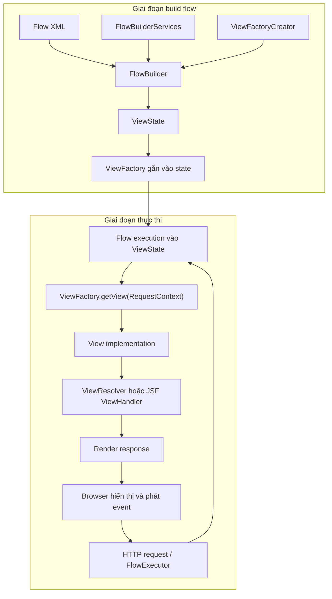
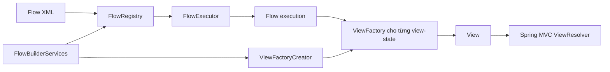

# ViewFactory và việc tạo view

Trong Spring Web Flow, một `view-state` đại diện cho bước mà người dùng nhìn thấy một màn hình và gửi event để tiếp tục hành trình. Flow engine cần biết view nào sẽ được hiển thị, cách tạo hoặc khôi phục view ở request tiếp theo, cách đọc event từ request và cách render view. Phần việc này được tổ chức qua hai abstraction: **`ViewFactoryCreator`** và **`ViewFactory`**.

`ViewFactoryCreator` tham gia khi flow definition được xây dựng. Nó tạo ra một `ViewFactory` cho mỗi `view-state`. Khi flow chạy, `ViewFactory` cung cấp đối tượng `View` phù hợp với request hiện tại. Trong ứng dụng Spring MVC, `MvcViewFactoryCreator` kết nối Web Flow với Spring MVC `ViewResolver`; trong ứng dụng JSF, `JsfViewFactoryCreator` kết nối với vòng đời và component tree của JSF.

Phân biệt hai thời điểm này giúp chẩn đoán các lỗi như view không tìm thấy, template được phân giải sai thư mục, resolver MVC không được Web Flow sử dụng hoặc cấu hình view factory không phù hợp với công nghệ giao diện.

## 1. Mục tiêu học tập

Sau bài học, bạn có thể:

1. Giải thích vai trò của `ViewFactoryCreator`, `ViewFactory` và `View`.
2. Phân biệt thời điểm build flow với thời điểm thực thi flow.
3. Mô tả cách một `view-state` nhận view factory và dùng factory để render view.
4. Hiểu cách Web Flow suy ra view ID từ state ID hoặc nhận view ID qua thuộc tính `view`.
5. Phân biệt flow-relative, absolute và logical view ID.
6. Cấu hình `MvcViewFactoryCreator` với view resolver sẵn có của Spring MVC.
7. Biết khi nào dùng `JsfViewFactoryCreator` trong tích hợp JSF.
8. Tùy chỉnh suffix, event parameter, data binding và message code resolver khi cần.
9. Kiểm tra các lỗi thường gặp trong quá trình phân giải và render view.

## 2. Vị trí của ViewFactory trong kiến trúc thực thi

Một flow XML định nghĩa các state và transition. Với mỗi `view-state`, flow builder cần tạo một đối tượng có thể cung cấp view trong lúc thực thi. `ViewFactoryCreator` là điểm mở rộng để flow builder tạo đối tượng đó mà không phải phụ thuộc trực tiếp vào JSP, Thymeleaf, JSF hay một thư viện view cụ thể.

Sơ đồ dưới đây tách hai giai đoạn:



Ở giai đoạn build, flow builder đọc `view-state`, xác định view ID và gọi `ViewFactoryCreator` để tạo factory. Factory được gắn vào state trong flow definition.

Ở giai đoạn runtime, flow đi vào `view-state` hoặc khôi phục state đang chờ event. Factory cung cấp `View` cho request hiện tại. View implementation xử lý việc render và cách giải mã event theo công nghệ giao diện đang dùng.

## 3. Phân biệt ba abstraction

| Thành phần | Vai trò | Câu hỏi được giải quyết |
| --- | --- | --- |
| `ViewFactoryCreator` | Tạo `ViewFactory` trong lúc build flow | Với công nghệ view này, cần loại factory nào? |
| `ViewFactory` | Tạo hoặc khôi phục `View` theo request context | Ở request hiện tại, view nào cần tham gia flow execution? |
| `View` | Render giao diện và tham gia xử lý event của view-state | Cần gửi response nào và event nào đã được phát? |

### 3.1. ViewFactoryCreator

`ViewFactoryCreator` là SPI (Service Provider Interface) của Web Flow. Nó che giấu chi tiết triển khai view factory khỏi flow builder. Các phương thức quan trọng gồm:

- `createViewFactory(...)`: tạo factory có khả năng cung cấp view cho một view ID.
- `getViewIdByConvention(viewStateId)`: xác định view ID mặc định khi flow không khai báo thuộc tính `view`.

Khi tạo factory, flow builder truyền các thông tin cần thiết như:

- Biểu thức view ID.
- `ExpressionParser` để đánh giá biểu thức.
- `ConversionService` để chuyển đổi/định dạng dữ liệu.
- `BinderConfiguration` mô tả cấu hình binding của view-state.
- Validator và `ValidationHintResolver` dùng cho model validation.

Nhờ nhận các dịch vụ này, factory được tạo ra với cấu hình nhất quán với flow builder services.

### 3.2. ViewFactory

`ViewFactory` là factory cấp runtime. Hợp đồng chính của nó là:

```java
import org.springframework.webflow.execution.RequestContext;
import org.springframework.webflow.execution.View;

public interface ViewFactory {
    View getView(RequestContext context);
}
```

`getView` nhận `RequestContext` của lần thực thi hiện tại và trả về `View` cần render. Factory đóng gói cách tạo hoặc khôi phục view implementation, bao gồm cả việc áp dụng request values để xác định event do người dùng phát ra.

Một view-state giữ `ViewFactory`, không giữ một HTML document cố định. Điều này cho phép Web Flow tạo view phù hợp mỗi lần flow được tiếp tục qua request mới.

### 3.3. View

`View` là abstraction ở gần tầng trình bày hơn. Tùy tích hợp, đó có thể là một Spring MVC view được bọc bởi Web Flow hoặc một JSF view làm việc với `UIViewRoot` và JSF lifecycle.

View có trách nhiệm phối hợp việc render với request context và giải mã event theo công nghệ view. Ví dụ, một Spring MVC view có thể đọc request parameter `_eventId` hoặc `_eventId_submit`; JSF view nhận event qua component/action lifecycle của JSF.

## 4. Khi flow builder tạo ViewFactory

Giả sử flow có hai màn hình:

```xml
<flow xmlns="http://www.springframework.org/schema/webflow"
      xmlns:xsi="http://www.w3.org/2001/XMLSchema-instance"
      xsi:schemaLocation="http://www.springframework.org/schema/webflow
                          https://www.springframework.org/schema/webflow/spring-webflow.xsd">

    <view-state id="enterBookingDetails">
        <transition on="submit" to="reviewBooking" />
    </view-state>

    <view-state id="reviewBooking" view="booking/review">
        <transition on="confirm" to="bookingConfirmed" />
    </view-state>

    <end-state id="bookingConfirmed" />
</flow>
```

Trong lúc build flow:

1. Flow builder đọc `enterBookingDetails`.
2. Vì state không khai báo `view`, builder yêu cầu `ViewFactoryCreator` lấy view ID theo convention từ state ID.
3. Builder gọi `createViewFactory(...)` để tạo factory cho view ID đó.
4. Factory được gắn vào `enterBookingDetails`.
5. Builder đọc `reviewBooking`, lấy view ID tường minh `booking/review`, rồi tạo factory tương ứng.

Như vậy, hai state có thể dùng hai view ID khác nhau nhưng vẫn cùng một loại view factory. Nếu ứng dụng thay công nghệ view, có thể cấu hình creator/resolver mới mà không phải thay đổi logic transition trong flow.

## 5. Cách Web Flow xác định view ID

Một `view-state` có thể lấy view ID theo convention hoặc khai báo tường minh qua thuộc tính `view`.

### 5.1. View ID theo convention

Khi không khai báo `view`, Web Flow dùng ID của view-state làm view ID mặc định:

```xml
<view-state id="enterBookingDetails" />
```

Với `MvcViewFactoryCreator` mặc định, view tương đối được tìm trong thư mục làm việc của flow. Suffix mặc định của `FlowResourceFlowViewResolver` là `.jsp`, vì vậy một flow đặt tại:

```text
/WEB-INF/flows/booking/booking.xml
```

có thể dùng template:

```text
/WEB-INF/flows/booking/enterBookingDetails.jsp
```

Convention giúp flow XML ngắn và dễ đọc khi tên state trùng tên template.

### 5.2. Flow-relative view ID

Thuộc tính `view` có thể chỉ đường dẫn tương đối với thư mục làm việc của flow:

```xml
<view-state id="reviewBooking" view="booking/review.jsp" />
```

Nếu flow nằm trong `/WEB-INF/flows/booking/booking.xml`, đường dẫn trên được hiểu tương đối với thư mục `/WEB-INF/flows/booking/`.

### 5.3. Absolute view ID

Có thể chỉ rõ đường dẫn tuyệt đối trong web application:

```xml
<view-state id="reviewBooking"
            view="/WEB-INF/views/booking/review.jsp" />
```

Cách này hữu ích khi nhiều flow dùng chung view nằm ở thư mục tập trung.

### 5.4. Logical view ID

Khi dùng Spring MVC `ViewResolver`, view ID có thể là tên logic thay vì đường dẫn file:

```xml
<view-state id="reviewBooking" view="booking/review" />
```

Một `InternalResourceViewResolver`, `ThymeleafViewResolver` hoặc resolver khác có thể ánh xạ `booking/review` thành template thực tế. Khi dùng logical ID, phải bảo đảm resolver tương ứng được đưa vào `MvcViewFactoryCreator`.

| Kiểu view ID | Ví dụ | Cách phân giải |
| --- | --- | --- |
| Convention | `id="enterBookingDetails"` | Lấy view ID theo state ID |
| Flow-relative | `view="booking/review.jsp"` | Tương đối với thư mục flow |
| Absolute | `view="/WEB-INF/views/booking/review.jsp"` | Đường dẫn trong web application |
| Logical | `view="booking/review"` | Được Spring MVC `ViewResolver` phân giải |

## 6. MvcViewFactoryCreator trong Spring MVC

`MvcViewFactoryCreator` tạo các view factory sử dụng view system của Spring MVC. Nó là lựa chọn phù hợp khi flow render JSP, Thymeleaf, FreeMarker hoặc một công nghệ view đã tích hợp với Spring MVC.

Theo mặc định, creator có thể phân giải view-relative resources như JSP trong thư mục làm việc của flow. Nó cũng hỗ trợ dùng lại các `ViewResolver` đã được khai báo trong Spring MVC application context.

### 6.1. Dùng view resolver đã có

Giả sử ứng dụng có `ViewResolver` tên `mvcViewResolver`. Có thể nối resolver này vào `MvcViewFactoryCreator`:

```xml
<webflow:flow-registry id="flowRegistry"
                       flow-builder-services="flowBuilderServices">
    <webflow:flow-location
        path="/WEB-INF/flows/booking/booking.xml" />
</webflow:flow-registry>

<webflow:flow-builder-services
    id="flowBuilderServices"
    view-factory-creator="mvcViewFactoryCreator" />

<bean id="mvcViewFactoryCreator"
      class="org.springframework.webflow.mvc.builder.MvcViewFactoryCreator">
    <property name="viewResolvers">
        <list>
            <ref bean="mvcViewResolver" />
        </list>
    </property>
</bean>
```

Điểm quan trọng là `flow-registry` tham chiếu đúng `flow-builder-services`. Nếu chỉ khai báo bean `MvcViewFactoryCreator` nhưng không đưa nó vào dịch vụ build flow mà registry sử dụng, flow vẫn có thể được build bằng creator mặc định.

Khi có nhiều Spring MVC view resolver, truyền chúng theo thứ tự ưu tiên mong muốn. Creator sẽ lần lượt dùng chuỗi resolver đó để phân giải view ID.

### 6.2. Cấu hình bằng Java

Với Java configuration, có thể tạo creator và đưa nó vào `FlowBuilderServices`:

```java
import java.util.List;

import org.springframework.context.annotation.Bean;
import org.springframework.context.annotation.Configuration;
import org.springframework.web.servlet.ViewResolver;
import org.springframework.webflow.definition.registry.FlowDefinitionRegistry;
import org.springframework.webflow.config.AbstractFlowConfiguration;
import org.springframework.webflow.engine.builder.ViewFactoryCreator;
import org.springframework.webflow.engine.builder.support.FlowBuilderServices;
import org.springframework.webflow.mvc.builder.MvcViewFactoryCreator;

@Configuration
public class BookingFlowConfiguration extends AbstractFlowConfiguration {

    @Bean
    public ViewFactoryCreator mvcViewFactoryCreator(
            ViewResolver mvcViewResolver) {

        MvcViewFactoryCreator creator = new MvcViewFactoryCreator();
        creator.setViewResolvers(List.of(mvcViewResolver));
        return creator;
    }

    @Bean
    public FlowBuilderServices flowBuilderServices(
            ViewFactoryCreator mvcViewFactoryCreator) {

        return getFlowBuilderServicesBuilder()
                .setViewFactoryCreator(mvcViewFactoryCreator)
                .build();
    }

    @Bean
    public FlowDefinitionRegistry flowRegistry(
            FlowBuilderServices flowBuilderServices) {

        return getFlowDefinitionRegistryBuilder(flowBuilderServices)
                .addFlowLocation("/WEB-INF/flows/booking/booking.xml")
                .build();
    }
}
```

`FlowBuilderServices` là tập dịch vụ dùng trong lúc xây dựng flow. Ở đây, registry được tạo bằng chính `FlowBuilderServices` có `MvcViewFactoryCreator`, nên các view-state trong flow được cấu hình theo resolver đã chọn.

Ứng dụng vẫn cần khai báo `FlowExecutor` và tích hợp HTTP adapter/mapping theo cấu hình Spring Web Flow thông thường. `FlowExecutor` điều khiển flow execution ở runtime; nó không thay thế nhiệm vụ tạo view factory của flow builder.

## 7. Các tùy chọn thường dùng của MvcViewFactoryCreator

Không phải ứng dụng nào cũng cần tùy chỉnh mọi thuộc tính. Hãy bắt đầu bằng resolver hiện có và chỉ cấu hình thêm khi có yêu cầu cụ thể.

| Thuộc tính/phương thức | Ý nghĩa | Khi nào cần |
| --- | --- | --- |
| `setViewResolvers(...)` | Đặt chuỗi Spring MVC `ViewResolver` | Dùng logical view ID hoặc tái sử dụng resolver của ứng dụng |
| `setDefaultViewSuffix(...)` | Đổi suffix mặc định của flow-relative resource; mặc định `.jsp` | Template convention dùng `.html`, `.ftl` hoặc suffix khác |
| `setFlowViewResolver(...)` | Cung cấp `FlowViewResolver` tùy chỉnh | Cần kiểm soát đầy đủ cách Web Flow tìm `View` |
| `setUseSpringBeanBinding(true)` | Dùng Spring `BeanWrapper` cho data binding | Muốn dùng cơ chế binding của Spring MVC |
| `setEventIdParameterName(...)` | Đổi tên request parameter chứa event ID; mặc định `_eventId` | View/client dùng giao thức event parameter riêng |
| `setFieldMarkerPrefix(...)` | Đặt prefix cho marker của field rỗng; mặc định `_` | Tùy biến cách nhận biết checkbox/field rỗng |
| `setMessageCodesResolver(...)` | Tùy chỉnh cách tạo message code cho binding/validation errors | Muốn đồng nhất message code với Spring MVC controller |

`setUseSpringBeanBinding(true)` là tùy chọn, không phải điều kiện bắt buộc để dùng Spring MVC view. Mặc định của thuộc tính này là `false`; khi bật, Web Flow dùng Spring `BeanWrapper` cho binding.

Nếu không cấu hình `MessageCodesResolver`, Web Flow dùng `WebFlowMessageCodesResolver`. Có thể cung cấp `DefaultMessageCodesResolver` nếu muốn quy tắc message code nhất quán với Spring MVC controllers.

## 8. FlowBuilderServices và FlowRegistry

`ViewFactoryCreator` không được cấu hình trực tiếp trên từng request. Nó là một trong các dịch vụ được flow builder sử dụng khi dựng flow definition.

Các dịch vụ build flow có thể gồm:

- `ConversionService`: chuyển đổi kiểu dữ liệu khi xử lý input, action result và binding.
- `ExpressionParser`: đánh giá biểu thức trong flow definition.
- `ViewFactoryCreator`: tạo factory cho view-state.
- Validator và `ValidationHintResolver`: hỗ trợ validation model.

`FlowRegistry` quản lý các flow definition đã đăng ký. Khi registry được tạo, nó dùng `FlowBuilderServices` để build các flow từ XML hoặc nguồn định nghĩa khác.

`FlowExecutor` là dịch vụ trung tâm thực thi flow. Trong một ứng dụng Spring MVC, `FlowHandlerMapping` và `FlowHandlerAdapter`/`FlowController` định tuyến HTTP request tới executor. Các thành phần này làm việc ở runtime sau khi flow definition đã được xây dựng.



Khi `flow-builder-services` không được khai báo, Web Flow sử dụng các dịch vụ mặc định. Khi khai báo `flow-builder-services`, chỉ cần tham chiếu những dịch vụ muốn thay đổi; các dịch vụ còn lại tiếp tục dùng mặc định.

## 9. JSF sử dụng JsfViewFactoryCreator

JSF không phân giải view bằng Spring MVC `ViewResolver`. Nó có component tree, `FacesContext`, `ViewHandler` và lifecycle riêng. Vì vậy, tích hợp JSF dùng `JsfViewFactoryCreator` để tạo JSF-specific `ViewFactory`.

Trong cấu hình JSF, `JsfViewFactoryCreator` là creator mặc định của JSF-specific `FlowBuilderServicesBuilder`. Có thể chỉ định rõ creator nếu muốn thể hiện cấu hình:

```java
import org.springframework.context.annotation.Bean;
import org.springframework.context.annotation.Configuration;
import org.springframework.faces.config.AbstractFacesFlowConfiguration;
import org.springframework.faces.webflow.JsfViewFactoryCreator;
import org.springframework.webflow.engine.builder.support.FlowBuilderServices;

@Configuration
public class FacesFlowConfiguration extends AbstractFacesFlowConfiguration {

    @Bean
    public FlowBuilderServices flowBuilderServices() {
        return getFlowBuilderServicesBuilder()
                .setViewFactoryCreator(new JsfViewFactoryCreator())
                .build();
    }
}
```

`JsfViewFactoryCreator` tạo `JsfViewFactory`, còn factory này cung cấp JSF-specific `View`. Nó phối hợp với JSF lifecycle để khôi phục view và xử lý component events.

Trong ứng dụng JSF đầy đủ, còn cần cấu hình `FlowFacesContextLifecycleListener` cho flow executor và dùng `JsfFlowHandlerAdapter` để tích hợp request. Đoạn code trên chỉ minh họa việc chọn creator trong flow builder services.

Không đưa `MvcViewFactoryCreator` vào flow chạy trên JSF chỉ vì ứng dụng cũng có Spring MVC bean. Hãy chọn creator phù hợp với công nghệ view thực sự được flow sử dụng.

## 10. Tạo view theo từng request

Sau khi flow definition đã có `ViewFactory`, runtime sử dụng factory khi state cần hiển thị view.

Một chu trình đơn giản:

1. Người dùng mở flow; flow chuyển vào view-state đầu tiên.
2. View-state yêu cầu factory cung cấp `View` cho `RequestContext`.
3. View được render bằng công nghệ giao diện đã cấu hình.
4. Browser gửi request tiếp theo với event do người dùng chọn.
5. View implementation giải mã event và trả event cho flow execution.
6. Flow xử lý binding/validation/action và transition.
7. Nếu flow vẫn ở view-state hiện tại, factory cung cấp view cho lần render tiếp theo; nếu flow chuyển state, factory của state mới được sử dụng.

Với Spring MVC, view implementation phối hợp với `ViewResolver` và `View` của Spring MVC. Với JSF, `JsfViewFactory` làm việc với JSF view/lifecycle. Flow engine không cần biết chi tiết về template engine hoặc component library.

### 10.1. View-state có thể render nhiều lần

Một view-state có thể được render ban đầu, sau đó render lại sau event hoặc Ajax request. Vì vậy, `ViewFactory` phải hỗ trợ khôi phục view và xử lý request tiếp theo của cùng flow execution.

Ví dụ, state tìm kiếm có thể giữ `searchCriteria` trong `viewScope`. Khi người dùng nhấn Next, event làm thay đổi trang kết quả và view được render lại. Factory cung cấp view tương ứng với state hiện tại để trình bày dữ liệu mới.

### 10.2. View ID và event ID là hai khái niệm khác nhau

- View ID chỉ ra template hoặc logical view cần render, ví dụ `booking/review`.
- Event ID chỉ ra thao tác người dùng vừa phát, ví dụ `confirm`.

Đổi view ID không tự đổi transition. Tương tự, đổi tên event parameter không làm template được phân giải sang một file khác.

## 11. Ví dụ hoàn chỉnh: flow đặt phòng dùng Spring MVC resolver

Giả sử ứng dụng dùng `InternalResourceViewResolver` để render JSP. Flow định nghĩa hai màn hình:

```xml
<flow xmlns="http://www.springframework.org/schema/webflow"
      xmlns:xsi="http://www.w3.org/2001/XMLSchema-instance"
      xsi:schemaLocation="http://www.springframework.org/schema/webflow
                          https://www.springframework.org/schema/webflow/spring-webflow.xsd">

    <view-state id="enterBookingDetails"
                view="booking/enterBookingDetails">
        <transition on="submit" to="reviewBooking" />
    </view-state>

    <view-state id="reviewBooking"
                view="booking/reviewBooking">
        <transition on="confirm" to="bookingConfirmed" />
        <transition on="revise" to="enterBookingDetails" />
    </view-state>

    <end-state id="bookingConfirmed" />
</flow>
```

Resolver MVC:

```xml
<bean id="mvcViewResolver"
      class="org.springframework.web.servlet.view.InternalResourceViewResolver">
    <property name="prefix" value="/WEB-INF/jsp/" />
    <property name="suffix" value=".jsp" />
</bean>
```

`MvcViewFactoryCreator` dùng resolver đó:

```xml
<bean id="mvcViewFactoryCreator"
      class="org.springframework.webflow.mvc.builder.MvcViewFactoryCreator">
    <property name="viewResolvers">
        <list>
            <ref bean="mvcViewResolver" />
        </list>
    </property>
</bean>
```

Khi flow yêu cầu logical view ID `booking/enterBookingDetails`, resolver ánh xạ nó thành:

```text
/WEB-INF/jsp/booking/enterBookingDetails.jsp
```

Tương tự, `booking/reviewBooking` được ánh xạ thành `/WEB-INF/jsp/booking/reviewBooking.jsp`.

Trong ví dụ này, `view-state` không cần biết prefix hoặc suffix của resolver. Flow chỉ giữ logical view ID; Spring MVC chịu trách nhiệm tìm template vật lý.

## 12. Khi nào cần viết ViewFactoryCreator tùy chỉnh?

Hầu hết ứng dụng nên dùng `MvcViewFactoryCreator` hoặc `JsfViewFactoryCreator` đã có. Chỉ cần tự triển khai `ViewFactoryCreator` khi công nghệ view không được hỗ trợ bởi các tích hợp sẵn, hoặc khi ứng dụng có quy tắc tạo/khôi phục view riêng.

Một implementation tùy chỉnh phải giải quyết ít nhất hai việc:

1. Chọn view ID mặc định từ state ID khi flow không chỉ định `view`.
2. Tạo `ViewFactory` từ view ID và các dịch vụ build flow được truyền vào.

Ví dụ skeleton để thấy vị trí mở rộng:

Đoạn code sau là skeleton SPI; import và phần triển khai nội bộ của `CustomViewFactory` được lược bỏ vì phụ thuộc công nghệ view mà ứng dụng chọn.

```java
public class CustomViewFactoryCreator implements ViewFactoryCreator {

    @Override
    public String getViewIdByConvention(String viewStateId) {
        return "custom/" + viewStateId;
    }

    @Override
    public ViewFactory createViewFactory(
            Expression viewId,
            ExpressionParser expressionParser,
            ConversionService conversionService,
            BinderConfiguration binderConfiguration,
            Validator validator,
            ValidationHintResolver validationHintResolver) {

        // Tạo factory phù hợp với công nghệ view của ứng dụng.
        // Factory sẽ cung cấp View thông qua getView(RequestContext).
        return new CustomViewFactory(
                viewId,
                expressionParser,
                conversionService,
                binderConfiguration,
                validator,
                validationHintResolver);
    }
}
```

`CustomViewFactory` ở đây là lớp do ứng dụng tự triển khai, không phải class có sẵn trong Spring Web Flow. Trong triển khai thật, factory phải xử lý việc tạo/khôi phục view, render response và giải mã event theo hợp đồng của `View`.

Nếu chỉ cần thay cách phân giải tên view trong Spring MVC, hãy cân nhắc `setViewResolvers(...)` hoặc `setFlowViewResolver(...)` trước khi viết một creator hoàn toàn mới.

## 13. Kiểm thử cấu hình tạo view

Có thể chia kiểm thử thành hai lớp:

**Kiểm thử flow execution**

- Flow definition được registry load thành công.
- View-state bắt đầu đúng state.
- Event được xử lý và transition tới state dự kiến.
- Model/binding/validation của view-state vẫn hoạt động sau khi thay creator.

`AbstractXmlFlowExecutionTests` phù hợp để kiểm thử flow XML và các chuyển trạng thái. Tuy nhiên, một test execution đơn giản chưa chứng minh `ViewResolver` thật sự render đúng template.

**Kiểm thử tích hợp view**

- Nạp Spring application context với `FlowBuilderServices`, registry và resolver thực tế.
- Gửi request tới flow qua adapter/mapping.
- Xác minh logical view ID được ánh xạ tới đúng template.
- Xác minh response chứa nội dung của view mong đợi.
- Gửi event từ view và xác minh flow tiếp tục đúng state.

Nếu dùng JSF, kiểm thử thêm JSF lifecycle và view restoration. Nếu dùng Ajax/fragment, kiểm tra response fragment và DOM target ở tầng browser; không chỉ kiểm tra state của flow.

## 14. Lỗi thường gặp khi tạo và phân giải view

| Triệu chứng | Nguyên nhân thường gặp | Cách kiểm tra hoặc sửa |
| --- | --- | --- |
| Flow báo không tìm thấy view | View ID theo convention không khớp tên template | Kiểm tra state ID, flow directory và suffix |
| Template tồn tại nhưng Web Flow không tìm thấy | Flow dùng flow-relative ID nhưng file nằm ở thư mục khác | Dùng đúng đường dẫn tương đối hoặc absolute ID |
| MVC controller render được nhưng flow không render | Flow builder không dùng resolver của MVC | Đưa resolver vào `MvcViewFactoryCreator` |
| Đã khai báo creator nhưng không có hiệu lực | `flow-registry` không tham chiếu `flow-builder-services` chứa creator đó | Kiểm tra `flow-builder-services` của registry |
| Logical view ID bị coi là đường dẫn resource | Chưa cấu hình `ViewResolver` chain | Dùng `setViewResolvers(...)` hoặc view ID dạng resource |
| Resolver chọn nhầm template | Có nhiều resolver và thứ tự không phù hợp | Sắp xếp resolver theo thứ tự ưu tiên |
| JSP được tìm với suffix sai | `defaultViewSuffix` không phù hợp hoặc resolver prefix/suffix sai | Kiểm tra cấu hình suffix và đường dẫn |
| Binding khác hành vi Spring MVC | `useSpringBeanBinding` chưa được bật trong khi ứng dụng kỳ vọng `BeanWrapper` | Kiểm tra `setUseSpringBeanBinding(true)` |
| Message code khác controller MVC | Web Flow đang dùng `WebFlowMessageCodesResolver` mặc định | Cấu hình `DefaultMessageCodesResolver` nếu cần cùng quy tắc |
| JSF view không khôi phục đúng | Dùng MVC creator/resolver cho flow JSF | Dùng `JsfViewFactoryCreator` và JSF integration |
| View render đúng lần đầu nhưng lỗi khi postback | View factory/view implementation không xử lý đúng việc khôi phục view hoặc giải mã event | Kiểm tra request event và lifecycle của view technology |
| View ID trong flow sai chính tả | Thuộc tính `view` không khớp logical name hoặc resource | Kiểm tra view ID và mapping của resolver |

## 15. Bài tập thực hành

Tạo flow `support-request` gồm ba màn hình:

1. `enterContactDetails`: nhập email và thông tin liên hệ.
2. `describeIssue`: mô tả vấn đề.
3. `reviewRequest`: xem lại và gửi yêu cầu.

Yêu cầu:

- Dùng convention cho `enterContactDetails`.
- Dùng flow-relative view ID cho `describeIssue`.
- Dùng logical view ID `support/review` cho `reviewRequest`.
- Cấu hình `MvcViewFactoryCreator` với một Spring MVC `ViewResolver`.
- Nối creator vào `FlowBuilderServices` và registry.
- Xác minh resolver ánh xạ đúng cả ba view.
- Thử đổi suffix mặc định và quan sát view ID theo convention thay đổi ra sao.
- Viết integration test kiểm tra response của từng view và event chuyển state.

**Câu hỏi tự kiểm tra:**

- `ViewFactoryCreator` được gọi ở giai đoạn build flow hay mỗi lần HTTP request?
- Vì sao `ViewFactory` nhận `RequestContext` khi tạo view?
- Khi nào nên dùng logical view ID thay cho đường dẫn JSP?
- `MvcViewFactoryCreator` khác `JsfViewFactoryCreator` ở điểm nào?
- Nếu `FlowRegistry` không dùng `FlowBuilderServices` đã cấu hình, điều gì xảy ra?
- Vì sao flow execution test chưa đủ để chứng minh template đã được render đúng?

## 16. Checklist cấu hình ViewFactory

- [ ] Mỗi `view-state` có view ID hợp lệ theo convention hoặc thuộc tính `view`.
- [ ] Đã xác định view ID là flow-relative, absolute hay logical.
- [ ] `ViewFactoryCreator` phù hợp với công nghệ view của ứng dụng.
- [ ] Nếu dùng Spring MVC, resolver cần thiết được đưa vào `MvcViewFactoryCreator`.
- [ ] Resolver được sắp xếp đúng thứ tự nếu có nhiều resolver.
- [ ] `FlowRegistry` sử dụng `FlowBuilderServices` chứa creator mong muốn.
- [ ] Suffix mặc định phù hợp với template khi dùng flow-relative resources.
- [ ] Data binding, conversion và validator được truyền qua cấu hình build flow phù hợp.
- [ ] Nếu dùng JSF, flow được build với `JsfViewFactoryCreator`/JSF integration.
- [ ] Có integration test xác minh view thực tế được phân giải và render.

## 17. Ghi nhớ

- `ViewFactoryCreator` là SPI được flow builder dùng để tạo `ViewFactory` cho các `view-state`.
- `ViewFactory` cung cấp `View` theo `RequestContext`; nó đóng gói việc tạo/khôi phục view và giải mã event.
- `View` là abstraction render giao diện theo công nghệ view cụ thể.
- `view-state` dùng state ID làm view ID theo convention nếu không khai báo `view`.
- View ID có thể là flow-relative path, absolute path hoặc logical name do Spring MVC `ViewResolver` phân giải.
- `MvcViewFactoryCreator` kết nối flow với Spring MVC view system; `JsfViewFactoryCreator` dùng JSF view/lifecycle.
- `FlowBuilderServices` chứa `ViewFactoryCreator` và các dịch vụ build flow khác; `FlowRegistry` phải dùng đúng builder services đó.
- `FlowExecutor` điều khiển flow ở runtime; nó không thay thế nhiệm vụ tạo view factory lúc build flow.
- Chỉ viết creator tùy chỉnh khi các creator/resolver tích hợp sẵn không đáp ứng công nghệ view của ứng dụng.
- Kiểm thử cần xác minh cả flow transition lẫn template/view được render thật.

### Tài liệu tham khảo

- [Spring Web Flow 3.0.2 Reference Guide — Rendering Views](https://docs.spring.io/spring-webflow/docs/3.0.2/reference/#_rendering_views)
- [Spring Web Flow 3.0.2 Reference Guide — Configuring Custom FlowBuilder Services](https://docs.spring.io/spring-webflow/docs/3.0.2/reference/#_configuring_custom_flowbuilder_services)
- [Spring Web Flow 3.0.2 Reference Guide — Spring MVC View Resolution](https://docs.spring.io/spring-webflow/docs/3.0.2/reference/#_view_resolution)
- [Spring Web Flow 3.0.1 API — MvcViewFactoryCreator](https://docs.spring.io/spring-webflow/docs/3.0.1/api/org/springframework/webflow/mvc/builder/MvcViewFactoryCreator.html)
- [Spring Web Flow 3.0.1 API — JsfViewFactoryCreator](https://docs.spring.io/spring-webflow/docs/3.0.1/api/org/springframework/faces/webflow/JsfViewFactoryCreator.html)
- [Spring Web Flow 3.0.0 API — ViewFactory](https://docs.spring.io/spring-webflow/docs/3.0.0/api/org/springframework/webflow/execution/ViewFactory.html)
- [Spring Web Flow 3.0.2 API — ViewFactoryCreator](https://docs.spring.io/spring-webflow/docs/3.0.2/api/org/springframework/webflow/engine/builder/ViewFactoryCreator.html)
